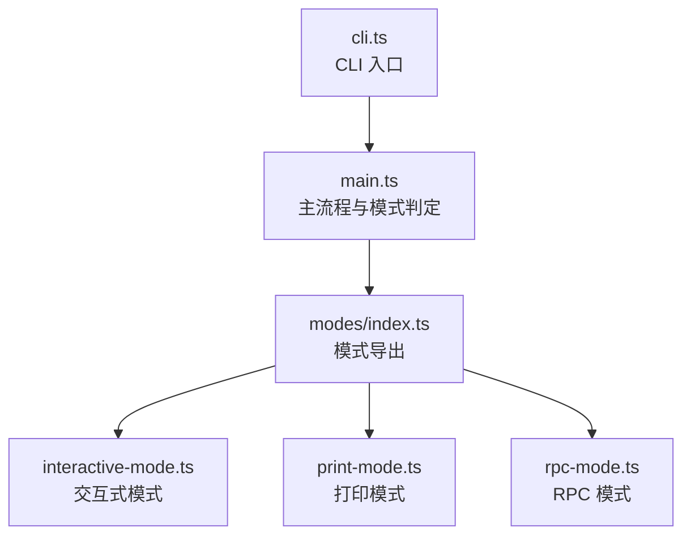
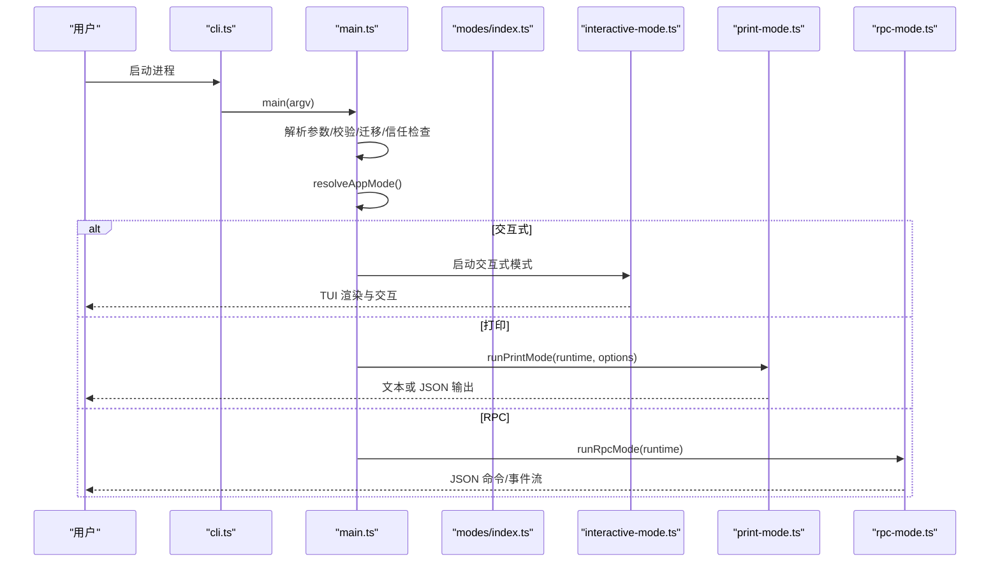
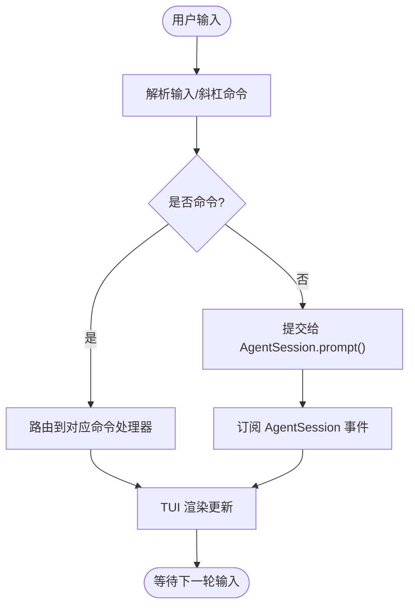
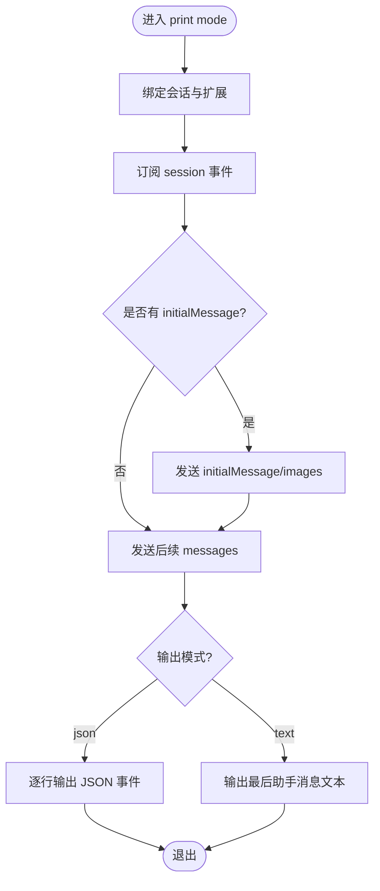
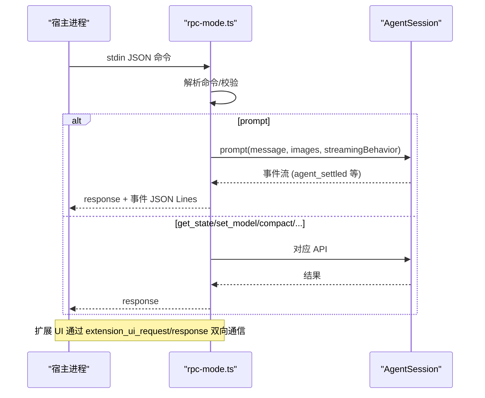
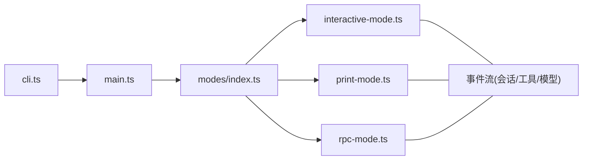

# 运行模式与事件处理

<cite>
**本文引用的文件**   
- [README.md](https://github.com/FDE-GROUP/oh-my-coding-agent/blob/omca/README.md)
- [package.json](https://github.com/FDE-GROUP/oh-my-coding-agent/blob/omca/package.json)
- [cli.ts](https://github.com/FDE-GROUP/oh-my-coding-agent/blob/omca/packages/coding-agent/src/cli.ts)
- [main.ts](https://github.com/FDE-GROUP/oh-my-coding-agent/blob/omca/packages/coding-agent/src/main.ts)
- [modes/index.ts](https://github.com/FDE-GROUP/oh-my-coding-agent/blob/omca/packages/coding-agent/src/modes/index.ts)
- [interactive-mode.ts](https://github.com/FDE-GROUP/oh-my-coding-agent/blob/omca/packages/coding-agent/src/modes/interactive/interactive-mode.ts)
- [print-mode.ts](https://github.com/FDE-GROUP/oh-my-coding-agent/blob/omca/packages/coding-agent/src/modes/print-mode.ts)
- [rpc-mode.ts](https://github.com/FDE-GROUP/oh-my-coding-agent/blob/omca/packages/coding-agent/src/modes/rpc/rpc-mode.ts)
</cite>

## 目录
1. [引言](#引言)
2. [项目结构](#项目结构)
3. [核心组件](#核心组件)
4. [架构总览](#架构总览)
5. [详细组件分析](#详细组件分析)
6. [依赖关系分析](#依赖关系分析)
7. [性能考量](#性能考量)
8. [故障排查指南](#故障排查指南)
9. [结论](#结论)

## 引言
本文聚焦于 Pi 编码代理的运行模式与事件处理机制，围绕 CLI 入口、应用模式判定、三种运行模式（交互式、打印、RPC）以及事件流在进程内的流转进行系统化说明。目标是帮助读者理解从命令行参数到会话执行、再到事件输出的完整链路，并掌握在不同模式下如何消费或扩展事件。

## 项目结构
本仓库为多包工作区，CLI 与运行时位于 packages/coding-agent 下。关键路径如下：
- CLI 入口：packages/coding-agent/src/cli.ts
- 主流程与模式选择：packages/coding-agent/src/main.ts
- 模式导出与类型：packages/coding-agent/src/modes/index.ts
- 交互模式实现：packages/coding-agent/src/modes/interactive/interactive-mode.ts
- 打印模式实现：packages/coding-agent/src/modes/print-mode.ts
- RPC 模式实现：packages/coding-agent/src/modes/rpc/rpc-mode.ts

**图示来源**
- [cli.ts:1-7](https://github.com/FDE-GROUP/oh-my-coding-agent/blob/omca/packages/coding-agent/src/cli.ts#L1-L7)
- [main.ts:115-130](https://github.com/FDE-GROUP/oh-my-coding-agent/blob/omca/packages/coding-agent/src/main.ts#L115-L130)
- [modes/index.ts:1-17](https://github.com/FDE-GROUP/oh-my-coding-agent/blob/omca/packages/coding-agent/src/modes/index.ts#L1-L17)

**章节来源**
- [README.md:72-84](https://github.com/FDE-GROUP/oh-my-coding-agent/blob/omca/README.md#L72-L84)
- [package.json:1-11](https://github.com/FDE-GROUP/oh-my-coding-agent/blob/omca/package.json#L1-L11)
- [cli.ts:1-7](https://github.com/FDE-GROUP/oh-my-coding-agent/blob/omca/packages/coding-agent/src/cli.ts#L1-L7)

## 核心组件
- CLI 启动器：负责初始化 CLI 环境并调用主函数。
- 主流程控制器：解析参数、决定运行模式、准备会话与运行时、分发到具体模式。
- 模式层：
  - 交互式模式：基于 TUI 的终端交互，渲染消息、工具执行、模型切换等。
  - 打印模式：一次性任务，输出最终文本或 JSON 事件流。
  - RPC 模式：无头进程，通过 stdin/stdout 的 JSON 协议与外部宿主通信。

**章节来源**
- [cli.ts:1-7](https://github.com/FDE-GROUP/oh-my-coding-agent/blob/omca/packages/coding-agent/src/cli.ts#L1-L7)
- [main.ts:115-130](https://github.com/FDE-GROUP/oh-my-coding-agent/blob/omca/packages/coding-agent/src/main.ts#L115-L130)
- [modes/index.ts:1-17](https://github.com/FDE-GROUP/oh-my-coding-agent/blob/omca/packages/coding-agent/src/modes/index.ts#L1-L17)

## 架构总览
下图展示从 CLI 到运行模式的控制流，以及各模式对 AgentSessionRuntime 和事件的统一使用方式。

**图示来源**
- [cli.ts:1-7](https://github.com/FDE-GROUP/oh-my-coding-agent/blob/omca/packages/coding-agent/src/cli.ts#L1-L7)
- [main.ts:115-130](https://github.com/FDE-GROUP/oh-my-coding-agent/blob/omca/packages/coding-agent/src/main.ts#L115-L130)
- [modes/index.ts:1-17](https://github.com/FDE-GROUP/oh-my-coding-agent/blob/omca/packages/coding-agent/src/modes/index.ts#L1-L17)

## 详细组件分析

### CLI 入口与主流程
- cli.ts 仅做最小化初始化后调用 main。
- main.ts 承担以下职责：
  - 解析参数、环境变量与离线模式。
  - 处理 auth、mcp、package/config 等子命令。
  - 根据 TTY 状态与显式标志决定应用模式。
  - 创建 SessionManager、ProjectTrustStore 等运行时前置资源。
  - 将控制权交给对应模式。

关键点：
- 应用模式判定逻辑集中在 resolveAppMode，依据 --mode、--print、TTY 等条件返回 rpc/json/print/interactive。
- 非交互模式会接管 stdout 以保证事件输出稳定。

**章节来源**
- [cli.ts:1-7](https://github.com/FDE-GROUP/oh-my-coding-agent/blob/omca/packages/coding-agent/src/cli.ts#L1-L7)
- [main.ts:115-130](https://github.com/FDE-GROUP/oh-my-coding-agent/blob/omca/packages/coding-agent/src/main.ts#L115-L130)
- [main.ts:621-716](https://github.com/FDE-GROUP/oh-my-coding-agent/blob/omca/packages/coding-agent/src/main.ts#L621-L716)

### 模式层导出
- modes/index.ts 统一导出 InteractiveMode、runPrintMode、runRpcMode 及相关类型，供上层按模式调用。

**章节来源**
- [modes/index.ts:1-17](https://github.com/FDE-GROUP/oh-my-coding-agent/blob/omca/packages/coding-agent/src/modes/index.ts#L1-L17)

### 交互式模式（Interactive Mode）
- 负责 TUI 渲染、键盘输入、斜杠命令、模型/设置选择、工具执行可视化、会话分享等。
- 内部维护大量 UI 组件与状态指示器，并通过 AgentSession 驱动业务逻辑。
- 典型行为包括：
  - 监听用户输入，路由到 /settings、/model、/thinking、/export、/import、/share、/bug 等命令。
  - 与主题系统、键绑定、自动补全、Markdown 渲染集成。
  - 与扩展系统对接，提供编辑器、对话框、状态栏等能力。

**图示来源**
- [interactive-mode.ts:3290-3334](https://github.com/FDE-GROUP/oh-my-coding-agent/blob/omca/packages/coding-agent/src/modes/interactive/interactive-mode.ts#L3290-L3334)

**章节来源**
- [interactive-mode.ts:1-200](https://github.com/FDE-GROUP/oh-my-coding-agent/blob/omca/packages/coding-agent/src/modes/interactive/interactive-mode.ts#L1-L200)
- [interactive-mode.ts:3290-3334](https://github.com/FDE-GROUP/oh-my-coding-agent/blob/omca/packages/coding-agent/src/modes/interactive/interactive-mode.ts#L3290-L3334)

### 打印模式（Print Mode）
- 用于一次性任务：发送初始消息与后续消息，输出最终文本或 JSON 事件流。
- 支持 SIGTERM/SIGHUP 优雅退出，并在退出前完成清理与 flush。
- JSON 模式下，会将会话头与所有事件以 JSON Lines 形式输出；文本模式下仅输出最后一条助手消息的文本内容。

**图示来源**
- [print-mode.ts:33-183](https://github.com/FDE-GROUP/oh-my-coding-agent/blob/omca/packages/coding-agent/src/modes/print-mode.ts#L33-L183)

**章节来源**
- [print-mode.ts:1-183](https://github.com/FDE-GROUP/oh-my-coding-agent/blob/omca/packages/coding-agent/src/modes/print-mode.ts#L1-L183)

### RPC 模式（RPC Mode）
- 面向宿主应用的无头模式，stdin/stdout 采用 JSON Lines 协议。
- 定义命令类型（prompt、steer、follow_up、abort、bash、get_state、set_model、compact、switch_session、fork 等），并以 response 与 extension_ui_request 等形式回传。
- 提供扩展 UI 上下文，将 select/confirm/input/editor 等交互映射为远程请求，由宿主回复 extension_ui_response。
- 管理信号与优雅关闭，确保在命令处理中也能安全退出。

**图示来源**
- [rpc-mode.ts:54-135](https://github.com/FDE-GROUP/oh-my-coding-agent/blob/omca/packages/coding-agent/src/modes/rpc/rpc-mode.ts#L54-L135)
- [rpc-mode.ts:400-738](https://github.com/FDE-GROUP/oh-my-coding-agent/blob/omca/packages/coding-agent/src/modes/rpc/rpc-mode.ts#L400-L738)

**章节来源**
- [rpc-mode.ts:1-800](https://github.com/FDE-GROUP/oh-my-coding-agent/blob/omca/packages/coding-agent/src/modes/rpc/rpc-mode.ts#L1-L800)

## 依赖关系分析
- cli.ts 依赖 main.ts 作为唯一入口。
- main.ts 依赖 modes/index.ts 导出的模式函数，并根据 resolveAppMode 的结果分派。
- 三种模式均依赖 AgentSessionRuntime/AgentSession 提供的会话、事件与工具能力。
- 事件流在 print 与 RPC 模式中直接序列化输出；在 interactive 模式中用于驱动 TUI 渲染。

**图示来源**
- [cli.ts:1-7](https://github.com/FDE-GROUP/oh-my-coding-agent/blob/omca/packages/coding-agent/src/cli.ts#L1-L7)
- [main.ts:115-130](https://github.com/FDE-GROUP/oh-my-coding-agent/blob/omca/packages/coding-agent/src/main.ts#L115-L130)
- [modes/index.ts:1-17](https://github.com/FDE-GROUP/oh-my-coding-agent/blob/omca/packages/coding-agent/src/modes/index.ts#L1-L17)

**章节来源**
- [cli.ts:1-7](https://github.com/FDE-GROUP/oh-my-coding-agent/blob/omca/packages/coding-agent/src/cli.ts#L1-L7)
- [main.ts:115-130](https://github.com/FDE-GROUP/oh-my-coding-agent/blob/omca/packages/coding-agent/src/main.ts#L115-L130)
- [modes/index.ts:1-17](https://github.com/FDE-GROUP/oh-my-coding-agent/blob/omca/packages/coding-agent/src/modes/index.ts#L1-L17)

## 性能考量
- 非交互模式接管 stdout，避免混杂输出导致事件丢失或乱序。
- JSON 模式下对 stdout 背压进行同步，保证下游消费者能稳定消费。
- 信号处理与优雅退出避免在 MCP token 刷新等长耗时操作中中断。
- 交互式模式通过组件化渲染与增量更新降低重绘开销。

[本节为通用指导，不直接分析具体文件]

## 故障排查指南
- 参数冲突与校验失败：main.ts 对 fork、sessionId 等参数进行冲突检测与格式校验，错误时直接退出。
- 会话工作目录缺失：当会话 cwd 与当前目录不一致且未授权时，交互式模式会提示选择；非交互模式直接报错。
- 认证相关：auth 子命令与凭据解析失败会输出明确错误码与提示信息。
- 事件消费异常：
  - 打印模式：若最后一条消息为错误或被截断，会输出错误信息并设置非零退出码。
  - RPC 模式：未知命令会返回 error 响应；扩展 UI 请求需宿主正确回复 extension_ui_response。

**章节来源**
- [main.ts:346-383](https://github.com/FDE-GROUP/oh-my-coding-agent/blob/omca/packages/coding-agent/src/main.ts#L346-L383)
- [main.ts:607-615](https://github.com/FDE-GROUP/oh-my-coding-agent/blob/omca/packages/coding-agent/src/main.ts#L607-L615)
- [print-mode.ts:146-167](https://github.com/FDE-GROUP/oh-my-coding-agent/blob/omca/packages/coding-agent/src/modes/print-mode.ts#L146-L167)
- [rpc-mode.ts:734-738](https://github.com/FDE-GROUP/oh-my-coding-agent/blob/omca/packages/coding-agent/src/modes/rpc/rpc-mode.ts#L734-L738)

## 结论
Pi 的运行模式以 CLI 入口与主流程控制器为核心，通过统一的模式抽象将交互式、打印与 RPC 三种场景解耦。事件流贯穿会话生命周期，在不同模式下分别用于 TUI 渲染、文本/JSON 输出与远程协议通信。理解该架构有助于在扩展、集成与自动化场景中选择合适的运行模式，并正确处理事件与错误路径。