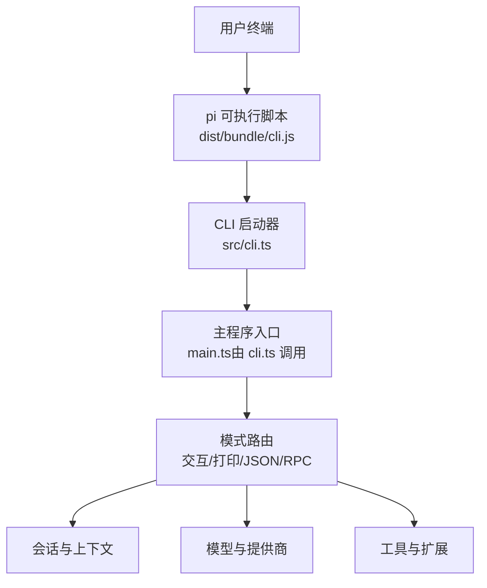
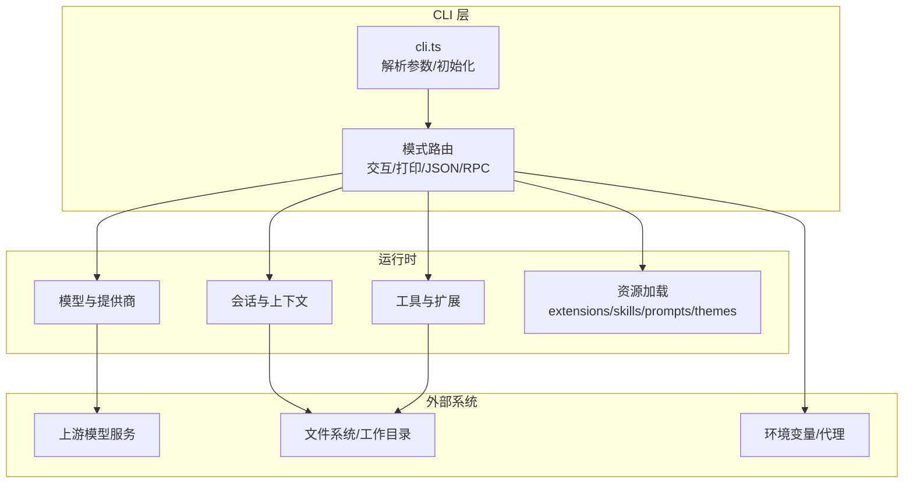
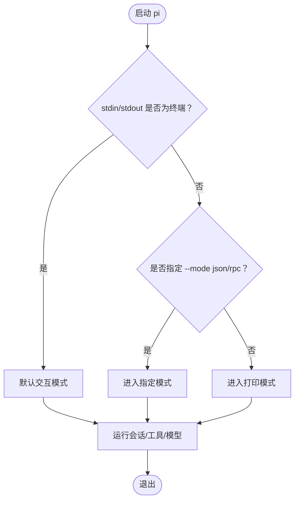
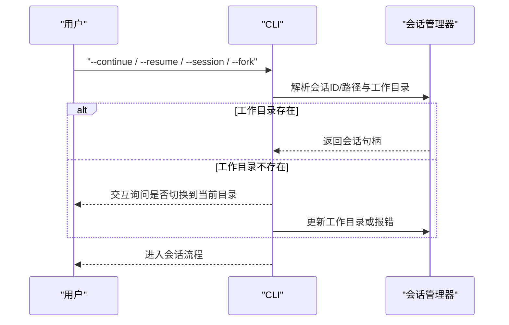
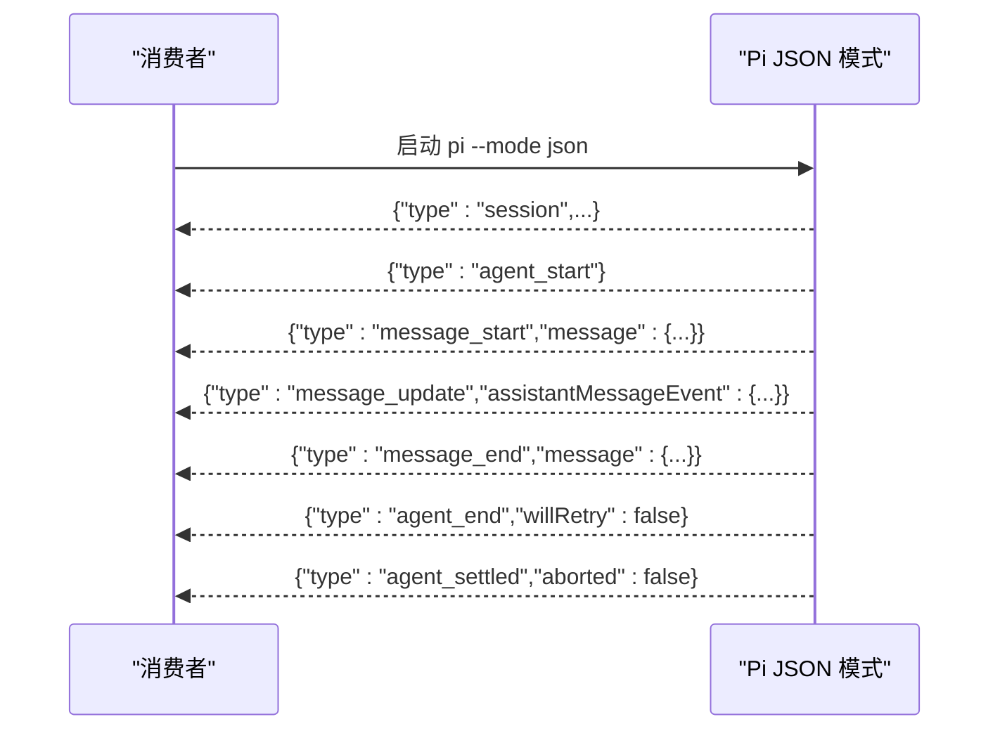
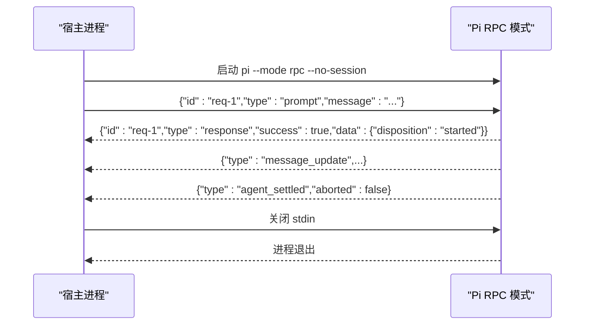
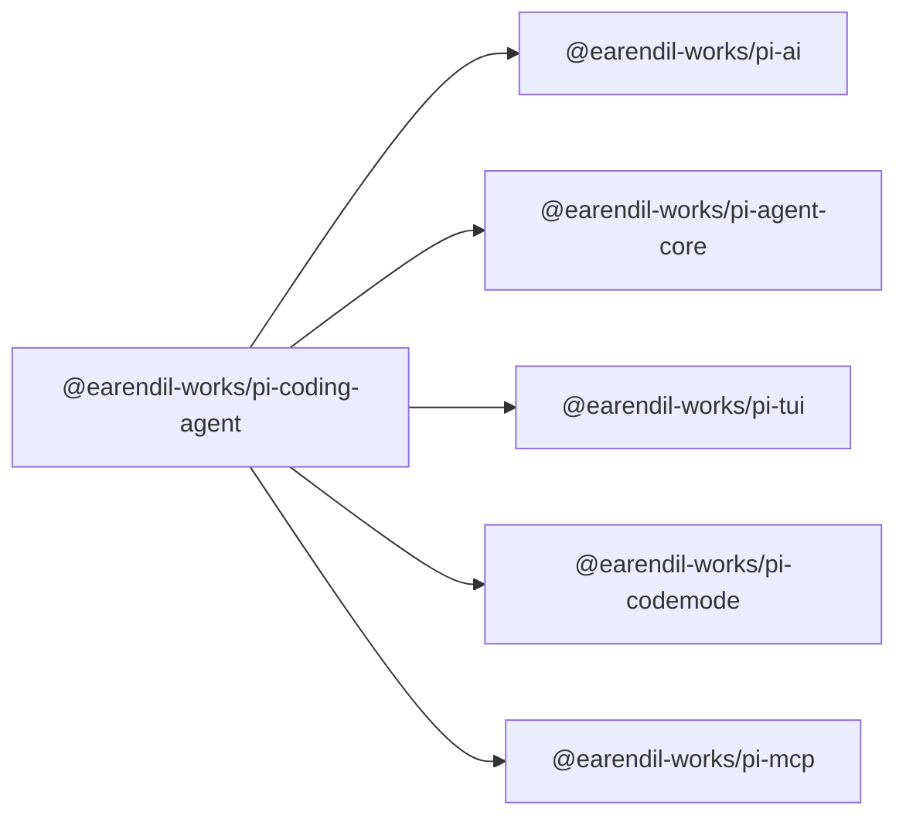

# CLI参考手册

<cite>
**本文引用的文件**   
- [README.md](https://github.com/FDE-GROUP/oh-my-fde/blob/omca/README.md)
- [packages/coding-agent/package.json](https://github.com/FDE-GROUP/oh-my-fde/blob/omca/packages/coding-agent/package.json)
- [packages/coding-agent/src/cli.ts](https://github.com/FDE-GROUP/oh-my-fde/blob/omca/packages/coding-agent/src/cli.ts)
- [packages/coding-agent/docs/cli.md](https://github.com/FDE-GROUP/oh-my-fde/blob/omca/packages/coding-agent/docs/cli.md)
- [packages/coding-agent/docs/environment-variables.md](https://github.com/FDE-GROUP/oh-my-fde/blob/omca/packages/coding-agent/docs/environment-variables.md)
- [packages/coding-agent/docs/configuration.md](https://github.com/FDE-GROUP/oh-my-fde/blob/omca/packages/coding-agent/docs/configuration.md)
- [packages/coding-agent/docs/json.md](https://github.com/FDE-GROUP/oh-my-fde/blob/omca/packages/coding-agent/docs/json.md)
- [packages/coding-agent/docs/rpc.md](https://github.com/FDE-GROUP/oh-my-fde/blob/omca/packages/coding-agent/docs/rpc.md)
- [packages/coding-agent/docs/sessions.md](https://github.com/FDE-GROUP/oh-my-fde/blob/omca/packages/coding-agent/docs/sessions.md)
- [packages/coding-agent/docs/settings.md](https://github.com/FDE-GROUP/oh-my-fde/blob/omca/packages/coding-agent/docs/settings.md)
</cite>

## 目录
1. [简介](#简介)
2. [项目结构](#项目结构)
3. [核心组件](#核心组件)
4. [架构总览](#架构总览)
5. [详细组件分析](#详细组件分析)
6. [依赖关系分析](#依赖关系分析)
7. [性能考虑](#性能考虑)
8. [故障排查指南](#故障排查指南)
9. [结论](#结论)
10. [附录](#附录)

## 简介
本手册面向使用 Pi 命令行工具的用户与集成方，系统性地记录所有命令语法、选项参数、环境变量与配置文件，覆盖交互式模式、打印模式、JSON 事件流模式与 RPC 模式的完整用法。文档还包含会话管理、模型选择、工具调用等高级功能的命令行控制方式，并提供示例、参数校验规则、错误处理与性能注意事项，帮助你在不同运行环境中稳定、高效地使用 Pi。

## 项目结构
Pi 的 CLI 入口由包中的可执行脚本提供，实际逻辑位于源码与文档中：
- 可执行入口将 Node 进程参数传递给主程序并初始化 CLI。
- 包元数据声明了二进制入口路径与依赖。
- 文档集中描述了命令、模式、配置与环境变量。

图表来源
- [packages/coding-agent/src/cli.ts:1-7](https://github.com/FDE-GROUP/oh-my-fde/blob/omca/packages/coding-agent/src/cli.ts#L1-L7)
- [packages/coding-agent/package.json:9-11](https://github.com/FDE-GROUP/oh-my-fde/blob/omca/packages/coding-agent/package.json#L9-L11)

章节来源
- [packages/coding-agent/src/cli.ts:1-7](https://github.com/FDE-GROUP/oh-my-fde/blob/omca/packages/coding-agent/src/cli.ts#L1-L7)
- [packages/coding-agent/package.json:1-11](https://github.com/FDE-GROUP/oh-my-fde/blob/omca/packages/coding-agent/package.json#L1-L11)

## 核心组件
- 命令与模式
  - 顶层命令：pi、install、remove、uninstall、update、list、config、auth、mcp。
  - 输出模式：交互（默认）、--print 打印模式、--mode json JSON 事件流、--mode rpc 长连接 RPC。
- 模型与提供商
  - --model、--provider、--api-key、--thinking、--models、--list-models。
- 会话管理
  - --continue、--resume、--session、--session-id、--fork、--session-dir、--no-session、--name。
- 工具控制
  - --tools、--exclude-tools、--no-builtin-tools、--no-tools；内置工具列表与 codemode/tool_search。
- 资源加载
  - --extension、--no-extensions、--no-mcp、--skill、--no-skills、--prompt-template、--no-prompt-templates、--theme、--use-theme、--no-themes、--no-context-files。
- 提示与进程
  - --system-prompt、--append-system-prompt、--tui-mode、--verbose、--approve/--no-approve、--offline、--help、--version。
- 凭证与 MCP
  - pi auth login/logout/check/print-api-key/print-bearer-token；pi mcp add/remove/list/login/logout。
- 环境变量
  - PI_CODING_AGENT_DIR、PI_CODING_AGENT_SESSION_DIR、PI_OFFLINE、PI_SELF_UPDATE_COMMAND、PI_TELEMETRY、PI_CODEMODE_MAX_WORKERS、PI_CACHE_RETENTION 等。
- 配置文件
  - 用户级 settings.json、keybindings.json、mcp.json、models.json、auth.json、SYSTEM.md、APPEND_SYSTEM.md、extensions/skills/prompts/themes。
  - 项目 .pi 下同名结构与信任机制。

章节来源
- [packages/coding-agent/docs/cli.md:1-357](https://github.com/FDE-GROUP/oh-my-fde/blob/omca/packages/coding-agent/docs/cli.md#L1-L357)
- [packages/coding-agent/docs/environment-variables.md:1-104](https://github.com/FDE-GROUP/oh-my-fde/blob/omca/packages/coding-agent/docs/environment-variables.md#L1-L104)
- [packages/coding-agent/docs/configuration.md:1-48](https://github.com/FDE-GROUP/oh-my-fde/blob/omca/packages/coding-agent/docs/configuration.md#L1-L48)
- [packages/coding-agent/docs/settings.md:1-174](https://github.com/FDE-GROUP/oh-my-fde/blob/omca/packages/coding-agent/docs/settings.md#L1-L174)

## 架构总览
下图展示从 CLI 到各子系统的调用关系与数据流向。

图表来源
- [packages/coding-agent/src/cli.ts:1-7](https://github.com/FDE-GROUP/oh-my-fde/blob/omca/packages/coding-agent/src/cli.ts#L1-L7)
- [packages/coding-agent/docs/cli.md:21-53](https://github.com/FDE-GROUP/oh-my-fde/blob/omca/packages/coding-agent/docs/cli.md#L21-L53)
- [packages/coding-agent/docs/environment-variables.md:75-104](https://github.com/FDE-GROUP/oh-my-fde/blob/omca/packages/coding-agent/docs/environment-variables.md#L75-L104)

## 详细组件分析

### 命令与模式
- 基本语法
  - pi [options] [--] [@files...] [messages...]
  - pi install/remove/uninstall/update/list/config
  - pi auth login/logout/check/print-api-key/print-bearer-token
  - pi mcp add/remove/list/login/logout
- 输出模式
  - 交互模式：stdin/stdout 为终端时默认打开 TUI。
  - 打印模式：--print 一次性运行并输出最终助手文本后退出。
  - JSON 模式：--mode json 输出结构化 JSONL 事件后退出。
  - RPC 模式：--mode rpc 通过 stdin/stdout 进行双向 JSONL 协议通信。
- 输入行为
  - message：初始提示。
  - @path：附加文本或图片到首条提示。
  - 管道 stdin：内容追加到首条提示。
  - --：停止选项解析，允许提示以 - 开头。
- 模式互斥与限制
  - JSON/RPC 模式下禁止 @file 参数；stdout 保留给协议记录。

图表来源
- [packages/coding-agent/docs/cli.md:21-53](https://github.com/FDE-GROUP/oh-my-fde/blob/omca/packages/coding-agent/docs/cli.md#L21-L53)

章节来源
- [packages/coding-agent/docs/cli.md:1-53](https://github.com/FDE-GROUP/oh-my-fde/blob/omca/packages/coding-agent/docs/cli.md#L1-L53)

### 模型选择与思考级别
- 关键选项
  - --provider <name>：限定 provider 查找，需配合 --model。
  - --model <pattern>：按 ID 或模糊匹配选择模型，支持 provider/id 与 :thinking 后缀。
  - --api-key <key>：非持久化 API Key 覆盖，需先选定模型。
  - --thinking <level>：off/minimal/low/medium/high/xhigh/max，受模型能力约束。
  - --models <patterns>：逗号分隔的模型范围，支持通配与 :thinking。
  - --list-models [search]：列出可用模型并退出。
- 行为说明
  - 多 provider 提供同一模型时优先有凭据的 provider，否则要求 --provider。
  - thinking 级别会被钳制到模型支持的范围。

章节来源
- [packages/coding-agent/docs/cli.md:55-76](https://github.com/FDE-GROUP/oh-my-fde/blob/omca/packages/coding-agent/docs/cli.md#L55-L76)

### 会话管理与分支
- 关键选项
  - -c/--continue：继续当前目录最近会话。
  - -r/--resume：打开会话选择器恢复会话。
  - --session <path|id>：按路径或 ID 打开并恢复。
  - --session-id <id>：在当前目录创建或打开指定 ID 的会话。
  - --fork <path|id>：将某会话分叉到当前目录的新会话。
  - --session-dir <dir>：覆盖会话存储位置。
  - --no-session：仅内存会话，不持久化。
  - -n/--name <name>：设置会话显示名。
- 约束
  - 会话 ID 必须以字母或数字开头和结尾。
  - --fork 不能与 --session/--continue/--resume/--no-session 同时使用。
  - --session-id 不能与 --session/--continue/--resume 同时使用，可与 --fork 组合指定新 ID。
- 工作目录
  - 会话固定其创建时的工作目录；若该目录不存在，交互模式会询问是否在当前位置运行，其他模式报错。

图表来源
- [packages/coding-agent/docs/cli.md:78-110](https://github.com/FDE-GROUP/oh-my-fde/blob/omca/packages/coding-agent/docs/cli.md#L78-L110)
- [packages/coding-agent/docs/sessions.md:5-28](https://github.com/FDE-GROUP/oh-my-fde/blob/omca/packages/coding-agent/docs/sessions.md#L5-L28)

章节来源
- [packages/coding-agent/docs/cli.md:78-110](https://github.com/FDE-GROUP/oh-my-fde/blob/omca/packages/coding-agent/docs/cli.md#L78-L110)
- [packages/coding-agent/docs/sessions.md:1-75](https://github.com/FDE-GROUP/oh-my-fde/blob/omca/packages/coding-agent/docs/sessions.md#L1-L75)

### 工具控制与 Codemode
- 关键选项
  - -t/--tools <list>：替换默认工具白名单，支持名称与 * 通配；MCP 工具默认不受影响，除非条目以 mcp__ 开头。
  - -xt/--exclude-tools <list>：在其它选择之后禁用工具，包括 MCP。
  - -nbt/--no-builtin-tools：禁用内置工具但保留扩展与自定义工具。
  - -nt/--no-tools：禁用所有工具。
- 默认工具
  - read、bash、edit、write；可通过 defaultTools 修改。
- Codemode 与 tool_search
  - codemode：在 QuickJS 沙箱中并行调用工具，仅脚本输出可见于模型。
  - tool_search：搜索未声明的工具并在下次调用时声明匹配项。
- 启用方式
  - 全局 settings.json 中添加 "+codemode" 到 defaultTools。
  - 单次调用使用 --tools +codemode。

章节来源
- [packages/coding-agent/docs/cli.md:111-184](https://github.com/FDE-GROUP/oh-my-fde/blob/omca/packages/coding-agent/docs/cli.md#L111-L184)
- [packages/coding-agent/docs/settings.md:38-60](https://github.com/FDE-GROUP/oh-my-fde/blob/omca/packages/coding-agent/docs/settings.md#L38-L60)

### 资源加载与主题
- 关键选项
  - -e/--extension：加载扩展文件或目录，可重复；支持 builtin:mcp 等内置扩展。
  - -ne/--no-extensions：禁用发现与配置的扩展；显式 -e 仍加载。
  - --no-mcp：禁用内置 MCP 支持。
  - --skill/-ns/--no-skills：技能文件/目录加载控制。
  - --prompt-template/-np/--no-prompt-templates：提示模板加载控制。
  - --theme/--use-theme/--no-themes：主题加载与初始主题选择。
  - -nc/--no-context-files：禁用 AGENTS.md/CLAUDE.md 发现。
- 注意
  - 资源路径仅对当前进程有效，相对路径基于当前工作目录解析。

章节来源
- [packages/coding-agent/docs/cli.md:186-219](https://github.com/FDE-GROUP/oh-my-fde/blob/omca/packages/coding-agent/docs/cli.md#L186-L219)

### 提示与进程控制
- 关键选项
  - --system-prompt：替换系统提示（文本或文件）。
  - --append-system-prompt：追加系统提示（文本或文件），可重复。
  - --tui-mode：fullscreen 或 regular。
  - --verbose：显示详细启动信息。
  - -a/--approve：信任项目本地配置与资源。
  - -na/--no-approve：忽略信任门控的项目本地配置与资源。
  - --offline：等价于 PI_OFFLINE=1，禁用自动网络活动。
  - -h/--help、-v/--version：帮助与版本。

章节来源
- [packages/coding-agent/docs/cli.md:221-250](https://github.com/FDE-GROUP/oh-my-fde/blob/omca/packages/coding-agent/docs/cli.md#L221-L250)

### 包管理命令
- 常用任务
  - pi install/remove/uninstall/list/config。
  - pi update：无目标时更新 Pi 自身；--extensions 更新所有扩展；--models 刷新模型目录；--all 全部更新。
- 别名与选项
  - uninstall 是 remove 的别名；update --self/self/pi 等价；update --extension 等价于 update <source>。
  - --local/-l：在项目 settings 而非全局 settings 操作。
- 自定义更新命令
  - 通过 PI_SELF_UPDATE_COMMAND 或 selfUpdateCommand 设置自定义更新命令。

章节来源
- [packages/coding-agent/docs/cli.md:252-303](https://github.com/FDE-GROUP/oh-my-fde/blob/omca/packages/coding-agent/docs/cli.md#L252-L303)

### 凭证与认证
- 登录/登出
  - pi auth login <provider> [--api-key] [--no-browser]：交互式登录或保存 API Key。
  - pi auth logout <provider>：移除已保存凭据。
- 检查与打印
  - pi auth check [--provider|--model] [--json] [--credentials] [--no-refresh]：返回 ready/not_ready/invalid 及状态码。
  - pi auth print-api-key：打印解析后的 API Key。
  - pi auth print-bearer-token [--min-expiry]：打印 OAuth bearer token。
- 注意
  - 凭证打印命令会将机密写入 stdout。

章节来源
- [packages/coding-agent/docs/cli.md:305-339](https://github.com/FDE-GROUP/oh-my-fde/blob/omca/packages/coding-agent/docs/cli.md#L305-L339)

### MCP 服务器管理
- 命令
  - pi mcp add <server> [options] -- <command> [args...]：添加 stdio 服务器，支持 --env、--cwd。
  - pi mcp add <server> [options] --url <url>：添加 HTTP 服务器，支持多种 OAuth 配置。
  - pi mcp remove <server>：删除服务器配置。
  - pi mcp list [--json]：连接并打印服务器状态、工具与错误。
  - pi mcp login <server> [-l] [--timeout]：OAuth 登录。
  - pi mcp logout <server> [-l]：删除 OAuth 凭据。
- 注意
  - add/remove 修改 ~/.pi/agent/mcp.json 或 .pi/mcp.json（--local）。
  - 项目 .pi/mcp.json 仅在已信任项目中读取。

章节来源
- [packages/coding-agent/docs/cli.md:341-357](https://github.com/FDE-GROUP/oh-my-fde/blob/omca/packages/coding-agent/docs/cli.md#L341-L357)

### JSON 事件流模式
- 用途
  - 一次运行输出结构化 JSONL 事件，便于自动化消费。
- 帧格式
  - 严格 JSONL，每条记录以 LF 终止；不要使用 Unicode 行/段落分隔符作为边界。
  - stdout 保留给 JSONL；诊断与日志输出到 stderr。
- 会话头
  - JSON 模式首条记录为 session 头；RPC 模式不发送。
- 事件序列
  - agent_start/turn_start/message_start/update/end/turn_end/agent_end/agent_settled。
  - tool_execution_start/update/end。
  - queue_update/entry_appended/session_info_changed/thinking_level_changed。
  - compaction_start/end、auto_retry_*、summarization_retry_*。
- 重建消息
  - message_update 为增量 delta，需结合 text_delta/thinking_delta/toolcall_delta 与结束事件重建。
- 示例
  - 过滤 message_end 输出完成消息。

图表来源
- [packages/coding-agent/docs/json.md:1-227](https://github.com/FDE-GROUP/oh-my-fde/blob/omca/packages/coding-agent/docs/json.md#L1-L227)

章节来源
- [packages/coding-agent/docs/json.md:1-227](https://github.com/FDE-GROUP/oh-my-fde/blob/omca/packages/coding-agent/docs/json.md#L1-L227)

### RPC 模式
- 用途
  - 长连接子进程，通过 stdin/stdout 的 JSONL 命令、响应与事件进行控制。
- 启动
  - pi --mode rpc --no-session；其余 CLI 选项照常生效。
- 协议记录
  - stdin：命令；stdout：response、会话事件、扩展 UI 记录。
- 关联命令与响应
  - 可选 id 字段用于关联异步命令与其 response。
- 帧格式
  - 严格 JSONL，LF 终止；stdout 保留给协议记录。
- 生命周期
  - prompt 成功仅代表接受/排队/处理；等待 agent_settled 表示不再自动继续。
- 错误处理
  - 失败 response 含 success:false 与 error；解析失败返回 parse 响应。
- 关闭
  - 关闭 stdin 优雅退出；SIGTERM/SIGHUP 触发优雅退出；第二次信号立即退出。
- 最小客户端
  - 使用二进制流读取 stdout，避免 Unicode 分隔符问题。

图表来源
- [packages/coding-agent/docs/rpc.md:1-196](https://github.com/FDE-GROUP/oh-my-fde/blob/omca/packages/coding-agent/docs/rpc.md#L1-L196)

章节来源
- [packages/coding-agent/docs/rpc.md:1-196](https://github.com/FDE-GROUP/oh-my-fde/blob/omca/packages/coding-agent/docs/rpc.md#L1-L196)

### 环境变量
- 进程标记
  - AI_AGENT=pi、PI_CODING_AGENT=true。
- Shell 工具会话环境
  - PI_SESSION_ID、PI_SESSION_FILE、PI_PROVIDER、PI_MODEL、PI_REASONING_LEVEL。
- Pi 进程配置
  - PI_CODING_AGENT_DIR、PI_CODING_AGENT_SESSION_DIR、PI_PACKAGE_DIR、PI_OFFLINE、PI_SKIP_VERSION_CHECK、PI_SELF_UPDATE_COMMAND、PI_TELEMETRY、PI_CODEMODE_MAX_WORKERS、PI_CACHE_RETENTION、PI_SHARE_VIEWER_URL、PI_RADIUS_GATEWAY、PI_CLEAR_ON_SHRINK、PI_HARDWARE_CURSOR、PI_CLIPBOARD_OSC52、PI_HYPERLINKS、PI_PROGRAM_STATUS、PI_IMAGE_PROTOCOL、PI_TRUE_COLOR、PI_TUI_ESC_TIMEOUT、VISUAL/EDITOR、HTTP_PROXY/HTTPS_PROXY。

章节来源
- [packages/coding-agent/docs/environment-variables.md:1-104](https://github.com/FDE-GROUP/oh-my-fde/blob/omca/packages/coding-agent/docs/environment-variables.md#L1-L104)

### 配置文件
- 用户级目录
  - settings.json、keybindings.json、mcp.json、models.json、auth.json、AGENTS.override.md/AGENTS.md/CLAUDE.md、SYSTEM.md、APPEND_SYSTEM.md、extensions/skills/prompts/themes。
- 项目 .pi 目录
  - settings.json、mcp.json、SYSTEM.md、APPEND_SYSTEM.md、extensions/skills/prompts/themes。
- 上下文文件
  - AGENTS.md/CLAUDE.md 从用户目录、工作目录及其父目录发现；AGENTS.override.md 仅在同级目录替换。

章节来源
- [packages/coding-agent/docs/configuration.md:1-48](https://github.com/FDE-GROUP/oh-my-fde/blob/omca/packages/coding-agent/docs/configuration.md#L1-L48)

### 设置参考
- 模型与思考
  - defaultProvider/defaultModel/defaultThinkingLevel/modelThinkingLevels/thinkingBudgets/enabledModels/hideThinkingBlock/showCacheMissNotices/cacheWarming。
- 交互
  - steeringMode/followUpMode/externalEditor/doubleEscapeAction/treeFilterMode/defaultProjectTrust。
- 工具
  - defaultTools/codemode.mode/codemode.inlineBudget。
- 会话与上下文
  - sessionDir/sessionShareDestination；compaction.enabled/reserveTokens/keepRecentTokens/modelOverrides；branchSummary.reserveTokens/skipPrompt。
- 终端与显示
  - theme/quietStartup/tuiMode/fullscreenExitOutput/fullscreenScrollbar/fullscreenCopyOnSelect/fullscreenWheelScrollLines/editorPaddingX/outputPad/autocompleteMaxVisible/showHardwareCursor/terminal.* 等。
- 网络与重试
  - transport/httpProxy/httpIdleTimeoutMs/websocketConnectTimeoutMs/retry.*。
- Shell
  - shellPath/shellCommandPrefix/npmCommand/selfUpdateCommand。
- 资源
  - packages/extensions/skills/prompts/themes/enableSkillCommands。
- 更新、遥测与警告
  - collapseChangelog/enableInstallTelemetry/enableAnalytics/warnings.anthropicExtraUsage。

章节来源
- [packages/coding-agent/docs/settings.md:1-174](https://github.com/FDE-GROUP/oh-my-fde/blob/omca/packages/coding-agent/docs/settings.md#L1-L174)

## 依赖关系分析
- 包入口与依赖
  - 包元数据声明 bin 指向 dist/bundle/cli.js，依赖 ai、agent-core、tui、codemode、mcp 等内部包。
- 运行时依赖
  - 模型调用依赖 ai 包；TUI 依赖 tui 包；工具与扩展依赖 agent-core 与 codemode；MCP 依赖 mcp 包。

图表来源
- [packages/coding-agent/package.json:43-65](https://github.com/FDE-GROUP/oh-my-fde/blob/omca/packages/coding-agent/package.json#L43-L65)

章节来源
- [packages/coding-agent/package.json:1-98](https://github.com/FDE-GROUP/oh-my-fde/blob/omca/packages/coding-agent/package.json#L1-L98)

## 性能考虑
- 模型缓存预热
  - cacheWarming 可在活跃运行或空闲期间保持提示缓存预热，减少缓存未命中成本。
- 压缩与摘要
  - 自动压缩阈值 reserveTokens、保留近期 tokens keepRecentTokens 与 per-model 覆盖可调节；分支摘要 reserveTokens 与 skipPrompt 控制分支历史摘要策略。
- 并发与 Worker
  - PI_CODEMODE_MAX_WORKERS 控制同进程中 codemode worker 的最大并发数；每个 worker 脚本最多使用 256 MB。
- 网络与重试
  - httpIdleTimeoutMs、websocketConnectTimeoutMs、retry.provider.timeoutMs 等可调；建议保持 provider 级重试为 0，让 Pi 自行处理配额与用量限制。
- 终端渲染
  - fullscreenWheelScrollLines、terminal.clearOnShrink、terminal.showTerminalProgress 等影响交互体验与性能。

章节来源
- [packages/coding-agent/docs/settings.md:1-174](https://github.com/FDE-GROUP/oh-my-fde/blob/omca/packages/coding-agent/docs/settings.md#L1-L174)
- [packages/coding-agent/docs/environment-variables.md:75-104](https://github.com/FDE-GROUP/oh-my-fde/blob/omca/packages/coding-agent/docs/environment-variables.md#L75-L104)

## 故障排查指南
- 常见错误
  - 模型未找到：set_model 返回 success:false 与错误信息。
  - JSON 解析失败：parse 响应返回解析错误。
  - 会话工作目录不存在：非交互模式直接报错；交互模式可切换至当前目录。
  - 压缩失败：提供者不可用或无法接受摘要请求；修正提供者后手动 /compact。
- 调试建议
  - 使用 --verbose 查看详细启动信息。
  - 在 JSON/RPC 模式中观察 message_update 与 tool_execution_* 事件定位问题。
  - 检查环境变量 PI_OFFLINE、HTTP_PROXY/HTTPS_PROXY 与代理配置。
  - 使用 pi auth check --json 验证凭据状态。
- 安全与权限
  - 凭证打印命令会输出机密到 stdout，请谨慎重定向。
  - 如需更强隔离，使用容器或沙箱运行 Pi。

章节来源
- [packages/coding-agent/docs/rpc.md:73-90](https://github.com/FDE-GROUP/oh-my-fde/blob/omca/packages/coding-agent/docs/rpc.md#L73-L90)
- [packages/coding-agent/docs/sessions.md:24-28](https://github.com/FDE-GROUP/oh-my-fde/blob/omca/packages/coding-agent/docs/sessions.md#L24-L28)
- [packages/coding-agent/docs/sessions.md:50-56](https://github.com/FDE-GROUP/oh-my-fde/blob/omca/packages/coding-agent/docs/sessions.md#L50-L56)
- [packages/coding-agent/docs/cli.md:339-339](https://github.com/FDE-GROUP/oh-my-fde/blob/omca/packages/coding-agent/docs/cli.md#L339-L339)

## 结论
本手册系统梳理了 Pi CLI 的命令语法、选项参数、环境变量与配置文件，覆盖了交互、打印、JSON 与 RPC 四种模式的完整用法，并深入说明了会话管理、模型选择、工具控制与资源加载等高级功能。通过合理配置 settings.json 与环境变量，结合 JSON/RPC 的事件流与协议规范，你可以在不同运行环境中构建稳定、可扩展的自动化与集成方案。

## 附录
- 快速开始
  - 安装与运行：见仓库 README 的安装与运行指引。
  - 首次使用：在 Pi 内运行 /login 连接提供商或 API Key，然后给出任务。

章节来源
- [README.md:23-54](https://github.com/FDE-GROUP/oh-my-fde/blob/omca/README.md#L23-L54)