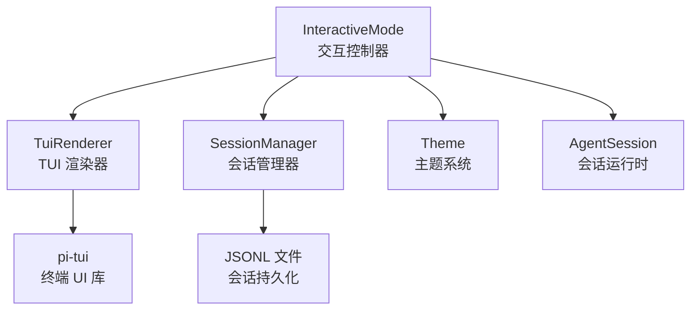
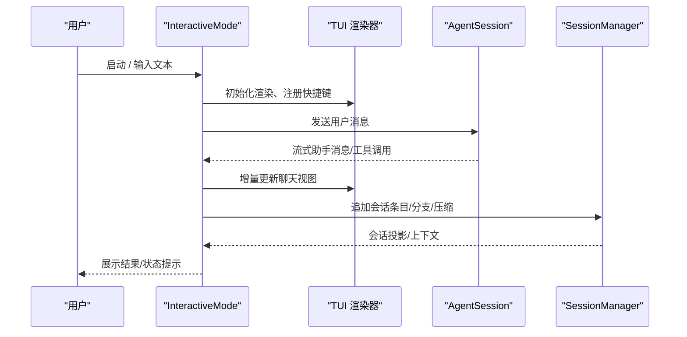
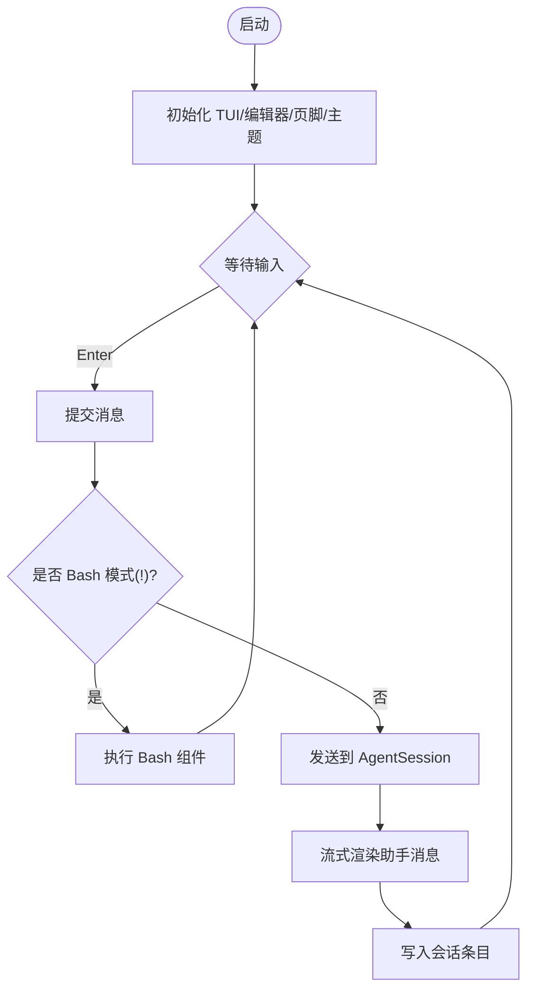
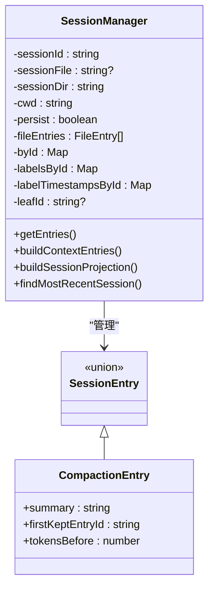
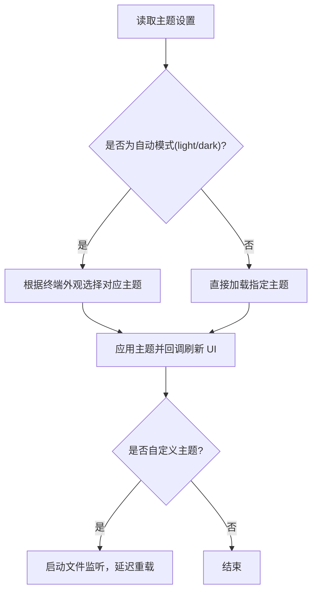
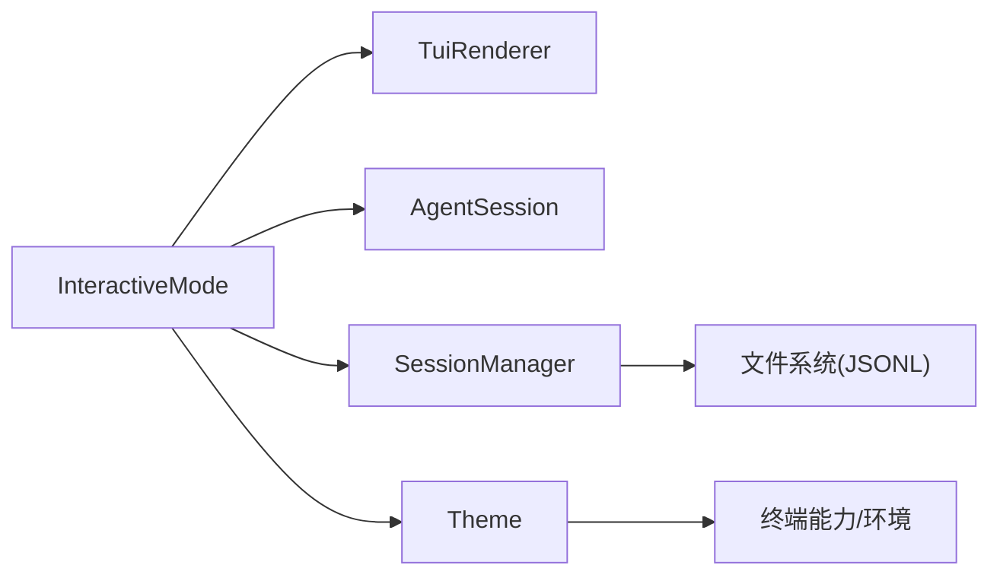
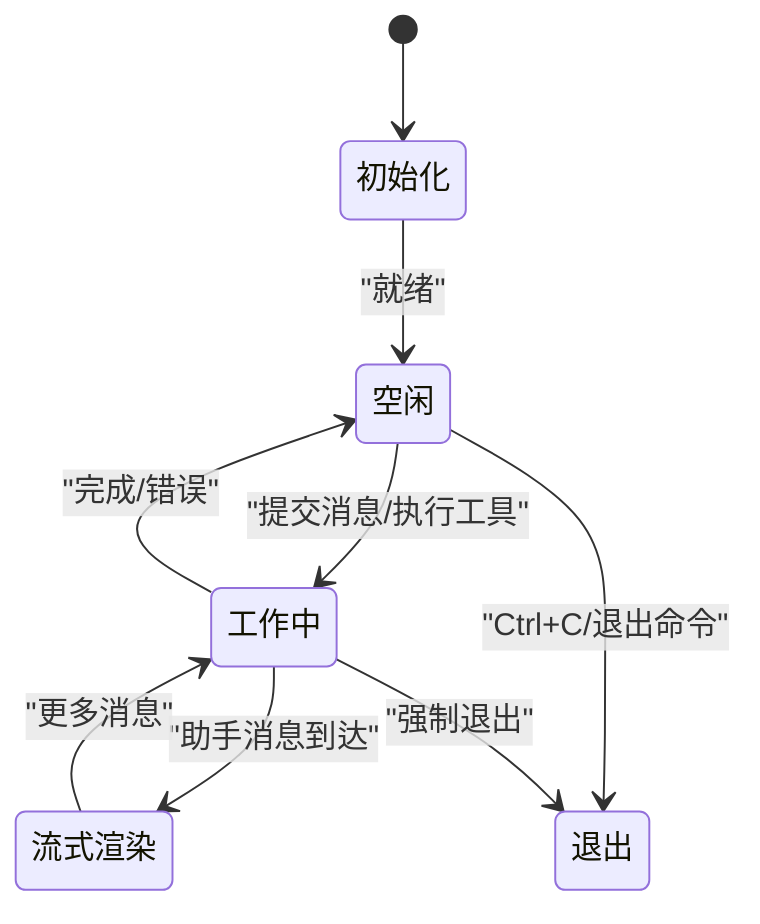

# 交互式模式

<cite>
**本文引用的文件**   
- [interactive-mode.ts](https://github.com/FDE-GROUP/oh-my-fde/blob/omca/packages/coding-agent/src/modes/interactive/interactive-mode.ts)
- [session-manager.ts](https://github.com/FDE-GROUP/oh-my-fde/blob/omca/packages/coding-agent/src/core/session-manager.ts)
- [agent-session.ts](https://github.com/FDE-GROUP/oh-my-fde/blob/omca/packages/coding-agent/src/core/agent-session.ts)
- [theme.ts](https://github.com/FDE-GROUP/oh-my-fde/blob/omca/packages/coding-agent/src/modes/interactive/theme/theme.ts)
- [settings-selector.ts](https://github.com/FDE-GROUP/oh-my-fde/blob/omca/packages/coding-agent/src/modes/interactive/components/settings-selector.ts)
- [tui-renderer.ts](https://github.com/FDE-GROUP/oh-my-fde/blob/omca/packages/coding-agent/src/modes/interactive/tui-renderer.ts)
- [README.md](https://github.com/FDE-GROUP/oh-my-fde/blob/omca/packages/tui/README.md)
</cite>

## 目录
1. [简介](#简介)
2. [项目结构](#项目结构)
3. [核心组件](#核心组件)
4. [架构总览](#架构总览)
5. [详细组件分析](#详细组件分析)
6. [依赖关系分析](#依赖关系分析)
7. [性能与优化](#性能与优化)
8. [故障排查指南](#故障排查指南)
9. [结论](#结论)
10. [附录](#附录)

## 简介
本文件面向“交互式模式”的完整文档，覆盖会话生命周期、用户输入处理、对话管理机制、界面状态与快捷键、主题定制、会话持久化、历史管理、上下文保持等高级能力，并给出最佳实践与性能优化建议。该模式由交互式控制器驱动，基于 TUI 库渲染终端界面，并通过会话管理器维护可分支、可压缩、可重放的 JSONL 会话树。

## 项目结构
交互式模式的核心位于 coding-agent 包的 interactive 模式目录，围绕以下关键模块组织：
- 交互控制器：负责 TUI 生命周期、输入分发、命令路由、状态机与 UI 组合。
- 会话管理：以 append-only JSONL 存储会话树，支持分支、标签、压缩、上下文投影。
- 主题系统：内置与自定义主题，自动检测终端明暗，支持热重载与预览。
- TUI 渲染器：封装主屏/备屏渲染策略、同步输出、滚动与搜索。
- 组件生态：消息、工具执行、编辑器、选择器、设置面板等。

图示来源
- [interactive-mode.ts:463-689](https://github.com/FDE-GROUP/oh-my-fde/blob/omca/packages/coding-agent/src/modes/interactive/interactive-mode.ts#L463-L689)
- [tui-renderer.ts](https://github.com/FDE-GROUP/oh-my-fde/blob/omca/packages/coding-agent/src/modes/interactive/tui-renderer.ts)
- [session-manager.ts:977-1014](https://github.com/FDE-GROUP/oh-my-fde/blob/omca/packages/coding-agent/src/core/session-manager.ts#L977-L1014)
- [theme.ts:687-724](https://github.com/FDE-GROUP/oh-my-fde/blob/omca/packages/coding-agent/src/modes/interactive/theme/theme.ts#L687-L724)
- [README.md:55-79](https://github.com/FDE-GROUP/oh-my-fde/blob/omca/packages/tui/README.md#L55-L79)

章节来源
- [interactive-mode.ts:463-689](https://github.com/FDE-GROUP/oh-my-fde/blob/omca/packages/coding-agent/src/modes/interactive/interactive-mode.ts#L463-L689)
- [session-manager.ts:977-1014](https://github.com/FDE-GROUP/oh-my-fde/blob/omca/packages/coding-agent/src/core/session-manager.ts#L977-L1014)
- [theme.ts:687-724](https://github.com/FDE-GROUP/oh-my-fde/blob/omca/packages/coding-agent/src/modes/interactive/theme/theme.ts#L687-L724)
- [README.md:55-79](https://github.com/FDE-GROUP/oh-my-fde/blob/omca/packages/tui/README.md#L55-L79)

## 核心组件
- InteractiveMode：交互式会话的主控制器，负责初始化 TUI、注册快捷键、构建聊天视图、处理用户输入、协调 AgentSession、管理状态指示器与扩展 UI。
- SessionManager：会话树的 append-only 存储与投影，提供分支、压缩、标签、上下文编辑、最近会话发现等能力。
- Theme：主题加载、解析、应用与热重载；支持系统主题、内置主题与自定义主题，自动适配终端明暗。
- TUI 渲染器：根据配置选择主屏或备屏渲染，统一输入、焦点、叠加层、滚动与搜索。
- AgentSession：会话业务逻辑与事件总线，驱动模型调用、工具执行、消息流式更新。

章节来源
- [interactive-mode.ts:463-689](https://github.com/FDE-GROUP/oh-my-fde/blob/omca/packages/coding-agent/src/modes/interactive/interactive-mode.ts#L463-L689)
- [session-manager.ts:977-1014](https://github.com/FDE-GROUP/oh-my-fde/blob/omca/packages/coding-agent/src/core/session-manager.ts#L977-L1014)
- [theme.ts:687-724](https://github.com/FDE-GROUP/oh-my-fde/blob/omca/packages/coding-agent/src/modes/interactive/theme/theme.ts#L687-L724)
- [README.md:55-79](https://github.com/FDE-GROUP/oh-my-fde/blob/omca/packages/tui/README.md#L55-L79)

## 架构总览
交互式模式采用“控制器 + 渲染器 + 会话 + 主题”的分层架构：
- 控制器（InteractiveMode）编排 UI、输入、命令与业务事件。
- 渲染器（TUI）提供无闪烁的差分渲染、主/备屏布局、叠加层与滚动。
- 会话（SessionManager）维护 append-only 树，计算可见上下文。
- 主题（Theme）提供一致的视觉语义，支持自动切换与热重载。

图示来源
- [interactive-mode.ts:463-689](https://github.com/FDE-GROUP/oh-my-fde/blob/omca/packages/coding-agent/src/modes/interactive/interactive-mode.ts#L463-L689)
- [agent-session.ts:970-980](https://github.com/FDE-GROUP/oh-my-fde/blob/omca/packages/coding-agent/src/core/agent-session.ts#L970-L980)
- [session-manager.ts:468-512](https://github.com/FDE-GROUP/oh-my-fde/blob/omca/packages/coding-agent/src/core/session-manager.ts#L468-L512)

## 详细组件分析

### 交互式控制器（InteractiveMode）
职责
- 初始化 TUI 渲染器与 UI 引用，创建容器、编辑器、页脚、状态指示器等。
- 注册全局快捷键与键绑定管理器，处理 Ctrl+C/Ctrl+Z、退出、挂起等信号。
- 构建聊天视图与组件树，管理流式消息、工具执行、思考块显示、Bash 模式。
- 协调 AgentSession 事件，将消息、使用量、压缩摘要等写入会话树。
- 管理扩展 UI（对话框、选择器、自定义头/脚、小部件）。
- 主题控制：根据设置与应用主题，监听变化并刷新 UI。

关键流程
- 启动：构造渲染器、编辑器、页脚数据提供者、主题控制器，注册快捷键。
- 输入处理：编辑器提交后进入 Bash 模式或普通对话；斜杠命令通过自动补全与参数完成。
- 会话持久化：每次用户/助手消息、模型变更、用量统计、压缩/分支摘要均落盘为 JSONL。
- 状态反馈：工作/阻塞/完成/错误状态通过 OSC 7501 报告到终端。

图示来源
- [interactive-mode.ts:463-689](https://github.com/FDE-GROUP/oh-my-fde/blob/omca/packages/coding-agent/src/modes/interactive/interactive-mode.ts#L463-L689)

章节来源
- [interactive-mode.ts:463-689](https://github.com/FDE-GROUP/oh-my-fde/blob/omca/packages/coding-agent/src/modes/interactive/interactive-mode.ts#L463-L689)

### 会话管理与历史（SessionManager）
数据结构
- Append-only JSONL 文件，包含会话头与会话条目（消息、模型变更、思考级别变更、用量、压缩、分支摘要、自定义条目、标签、上下文编辑、会话信息等）。
- 通过 id/parentId 形成树结构，leafId 指向当前分支位置。

核心能力
- 会话路径构建：从 leaf 回溯到根，得到当前分支路径。
- 上下文投影：考虑压缩与上下文编辑，生成 LLM 可见的消息序列。
- 最近会话发现：按修改时间扫描 .jsonl，快速定位最近会话。
- 迁移：v1→v2 添加 id/parentId，v2→v3 重命名角色字段。

图示来源
- [session-manager.ts:977-1014](https://github.com/FDE-GROUP/oh-my-fde/blob/omca/packages/coding-agent/src/core/session-manager.ts#L977-L1014)
- [session-manager.ts:468-512](https://github.com/FDE-GROUP/oh-my-fde/blob/omca/packages/coding-agent/src/core/session-manager.ts#L468-L512)

章节来源
- [session-manager.ts:977-1014](https://github.com/FDE-GROUP/oh-my-fde/blob/omca/packages/coding-agent/src/core/session-manager.ts#L977-L1014)
- [session-manager.ts:468-512](https://github.com/FDE-GROUP/oh-my-fde/blob/omca/packages/coding-agent/src/core/session-manager.ts#L468-L512)

### 主题系统与定制（Theme）
功能要点
- 内置 dark/light 主题与系统主题（根据终端颜色自动生成）。
- 自定义主题目录扫描与热重载（仅自定义主题启用 watcher）。
- 自动明暗检测：优先终端背景色，其次 COLORFGBG 环境变量，最后默认 dark。
- 主题设置支持“light/dark”双主题自动切换语法。
- 设置面板中可选择 light/dark 主题并预览。

图示来源
- [theme.ts:687-724](https://github.com/FDE-GROUP/oh-my-fde/blob/omca/packages/coding-agent/src/modes/interactive/theme/theme.ts#L687-L724)
- [theme.ts:578-606](https://github.com/FDE-GROUP/oh-my-fde/blob/omca/packages/coding-agent/src/modes/interactive/theme/theme.ts#L578-L606)
- [settings-selector.ts:346-397](https://github.com/FDE-GROUP/oh-my-fde/blob/omca/packages/coding-agent/src/modes/interactive/components/settings-selector.ts#L346-L397)

章节来源
- [theme.ts:687-724](https://github.com/FDE-GROUP/oh-my-fde/blob/omca/packages/coding-agent/src/modes/interactive/theme/theme.ts#L687-L724)
- [theme.ts:578-606](https://github.com/FDE-GROUP/oh-my-fde/blob/omca/packages/coding-agent/src/modes/interactive/theme/theme.ts#L578-L606)
- [settings-selector.ts:346-397](https://github.com/FDE-GROUP/oh-my-fde/blob/omca/packages/coding-agent/src/modes/interactive/components/settings-selector.ts#L346-L397)

### TUI 渲染与交互（TUI 渲染器与 pi-tui）
- 渲染器：根据配置选择主屏（保留滚动）或备屏（应用内滚动），统一同步输出避免闪烁。
- 输入：键盘、鼠标、滚轮、粘贴、IME 光标定位、OSC 8 链接点击等。
- 布局：VStack/HStack/ScrollView 组合，支持 primary scroll view、滚动条、跳转标记。
- 叠加层：对话框、菜单、模态 UI，支持锚点、百分比/绝对定位、响应式可见性。

章节来源
- [README.md:55-79](https://github.com/FDE-GROUP/oh-my-fde/blob/omca/packages/tui/README.md#L55-L79)
- [README.md:119-164](https://github.com/FDE-GROUP/oh-my-fde/blob/omca/packages/tui/README.md#L119-L164)
- [README.md:166-235](https://github.com/FDE-GROUP/oh-my-fde/blob/omca/packages/tui/README.md#L166-L235)
- [README.md:745-755](https://github.com/FDE-GROUP/oh-my-fde/blob/omca/packages/tui/README.md#L745-L755)

## 依赖关系分析
- InteractiveMode 依赖：
  - TUI 渲染器：创建主/备屏渲染实例，注入快捷键、右键粘贴、全屏复制/滚轮行数等。
  - AgentSession：订阅事件，驱动消息流与工具执行。
  - SessionManager：追加会话条目、构建上下文投影、查找最近会话。
  - Theme：应用主题、监听变化、刷新编辑器边框等。
- SessionManager 依赖：
  - 文件系统：读写 JSONL 会话文件，扫描目录，解析头部。
  - 消息与工具类型：用于序列化/反序列化会话条目。
- Theme 依赖：
  - 终端能力：颜色模式、明暗检测、环境变量。
  - 文件系统：内置/自定义主题文件。

图示来源
- [interactive-mode.ts:463-689](https://github.com/FDE-GROUP/oh-my-fde/blob/omca/packages/coding-agent/src/modes/interactive/interactive-mode.ts#L463-L689)
- [session-manager.ts:977-1014](https://github.com/FDE-GROUP/oh-my-fde/blob/omca/packages/coding-agent/src/core/session-manager.ts#L977-L1014)
- [theme.ts:687-724](https://github.com/FDE-GROUP/oh-my-fde/blob/omca/packages/coding-agent/src/modes/interactive/theme/theme.ts#L687-L724)

章节来源
- [interactive-mode.ts:463-689](https://github.com/FDE-GROUP/oh-my-fde/blob/omca/packages/coding-agent/src/modes/interactive/interactive-mode.ts#L463-L689)
- [session-manager.ts:977-1014](https://github.com/FDE-GROUP/oh-my-fde/blob/omca/packages/coding-agent/src/core/session-manager.ts#L977-L1014)
- [theme.ts:687-724](https://github.com/FDE-GROUP/oh-my-fde/blob/omca/packages/coding-agent/src/modes/interactive/theme/theme.ts#L687-L724)

## 性能与优化
- 渲染性能
  - 使用差分渲染与同步输出，避免闪烁与多余重绘。
  - 在备屏模式下，仅更新视口行，保持手动滚动位置。
  - 对频繁使用的颜色预计算 ANSI 序列，减少热路径开销。
- 会话 I/O
  - 大文件分块读取与缓冲解析，限制头部扫描字节数，避免卡顿。
  - 使用 append-only 写入，降低并发写冲突风险。
- 上下文构建
  - 仅在必要时重建会话投影，缓存 entry→message 映射。
  - 压缩后只保留必要条目，减少上下文大小。
- 主题热重载
  - 仅对自定义主题启用 watcher，避免不必要的监听。
  - 延迟批量重载，避免频繁文件事件抖动。

章节来源
- [README.md:745-755](https://github.com/FDE-GROUP/oh-my-fde/blob/omca/packages/tui/README.md#L745-L755)
- [session-manager.ts:605-728](https://github.com/FDE-GROUP/oh-my-fde/blob/omca/packages/coding-agent/src/core/session-manager.ts#L605-L728)
- [theme.ts:739-800](https://github.com/FDE-GROUP/oh-my-fde/blob/omca/packages/coding-agent/src/modes/interactive/theme/theme.ts#L739-L800)

## 故障排查指南
常见问题与定位
- 终端异常断开（EIO/EPIPE/ENOTTY）：检测到死终端时优雅退出，避免崩溃。
- 主题无效：自动回退到系统主题，不中断运行。
- 会话文件损坏：跳过非法行，继续解析；头部过大时抛出明确错误。
- 最近会话不可用：目录访问/竞态失败时返回空，不影响其他会话。

建议步骤
- 检查终端能力与颜色模式，确认主题能正确应用。
- 查看会话文件头部与最近会话扫描日志，确认路径与权限。
- 禁用扩展或切换到非交互模式验证问题是否复现。

章节来源
- [interactive-mode.ts:298-308](https://github.com/FDE-GROUP/oh-my-fde/blob/omca/packages/coding-agent/src/modes/interactive/interactive-mode.ts#L298-L308)
- [theme.ts:703-724](https://github.com/FDE-GROUP/oh-my-fde/blob/omca/packages/coding-agent/src/modes/interactive/theme/theme.ts#L703-L724)
- [session-manager.ts:610-624](https://github.com/FDE-GROUP/oh-my-fde/blob/omca/packages/coding-agent/src/core/session-manager.ts#L610-L624)
- [session-manager.ts:730-738](https://github.com/FDE-GROUP/oh-my-fde/blob/omca/packages/coding-agent/src/core/session-manager.ts#L730-L738)

## 结论
交互式模式通过清晰的控制器-渲染器-会话-主题分层，提供了稳定、可扩展且高性能的终端交互体验。Append-only 会话树与上下文投影机制确保对话历史可追溯、可分支、可压缩；主题系统兼顾美观与自适应；TUI 渲染保证流畅与无闪烁。遵循本文的最佳实践与优化建议，可在复杂工作流中获得更佳的交互效率与稳定性。

## 附录

### 会话生命周期与状态
- 启动：初始化 TUI、编辑器、页脚、主题控制器，注册快捷键。
- 输入：编辑器提交消息，进入 Bash 模式或对话模式。
- 处理：AgentSession 流式返回助手消息与工具调用，UI 增量渲染。
- 持久化：会话条目追加到 JSONL，支持分支、压缩、标签与上下文编辑。
- 退出：清理资源，恢复终端状态，可选输出最终文档。

图示来源
- [interactive-mode.ts:463-689](https://github.com/FDE-GROUP/oh-my-fde/blob/omca/packages/coding-agent/src/modes/interactive/interactive-mode.ts#L463-L689)

### 快捷键与操作（示例）
- 编辑器/输入
  - Enter：提交
  - Shift/Ctrl/Alt+Enter：换行
  - Tab：自动补全
  - Ctrl+A/E：行首/行尾
  - Ctrl+W/Alt+Backspace：删除单词
  - Ctrl+K/U：删除至行尾/行首
- 视图与导航
  - Ctrl+Shift+F：打开/关闭搜索面板
  - 滚轮/方向键：滚动与选择
  - 点击：选择列表项/链接
- 会话与设置
  - Ctrl+C：退出
  - Ctrl+Z：挂起（Windows 上显示状态并跳过挂起）
  - 设置面板：切换主题、模型、思考级别等

章节来源
- [README.md:430-484](https://github.com/FDE-GROUP/oh-my-fde/blob/omca/packages/tui/README.md#L430-L484)
- [README.md:605-652](https://github.com/FDE-GROUP/oh-my-fde/blob/omca/packages/tui/README.md#L605-L652)
- [interactive-mode.ts:463-689](https://github.com/FDE-GROUP/oh-my-fde/blob/omca/packages/coding-agent/src/modes/interactive/interactive-mode.ts#L463-L689)

### 主题定制选项
- 自动模式：light/dark 双主题自动切换
- 单主题模式：固定一个主题
- 系统主题：根据终端颜色自动生成
- 自定义主题：放置于自定义主题目录，支持热重载与预览

章节来源
- [theme.ts:578-606](https://github.com/FDE-GROUP/oh-my-fde/blob/omca/packages/coding-agent/src/modes/interactive/theme/theme.ts#L578-L606)
- [settings-selector.ts:346-397](https://github.com/FDE-GROUP/oh-my-fde/blob/omca/packages/coding-agent/src/modes/interactive/components/settings-selector.ts#L346-L397)

### 最佳实践
- 使用主屏模式保留滚动历史，备屏模式用于固定布局与独立滚动区域。
- 避免在热路径重复解析颜色，预计算 ANSI 序列。
- 合理设置压缩阈值，平衡上下文长度与成本。
- 使用标签与分支组织长会话，便于回溯与复用。
- 自定义主题时关注 token 语义，确保可读性与对比度。

[本节为通用指导，无需代码引用]