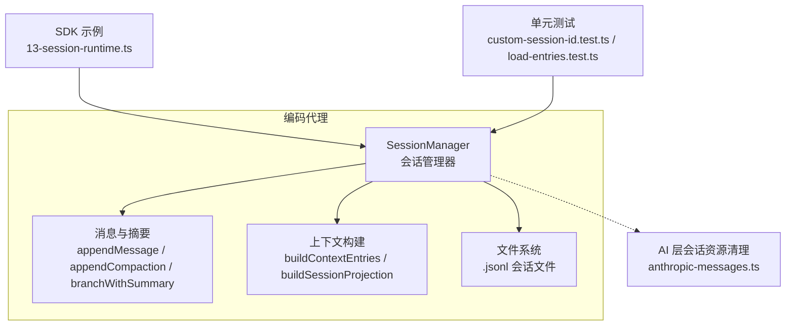
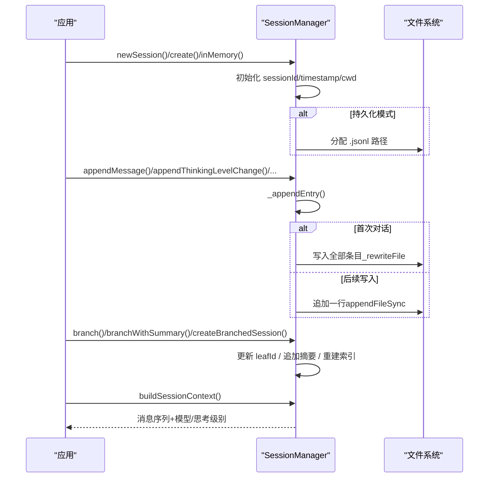
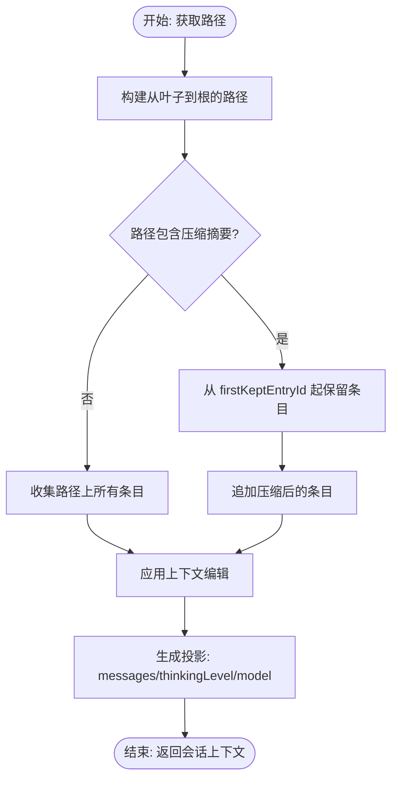
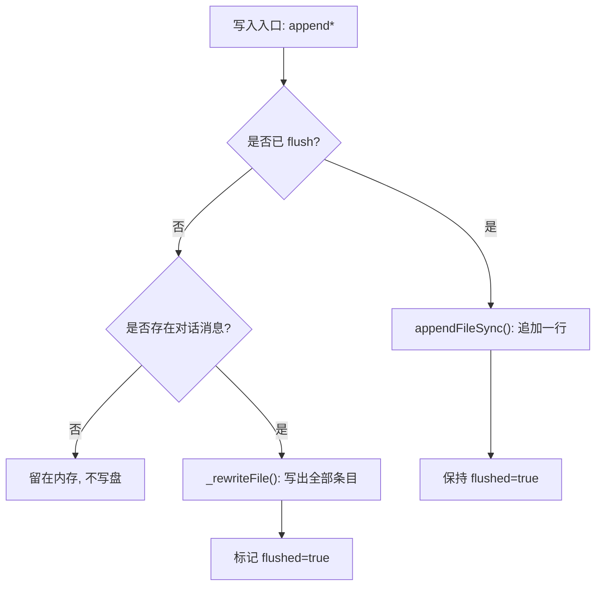
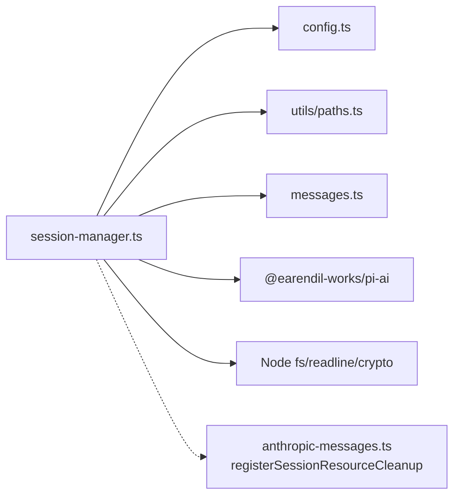

# 会话管理

<cite>
**本文引用的文件**   
- [session-manager.ts](https://github.com/FDE-GROUP/oh-my-fde/blob/omca/packages/coding-agent/src/core/session-manager.ts)
- [13-session-runtime.ts](https://github.com/FDE-GROUP/oh-my-fde/blob/omca/packages/coding-agent/examples/sdk/13-session-runtime.ts)
- [custom-session-id.test.ts](https://github.com/FDE-GROUP/oh-my-fde/blob/omca/packages/coding-agent/test/session-manager/custom-session-id.test.ts)
- [load-entries.test.ts](https://github.com/FDE-GROUP/oh-my-fde/blob/omca/packages/coding-agent/test/session-manager/load-entries.test.ts)
- [anthropic-messages.ts](https://github.com/FDE-GROUP/oh-my-fde/blob/omca/packages/ai/src/api/anthropic-messages.ts)
</cite>

## 目录
1. [引言](#引言)
2. [项目结构](#项目结构)
3. [核心组件](#核心组件)
4. [架构总览](#架构总览)
5. [详细组件分析](#详细组件分析)
6. [依赖关系分析](#依赖关系分析)
7. [性能与内存优化](#性能与内存优化)
8. [故障排查](#故障排查)
9. [结论](#结论)
10. [附录：配置与调优建议](#附录配置与调优建议)

## 引言
本文件面向需要理解并正确使用“交互式会话管理”的开发者与维护者，聚焦以下目标：
- 会话生命周期：创建、恢复、分支、清理与持久化。
- 状态转换：叶子节点指针、上下文投影、压缩摘要与分支摘要。
- 数据模型：会话头、条目类型、树结构与标签。
- 上下文保持：历史消息管理、上下文编辑、思考级别与模型切换。
- 性能与内存：流式读取、并发扫描、写入策略与边界保护。
- 使用方式：SDK 示例、测试用例与常见问题定位。

## 项目结构
会话管理的核心实现位于编码代理包的核心模块中，围绕一个可追加的 JSONL 会话文件组织。对外暴露的 API 包括：
- 会话工厂方法：创建、打开、继续最近会话、内存会话、跨目录分叉、按 ID 查找、列表等。
- 会话操作：追加消息、变更思考级别、模型切换、压缩、分支、标签、上下文编辑等。
- 上下文构建：从树路径计算 LLM 可见的消息序列，处理压缩与分支摘要。
- 持久化：延迟写首条对话、追加写、重写、并发发现与加载。



图表来源
- [session-manager.ts:988-1023](https://github.com/FDE-GROUP/oh-my-fde/blob/omca/packages/coding-agent/src/core/session-manager.ts#L988-L1023)
- [session-manager.ts:1058-1084](https://github.com/FDE-GROUP/oh-my-fde/blob/omca/packages/coding-agent/src/core/session-manager.ts#L1058-L1084)
- [session-manager.ts:1173-1207](https://github.com/FDE-GROUP/oh-my-fde/blob/omca/packages/coding-agent/src/core/session-manager.ts#L1173-L1207)
- [session-manager.ts:1475-1511](https://github.com/FDE-GROUP/oh-my-fde/blob/omca/packages/coding-agent/src/core/session-manager.ts#L1475-L1511)
- [13-session-runtime.ts:52-67](https://github.com/FDE-GROUP/oh-my-fde/blob/omca/packages/coding-agent/examples/sdk/13-session-runtime.ts#L52-L67)
- [anthropic-messages.ts:283-305](https://github.com/FDE-GROUP/oh-my-fde/blob/omca/packages/ai/src/api/anthropic-messages.ts#L283-L305)

章节来源
- [session-manager.ts:988-1023](https://github.com/FDE-GROUP/oh-my-fde/blob/omca/packages/coding-agent/src/core/session-manager.ts#L988-L1023)
- [13-session-runtime.ts:52-67](https://github.com/FDE-GROUP/oh-my-fde/blob/omca/packages/coding-agent/examples/sdk/13-session-runtime.ts#L52-L67)

## 核心组件
- SessionManager：会话的运行时容器，维护会话 ID、工作目录、持久化开关、文件路径、条目数组、索引、标签映射与当前叶子节点。
- 会话头 SessionHeader：会话元信息（版本、ID、时间戳、工作目录、父会话）。
- 会话条目 SessionEntry：消息、思考级别变更、模型变更、用量、压缩摘要、分支摘要、自定义扩展数据、标签、会话信息等。
- 上下文相关：会话投影 SessionProjection、会话上下文 SessionContext、上下文编辑 ContextEditEntry。
- 工具函数：迁移、解析、路径构建、上下文构建、会话发现与列表。

关键职责划分
- 生命周期：newSession、open、continueRecent、inMemory、forkFrom、createBranchedSession。
- 写入与持久化：_persist、_appendEntry、append* 系列方法。
- 树与分支：branch、resetLeaf、getBranch、getTree、createBranchedSession。
- 上下文：buildContextEntries、buildSessionProjection、buildSessionContext、projectContextEntry。
- 元数据与标签：appendLabelChange、getSessionName、labelsById。
- 发现与列表：findMostRecentSession、list、listAll、findById。

章节来源
- [session-manager.ts:43-55](https://github.com/FDE-GROUP/oh-my-fde/blob/omca/packages/coding-agent/src/core/session-manager.ts#L43-L55)
- [session-manager.ts:57-194](https://github.com/FDE-GROUP/oh-my-fde/blob/omca/packages/coding-agent/src/core/session-manager.ts#L57-L194)
- [session-manager.ts:209-227](https://github.com/FDE-GROUP/oh-my-fde/blob/omca/packages/coding-agent/src/core/session-manager.ts#L209-L227)
- [session-manager.ts:988-1023](https://github.com/FDE-GROUP/oh-my-fde/blob/omca/packages/coding-agent/src/core/session-manager.ts#L988-L1023)

## 架构总览
会话以“可追加的 JSONL 文件 + 内存树索引”的形式存在。每个条目拥有 id 与 parentId，形成一棵树；当前活跃路径由 leafId 指向最新条目。上下文构建时沿路径回溯到根，并根据压缩摘要决定保留哪些旧条目。

```mermaid
classDiagram
class SessionManager {
-sessionId : string
-sessionFile : string|undefined
-sessionDir : string
-cwd : string
-persist : boolean
-flushed : boolean
-fileEntries : FileEntry[]
-byId : Map~string, SessionEntry~
-labelsById : Map~string, string~
-labelTimestampsById : Map~string, string~
-leafId : string|null
+newSession(options)
+appendMessage(message)
+appendThinkingLevelChange(level)
+appendModelChange(provider,modelId)
+appendUsage(kind,provider,model,usage,note)
+appendCompaction(summary,firstKeptEntryId,tokensBefore,details,fromHook,usage)
+appendCustomEntry(customType,data)
+appendSessionInfo(name)
+appendCustomMessageEntry(customType,content,display,details)
+appendContextEdit(targetId,replacement)
+appendLabelChange(targetId,label)
+branch(branchFromId)
+resetLeaf()
+branchWithSummary(branchFromId,summary,details,fromHook,usage)
+createBranchedSession(leafId)
+buildContextEntries()
+buildSessionProjection()
+buildSessionContext()
+getHeader()
+getEntries()
+getTree()
+getSessionName()
}
class SessionHeader {
+type : "session"
+version : number
+id : string
+timestamp : string
+cwd : string
+parentSession? : string
}
class SessionEntry {
<<union>>
}
class CompactionEntry {
+type : "compaction"
+summary : string
+firstKeptEntryId : string
+tokensBefore : number
+details?
+usage?
+fromHook?
+systemMessage?
}
class BranchSummaryEntry {
+type : "branch_summary"
+fromId : string
+summary : string
+details?
+usage?
+fromHook?
}
class LabelEntry {
+type : "label"
+targetId : string
+label : string|undefined
}
class ContextEditEntry {
+type : "context_edit"
+targetId : string
+replacement : {content}|null
}
SessionManager --> SessionHeader : "持有"
SessionManager --> SessionEntry : "管理"
SessionEntry <|-- CompactionEntry
SessionEntry <|-- BranchSummaryEntry
SessionEntry <|-- LabelEntry
SessionEntry <|-- ContextEditEntry
```

图表来源
- [session-manager.ts:43-55](https://github.com/FDE-GROUP/oh-my-fde/blob/omca/packages/coding-agent/src/core/session-manager.ts#L43-L55)
- [session-manager.ts:91-194](https://github.com/FDE-GROUP/oh-my-fde/blob/omca/packages/coding-agent/src/core/session-manager.ts#L91-L194)
- [session-manager.ts:988-1023](https://github.com/FDE-GROUP/oh-my-fde/blob/omca/packages/coding-agent/src/core/session-manager.ts#L988-L1023)

## 详细组件分析

### 会话生命周期与状态转换
- 创建会话
  - newSession：生成会话 ID、时间戳与工作目录，初始化空条目数组，设置 flushed=false；若启用持久化则分配 .jsonl 文件名。
  - create：基于 cwd 与可选 sessionDir 创建持久化会话。
  - inMemory：不写盘，适合临时或测试场景。
- 恢复与会话打开
  - open：优先尝试快速读取头部；若头部过大则回退为完整加载；根据头部 cwd 或覆盖参数确定工作目录。
  - continueRecent：在默认会话目录下按修改时间找到最近会话并打开，否则新建。
- 分支与克隆
  - branch：将 leafId 移动到指定条目，后续追加将形成新分支。
  - resetLeaf：将 leafId 置空，下一次追加会创建根级条目。
  - branchWithSummary：移动叶子并追加分支摘要，记录被放弃路径的上下文。
  - createBranchedSession：从根到指定叶子的路径导出为新会话文件，保留标签与压缩摘要语义。
- 清理与释放
  - 会话结束时，上层应调用资源清理逻辑（例如 AI 层的会话资源清理），避免线程状态泄漏。



图表来源
- [session-manager.ts:1058-1084](https://github.com/FDE-GROUP/oh-my-fde/blob/omca/packages/coding-agent/src/core/session-manager.ts#L1058-L1084)
- [session-manager.ts:1173-1207](https://github.com/FDE-GROUP/oh-my-fde/blob/omca/packages/coding-agent/src/core/session-manager.ts#L1173-L1207)
- [session-manager.ts:1584-1636](https://github.com/FDE-GROUP/oh-my-fde/blob/omca/packages/coding-agent/src/core/session-manager.ts#L1584-L1636)
- [session-manager.ts:1643-1759](https://github.com/FDE-GROUP/oh-my-fde/blob/omca/packages/coding-agent/src/core/session-manager.ts#L1643-L1759)

章节来源
- [session-manager.ts:1058-1084](https://github.com/FDE-GROUP/oh-my-fde/blob/omca/packages/coding-agent/src/core/session-manager.ts#L1058-L1084)
- [session-manager.ts:1173-1207](https://github.com/FDE-GROUP/oh-my-fde/blob/omca/packages/coding-agent/src/core/session-manager.ts#L1173-L1207)
- [session-manager.ts:1584-1636](https://github.com/FDE-GROUP/oh-my-fde/blob/omca/packages/coding-agent/src/core/session-manager.ts#L1584-L1636)
- [session-manager.ts:1643-1759](https://github.com/FDE-GROUP/oh-my-fde/blob/omca/packages/coding-agent/src/core/session-manager.ts#L1643-L1759)

### 历史消息管理与上下文构建
- 路径与树
  - getBranch：从叶子回溯到根，返回路径上的所有条目。
  - getTree：构建带标签的树结构，子节点按时间排序。
- 上下文投影
  - buildContextEntries：沿路径收集条目，遇到压缩摘要时仅保留 firstKeptEntryId 之后的条目及压缩后内容。
  - projectContextEntry：将单个条目转换为模型可见消息，支持上下文编辑替换内容。
  - buildSessionProjection：合并 thinkingLevel、model 变更与上下文编辑，输出投影。
  - buildSessionContext：从投影提取最终消息序列与上下文元信息。
- 上下文编辑
  - appendContextEdit：在当前分支上对早期消息进行内容替换或删除（null 表示从上下文中剔除）。



图表来源
- [session-manager.ts:476-512](https://github.com/FDE-GROUP/oh-my-fde/blob/omca/packages/coding-agent/src/core/session-manager.ts#L476-L512)
- [session-manager.ts:519-541](https://github.com/FDE-GROUP/oh-my-fde/blob/omca/packages/coding-agent/src/core/session-manager.ts#L519-L541)
- [session-manager.ts:543-584](https://github.com/FDE-GROUP/oh-my-fde/blob/omca/packages/coding-agent/src/core/session-manager.ts#L543-L584)
- [session-manager.ts:1370-1409](https://github.com/FDE-GROUP/oh-my-fde/blob/omca/packages/coding-agent/src/core/session-manager.ts#L1370-L1409)

章节来源
- [session-manager.ts:476-512](https://github.com/FDE-GROUP/oh-my-fde/blob/omca/packages/coding-agent/src/core/session-manager.ts#L476-L512)
- [session-manager.ts:519-541](https://github.com/FDE-GROUP/oh-my-fde/blob/omca/packages/coding-agent/src/core/session-manager.ts#L519-L541)
- [session-manager.ts:543-584](https://github.com/FDE-GROUP/oh-my-fde/blob/omca/packages/coding-agent/src/core/session-manager.ts#L543-L584)
- [session-manager.ts:1370-1409](https://github.com/FDE-GROUP/oh-my-fde/blob/omca/packages/coding-agent/src/core/session-manager.ts#L1370-L1409)

### 持久化机制与写入策略
- 延迟写首条对话
  - _hasConversation：只有出现用户或助手消息时才真正落盘，避免无对话的“空会话”文件。
  - _persist：首次写入时重写整个文件，后续追加单行。
- 大文件与头部扫描
  - loadEntriesFromFile：流式逐行解析，跳过坏行，保证健壮性。
  - readSessionHeader：限制头部扫描字节数，超大头部抛出专用错误，但全量加载仍可用于兼容。
- 并发与发现
  - findMostRecentSession：按 mtime 排序，快速定位最近会话。
  - list/listAll：并发扫描目录与文件，分批发布进度回调。



图表来源
- [session-manager.ts:1161-1190](https://github.com/FDE-GROUP/oh-my-fde/blob/omca/packages/coding-agent/src/core/session-manager.ts#L1161-L1190)
- [session-manager.ts:628-671](https://github.com/FDE-GROUP/oh-my-fde/blob/omca/packages/coding-agent/src/core/session-manager.ts#L628-L671)
- [session-manager.ts:686-728](https://github.com/FDE-GROUP/oh-my-fde/blob/omca/packages/coding-agent/src/core/session-manager.ts#L686-L728)
- [session-manager.ts:750-769](https://github.com/FDE-GROUP/oh-my-fde/blob/omca/packages/coding-agent/src/core/session-manager.ts#L750-L769)

章节来源
- [session-manager.ts:1161-1190](https://github.com/FDE-GROUP/oh-my-fde/blob/omca/packages/coding-agent/src/core/session-manager.ts#L1161-L1190)
- [session-manager.ts:628-671](https://github.com/FDE-GROUP/oh-my-fde/blob/omca/packages/coding-agent/src/core/session-manager.ts#L628-L671)
- [session-manager.ts:686-728](https://github.com/FDE-GROUP/oh-my-fde/blob/omca/packages/coding-agent/src/core/session-manager.ts#L686-L728)
- [session-manager.ts:750-769](https://github.com/FDE-GROUP/oh-my-fde/blob/omca/packages/coding-agent/src/core/session-manager.ts#L750-L769)

### 分支、标签与扩展点
- 分支
  - branch：移动叶子指针，不修改历史。
  - branchWithSummary：追加分支摘要，记录被放弃路径的上下文。
  - createBranchedSession：导出路径到新会话文件，重链标签与压缩摘要。
- 标签
  - appendLabelChange：为任意条目添加/清除标签，维护 labelsById 与 labelTimestampsById。
- 扩展点
  - CustomEntry：扩展私有状态，不参与 LLM 上下文。
  - CustomMessageEntry：扩展注入消息，参与 LLM 上下文并可控制 TUI 显示。
  - ContextEditEntry：在不破坏追加不可变性的前提下，对早期消息内容进行替换或删除。

章节来源
- [session-manager.ts:1584-1636](https://github.com/FDE-GROUP/oh-my-fde/blob/omca/packages/coding-agent/src/core/session-manager.ts#L1584-L1636)
- [session-manager.ts:1643-1759](https://github.com/FDE-GROUP/oh-my-fde/blob/omca/packages/coding-agent/src/core/session-manager.ts#L1643-L1759)
- [session-manager.ts:1452-1473](https://github.com/FDE-GROUP/oh-my-fde/blob/omca/packages/coding-agent/src/core/session-manager.ts#L1452-L1473)
- [session-manager.ts:118-165](https://github.com/FDE-GROUP/oh-my-fde/blob/omca/packages/coding-agent/src/core/session-manager.ts#L118-L165)
- [session-manager.ts:174-180](https://github.com/FDE-GROUP/oh-my-fde/blob/omca/packages/coding-agent/src/core/session-manager.ts#L174-L180)

### 会话配置选项与使用示例
- 创建选项
  - NewSessionOptions：id（自定义会话 ID）、parentSession（父会话路径）。
- SDK 示例
  - 13-session-runtime.ts：演示 newSession、switchSession、bindSession 的使用流程。
- 自定义会话 ID
  - custom-session-id.test.ts：验证自定义 ID 的合法性与行为。
- 内存会话
  - load-entries.test.ts：验证 from entries 构造的内存会话、ID 继承与未持久化行为。

章节来源
- [session-manager.ts:52-55](https://github.com/FDE-GROUP/oh-my-fde/blob/omca/packages/coding-agent/src/core/session-manager.ts#L52-L55)
- [13-session-runtime.ts:52-67](https://github.com/FDE-GROUP/oh-my-fde/blob/omca/packages/coding-agent/examples/sdk/13-session-runtime.ts#L52-L67)
- [custom-session-id.test.ts:9-30](https://github.com/FDE-GROUP/oh-my-fde/blob/omca/packages/coding-agent/test/session-manager/custom-session-id.test.ts#L9-L30)
- [load-entries.test.ts:111-144](https://github.com/FDE-GROUP/oh-my-fde/blob/omca/packages/coding-agent/test/session-manager/load-entries.test.ts#L111-L144)

## 依赖关系分析
- 内部依赖
  - 消息与摘要：messages.ts（用于创建分支摘要、压缩摘要、自定义消息等）。
  - 配置与路径：config.ts、utils/paths.ts（默认会话目录、路径规范化）。
  - AI 消息类型：@earendil-works/pi-ai（AgentMessage、SystemMessage、ImageContent 等）。
- 外部依赖
  - Node fs/fs/promises/readline/string_decoder：文件读写、流式读取、UTF-8 解码。
  - crypto/randomUUID：短 ID 生成。
  - AI 层会话资源清理：anthropic-messages.ts 提供 registerSessionResourceCleanup，用于释放线程状态等资源。



图表来源
- [session-manager.ts:1-41](https://github.com/FDE-GROUP/oh-my-fde/blob/omca/packages/coding-agent/src/core/session-manager.ts#L1-L41)
- [anthropic-messages.ts:283-305](https://github.com/FDE-GROUP/oh-my-fde/blob/omca/packages/ai/src/api/anthropic-messages.ts#L283-L305)

章节来源
- [session-manager.ts:1-41](https://github.com/FDE-GROUP/oh-my-fde/blob/omca/packages/coding-agent/src/core/session-manager.ts#L1-L41)
- [anthropic-messages.ts:283-305](https://github.com/FDE-GROUP/oh-my-fde/blob/omca/packages/ai/src/api/anthropic-messages.ts#L283-L305)

## 性能与内存优化
- 流式 I/O
  - SESSION_READ_BUFFER_SIZE 与 SESSION_HEADER_READ_BUFFER_SIZE：控制缓冲大小，避免一次性加载大文件。
  - MAX_SESSION_HEADER_SCAN_BYTES：限制头部扫描范围，防止超大头部阻塞。
- 写入优化
  - 首次对话前不写盘，减少无用文件。
  - 首次写入重写全量，后续追加单行，降低频繁 open/close 开销。
- 并发扫描
  - list/listAll：使用 mapWithConcurrency 控制并发度，分批发布进度，提升 UI 响应性。
- 内存占用
  - byId 与 labelsById 维持 O(n) 索引，避免重复遍历。
  - AI 层线程状态表有最大条目上限，自动淘汰最久未更新的会话，避免无限增长。

章节来源
- [session-manager.ts:605-608](https://github.com/FDE-GROUP/oh-my-fde/blob/omca/packages/coding-agent/src/core/session-manager.ts#L605-L608)
- [session-manager.ts:1161-1190](https://github.com/FDE-GROUP/oh-my-fde/blob/omca/packages/coding-agent/src/core/session-manager.ts#L1161-L1190)
- [session-manager.ts:902-919](https://github.com/FDE-GROUP/oh-my-fde/blob/omca/packages/coding-agent/src/core/session-manager.ts#L902-L919)
- [session-manager.ts:1916-2028](https://github.com/FDE-GROUP/oh-my-fde/blob/omca/packages/coding-agent/src/core/session-manager.ts#L1916-L2028)
- [anthropic-messages.ts:283-305](https://github.com/FDE-GROUP/oh-my-fde/blob/omca/packages/ai/src/api/anthropic-messages.ts#L283-L305)

## 故障排查
- 会话文件无效或损坏
  - 现象：open 时报错或无法识别。
  - 原因：非 pi 会话文件或头部非法。
  - 处理：检查文件是否以 session 头开头且包含有效 id；必要时用 loadEntriesFromFile 全量解析修复。
- 头部过大导致扫描失败
  - 现象：readSessionHeader 抛出 SessionHeaderScanLimitError。
  - 原因：头部超过扫描限制。
  - 处理：open 会自动回退为全量加载；建议检查是否有异常大的 header 字段。
- 写入失败导致内存与文件不一致
  - 现象：追加失败后内存状态回滚。
  - 原因：_appendEntry 捕获异常并撤销 entry。
  - 处理：确保底层文件系统可用；重试或降级到内存会话。
- 上下文编辑无效
  - 现象：appendContextEdit 抛错。
  - 原因：目标不在当前分支、目标不可编辑或 replacement 格式错误。
  - 处理：确认 targetId 在 getBranch() 结果中，且内容为 user/assistant/toolResult/custom。
- 自定义会话 ID 非法
  - 现象：newSession({ id }) 抛错。
  - 原因：不符合正则规则。
  - 处理：参考 assertValidSessionId 的规则调整 ID。
- 线程状态泄漏
  - 现象：长时间运行后内存增长。
  - 原因：未调用会话资源清理。
  - 处理：确保在会话结束时调用 AI 层的清理注册器。

章节来源
- [session-manager.ts:1025-1056](https://github.com/FDE-GROUP/oh-my-fde/blob/omca/packages/coding-agent/src/core/session-manager.ts#L1025-L1056)
- [session-manager.ts:686-728](https://github.com/FDE-GROUP/oh-my-fde/blob/omca/packages/coding-agent/src/core/session-manager.ts#L686-L728)
- [session-manager.ts:1192-1207](https://github.com/FDE-GROUP/oh-my-fde/blob/omca/packages/coding-agent/src/core/session-manager.ts#L1192-L1207)
- [session-manager.ts:1370-1409](https://github.com/FDE-GROUP/oh-my-fde/blob/omca/packages/coding-agent/src/core/session-manager.ts#L1370-L1409)
- [session-manager.ts:268-274](https://github.com/FDE-GROUP/oh-my-fde/blob/omca/packages/coding-agent/src/core/session-manager.ts#L268-L274)
- [anthropic-messages.ts:283-305](https://github.com/FDE-GROUP/oh-my-fde/blob/omca/packages/ai/src/api/anthropic-messages.ts#L283-L305)

## 结论
该会话管理系统通过“追加不可变条目 + 树索引 + 上下文投影”的设计，实现了高内聚、低耦合的会话生命周期管理。其优势在于：
- 强一致性与可追溯性：追加写入与树结构保证历史可审计。
- 可扩展性：自定义条目与上下文编辑满足复杂业务需求。
- 高性能：流式 I/O、并发扫描与智能写入策略兼顾吞吐与响应。
- 健壮性：迁移、容错解析与边界保护保障长期稳定性。

## 附录：配置与调优建议
- 会话目录
  - 使用 getDefaultSessionDir(cwd) 或自定义 sessionDir，避免跨项目污染。
- 会话 ID
  - 推荐业务侧生成稳定 ID，便于追踪与检索；注意校验规则。
- 持久化策略
  - 生产环境开启持久化；测试或临时任务使用 inMemory。
- 上下文编辑
  - 谨慎使用，仅在分支内对必要内容进行替换或删除，避免破坏共享历史。
- 压缩与分支摘要
  - 长会话建议配合压缩与分支摘要，减少上下文体积，提高推理效率。
- 资源清理
  - 会话结束时务必触发 AI 层资源清理，避免线程状态泄漏。