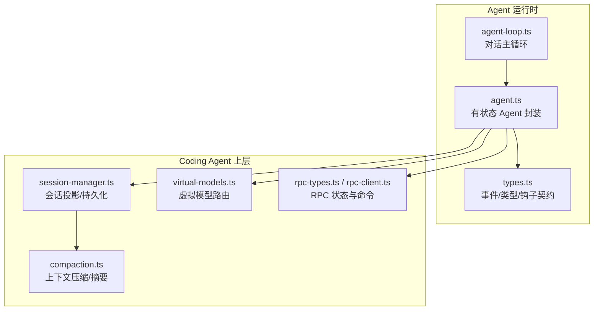
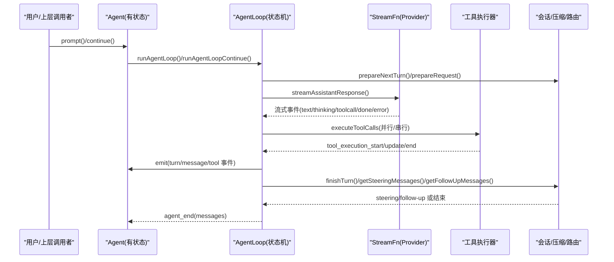
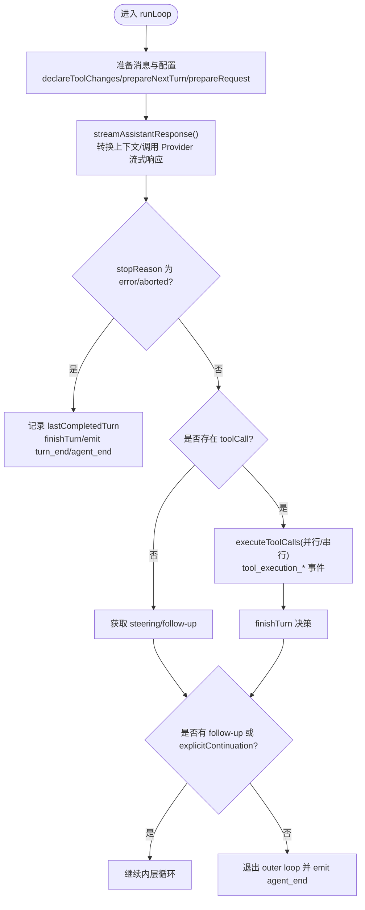
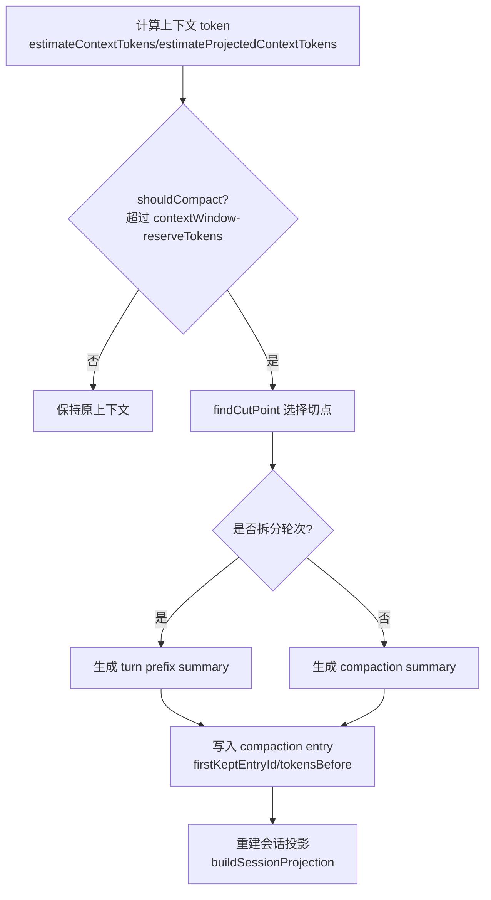
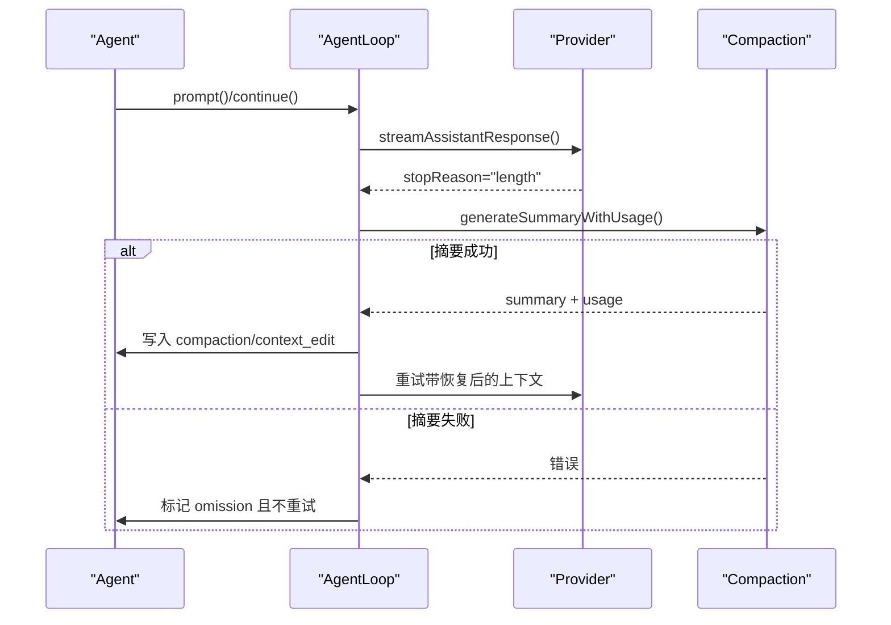
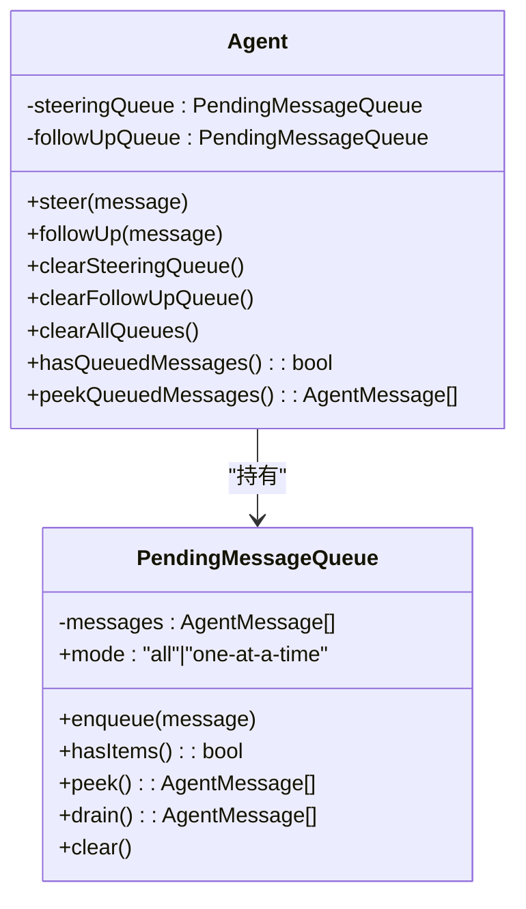
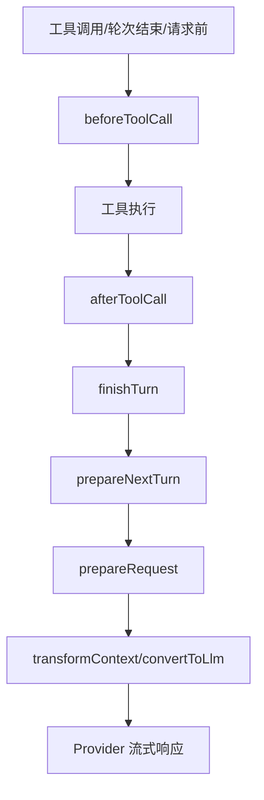
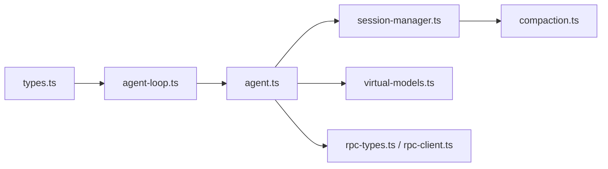

# 对话流程

<cite>
**本文引用的文件**   
- [packages/agent/src/agent-loop.ts](https://github.com/FDE-GROUP/oh-my-fde/blob/omca/packages/agent/src/agent-loop.ts)
- [packages/agent/src/agent.ts](https://github.com/FDE-GROUP/oh-my-fde/blob/omca/packages/agent/src/agent.ts)
- [packages/agent/src/types.ts](https://github.com/FDE-GROUP/oh-my-fde/blob/omca/packages/agent/src/types.ts)
- [packages/coding-agent/src/core/virtual-models.ts](https://github.com/FDE-GROUP/oh-my-fde/blob/omca/packages/coding-agent/src/core/virtual-models.ts)
- [packages/coding-agent/src/core/compaction/compaction.ts](https://github.com/FDE-GROUP/oh-my-fde/blob/omca/packages/coding-agent/src/core/compaction/compaction.ts)
- [packages/coding-agent/src/core/session-manager.ts](https://github.com/FDE-GROUP/oh-my-fde/blob/omca/packages/coding-agent/src/core/session-manager.ts)
- [packages/coding-agent/src/modes/rpc/rpc-types.ts](https://github.com/FDE-GROUP/oh-my-fde/blob/omca/packages/coding-agent/src/modes/rpc/rpc-types.ts)
- [packages/coding-agent/src/modes/rpc/rpc-client.ts](https://github.com/FDE-GROUP/oh-my-fde/blob/omca/packages/coding-agent/src/modes/rpc/rpc-client.ts)
- [packages/coding-agent/test/suite/agent-session-boundaries.test.ts](https://github.com/FDE-GROUP/oh-my-fde/blob/omca/packages/coding-agent/test/suite/agent-session-boundaries.test.ts)
</cite>

## 目录
1. [引言](#引言)
2. [项目结构](#项目结构)
3. [核心组件](#核心组件)
4. [架构总览](#架构总览)
5. [详细组件分析](#详细组件分析)
6. [依赖关系分析](#依赖关系分析)
7. [性能与并发特性](#性能与并发特性)
8. [故障排查指南](#故障排查指南)
9. [结论](#结论)
10. [附录：API 与配置速查](#附录api-与配置速查)

## 引言
本文面向“对话流程管理”的完整技术文档，覆盖以下主题：
- 对话状态机、消息路由、响应生成流程
- 对话轮次管理、上下文窗口控制、记忆机制
- 对话中断处理、恢复策略、并发对话支持
- 对话流定制、钩子函数使用与调试技巧

本仓库采用多包架构：agent 包提供低层 Agent 循环与事件模型；coding-agent 包在之上实现会话持久化、压缩（Compaction）、虚拟模型路由、RPC 模式等能力。

## 项目结构
围绕对话流程的关键代码分布在以下位置：
- agent 包：Agent 状态机、工具执行、事件流、类型定义
- coding-agent 包：会话管理、上下文投影、压缩摘要、虚拟模型路由、RPC 接口



**图表来源**
- [packages/agent/src/agent-loop.ts:47-134](https://github.com/FDE-GROUP/oh-my-fde/blob/omca/packages/agent/src/agent-loop.ts#L47-L134)
- [packages/agent/src/agent.ts:194-263](https://github.com/FDE-GROUP/oh-my-fde/blob/omca/packages/agent/src/agent.ts#L194-L263)
- [packages/agent/src/types.ts:193-342](https://github.com/FDE-GROUP/oh-my-fde/blob/omca/packages/agent/src/types.ts#L193-L342)
- [packages/coding-agent/src/core/session-manager.ts:439-584](https://github.com/FDE-GROUP/oh-my-fde/blob/omca/packages/coding-agent/src/core/session-manager.ts#L439-L584)
- [packages/coding-agent/src/core/compaction/compaction.ts:120-130](https://github.com/FDE-GROUP/oh-my-fde/blob/omca/packages/coding-agent/src/core/compaction/compaction.ts#L120-L130)
- [packages/coding-agent/src/core/virtual-models.ts:1-25](https://github.com/FDE-GROUP/oh-my-fde/blob/omca/packages/coding-agent/src/core/virtual-models.ts#L1-L25)
- [packages/coding-agent/src/modes/rpc/rpc-types.ts:96-135](https://github.com/FDE-GROUP/oh-my-fde/blob/omca/packages/coding-agent/src/modes/rpc/rpc-types.ts#L96-L135)

**章节来源**
- [packages/agent/src/agent-loop.ts:47-134](https://github.com/FDE-GROUP/oh-my-fde/blob/omca/packages/agent/src/agent-loop.ts#L47-L134)
- [packages/agent/src/agent.ts:194-263](https://github.com/FDE-GROUP/oh-my-fde/blob/omca/packages/agent/src/agent.ts#L194-L263)
- [packages/coding-agent/src/core/session-manager.ts:439-584](https://github.com/FDE-GROUP/oh-my-fde/blob/omca/packages/coding-agent/src/core/session-manager.ts#L439-L584)

## 核心组件
- Agent 循环（agent-loop.ts）：负责一次 prompt 到 agent_end 的状态转移、工具调用编排、steering/follow-up 注入、turn 边界事件。
- Agent 类（agent.ts）：维护消息历史、工具集、队列（steering/follow-up）、生命周期事件订阅、abort/reset/continue/prompt 等高层 API。
- 类型与钩子（types.ts）：StreamFn、ToolExecutionMode、QueueMode、Before/AfterToolCall、FinishTurn、PrepareRequest、PrepareNextTurn 等扩展点。
- 会话管理（session-manager.ts）：会话条目、投影、上下文构建、分支与压缩边界。
- 压缩与摘要（compaction.ts）：上下文 token 估算、切点选择、摘要生成、长度截断恢复策略。
- 虚拟模型路由（virtual-models.ts）：将逻辑上的“虚拟模型”映射到物理模型，携带路由状态。
- RPC 模式（rpc-types.ts / rpc-client.ts）：远程状态与命令（prompt/steer/follow_up/abort/clear_queue/new_session 等）。

**章节来源**
- [packages/agent/src/agent-loop.ts:172-330](https://github.com/FDE-GROUP/oh-my-fde/blob/omca/packages/agent/src/agent-loop.ts#L172-L330)
- [packages/agent/src/agent.ts:194-377](https://github.com/FDE-GROUP/oh-my-fde/blob/omca/packages/agent/src/agent.ts#L194-L377)
- [packages/agent/src/types.ts:193-342](https://github.com/FDE-GROUP/oh-my-fde/blob/omca/packages/agent/src/types.ts#L193-L342)
- [packages/coding-agent/src/core/session-manager.ts:439-584](https://github.com/FDE-GROUP/oh-my-fde/blob/omca/packages/coding-agent/src/core/session-manager.ts#L439-L584)
- [packages/coding-agent/src/core/compaction/compaction.ts:120-130](https://github.com/FDE-GROUP/oh-my-fde/blob/omca/packages/coding-agent/src/core/compaction/compaction.ts#L120-L130)
- [packages/coding-agent/src/core/virtual-models.ts:1-25](https://github.com/FDE-GROUP/oh-my-fde/blob/omca/packages/coding-agent/src/core/virtual-models.ts#L1-L25)
- [packages/coding-agent/src/modes/rpc/rpc-types.ts:96-135](https://github.com/FDE-GROUP/oh-my-fde/blob/omca/packages/coding-agent/src/modes/rpc/rpc-types.ts#L96-L135)

## 架构总览
下图展示从用户输入到 LLM 响应、工具执行、再到下一轮的完整数据流与控制流。



**图表来源**
- [packages/agent/src/agent.ts:379-467](https://github.com/FDE-GROUP/oh-my-fde/blob/omca/packages/agent/src/agent.ts#L379-L467)
- [packages/agent/src/agent-loop.ts:172-330](https://github.com/FDE-GROUP/oh-my-fde/blob/omca/packages/agent/src/agent-loop.ts#L172-L330)
- [packages/agent/src/agent-loop.ts:390-479](https://github.com/FDE-GROUP/oh-my-fde/blob/omca/packages/agent/src/agent-loop.ts#L390-L479)
- [packages/agent/src/agent-loop.ts:518-670](https://github.com/FDE-GROUP/oh-my-fde/blob/omca/packages/agent/src/agent-loop.ts#L518-L670)

## 详细组件分析

### 对话状态机与轮次管理（AgentLoop）
- 入口：agentLoop/agentLoopContinue 分别对应“新增提示”和“基于当前上下文继续”。
- 主循环 runLoop：
  - 外层循环：当存在 follow-up 或显式 continue 时继续。
  - 内层循环：处理 preparedMessages 与 pendingMessages（steering），然后发起一次 LLM 请求。
  - 工具调用：根据 ToolExecutionMode 决定串行或并行执行；若输出被截断（length），则批量失败工具调用并让模型重试。
  - 轮次结束：finishTurn 可返回 end/continue；若无自然请求，但存在 follow-up 或 explicitContinuation，则继续一轮。
- 事件：agent_start/turn_start/message_start/update/end/tool_execution_start/update/end/turn_end/agent_end。



**图表来源**
- [packages/agent/src/agent-loop.ts:172-330](https://github.com/FDE-GROUP/oh-my-fde/blob/omca/packages/agent/src/agent-loop.ts#L172-L330)
- [packages/agent/src/agent-loop.ts:390-479](https://github.com/FDE-GROUP/oh-my-fde/blob/omca/packages/agent/src/agent-loop.ts#L390-L479)
- [packages/agent/src/agent-loop.ts:518-670](https://github.com/FDE-GROUP/oh-my-fde/blob/omca/packages/agent/src/agent-loop.ts#L518-L670)

**章节来源**
- [packages/agent/src/agent-loop.ts:47-134](https://github.com/FDE-GROUP/oh-my-fde/blob/omca/packages/agent/src/agent-loop.ts#L47-L134)
- [packages/agent/src/agent-loop.ts:172-330](https://github.com/FDE-GROUP/oh-my-fde/blob/omca/packages/agent/src/agent-loop.ts#L172-L330)
- [packages/agent/src/agent-loop.ts:390-479](https://github.com/FDE-GROUP/oh-my-fde/blob/omca/packages/agent/src/agent-loop.ts#L390-L479)
- [packages/agent/src/agent-loop.ts:518-670](https://github.com/FDE-GROUP/oh-my-fde/blob/omca/packages/agent/src/agent-loop.ts#L518-L670)

### 消息路由与虚拟模型（Virtual Models）
- 虚拟模型不直接发送到 Provider，而是通过 route(request) 选择物理模型与 thinkingLevel，并可携带 state 持久化到会话分支。
- 路由原因：user/continuation/retry/direct，用于区分首次用户请求、循环续跑、自动重试、外部调用（如摘要）。
- 会话分支选择：getBranchSelection 会优先保留最近的 model_change，否则回退到最近成功的物理模型响应。
- withVirtualModels 将虚拟模型注入 Provider 目录，未路由的虚拟模型会抛出错误，避免误发。

```mermaid
classDiagram
class VirtualModelDefinition {
+provider : string
+id : string
+name : string
+thinkingLevels : ModelThinkingLevel[]
+contextWindow : number
+maxTokens : number
+input : ("text"|"image")[]
+route(request) : ModelRoute
}
class ModelRouteRequest {
+model : Model
+thinkingLevel : ModelThinkingLevel
+reason : "user"|"continuation"|"retry"|"direct"
+previous? : {model, thinkingLevel}
+failed? : {model, thinkingLevel, message}
+state? : unknown
+messages : Message[]
+signal? : AbortSignal
}
class ModelRoute {
+model : Model
+thinkingLevel : ModelThinkingLevel
+state? : unknown
}
VirtualModelDefinition --> ModelRouteRequest : "接收"
VirtualModelDefinition --> ModelRoute : "返回"
```

**图表来源**
- [packages/coding-agent/src/core/virtual-models.ts:52-102](https://github.com/FDE-GROUP/oh-my-fde/blob/omca/packages/coding-agent/src/core/virtual-models.ts#L52-L102)
- [packages/coding-agent/src/core/virtual-models.ts:128-187](https://github.com/FDE-GROUP/oh-my-fde/blob/omca/packages/coding-agent/src/core/virtual-models.ts#L128-L187)

**章节来源**
- [packages/coding-agent/src/core/virtual-models.ts:1-25](https://github.com/FDE-GROUP/oh-my-fde/blob/omca/packages/coding-agent/src/core/virtual-models.ts#L1-L25)
- [packages/coding-agent/src/core/virtual-models.ts:52-102](https://github.com/FDE-GROUP/oh-my-fde/blob/omca/packages/coding-agent/src/core/virtual-models.ts#L52-L102)
- [packages/coding-agent/src/core/virtual-models.ts:128-187](https://github.com/FDE-GROUP/oh-my-fde/blob/omca/packages/coding-agent/src/core/virtual-models.ts#L128-L187)

### 上下文窗口控制与记忆机制（Session + Compaction）
- 会话投影：buildSessionProjection/buildSessionContext 将 append-only 的 SessionEntry 树转换为模型可见的 AgentMessage[]，同时考虑 context_edit、compaction、branch_summary。
- 上下文估算：estimateContextTokens/estimateProjectedContextTokens 结合 AssistantMessage.usage 与启发式估算，判断是否触发压缩。
- 切点选择：findCutPoint 从新到旧累积估计 token，找到合法切点（不在 toolResult 上），必要时拆分轮次（isSplitTurn）。
- 摘要生成：generateSummary/generateSummaryWithUsage 将对话序列化为文本，调用 LLM 生成结构化摘要；completeSummarization 统一包装重试策略。
- 恢复策略：当 stopReason=length 且输出低于模型原始期望限制时，系统尝试“恢复性压缩”，必要时对截断片段做 omission 编辑，避免重复发送无效内容。



**图表来源**
- [packages/coding-agent/src/core/compaction/compaction.ts:196-269](https://github.com/FDE-GROUP/oh-my-fde/blob/omca/packages/coding-agent/src/core/compaction/compaction.ts#L196-L269)
- [packages/coding-agent/src/core/compaction/compaction.ts:446-500](https://github.com/FDE-GROUP/oh-my-fde/blob/omca/packages/coding-agent/src/core/compaction/compaction.ts#L446-L500)
- [packages/coding-agent/src/core/compaction/compaction.ts:618-753](https://github.com/FDE-GROUP/oh-my-fde/blob/omca/packages/coding-agent/src/core/compaction/compaction.ts#L618-L753)
- [packages/coding-agent/src/core/session-manager.ts:544-584](https://github.com/FDE-GROUP/oh-my-fde/blob/omca/packages/coding-agent/src/core/session-manager.ts#L544-L584)

**章节来源**
- [packages/coding-agent/src/core/session-manager.ts:439-584](https://github.com/FDE-GROUP/oh-my-fde/blob/omca/packages/coding-agent/src/core/session-manager.ts#L439-L584)
- [packages/coding-agent/src/core/compaction/compaction.ts:120-130](https://github.com/FDE-GROUP/oh-my-fde/blob/omca/packages/coding-agent/src/core/compaction/compaction.ts#L120-L130)
- [packages/coding-agent/src/core/compaction/compaction.ts:196-269](https://github.com/FDE-GROUP/oh-my-fde/blob/omca/packages/coding-agent/src/core/compaction/compaction.ts#L196-L269)
- [packages/coding-agent/src/core/compaction/compaction.ts:446-500](https://github.com/FDE-GROUP/oh-my-fde/blob/omca/packages/coding-agent/src/core/compaction/compaction.ts#L446-L500)
- [packages/coding-agent/src/core/compaction/compaction.ts:618-753](https://github.com/FDE-GROUP/oh-my-fde/blob/omca/packages/coding-agent/src/core/compaction/compaction.ts#L618-L753)

### 对话中断处理与恢复策略
- 中断信号：Agent.runWithLifecycle 持有 AbortController，所有工具与 Provider 调用均透传 signal；beforeToolCall 与工具 execute 需检查并尊重中断。
- 运行失败：handleRunFailure 构造一条 assistant 消息（errorMessage/stopReason=error 或 aborted），并补齐 turn_end/agent_end 事件。
- 长度截断恢复：当检测到 length 停止且满足恢复条件时，系统通过 compaction 生成摘要并插入 context_edit 以省略不可信片段，随后重试。
- 测试覆盖：包括“中间成功轮次后重置恢复预算”“独立 follow-up 拥有独立的恢复预算”“恢复压缩失败时保留 omission 且不重试”等场景。



**图表来源**
- [packages/agent/src/agent.ts:517-558](https://github.com/FDE-GROUP/oh-my-fde/blob/omca/packages/agent/src/agent.ts#L517-L558)
- [packages/coding-agent/src/core/compaction/compaction.ts:618-753](https://github.com/FDE-GROUP/oh-my-fde/blob/omca/packages/coding-agent/src/core/compaction/compaction.ts#L618-L753)
- [packages/coding-agent/test/suite/agent-session-boundaries.test.ts:780-863](https://github.com/FDE-GROUP/oh-my-fde/blob/omca/packages/coding-agent/test/suite/agent-session-boundaries.test.ts#L780-L863)

**章节来源**
- [packages/agent/src/agent.ts:517-558](https://github.com/FDE-GROUP/oh-my-fde/blob/omca/packages/agent/src/agent.ts#L517-L558)
- [packages/coding-agent/src/core/compaction/compaction.ts:618-753](https://github.com/FDE-GROUP/oh-my-fde/blob/omca/packages/coding-agent/src/core/compaction/compaction.ts#L618-L753)
- [packages/coding-agent/test/suite/agent-session-boundaries.test.ts:780-863](https://github.com/FDE-GROUP/oh-my-fde/blob/omca/packages/coding-agent/test/suite/agent-session-boundaries.test.ts#L780-L863)

### 并发对话支持与队列调度
- Agent 内部维护两个队列：steeringQueue（即时注入）与 followUpQueue（等待 agent 自然停止后注入）。
- QueueMode：all 一次性注入全部；one-at-a-time 每次只注入最老的一条。
- RPC 模式暴露 clear_queue 命令，客户端可清空待处理队列并获取剩余 steering/follow-up。
- 测试验证了 turn_end 交接处队列调度的稳定性。



**图表来源**
- [packages/agent/src/agent.ts:149-180](https://github.com/FDE-GROUP/oh-my-fde/blob/omca/packages/agent/src/agent.ts#L149-L180)
- [packages/agent/src/agent.ts:290-342](https://github.com/FDE-GROUP/oh-my-fde/blob/omca/packages/agent/src/agent.ts#L290-L342)
- [packages/coding-agent/src/modes/rpc/rpc-types.ts:116-135](https://github.com/FDE-GROUP/oh-my-fde/blob/omca/packages/coding-agent/src/modes/rpc/rpc-types.ts#L116-L135)
- [packages/coding-agent/test/rpc-client-clear-queue.test.ts:1-29](https://github.com/FDE-GROUP/oh-my-fde/blob/omca/packages/coding-agent/test/rpc-client-clear-queue.test.ts#L1-L29)

**章节来源**
- [packages/agent/src/agent.ts:149-180](https://github.com/FDE-GROUP/oh-my-fde/blob/omca/packages/agent/src/agent.ts#L149-L180)
- [packages/agent/src/agent.ts:290-342](https://github.com/FDE-GROUP/oh-my-fde/blob/omca/packages/agent/src/agent.ts#L290-L342)
- [packages/coding-agent/src/modes/rpc/rpc-types.ts:116-135](https://github.com/FDE-GROUP/oh-my-fde/blob/omca/packages/coding-agent/src/modes/rpc/rpc-types.ts#L116-L135)
- [packages/coding-agent/test/rpc-client-clear-queue.test.ts:1-29](https://github.com/FDE-GROUP/oh-my-fde/blob/omca/packages/coding-agent/test/rpc-client-clear-queue.test.ts#L1-L29)

### 钩子函数与对话流定制
- beforeToolCall/afterToolCall：在执行前后拦截，可阻断执行、替换结果、设置 terminate 提示提前结束批次。
- finishTurn：在 turn 结束时决定是否继续或终止；可用于触发压缩、注入系统指令、切换模型。
- prepareRequest：每次请求前可更新 context/model/thinkingLevel。
- prepareNextTurn：在 turn_end 之后、下一次 provider 请求之前，可追加 messages 或替换上下文/模型/思考级别。
- transformContext/convertToLlm：在 LLM 边界进行上下文裁剪、过滤 UI 消息、自定义消息转标准消息。



**图表来源**
- [packages/agent/src/types.ts:319-342](https://github.com/FDE-GROUP/oh-my-fde/blob/omca/packages/agent/src/types.ts#L319-L342)
- [packages/agent/src/types.ts:256-280](https://github.com/FDE-GROUP/oh-my-fde/blob/omca/packages/agent/src/types.ts#L256-L280)
- [packages/agent/src/types.ts:224-244](https://github.com/FDE-GROUP/oh-my-fde/blob/omca/packages/agent/src/types.ts#L224-L244)
- [packages/agent/src/types.ts:196-222](https://github.com/FDE-GROUP/oh-my-fde/blob/omca/packages/agent/src/types.ts#L196-L222)

**章节来源**
- [packages/agent/src/types.ts:193-342](https://github.com/FDE-GROUP/oh-my-fde/blob/omca/packages/agent/src/types.ts#L193-L342)

## 依赖关系分析
- AgentLoop 依赖 types.ts 定义的 StreamFn、ToolExecutionMode、QueueMode 以及各类钩子契约。
- Agent 类组合 PendingMessageQueue，并通过 createLoopConfig 将钩子与队列接入 AgentLoop。
- Coding-Agent 的 session-manager 与 compaction 在 Agent 之上提供持久化与上下文管理。
- virtual-models 作为 Provider 目录增强，屏蔽虚拟模型，确保只有物理模型进入 Provider。
- RPC 模式通过 rpc-types 暴露状态与命令，rpc-client 提供客户端方法（如 clearQueue）。



**图表来源**
- [packages/agent/src/types.ts:193-342](https://github.com/FDE-GROUP/oh-my-fde/blob/omca/packages/agent/src/types.ts#L193-L342)
- [packages/agent/src/agent-loop.ts:172-330](https://github.com/FDE-GROUP/oh-my-fde/blob/omca/packages/agent/src/agent-loop.ts#L172-L330)
- [packages/agent/src/agent.ts:194-263](https://github.com/FDE-GROUP/oh-my-fde/blob/omca/packages/agent/src/agent.ts#L194-L263)
- [packages/coding-agent/src/core/session-manager.ts:439-584](https://github.com/FDE-GROUP/oh-my-fde/blob/omca/packages/coding-agent/src/core/session-manager.ts#L439-L584)
- [packages/coding-agent/src/core/compaction/compaction.ts:120-130](https://github.com/FDE-GROUP/oh-my-fde/blob/omca/packages/coding-agent/src/core/compaction/compaction.ts#L120-L130)
- [packages/coding-agent/src/core/virtual-models.ts:1-25](https://github.com/FDE-GROUP/oh-my-fde/blob/omca/packages/coding-agent/src/core/virtual-models.ts#L1-L25)
- [packages/coding-agent/src/modes/rpc/rpc-types.ts:96-135](https://github.com/FDE-GROUP/oh-my-fde/blob/omca/packages/coding-agent/src/modes/rpc/rpc-types.ts#L96-L135)

**章节来源**
- [packages/agent/src/types.ts:193-342](https://github.com/FDE-GROUP/oh-my-fde/blob/omca/packages/agent/src/types.ts#L193-L342)
- [packages/agent/src/agent-loop.ts:172-330](https://github.com/FDE-GROUP/oh-my-fde/blob/omca/packages/agent/src/agent-loop.ts#L172-L330)
- [packages/agent/src/agent.ts:194-263](https://github.com/FDE-GROUP/oh-my-fde/blob/omca/packages/agent/src/agent.ts#L194-L263)
- [packages/coding-agent/src/core/session-manager.ts:439-584](https://github.com/FDE-GROUP/oh-my-fde/blob/omca/packages/coding-agent/src/core/session-manager.ts#L439-L584)
- [packages/coding-agent/src/core/compaction/compaction.ts:120-130](https://github.com/FDE-GROUP/oh-my-fde/blob/omca/packages/coding-agent/src/core/compaction/compaction.ts#L120-L130)
- [packages/coding-agent/src/core/virtual-models.ts:1-25](https://github.com/FDE-GROUP/oh-my-fde/blob/omca/packages/coding-agent/src/core/virtual-models.ts#L1-L25)
- [packages/coding-agent/src/modes/rpc/rpc-types.ts:96-135](https://github.com/FDE-GROUP/oh-my-fde/blob/omca/packages/coding-agent/src/modes/rpc/rpc-types.ts#L96-L135)

## 性能与并发特性
- 工具执行模式：
  - sequential：逐个准备、执行、收尾，顺序保证强。
  - parallel：顺序预检工具，允许的工具并发执行；tool_execution_end 按完成顺序发出，tool-result 消息按助手源顺序发出。
- 流式响应：streamAssistantResponse 将 Provider 事件映射为 message_update，减少内存峰值并提升交互体验。
- 上下文估算：estimateContextTokens 使用启发式估算，避免频繁精确计数；estimateProjectedContextTokens 在编辑/压缩后重新评估。
- 压缩阈值：shouldCompact 基于 contextWindow-reserveTokens 触发，避免接近上限时的抖动。

[本节为通用性能讨论，不直接分析具体文件]

## 故障排查指南
- 常见错误与定位：
  - “Cannot continue from message role: assistant”：说明上下文末尾不是 user/toolResult，无法继续。
  - “No messages to continue from”：上下文为空或仅有 system 消息。
  - “Agent is already processing.”：并发调用 prompt/continue 冲突，应先 wait 或 steer/followUp。
  - “Operation aborted”：AbortSignal 被触发，检查外部取消逻辑。
- 诊断建议：
  - 监听 agent/turn/message/tool 事件，确认状态转移是否符合预期。
  - 使用 peekQueuedMessages 查看即将注入的消息。
  - 检查 finishTurn/prepareNextTurn/prepareRequest 返回值是否意外改变调度。
  - 对于长度截断问题，查看是否触发了恢复性压缩，以及摘要是否成功。

**章节来源**
- [packages/agent/src/agent.ts:382-420](https://github.com/FDE-GROUP/oh-my-fde/blob/omca/packages/agent/src/agent.ts#L382-L420)
- [packages/agent/src/agent.ts:517-558](https://github.com/FDE-GROUP/oh-my-fde/blob/omca/packages/agent/src/agent.ts#L517-L558)
- [packages/coding-agent/test/suite/agent-session-boundaries.test.ts:1033-1063](https://github.com/FDE-GROUP/oh-my-fde/blob/omca/packages/coding-agent/test/suite/agent-session-boundaries.test.ts#L1033-L1063)

## 结论
该对话流程以 AgentLoop 为核心状态机，配合 Agent 类的队列与生命周期管理，形成可扩展、可中断、可恢复的对话引擎。上层通过 session-manager 与 compaction 实现长会话的上下文管理与记忆机制，virtual-models 提供灵活的路由策略，RPC 模式支持进程外控制。通过丰富的钩子（before/afterToolCall、finishTurn、prepareRequest、prepareNextTurn、transformContext、convertToLlm），可在不同阶段定制行为，满足复杂业务需求。

[本节为总结性内容，不直接分析具体文件]

## 附录：API 与配置速查
- 关键 API
  - Agent.prompt()/continue()/steer()/followUp()/clearAllQueues()/abort()/reset()
  - Agent.subscribe(listener)
  - Agent.state：systemPrompt/model/thinkingLevel/tools/messages/isStreaming/streamingMessage/pendingToolCalls/errorMessage
- 关键配置（AgentOptions）
  - convertToLlm/transformContext/streamFn/getApiKey/onPayload/onResponse/onProviderStreamEvent
  - beforeToolCall/afterToolCall/finishTurn/prepareRequest/prepareNextTurn/prepareNextTurnWithContext
  - steeringMode/followUpMode/sessionId/thinkingBudgets/transport/maxRetryDelayMs/toolExecution/identity
- RPC 命令（示例）
  - prompt/steer/follow_up/abort/clear_queue/new_session
  - set_steering_mode/cycle_model/set_thinking_level/cycle_thinking_level/get_available_models/get_available_thinking_levels

**章节来源**
- [packages/agent/src/agent.ts:114-147](https://github.com/FDE-GROUP/oh-my-fde/blob/omca/packages/agent/src/agent.ts#L114-L147)
- [packages/agent/src/agent.ts:265-377](https://github.com/FDE-GROUP/oh-my-fde/blob/omca/packages/agent/src/agent.ts#L265-L377)
- [packages/coding-agent/src/modes/rpc/rpc-client.ts:264-312](https://github.com/FDE-GROUP/oh-my-fde/blob/omca/packages/coding-agent/src/modes/rpc/rpc-client.ts#L264-L312)
- [packages/coding-agent/src/modes/rpc/rpc-types.ts:96-135](https://github.com/FDE-GROUP/oh-my-fde/blob/omca/packages/coding-agent/src/modes/rpc/rpc-types.ts#L96-L135)