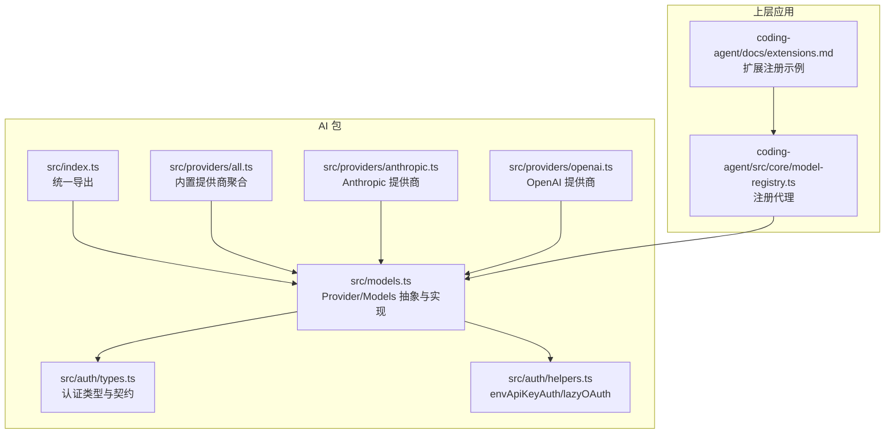
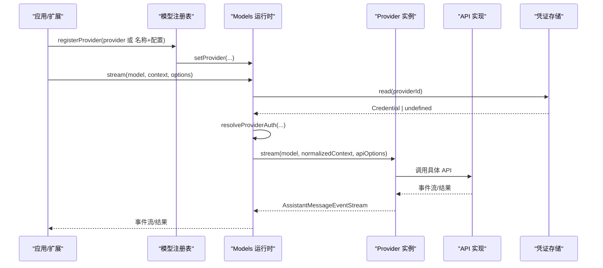
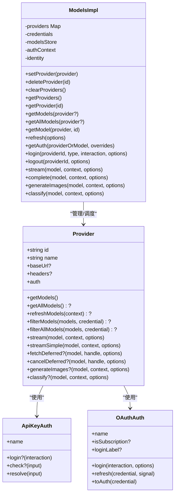
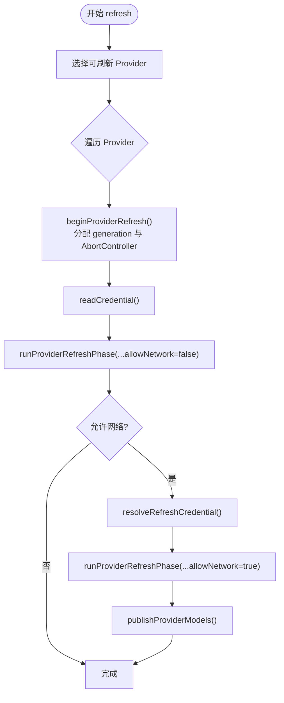
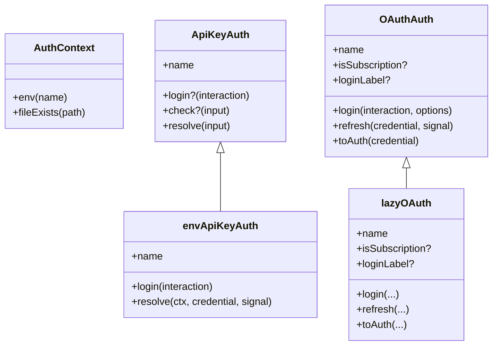
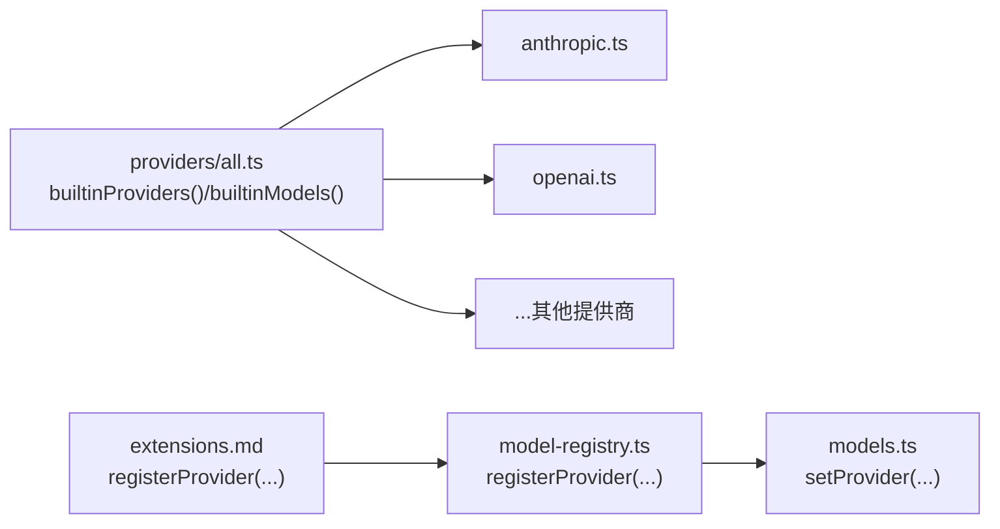
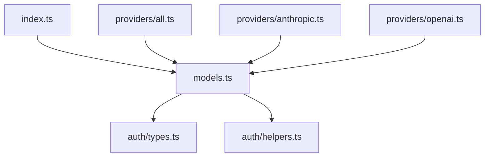
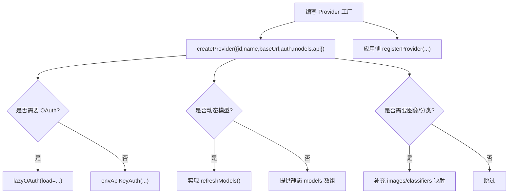

# 提供商抽象架构

<cite>
**本文引用的文件**   
- [packages/ai/src/index.ts](https://github.com/FDE-GROUP/oh-my-fde/blob/omca/packages/ai/src/index.ts)
- [packages/ai/src/models.ts](https://github.com/FDE-GROUP/oh-my-fde/blob/omca/packages/ai/src/models.ts)
- [packages/ai/src/providers/all.ts](https://github.com/FDE-GROUP/oh-my-fde/blob/omca/packages/ai/src/providers/all.ts)
- [packages/ai/src/providers/anthropic.ts](https://github.com/FDE-GROUP/oh-my-fde/blob/omca/packages/ai/src/providers/anthropic.ts)
- [packages/ai/src/providers/openai.ts](https://github.com/FDE-GROUP/oh-my-fde/blob/omca/packages/ai/src/providers/openai.ts)
- [packages/ai/src/auth/types.ts](https://github.com/FDE-GROUP/oh-my-fde/blob/omca/packages/ai/src/auth/types.ts)
- [packages/ai/src/auth/helpers.ts](https://github.com/FDE-GROUP/oh-my-fde/blob/omca/packages/ai/src/auth/helpers.ts)
- [packages/coding-agent/docs/extensions.md](https://github.com/FDE-GROUP/oh-my-fde/blob/omca/packages/coding-agent/docs/extensions.md)
- [packages/coding-agent/src/core/model-registry.ts](https://github.com/FDE-GROUP/oh-my-fde/blob/omca/packages/coding-agent/src/core/model-registry.ts)
</cite>

## 目录
1. [简介](#简介)
2. [项目结构](#项目结构)
3. [核心组件](#核心组件)
4. [架构总览](#架构总览)
5. [详细组件分析](#详细组件分析)
6. [依赖关系分析](#依赖关系分析)
7. [性能与并发特性](#性能与并发特性)
8. [故障排查指南](#故障排查指南)
9. [结论](#结论)
10. [附录：自定义提供商开发指南](#附录自定义提供商开发指南)

## 简介
本文件系统化梳理 LLM 提供商抽象层的设计与实现，重点解释统一的 Provider 接口、模型注册机制、运行时管理、工厂模式、依赖注入与生命周期管理。文档说明抽象层如何屏蔽不同提供商的 API 差异，提供一致的编程接口；并文档化提供商发现机制、动态加载与配置验证流程。最后给出自定义提供商开发的完整指南，包括接口实现、测试策略与最佳实践。

## 项目结构
该抽象层位于 `packages/ai` 中，核心由以下部分组成：
- 统一入口与类型导出：`src/index.ts`
- 运行时与 Provider 抽象：`src/models.ts`
- 内置提供商集合与发现：`src/providers/all.ts`
- 具体提供商示例：`src/providers/anthropic.ts`、`src/providers/openai.ts`
- 认证抽象与通用工具：`src/auth/types.ts`、`src/auth/helpers.ts`
- 扩展集成与注册方式（上层应用）：`packages/coding-agent/docs/extensions.md`、`packages/coding-agent/src/core/model-registry.ts`

**图表来源**
- [packages/ai/src/index.ts:1-48](https://github.com/FDE-GROUP/oh-my-fde/blob/omca/packages/ai/src/index.ts#L1-L48)
- [packages/ai/src/models.ts:147-247](https://github.com/FDE-GROUP/oh-my-fde/blob/omca/packages/ai/src/models.ts#L147-L247)
- [packages/ai/src/providers/all.ts:136-193](https://github.com/FDE-GROUP/oh-my-fde/blob/omca/packages/ai/src/providers/all.ts#L136-L193)
- [packages/ai/src/providers/anthropic.ts:74-90](https://github.com/FDE-GROUP/oh-my-fde/blob/omca/packages/ai/src/providers/anthropic.ts#L74-L90)
- [packages/ai/src/providers/openai.ts:9-35](https://github.com/FDE-GROUP/oh-my-fde/blob/omca/packages/ai/src/providers/openai.ts#L9-L35)
- [packages/ai/src/auth/types.ts:170-259](https://github.com/FDE-GROUP/oh-my-fde/blob/omca/packages/ai/src/auth/types.ts#L170-L259)
- [packages/ai/src/auth/helpers.ts:9-59](https://github.com/FDE-GROUP/oh-my-fde/blob/omca/packages/ai/src/auth/helpers.ts#L9-L59)
- [packages/coding-agent/docs/extensions.md:1984-2082](https://github.com/FDE-GROUP/oh-my-fde/blob/omca/packages/coding-agent/docs/extensions.md#L1984-L2082)
- [packages/coding-agent/src/core/model-registry.ts:206-244](https://github.com/FDE-GROUP/oh-my-fde/blob/omca/packages/coding-agent/src/core/model-registry.ts#L206-L244)

**章节来源**
- [packages/ai/src/index.ts:1-48](https://github.com/FDE-GROUP/oh-my-fde/blob/omca/packages/ai/src/index.ts#L1-L48)
- [packages/ai/src/providers/all.ts:136-193](https://github.com/FDE-GROUP/oh-my-fde/blob/omca/packages/ai/src/providers/all.ts#L136-L193)

## 核心组件
- Provider 抽象：定义提供商的统一能力边界，包括标识、基础 URL、认证、模型列表、刷新策略、流式与非流式推理、图像生成与分类等。
- Models 运行时：维护 Provider 集合，负责认证解析、模型发现与过滤、请求分发、并发刷新与发布持久化。
- 认证抽象：ApiKey/OAuth 两种认证路径，支持交互式登录、环境读取、令牌刷新与派生请求头。
- 提供商工厂：通过 `createProvider` 将模型清单与 API 实现组合为可注册的 Provider。
- 内置提供商聚合：集中构建所有内置提供商，并提供便捷初始化方法。

**章节来源**
- [packages/ai/src/models.ts:147-247](https://github.com/FDE-GROUP/oh-my-fde/blob/omca/packages/ai/src/models.ts#L147-L247)
- [packages/ai/src/models.ts:249-374](https://github.com/FDE-GROUP/oh-my-fde/blob/omca/packages/ai/src/models.ts#L249-L374)
- [packages/ai/src/auth/types.ts:170-259](https://github.com/FDE-GROUP/oh-my-fde/blob/omca/packages/ai/src/auth/types.ts#L170-L259)
- [packages/ai/src/providers/all.ts:136-193](https://github.com/FDE-GROUP/oh-my-fde/blob/omca/packages/ai/src/providers/all.ts#L136-L193)

## 架构总览
下图展示从应用侧到提供商实现的调用链：应用通过扩展或 SDK 注册 Provider，运行时在请求时解析认证并委派给对应 Provider，Provider 再调用具体 API 实现。

**图表来源**
- [packages/coding-agent/src/core/model-registry.ts:206-244](https://github.com/FDE-GROUP/oh-my-fde/blob/omca/packages/coding-agent/src/core/model-registry.ts#L206-L244)
- [packages/ai/src/models.ts:400-440](https://github.com/FDE-GROUP/oh-my-fde/blob/omca/packages/ai/src/models.ts#L400-L440)
- [packages/ai/src/models.ts:754-773](https://github.com/FDE-GROUP/oh-my-fde/blob/omca/packages/ai/src/models.ts#L754-L773)

## 详细组件分析

### Provider 抽象与工厂
- Provider 接口定义了提供商的元数据、认证、模型枚举、刷新、过滤、流式与非流式推理、图像生成与分类等能力。
- `createProvider` 工厂将模型清单与 API 实现组合为 Provider，支持单 API 或按 `model.api` 分发的多 API 映射，同时支持 images/classifiers 扩展点。
- 工厂会校验至少实现 chat/images/classifiers 之一，否则抛出错误。

**图表来源**
- [packages/ai/src/models.ts:147-247](https://github.com/FDE-GROUP/oh-my-fde/blob/omca/packages/ai/src/models.ts#L147-L247)
- [packages/ai/src/models.ts:400-440](https://github.com/FDE-GROUP/oh-my-fde/blob/omca/packages/ai/src/models.ts#L400-L440)
- [packages/ai/src/auth/types.ts:170-259](https://github.com/FDE-GROUP/oh-my-fde/blob/omca/packages/ai/src/auth/types.ts#L170-L259)

**章节来源**
- [packages/ai/src/models.ts:1072-1233](https://github.com/FDE-GROUP/oh-my-fde/blob/omca/packages/ai/src/models.ts#L1072-L1233)
- [packages/ai/src/models.ts:147-247](https://github.com/FDE-GROUP/oh-my-fde/blob/omca/packages/ai/src/models.ts#L147-L247)

### 模型注册与运行时管理
- `ModelsImpl` 以 Map 维护 Provider，提供 set/delete/clear 等变更操作，并在变更时中断旧刷新任务。
- 模型查询提供按 Provider 与全局视图，对异常 Provider 采用“尽力而为”策略（吞掉异常返回空）。
- 并发刷新：每个 Provider 有独立 generation 与 AbortController，新刷新会中止旧刷新；刷新过程先恢复本地缓存，再根据网络权限与凭据进行在线刷新。
- 发布管道：Provider 通过 `context.publish()` 提交持久化与内存更新，运行时串行化执行，保证一致性。

**图表来源**
- [packages/ai/src/models.ts:498-563](https://github.com/FDE-GROUP/oh-my-fde/blob/omca/packages/ai/src/models.ts#L498-L563)
- [packages/ai/src/models.ts:565-625](https://github.com/FDE-GROUP/oh-my-fde/blob/omca/packages/ai/src/models.ts#L565-L625)
- [packages/ai/src/models.ts:516-543](https://github.com/FDE-GROUP/oh-my-fde/blob/omca/packages/ai/src/models.ts#L516-L543)

**章节来源**
- [packages/ai/src/models.ts:400-440](https://github.com/FDE-GROUP/oh-my-fde/blob/omca/packages/ai/src/models.ts#L400-L440)
- [packages/ai/src/models.ts:498-563](https://github.com/FDE-GROUP/oh-my-fde/blob/omca/packages/ai/src/models.ts#L498-L563)
- [packages/ai/src/models.ts:565-625](https://github.com/FDE-GROUP/oh-my-fde/blob/omca/packages/ai/src/models.ts#L565-L625)

### 认证抽象与依赖注入
- `ApiKeyAuth` 与 `OAuthAuth` 分别描述两类认证方式，Provider 必须至少提供其一。
- `envApiKeyAuth` 提供标准 API Key 解析：优先使用已存储 key，其次按环境变量顺序解析，并包含交互式 login。
- `lazyOAuth` 延迟加载 OAuth 实现，避免将 Node-only 代码打入浏览器包体。
- `Models.getAuth()` 基于 Provider 与存储的 Credential 解析最终请求级 auth，并可合并 model 级别的 headers。

**图表来源**
- [packages/ai/src/auth/types.ts:96-110](https://github.com/FDE-GROUP/oh-my-fde/blob/omca/packages/ai/src/auth/types.ts#L96-L110)
- [packages/ai/src/auth/types.ts:170-259](https://github.com/FDE-GROUP/oh-my-fde/blob/omca/packages/ai/src/auth/types.ts#L170-L259)
- [packages/ai/src/auth/helpers.ts:9-59](https://github.com/FDE-GROUP/oh-my-fde/blob/omca/packages/ai/src/auth/helpers.ts#L9-L59)

**章节来源**
- [packages/ai/src/auth/types.ts:170-259](https://github.com/FDE-GROUP/oh-my-fde/blob/omca/packages/ai/src/auth/types.ts#L170-L259)
- [packages/ai/src/auth/helpers.ts:9-59](https://github.com/FDE-GROUP/oh-my-fde/blob/omca/packages/ai/src/auth/helpers.ts#L9-L59)
- [packages/ai/src/models.ts:754-773](https://github.com/FDE-GROUP/oh-my-fde/blob/omca/packages/ai/src/models.ts#L754-L773)

### 提供商发现与动态加载
- 内置提供商通过 `builtinProviders()` 集中构造，`builtinModels()` 一键创建包含所有内置 Provider 的 Models。
- 各 Provider 工厂（如 Anthropic、OpenAI）通过 `createProvider` 组装模型清单与 API 实现，并声明 baseUrl、auth、可选 filterAllModels 等。
- 上层扩展可通过 `registerProvider` 动态注册 Provider 或仅覆盖 baseUrl/apiKey 等配置。

**图表来源**
- [packages/ai/src/providers/all.ts:136-193](https://github.com/FDE-GROUP/oh-my-fde/blob/omca/packages/ai/src/providers/all.ts#L136-L193)
- [packages/ai/src/providers/anthropic.ts:74-90](https://github.com/FDE-GROUP/oh-my-fde/blob/omca/packages/ai/src/providers/anthropic.ts#L74-L90)
- [packages/ai/src/providers/openai.ts:9-35](https://github.com/FDE-GROUP/oh-my-fde/blob/omca/packages/ai/src/providers/openai.ts#L9-L35)
- [packages/coding-agent/docs/extensions.md:1984-2082](https://github.com/FDE-GROUP/oh-my-fde/blob/omca/packages/coding-agent/docs/extensions.md#L1984-L2082)
- [packages/coding-agent/src/core/model-registry.ts:206-244](https://github.com/FDE-GROUP/oh-my-fde/blob/omca/packages/coding-agent/src/core/model-registry.ts#L206-L244)

**章节来源**
- [packages/ai/src/providers/all.ts:136-193](https://github.com/FDE-GROUP/oh-my-fde/blob/omca/packages/ai/src/providers/all.ts#L136-L193)
- [packages/coding-agent/docs/extensions.md:1984-2082](https://github.com/FDE-GROUP/oh-my-fde/blob/omca/packages/coding-agent/docs/extensions.md#L1984-L2082)

### 抽象层如何屏蔽 API 差异
- Provider 暴露统一的 `stream`/`streamSimple`/`generateImages`/`classify` 等方法，内部通过 `api`/`images`/`classifiers` 映射到具体 API 实现。
- 模型对象携带 `api` 字段，运行时据此路由到对应实现；若未实现则返回错误结果，保证调用方无需感知底层差异。
- 通过 `hasApi` 类型守卫，可在运行时安全地窄化模型类型，获得强类型的流选项。

**章节来源**
- [packages/ai/src/models.ts:1072-1233](https://github.com/FDE-GROUP/oh-my-fde/blob/omca/packages/ai/src/models.ts#L1072-L1233)
- [packages/ai/src/models.ts:1247-1249](https://github.com/FDE-GROUP/oh-my-fde/blob/omca/packages/ai/src/models.ts#L1247-L1249)

## 依赖关系分析
- `index.ts` 仅导出类型与稳定能力，不包含副作用与提供商工厂，降低耦合。
- `models.ts` 依赖认证抽象与模型存储，不直接依赖具体提供商实现。
- `providers/all.ts` 聚合所有内置提供商，作为高层入口。
- 具体提供商（如 anthropic/openai）依赖各自的 API 实现与 OAuth 加载器。

**图表来源**
- [packages/ai/src/index.ts:1-48](https://github.com/FDE-GROUP/oh-my-fde/blob/omca/packages/ai/src/index.ts#L1-L48)
- [packages/ai/src/models.ts:1-74](https://github.com/FDE-GROUP/oh-my-fde/blob/omca/packages/ai/src/models.ts#L1-L74)
- [packages/ai/src/providers/all.ts:1-48](https://github.com/FDE-GROUP/oh-my-fde/blob/omca/packages/ai/src/providers/all.ts#L1-L48)

**章节来源**
- [packages/ai/src/index.ts:1-48](https://github.com/FDE-GROUP/oh-my-fde/blob/omca/packages/ai/src/index.ts#L1-L48)
- [packages/ai/src/providers/all.ts:1-48](https://github.com/FDE-GROUP/oh-my-fde/blob/omca/packages/ai/src/providers/all.ts#L1-L48)

## 性能与并发特性
- 并发刷新：多个 Provider 的模型刷新并行执行，单个 Provider 的新刷新会中止旧刷新，避免重复工作。
- 发布串行化：同一 Provider 的持久化与内存更新通过队列串行执行，避免竞态。
- 取消传播：所有长耗时操作均接受 `AbortSignal`，支持调用方取消。
- 懒加载：OAuth 实现通过 `lazyOAuth` 延迟加载，减少冷启动开销与包体积。

[本节为通用指导，不直接分析具体文件]

## 故障排查指南
- 未知 Provider：当调用 `login` 或 `getAuth` 传入未知 providerId 时，会抛出带明确代码的错误。
- 认证失败：OAuth 刷新失败会抛出特定错误码，但保留存储中的凭据以便重试；API Key 解析失败也会抛出错误。
- 模型刷新失败：`refresh()` 返回错误映射而非抛错，便于上层汇总处理。
- 未实现的能力：若 Provider 缺少 `generateImages`/`classify` 实现，调用会返回错误结果而非拒绝。

**章节来源**
- [packages/ai/src/models.ts:775-800](https://github.com/FDE-GROUP/oh-my-fde/blob/omca/packages/ai/src/models.ts#L775-L800)
- [packages/ai/src/models.ts:627-654](https://github.com/FDE-GROUP/oh-my-fde/blob/omca/packages/ai/src/models.ts#L627-L654)
- [packages/ai/src/models.ts:565-625](https://github.com/FDE-GROUP/oh-my-fde/blob/omca/packages/ai/src/models.ts#L565-L625)
- [packages/ai/src/models.ts:1072-1093](https://github.com/FDE-GROUP/oh-my-fde/blob/omca/packages/ai/src/models.ts#L1072-L1093)

## 结论
该抽象层通过统一的 Provider 接口与 Models 运行时，将不同 LLM 提供商的差异封装在内部，向上暴露一致的流式与非流式推理、图像生成与分类能力。工厂模式与依赖注入使提供商易于扩展与替换；并发刷新与发布管道确保模型目录的一致性与可用性；认证抽象与懒加载兼顾安全性与性能。上层应用可通过扩展机制动态注册与覆盖提供商，满足多样化部署场景。

[本节为总结性内容，不直接分析具体文件]

## 附录：自定义提供商开发指南

### 目标与范围
- 实现一个符合 Provider 接口的提供商，或通过工厂函数包装现有 API 实现。
- 支持至少一种认证方式（API Key 或 OAuth），并提供交互式登录与环境变量解析。
- 提供模型清单，可选择实现动态刷新与模型过滤。

### 步骤概览
1. 定义 Provider 工厂函数，调用 `createProvider` 组装 id/name/baseUrl/auth/models/api。
2. 实现认证逻辑：
   - 简单 API Key：使用 `envApiKeyAuth`。
   - 复杂环境/IAM：自定义 `ApiKeyAuth.resolve`。
   - OAuth：使用 `lazyOAuth` 包裹具体 OAuth 实现。
3. 提供模型清单：静态清单或实现 `refreshModels` 动态拉取。
4. 如需图像/分类能力，补充 `images`/`classifiers` 映射。
5. 在应用侧通过 `registerProvider` 注册，或覆盖已有 Provider 的配置。

**图表来源**
- [packages/ai/src/models.ts:1072-1233](https://github.com/FDE-GROUP/oh-my-fde/blob/omca/packages/ai/src/models.ts#L1072-L1233)
- [packages/ai/src/auth/helpers.ts:9-59](https://github.com/FDE-GROUP/oh-my-fde/blob/omca/packages/ai/src/auth/helpers.ts#L9-L59)
- [packages/coding-agent/docs/extensions.md:1984-2082](https://github.com/FDE-GROUP/oh-my-fde/blob/omca/packages/coding-agent/docs/extensions.md#L1984-L2082)

### 接口实现要点
- Provider 必须提供 `auth`，即使只是“检查是否配置”的轻量实现。
- `getModels()` 不得抛出异常；若抛出，运行时视为无模型。
- `refreshModels()` 应尊重 `signal`，并通过 `context.publish()` 提交持久化与内存更新。
- `filterModels`/`filterAllModels` 用于按凭据裁剪可用模型。

**章节来源**
- [packages/ai/src/models.ts:147-247](https://github.com/FDE-GROUP/oh-my-fde/blob/omca/packages/ai/src/models.ts#L147-L247)
- [packages/ai/src/models.ts:545-563](https://github.com/FDE-GROUP/oh-my-fde/blob/omca/packages/ai/src/models.ts#L545-L563)

### 测试策略
- 单元测试：
  - 认证解析：模拟 `ctx.env` 与存储，断言 `resolve` 输出。
  - 模型刷新：模拟网络与存储，断言 `publish` 调用与状态更新。
  - 能力缺失：断言未实现 `generateImages`/`classify` 时的错误结果。
- 集成测试：
  - 使用 `createModels()` 注册自定义 Provider，端到端验证流式与非流式调用。
  - 覆盖 OAuth 刷新与并发刷新取消场景。

[本节为通用指导，不直接分析具体文件]

### 最佳实践
- 使用 `lazyOAuth` 避免将 Node-only 代码打入浏览器包体。
- 在 `refreshModels` 中先恢复本地缓存，再进行网络访问，提升离线体验。
- 对可能失败的远端调用始终捕获异常，并以 ModelsError 上报，便于上层统一处理。
- 通过 `filterAllModels` 精确控制 OAuth 等凭据下的模型可见性。

**章节来源**
- [packages/ai/src/auth/helpers.ts:33-59](https://github.com/FDE-GROUP/oh-my-fde/blob/omca/packages/ai/src/auth/helpers.ts#L33-L59)
- [packages/ai/src/providers/openai.ts:23-35](https://github.com/FDE-GROUP/oh-my-fde/blob/omca/packages/ai/src/providers/openai.ts#L23-L35)