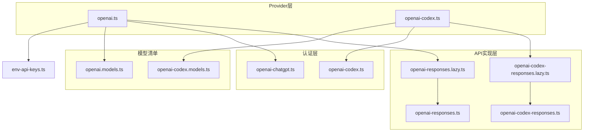
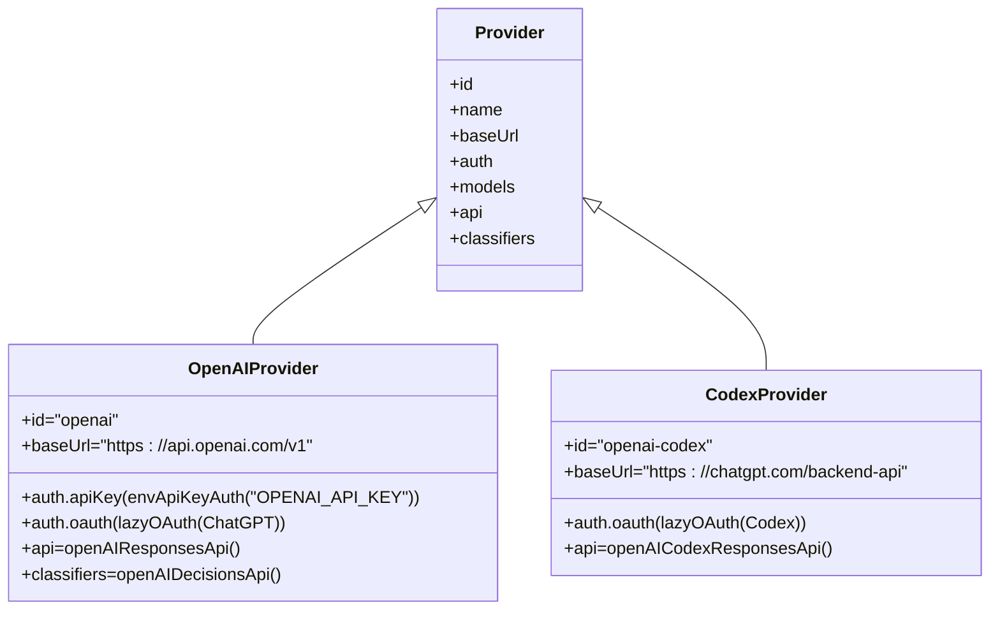
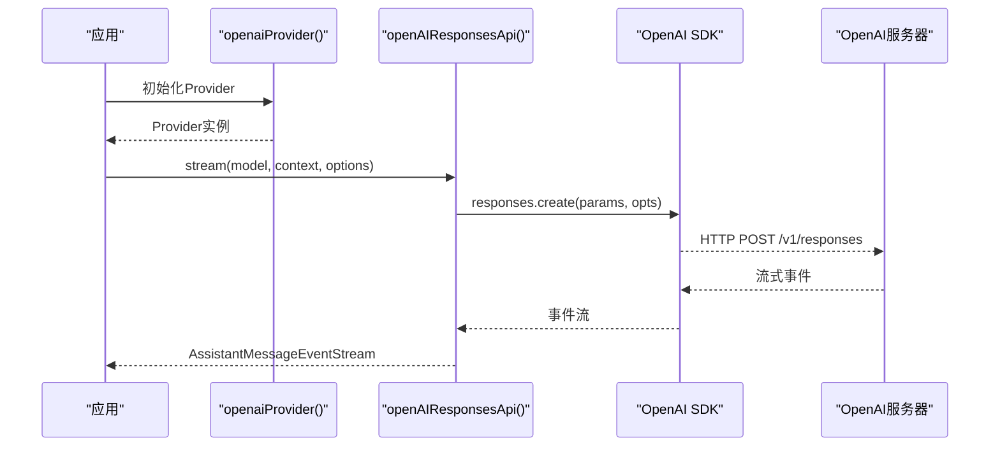
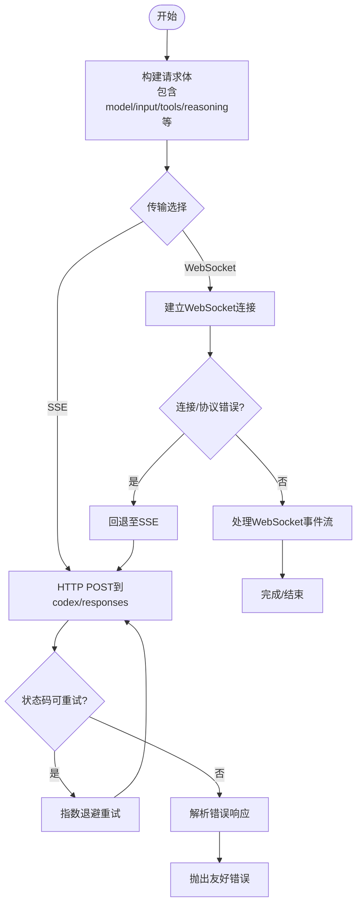
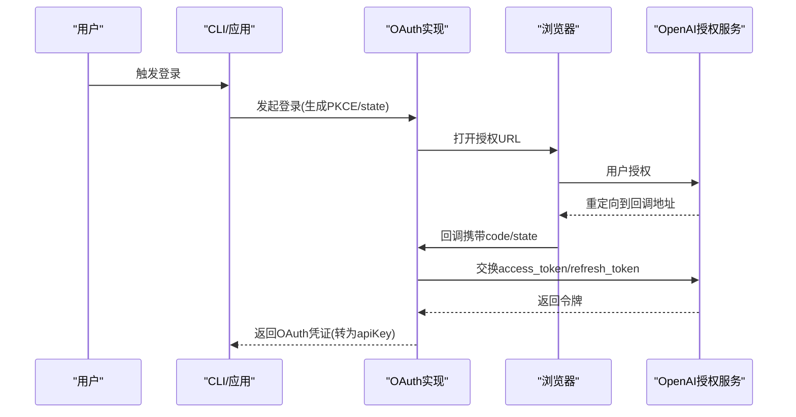
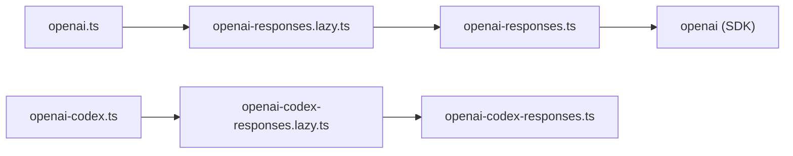

# OpenAI生态提供商

<cite>
**本文引用的文件**   
- [packages/ai/src/providers/openai.ts](https://github.com/FDE-GROUP/oh-my-coding-agent/blob/omca/packages/ai/src/providers/openai.ts)
- [packages/ai/src/providers/openai-codex.ts](https://github.com/FDE-GROUP/oh-my-coding-agent/blob/omca/packages/ai/src/providers/openai-codex.ts)
- [packages/ai/src/api/openai-responses.lazy.ts](https://github.com/FDE-GROUP/oh-my-coding-agent/blob/omca/packages/ai/src/api/openai-responses.lazy.ts)
- [packages/ai/src/api/openai-codex-responses.lazy.ts](https://github.com/FDE-GROUP/oh-my-coding-agent/blob/omca/packages/ai/src/api/openai-codex-responses.lazy.ts)
- [packages/ai/src/api/openai-responses.ts](https://github.com/FDE-GROUP/oh-my-coding-agent/blob/omca/packages/ai/src/api/openai-responses.ts)
- [packages/ai/src/api/openai-codex-responses.ts](https://github.com/FDE-GROUP/oh-my-coding-agent/blob/omca/packages/ai/src/api/openai-codex-responses.ts)
- [packages/ai/src/auth/oauth/openai-chatgpt.ts](https://github.com/FDE-GROUP/oh-my-coding-agent/blob/omca/packages/ai/src/auth/oauth/openai-chatgpt.ts)
- [packages/ai/src/auth/oauth/openai-codex.ts](https://github.com/FDE-GROUP/oh-my-coding-agent/blob/omca/packages/ai/src/auth/oauth/openai-codex.ts)
- [packages/ai/src/models.ts](https://github.com/FDE-GROUP/oh-my-coding-agent/blob/omca/packages/ai/src/models.ts)
- [packages/ai/src/env-api-keys.ts](https://github.com/FDE-GROUP/oh-my-coding-agent/blob/omca/packages/ai/src/env-api-keys.ts)
- [packages/ai/src/providers/openai.models.ts](https://github.com/FDE-GROUP/oh-my-coding-agent/blob/omca/packages/ai/src/providers/openai.models.ts)
- [packages/ai/src/providers/openai-codex.models.ts](https://github.com/FDE-GROUP/oh-my-coding-agent/blob/omca/packages/ai/src/providers/openai-codex.models.ts)
- [packages/coding-agent/test/auth-check.test.ts](https://github.com/FDE-GROUP/oh-my-coding-agent/blob/omca/packages/coding-agent/test/auth-check.test.ts)
</cite>

## 目录
1. [简介](#简介)
2. [项目结构](#项目结构)
3. [核心组件](#核心组件)
4. [架构总览](#架构总览)
5. [详细组件分析](#详细组件分析)
6. [依赖关系分析](#依赖关系分析)
7. [性能与速率限制](#性能与速率限制)
8. [故障排查指南](#故障排查指南)
9. [结论](#结论)
10. [附录：使用示例与最佳实践](#附录使用示例与最佳实践)

## 简介
本文件面向OpenAI生态提供商的集成与使用，覆盖OpenAI官方Responses API、Codex（Legacy）API、认证方式（API Key与OAuth）、环境变量配置、模型选择与调用流程。文档同时给出错误处理、速率限制、重试策略、性能优化建议，以及与标准OpenAI SDK的兼容性与差异说明。

## 项目结构
OpenAI生态在仓库中通过“Provider + API实现”的方式组织：
- Provider定义：openai、openai-codex
- API实现：openai-responses、openai-codex-responses
- OAuth实现：ChatGPT订阅登录、Codex登录
- 模型清单：openai.models.ts、openai-codex.models.ts
- 环境密钥映射：env-api-keys.ts

图表来源
- [packages/ai/src/providers/openai.ts:9-35](https://github.com/FDE-GROUP/oh-my-coding-agent/blob/omca/packages/ai/src/providers/openai.ts#L9-L35)
- [packages/ai/src/providers/openai-codex.ts:7-22](https://github.com/FDE-GROUP/oh-my-coding-agent/blob/omca/packages/ai/src/providers/openai-codex.ts#L7-L22)
- [packages/ai/src/api/openai-responses.lazy.ts:1-5](https://github.com/FDE-GROUP/oh-my-coding-agent/blob/omca/packages/ai/src/api/openai-responses.lazy.ts#L1-L5)
- [packages/ai/src/api/openai-codex-responses.lazy.ts:1-5](https://github.com/FDE-GROUP/oh-my-coding-agent/blob/omca/packages/ai/src/api/openai-codex-responses.lazy.ts#L1-L5)
- [packages/ai/src/api/openai-responses.ts:1-35](https://github.com/FDE-GROUP/oh-my-coding-agent/blob/omca/packages/ai/src/api/openai-responses.ts#L1-L35)
- [packages/ai/src/api/openai-codex-responses.ts:1-50](https://github.com/FDE-GROUP/oh-my-coding-agent/blob/omca/packages/ai/src/api/openai-codex-responses.ts#L1-L50)
- [packages/ai/src/auth/oauth/openai-chatgpt.ts:1-30](https://github.com/FDE-GROUP/oh-my-coding-agent/blob/omca/packages/ai/src/auth/oauth/openai-chatgpt.ts#L1-L30)
- [packages/ai/src/auth/oauth/openai-codex.ts:1-35](https://github.com/FDE-GROUP/oh-my-coding-agent/blob/omca/packages/ai/src/auth/oauth/openai-codex.ts#L1-L35)
- [packages/ai/src/providers/openai.models.ts:1-15](https://github.com/FDE-GROUP/oh-my-coding-agent/blob/omca/packages/ai/src/providers/openai.models.ts#L1-L15)
- [packages/ai/src/providers/openai-codex.models.ts:1-15](https://github.com/FDE-GROUP/oh-my-coding-agent/blob/omca/packages/ai/src/providers/openai-codex.models.ts#L1-L15)
- [packages/ai/src/env-api-keys.ts:90-91](https://github.com/FDE-GROUP/oh-my-coding-agent/blob/omca/packages/ai/src/env-api-keys.ts#L90-L91)

章节来源
- [packages/ai/src/providers/openai.ts:9-35](https://github.com/FDE-GROUP/oh-my-coding-agent/blob/omca/packages/ai/src/providers/openai.ts#L9-L35)
- [packages/ai/src/providers/openai-codex.ts:7-22](https://github.com/FDE-GROUP/oh-my-coding-agent/blob/omca/packages/ai/src/providers/openai-codex.ts#L7-L22)
- [packages/ai/src/env-api-keys.ts:90-91](https://github.com/FDE-GROUP/oh-my-coding-agent/blob/omca/packages/ai/src/env-api-keys.ts#L90-L91)

## 核心组件
- OpenAI Provider（官方Responses）
  - 标识：openai
  - 基础URL：https://api.openai.com/v1
  - 认证：API Key（OPENAI_API_KEY），支持OAuth（Sign in with ChatGPT）
  - API：openai-responses
  - 分类器：openai-decisions（仅API Key可用；OAuth时过滤掉classifier模型）
- OpenAI Codex Provider（Legacy）
  - 标识：openai-codex
  - 基础URL：https://chatgpt.com/backend-api
  - 认证：OAuth（ChatGPT Plus/Pro）
  - API：openai-codex-responses

章节来源
- [packages/ai/src/providers/openai.ts:9-35](https://github.com/FDE-GROUP/oh-my-coding-agent/blob/omca/packages/ai/src/providers/openai.ts#L9-L35)
- [packages/ai/src/providers/openai-codex.ts:7-22](https://github.com/FDE-GROUP/oh-my-coding-agent/blob/omca/packages/ai/src/providers/openai-codex.ts#L7-L22)

## 架构总览
OpenAI生态通过Provider工厂创建统一的Provider实例，内部绑定：
- baseUrl与auth（apiKey或oauth）
- models清单（由catalog生成）
- api/classifiers/images等能力映射

图表来源
- [packages/ai/src/models.ts:1072-1093](https://github.com/FDE-GROUP/oh-my-coding-agent/blob/omca/packages/ai/src/models.ts#L1072-L1093)
- [packages/ai/src/providers/openai.ts:9-35](https://github.com/FDE-GROUP/oh-my-coding-agent/blob/omca/packages/ai/src/providers/openai.ts#L9-L35)
- [packages/ai/src/providers/openai-codex.ts:7-22](https://github.com/FDE-GROUP/oh-my-coding-agent/blob/omca/packages/ai/src/providers/openai-codex.ts#L7-L22)

## 详细组件分析

### OpenAI官方Provider与Responses API
- Provider注册
  - id/name/baseUrl/auth/models/api/classifiers
  - OAuth仅允许Responses API，Classifier模型会被过滤
- API实现要点
  - 基于openai SDK的responses.create流式接口
  - 自动构建请求参数：messages/tools/reasoning/prompt_cache/service_tier等
  - 支持会话亲和头、身份头、工具语法属性
  - 错误格式化与用量统计（含service tier定价乘数）

图表来源
- [packages/ai/src/providers/openai.ts:9-35](https://github.com/FDE-GROUP/oh-my-coding-agent/blob/omca/packages/ai/src/providers/openai.ts#L9-L35)
- [packages/ai/src/api/openai-responses.lazy.ts:1-5](https://github.com/FDE-GROUP/oh-my-coding-agent/blob/omca/packages/ai/src/api/openai-responses.lazy.ts#L1-L5)
- [packages/ai/src/api/openai-responses.ts:155-273](https://github.com/FDE-GROUP/oh-my-coding-agent/blob/omca/packages/ai/src/api/openai-responses.ts#L155-L273)

章节来源
- [packages/ai/src/providers/openai.ts:9-35](https://github.com/FDE-GROUP/oh-my-coding-agent/blob/omca/packages/ai/src/providers/openai.ts#L9-L35)
- [packages/ai/src/api/openai-responses.ts:155-273](https://github.com/FDE-GROUP/oh-my-coding-agent/blob/omca/packages/ai/src/api/openai-responses.ts#L155-L273)
- [packages/ai/src/api/openai-responses.ts:295-338](https://github.com/FDE-GROUP/oh-my-coding-agent/blob/omca/packages/ai/src/api/openai-responses.ts#L295-L338)
- [packages/ai/src/api/openai-responses.ts:340-425](https://github.com/FDE-GROUP/oh-my-coding-agent/blob/omca/packages/ai/src/api/openai-responses.ts#L340-L425)

### OpenAI Codex Provider与Responses API
- Provider注册
  - id/name/baseUrl/auth/models/api
  - 仅支持OAuth（ChatGPT Plus/Pro）
- API实现要点
  - 支持WebSocket与SSE双通道，优先WebSocket，失败回退SSE
  - 请求体压缩（zstd）以降低带宽
  - 内置重试逻辑与速率限制处理（含429/5xx）
  - 解析服务等级（service_tier）并调整计费乘数

图表来源
- [packages/ai/src/api/openai-codex-responses.ts:246-512](https://github.com/FDE-GROUP/oh-my-coding-agent/blob/omca/packages/ai/src/api/openai-codex-responses.ts#L246-L512)
- [packages/ai/src/api/openai-codex-responses.ts:541-621](https://github.com/FDE-GROUP/oh-my-coding-agent/blob/omca/packages/ai/src/api/openai-codex-responses.ts#L541-L621)
- [packages/ai/src/api/openai-codex-responses.ts:662-675](https://github.com/FDE-GROUP/oh-my-coding-agent/blob/omca/packages/ai/src/api/openai-codex-responses.ts#L662-L675)

章节来源
- [packages/ai/src/providers/openai-codex.ts:7-22](https://github.com/FDE-GROUP/oh-my-coding-agent/blob/omca/packages/ai/src/providers/openai-codex.ts#L7-L22)
- [packages/ai/src/api/openai-codex-responses.ts:246-512](https://github.com/FDE-GROUP/oh-my-coding-agent/blob/omca/packages/ai/src/api/openai-codex-responses.ts#L246-L512)
- [packages/ai/src/api/openai-codex-responses.ts:541-621](https://github.com/FDE-GROUP/oh-my-coding-agent/blob/omca/packages/ai/src/api/openai-codex-responses.ts#L541-L621)

### 认证机制与环境变量
- API Key认证
  - OPENAI_API_KEY用于OpenAI官方Provider
  - env-api-keys.ts提供provider到环境变量的映射
- OAuth认证
  - ChatGPT订阅登录（Sign in with ChatGPT）：本地回调端口1455，PKCE流程，刷新token
  - Codex登录：浏览器或设备码两种方式，同样使用PKCE与refresh_token
- 认证结果转换为apiKey供API调用

图表来源
- [packages/ai/src/auth/oauth/openai-chatgpt.ts:233-309](https://github.com/FDE-GROUP/oh-my-coding-agent/blob/omca/packages/ai/src/auth/oauth/openai-chatgpt.ts#L233-L309)
- [packages/ai/src/auth/oauth/openai-codex.ts:359-438](https://github.com/FDE-GROUP/oh-my-coding-agent/blob/omca/packages/ai/src/auth/oauth/openai-codex.ts#L359-L438)

章节来源
- [packages/ai/src/env-api-keys.ts:90-91](https://github.com/FDE-GROUP/oh-my-coding-agent/blob/omca/packages/ai/src/env-api-keys.ts#L90-L91)
- [packages/ai/src/auth/oauth/openai-chatgpt.ts:1-30](https://github.com/FDE-GROUP/oh-my-coding-agent/blob/omca/packages/ai/src/auth/oauth/openai-chatgpt.ts#L1-L30)
- [packages/ai/src/auth/oauth/openai-chatgpt.ts:233-309](https://github.com/FDE-GROUP/oh-my-coding-agent/blob/omca/packages/ai/src/auth/oauth/openai-chatgpt.ts#L233-L309)
- [packages/ai/src/auth/oauth/openai-codex.ts:359-438](https://github.com/FDE-GROUP/oh-my-coding-agent/blob/omca/packages/ai/src/auth/oauth/openai-codex.ts#L359-L438)

### 模型选择与清单
- openai.models.ts与openai-codex.models.ts由catalog自动生成，分别导出Chat/Image/Classifier三类模型
- Provider在注册时将模型列表注入，运行时根据provider/modelId选择具体模型

章节来源
- [packages/ai/src/providers/openai.models.ts:1-15](https://github.com/FDE-GROUP/oh-my-coding-agent/blob/omca/packages/ai/src/providers/openai.models.ts#L1-L15)
- [packages/ai/src/providers/openai-codex.models.ts:1-15](https://github.com/FDE-GROUP/oh-my-coding-agent/blob/omca/packages/ai/src/providers/openai-codex.models.ts#L1-L15)

## 依赖关系分析
- Provider与API解耦：Provider只负责注册与鉴权，API实现封装具体调用细节
- 懒加载API模块：lazy.ts包装API实现，减少启动开销
- 与OpenAI SDK耦合：openai-responses直接依赖openai包；openai-codex-responses自行实现HTTP/WebSocket通信

图表来源
- [packages/ai/src/providers/openai.ts:9-35](https://github.com/FDE-GROUP/oh-my-coding-agent/blob/omca/packages/ai/src/providers/openai.ts#L9-L35)
- [packages/ai/src/api/openai-responses.lazy.ts:1-5](https://github.com/FDE-GROUP/oh-my-coding-agent/blob/omca/packages/ai/src/api/openai-responses.lazy.ts#L1-L5)
- [packages/ai/src/api/openai-codex-responses.lazy.ts:1-5](https://github.com/FDE-GROUP/oh-my-coding-agent/blob/omca/packages/ai/src/api/openai-codex-responses.lazy.ts#L1-L5)

章节来源
- [packages/ai/src/providers/openai.ts:9-35](https://github.com/FDE-GROUP/oh-my-coding-agent/blob/omca/packages/ai/src/providers/openai.ts#L9-L35)
- [packages/ai/src/api/openai-responses.lazy.ts:1-5](https://github.com/FDE-GROUP/oh-my-coding-agent/blob/omca/packages/ai/src/api/openai-responses.lazy.ts#L1-L5)
- [packages/ai/src/api/openai-codex-responses.lazy.ts:1-5](https://github.com/FDE-GROUP/oh-my-coding-agent/blob/omca/packages/ai/src/api/openai-codex-responses.lazy.ts#L1-L5)

## 性能与速率限制
- 速率限制与重试
  - openai-codex-responses内置重试逻辑：对429/5xx进行指数退避，尊重retry-after头，区分终态限额错误（如配额耗尽）不重试
  - openai-responses通过通用重试工具retryProviderRequest包装SDK调用
- 传输优化
  - Codex路径支持zstd压缩请求体，降低网络开销
  - WebSocket优先，失败自动回退SSE，提升稳定性
- 会话亲和与缓存
  - 支持session-id/x-session-id等头部以维持会话亲和
  - prompt_cache_key/prompt_cache_retention控制提示词缓存命中
- Service Tier定价
  - flex/priority/fast等不同服务等级影响计费乘数，需在成本计算中考虑

章节来源
- [packages/ai/src/api/openai-codex-responses.ts:127-180](https://github.com/FDE-GROUP/oh-my-coding-agent/blob/omca/packages/ai/src/api/openai-codex-responses.ts#L127-L180)
- [packages/ai/src/api/openai-codex-responses.ts:395-401](https://github.com/FDE-GROUP/oh-my-coding-agent/blob/omca/packages/ai/src/api/openai-codex-responses.ts#L395-L401)
- [packages/ai/src/api/openai-codex-responses.ts:623-660](https://github.com/FDE-GROUP/oh-my-coding-agent/blob/omca/packages/ai/src/api/openai-codex-responses.ts#L623-L660)
- [packages/ai/src/api/openai-responses.ts:221-228](https://github.com/FDE-GROUP/oh-my-coding-agent/blob/omca/packages/ai/src/api/openai-responses.ts#L221-L228)
- [packages/ai/src/api/openai-responses.ts:315-324](https://github.com/FDE-GROUP/oh-my-coding-agent/blob/omca/packages/ai/src/api/openai-responses.ts#L315-L324)
- [packages/ai/src/api/openai-responses.ts:427-455](https://github.com/FDE-GROUP/oh-my-coding-agent/blob/omca/packages/ai/src/api/openai-responses.ts#L427-L455)

## 故障排查指南
- 常见错误类型
  - 未提供API Key：客户端会抛出“No API key for provider”
  - 流结束无stopReason：抛出“stream ended without a stop reason”
  - 请求被中止：统一为“Request was aborted”
  - 订阅共享额度超限：附加ChatGPT用量链接提示
- 诊断信息
  - Codex路径记录provider_transport_failure诊断，包含传输类型、是否已发送start、请求字节数等
- 排查步骤
  - 确认OPENAI_API_KEY或OAuth已正确配置
  - 检查回调端口1455是否被占用（OAuth登录）
  - 查看onResponse/onProviderStreamEvent回调中的状态码与headers
  - 对于429/5xx，观察是否触发重试与退避

章节来源
- [packages/ai/src/api/openai-responses.ts:252-269](https://github.com/FDE-GROUP/oh-my-coding-agent/blob/omca/packages/ai/src/api/openai-responses.ts#L252-L269)
- [packages/ai/src/api/openai-codex-responses.ts:475-484](https://github.com/FDE-GROUP/oh-my-coding-agent/blob/omca/packages/ai/src/api/openai-codex-responses.ts#L475-L484)
- [packages/ai/src/api/openai-codex-responses.ts:703-749](https://github.com/FDE-GROUP/oh-my-coding-agent/blob/omca/packages/ai/src/api/openai-codex-responses.ts#L703-L749)

## 结论
OpenAI生态在本仓库中以Provider+API实现的方式清晰解耦，支持官方Responses与Codex两条路径。认证方面同时支持API Key与OAuth，适配不同订阅场景。API实现涵盖流式处理、传输优化、重试与限流、会话亲和与缓存、Service Tier定价等关键特性。整体设计兼顾可扩展性与健壮性，便于后续扩展更多OpenAI相关能力。

## 附录：使用示例与最佳实践
- 初始化客户端
  - 使用openaiProvider()/openaiCodexProvider()创建Provider实例
  - 通过createProvider工厂将id/name/baseUrl/auth/models/api组合
- 发送请求与处理响应
  - 调用对应API的stream/streamSimple方法，传入Model、TranscriptContext与Options
  - 监听AssistantMessageEventStream的start/message/done/error事件
- 环境变量设置
  - 设置OPENAI_API_KEY以启用API Key模式
  - 如需OAuth，按交互指引完成浏览器登录或设备码登录
- 模型选择
  - 从catalog生成的模型清单中选择provider/modelId
- 速率限制与错误处理
  - 合理设置maxRetries/maxRetryDelayMs
  - 捕获并展示友好的错误消息，必要时引导用户检查用量
- 性能优化建议
  - 开启prompt_cache_key/prompt_cache_retention提高缓存命中率
  - 使用service_tier平衡延迟与成本
  - 在Codex路径利用zstd压缩与WebSocket优先策略

章节来源
- [packages/ai/src/models.ts:1072-1093](https://github.com/FDE-GROUP/oh-my-coding-agent/blob/omca/packages/ai/src/models.ts#L1072-L1093)
- [packages/ai/src/providers/openai.ts:9-35](https://github.com/FDE-GROUP/oh-my-coding-agent/blob/omca/packages/ai/src/providers/openai.ts#L9-L35)
- [packages/ai/src/providers/openai-codex.ts:7-22](https://github.com/FDE-GROUP/oh-my-coding-agent/blob/omca/packages/ai/src/providers/openai-codex.ts#L7-L22)
- [packages/ai/src/api/openai-responses.ts:155-273](https://github.com/FDE-GROUP/oh-my-coding-agent/blob/omca/packages/ai/src/api/openai-responses.ts#L155-L273)
- [packages/ai/src/api/openai-codex-responses.ts:246-512](https://github.com/FDE-GROUP/oh-my-coding-agent/blob/omca/packages/ai/src/api/openai-codex-responses.ts#L246-L512)
- [packages/coding-agent/test/auth-check.test.ts:37-62](https://github.com/FDE-GROUP/oh-my-coding-agent/blob/omca/packages/coding-agent/test/auth-check.test.ts#L37-L62)