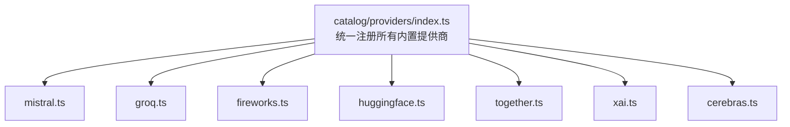
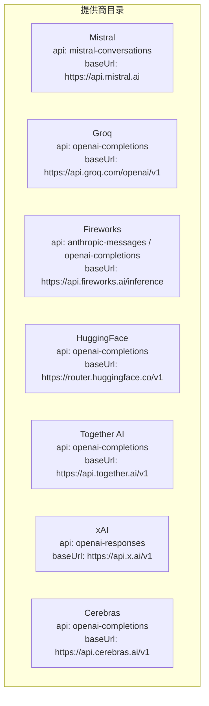
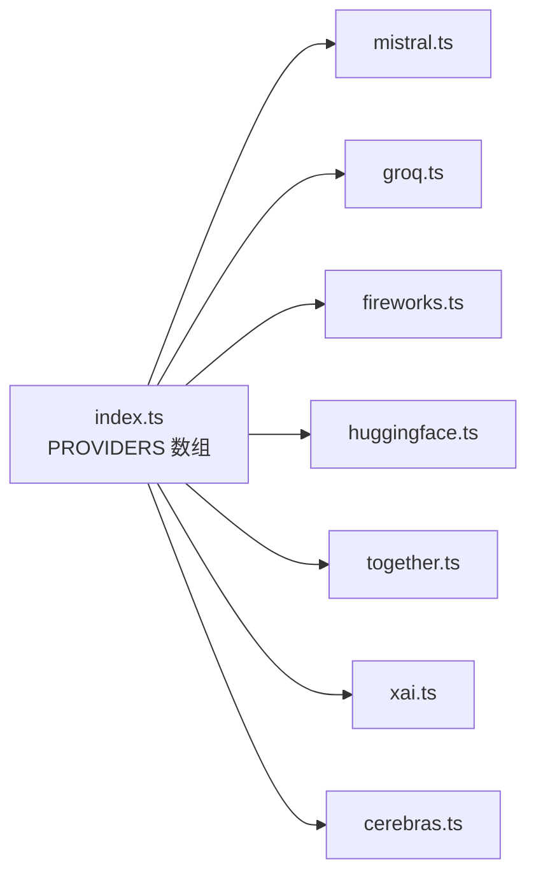
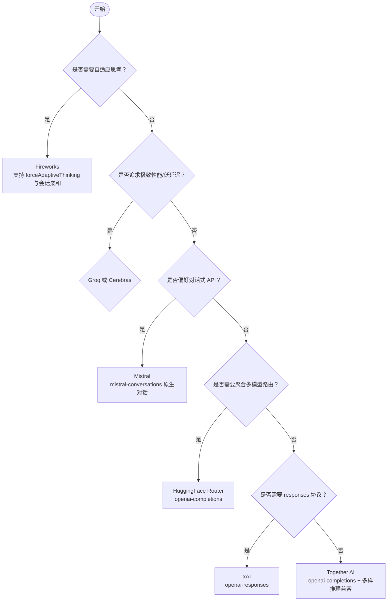

# 第三方提供商

<cite>
**本文引用的文件**   
- [packages/ai/catalog/providers/index.ts](https://github.com/FDE-GROUP/oh-my-fde/blob/omca/packages/ai/catalog/providers/index.ts)
- [packages/ai/catalog/providers/mistral.ts](https://github.com/FDE-GROUP/oh-my-fde/blob/omca/packages/ai/catalog/providers/mistral.ts)
- [packages/ai/catalog/providers/groq.ts](https://github.com/FDE-GROUP/oh-my-fde/blob/omca/packages/ai/catalog/providers/groq.ts)
- [packages/ai/catalog/providers/fireworks.ts](https://github.com/FDE-GROUP/oh-my-fde/blob/omca/packages/ai/catalog/providers/fireworks.ts)
- [packages/ai/catalog/providers/huggingface.ts](https://github.com/FDE-GROUP/oh-my-fde/blob/omca/packages/ai/catalog/providers/huggingface.ts)
- [packages/ai/catalog/providers/together.ts](https://github.com/FDE-GROUP/oh-my-fde/blob/omca/packages/ai/catalog/providers/together.ts)
- [packages/ai/catalog/providers/xai.ts](https://github.com/FDE-GROUP/oh-my-fde/blob/omca/packages/ai/catalog/providers/xai.ts)
- [packages/ai/catalog/providers/cerebras.ts](https://github.com/FDE-GROUP/oh-my-fde/blob/omca/packages/ai/catalog/providers/cerebras.ts)
</cite>

## 目录
1. [简介](#简介)
2. [项目结构](#项目结构)
3. [核心组件](#核心组件)
4. [架构总览](#架构总览)
5. [详细组件分析](#详细组件分析)
6. [依赖关系分析](#依赖关系分析)
7. [性能与成本考量](#性能与成本考量)
8. [故障排查指南](#故障排查指南)
9. [结论](#结论)
10. [附录：选择决策树与迁移指南](#附录选择决策树与迁移指南)

## 简介
本文件面向在项目中接入主流第三方大模型服务商的统一文档，覆盖 Mistral、Groq、Fireworks、HuggingFace、Together AI、xAI、Cerebras。内容包含各提供商的配置要点、认证方式、基础使用路径、能力差异对比、定价策略说明（以仓库内成本字段为准）、以及提供商选择的决策树与迁移指南。

## 项目结构
本项目通过“目录化”的提供商定义集中管理各第三方 LLM 提供商的模型清单、API 适配与兼容性声明。关键入口位于 catalog/providers 目录，统一由 index.ts 汇总导出。

**图示来源**
- [packages/ai/catalog/providers/index.ts:1-93](https://github.com/FDE-GROUP/oh-my-fde/blob/omca/packages/ai/catalog/providers/index.ts#L1-L93)

**章节来源**
- [packages/ai/catalog/providers/index.ts:1-93](https://github.com/FDE-GROUP/oh-my-fde/blob/omca/packages/ai/catalog/providers/index.ts#L1-L93)

## 核心组件
- 提供商定义：每个提供商通过 defineProvider 暴露 id、models 生成逻辑、compat 兼容声明、finalize 后处理等。
- 模型清单：通过 modelsDevModels 从外部数据源拉取并映射为内部 Model 结构，支持按提供商定制 baseUrl、API 协议、thinkingLevelMap、cost 等。
- 兼容性层：针对不同 API 协议（如 openai-completions、anthropic-messages、openai-responses）提供差异化行为开关。

**章节来源**
- [packages/ai/catalog/providers/mistral.ts:1-47](https://github.com/FDE-GROUP/oh-my-fde/blob/omca/packages/ai/catalog/providers/mistral.ts#L1-L47)
- [packages/ai/catalog/providers/groq.ts:1-14](https://github.com/FDE-GROUP/oh-my-fde/blob/omca/packages/ai/catalog/providers/groq.ts#L1-L14)
- [packages/ai/catalog/providers/fireworks.ts:1-101](https://github.com/FDE-GROUP/oh-my-fde/blob/omca/packages/ai/catalog/providers/fireworks.ts#L1-L101)
- [packages/ai/catalog/providers/huggingface.ts:1-13](https://github.com/FDE-GROUP/oh-my-fde/blob/omca/packages/ai/catalog/providers/huggingface.ts#L1-L13)
- [packages/ai/catalog/providers/together.ts:1-59](https://github.com/FDE-GROUP/oh-my-fde/blob/omca/packages/ai/catalog/providers/together.ts#L1-L59)
- [packages/ai/catalog/providers/xai.ts:1-30](https://github.com/FDE-GROUP/oh-my-fde/blob/omca/packages/ai/catalog/providers/xai.ts#L1-L30)
- [packages/ai/catalog/providers/cerebras.ts:1-9](https://github.com/FDE-GROUP/oh-my-fde/blob/omca/packages/ai/catalog/providers/cerebras.ts#L1-L9)

## 架构总览
下图展示各提供商在 catalog 层的统一接入方式，以及它们对外暴露的 API 协议与基础地址。

**图示来源**
- [packages/ai/catalog/providers/mistral.ts:5-12](https://github.com/FDE-GROUP/oh-my-fde/blob/omca/packages/ai/catalog/providers/mistral.ts#L5-L12)
- [packages/ai/catalog/providers/groq.ts:3-7](https://github.com/FDE-GROUP/oh-my-fde/blob/omca/packages/ai/catalog/providers/groq.ts#L3-L7)
- [packages/ai/catalog/providers/fireworks.ts:40-53](https://github.com/FDE-GROUP/oh-my-fde/blob/omca/packages/ai/catalog/providers/fireworks.ts#L40-L53)
- [packages/ai/catalog/providers/huggingface.ts:3-10](https://github.com/FDE-GROUP/oh-my-fde/blob/omca/packages/ai/catalog/providers/huggingface.ts#L3-L10)
- [packages/ai/catalog/providers/together.ts:30-36](https://github.com/FDE-GROUP/oh-my-fde/blob/omca/packages/ai/catalog/providers/together.ts#L30-L36)
- [packages/ai/catalog/providers/xai.ts:13-21](https://github.com/FDE-GROUP/oh-my-fde/blob/omca/packages/ai/catalog/providers/xai.ts#L13-L21)
- [packages/ai/catalog/providers/cerebras.ts:3-7](https://github.com/FDE-GROUP/oh-my-fde/blob/omca/packages/ai/catalog/providers/cerebras.ts#L3-L7)

## 详细组件分析

### Mistral
- 配置要点
  - API 协议：mistral-conversations
  - 基础地址：https://api.mistral.ai
  - 推理思考级别：根据 reasoningOptions 推导 thinkingLevelMap；对部分模型补充缓存计费规则（cacheRead 默认按输入价的 10%）。
- 认证方法
  - 使用环境变量注入 API Key（参考项目通用 env-api-keys 机制），并在调用时由运行时解析。
- 基础使用示例
  - 通过 provider id “mistral” 选择模型，发送对话消息；若模型支持推理，则按 thinkingLevelMap 控制思考强度。
- 特点与适用场景
  - 原生对话式 API；具备推理能力与缓存计费优化；适合需要稳定对话体验与可控推理强度的场景。
- 定价策略
  - 以 catalog 中 cost 字段为准；缓存读取按输入价 10% 计算（当上游未明确给出时）。

**章节来源**
- [packages/ai/catalog/providers/mistral.ts:5-46](https://github.com/FDE-GROUP/oh-my-fde/blob/omca/packages/ai/catalog/providers/mistral.ts#L5-L46)

### Groq
- 配置要点
  - API 协议：openai-completions
  - 基础地址：https://api.groq.com/openai/v1
  - 兼容性：支持严格模式；对特定模型（如 qwen/qwen3.6-27b）合并思考级别映射。
- 认证方法
  - 使用环境变量注入 API Key，并由运行时在请求头中携带。
- 基础使用示例
  - 通过 provider id “groq” 选择模型，按 OpenAI Completions 风格发送请求。
- 特点与适用场景
  - 高性能推理平台；OpenAI 兼容接口便于快速迁移；适合追求低延迟与高吞吐的场景。
- 定价策略
  - 以 catalog 中 cost 字段为准；具体价格以官方账单为准。

**章节来源**
- [packages/ai/catalog/providers/groq.ts:3-13](https://github.com/FDE-GROUP/oh-my-fde/blob/omca/packages/ai/catalog/providers/groq.ts#L3-L13)

### Fireworks
- 配置要点
  - API 协议：anthropic-messages（主）；部分模型（glm/kimi-k3）走 openai-completions
  - 基础地址：https://api.fireworks.ai/inference（Anthropic 兼容）；GLM/Kimi K3 使用 https://api.fireworks.ai/inference/v1
  - 兼容性：Anthropic 兼容开启会话亲和头；不支持工具缓存控制与 eager_tool_input_streaming；OpenAI 兼容关闭 store 与 developer role。
  - 自适应思考：对带 effort 元数据的模型启用 forceAdaptiveThinking；对部分模型补齐 thinkingLevelMap。
- 认证方法
  - 使用环境变量注入 API Key，并通过 SDK 自动附加会话亲和头。
- 基础使用示例
  - 通过 provider id “fireworks” 选择模型；对于 GLM/Kimi K3 会自动切换到 OpenAI 兼容端点。
- 特点与适用场景
  - 多协议支持与自适应思考；适合混合模型生态与需要精细控制推理行为的场景。
- 定价策略
  - 以 catalog 中 cost 字段为准；不同模型可能具有不同的思考级别映射与计费策略。

**章节来源**
- [packages/ai/catalog/providers/fireworks.ts:5-101](https://github.com/FDE-GROUP/oh-my-fde/blob/omca/packages/ai/catalog/providers/fireworks.ts#L5-L101)

### HuggingFace
- 配置要点
  - API 协议：openai-completions
  - 基础地址：https://router.huggingface.co/v1
  - 兼容性：不支持 developer role；支持严格模式。
- 认证方法
  - 使用环境变量注入 API Key，并通过 router 路由到对应模型后端。
- 基础使用示例
  - 通过 provider id “huggingface” 选择模型，按 OpenAI Completions 风格发送请求。
- 特点与适用场景
  - 聚合多家模型的后端路由；适合需要广泛模型选择与统一接口的场景。
- 定价策略
  - 以 catalog 中 cost 字段为准；具体价格以官方账单为准。

**章节来源**
- [packages/ai/catalog/providers/huggingface.ts:3-12](https://github.com/FDE-GROUP/oh-my-fde/blob/omca/packages/ai/catalog/providers/huggingface.ts#L3-L12)

### Together AI
- 配置要点
  - API 协议：openai-completions
  - 基础地址：https://api.together.ai/v1
  - 兼容性：默认关闭 store、developer role、reasoning effort；thinkingFormat 为 together；maxTokensField 为 max_tokens。
  - 特殊模型：gpt-oss-* 系列支持 reasoning effort；DeepSeek-V4-Pro-0813 支持 toggle+effort 组合。
- 认证方法
  - 使用环境变量注入 API Key，并按 OpenAI 兼容格式发送请求。
- 基础使用示例
  - 通过 provider id “together” 选择模型；根据模型类型自动应用对应的 thinkingLevelMap 与 compat。
- 特点与适用场景
  - 对多种推理模式进行细粒度兼容；适合需要灵活控制推理行为与 token 字段的场景。
- 定价策略
  - 以 catalog 中 cost 字段为准；不同模型可能有不同的推理模式与计费策略。

**章节来源**
- [packages/ai/catalog/providers/together.ts:4-58](https://github.com/FDE-GROUP/oh-my-fde/blob/omca/packages/ai/catalog/providers/together.ts#L4-L58)

### xAI
- 配置要点
  - API 协议：openai-responses
  - 基础地址：https://api.x.ai/v1
  - 兼容性：关闭长缓存保留；排除部分不适合或已停用的模型 ID。
  - 思考级别：对未验证 effort 的模型禁用 undocumented 的 none/minimal 值。
- 认证方法
  - 使用环境变量注入 API Key，并通过 responses 协议发送请求。
- 基础使用示例
  - 通过 provider id “xai” 选择模型；系统会过滤掉被排除的模型 ID。
- 特点与适用场景
  - 基于 responses 协议；适合需要新式响应结构与受控推理行为的场景。
- 定价策略
  - 以 catalog 中 cost 字段为准；具体价格以官方账单为准。

**章节来源**
- [packages/ai/catalog/providers/xai.ts:3-29](https://github.com/FDE-GROUP/oh-my-fde/blob/omca/packages/ai/catalog/providers/xai.ts#L3-L29)

### Cerebras
- 配置要点
  - API 协议：openai-completions
  - 基础地址：https://api.cerebras.ai/v1
  - 兼容性：关闭 store 与 developer role。
- 认证方法
  - 使用环境变量注入 API Key，并按 OpenAI 兼容格式发送请求。
- 基础使用示例
  - 通过 provider id “cerebras” 选择模型，按 OpenAI Completions 风格发送请求。
- 特点与适用场景
  - 高性能推理硬件厂商；适合对延迟和吞吐有极致要求的场景。
- 定价策略
  - 以 catalog 中 cost 字段为准；具体价格以官方账单为准。

**章节来源**
- [packages/ai/catalog/providers/cerebras.ts:3-8](https://github.com/FDE-GROUP/oh-my-fde/blob/omca/packages/ai/catalog/providers/cerebras.ts#L3-L8)

## 依赖关系分析
- 统一注册：index.ts 汇总所有内置提供商，确保新增提供商只需在此处导入并加入 PROVIDERS 数组。
- 模型数据：各提供商通过 modelsDevModels 从外部数据源获取模型清单，并进行 map/finalize 转换。
- 兼容性声明：各提供商在 compat 中声明对不同 API 协议的支持情况，影响上层调用行为。

**图示来源**
- [packages/ai/catalog/providers/index.ts:48-92](https://github.com/FDE-GROUP/oh-my-fde/blob/omca/packages/ai/catalog/providers/index.ts#L48-L92)

**章节来源**
- [packages/ai/catalog/providers/index.ts:1-93](https://github.com/FDE-GROUP/oh-my-fde/blob/omca/packages/ai/catalog/providers/index.ts#L1-L93)

## 性能与成本考量
- 性能特征
  - Groq、Cerebras 偏向高性能推理平台，适合低延迟与高吞吐需求。
  - Fireworks 支持自适应思考与会话亲和，有助于提升缓存命中与稳定性。
- 成本优化
  - Mistral 对缓存读取采用输入价的 10% 作为默认计费（当上游未明确给出时）。
  - 各提供商的 cost 字段以 catalog 为准，建议在业务侧结合用量监控进行预算控制。

[本节为通用指导，不直接分析具体文件]

## 故障排查指南
- 认证失败
  - 检查环境变量是否已正确设置 API Key；确认运行时是否正确解析并注入到请求头。
- 模型不可用或被排除
  - xAI 会排除部分模型 ID；确认所选模型未被列入排除集合。
- 思考级别异常
  - Fireworks 对部分模型启用 forceAdaptiveThinking；若 thinkingLevelMap 缺失，系统会尝试补齐。
  - Together AI 对 gpt-oss-* 与 DeepSeek-V4-Pro-0813 有特殊兼容逻辑，需按模型类型调整参数。
- 协议不匹配
  - 确认所选模型的 API 协议与 baseUrl 一致；例如 Fireworks 的 GLM/Kimi K3 使用 openai-completions 端点。

**章节来源**
- [packages/ai/catalog/providers/xai.ts:3-29](https://github.com/FDE-GROUP/oh-my-fde/blob/omca/packages/ai/catalog/providers/xai.ts#L3-L29)
- [packages/ai/catalog/providers/fireworks.ts:40-101](https://github.com/FDE-GROUP/oh-my-fde/blob/omca/packages/ai/catalog/providers/fireworks.ts#L40-L101)
- [packages/ai/catalog/providers/together.ts:30-58](https://github.com/FDE-GROUP/oh-my-fde/blob/omca/packages/ai/catalog/providers/together.ts#L30-L58)

## 结论
本项目通过统一的 catalog 层将多个第三方 LLM 提供商纳入一致的模型管理与兼容性框架。各提供商在 API 协议、基础地址、思考级别映射与兼容性声明上存在差异，但均遵循相同的定义与注册模式。建议在选择提供商时综合考虑性能、成本、协议兼容性与业务场景，并结合本文件的决策树与迁移指南进行平滑切换。

[本节为总结性内容，不直接分析具体文件]

## 附录：选择决策树与迁移指南

### 提供商选择决策树

[该图为概念性流程图，无需图示来源]

### 迁移指南
- 步骤一：确定目标提供商
  - 根据上述决策树选择目标提供商，并记录其 api 与 baseUrl。
- 步骤二：配置认证
  - 在环境变量中设置对应提供商的 API Key；确保运行时能正确解析。
- 步骤三：更新模型选择
  - 在代码中将 provider id 切换为目标提供商；必要时调整 thinkingLevelMap 与 compat 参数。
- 步骤四：验证功能
  - 发送测试请求，确认消息格式、工具调用、思考级别与流式输出符合预期。
- 步骤五：监控与优化
  - 监控延迟、吞吐与成本；结合 catalog 中的 cost 字段进行预算控制与模型替换。

[本节为通用指导，不直接分析具体文件]