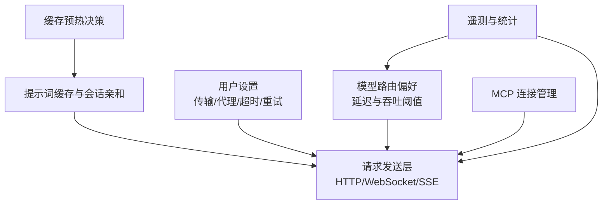
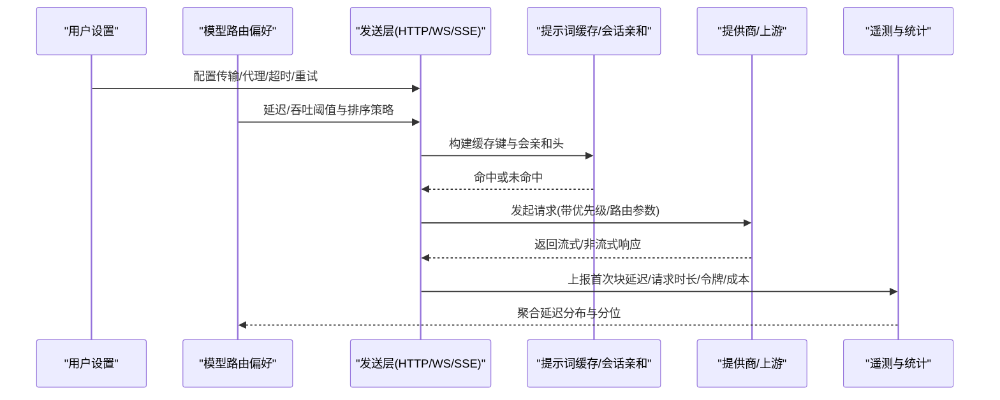
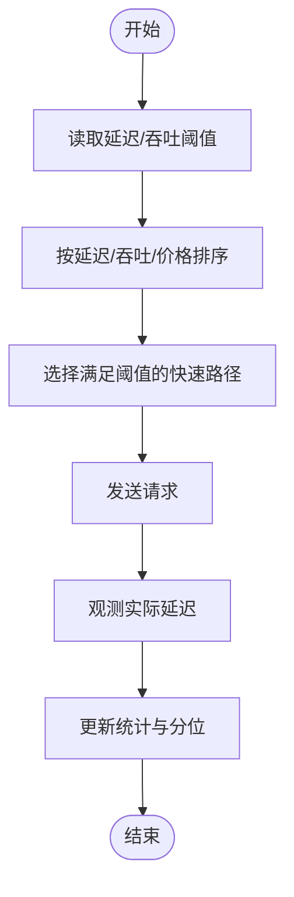
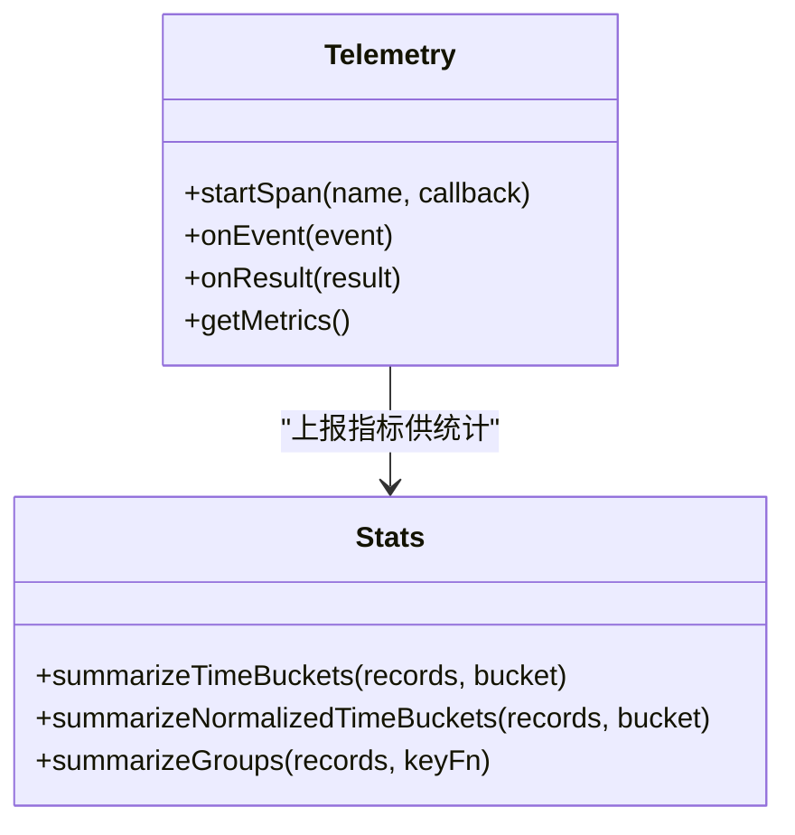
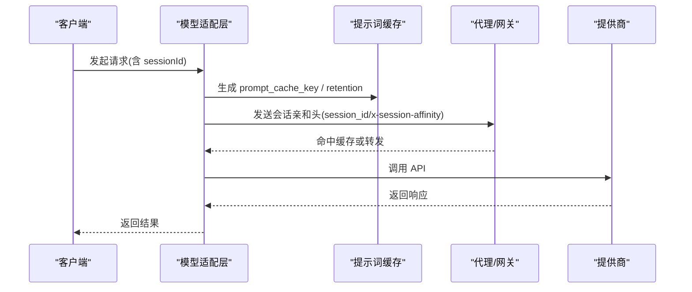
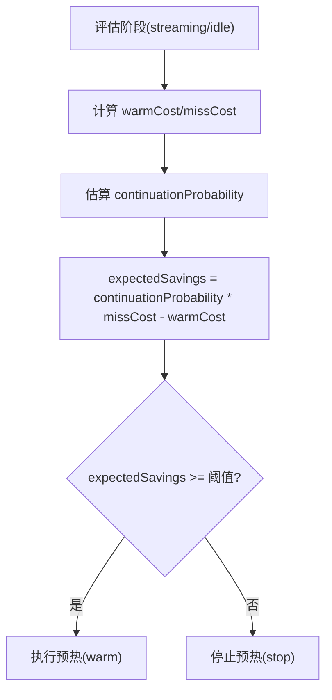
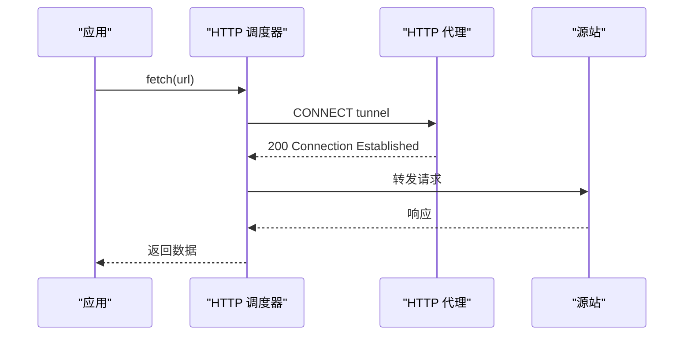
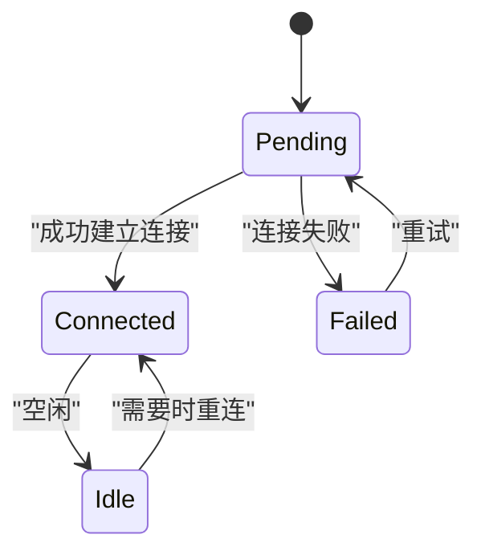
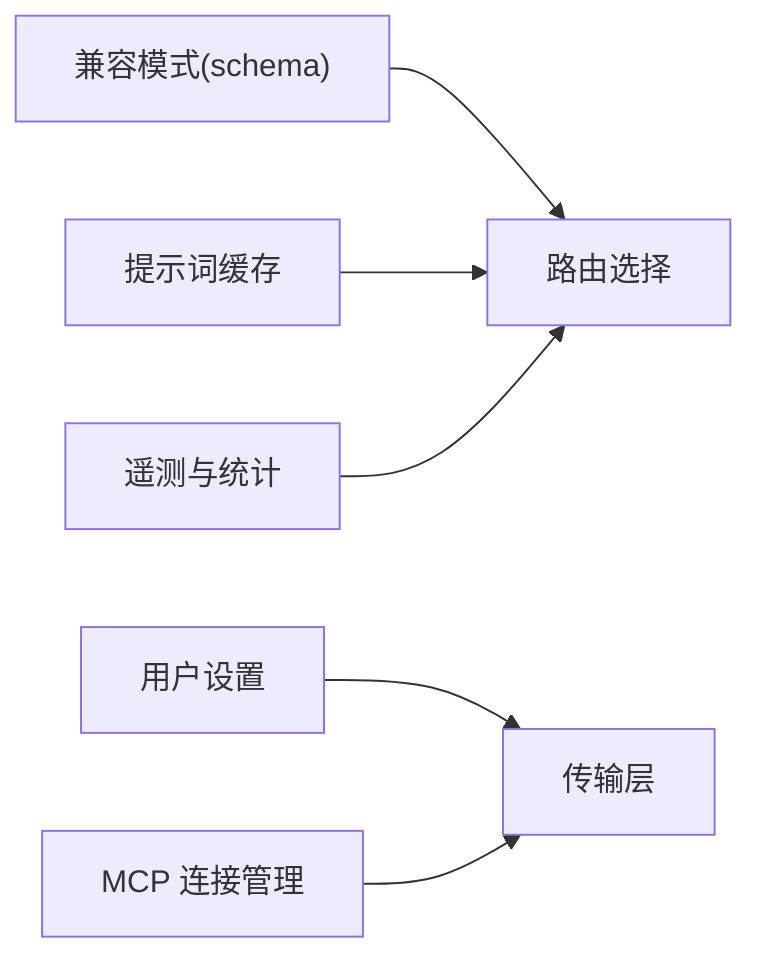

# 延迟优先策略

<cite>
**本文引用的文件**   
- [packages/ai/src/providers/compat-schema.ts](https://github.com/FDE-GROUP/oh-my-coding-agent/blob/omca/packages/ai/src/providers/compat-schema.ts)
- [packages/coding-agent/docs/settings.md](https://github.com/FDE-GROUP/oh-my-coding-agent/blob/omca/packages/coding-agent/docs/settings.md)
- [packages/coding-agent/test/http-dispatcher.test.ts](https://github.com/FDE-GROUP/oh-my-coding-agent/blob/omca/packages/coding-agent/test/http-dispatcher.test.ts)
- [packages/ai/test/openai-completions-prompt-cache.test.ts](https://github.com/FDE-GROUP/oh-my-coding-agent/blob/omca/packages/ai/test/openai-completions-prompt-cache.test.ts)
- [packages/coding-agent/src/core/cache-warmer.ts](https://github.com/FDE-GROUP/oh-my-coding-agent/blob/omca/packages/coding-agent/src/core/cache-warmer.ts)
- [packages/coding-agent/src/extensions/mcp/index.ts](https://github.com/FDE-GROUP/oh-my-coding-agent/blob/omca/packages/coding-agent/src/extensions/mcp/index.ts)
- [packages/coding-agent/test/mcp-extension.test.ts](https://github.com/FDE-GROUP/oh-my-coding-agent/blob/omca/packages/coding-agent/test/mcp-extension.test.ts)
- [scripts/read-tool-stats.mjs](https://github.com/FDE-GROUP/oh-my-coding-agent/blob/omca/scripts/read-tool-stats.mjs)
- [packages/ai/test/telemetry.test.ts](https://github.com/FDE-GROUP/oh-my-coding-agent/blob/omca/packages/ai/test/telemetry.test.ts)
</cite>

## 目录
1. [引言](#引言)
2. [项目结构](#项目结构)
3. [核心组件](#核心组件)
4. [架构总览](#架构总览)
5. [详细组件分析](#详细组件分析)
6. [依赖关系分析](#依赖关系分析)
7. [性能考量](#性能考量)
8. [故障排查指南](#故障排查指南)
9. [结论](#结论)
10. [附录](#附录)

## 引言
本文件围绕“延迟优先策略”展开，聚焦以下目标：
- 响应时间监控、延迟预测与快速路径选择。
- 延迟测量方法、基准测试与性能分析工具。
- 延迟阈值配置、实时调整与自适应优化。
- 延迟优化配置示例、性能监控与瓶颈识别。
- 网络优化、连接池管理与请求合并技术。

该策略在系统中通过多层机制协同工作：模型路由偏好中的延迟阈值、传输层超时与重试、提示词缓存与预热、会话亲和与连接复用、以及遥测与统计工具对延迟的观测与诊断。

## 项目结构
与延迟优先策略直接相关的代码和文档分布在以下位置：
- 模型与提供商兼容性设置：定义延迟阈值、吞吐阈值、排序策略等。
- 用户设置参考：定义传输、代理、超时与重试参数。
- HTTP 调度器测试：验证代理隧道与连接尝试超时行为。
- OpenAI 提示词缓存测试：验证缓存键与会话亲和头。
- 缓存预热：基于经济模型的预热决策。
- MCP 连接管理：后台连接、重试与生命周期。
- 统计与遥测：延迟分布、分位指标与成本统计。

图表来源
- [packages/ai/src/providers/compat-schema.ts:57-153](https://github.com/FDE-GROUP/oh-my-coding-agent/blob/omca/packages/ai/src/providers/compat-schema.ts#L57-L153)
- [packages/coding-agent/docs/settings.md:120-136](https://github.com/FDE-GROUP/oh-my-coding-agent/blob/omca/packages/coding-agent/docs/settings.md#L120-L136)
- [packages/ai/test/openai-completions-prompt-cache.test.ts:154-244](https://github.com/FDE-GROUP/oh-my-coding-agent/blob/omca/packages/ai/test/openai-completions-prompt-cache.test.ts#L154-L244)
- [packages/coding-agent/src/core/cache-warmer.ts:88-119](https://github.com/FDE-GROUP/oh-my-coding-agent/blob/omca/packages/coding-agent/src/core/cache-warmer.ts#L88-L119)
- [packages/coding-agent/src/extensions/mcp/index.ts:589-609](https://github.com/FDE-GROUP/oh-my-coding-agent/blob/omca/packages/coding-agent/src/extensions/mcp/index.ts#L589-L609)
- [scripts/read-tool-stats.mjs:259-385](https://github.com/FDE-GROUP/oh-my-coding-agent/blob/omca/scripts/read-tool-stats.mjs#L259-L385)

章节来源
- [packages/ai/src/providers/compat-schema.ts:57-153](https://github.com/FDE-GROUP/oh-my-coding-agent/blob/omca/packages/ai/src/providers/compat-schema.ts#L57-L153)
- [packages/coding-agent/docs/settings.md:120-136](https://github.com/FDE-GROUP/oh-my-coding-agent/blob/omca/packages/coding-agent/docs/settings.md#L120-L136)

## 核心组件
- 延迟与吞吐阈值配置：通过提供商兼容模式中的 `preferred_max_latency` 与 `preferred_min_throughput` 表达 p50/p75/p90/p99 的分位阈值；OpenRouter 路由还支持按延迟、吞吐或价格排序。
- 传输与重试：用户设置中提供 `transport`、`httpProxy`、`httpIdleTimeoutMs`、`websocketConnectTimeoutMs` 及多级重试参数，用于控制连接建立、空闲超时与失败恢复。
- 提示词缓存与会话亲和：OpenAI 兼容端点支持 `prompt_cache_key`、`prompt_cache_retention` 与会话亲和头，提升缓存命中并降低首字节延迟。
- 缓存预热：根据续期概率与缓存缺失成本计算预期节省，决定是否进行预热。
- MCP 连接管理：后台启动连接、记录就绪状态、失败时进入失败态并可重试。
- 遥测与统计：记录首次块延迟、请求时长、令牌用量与成本，并按时间桶与小时段汇总。

章节来源
- [packages/ai/src/providers/compat-schema.ts:57-153](https://github.com/FDE-GROUP/oh-my-coding-agent/blob/omca/packages/ai/src/providers/compat-schema.ts#L57-L153)
- [packages/coding-agent/docs/settings.md:120-136](https://github.com/FDE-GROUP/oh-my-coding-agent/blob/omca/packages/coding-agent/docs/settings.md#L120-L136)
- [packages/ai/test/openai-completions-prompt-cache.test.ts:154-244](https://github.com/FDE-GROUP/oh-my-coding-agent/blob/omca/packages/ai/test/openai-completions-prompt-cache.test.ts#L154-L244)
- [packages/coding-agent/src/core/cache-warmer.ts:88-119](https://github.com/FDE-GROUP/oh-my-coding-agent/blob/omca/packages/coding-agent/src/core/cache-warmer.ts#L88-L119)
- [packages/coding-agent/src/extensions/mcp/index.ts:589-609](https://github.com/FDE-GROUP/oh-my-coding-agent/blob/omca/packages/coding-agent/src/extensions/mcp/index.ts#L589-L609)
- [packages/ai/test/telemetry.test.ts:298-379](https://github.com/FDE-GROUP/oh-my-coding-agent/blob/omca/packages/ai/test/telemetry.test.ts#L298-L379)

## 架构总览
下图展示延迟优先策略的关键交互：上层通过模型路由偏好与用户设置决定请求路径；中间层负责传输、缓存与会话亲和；底层由提供商与网络栈执行；遥测与统计贯穿全链路以反馈优化。

图表来源
- [packages/ai/src/providers/compat-schema.ts:57-153](https://github.com/FDE-GROUP/oh-my-coding-agent/blob/omca/packages/ai/src/providers/compat-schema.ts#L57-L153)
- [packages/coding-agent/docs/settings.md:120-136](https://github.com/FDE-GROUP/oh-my-coding-agent/blob/omca/packages/coding-agent/docs/settings.md#L120-L136)
- [packages/ai/test/openai-completions-prompt-cache.test.ts:154-244](https://github.com/FDE-GROUP/oh-my-coding-agent/blob/omca/packages/ai/test/openai-completions-prompt-cache.test.ts#L154-L244)
- [packages/ai/test/telemetry.test.ts:298-379](https://github.com/FDE-GROUP/oh-my-coding-agent/blob/omca/packages/ai/test/telemetry.test.ts#L298-L379)

## 详细组件分析

### 延迟阈值与快速路径选择
- 延迟阈值：通过 `preferred_max_latency` 指定 p50/p75/p90/p99 的最大延迟秒数，作为快速路径选择的依据。
- 吞吐阈值：通过 `preferred_min_throughput` 指定最小吞吐（token/s），避免慢速路径。
- 排序策略：OpenRouter 路由支持按 `latency`、`throughput`、`price` 排序，可结合分区策略（如按模型）实现更细粒度的快速路径。

图表来源
- [packages/ai/src/providers/compat-schema.ts:57-153](https://github.com/FDE-GROUP/oh-my-coding-agent/blob/omca/packages/ai/src/providers/compat-schema.ts#L57-L153)

章节来源
- [packages/ai/src/providers/compat-schema.ts:57-153](https://github.com/FDE-GROUP/oh-my-coding-agent/blob/omca/packages/ai/src/providers/compat-schema.ts#L57-L153)

### 响应时间监控与延迟测量
- 遥测指标：记录 `pi.ai.first_chunk.duration`（首次块延迟）、`pi.ai.request.duration`（请求时长）、`pi.ai.tokens`（输入/输出/缓存读/写）与 `pi.ai.cost`（成本）。
- 统计工具：按时间桶与小时段汇总完整/部分读取比例、会话归一化指标，帮助识别延迟热点与时段性波动。

图表来源
- [packages/ai/test/telemetry.test.ts:298-379](https://github.com/FDE-GROUP/oh-my-coding-agent/blob/omca/packages/ai/test/telemetry.test.ts#L298-L379)
- [scripts/read-tool-stats.mjs:259-385](https://github.com/FDE-GROUP/oh-my-coding-agent/blob/omca/scripts/read-tool-stats.mjs#L259-L385)

章节来源
- [packages/ai/test/telemetry.test.ts:298-379](https://github.com/FDE-GROUP/oh-my-coding-agent/blob/omca/packages/ai/test/telemetry.test.ts#L298-L379)
- [scripts/read-tool-stats.mjs:259-385](https://github.com/FDE-GROUP/oh-my-coding-agent/blob/omca/scripts/read-tool-stats.mjs#L259-L385)

### 提示词缓存与会话亲和（快速路径关键）
- 缓存键与会亲和：OpenAI 兼容端点可通过 `prompt_cache_key` 与 `prompt_cache_retention` 启用长保留缓存；会话亲和头确保相关请求路由到同一副本，提高命中率。
- 环境与环境变量：`PI_CACHE_RETENTION` 可影响直连 OpenAI 请求的缓存键与保留策略。
- 覆盖与禁用：显式头部可覆盖生成的会话亲和头；可在兼容模式中禁用缓存键。

图表来源
- [packages/ai/test/openai-completions-prompt-cache.test.ts:154-244](https://github.com/FDE-GROUP/oh-my-coding-agent/blob/omca/packages/ai/test/openai-completions-prompt-cache.test.ts#L154-L244)
- [packages/ai/test/openai-completions-prompt-cache.test.ts:246-363](https://github.com/FDE-GROUP/oh-my-coding-agent/blob/omca/packages/ai/test/openai-completions-prompt-cache.test.ts#L246-L363)

章节来源
- [packages/ai/test/openai-completions-prompt-cache.test.ts:154-244](https://github.com/FDE-GROUP/oh-my-coding-agent/blob/omca/packages/ai/test/openai-completions-prompt-cache.test.ts#L154-L244)
- [packages/ai/test/openai-completions-prompt-cache.test.ts:246-363](https://github.com/FDE-GROUP/oh-my-coding-agent/blob/omca/packages/ai/test/openai-completions-prompt-cache.test.ts#L246-L363)

### 缓存预热与经济决策
- 预热决策：根据当前阶段（流式/空闲）、预热成本、缺失成本与续期概率计算预期节省，当预期节省达到阈值时执行预热。
- 扩展点：事件 `cache_warming_decision` 允许扩展覆盖预热动作。

图表来源
- [packages/coding-agent/src/core/cache-warmer.ts:88-119](https://github.com/FDE-GROUP/oh-my-coding-agent/blob/omca/packages/coding-agent/src/core/cache-warmer.ts#L88-L119)

章节来源
- [packages/coding-agent/src/core/cache-warmer.ts:88-119](https://github.com/FDE-GROUP/oh-my-coding-agent/blob/omca/packages/coding-agent/src/core/cache-warmer.ts#L88-L119)

### 网络优化、连接池与请求合并
- 代理隧道：HTTP 代理支持 CONNECT 隧道，确保 HTTPS 流量正确转发。
- 连接尝试超时：HTTPS 连接尝试具有固定超时，不改变 Node 默认值。
- 传输选择：用户设置支持 `auto`、`sse`、`websocket`、`websocket-cached`，可根据场景选择低延迟传输。
- 连接池与会话亲和：通过会话亲和头与缓存键将相关请求路由到相同后端实例，减少握手与冷启动开销。

图表来源
- [packages/coding-agent/test/http-dispatcher.test.ts:93-148](https://github.com/FDE-GROUP/oh-my-coding-agent/blob/omca/packages/coding-agent/test/http-dispatcher.test.ts#L93-L148)
- [packages/coding-agent/test/http-dispatcher.test.ts:150-158](https://github.com/FDE-GROUP/oh-my-coding-agent/blob/omca/packages/coding-agent/test/http-dispatcher.test.ts#L150-L158)
- [packages/coding-agent/docs/settings.md:120-136](https://github.com/FDE-GROUP/oh-my-coding-agent/blob/omca/packages/coding-agent/docs/settings.md#L120-L136)

章节来源
- [packages/coding-agent/test/http-dispatcher.test.ts:93-148](https://github.com/FDE-GROUP/oh-my-coding-agent/blob/omca/packages/coding-agent/test/http-dispatcher.test.ts#L93-L148)
- [packages/coding-agent/test/http-dispatcher.test.ts:150-158](https://github.com/FDE-GROUP/oh-my-coding-agent/blob/omca/packages/coding-agent/test/http-dispatcher.test.ts#L150-L158)
- [packages/coding-agent/docs/settings.md:120-136](https://github.com/FDE-GROUP/oh-my-coding-agent/blob/omca/packages/coding-agent/docs/settings.md#L120-L136)

### MCP 连接管理与重试（后台连接）
- 后台连接：连接在后台启动，记录就绪状态；失败时进入失败态，并在适当时机重试。
- 生命周期：会话级 AbortController 控制连接生命周期，任务注册与清理保证优雅关闭。

图表来源
- [packages/coding-agent/src/extensions/mcp/index.ts:589-609](https://github.com/FDE-GROUP/oh-my-coding-agent/blob/omca/packages/coding-agent/src/extensions/mcp/index.ts#L589-L609)
- [packages/coding-agent/test/mcp-extension.test.ts:603-637](https://github.com/FDE-GROUP/oh-my-coding-agent/blob/omca/packages/coding-agent/test/mcp-extension.test.ts#L603-L637)

章节来源
- [packages/coding-agent/src/extensions/mcp/index.ts:589-609](https://github.com/FDE-GROUP/oh-my-coding-agent/blob/omca/packages/coding-agent/src/extensions/mcp/index.ts#L589-L609)
- [packages/coding-agent/test/mcp-extension.test.ts:603-637](https://github.com/FDE-GROUP/oh-my-coding-agent/blob/omca/packages/coding-agent/test/mcp-extension.test.ts#L603-L637)

## 依赖关系分析
- 模型路由偏好依赖提供商兼容模式，决定延迟与吞吐阈值如何参与排序与选择。
- 用户设置驱动传输层行为（代理、超时、重试），与遥测统计共同形成闭环优化。
- 提示词缓存与会亲和依赖提供商能力检测与兼容模式开关。
- MCP 连接管理依赖会话信号与后台任务跟踪，确保连接生命周期可控。

图表来源
- [packages/ai/src/providers/compat-schema.ts:57-153](https://github.com/FDE-GROUP/oh-my-coding-agent/blob/omca/packages/ai/src/providers/compat-schema.ts#L57-L153)
- [packages/coding-agent/docs/settings.md:120-136](https://github.com/FDE-GROUP/oh-my-coding-agent/blob/omca/packages/coding-agent/docs/settings.md#L120-L136)
- [packages/ai/test/openai-completions-prompt-cache.test.ts:154-244](https://github.com/FDE-GROUP/oh-my-coding-agent/blob/omca/packages/ai/test/openai-completions-prompt-cache.test.ts#L154-L244)
- [packages/coding-agent/src/extensions/mcp/index.ts:589-609](https://github.com/FDE-GROUP/oh-my-coding-agent/blob/omca/packages/coding-agent/src/extensions/mcp/index.ts#L589-L609)

章节来源
- [packages/ai/src/providers/compat-schema.ts:57-153](https://github.com/FDE-GROUP/oh-my-coding-agent/blob/omca/packages/ai/src/providers/compat-schema.ts#L57-L153)
- [packages/coding-agent/docs/settings.md:120-136](https://github.com/FDE-GROUP/oh-my-coding-agent/blob/omca/packages/coding-agent/docs/settings.md#L120-L136)

## 性能考量
- 延迟阈值应结合 p50/p75/p90/p99 综合设定，避免仅关注均值导致尾部延迟被忽略。
- 吞吐阈值有助于筛选稳定快速的提供商，减少抖动带来的用户体验下降。
- 提示词缓存与长保留缓存显著降低重复请求的首字节延迟；会话亲和提升缓存命中率。
- 合理设置代理与超时，避免连接建立成为瓶颈；WebSocket 缓存传输可降低握手开销。
- 遥测与统计需持续采集，按时间桶与小时段观察延迟分布，定位时段性瓶颈。

[本节为通用指导，不直接分析具体文件]

## 故障排查指南
- 代理隧道失败：检查 HTTP_PROXY/HTTPS_PROXY 环境变量与 CONNECT 隧道是否建立。
- 连接超时：确认 `websocketConnectTimeoutMs` 与 HTTPS 连接尝试超时是否符合预期。
- 缓存未命中：检查 `prompt_cache_key` 与会亲和头是否正确发送；确认提供商是否支持长保留缓存。
- 预热无效：查看 `cache_warming_decision` 的预期节省是否低于阈值；检查模型缓存生命周期与续期概率。
- 重试风暴：调整 `retry.baseDelayMs`、`retry.maxAgentDelayMs` 与 provider 级重试限制，避免雪崩。

章节来源
- [packages/coding-agent/test/http-dispatcher.test.ts:93-148](https://github.com/FDE-GROUP/oh-my-coding-agent/blob/omca/packages/coding-agent/test/http-dispatcher.test.ts#L93-L148)
- [packages/coding-agent/test/http-dispatcher.test.ts:150-158](https://github.com/FDE-GROUP/oh-my-coding-agent/blob/omca/packages/coding-agent/test/http-dispatcher.test.ts#L150-L158)
- [packages/ai/test/openai-completions-prompt-cache.test.ts:154-244](https://github.com/FDE-GROUP/oh-my-coding-agent/blob/omca/packages/ai/test/openai-completions-prompt-cache.test.ts#L154-L244)
- [packages/coding-agent/src/core/cache-warmer.ts:88-119](https://github.com/FDE-GROUP/oh-my-coding-agent/blob/omca/packages/coding-agent/src/core/cache-warmer.ts#L88-L119)
- [packages/coding-agent/docs/settings.md:120-136](https://github.com/FDE-GROUP/oh-my-coding-agent/blob/omca/packages/coding-agent/docs/settings.md#L120-L136)

## 结论
延迟优先策略通过“阈值+排序+缓存+传输+遥测”的多层协作，实现从请求发送到结果返回的全链路延迟优化。实践中建议：
- 明确 p50/p75/p90/p99 延迟阈值与最小吞吐阈值。
- 启用提示词缓存与会亲和，配合长保留缓存提升命中率。
- 使用合适的传输与代理配置，避免连接与握手成为瓶颈。
- 持续采集遥测与统计，按时间桶与小时段分析延迟分布，动态调整阈值与路由策略。
- 谨慎配置重试，避免掩盖配额与限流错误。

[本节为总结性内容，不直接分析具体文件]

## 附录
- 延迟优化配置示例（概念性说明）：
  - 设置 `preferred_max_latency.p90=2.0`、`preferred_min_throughput.p50=50`，并按 `latency` 排序。
  - 启用 `prompt_cache_key` 与 `prompt_cache_retention="24h"`，开启会话亲和头。
  - 配置 `transport="websocket-cached"`，设置 `httpIdleTimeoutMs=300000`、`websocketConnectTimeoutMs=15000`。
  - 启用自动重试，设置 `retry.baseDelayMs=2000`、`retry.maxAgentDelayMs=60000`。
- 性能监控与瓶颈识别：
  - 使用遥测指标 `pi.ai.first_chunk.duration`、`pi.ai.request.duration` 观察首字节与整体延迟。
  - 使用统计工具按时间桶与小时段分析完整/部分读取比例与会话归一化指标。

[本节为补充信息，不直接分析具体文件]