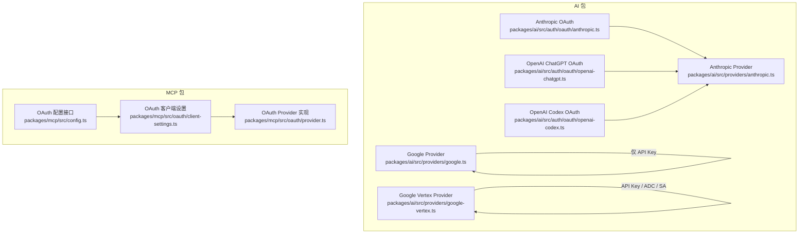
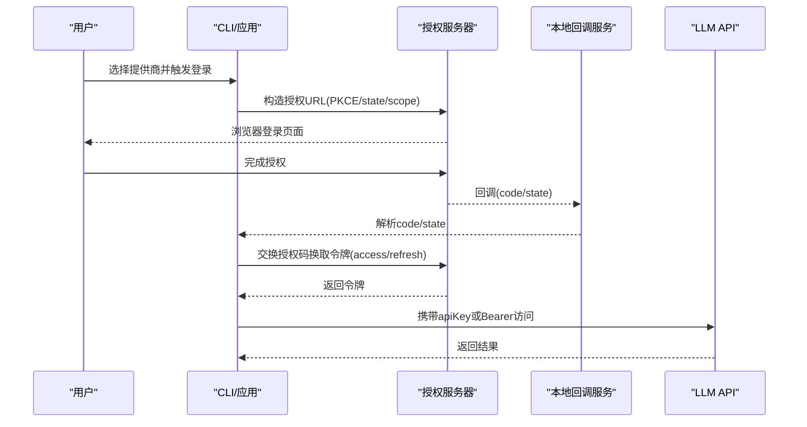
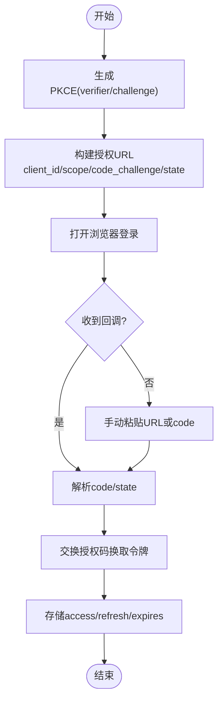
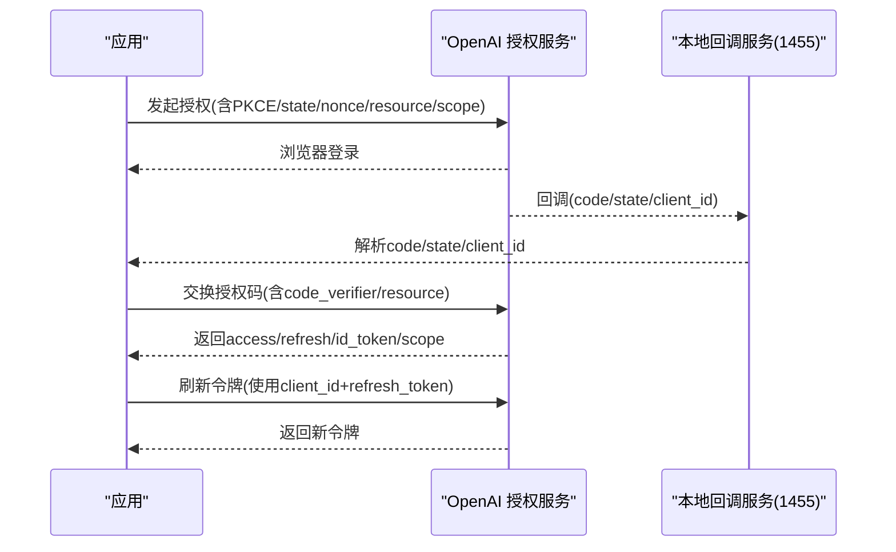
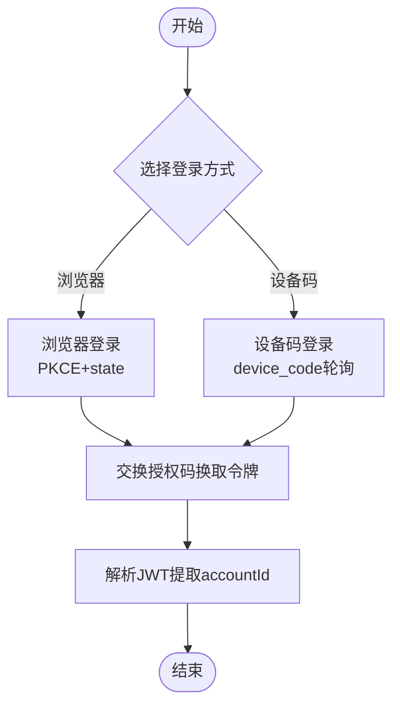

# 提供商实现

<cite>
**本文引用的文件**   
- [packages/ai/src/auth/oauth/anthropic.ts](https://github.com/FDE-GROUP/oh-my-coding-agent/blob/omca/packages/ai/src/auth/oauth/anthropic.ts)
- [packages/ai/src/providers/anthropic.ts](https://github.com/FDE-GROUP/oh-my-coding-agent/blob/omca/packages/ai/src/providers/anthropic.ts)
- [packages/ai/src/api/anthropic-messages.ts](https://github.com/FDE-GROUP/oh-my-coding-agent/blob/omca/packages/ai/src/api/anthropic-messages.ts)
- [packages/ai/src/auth/oauth/openai-chatgpt.ts](https://github.com/FDE-GROUP/oh-my-coding-agent/blob/omca/packages/ai/src/auth/oauth/openai-chatgpt.ts)
- [packages/ai/src/auth/oauth/openai-codex.ts](https://github.com/FDE-GROUP/oh-my-coding-agent/blob/omca/packages/ai/src/auth/oauth/openai-codex.ts)
- [packages/ai/test/oauth-auth.test.ts](https://github.com/FDE-GROUP/oh-my-coding-agent/blob/omca/packages/ai/test/oauth-auth.test.ts)
- [packages/ai/src/providers/google.ts](https://github.com/FDE-GROUP/oh-my-coding-agent/blob/omca/packages/ai/src/providers/google.ts)
- [packages/ai/src/providers/google-vertex.ts](https://github.com/FDE-GROUP/oh-my-coding-agent/blob/omca/packages/ai/src/providers/google-vertex.ts)
- [packages/mcp/src/config.ts](https://github.com/FDE-GROUP/oh-my-coding-agent/blob/omca/packages/mcp/src/config.ts)
- [packages/mcp/src/oauth/client-settings.ts](https://github.com/FDE-GROUP/oh-my-coding-agent/blob/omca/packages/mcp/src/oauth/client-settings.ts)
- [packages/mcp/src/oauth/provider.ts](https://github.com/FDE-GROUP/oh-my-coding-agent/blob/omca/packages/mcp/src/oauth/provider.ts)
</cite>

## 目录
1. [简介](#简介)
2. [项目结构](#项目结构)
3. [核心组件](#核心组件)
4. [架构总览](#架构总览)
5. [详细组件分析](#详细组件分析)
6. [依赖关系分析](#依赖关系分析)
7. [性能与安全考量](#性能与安全考量)
8. [故障排查指南](#故障排查指南)
9. [结论](#结论)
10. [附录：配置与迁移清单](#附录配置与迁移清单)

## 简介
本文件聚焦于各主流 LLM 提供商的 OAuth 实现与配置差异，覆盖 OpenAI（ChatGPT 订阅、Codex）、Anthropic（Claude Pro/Max）以及 Google（Generative AI 与 Vertex AI）。文档包含：
- 客户端 ID、重定向 URI、权限范围（scope）的定义与差异
- 完整认证流程与流程图
- 提供商特有的安全要求与选项
- 迁移与兼容性说明

## 项目结构
本项目在 packages/ai 中为不同提供商提供独立的 OAuth 实现模块，并在 providers 层将 OAuth 能力暴露给上层模型调用。MCP 包提供了通用的 OAuth 客户端与回调处理逻辑，供多场景复用。

**图表来源**
- [packages/ai/src/auth/oauth/anthropic.ts:1-308](https://github.com/FDE-GROUP/oh-my-coding-agent/blob/omca/packages/ai/src/auth/oauth/anthropic.ts#L1-L308)
- [packages/ai/src/auth/oauth/openai-chatgpt.ts:1-310](https://github.com/FDE-GROUP/oh-my-coding-agent/blob/omca/packages/ai/src/auth/oauth/openai-chatgpt.ts#L1-L310)
- [packages/ai/src/auth/oauth/openai-codex.ts:1-439](https://github.com/FDE-GROUP/oh-my-coding-agent/blob/omca/packages/ai/src/auth/oauth/openai-codex.ts#L1-L439)
- [packages/ai/src/providers/anthropic.ts:74-90](https://github.com/FDE-GROUP/oh-my-coding-agent/blob/omca/packages/ai/src/providers/anthropic.ts#L74-L90)
- [packages/ai/src/providers/google.ts:6-15](https://github.com/FDE-GROUP/oh-my-coding-agent/blob/omca/packages/ai/src/providers/google.ts#L6-L15)
- [packages/ai/src/providers/google-vertex.ts:92-100](https://github.com/FDE-GROUP/oh-my-coding-agent/blob/omca/packages/ai/src/providers/google-vertex.ts#L92-L100)
- [packages/mcp/src/config.ts:40-64](https://github.com/FDE-GROUP/oh-my-coding-agent/blob/omca/packages/mcp/src/config.ts#L40-L64)
- [packages/mcp/src/oauth/client-settings.ts:13-117](https://github.com/FDE-GROUP/oh-my-coding-agent/blob/omca/packages/mcp/src/oauth/client-settings.ts#L13-L117)
- [packages/mcp/src/oauth/provider.ts:52-94](https://github.com/FDE-GROUP/oh-my-coding-agent/blob/omca/packages/mcp/src/oauth/provider.ts#L52-L94)

**章节来源**
- [packages/ai/src/auth/oauth/anthropic.ts:1-308](https://github.com/FDE-GROUP/oh-my-coding-agent/blob/omca/packages/ai/src/auth/oauth/anthropic.ts#L1-L308)
- [packages/ai/src/auth/oauth/openai-chatgpt.ts:1-310](https://github.com/FDE-GROUP/oh-my-coding-agent/blob/omca/packages/ai/src/auth/oauth/openai-chatgpt.ts#L1-L310)
- [packages/ai/src/auth/oauth/openai-codex.ts:1-439](https://github.com/FDE-GROUP/oh-my-coding-agent/blob/omca/packages/ai/src/auth/oauth/openai-codex.ts#L1-L439)
- [packages/ai/src/providers/anthropic.ts:74-90](https://github.com/FDE-GROUP/oh-my-coding-agent/blob/omca/packages/ai/src/providers/anthropic.ts#L74-L90)
- [packages/ai/src/providers/google.ts:6-15](https://github.com/FDE-GROUP/oh-my-coding-agent/blob/omca/packages/ai/src/providers/google.ts#L6-L15)
- [packages/ai/src/providers/google-vertex.ts:92-100](https://github.com/FDE-GROUP/oh-my-coding-agent/blob/omca/packages/ai/src/providers/google-vertex.ts#L92-L100)
- [packages/mcp/src/config.ts:40-64](https://github.com/FDE-GROUP/oh-my-coding-agent/blob/omca/packages/mcp/src/config.ts#L40-L64)
- [packages/mcp/src/oauth/client-settings.ts:13-117](https://github.com/FDE-GROUP/oh-my-coding-agent/blob/omca/packages/mcp/src/oauth/client-settings.ts#L13-L117)
- [packages/mcp/src/oauth/provider.ts:52-94](https://github.com/FDE-GROUP/oh-my-coding-agent/blob/omca/packages/mcp/src/oauth/provider.ts#L52-L94)

## 核心组件
- Anthropic OAuth：支持浏览器登录与“复制代码”无头模式，使用 PKCE，回调端口可配置，默认回退到空闲端口；最终将 access_token 映射为 apiKey。
- OpenAI ChatGPT OAuth：动态客户端注册，本地回调服务监听固定端口，支持手动粘贴回调 URL；返回 scope 校验并保留 clientId。
- OpenAI Codex OAuth：同时支持浏览器登录与设备码（Device Code）登录；提取 JWT 中的 accountId 作为账户标识。
- Google Generative AI：仅提供 API Key 认证，不涉及 OAuth。
- Google Vertex AI：支持 API Key、Application Default Credentials（ADC）与服务账号文件三种方式，不直接实现 OAuth。

**章节来源**
- [packages/ai/src/auth/oauth/anthropic.ts:14-27](https://github.com/FDE-GROUP/oh-my-coding-agent/blob/omca/packages/ai/src/auth/oauth/anthropic.ts#L14-L27)
- [packages/ai/src/auth/oauth/openai-chatgpt.ts:15-29](https://github.com/FDE-GROUP/oh-my-coding-agent/blob/omca/packages/ai/src/auth/oauth/openai-chatgpt.ts#L15-L29)
- [packages/ai/src/auth/oauth/openai-codex.ts:22-35](https://github.com/FDE-GROUP/oh-my-coding-agent/blob/omca/packages/ai/src/auth/oauth/openai-codex.ts#L22-L35)
- [packages/ai/src/providers/google.ts:6-15](https://github.com/FDE-GROUP/oh-my-coding-agent/blob/omca/packages/ai/src/providers/google.ts#L6-L15)
- [packages/ai/src/providers/google-vertex.ts:13-63](https://github.com/FDE-GROUP/oh-my-coding-agent/blob/omca/packages/ai/src/providers/google-vertex.ts#L13-L63)

## 架构总览
下图展示了从用户交互到令牌交换、再到 API 调用的整体流程，涵盖 Anthropic、OpenAI（ChatGPT/Codex）与 Google 的差异点。

**图表来源**
- [packages/ai/src/auth/oauth/anthropic.ts:140-198](https://github.com/FDE-GROUP/oh-my-coding-agent/blob/omca/packages/ai/src/auth/oauth/anthropic.ts#L140-L198)
- [packages/ai/src/auth/oauth/openai-chatgpt.ts:233-298](https://github.com/FDE-GROUP/oh-my-coding-agent/blob/omca/packages/ai/src/auth/oauth/openai-chatgpt.ts#L233-L298)
- [packages/ai/src/auth/oauth/openai-codex.ts:359-400](https://github.com/FDE-GROUP/oh-my-coding-agent/blob/omca/packages/ai/src/auth/oauth/openai-codex.ts#L359-L400)

## 详细组件分析

### Anthropic（Claude Pro/Max）
- 客户端 ID：通过 Base64 解码常量获取
- 授权端点与令牌端点：分别指向 claude.ai 与 platform.claude.com
- 回调地址：本地回环地址 + 可配置端口（默认优先 53692），路径为 /callback；另提供“复制代码”模式的专用 redirect_uri
- 权限范围：组织与用户相关多项 scope（如 user:inference、user:sessions:claude_code 等）
- 登录方式：
  - 浏览器登录：启动本地回调服务，若端口不可用则自动回退到空闲端口
  - 复制代码登录：引导用户在浏览器登录后粘贴一次性 code
- 令牌交换：使用 authorization_code + PKCE（S256），返回 access_token、refresh_token、expires_in
- 刷新令牌：使用 refresh_token 请求新令牌
- toAuth：将 access_token 映射为 apiKey

**图表来源**
- [packages/ai/src/auth/oauth/anthropic.ts:140-198](https://github.com/FDE-GROUP/oh-my-coding-agent/blob/omca/packages/ai/src/auth/oauth/anthropic.ts#L140-L198)
- [packages/ai/src/auth/oauth/anthropic.ts:200-235](https://github.com/FDE-GROUP/oh-my-coding-agent/blob/omca/packages/ai/src/auth/oauth/anthropic.ts#L200-L235)
- [packages/ai/src/auth/oauth/anthropic.ts:240-276](https://github.com/FDE-GROUP/oh-my-coding-agent/blob/omca/packages/ai/src/auth/oauth/anthropic.ts#L240-L276)

**章节来源**
- [packages/ai/src/auth/oauth/anthropic.ts:14-27](https://github.com/FDE-GROUP/oh-my-coding-agent/blob/omca/packages/ai/src/auth/oauth/anthropic.ts#L14-L27)
- [packages/ai/src/auth/oauth/anthropic.ts:96-138](https://github.com/FDE-GROUP/oh-my-coding-agent/blob/omca/packages/ai/src/auth/oauth/anthropic.ts#L96-L138)
- [packages/ai/src/auth/oauth/anthropic.ts:140-235](https://github.com/FDE-GROUP/oh-my-coding-agent/blob/omca/packages/ai/src/auth/oauth/anthropic.ts#L140-L235)
- [packages/ai/src/auth/oauth/anthropic.ts:240-276](https://github.com/FDE-GROUP/oh-my-coding-agent/blob/omca/packages/ai/src/auth/oauth/anthropic.ts#L240-L276)
- [packages/ai/src/providers/anthropic.ts:74-90](https://github.com/FDE-GROUP/oh-my-coding-agent/blob/omca/packages/ai/src/providers/anthropic.ts#L74-L90)
- [packages/ai/src/api/anthropic-messages.ts:576-605](https://github.com/FDE-GROUP/oh-my-coding-agent/blob/omca/packages/ai/src/api/anthropic-messages.ts#L576-L605)

### OpenAI（ChatGPT 订阅）
- 客户端 ID：动态注册（dynamic_agent_client），回调中返回实际 client_id
- 授权端点与令牌端点：auth.openai.com 下的 authorize 与 oauth/token
- 资源与范围：resource 指定 api.openai.com/v1；scope 包含 openid/profile/email/offline_access/resource.invoke/chatgpt.tokens.use.direct
- 回调地址：本地 127.0.0.1:1455/auth/callback；若端口占用会给出明确错误提示
- 登录方式：
  - 浏览器登录：启动本地回调服务，支持手动粘贴最终回调 URL
  - 校验：必须包含 id_token 与 required scope
- 令牌交换：authorization_code + PKCE（S256），返回 access_token、refresh_token、expires_in、id_token、scope
- 刷新令牌：使用 refresh_token 与已注册的 client_id
- toAuth：将 access_token 映射为 apiKey

**图表来源**
- [packages/ai/src/auth/oauth/openai-chatgpt.ts:85-132](https://github.com/FDE-GROUP/oh-my-coding-agent/blob/omca/packages/ai/src/auth/oauth/openai-chatgpt.ts#L85-L132)
- [packages/ai/src/auth/oauth/openai-chatgpt.ts:183-223](https://github.com/FDE-GROUP/oh-my-coding-agent/blob/omca/packages/ai/src/auth/oauth/openai-chatgpt.ts#L183-L223)
- [packages/ai/src/auth/oauth/openai-chatgpt.ts:233-298](https://github.com/FDE-GROUP/oh-my-coding-agent/blob/omca/packages/ai/src/auth/oauth/openai-chatgpt.ts#L233-L298)

**章节来源**
- [packages/ai/src/auth/oauth/openai-chatgpt.ts:15-29](https://github.com/FDE-GROUP/oh-my-coding-agent/blob/omca/packages/ai/src/auth/oauth/openai-chatgpt.ts#L15-L29)
- [packages/ai/src/auth/oauth/openai-chatgpt.ts:134-181](https://github.com/FDE-GROUP/oh-my-coding-agent/blob/omca/packages/ai/src/auth/oauth/openai-chatgpt.ts#L134-L181)
- [packages/ai/src/auth/oauth/openai-chatgpt.ts:183-223](https://github.com/FDE-GROUP/oh-my-coding-agent/blob/omca/packages/ai/src/auth/oauth/openai-chatgpt.ts#L183-L223)
- [packages/ai/src/auth/oauth/openai-chatgpt.ts:233-298](https://github.com/FDE-GROUP/oh-my-coding-agent/blob/omca/packages/ai/src/auth/oauth/openai-chatgpt.ts#L233-L298)
- [packages/ai/test/oauth-auth.test.ts:51-59](https://github.com/FDE-GROUP/oh-my-coding-agent/blob/omca/packages/ai/test/oauth-auth.test.ts#L51-L59)

### OpenAI（Codex）
- 客户端 ID：固定客户端 ID
- 授权端点与令牌端点：auth.openai.com 下的 /oauth/authorize 与 /oauth/token
- 设备码流程：独立端点用于获取 device_code/user_code，轮询获取授权码
- 回调地址：localhost:1455/auth/callback；若端口被占用，允许手动粘贴回调 URL
- 登录方式：
  - 浏览器登录：标准授权码流程 + PKCE
  - 设备码登录：适用于无头环境
- 令牌交换：authorization_code + PKCE（S256），返回 access_token、refresh_token、expires_in
- 账户标识：从 access_token 的 JWT 载荷中提取 chatgpt_account_id
- toAuth：将 access_token 映射为 apiKey

**图表来源**
- [packages/ai/src/auth/oauth/openai-codex.ts:187-287](https://github.com/FDE-GROUP/oh-my-coding-agent/blob/omca/packages/ai/src/auth/oauth/openai-codex.ts#L187-L287)
- [packages/ai/src/auth/oauth/openai-codex.ts:359-400](https://github.com/FDE-GROUP/oh-my-coding-agent/blob/omca/packages/ai/src/auth/oauth/openai-codex.ts#L359-L400)
- [packages/ai/src/auth/oauth/openai-codex.ts:310-330](https://github.com/FDE-GROUP/oh-my-coding-agent/blob/omca/packages/ai/src/auth/oauth/openai-codex.ts#L310-L330)

**章节来源**
- [packages/ai/src/auth/oauth/openai-codex.ts:22-35](https://github.com/FDE-GROUP/oh-my-coding-agent/blob/omca/packages/ai/src/auth/oauth/openai-codex.ts#L22-L35)
- [packages/ai/src/auth/oauth/openai-codex.ts:145-185](https://github.com/FDE-GROUP/oh-my-coding-agent/blob/omca/packages/ai/src/auth/oauth/openai-codex.ts#L145-L185)
- [packages/ai/src/auth/oauth/openai-codex.ts:187-287](https://github.com/FDE-GROUP/oh-my-coding-agent/blob/omca/packages/ai/src/auth/oauth/openai-codex.ts#L187-L287)
- [packages/ai/src/auth/oauth/openai-codex.ts:310-330](https://github.com/FDE-GROUP/oh-my-coding-agent/blob/omca/packages/ai/src/auth/oauth/openai-codex.ts#L310-L330)
- [packages/ai/src/auth/oauth/openai-codex.ts:359-400](https://github.com/FDE-GROUP/oh-my-coding-agent/blob/omca/packages/ai/src/auth/oauth/openai-codex.ts#L359-L400)
- [packages/ai/test/oauth-auth.test.ts:61-64](https://github.com/FDE-GROUP/oh-my-coding-agent/blob/omca/packages/ai/test/oauth-auth.test.ts#L61-L64)

### Google（Generative AI）
- 认证方式：仅支持 API Key（环境变量 GEMINI_API_KEY）
- 不提供 OAuth 流程

**章节来源**
- [packages/ai/src/providers/google.ts:6-15](https://github.com/FDE-GROUP/oh-my-coding-agent/blob/omca/packages/ai/src/providers/google.ts#L6-L15)

### Google（Vertex AI）
- 认证方式：
  - API Key：直接使用 GOOGLE_CLOUD_API_KEY
  - Application Default Credentials（ADC）：需运行 gcloud auth application-default login，并提供 project 与 location
  - 服务账号文件：提供 GOOGLE_APPLICATION_CREDENTIALS 文件路径，配合 project 与 location
- 不直接实现 OAuth；通过 SDK 的 ADC/SA 机制完成鉴权

**章节来源**
- [packages/ai/src/providers/google-vertex.ts:13-63](https://github.com/FDE-GROUP/oh-my-coding-agent/blob/omca/packages/ai/src/providers/google-vertex.ts#L13-L63)
- [packages/ai/src/providers/google-vertex.ts:64-89](https://github.com/FDE-GROUP/oh-my-coding-agent/blob/omca/packages/ai/src/providers/google-vertex.ts#L64-L89)

### MCP OAuth 通用客户端（参考）
- 配置项：clientId、clientSecret、callbackPort、callbackUrl、scope、clientName、clientRegistration 策略等
- 行为：
  - 支持动态客户端注册或 Client ID Metadata Documents（CIMD）
  - 回调地址遵循 RFC 8252（回环地址 + 端口）
  - 默认 grant_types/response_types/token_endpoint_auth_method 由实现推断

**章节来源**
- [packages/mcp/src/config.ts:40-64](https://github.com/FDE-GROUP/oh-my-coding-agent/blob/omca/packages/mcp/src/config.ts#L40-L64)
- [packages/mcp/src/oauth/client-settings.ts:13-117](https://github.com/FDE-GROUP/oh-my-coding-agent/blob/omca/packages/mcp/src/oauth/client-settings.ts#L13-L117)
- [packages/mcp/src/oauth/provider.ts:52-94](https://github.com/FDE-GROUP/oh-my-coding-agent/blob/omca/packages/mcp/src/oauth/provider.ts#L52-L94)

## 依赖关系分析
- Anthropic：
  - 依赖 provider-env 读取回调主机
  - 依赖 callback-server 提供本地回调与等待回调/手动输入
  - 依赖 pkce 生成 PKCE verifier/challenge
  - 在 provider 层注入 OAuth 能力，并通过 API 层支持 Workload Identity Federation（OIDC federation）
- OpenAI（ChatGPT/Codex）：
  - 依赖 callback-server 或内联回调服务
  - 依赖 device-code 流程（Codex）
  - 依赖 pkce 生成 PKCE
- Google：
  - Generative AI：仅依赖 API Key
  - Vertex AI：依赖 gcloud ADC 或服务账号文件

```mermaid
graph LR
Anthropic["Anthropic OAuth"] --> PKE["PKCE"]
Anthropic --> CB["回调服务"]
Anthropic --> Prov["Anthropic Provider"]
AnthProv["Anthropic Provider"] --> Fed["Workload Identity Federation(API层)"]
OAIChat["OpenAI ChatGPT OAuth"] --> PKE
OAIChat --> CB
OAICodex["OpenAI Codex OAuth"] --> PKE
OAICodex --> Dev["设备码流程"]
OAICodex --> CB
GoogleGA["Google Generative AI"] --> Key["API Key"]
GoogleV["Google Vertex AI"] --> ADC["ADC/SA"]
```

**图表来源**
- [packages/ai/src/auth/oauth/anthropic.ts:8-11](https://github.com/FDE-GROUP/oh-my-coding-agent/blob/omca/packages/ai/src/auth/oauth/anthropic.ts#L8-L11)
- [packages/ai/src/providers/anthropic.ts:74-90](https://github.com/FDE-GROUP/oh-my-coding-agent/blob/omca/packages/ai/src/providers/anthropic.ts#L74-L90)
- [packages/ai/src/api/anthropic-messages.ts:576-605](https://github.com/FDE-GROUP/oh-my-coding-agent/blob/omca/packages/ai/src/api/anthropic-messages.ts#L576-L605)
- [packages/ai/src/auth/oauth/openai-chatgpt.ts:8-13](https://github.com/FDE-GROUP/oh-my-coding-agent/blob/omca/packages/ai/src/auth/oauth/openai-chatgpt.ts#L8-L13)
- [packages/ai/src/auth/oauth/openai-codex.ts:16-20](https://github.com/FDE-GROUP/oh-my-coding-agent/blob/omca/packages/ai/src/auth/oauth/openai-codex.ts#L16-L20)
- [packages/ai/src/providers/google.ts:6-15](https://github.com/FDE-GROUP/oh-my-coding-agent/blob/omca/packages/ai/src/providers/google.ts#L6-L15)
- [packages/ai/src/providers/google-vertex.ts:13-63](https://github.com/FDE-GROUP/oh-my-coding-agent/blob/omca/packages/ai/src/providers/google-vertex.ts#L13-L63)

**章节来源**
- [packages/ai/src/auth/oauth/anthropic.ts:8-11](https://github.com/FDE-GROUP/oh-my-coding-agent/blob/omca/packages/ai/src/auth/oauth/anthropic.ts#L8-L11)
- [packages/ai/src/auth/oauth/openai-chatgpt.ts:8-13](https://github.com/FDE-GROUP/oh-my-coding-agent/blob/omca/packages/ai/src/auth/oauth/openai-chatgpt.ts#L8-L13)
- [packages/ai/src/auth/oauth/openai-codex.ts:16-20](https://github.com/FDE-GROUP/oh-my-coding-agent/blob/omca/packages/ai/src/auth/oauth/openai-codex.ts#L16-L20)
- [packages/ai/src/providers/anthropic.ts:74-90](https://github.com/FDE-GROUP/oh-my-coding-agent/blob/omca/packages/ai/src/providers/anthropic.ts#L74-L90)
- [packages/ai/src/api/anthropic-messages.ts:576-605](https://github.com/FDE-GROUP/oh-my-coding-agent/blob/omca/packages/ai/src/api/anthropic-messages.ts#L576-L605)
- [packages/ai/src/providers/google.ts:6-15](https://github.com/FDE-GROUP/oh-my-coding-agent/blob/omca/packages/ai/src/providers/google.ts#L6-L15)
- [packages/ai/src/providers/google-vertex.ts:13-63](https://github.com/FDE-GROUP/oh-my-coding-agent/blob/omca/packages/ai/src/providers/google-vertex.ts#L13-L63)

## 性能与安全考量
- PKCE：所有 OAuth 流程均使用 PKCE（S256），防止授权码拦截攻击
- 回调端口冲突：
  - Anthropic：优先绑定固定端口，失败时自动回退到空闲端口
  - OpenAI ChatGPT：固定端口 1455，若被占用给出明确错误提示
  - OpenAI Codex：共享端口 1455，失败时允许手动粘贴回调 URL
- 令牌过期管理：
  - 提前刷新：在接近过期前进行刷新，避免请求开始时令牌即将失效
  - 刷新失败：统一抛出带状态码与响应体的错误信息，便于诊断
- 范围最小化：
  - Anthropic：按功能划分 scope（组织、会话、上传、MCP 等）
  - OpenAI ChatGPT：显式声明 resource 与 direct token scope，确保仅授予必要权限
- 身份与审计：
  - OpenAI Codex：从 JWT 载荷中提取 accountId，便于跨会话识别用户
  - Anthropic：支持 Workload Identity Federation（OIDC federation），适合企业环境

[本节为通用指导，不直接分析具体文件]

## 故障排查指南
- 回调端口占用
  - 现象：无法启动本地回调服务
  - 处理：Anthropic 自动回退到空闲端口；OpenAI ChatGPT 提示端口占用；OpenAI Codex 允许手动粘贴回调 URL
- 授权码无效或缺失
  - 现象：令牌交换失败，提示缺少 code 或 state 不匹配
  - 处理：检查回调 URL 是否完整、state 是否一致、是否误粘贴中间链接
- 范围不足
  - 现象：OpenAI ChatGPT 报 scope 缺失
  - 处理：确认授权时包含 required scope（如 chatgpt.tokens.use.direct）
- 刷新令牌失败
  - 现象：刷新请求返回非 2xx 或 JSON 解析失败
  - 处理：检查 refresh_token 是否有效、client_id 是否正确（OpenAI ChatGPT 需要首次登录时返回的 clientId）
- Google 未配置凭据
  - 现象：Vertex AI 无法找到 ADC 或 SA 文件
  - 处理：运行 gcloud auth application-default login 或提供 GOOGLE_APPLICATION_CREDENTIALS 文件路径，并确保 project/location 正确

**章节来源**
- [packages/ai/src/auth/oauth/anthropic.ts:140-198](https://github.com/FDE-GROUP/oh-my-coding-agent/blob/omca/packages/ai/src/auth/oauth/anthropic.ts#L140-L198)
- [packages/ai/src/auth/oauth/openai-chatgpt.ts:233-298](https://github.com/FDE-GROUP/oh-my-coding-agent/blob/omca/packages/ai/src/auth/oauth/openai-chatgpt.ts#L233-L298)
- [packages/ai/src/auth/oauth/openai-codex.ts:359-400](https://github.com/FDE-GROUP/oh-my-coding-agent/blob/omca/packages/ai/src/auth/oauth/openai-codex.ts#L359-L400)
- [packages/ai/src/providers/google-vertex.ts:64-89](https://github.com/FDE-GROUP/oh-my-coding-agent/blob/omca/packages/ai/src/providers/google-vertex.ts#L64-L89)

## 结论
- Anthropic、OpenAI（ChatGPT/Codex）均实现了完整的 OAuth 流程，采用 PKCE 提升安全性，并通过回调服务简化用户体验。
- Google Generative AI 仅支持 API Key；Vertex AI 通过 ADC/SA 机制完成鉴权，不直接实现 OAuth。
- 在不同环境中（容器、SSH、无头终端），各实现提供了灵活的回调与登录方式，确保可用性。
- 在企业场景中，Anthropic 的 Workload Identity Federation 与 Vertex 的 ADC/SA 提供更强的合规性与可管理性。

[本节为总结性内容，不直接分析具体文件]

## 附录：配置与迁移清单

### 配置要点速查
- Anthropic
  - 客户端 ID：Base64 解码常量
  - 授权端点：https://claude.ai/oauth/authorize
  - 令牌端点：https://platform.claude.com/v1/oauth/token
  - 回调地址：http://localhost:<port>/callback（可配置 host/port）
  - 范围：org:create_api_key, user:profile, user:inference, user:sessions:claude_code, user:mcp_servers, user:file_upload
  - 登录方式：浏览器登录 / 复制代码登录
  - 刷新令牌：refresh_token
  - toAuth：access_token → apiKey
- OpenAI（ChatGPT）
  - 客户端 ID：动态注册（dynamic_agent_client），回调返回实际 client_id
  - 授权端点：https://auth.openai.com/api/accounts/authorize
  - 令牌端点：https://auth.openai.com/api/accounts/oauth/token
  - 资源：https://api.openai.com/v1
  - 回调地址：http://127.0.0.1:1455/auth/callback
  - 范围：openid profile email offline_access resource.invoke chatgpt.tokens.use.direct
  - 登录方式：浏览器登录 / 手动粘贴回调 URL
  - 刷新令牌：refresh_token + client_id
  - toAuth：access_token → apiKey
- OpenAI（Codex）
  - 客户端 ID：固定客户端 ID
  - 授权端点：https://auth.openai.com/oauth/authorize
  - 令牌端点：https://auth.openai.com/oauth/token
  - 回调地址：http://localhost:1455/auth/callback
  - 范围：openid profile email offline_access
  - 登录方式：浏览器登录 / 设备码登录
  - 账户标识：从 JWT 载荷提取 chatgpt_account_id
  - toAuth：access_token → apiKey
- Google（Generative AI）
  - 认证：API Key（GEMINI_API_KEY）
- Google（Vertex AI）
  - 认证：API Key / ADC / Service Account
  - 环境变量：GOOGLE_CLOUD_PROJECT、GOOGLE_CLOUD_LOCATION、GOOGLE_APPLICATION_CREDENTIALS

**章节来源**
- [packages/ai/src/auth/oauth/anthropic.ts:14-27](https://github.com/FDE-GROUP/oh-my-coding-agent/blob/omca/packages/ai/src/auth/oauth/anthropic.ts#L14-L27)
- [packages/ai/src/auth/oauth/openai-chatgpt.ts:15-29](https://github.com/FDE-GROUP/oh-my-coding-agent/blob/omca/packages/ai/src/auth/oauth/openai-chatgpt.ts#L15-L29)
- [packages/ai/src/auth/oauth/openai-codex.ts:22-35](https://github.com/FDE-GROUP/oh-my-coding-agent/blob/omca/packages/ai/src/auth/oauth/openai-codex.ts#L22-L35)
- [packages/ai/src/providers/google.ts:6-15](https://github.com/FDE-GROUP/oh-my-coding-agent/blob/omca/packages/ai/src/providers/google.ts#L6-L15)
- [packages/ai/src/providers/google-vertex.ts:13-63](https://github.com/FDE-GROUP/oh-my-coding-agent/blob/omca/packages/ai/src/providers/google-vertex.ts#L13-L63)

### 迁移与兼容性说明
- 从 API Key 迁移到 OAuth
  - Anthropic：启用 OAuth 后，toAuth 会将 access_token 转为 apiKey，无需改动上层调用
  - OpenAI（ChatGPT/Codex）：同样以 apiKey 形式透传，保持兼容
- 从 ChatGPT 迁移到 Codex
  - 两者均为 OpenAI 提供的 OAuth 流，但端点、scope、回调端口与登录方式存在差异
  - 注意端口冲突与设备码登录的使用场景
- 从 Anthropic 迁移到 OpenAI
  - 关注 scope 差异与回调地址差异；Anthropic 支持“复制代码”登录，OpenAI 支持设备码登录
- Google 迁移
  - Generative AI 不支持 OAuth；如需 OAuth，考虑使用第三方代理或改用 Vertex（通过 ADC/SA）

**章节来源**
- [packages/ai/test/oauth-auth.test.ts:32-44](https://github.com/FDE-GROUP/oh-my-coding-agent/blob/omca/packages/ai/test/oauth-auth.test.ts#L32-L44)
- [packages/ai/test/oauth-auth.test.ts:46-64](https://github.com/FDE-GROUP/oh-my-coding-agent/blob/omca/packages/ai/test/oauth-auth.test.ts#L46-L64)
- [packages/ai/src/auth/oauth/openai-codex.ts:341-357](https://github.com/FDE-GROUP/oh-my-coding-agent/blob/omca/packages/ai/src/auth/oauth/openai-codex.ts#L341-L357)