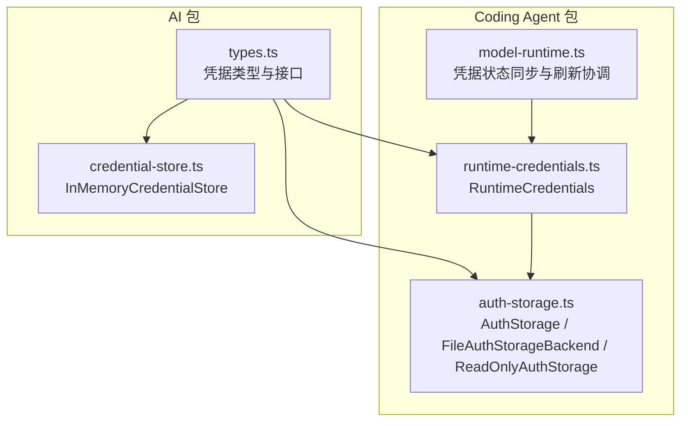
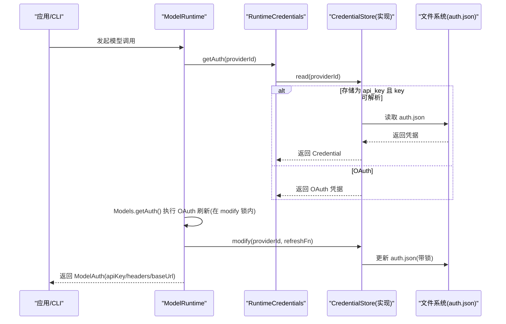
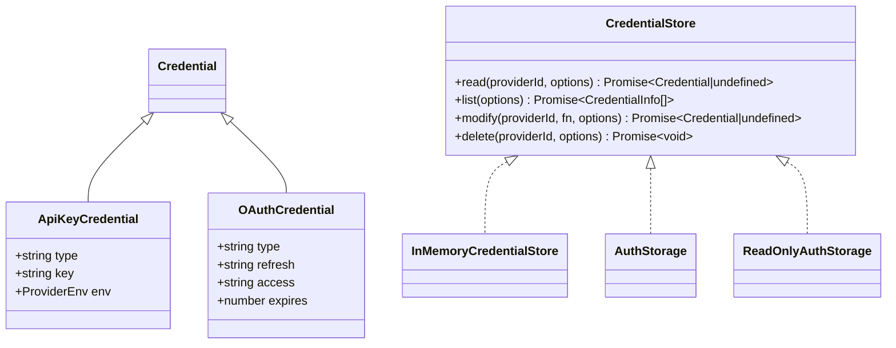
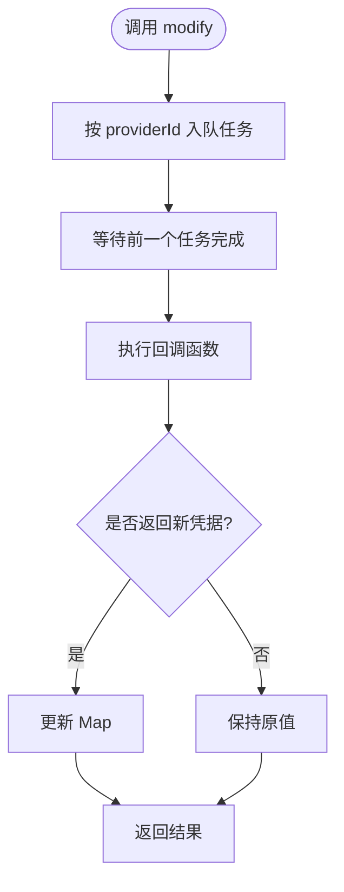
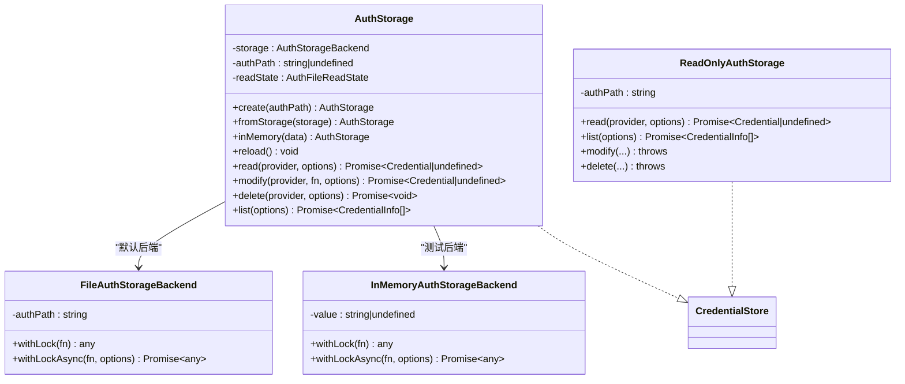
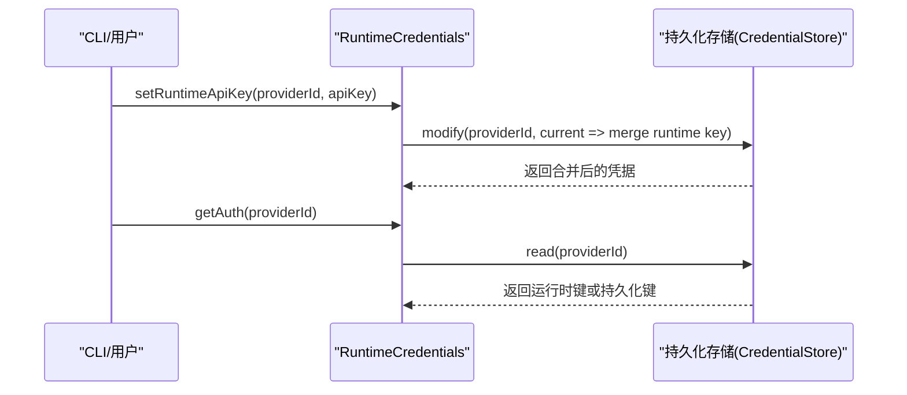
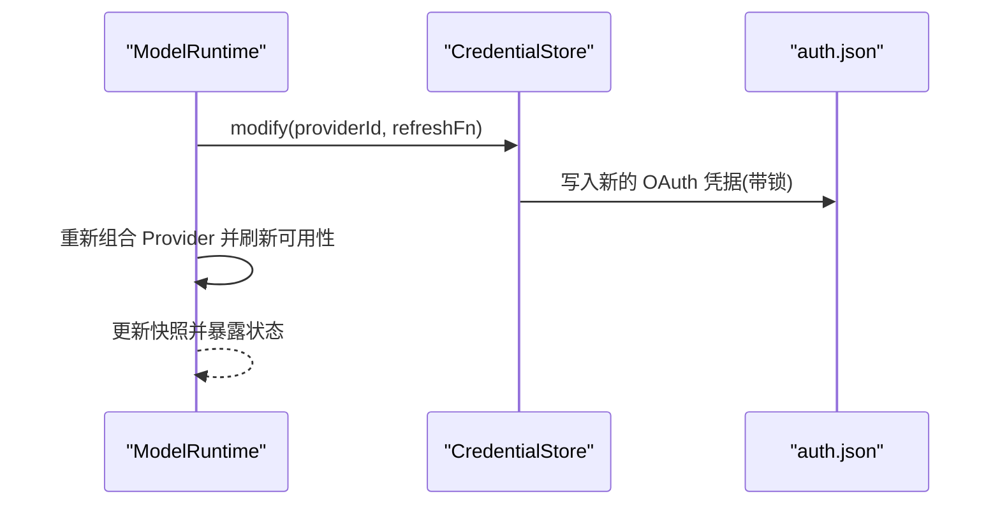
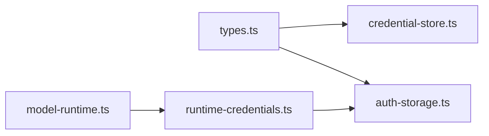

# 凭据存储系统

<cite>
**本文引用的文件**   
- [packages/ai/src/auth/types.ts](https://github.com/FDE-GROUP/oh-my-fde/blob/omca/packages/ai/src/auth/types.ts)
- [packages/ai/src/auth/credential-store.ts](https://github.com/FDE-GROUP/oh-my-fde/blob/omca/packages/ai/src/auth/credential-store.ts)
- [packages/coding-agent/src/core/auth-storage.ts](https://github.com/FDE-GROUP/oh-my-fde/blob/omca/packages/coding-agent/src/core/auth-storage.ts)
- [packages/coding-agent/src/core/runtime-credentials.ts](https://github.com/FDE-GROUP/oh-my-fde/blob/omca/packages/coding-agent/src/core/runtime-credentials.ts)
- [packages/coding-agent/src/core/model-runtime.ts](https://github.com/FDE-GROUP/oh-my-fde/blob/omca/packages/coding-agent/src/core/model-runtime.ts)
- [packages/ai/test/models-runtime.test.ts](https://github.com/FDE-GROUP/oh-my-fde/blob/omca/packages/ai/test/models-runtime.test.ts)
- [packages/coding-agent/test/runtime-credentials.test.ts](https://github.com/FDE-GROUP/oh-my-fde/blob/omca/packages/coding-agent/test/runtime-credentials.test.ts)
</cite>

## 目录
1. [引言](#引言)
2. [项目结构](#项目结构)
3. [核心组件](#核心组件)
4. [架构总览](#架构总览)
5. [详细组件分析](#详细组件分析)
6. [依赖关系分析](#依赖关系分析)
7. [性能与可靠性](#性能与可靠性)
8. [安全配置与访问控制](#安全配置与访问控制)
9. [故障恢复与排障指南](#故障恢复与排障指南)
10. [结论](#结论)

## 引言
本文件系统化说明仓库中的凭据存储子系统，重点覆盖：
- 加密存储机制、密钥管理与数据持久化策略
- 支持的后端类型、存储格式与数据迁移方案
- 凭据生命周期管理、自动清理机制与备份恢复
- 安全配置选项、访问控制策略与审计跟踪
- 存储性能优化与故障恢复策略

需要特别说明的是：当前代码库中的凭据存储以明文 JSON 文件为主，未实现应用层凭据加密或集中式密钥管理服务。因此“加密存储”在当前实现中并不存在；若需增强安全性，应基于现有抽象扩展后端并引入外部密钥管理方案。

## 项目结构
凭据存储相关代码主要分布在两个包：
- `packages/ai`：定义凭据类型、接口与默认内存实现
- `packages/coding-agent`：提供面向应用的持久化实现（JSON 文件）、只读实现、运行时注入与流程编排

**图表来源**
- [packages/ai/src/auth/types.ts:1-260](https://github.com/FDE-GROUP/oh-my-fde/blob/omca/packages/ai/src/auth/types.ts#L1-L260)
- [packages/ai/src/auth/credential-store.ts:1-68](https://github.com/FDE-GROUP/oh-my-fde/blob/omca/packages/ai/src/auth/credential-store.ts#L1-L68)
- [packages/coding-agent/src/core/auth-storage.ts:1-509](https://github.com/FDE-GROUP/oh-my-fde/blob/omca/packages/coding-agent/src/core/auth-storage.ts#L1-L509)
- [packages/coding-agent/src/core/runtime-credentials.ts:1-200](https://github.com/FDE-GROUP/oh-my-fde/blob/omca/packages/coding-agent/src/core/runtime-credentials.ts#L1-L200)
- [packages/coding-agent/src/core/model-runtime.ts:600-665](https://github.com/FDE-GROUP/oh-my-fde/blob/omca/packages/coding-agent/src/core/model-runtime.ts#L600-L665)

**章节来源**
- [packages/ai/src/auth/types.ts:1-260](https://github.com/FDE-GROUP/oh-my-fde/blob/omca/packages/ai/src/auth/types.ts#L1-L260)
- [packages/ai/src/auth/credential-store.ts:1-68](https://github.com/FDE-GROUP/oh-my-fde/blob/omca/packages/ai/src/auth/credential-store.ts#L1-L68)
- [packages/coding-agent/src/core/auth-storage.ts:1-509](https://github.com/FDE-GROUP/oh-my-fde/blob/omca/packages/coding-agent/src/core/auth-storage.ts#L1-L509)

## 核心组件
- 凭据类型与接口
  - `Credential`：API Key 或 OAuth 凭据的联合类型
  - `CredentialStore`：统一读写接口，强调串行写入、跨进程锁（由后端实现）
  - `ModelAuth`：请求级认证对象（apiKey、headers、baseUrl）
- 内存凭据存储
  - `InMemoryCredentialStore`：按 providerId 序列化写操作，适合测试与临时场景
- 持久化凭据存储
  - `AuthStorage`：面向应用的凭据存储门面，封装读取缓存、并发刷新与文件锁定
  - `FileAuthStorageBackend`：基于 `auth.json` 的文件后端，使用文件锁保证并发安全
  - `ReadOnlyAuthStorage`：只读视图，用于枚举与展示
  - `InMemoryAuthStorageBackend`：测试用内存后端
- 运行时凭据注入
  - `RuntimeCredentials`：将运行时 API Key 注入到持久化存储之上，供单次会话使用
- 模型运行时协调
  - `model-runtime.ts`：负责凭据状态同步、OAuth 刷新、可用性检查与退出前等待写入完成

**章节来源**
- [packages/ai/src/auth/types.ts:1-260](https://github.com/FDE-GROUP/oh-my-fde/blob/omca/packages/ai/src/auth/types.ts#L1-L260)
- [packages/ai/src/auth/credential-store.ts:1-68](https://github.com/FDE-GROUP/oh-my-fde/blob/omca/packages/ai/src/auth/credential-store.ts#L1-L68)
- [packages/coding-agent/src/core/auth-storage.ts:1-509](https://github.com/FDE-GROUP/oh-my-fde/blob/omca/packages/coding-agent/src/core/auth-storage.ts#L1-L509)
- [packages/coding-agent/src/core/runtime-credentials.ts:1-200](https://github.com/FDE-GROUP/oh-my-fde/blob/omca/packages/coding-agent/src/core/runtime-credentials.ts#L1-L200)
- [packages/coding-agent/src/core/model-runtime.ts:600-665](https://github.com/FDE-GROUP/oh-my-fde/blob/omca/packages/coding-agent/src/core/model-runtime.ts#L600-L665)

## 架构总览
凭据从存储到请求的整体流程如下：

**图表来源**
- [packages/coding-agent/src/core/model-runtime.ts:600-665](https://github.com/FDE-GROUP/oh-my-fde/blob/omca/packages/coding-agent/src/core/model-runtime.ts#L600-L665)
- [packages/coding-agent/src/core/auth-storage.ts:329-492](https://github.com/FDE-GROUP/oh-my-fde/blob/omca/packages/coding-agent/src/core/auth-storage.ts#L329-L492)
- [packages/ai/src/auth/types.ts:1-110](https://github.com/FDE-GROUP/oh-my-fde/blob/omca/packages/ai/src/auth/types.ts#L1-L110)

## 详细组件分析

### 凭据类型与接口
- `Credential`
  - `ApiKeyCredential`：包含可选的 `key` 与 `env`，`env` 用于存放提供商作用域的配置值
  - `OAuthCredential`：包含 `refresh`、`access`、`expires` 等字段
- `CredentialStore`
  - `read`：读取凭据，缺失时返回 `undefined`
  - `list`：仅列出元信息，不解析命令型 key
  - `modify`：唯一写入路径，串行化，支持跨进程锁
  - `delete`：删除凭据，需与 `modify` 串行
- `AuthOperationOptions`
  - 支持 `AbortSignal`，便于取消长时间运行的凭据操作

**图表来源**
- [packages/ai/src/auth/types.ts:13-48](https://github.com/FDE-GROUP/oh-my-fde/blob/omca/packages/ai/src/auth/types.ts#L13-L48)
- [packages/ai/src/auth/types.ts:65-94](https://github.com/FDE-GROUP/oh-my-fde/blob/omca/packages/ai/src/auth/types.ts#L65-L94)
- [packages/ai/src/auth/credential-store.ts:9-67](https://github.com/FDE-GROUP/oh-my-fde/blob/omca/packages/ai/src/auth/credential-store.ts#L9-L67)
- [packages/coding-agent/src/core/auth-storage.ts:205-324](https://github.com/FDE-GROUP/oh-my-fde/blob/omca/packages/coding-agent/src/core/auth-storage.ts#L205-L324)
- [packages/coding-agent/src/core/auth-storage.ts:329-492](https://github.com/FDE-GROUP/oh-my-fde/blob/omca/packages/coding-agent/src/core/auth-storage.ts#L329-L492)

**章节来源**
- [packages/ai/src/auth/types.ts:1-260](https://github.com/FDE-GROUP/oh-my-fde/blob/omca/packages/ai/src/auth/types.ts#L1-L260)

### 内存凭据存储
- `InMemoryCredentialStore`
  - 使用 Map 存储凭据，按 providerId 串行化写操作
  - 通过 `operationSignal` 与 `raceWithAbortSignal` 支持取消
  - 适用于测试、浏览器环境或无需持久化的场景

**图表来源**
- [packages/ai/src/auth/credential-store.ts:14-56](https://github.com/FDE-GROUP/oh-my-fde/blob/omca/packages/ai/src/auth/credential-store.ts#L14-L56)

**章节来源**
- [packages/ai/src/auth/credential-store.ts:1-68](https://github.com/FDE-GROUP/oh-my-fde/blob/omca/packages/ai/src/auth/credential-store.ts#L1-L68)

### 持久化凭据存储（JSON 文件）
- `AuthStorage`
  - 门面类，封装读取缓存、版本检测与异步重载
  - 对 `api_key` 类型的 `key` 进行命令值解析（例如环境变量或命令输出），避免在 `list` 中执行命令
  - 维护共享的读取状态，减少重复 I/O
- `FileAuthStorageBackend`
  - 使用 `proper-lockfile` 进行进程间锁
  - 同步与异步两种加锁路径，均确保父目录与文件存在
  - 处理 Windows EPERM 重试与锁被破坏保护
- `ReadOnlyAuthStorage`
  - 只读视图，校验文件格式与字段类型，抛出明确错误
- `InMemoryAuthStorageBackend`
  - 测试用内存后端，模拟文件后端的串行语义

**图表来源**
- [packages/coding-agent/src/core/auth-storage.ts:53-59](https://github.com/FDE-GROUP/oh-my-fde/blob/omca/packages/coding-agent/src/core/auth-storage.ts#L53-L59)
- [packages/coding-agent/src/core/auth-storage.ts:61-203](https://github.com/FDE-GROUP/oh-my-fde/blob/omca/packages/coding-agent/src/core/auth-storage.ts#L61-L203)
- [packages/coding-agent/src/core/auth-storage.ts:205-324](https://github.com/FDE-GROUP/oh-my-fde/blob/omca/packages/coding-agent/src/core/auth-storage.ts#L205-L324)
- [packages/coding-agent/src/core/auth-storage.ts:329-492](https://github.com/FDE-GROUP/oh-my-fde/blob/omca/packages/coding-agent/src/core/auth-storage.ts#L329-L492)

**章节来源**
- [packages/coding-agent/src/core/auth-storage.ts:1-509](https://github.com/FDE-GROUP/oh-my-fde/blob/omca/packages/coding-agent/src/core/auth-storage.ts#L1-L509)

### 运行时凭据注入
- `RuntimeCredentials`
  - 在持久化存储之上提供运行时 API Key 注入能力
  - 所有底层操作透传 `AbortSignal`，确保上层可取消
  - 常用于 CLI 或一次性会话，避免污染持久化凭据

**图表来源**
- [packages/coding-agent/src/core/runtime-credentials.ts:1-200](https://github.com/FDE-GROUP/oh-my-fde/blob/omca/packages/coding-agent/src/core/runtime-credentials.ts#L1-L200)
- [packages/coding-agent/test/runtime-credentials.test.ts:27-61](https://github.com/FDE-GROUP/oh-my-fde/blob/omca/packages/coding-agent/test/runtime-credentials.test.ts#L27-L61)

**章节来源**
- [packages/coding-agent/src/core/runtime-credentials.ts:1-200](https://github.com/FDE-GROUP/oh-my-fde/blob/omca/packages/coding-agent/src/core/runtime-credentials.ts#L1-L200)
- [packages/coding-agent/test/runtime-credentials.test.ts:27-61](https://github.com/FDE-GROUP/oh-my-fde/blob/omca/packages/coding-agent/test/runtime-credentials.test.ts#L27-L61)

### 模型运行时与 OAuth 刷新
- `model-runtime.ts`
  - 负责凭据状态同步、刷新与可用性检查
  - 在退出前等待凭据写入完成，防止旋转后的 token 丢失
  - 提供运行时 API Key 设置与移除方法

**图表来源**
- [packages/coding-agent/src/core/model-runtime.ts:600-665](https://github.com/FDE-GROUP/oh-my-fde/blob/omca/packages/coding-agent/src/core/model-runtime.ts#L600-L665)
- [packages/ai/test/models-runtime.test.ts:933-973](https://github.com/FDE-GROUP/oh-my-fde/blob/omca/packages/ai/test/models-runtime.test.ts#L933-L973)

**章节来源**
- [packages/coding-agent/src/core/model-runtime.ts:600-665](https://github.com/FDE-GROUP/oh-my-fde/blob/omca/packages/coding-agent/src/core/model-runtime.ts#L600-L665)
- [packages/ai/test/models-runtime.test.ts:933-973](https://github.com/FDE-GROUP/oh-my-fde/blob/omca/packages/ai/test/models-runtime.test.ts#L933-L973)

## 依赖关系分析
- 类型与接口解耦
  - `types.ts` 定义通用类型与接口，被 AI 包与 Coding Agent 包共同消费
- 实现分层清晰
  - `credential-store.ts` 提供默认内存实现
  - `auth-storage.ts` 提供持久化实现与只读视图
  - `runtime-credentials.ts` 作为运行时注入层
  - `model-runtime.ts` 协调凭据刷新与状态同步
- 外部依赖
  - `proper-lockfile`：文件级互斥锁
  - Node.js `fs`：文件读写
  - 自定义工具：`abort.ts`、`paths.ts`、`text.ts`、`resolve-config-value.ts`

**图表来源**
- [packages/ai/src/auth/types.ts:1-260](https://github.com/FDE-GROUP/oh-my-fde/blob/omca/packages/ai/src/auth/types.ts#L1-L260)
- [packages/ai/src/auth/credential-store.ts:1-68](https://github.com/FDE-GROUP/oh-my-fde/blob/omca/packages/ai/src/auth/credential-store.ts#L1-L68)
- [packages/coding-agent/src/core/auth-storage.ts:1-509](https://github.com/FDE-GROUP/oh-my-fde/blob/omca/packages/coding-agent/src/core/auth-storage.ts#L1-L509)
- [packages/coding-agent/src/core/runtime-credentials.ts:1-200](https://github.com/FDE-GROUP/oh-my-fde/blob/omca/packages/coding-agent/src/core/runtime-credentials.ts#L1-L200)
- [packages/coding-agent/src/core/model-runtime.ts:600-665](https://github.com/FDE-GROUP/oh-my-fde/blob/omca/packages/coding-agent/src/core/model-runtime.ts#L600-L665)

**章节来源**
- [packages/ai/src/auth/types.ts:1-260](https://github.com/FDE-GROUP/oh-my-fde/blob/omca/packages/ai/src/auth/types.ts#L1-L260)
- [packages/ai/src/auth/credential-store.ts:1-68](https://github.com/FDE-GROUP/oh-my-fde/blob/omca/packages/ai/src/auth/credential-store.ts#L1-L68)
- [packages/coding-agent/src/core/auth-storage.ts:1-509](https://github.com/FDE-GROUP/oh-my-fde/blob/omca/packages/coding-agent/src/core/auth-storage.ts#L1-L509)
- [packages/coding-agent/src/core/runtime-credentials.ts:1-200](https://github.com/FDE-GROUP/oh-my-fde/blob/omca/packages/coding-agent/src/core/runtime-credentials.ts#L1-L200)
- [packages/coding-agent/src/core/model-runtime.ts:600-665](https://github.com/FDE-GROUP/oh-my-fde/blob/omca/packages/coding-agent/src/core/model-runtime.ts#L600-L665)

## 性能与可靠性

### 存储性能优化
- 读取缓存与版本检测
  - `AuthStorage` 维护共享读取状态与文件修订号，避免重复解析与 I/O
- 并发控制
  - 文件后端使用进程级锁，避免多进程竞争导致的数据损坏
  - 内存后端按 providerId 串行化写操作，避免竞态条件
- 命令值解析延迟
  - `list` 不解析命令型 key，仅在 `read` 时解析，降低枚举开销

**章节来源**
- [packages/coding-agent/src/core/auth-storage.ts:329-492](https://github.com/FDE-GROUP/oh-my-fde/blob/omca/packages/coding-agent/src/core/auth-storage.ts#L329-L492)
- [packages/ai/src/auth/credential-store.ts:14-56](https://github.com/FDE-GROUP/oh-my-fde/blob/omca/packages/ai/src/auth/credential-store.ts#L14-L56)

### 故障恢复策略
- 文件锁失败处理
  - 同步与异步加锁路径均支持重试与退避，Windows EPERM 有专门重试上限
  - 检测到锁被破坏时立即抛出错误，避免静默损坏
- 读取容错
  - 解析失败时保留上次有效内存快照，保障服务可用
- 退出前等待写入
  - `settleCredentialWrites()` 确保 OAuth 旋转后的 token 已持久化

**章节来源**
- [packages/coding-agent/src/core/auth-storage.ts:61-203](https://github.com/FDE-GROUP/oh-my-fde/blob/omca/packages/coding-agent/src/core/auth-storage.ts#L61-L203)
- [packages/coding-agent/src/core/auth-storage.ts:379-401](https://github.com/FDE-GROUP/oh-my-fde/blob/omca/packages/coding-agent/src/core/auth-storage.ts#L379-L401)
- [packages/coding-agent/src/core/model-runtime.ts:643-649](https://github.com/FDE-GROUP/oh-my-fde/blob/omca/packages/coding-agent/src/core/model-runtime.ts#L643-L649)

## 安全配置与访问控制

### 加密存储机制与密钥管理
- 现状
  - 凭据以明文 JSON 存储在 `auth.json`，未实现应用层加密或密钥管理服务
- 建议增强方向
  - 引入外部密钥管理（如操作系统密钥链、KMS、HSM）
  - 在存储后端中对敏感字段（如 `key`、`refresh`）进行加密
  - 将密钥派生与轮换逻辑与凭据存储解耦

[本节为概念性指导，不直接分析具体文件]

### 数据持久化策略与存储格式
- 存储位置
  - 默认位于代理目录下的 `auth.json`
- 存储格式
  - 顶层为对象，键为 providerId，值为 `Credential`
  - `api_key` 类型包含可选 `key` 与 `env`
  - `oauth` 类型包含 `refresh`、`access`、`expires`
- 权限与安全
  - 文件创建模式为 `0o600`，目录创建模式为 `0o700`
  - 建议使用操作系统级访问控制限制文件访问

**章节来源**
- [packages/coding-agent/src/core/auth-storage.ts:36-38](https://github.com/FDE-GROUP/oh-my-fde/blob/omca/packages/coding-agent/src/core/auth-storage.ts#L36-L38)
- [packages/coding-agent/src/core/auth-storage.ts:61-79](https://github.com/FDE-GROUP/oh-my-fde/blob/omca/packages/coding-agent/src/core/auth-storage.ts#L61-L79)
- [packages/ai/src/auth/types.ts:13-48](https://github.com/FDE-GROUP/oh-my-fde/blob/omca/packages/ai/src/auth/types.ts#L13-L48)

### 数据迁移方案
- 当前无显式迁移框架
- 建议
  - 在 `AuthStorage` 中增加 schema 版本号字段
  - 启动时检测版本并执行迁移脚本
  - 迁移过程在文件锁保护下进行，确保原子性

[本节为概念性指导，不直接分析具体文件]

### 凭据生命周期管理
- 创建
  - 通过 `modify` 写入新凭据，支持 OAuth 登录流程
- 刷新
  - OAuth 刷新在 `modify` 锁内执行，避免并发刷新
- 过期与清理
  - 当前未实现自动清理过期凭据
  - 建议结合 `expires` 字段与定时任务清理无效条目
- 删除
  - 通过 `delete` 移除凭据，与 `modify` 串行

**章节来源**
- [packages/ai/src/auth/types.ts:65-94](https://github.com/FDE-GROUP/oh-my-fde/blob/omca/packages/ai/src/auth/types.ts#L65-L94)
- [packages/ai/test/models-runtime.test.ts:933-973](https://github.com/FDE-GROUP/oh-my-fde/blob/omca/packages/ai/test/models-runtime.test.ts#L933-L973)

### 备份与恢复
- 现状
  - 无内置备份恢复功能
- 建议
  - 定期备份 `auth.json`
  - 恢复时先停止写入，再替换文件并重启服务
  - 校验备份完整性与权限

[本节为概念性指导，不直接分析具体文件]

### 访问控制策略
- 文件权限
  - 使用严格文件与目录权限
- 运行时隔离
  - 使用 `RuntimeCredentials` 注入一次性密钥，避免污染持久化凭据
- 最小权限原则
  - 仅授予必要进程对 `auth.json` 的读写权限

**章节来源**
- [packages/coding-agent/src/core/auth-storage.ts:36-38](https://github.com/FDE-GROUP/oh-my-fde/blob/omca/packages/coding-agent/src/core/auth-storage.ts#L36-L38)
- [packages/coding-agent/src/core/runtime-credentials.ts:1-200](https://github.com/FDE-GROUP/oh-my-fde/blob/omca/packages/coding-agent/src/core/runtime-credentials.ts#L1-L200)

### 审计跟踪
- 现状
  - 无内置审计日志
- 建议
  - 记录凭据读取、修改、删除操作的时间、主体与结果
  - 对敏感操作进行告警与留存

[本节为概念性指导，不直接分析具体文件]

## 故障恢复与排障指南

### 常见问题与定位
- 文件锁冲突
  - 现象：写入超时或报错
  - 排查：检查是否存在其他进程持有锁，确认 Windows EPERM 重试是否耗尽
- 文件损坏
  - 现象：解析失败
  - 排查：查看 `auth.json` 内容是否为合法 JSON 对象，字段是否符合类型约束
- OAuth 刷新失败
  - 现象：token 未更新或刷新失败
  - 排查：确认 `modify` 锁未被阻塞，检查网络与凭据有效性

**章节来源**
- [packages/coding-agent/src/core/auth-storage.ts:61-203](https://github.com/FDE-GROUP/oh-my-fde/blob/omca/packages/coding-agent/src/core/auth-storage.ts#L61-L203)
- [packages/coding-agent/src/core/auth-storage.ts:213-258](https://github.com/FDE-GROUP/oh-my-fde/blob/omca/packages/coding-agent/src/core/auth-storage.ts#L213-L258)
- [packages/ai/test/models-runtime.test.ts:933-973](https://github.com/FDE-GROUP/oh-my-fde/blob/omca/packages/ai/test/models-runtime.test.ts#L933-L973)

### 恢复步骤
- 停止写入
  - 调用 `settleCredentialWrites()` 等待写入完成
- 修复文件
  - 校验 `auth.json` 结构与权限
- 重启服务
  - 重新加载凭据并验证可用性

**章节来源**
- [packages/coding-agent/src/core/model-runtime.ts:643-649](https://github.com/FDE-GROUP/oh-my-fde/blob/omca/packages/coding-agent/src/core/model-runtime.ts#L643-L649)
- [packages/coding-agent/src/core/auth-storage.ts:379-401](https://github.com/FDE-GROUP/oh-my-fde/blob/omca/packages/coding-agent/src/core/auth-storage.ts#L379-L401)

## 结论
当前凭据存储系统以清晰的接口与分层实现为基础，提供了内存与文件两种后端，并通过文件锁与串行写入保证并发安全。然而，它尚未实现应用层加密、密钥管理、自动清理、备份恢复与审计追踪。若需满足更高安全与运维要求，建议在现有抽象之上扩展加密后端、引入外部密钥管理、完善生命周期与审计能力，并在迁移过程中保持向后兼容与原子性。