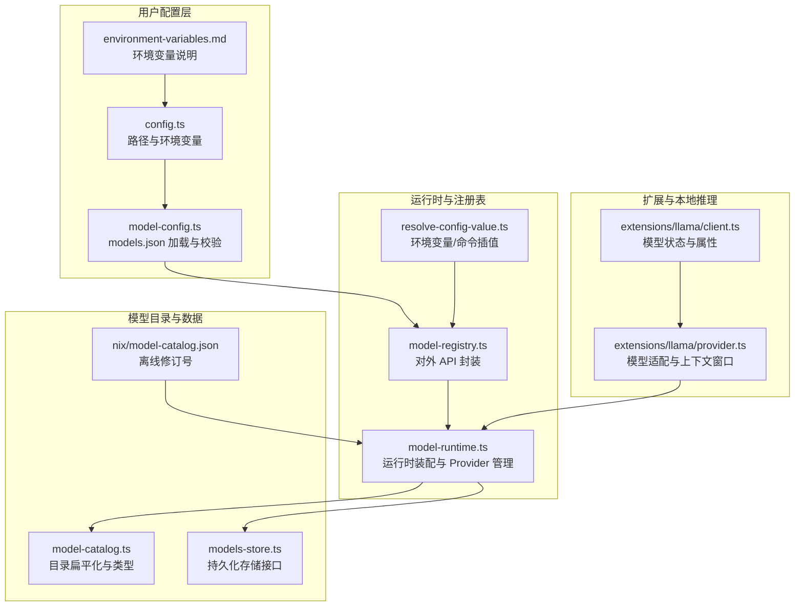
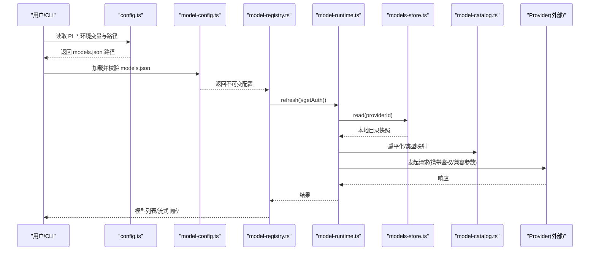
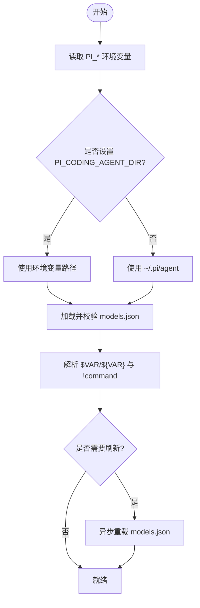
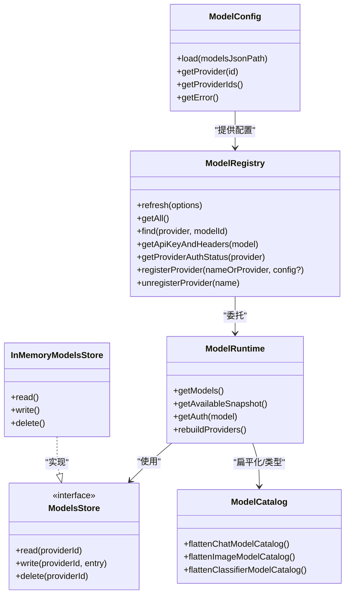

# 配置管理

<cite>
**本文引用的文件**   
- [packages/coding-agent/docs/models-configuration.md](https://github.com/FDE-GROUP/oh-my-coding-agent/blob/omca/packages/coding-agent/docs/models-configuration.md)
- [packages/coding-agent/docs/environment-variables.md](https://github.com/FDE-GROUP/oh-my-coding-agent/blob/omca/packages/coding-agent/docs/environment-variables.md)
- [packages/coding-agent/src/config.ts](https://github.com/FDE-GROUP/oh-my-coding-agent/blob/omca/packages/coding-agent/src/config.ts)
- [packages/coding-agent/src/core/model-config.ts](https://github.com/FDE-GROUP/oh-my-coding-agent/blob/omca/packages/coding-agent/src/core/model-config.ts)
- [packages/coding-agent/src/core/resolve-config-value.ts](https://github.com/FDE-GROUP/oh-my-coding-agent/blob/omca/packages/coding-agent/src/core/resolve-config-value.ts)
- [packages/coding-agent/src/core/model-runtime.ts](https://github.com/FDE-GROUP/oh-my-coding-agent/blob/omca/packages/coding-agent/src/core/model-runtime.ts)
- [packages/coding-agent/src/core/model-registry.ts](https://github.com/FDE-GROUP/oh-my-coding-agent/blob/omca/packages/coding-agent/src/core/model-registry.ts)
- [packages/ai/src/model-catalog.ts](https://github.com/FDE-GROUP/oh-my-coding-agent/blob/omca/packages/ai/src/model-catalog.ts)
- [packages/ai/src/models-store.ts](https://github.com/FDE-GROUP/oh-my-coding-agent/blob/omca/packages/ai/src/models-store.ts)
- [nix/model-catalog.json](https://github.com/FDE-GROUP/oh-my-coding-agent/blob/omca/nix/model-catalog.json)
- [packages/coding-agent/src/extensions/llama/provider.ts](https://github.com/FDE-GROUP/oh-my-coding-agent/blob/omca/packages/coding-agent/src/extensions/llama/provider.ts)
- [packages/coding-agent/src/extensions/llama/client.ts](https://github.com/FDE-GROUP/oh-my-coding-agent/blob/omca/packages/coding-agent/src/extensions/llama/client.ts)
</cite>

## 目录
1. [简介](#简介)
2. [项目结构](#项目结构)
3. [核心组件](#核心组件)
4. [架构总览](#架构总览)
5. [详细组件分析](#详细组件分析)
6. [依赖关系分析](#依赖关系分析)
7. [性能与容量规划](#性能与容量规划)
8. [故障排查指南](#故障排查指南)
9. [结论](#结论)
10. [附录](#附录)

## 简介
本文件面向 LLM 模型配置管理，覆盖以下主题：
- 模型配置文件结构与字段语义
- 环境变量优先级、动态插值与命令输出注入
- 模型目录管理与版本控制（含 Nix 离线目录）
- 兼容性检查与校验流程
- 默认值处理与配置迁移策略
- 配置热重载、调试工具与性能监控最佳实践

目标是帮助开发者与运维人员正确设计、验证和演进模型配置体系。

## 项目结构
本项目在 monorepo 中组织，与模型配置直接相关的代码主要分布在：
- packages/coding-agent：用户配置加载、路径解析、模型注册表、运行时装配
- packages/ai：模型目录扁平化、持久化存储接口、类型定义
- nix：Nix 离线构建时锁定的模型目录修订号

**图表来源**
- [packages/coding-agent/src/config.ts:629-681](https://github.com/FDE-GROUP/oh-my-coding-agent/blob/omca/packages/coding-agent/src/config.ts#L629-L681)
- [packages/coding-agent/src/core/model-config.ts:159-200](https://github.com/FDE-GROUP/oh-my-coding-agent/blob/omca/packages/coding-agent/src/core/model-config.ts#L159-L200)
- [packages/coding-agent/docs/environment-variables.md:75-103](https://github.com/FDE-GROUP/oh-my-coding-agent/blob/omca/packages/coding-agent/docs/environment-variables.md#L75-L103)
- [packages/coding-agent/src/core/model-registry.ts:48-126](https://github.com/FDE-GROUP/oh-my-coding-agent/blob/omca/packages/coding-agent/src/core/model-registry.ts#L48-L126)
- [packages/coding-agent/src/core/model-runtime.ts:200-216](https://github.com/FDE-GROUP/oh-my-coding-agent/blob/omca/packages/coding-agent/src/core/model-runtime.ts#L200-L216)
- [packages/ai/src/model-catalog.ts:12-81](https://github.com/FDE-GROUP/oh-my-coding-agent/blob/omca/packages/ai/src/model-catalog.ts#L12-L81)
- [packages/ai/src/models-store.ts:1-47](https://github.com/FDE-GROUP/oh-my-coding-agent/blob/omca/packages/ai/src/models-store.ts#L1-L47)
- [nix/model-catalog.json:1-4](https://github.com/FDE-GROUP/oh-my-coding-agent/blob/omca/nix/model-catalog.json#L1-L4)
- [packages/coding-agent/src/extensions/llama/provider.ts:71-159](https://github.com/FDE-GROUP/oh-my-coding-agent/blob/omca/packages/coding-agent/src/extensions/llama/provider.ts#L71-L159)
- [packages/coding-agent/src/extensions/llama/client.ts:1-34](https://github.com/FDE-GROUP/oh-my-coding-agent/blob/omca/packages/coding-agent/src/extensions/llama/client.ts#L1-L34)

**章节来源**
- [packages/coding-agent/src/config.ts:629-681](https://github.com/FDE-GROUP/oh-my-coding-agent/blob/omca/packages/coding-agent/src/config.ts#L629-L681)
- [packages/coding-agent/src/core/model-config.ts:159-200](https://github.com/FDE-GROUP/oh-my-coding-agent/blob/omca/packages/coding-agent/src/core/model-config.ts#L159-L200)
- [packages/coding-agent/docs/environment-variables.md:75-103](https://github.com/FDE-GROUP/oh-my-coding-agent/blob/omca/packages/coding-agent/docs/environment-variables.md#L75-L103)
- [packages/ai/src/model-catalog.ts:12-81](https://github.com/FDE-GROUP/oh-my-coding-agent/blob/omca/packages/ai/src/model-catalog.ts#L12-L81)
- [packages/ai/src/models-store.ts:1-47](https://github.com/FDE-GROUP/oh-my-coding-agent/blob/omca/packages/ai/src/models-store.ts#L1-L47)
- [nix/model-catalog.json:1-4](https://github.com/FDE-GROUP/oh-my-coding-agent/blob/omca/nix/model-catalog.json#L1-L4)
- [packages/coding-agent/src/extensions/llama/provider.ts:71-159](https://github.com/FDE-GROUP/oh-my-coding-agent/blob/omca/packages/coding-agent/src/extensions/llama/provider.ts#L71-L159)
- [packages/coding-agent/src/extensions/llama/client.ts:1-34](https://github.com/FDE-GROUP/oh-my-coding-agent/blob/omca/packages/coding-agent/src/extensions/llama/client.ts#L1-L34)

## 核心组件
- 用户配置路径与环境变量
  - 通过 `PI_CODING_AGENT_DIR` 等环境变量覆盖默认路径；默认用户配置目录为 `~/.pi/agent`，包含 `models.json`、`auth.json`、`settings.json` 等。
- models.json 配置加载与校验
  - 支持 JSONC、BOM、Schema 校验；错误信息包含文件路径与具体字段。
- 配置值解析
  - 支持 `$VAR`、`${VAR}` 环境变量插值，以及 `!command` 命令输出注入；结果进程内缓存。
- 模型注册表与运行时
  - `ModelRegistry` 暴露统一查询、流式调用、Provider 注册/注销、虚拟模型注册等能力；内部委托 `ModelRuntime` 完成 Provider 装配与鉴权。
- 模型目录与持久化
  - `ModelsStore` 抽象远程目录的读写；`InMemoryModelsStore` 提供内存实现；`model-catalog.ts` 提供按类型扁平化与类型推导。
- Nix 离线模型目录
  - 通过 `nix/model-catalog.json` 锁定离线目录修订号，配合 `PI_OFFLINE=1` 禁用网络刷新。

**章节来源**
- [packages/coding-agent/src/config.ts:629-681](https://github.com/FDE-GROUP/oh-my-coding-agent/blob/omca/packages/coding-agent/src/config.ts#L629-L681)
- [packages/coding-agent/src/core/model-config.ts:159-200](https://github.com/FDE-GROUP/oh-my-coding-agent/blob/omca/packages/coding-agent/src/core/model-config.ts#L159-L200)
- [packages/coding-agent/src/core/resolve-config-value.ts:1-40](https://github.com/FDE-GROUP/oh-my-coding-agent/blob/omca/packages/coding-agent/src/core/resolve-config-value.ts#L1-L40)
- [packages/coding-agent/src/core/model-registry.ts:48-126](https://github.com/FDE-GROUP/oh-my-coding-agent/blob/omca/packages/coding-agent/src/core/model-registry.ts#L48-L126)
- [packages/ai/src/model-catalog.ts:12-81](https://github.com/FDE-GROUP/oh-my-coding-agent/blob/omca/packages/ai/src/model-catalog.ts#L12-L81)
- [packages/ai/src/models-store.ts:1-47](https://github.com/FDE-GROUP/oh-my-coding-agent/blob/omca/packages/ai/src/models-store.ts#L1-L47)
- [nix/model-catalog.json:1-4](https://github.com/FDE-GROUP/oh-my-coding-agent/blob/omca/nix/model-catalog.json#L1-L4)

## 架构总览
下图展示从用户配置到模型调用的关键路径，包括鉴权解析、Provider 装配、模型目录与缓存。

**图表来源**
- [packages/coding-agent/src/config.ts:629-681](https://github.com/FDE-GROUP/oh-my-coding-agent/blob/omca/packages/coding-agent/src/config.ts#L629-L681)
- [packages/coding-agent/src/core/model-config.ts:159-200](https://github.com/FDE-GROUP/oh-my-coding-agent/blob/omca/packages/coding-agent/src/core/model-config.ts#L159-L200)
- [packages/coding-agent/src/core/model-registry.ts:55-126](https://github.com/FDE-GROUP/oh-my-coding-agent/blob/omca/packages/coding-agent/src/core/model-registry.ts#L55-L126)
- [packages/coding-agent/src/core/model-runtime.ts:200-216](https://github.com/FDE-GROUP/oh-my-coding-agent/blob/omca/packages/coding-agent/src/core/model-runtime.ts#L200-L216)
- [packages/ai/src/models-store.ts:21-47](https://github.com/FDE-GROUP/oh-my-coding-agent/blob/omca/packages/ai/src/models-store.ts#L21-L47)
- [packages/ai/src/model-catalog.ts:53-81](https://github.com/FDE-GROUP/oh-my-coding-agent/blob/omca/packages/ai/src/model-catalog.ts#L53-L81)

## 详细组件分析

### 模型配置文件结构（models.json）
- providers 对象
  - 每个键为 provider ID；内置 provider 可被覆盖，其他 ID 表示新增 Provider。
  - 关键字段：name、baseUrl、apiKey、api、oauth、headers、compat、authHeader、models、modelOverrides。
- models 数组
  - 添加或替换模型；id 匹配现有模型即替换。
  - 关键字段：id、name、api、baseUrl、reasoning、thinkingLevelMap、input、inputLimits、cost、promptCache、contextWindow、maxTokens、samplingParams、headers、compat。
- modelOverrides
  - 对已知模型进行增量覆盖；对象字段合并，其他字段替换。
- inputLimits
  - 限制请求大小与图片尺寸/数量。
- compat
  - 描述各 API 的差异点，如 OpenAI/Anthropic/Mistral/Bedrock/TypeSafe 等；字段按 API 生效。

建议：
- 在 models.json 顶部声明 schema 引用以获得编辑器校验与补全。
- 优先使用 provider 级 baseUrl/api，仅在必要时在模型级覆盖。
- 使用 modelOverrides 微调成本、输入模态、兼容性开关，避免重复定义完整模型。

**章节来源**
- [packages/coding-agent/docs/models-configuration.md:9-201](https://github.com/FDE-GROUP/oh-my-coding-agent/blob/omca/packages/coding-agent/docs/models-configuration.md#L9-L201)

### 环境变量优先级与动态配置更新
- 环境变量优先级
  - 进程级：`PI_OFFLINE`、`PI_SKIP_VERSION_CHECK`、`PI_SELF_UPDATE_COMMAND`、`PI_PACKAGE_DIR`、`PI_CODING_AGENT_DIR`、`PI_CODING_AGENT_SESSION_DIR` 等。
  - 会话级：`PI_SESSION_ID`、`PI_PROVIDER`、`PI_MODEL`、`PI_REASONING_LEVEL` 等由 shell 工具注入。
- 动态插值与命令注入
  - apiKey 与 headers 值支持 `$VAR`、`${VAR}` 插值与 `!command` 命令输出注入；结果进程内缓存。
- 动态更新
  - 通过 `ModelRegistry.refresh()` 异步重载 models.json；鉴权状态可通过 `getProviderAuthStatus()` 查看来源（环境、models_json_key 等）。

最佳实践：
- 敏感密钥优先使用环境变量或命令注入，避免硬编码。
- 使用 `PI_OFFLINE=1` 在 CI/离线环境禁用网络刷新。
- 变更 models.json 后调用 refresh，或在启动阶段确保已加载最新配置。

**图表来源**
- [packages/coding-agent/docs/environment-variables.md:75-103](https://github.com/FDE-GROUP/oh-my-coding-agent/blob/omca/packages/coding-agent/docs/environment-variables.md#L75-L103)
- [packages/coding-agent/src/core/resolve-config-value.ts:1-40](https://github.com/FDE-GROUP/oh-my-coding-agent/blob/omca/packages/coding-agent/src/core/resolve-config-value.ts#L1-L40)
- [packages/coding-agent/src/core/model-registry.ts:55-126](https://github.com/FDE-GROUP/oh-my-coding-agent/blob/omca/packages/coding-agent/src/core/model-registry.ts#L55-L126)

**章节来源**
- [packages/coding-agent/docs/environment-variables.md:75-103](https://github.com/FDE-GROUP/oh-my-coding-agent/blob/omca/packages/coding-agent/docs/environment-variables.md#L75-L103)
- [packages/coding-agent/src/core/resolve-config-value.ts:1-40](https://github.com/FDE-GROUP/oh-my-coding-agent/blob/omca/packages/coding-agent/src/core/resolve-config-value.ts#L1-L40)
- [packages/coding-agent/src/core/model-registry.ts:55-126](https://github.com/FDE-GROUP/oh-my-coding-agent/blob/omca/packages/coding-agent/src/core/model-registry.ts#L55-L126)

### 模型目录管理与版本控制
- 目录位置
  - 用户目录：`~/.pi/agent`（可由 `PI_CODING_AGENT_DIR` 覆盖）。
  - 包资源目录：由 `PI_PACKAGE_DIR` 或运行环境自动推断。
- 版本控制
  - Nix 离线模式：`nix/model-catalog.json` 锁定模型目录修订号；配合 `PI_OFFLINE=1` 禁用网络刷新。
  - 运行时目录缓存：`ModelsStore` 记录 lastModified、checkedAt、etag，用于条件刷新。
- 目录校验
  - 模型数据目录需存在且字段符合预期（id、provider、api、type、input/output 模态等）。

建议：
- 在 CI 中使用 Nix 离线构建，固定 catalog 修订号，保证可重现。
- 生产环境启用 ModelsStore 持久化，减少重复网络请求。
- 发布前运行模型数据校验脚本，确保目录结构正确。

**章节来源**
- [packages/coding-agent/src/config.ts:629-681](https://github.com/FDE-GROUP/oh-my-coding-agent/blob/omca/packages/coding-agent/src/config.ts#L629-L681)
- [nix/model-catalog.json:1-4](https://github.com/FDE-GROUP/oh-my-coding-agent/blob/omca/nix/model-catalog.json#L1-L4)
- [packages/ai/src/models-store.ts:1-47](https://github.com/FDE-GROUP/oh-my-coding-agent/blob/omca/packages/ai/src/models-store.ts#L1-L47)

### 兼容性检查与默认值处理
- 兼容性字段
  - 不同 API 的 compat 字段差异显著，例如 OpenAI 的 thinkingFormat、sessionAffinityFormat、promptCacheKeyMode 等；Anthropic 的 forceAdaptiveThinking、supportsStrictTools 等。
- 默认值
  - contextWindow 默认 128000，maxTokens 默认 16384；部分布尔型兼容字段默认 false。
- 本地推理模型
  - llama.cpp 模型根据 architecture.output_modalities 区分决策模型与聊天模型；contextWindow 优先取运行时 meta.n_ctx，其次配置与缓存，最后回退训练上下文或默认值。

建议：
- 为新接入的 Provider 明确声明 compat，避免隐式行为。
- 对 llama.cpp 等本地模型，显式设置 contextWindow 与 maxTokens，避免过大导致 OOM。
- 使用 modelOverrides 仅覆盖必要字段，保持最小变更面。

**章节来源**
- [packages/coding-agent/docs/models-configuration.md:105-201](https://github.com/FDE-GROUP/oh-my-coding-agent/blob/omca/packages/coding-agent/docs/models-configuration.md#L105-L201)
- [packages/coding-agent/src/extensions/llama/provider.ts:71-159](https://github.com/FDE-GROUP/oh-my-coding-agent/blob/omca/packages/coding-agent/src/extensions/llama/provider.ts#L71-L159)
- [packages/coding-agent/src/extensions/llama/client.ts:1-34](https://github.com/FDE-GROUP/oh-my-coding-agent/blob/omca/packages/coding-agent/src/extensions/llama/client.ts#L1-L34)

### 配置验证、默认值与迁移
- 验证
  - models.json 支持 JSONC 与 BOM；失败时返回带路径的错误信息；Schema 校验失败会列出所有字段错误。
- 默认值
  - 未指定 contextWindow/maxTokens 时使用默认值；部分兼容字段默认关闭。
- 迁移
  - 建议在 CI 中引入模型数据目录校验；对旧字段采用 modelOverrides 逐步迁移，避免破坏性变更。
  - 对 Provider 级 baseUrl/api 的变更，优先使用 modelOverrides 过渡。

建议：
- 将 Schema 校验纳入预提交钩子与 CI。
- 对历史 models.json 做增量迁移，保留向后兼容。
- 对鉴权方式变更（如从 apiKey 到 OAuth），通过 settings 与 env 双轨并行，再逐步切换。

**章节来源**
- [packages/coding-agent/src/core/model-config.ts:159-200](https://github.com/FDE-GROUP/oh-my-coding-agent/blob/omca/packages/coding-agent/src/core/model-config.ts#L159-L200)
- [packages/coding-agent/docs/models-configuration.md:26-88](https://github.com/FDE-GROUP/oh-my-coding-agent/blob/omca/packages/coding-agent/docs/models-configuration.md#L26-L88)

### 配置热重载与调试工具
- 热重载
  - 通过 `ModelRegistry.refresh()` 异步重载 models.json；鉴权状态变化可通过 `getProviderAuthStatus()` 观察来源。
- 调试
  - 使用 `getDebugLogPath()` 获取调试日志路径；结合 `PI_OFFLINE=1` 隔离网络因素。
  - 通过 `getProviderAuthStatus()` 判断鉴权来源（environment、models_json_key 等）。

建议：
- 在开发环境开启更详细的日志；在生产环境按需开启。
- 变更 models.json 后立即刷新，并在 UI/CLI 中反馈当前错误与来源。

**章节来源**
- [packages/coding-agent/src/core/model-registry.ts:55-126](https://github.com/FDE-GROUP/oh-my-coding-agent/blob/omca/packages/coding-agent/src/core/model-registry.ts#L55-L126)
- [packages/coding-agent/src/config.ts:678-681](https://github.com/FDE-GROUP/oh-my-coding-agent/blob/omca/packages/coding-agent/src/config.ts#L678-L681)

## 依赖关系分析
- 模块耦合
  - config.ts 负责路径与环境变量；model-config.ts 负责 models.json 加载与校验；model-registry.ts 暴露统一 API；model-runtime.ts 装配 Provider 与鉴权；models-store.ts 抽象目录持久化；model-catalog.ts 提供类型与扁平化工具。
- 外部依赖
  - Provider 实现（OpenAI、Anthropic、Google、Bedrock、Mistral、llama.cpp 等）通过 api 字段解耦。
- 潜在循环
  - registry 与 runtime 之间职责清晰，无直接循环导入；catalog/store 为纯函数与接口，降低耦合。

**图表来源**
- [packages/coding-agent/src/core/model-config.ts:159-200](https://github.com/FDE-GROUP/oh-my-coding-agent/blob/omca/packages/coding-agent/src/core/model-config.ts#L159-L200)
- [packages/coding-agent/src/core/model-registry.ts:48-126](https://github.com/FDE-GROUP/oh-my-coding-agent/blob/omca/packages/coding-agent/src/core/model-registry.ts#L48-L126)
- [packages/coding-agent/src/core/model-runtime.ts:200-216](https://github.com/FDE-GROUP/oh-my-coding-agent/blob/omca/packages/coding-agent/src/core/model-runtime.ts#L200-L216)
- [packages/ai/src/models-store.ts:1-47](https://github.com/FDE-GROUP/oh-my-coding-agent/blob/omca/packages/ai/src/models-store.ts#L1-L47)
- [packages/ai/src/model-catalog.ts:53-81](https://github.com/FDE-GROUP/oh-my-coding-agent/blob/omca/packages/ai/src/model-catalog.ts#L53-L81)

**章节来源**
- [packages/coding-agent/src/core/model-config.ts:159-200](https://github.com/FDE-GROUP/oh-my-coding-agent/blob/omca/packages/coding-agent/src/core/model-config.ts#L159-L200)
- [packages/coding-agent/src/core/model-registry.ts:48-126](https://github.com/FDE-GROUP/oh-my-coding-agent/blob/omca/packages/coding-agent/src/core/model-registry.ts#L48-L126)
- [packages/coding-agent/src/core/model-runtime.ts:200-216](https://github.com/FDE-GROUP/oh-my-coding-agent/blob/omca/packages/coding-agent/src/core/model-runtime.ts#L200-L216)
- [packages/ai/src/models-store.ts:1-47](https://github.com/FDE-GROUP/oh-my-coding-agent/blob/omca/packages/ai/src/models-store.ts#L1-L47)
- [packages/ai/src/model-catalog.ts:53-81](https://github.com/FDE-GROUP/oh-my-coding-agent/blob/omca/packages/ai/src/model-catalog.ts#L53-L81)

## 性能与容量规划
- 模型上下文窗口
  - 合理设置 contextWindow 与 maxTokens，避免超出 Provider 限制或触发截断。
  - llama.cpp 模型优先使用运行时 meta.n_ctx，否则回退至训练上下文或默认值。
- 请求体大小与图片限制
  - 使用 inputLimits.maxRequestBytes 与 images.resize 控制请求体积，防止超时与带宽浪费。
- 目录缓存与 ETag
  - 利用 ModelsStore 的 lastModified/etag 减少无效网络请求；CI 中可禁用网络刷新。
- 并发与 Worker
  - 通过 `PI_CODEMODE_MAX_WORKERS` 控制 codemode worker 并发，避免内存峰值过高。

建议：
- 对高频模型预热目录缓存；对低频模型按需刷新。
- 对图像密集型任务，启用 resize 与单条消息图片上限。
- 在大规模会话场景中，适当提高 worker 上限并监控内存占用。

**章节来源**
- [packages/coding-agent/src/extensions/llama/provider.ts:71-159](https://github.com/FDE-GROUP/oh-my-coding-agent/blob/omca/packages/coding-agent/src/extensions/llama/provider.ts#L71-L159)
- [packages/coding-agent/docs/models-configuration.md:89-104](https://github.com/FDE-GROUP/oh-my-coding-agent/blob/omca/packages/coding-agent/docs/models-configuration.md#L89-L104)
- [packages/ai/src/models-store.ts:1-47](https://github.com/FDE-GROUP/oh-my-coding-agent/blob/omca/packages/ai/src/models-store.ts#L1-L47)

## 故障排查指南
常见问题与定位步骤：
- models.json 无法加载或解析
  - 检查文件路径与权限；确认 JSONC/BOM 是否正确；查看错误信息中的路径与字段。
- 鉴权失败
  - 使用 `getProviderAuthStatus()` 查看来源；确认环境变量或命令注入是否生效；必要时清除 apiKey 缓存。
- 模型不显示或不可用
  - 检查 provider id、api、baseUrl 是否与上游一致；确认 compat 字段是否限制了功能。
- 离线模式异常
  - 确认 `PI_OFFLINE=1` 已设置；检查 Nix catalog 修订号是否过期；必要时手动刷新。

建议：
- 在 CI 中运行模型数据校验与 Schema 校验。
- 在交互式环境中打印鉴权来源与错误原因，便于快速定位。
- 对 Provider 变更进行灰度发布，先使用 modelOverrides 小范围验证。

**章节来源**
- [packages/coding-agent/src/core/model-config.ts:159-200](https://github.com/FDE-GROUP/oh-my-coding-agent/blob/omca/packages/coding-agent/src/core/model-config.ts#L159-L200)
- [packages/coding-agent/src/core/model-registry.ts:89-126](https://github.com/FDE-GROUP/oh-my-coding-agent/blob/omca/packages/coding-agent/src/core/model-registry.ts#L89-L126)
- [packages/coding-agent/docs/environment-variables.md:75-103](https://github.com/FDE-GROUP/oh-my-coding-agent/blob/omca/packages/coding-agent/docs/environment-variables.md#L75-L103)

## 结论
本配置管理体系以 models.json 为核心，结合环境变量与命令注入实现灵活、安全的鉴权与配置；通过 ModelRegistry 与 ModelRuntime 解耦 Provider 实现；借助 ModelsStore 与 catalog 扁平化提升可维护性与性能；Nix 离线目录修订号保障构建可重现。遵循本文的最佳实践，可在多 Provider、多模型的复杂场景下稳定演进配置体系。

## 附录
- 常用环境变量速查
  - `PI_OFFLINE`：禁用网络活动
  - `PI_SKIP_VERSION_CHECK`：跳过版本检查
  - `PI_SELF_UPDATE_COMMAND`：自定义更新命令
  - `PI_PACKAGE_DIR`：覆盖包目录
  - `PI_CODING_AGENT_DIR`：覆盖用户配置目录
  - `PI_CODING_AGENT_SESSION_DIR`：覆盖会话目录
- 参考文档
  - 模型配置字段与兼容性：[models-configuration.md](https://github.com/FDE-GROUP/oh-my-coding-agent/blob/omca/packages/coding-agent/docs/models-configuration.md)
  - 环境变量说明：[environment-variables.md](https://github.com/FDE-GROUP/oh-my-coding-agent/blob/omca/packages/coding-agent/docs/environment-variables.md)

**章节来源**
- [packages/coding-agent/docs/environment-variables.md:75-103](https://github.com/FDE-GROUP/oh-my-coding-agent/blob/omca/packages/coding-agent/docs/environment-variables.md#L75-L103)
- [packages/coding-agent/docs/models-configuration.md:9-201](https://github.com/FDE-GROUP/oh-my-coding-agent/blob/omca/packages/coding-agent/docs/models-configuration.md#L9-L201)