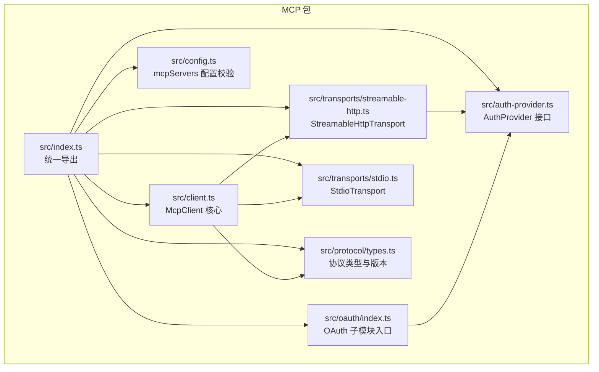
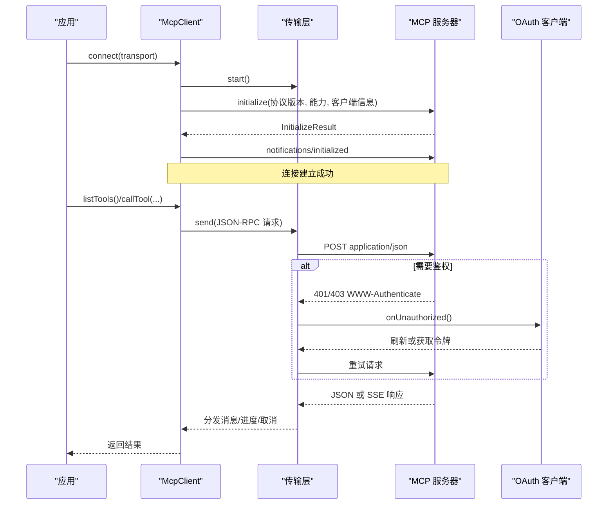
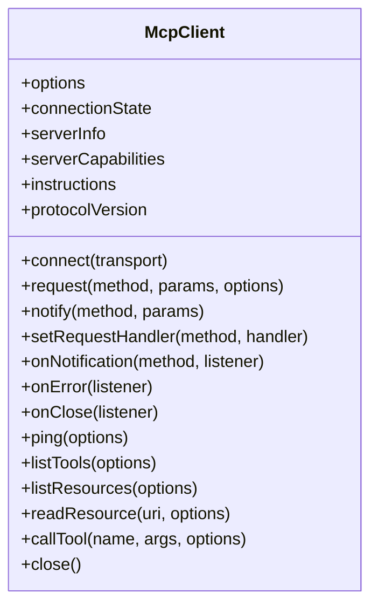
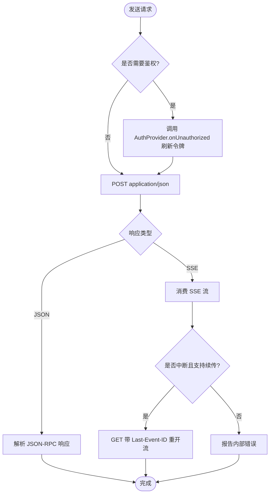
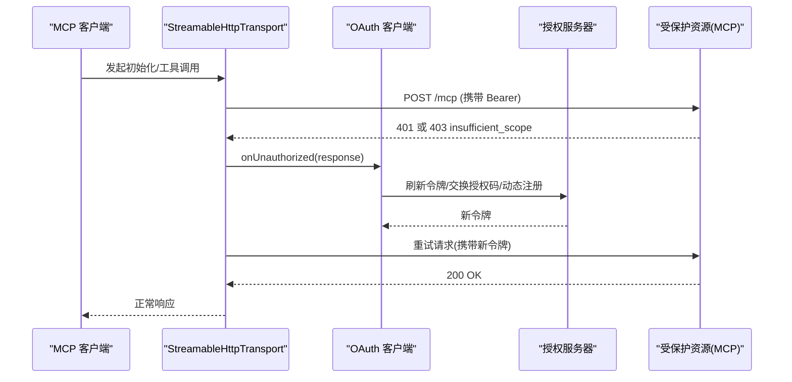
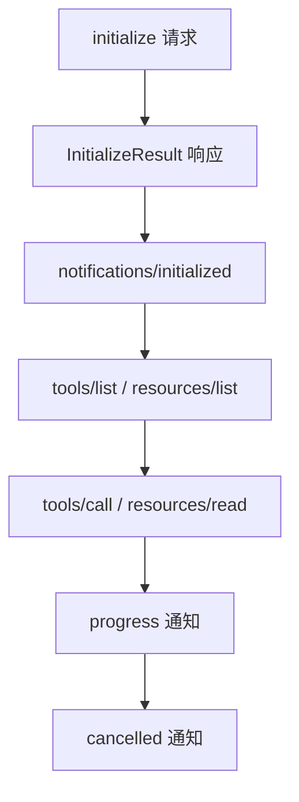
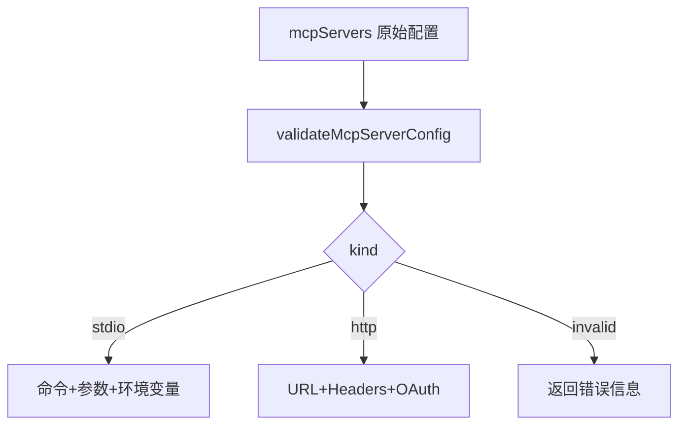
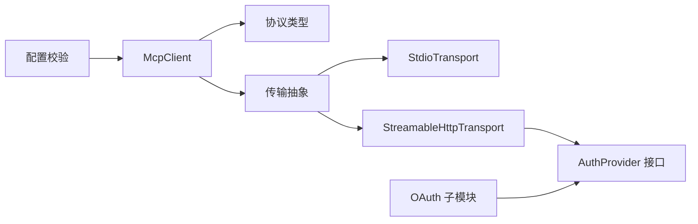

# MCP协议集成

<cite>
**本文引用的文件**   
- [packages/mcp/README.md](https://github.com/FDE-GROUP/oh-my-coding-agent/blob/omca/packages/mcp/README.md)
- [packages/mcp/package.json](https://github.com/FDE-GROUP/oh-my-coding-agent/blob/omca/packages/mcp/package.json)
- [packages/mcp/src/index.ts](https://github.com/FDE-GROUP/oh-my-coding-agent/blob/omca/packages/mcp/src/index.ts)
- [packages/mcp/src/client.ts](https://github.com/FDE-GROUP/oh-my-coding-agent/blob/omca/packages/mcp/src/client.ts)
- [packages/mcp/src/config.ts](https://github.com/FDE-GROUP/oh-my-coding-agent/blob/omca/packages/mcp/src/config.ts)
- [packages/mcp/src/auth-provider.ts](https://github.com/FDE-GROUP/oh-my-coding-agent/blob/omca/packages/mcp/src/auth-provider.ts)
- [packages/mcp/src/oauth/index.ts](https://github.com/FDE-GROUP/oh-my-coding-agent/blob/omca/packages/mcp/src/oauth/index.ts)
- [packages/mcp/src/oauth/client-settings.ts](https://github.com/FDE-GROUP/oh-my-coding-agent/blob/omca/packages/mcp/src/oauth/client-settings.ts)
- [packages/mcp/src/transports/streamable-http.ts](https://github.com/FDE-GROUP/oh-my-coding-agent/blob/omca/packages/mcp/src/transports/streamable-http.ts)
- [packages/mcp/src/transports/stdio.ts](https://github.com/FDE-GROUP/oh-my-coding-agent/blob/omca/packages/mcp/src/transports/stdio.ts)
- [packages/mcp/src/protocol/types.ts](https://github.com/FDE-GROUP/oh-my-coding-agent/blob/omca/packages/mcp/src/protocol/types.ts)
</cite>

## 目录
1. [简介](#简介)
2. [项目结构](#项目结构)
3. [核心组件](#核心组件)
4. [架构总览](#架构总览)
5. [详细组件分析](#详细组件分析)
6. [依赖关系分析](#依赖关系分析)
7. [性能与可扩展性](#性能与可扩展性)
8. [故障排查指南](#故障排查指南)
9. [结论](#结论)
10. [附录：开发与安全要点](#附录开发与安全要点)

## 简介
本文件面向需要在应用中集成 Model Context Protocol（MCP）的开发者，系统性说明 MCP 客户端工作原理、传输层实现、OAuth 认证流程、协议消息格式、连接管理、错误处理与性能优化。同时给出 MCP 服务器配置方法、工具暴露方式、安全注意事项以及实际集成示例和调试技巧。

该仓库中的 `@earendil-works/pi-mcp` 是一个独立、轻量、传输无关的 MCP 客户端实现，提供 stdio、Streamable HTTP、管道与内存测试传输，并内置 OAuth 客户端子集能力，用于对接支持 MCP 协议的服务器。

## 项目结构
MCP 相关代码集中在 `packages/mcp` 中，采用按职责分层的组织方式：
- 顶层导出与类型定义：`src/index.ts`
- 客户端核心：`src/client.ts`
- 协议类型与 JSON-RPC：`src/protocol/*`
- 传输层：`src/transports/*`
- OAuth 客户端：`src/oauth/*`
- 配置校验：`src/config.ts`
- 认证提供者接口：`src/auth-provider.ts`

图表来源
- [packages/mcp/src/index.ts:1-97](https://github.com/FDE-GROUP/oh-my-coding-agent/blob/omca/packages/mcp/src/index.ts#L1-L97)
- [packages/mcp/src/client.ts:155-250](https://github.com/FDE-GROUP/oh-my-coding-agent/blob/omca/packages/mcp/src/client.ts#L155-L250)
- [packages/mcp/src/transports/streamable-http.ts:248-389](https://github.com/FDE-GROUP/oh-my-coding-agent/blob/omca/packages/mcp/src/transports/streamable-http.ts#L248-L389)
- [packages/mcp/src/transports/stdio.ts:69-145](https://github.com/FDE-GROUP/oh-my-coding-agent/blob/omca/packages/mcp/src/transports/stdio.ts#L69-L145)
- [packages/mcp/src/protocol/types.ts:4-10](https://github.com/FDE-GROUP/oh-my-coding-agent/blob/omca/packages/mcp/src/protocol/types.ts#L4-L10)

章节来源
- [packages/mcp/README.md:1-30](https://github.com/FDE-GROUP/oh-my-coding-agent/blob/omca/packages/mcp/README.md#L1-L30)
- [packages/mcp/package.json:1-24](https://github.com/FDE-GROUP/oh-my-coding-agent/blob/omca/packages/mcp/package.json#L1-L24)

## 核心组件
- McpClient：封装初始化、请求/通知、分页列表、工具调用、进度与取消、超时控制、连接状态与事件。
- 传输层：
  - StdioTransport：通过子进程标准输入输出运行本地 MCP 服务器，遵循“关闭 stdin → SIGTERM → SIGKILL”的优雅退出流程。
  - StreamableHttpTransport：基于 Streamable HTTP 的 POST + SSE GET 流，支持会话、重连、Last-Event-ID 续传、401/403 鉴权挑战。
- OAuth 客户端：提供授权发现、PKCE 授权码流程、动态注册、令牌刷新、step-up 授权、回调服务与双阶段登录。
- 配置校验：对 `mcpServers` 的 stdio/http 条目进行严格校验，保留未知字段供应用扩展。
- 协议类型：声明 MCP 协议版本、能力、工具、资源、模板、结果等类型。

章节来源
- [packages/mcp/src/client.ts:155-250](https://github.com/FDE-GROUP/oh-my-coding-agent/blob/omca/packages/mcp/src/client.ts#L155-L250)
- [packages/mcp/src/transports/stdio.ts:69-187](https://github.com/FDE-GROUP/oh-my-coding-agent/blob/omca/packages/mcp/src/transports/stdio.ts#L69-L187)
- [packages/mcp/src/transports/streamable-http.ts:248-580](https://github.com/FDE-GROUP/oh-my-coding-agent/blob/omca/packages/mcp/src/transports/streamable-http.ts#L248-L580)
- [packages/mcp/src/oauth/index.ts:1-80](https://github.com/FDE-GROUP/oh-my-coding-agent/blob/omca/packages/mcp/src/oauth/index.ts#L1-L80)
- [packages/mcp/src/config.ts:1-105](https://github.com/FDE-GROUP/oh-my-coding-agent/blob/omca/packages/mcp/src/config.ts#L1-L105)
- [packages/mcp/src/protocol/types.ts:4-132](https://github.com/FDE-GROUP/oh-my-coding-agent/blob/omca/packages/mcp/src/protocol/types.ts#L4-L132)

## 架构总览
MCP 客户端通过抽象传输层与服务器通信；HTTP 传输可注入 AuthProvider 完成 OAuth 认证；配置模块负责解析 mcpServers；协议类型保证消息结构正确。

图表来源
- [packages/mcp/src/client.ts:204-249](https://github.com/FDE-GROUP/oh-my-coding-agent/blob/omca/packages/mcp/src/client.ts#L204-L249)
- [packages/mcp/src/transports/streamable-http.ts:285-323](https://github.com/FDE-GROUP/oh-my-coding-agent/blob/omca/packages/mcp/src/transports/streamable-http.ts#L285-L323)
- [packages/mcp/src/transports/streamable-http.ts:352-389](https://github.com/FDE-GROUP/oh-my-coding-agent/blob/omca/packages/mcp/src/transports/streamable-http.ts#L352-L389)
- [packages/mcp/src/auth-provider.ts:12-20](https://github.com/FDE-GROUP/oh-my-coding-agent/blob/omca/packages/mcp/src/auth-provider.ts#L12-L20)

## 详细组件分析

### McpClient：协议客户端核心
- 生命周期：idle → connecting → connected → closed，connect 时执行 initialize 并发送 initialized 通知。
- 请求模型：为每个请求分配 id，维护 pending 表，支持超时、AbortSignal 取消、progressToken 进度上报。
- 服务端请求：内置 ping、roots/list 处理器，支持自定义 requestHandler。
- 通知与错误：统一分发 progress/cancelled 通知，error/close 事件监听。
- 分页列表：tools/list、resources/list、templates/list 均支持 nextCursor 翻页，限制最大页数防止无限循环。
- 工具调用：tools/call 返回 CallToolResult，兼容 content 缺失但 structuredContent 存在的情况。

图表来源
- [packages/mcp/src/client.ts:155-622](https://github.com/FDE-GROUP/oh-my-coding-agent/blob/omca/packages/mcp/src/client.ts#L155-L622)

章节来源
- [packages/mcp/src/client.ts:38-153](https://github.com/FDE-GROUP/oh-my-coding-agent/blob/omca/packages/mcp/src/client.ts#L38-L153)
- [packages/mcp/src/client.ts:204-250](https://github.com/FDE-GROUP/oh-my-coding-agent/blob/omca/packages/mcp/src/client.ts#L204-L250)
- [packages/mcp/src/client.ts:292-386](https://github.com/FDE-GROUP/oh-my-coding-agent/blob/omca/packages/mcp/src/client.ts#L292-L386)
- [packages/mcp/src/client.ts:396-444](https://github.com/FDE-GROUP/oh-my-coding-agent/blob/omca/packages/mcp/src/client.ts#L396-L444)
- [packages/mcp/src/client.ts:465-583](https://github.com/FDE-GROUP/oh-my-coding-agent/blob/omca/packages/mcp/src/client.ts#L465-L583)

### 传输层：StdioTransport 与 StreamableHttpTransport
- StdioTransport
  - 启动子进程，分离 stdout/stderr，使用行式 JSON-RPC 帧。
  - 优雅关闭：先关闭 stdin，等待退出；超时后向进程组发送 SIGTERM，再 SIGKILL。
  - 跨平台进程组清理，避免包装器遗留进程。
- StreamableHttpTransport
  - POST application/json 发送请求，接收 JSON 或 text/event-stream。
  - 自动捕获 mcp-session-id，并在后续请求携带。
  - 401/403 insufficient_scope 触发 AuthProvider.onUnauthorized，支持 step-up 授权。
  - SSE GET 长连接，支持 Last-Event-ID 续传、指数退避重连、服务器 retry 提示。
  - 错误体截断读取，避免大响应阻塞内存。

图表来源
- [packages/mcp/src/transports/streamable-http.ts:285-323](https://github.com/FDE-GROUP/oh-my-coding-agent/blob/omca/packages/mcp/src/transports/streamable-http.ts#L285-L323)
- [packages/mcp/src/transports/streamable-http.ts:440-478](https://github.com/FDE-GROUP/oh-my-coding-agent/blob/omca/packages/mcp/src/transports/streamable-http.ts#L440-L478)
- [packages/mcp/src/transports/streamable-http.ts:514-534](https://github.com/FDE-GROUP/oh-my-coding-agent/blob/omca/packages/mcp/src/transports/streamable-http.ts#L514-L534)
- [packages/mcp/src/transports/stdio.ts:147-185](https://github.com/FDE-GROUP/oh-my-coding-agent/blob/omca/packages/mcp/src/transports/stdio.ts#L147-L185)

章节来源
- [packages/mcp/src/transports/stdio.ts:55-187](https://github.com/FDE-GROUP/oh-my-coding-agent/blob/omca/packages/mcp/src/transports/stdio.ts#L55-L187)
- [packages/mcp/src/transports/streamable-http.ts:147-157](https://github.com/FDE-GROUP/oh-my-coding-agent/blob/omca/packages/mcp/src/transports/streamable-http.ts#L147-L157)
- [packages/mcp/src/transports/streamable-http.ts:248-389](https://github.com/FDE-GROUP/oh-my-coding-agent/blob/omca/packages/mcp/src/transports/streamable-http.ts#L248-L389)
- [packages/mcp/src/transports/streamable-http.ts:405-580](https://github.com/FDE-GROUP/oh-my-coding-agent/blob/omca/packages/mcp/src/transports/streamable-http.ts#L405-L580)

### OAuth 认证流程
- 发现与元数据：从服务器 URL 推导受保护资源元数据与授权服务器元数据，支持 RFC 8414/OpenID Connect Discovery。
- 授权流程：PKCE 授权码模式，支持动态客户端注册（DCR）与客户端 ID 元文档（CIMD）。
- 令牌刷新：并发 401 共享一次刷新锁，避免风暴。
- Step-up 授权：403 且 WWW-Authenticate 包含 insufficient_scope 时触发范围升级。
- 回调服务：本地回环回调服务器或应用自有 HTTPS 回调路由。
- 双阶段登录：startMcpSignIn/completeMcpSignIn 将登录拆分为两半，便于在 Web 环境中持久化中间状态。

图表来源
- [packages/mcp/src/transports/streamable-http.ts:352-389](https://github.com/FDE-GROUP/oh-my-coding-agent/blob/omca/packages/mcp/src/transports/streamable-http.ts#L352-L389)
- [packages/mcp/src/oauth/index.ts:1-80](https://github.com/FDE-GROUP/oh-my-coding-agent/blob/omca/packages/mcp/src/oauth/index.ts#L1-L80)
- [packages/mcp/src/oauth/client-settings.ts:13-38](https://github.com/FDE-GROUP/oh-my-coding-agent/blob/omca/packages/mcp/src/oauth/client-settings.ts#L13-L38)

章节来源
- [packages/mcp/src/oauth/index.ts:1-80](https://github.com/FDE-GROUP/oh-my-coding-agent/blob/omca/packages/mcp/src/oauth/index.ts#L1-L80)
- [packages/mcp/src/oauth/client-settings.ts:13-38](https://github.com/FDE-GROUP/oh-my-coding-agent/blob/omca/packages/mcp/src/oauth/client-settings.ts#L13-L38)
- [packages/mcp/src/transports/streamable-http.ts:192-202](https://github.com/FDE-GROUP/oh-my-coding-agent/blob/omca/packages/mcp/src/transports/streamable-http.ts#L192-L202)

### 协议消息格式与版本协商
- 协议版本：客户端声明 LATEST_PROTOCOL_VERSION，并接受历史版本以兼容旧服务器。
- JSON-RPC 2.0：所有消息遵循 jsonrpc 2.0，支持请求、响应、通知。
- 初始化：客户端发送 initialize，服务器返回 InitializeResult，客户端随后发送 notifications/initialized。
- 工具与资源：tools/list、tools/call、resources/list、resources/templates/list、resources/read。
- 进度与取消：progressToken 关联进度通知，cancelled 通知中止服务端正在处理的请求。

图表来源
- [packages/mcp/src/protocol/types.ts:4-10](https://github.com/FDE-GROUP/oh-my-coding-agent/blob/omca/packages/mcp/src/protocol/types.ts#L4-L10)
- [packages/mcp/src/client.ts:204-249](https://github.com/FDE-GROUP/oh-my-coding-agent/blob/omca/packages/mcp/src/client.ts#L204-L249)
- [packages/mcp/src/client.ts:292-386](https://github.com/FDE-GROUP/oh-my-coding-agent/blob/omca/packages/mcp/src/client.ts#L292-L386)
- [packages/mcp/src/client.ts:524-551](https://github.com/FDE-GROUP/oh-my-coding-agent/blob/omca/packages/mcp/src/client.ts#L524-L551)

章节来源
- [packages/mcp/src/protocol/types.ts:4-132](https://github.com/FDE-GROUP/oh-my-coding-agent/blob/omca/packages/mcp/src/protocol/types.ts#L4-L132)
- [packages/mcp/src/client.ts:204-250](https://github.com/FDE-GROUP/oh-my-coding-agent/blob/omca/packages/mcp/src/client.ts#L204-L250)
- [packages/mcp/src/client.ts:292-386](https://github.com/FDE-GROUP/oh-my-coding-agent/blob/omca/packages/mcp/src/client.ts#L292-L386)
- [packages/mcp/src/client.ts:524-551](https://github.com/FDE-GROUP/oh-my-coding-agent/blob/omca/packages/mcp/src/client.ts#L524-L551)

### 连接管理与错误处理
- 连接状态机：idle/connecting/connected/closed，禁止重复连接与非法操作。
- 传输错误：标准化为 McpConnectionClosedError、McpTimeoutError、McpAbortError。
- HTTP 错误：McpHttpError、McpAuthRequiredError、McpSessionExpiredError，区分状态码与 WWW-Authenticate。
- 事件机制：onError/onClose 订阅全局错误与连接关闭，handleMessage 分发响应/请求/通知。
- 取消与超时：支持 AbortSignal 取消，progress 心跳重置超时计时器。

章节来源
- [packages/mcp/src/client.ts:41-72](https://github.com/FDE-GROUP/oh-my-coding-agent/blob/omca/packages/mcp/src/client.ts#L41-L72)
- [packages/mcp/src/client.ts:553-622](https://github.com/FDE-GROUP/oh-my-coding-agent/blob/omca/packages/mcp/src/client.ts#L553-L622)
- [packages/mcp/src/transports/streamable-http.ts:159-186](https://github.com/FDE-GROUP/oh-my-coding-agent/blob/omca/packages/mcp/src/transports/streamable-http.ts#L159-L186)
- [packages/mcp/src/transports/streamable-http.ts:396-403](https://github.com/FDE-GROUP/oh-my-coding-agent/blob/omca/packages/mcp/src/transports/streamable-http.ts#L396-L403)

### 配置与服务器暴露
- mcpServers 配置：支持 stdio（command/args/env/cwd）与 http（url/headers/oauth），通用 enabled/description/timeout。
- 校验规则：拒绝 legacy SSE，校验 URL、端口、回调地址、clientRegistration 策略、authServerMetadataUrl 安全性。
- 覆盖配置：isMcpServerOverride 识别仅覆盖字段的条目，便于低信任配置文件覆盖高信任配置。

图表来源
- [packages/mcp/src/config.ts:113-139](https://github.com/FDE-GROUP/oh-my-coding-agent/blob/omca/packages/mcp/src/config.ts#L113-L139)
- [packages/mcp/src/config.ts:155-227](https://github.com/FDE-GROUP/oh-my-coding-agent/blob/omca/packages/mcp/src/config.ts#L155-L227)
- [packages/mcp/src/config.ts:236-244](https://github.com/FDE-GROUP/oh-my-coding-agent/blob/omca/packages/mcp/src/config.ts#L236-L244)

章节来源
- [packages/mcp/src/config.ts:1-105](https://github.com/FDE-GROUP/oh-my-coding-agent/blob/omca/packages/mcp/src/config.ts#L1-L105)
- [packages/mcp/src/config.ts:113-139](https://github.com/FDE-GROUP/oh-my-coding-agent/blob/omca/packages/mcp/src/config.ts#L113-L139)
- [packages/mcp/src/config.ts:155-227](https://github.com/FDE-GROUP/oh-my-coding-agent/blob/omca/packages/mcp/src/config.ts#L155-L227)
- [packages/mcp/src/config.ts:236-244](https://github.com/FDE-GROUP/oh-my-coding-agent/blob/omca/packages/mcp/src/config.ts#L236-L244)

### 工具暴露与 LLM 内容转换
- 工具命名：createMcpToolName 生成 provider 友好的名称，mcpNamespace 提供服务器前缀。
- Schema 归一化：normalizeMcpInputSchema 将 inputSchema 转为对象 schema，适配部分 Provider 要求。
- 输出限制：limitMcpContent 将文本控制在 MCP_OUTPUT_MAX_BYTES，可选保存完整输出到路径。
- 内容转换：toLlmContent 将 CallToolResult 转换为文本/图像/结构化内容，兼容多种资源类型。

章节来源
- [packages/mcp/src/index.ts:13-20](https://github.com/FDE-GROUP/oh-my-coding-agent/blob/omca/packages/mcp/src/index.ts#L13-L20)
- [packages/mcp/src/index.ts:21-34](https://github.com/FDE-GROUP/oh-my-coding-agent/blob/omca/packages/mcp/src/index.ts#L21-L34)
- [packages/mcp/README.md:48-75](https://github.com/FDE-GROUP/oh-my-coding-agent/blob/omca/packages/mcp/README.md#L48-L75)

## 依赖关系分析
- McpClient 依赖协议类型与传输抽象，不直接耦合具体传输。
- StreamableHttpTransport 依赖 AuthProvider 接口，支持外部 OAuth 实现。
- OAuth 子模块通过 discovery/flow/provider/sign-in 等模块协作，对外暴露统一的 authorizeMcp、registerClient、refreshAuthorization 等方法。
- 配置模块独立于运行时，仅做静态校验，允许应用扩展未知字段。

图表来源
- [packages/mcp/src/index.ts:1-97](https://github.com/FDE-GROUP/oh-my-coding-agent/blob/omca/packages/mcp/src/index.ts#L1-L97)
- [packages/mcp/src/auth-provider.ts:12-20](https://github.com/FDE-GROUP/oh-my-coding-agent/blob/omca/packages/mcp/src/auth-provider.ts#L12-L20)
- [packages/mcp/src/oauth/index.ts:1-80](https://github.com/FDE-GROUP/oh-my-coding-agent/blob/omca/packages/mcp/src/oauth/index.ts#L1-L80)

章节来源
- [packages/mcp/src/index.ts:1-97](https://github.com/FDE-GROUP/oh-my-coding-agent/blob/omca/packages/mcp/src/index.ts#L1-L97)
- [packages/mcp/src/auth-provider.ts:1-21](https://github.com/FDE-GROUP/oh-my-coding-agent/blob/omca/packages/mcp/src/auth-provider.ts#L1-L21)
- [packages/mcp/src/oauth/index.ts:1-80](https://github.com/FDE-GROUP/oh-my-coding-agent/blob/omca/packages/mcp/src/oauth/index.ts#L1-L80)

## 性能与可扩展性
- 请求超时与进度心跳：progress 通知会重置超时计时器，避免长时间任务被误杀。
- 分页上限：listAll 限制最大页数，防止恶意服务器导致无限轮询。
- SSE 事件大小限制：consumeSseStream 限制单事件字节数，避免内存膨胀。
- HTTP 错误体截断：readBodyText 限制错误体读取长度，减少大响应开销。
- 重连退避：指数退避 + 服务器 retry 提示，默认最大延迟与重试次数可控。
- 进程组清理：StdioTransport 在非 Windows 下使用负 pid 终止整个进程组，避免包装进程残留。

章节来源
- [packages/mcp/src/client.ts:356-376](https://github.com/FDE-GROUP/oh-my-coding-agent/blob/omca/packages/mcp/src/client.ts#L356-L376)
- [packages/mcp/src/transports/streamable-http.ts:41-136](https://github.com/FDE-GROUP/oh-my-coding-agent/blob/omca/packages/mcp/src/transports/streamable-http.ts#L41-L136)
- [packages/mcp/src/transports/streamable-http.ts:208-239](https://github.com/FDE-GROUP/oh-my-coding-agent/blob/omca/packages/mcp/src/transports/streamable-http.ts#L208-L239)
- [packages/mcp/src/transports/streamable-http.ts:547-559](https://github.com/FDE-GROUP/oh-my-coding-agent/blob/omca/packages/mcp/src/transports/streamable-http.ts#L547-L559)
- [packages/mcp/src/transports/stdio.ts:17-53](https://github.com/FDE-GROUP/oh-my-coding-agent/blob/omca/packages/mcp/src/transports/stdio.ts#L17-L53)

## 故障排查指南
- 连接失败
  - 检查 transport.start 是否已调用，确认 client.state 不是 closed。
  - 对于 HTTP，确认 URL 合法、headers 正确、OAuth 回调与 scope 配置一致。
- 鉴权失败
  - 捕获 McpAuthRequiredError，检查 www-authenticate 头，确保 OAuth 回调可用且 state 匹配。
  - 若出现 403 insufficient_scope，确认 step-up 授权流程已执行。
- 会话过期
  - 捕获 McpSessionExpiredError，重新建立会话或刷新 token。
- 工具调用异常
  - tools/call 的错误通常作为 result.isError 返回，而非协议错误；需检查返回值结构。
- 日志与 stderr
  - StdioTransport 暴露 stderr 字符串，可用于诊断子进程错误。

章节来源
- [packages/mcp/src/transports/streamable-http.ts:159-186](https://github.com/FDE-GROUP/oh-my-coding-agent/blob/omca/packages/mcp/src/transports/streamable-http.ts#L159-L186)
- [packages/mcp/src/transports/streamable-http.ts:396-403](https://github.com/FDE-GROUP/oh-my-coding-agent/blob/omca/packages/mcp/src/transports/streamable-http.ts#L396-L403)
- [packages/mcp/src/client.ts:378-386](https://github.com/FDE-GROUP/oh-my-coding-agent/blob/omca/packages/mcp/src/client.ts#L378-L386)
- [packages/mcp/src/transports/stdio.ts:92-94](https://github.com/FDE-GROUP/oh-my-coding-agent/blob/omca/packages/mcp/src/transports/stdio.ts#L92-L94)

## 结论
该 MCP 客户端实现提供了稳定、可组合的协议交互能力，涵盖本地进程与远程 HTTP 两种主要传输方式，并内置完整的 OAuth 客户端能力。其设计强调传输无关、错误可观测、性能可控与配置可验证，适合在生产环境中集成各类 MCP 服务器。

## 附录：开发与安全要点
- 服务器开发指南
  - 实现 MCP 协议：支持 initialize、tools/list、tools/call、resources/list、resources/templates/list、resources/read。
  - 工具暴露：明确 name、inputSchema，必要时提供 title/description/annotations。
  - 资源暴露：提供 uri/name 或 uriTemplate，按需返回 text/blob 内容。
- 安全考虑
  - OAuth：优先使用 https；回调地址仅限 loopback；谨慎使用 cimd 与 dcr；校验 issuer 与 scope。
  - 配置校验：拒绝 legacy SSE；校验 callbackUrl 与 callbackPort 一致性；限制 authServerMetadataUrl 协议与主机。
  - 进程隔离：StdioTransport 使用进程组清理，避免遗留子进程；建议容器化或沙箱运行不可信服务器。
- 集成示例与调试技巧
  - 使用 StdioTransport 快速启动本地 MCP 服务器，结合 toLlmContent 将工具结果转为模型可读内容。
  - 使用 StreamableHttpTransport 对接远程 MCP 服务器，注入 AuthProvider 完成 OAuth。
  - 通过 onError/onClose 订阅连接级错误与关闭事件，结合 stderr 与日志定位问题。

章节来源
- [packages/mcp/README.md:7-75](https://github.com/FDE-GROUP/oh-my-coding-agent/blob/omca/packages/mcp/README.md#L7-L75)
- [packages/mcp/README.md:77-150](https://github.com/FDE-GROUP/oh-my-coding-agent/blob/omca/packages/mcp/README.md#L77-L150)
- [packages/mcp/README.md:152-187](https://github.com/FDE-GROUP/oh-my-coding-agent/blob/omca/packages/mcp/README.md#L152-L187)
- [packages/mcp/src/config.ts:181-227](https://github.com/FDE-GROUP/oh-my-coding-agent/blob/omca/packages/mcp/src/config.ts#L181-L227)
- [packages/mcp/src/transports/stdio.ts:17-53](https://github.com/FDE-GROUP/oh-my-coding-agent/blob/omca/packages/mcp/src/transports/stdio.ts#L17-L53)