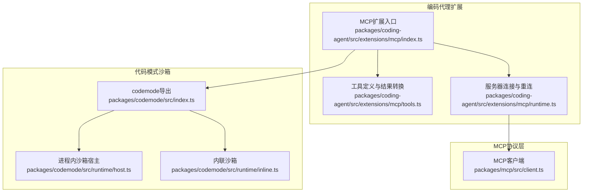
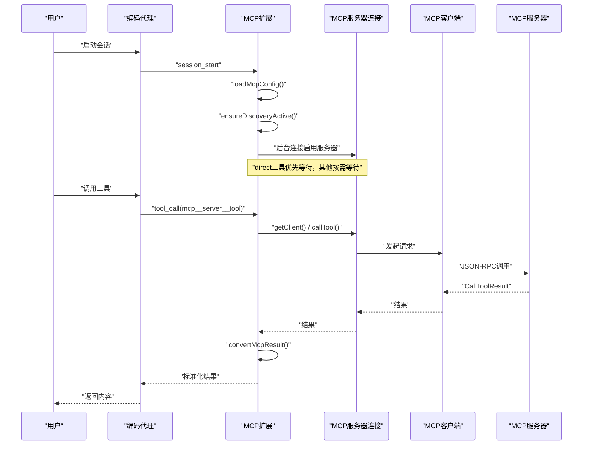
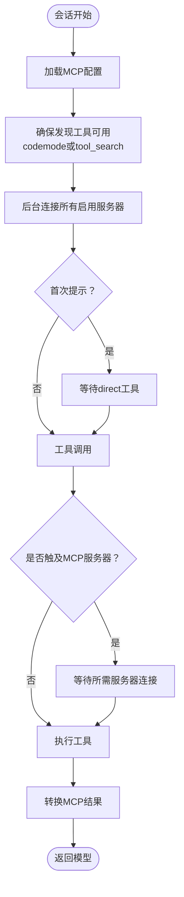
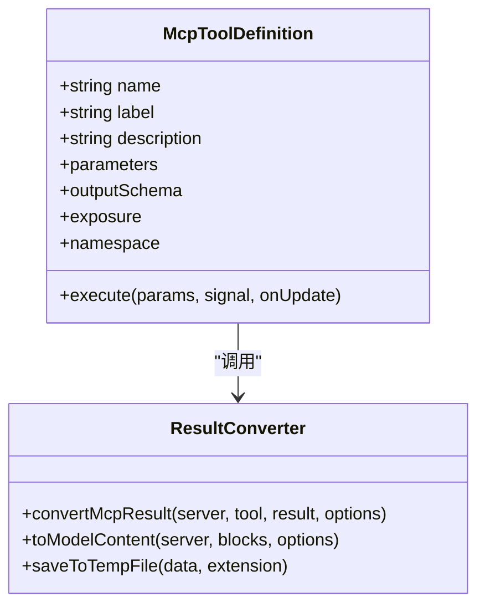
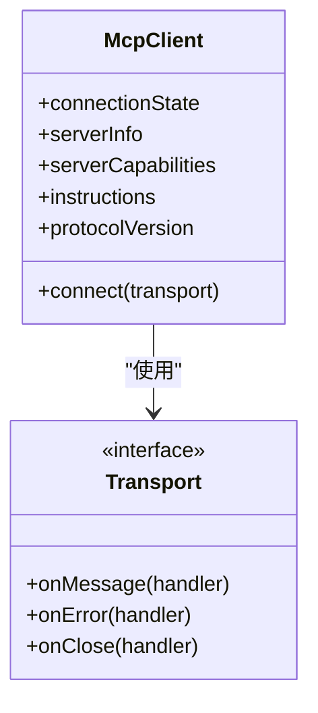
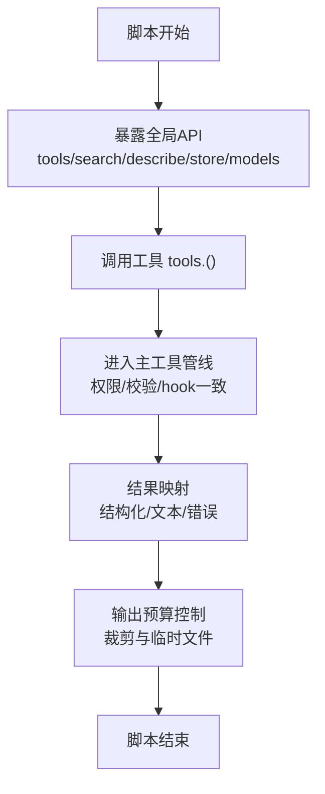
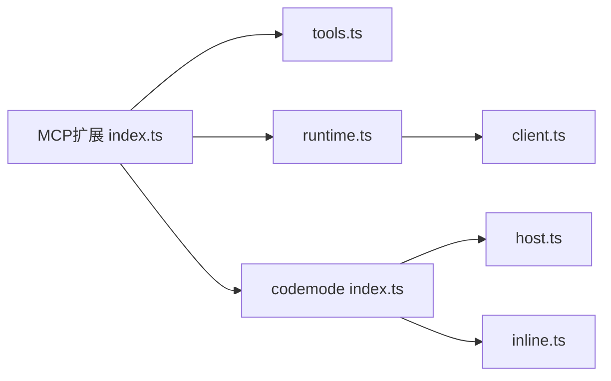

# MCP集成与代码模式沙箱

<cite>
**本文引用的文件**   
- [14-mcp-codemode.md](#/explains/14-mcp-codemode.md)
- [index.ts（MCP扩展）](https://github.com/FDE-GROUP/oh-my-coding-agent/blob/omca/packages/coding-agent/src/extensions/mcp/index.ts)
- [tools.ts（MCP工具定义与结果转换）](https://github.com/FDE-GROUP/oh-my-coding-agent/blob/omca/packages/coding-agent/src/extensions/mcp/tools.ts)
- [runtime.ts（MCP服务器连接）](https://github.com/FDE-GROUP/oh-my-coding-agent/blob/omca/packages/coding-agent/src/extensions/mcp/runtime.ts)
- [client.ts（MCP客户端）](https://github.com/FDE-GROUP/oh-my-coding-agent/blob/omca/packages/mcp/src/client.ts)
- [index.ts（codemode导出）](https://github.com/FDE-GROUP/oh-my-coding-agent/blob/omca/packages/codemode/src/index.ts)
- [host.ts（CodemodeSandbox）](https://github.com/FDE-GROUP/oh-my-coding-agent/blob/omca/packages/codemode/src/runtime/host.ts)
- [inline.ts（InlineCodemodeSandbox）](https://github.com/FDE-GROUP/oh-my-coding-agent/blob/omca/packages/codemode/src/runtime/inline.ts)
</cite>

## 目录
1. [引言](#引言)
2. [项目结构](#项目结构)
3. [核心组件](#核心组件)
4. [架构总览](#架构总览)
5. [详细组件分析](#详细组件分析)
6. [依赖关系分析](#依赖关系分析)
7. [性能与限制](#性能与限制)
8. [故障排查指南](#故障排查指南)
9. [结论](#结论)

## 引言
本文围绕“MCP集成与代码模式沙箱”展开，解释模型如何在不膨胀工具声明的前提下接入外部工具生态：通过暴露策略、按需发现、脚本沙箱和连接生命周期管理，把MCP工具与codemode脚本安全地组合起来。文档同时给出架构图、时序图、流程图与类图，帮助读者从高层到代码级理解系统。

## 项目结构
仓库中与主题相关的代码分布在两个包中：
- packages/coding-agent/src/extensions/mcp：MCP扩展，负责加载配置、建立连接、注册工具、处理OAuth与UI管理。
- packages/codemode：代码模式沙箱，提供在受限环境中执行JavaScript脚本的能力，并通过全局API调用其他工具。



**图表来源**
- [index.ts（MCP扩展）:1-27](https://github.com/FDE-GROUP/oh-my-coding-agent/blob/omca/packages/coding-agent/src/extensions/mcp/index.ts#L1-L27)
- [tools.ts:1-11](https://github.com/FDE-GROUP/oh-my-coding-agent/blob/omca/packages/coding-agent/src/extensions/mcp/tools.ts#L1-L11)
- [runtime.ts:1-5](https://github.com/FDE-GROUP/oh-my-coding-agent/blob/omca/packages/coding-agent/src/extensions/mcp/runtime.ts#L1-L5)
- [client.ts:173-213](https://github.com/FDE-GROUP/oh-my-coding-agent/blob/omca/packages/mcp/src/client.ts#L173-L213)
- [index.ts（codemode导出）:1-66](https://github.com/FDE-GROUP/oh-my-coding-agent/blob/omca/packages/codemode/src/index.ts#L1-L66)
- [host.ts:84-88](https://github.com/FDE-GROUP/oh-my-coding-agent/blob/omca/packages/codemode/src/runtime/host.ts#L84-L88)
- [inline.ts:122-126](https://github.com/FDE-GROUP/oh-my-coding-agent/blob/omca/packages/codemode/src/runtime/inline.ts#L122-L126)

**章节来源**
- [14-mcp-codemode.md:1-17](https://github.com/FDE-GROUP/oh-my-coding-agent/blob/omca/docs/explains/14-mcp-codemode.md#L1-L17)
- [index.ts（MCP扩展）:1-27](https://github.com/FDE-GROUP/oh-my-coding-agent/blob/omca/packages/coding-agent/src/extensions/mcp/index.ts#L1-L27)

## 核心组件
- MCP扩展：加载mcp.json与插件注册的服务器，按exposure策略注册工具，维护连接状态，提供/mcp管理器。
- MCP工具定义与结果转换：将MCP工具映射为代理工具，统一输出格式，裁剪大文本与二进制资源。
- MCP服务器连接：封装MCP客户端，处理HTTP/stdio传输、OAuth、重试、断开重连、工具列表变更通知。
- MCP客户端：实现JSON-RPC通信、初始化、工具与资源能力协商。
- codemode导出与沙箱：对外暴露沙箱类型与常量；运行时支持worker或内联执行，限制内存、超时与I/O。

**章节来源**
- [index.ts（MCP扩展）:280-330](https://github.com/FDE-GROUP/oh-my-coding-agent/blob/omca/packages/coding-agent/src/extensions/mcp/index.ts#L280-L330)
- [tools.ts:249-289](https://github.com/FDE-GROUP/oh-my-coding-agent/blob/omca/packages/coding-agent/src/extensions/mcp/tools.ts#L249-L289)
- [runtime.ts:141-456](https://github.com/FDE-GROUP/oh-my-coding-agent/blob/omca/packages/coding-agent/src/extensions/mcp/runtime.ts#L141-L456)
- [client.ts:173-213](https://github.com/FDE-GROUP/oh-my-coding-agent/blob/omca/packages/mcp/src/client.ts#L173-L213)
- [index.ts（codemode导出）:1-66](https://github.com/FDE-GROUP/oh-my-coding-agent/blob/omca/packages/codemode/src/index.ts#L1-L66)

## 架构总览
MCP扩展在会话启动时加载配置并后台连接所有启用的服务器；首次提示仅等待direct工具，其他工具由codemode或tool_search按需发现。工具以命名空间+哈希的方式注册，避免名称冲突。脚本在受限环境中运行，通过全局API调用工具，结果经统一管道返回给模型。



**图表来源**
- [index.ts（MCP扩展）:46-64](https://github.com/FDE-GROUP/oh-my-coding-agent/blob/omca/docs/explains/14-mcp-codemode.md#L46-L64)
- [tools.ts:275-286](https://github.com/FDE-GROUP/oh-my-coding-agent/blob/omca/packages/coding-agent/src/extensions/mcp/tools.ts#L275-L286)
- [runtime.ts:239-250](https://github.com/FDE-GROUP/oh-my-coding-agent/blob/omca/packages/coding-agent/src/extensions/mcp/runtime.ts#L239-L250)
- [client.ts:204-213](https://github.com/FDE-GROUP/oh-my-coding-agent/blob/omca/packages/mcp/src/client.ts#L204-L213)

## 详细组件分析

### MCP扩展：工具暴露策略与生命周期
- 暴露策略：direct直接声明给模型；codemode仅脚本可调用；deferred由tool_search加载后声明；hidden不可达。
- 连接生命周期：session_start加载配置并激活发现机制；before_agent_start等待direct工具；tool_call按需等待相关服务器；session_shutdown中止并关闭连接。
- 工具命名：mcp__<server>__<tool>，冲突时加哈希后缀保证稳定性。
- 工具定义：参数来自输入Schema规范化；输出为CallToolResult结构化内容；exposure与namespace用于描述与权限控制；execute委托给MCP客户端。
- 结果转换：content块转文本/图片；超长文本保留头尾并写临时文件；二进制资源写临时文件；resource_link提示使用read_mcp_resource；isError转为错误结果但保留完整structuredContent。
- 运行时：McpServerConnection维护connecting/connected/disconnected/needs-auth/failed/closed状态；懒连接；HTTP瞬态错误重试；会话过期丢弃旧client并重连一次；只读请求重试一次；工具列表变更触发刷新；stdio失败保留stderr尾部；close等待OAuth token写入完成。
- OAuth：凭据存储；HTTP默认OAuth；401进入needs-auth；auth.provider复用Pi provider令牌。
- /mcp管理器：TUI菜单排序与操作；项目覆盖与注册服务器会话级生效。



**图表来源**
- [14-mcp-codemode.md:43-64](https://github.com/FDE-GROUP/oh-my-coding-agent/blob/omca/docs/explains/14-mcp-codemode.md#L43-L64)
- [index.ts（MCP扩展）:502-537](https://github.com/FDE-GROUP/oh-my-coding-agent/blob/omca/packages/coding-agent/src/extensions/mcp/index.ts#L502-L537)
- [tools.ts:215-235](https://github.com/FDE-GROUP/oh-my-coding-agent/blob/omca/packages/coding-agent/src/extensions/mcp/tools.ts#L215-L235)
- [runtime.ts:276-303](https://github.com/FDE-GROUP/oh-my-coding-agent/blob/omca/packages/coding-agent/src/extensions/mcp/runtime.ts#L276-L303)

**章节来源**
- [14-mcp-codemode.md:18-31](https://github.com/FDE-GROUP/oh-my-coding-agent/blob/omca/docs/explains/14-mcp-codemode.md#L18-L31)
- [14-mcp-codemode.md:68-110](https://github.com/FDE-GROUP/oh-my-coding-agent/blob/omca/docs/explains/14-mcp-codemode.md#L68-L110)
- [14-mcp-codemode.md:112-128](https://github.com/FDE-GROUP/oh-my-coding-agent/blob/omca/docs/explains/14-mcp-codemode.md#L112-L128)
- [index.ts（MCP扩展）:280-330](https://github.com/FDE-GROUP/oh-my-coding-agent/blob/omca/packages/coding-agent/src/extensions/mcp/index.ts#L280-L330)
- [tools.ts:249-289](https://github.com/FDE-GROUP/oh-my-coding-agent/blob/omca/packages/coding-agent/src/extensions/mcp/tools.ts#L249-L289)
- [runtime.ts:141-456](https://github.com/FDE-GROUP/oh-my-coding-agent/blob/omca/packages/coding-agent/src/extensions/mcp/runtime.ts#L141-L456)

### MCP工具定义与结果转换
- createMcpToolDefinition：生成代理工具定义，包含名称、标签、描述、参数Schema、输出Schema、exposure、namespace、渲染器与execute逻辑。
- convertMcpResult：将MCP的CallToolResult转换为代理工具结果，处理content块、结构化内容、错误标记与输出裁剪。
- toModelContent与toLlmContent：将MCP content块转换为模型可读的文本或图像；对resource_link与二进制资源进行特殊处理。
- saveToTempFile与limitMcpContent：将超大文本与二进制资源保存到临时文件，并在结果中返回路径以便读取。



**图表来源**
- [tools.ts:249-289](https://github.com/FDE-GROUP/oh-my-coding-agent/blob/omca/packages/coding-agent/src/extensions/mcp/tools.ts#L249-L289)
- [tools.ts:215-235](https://github.com/FDE-GROUP/oh-my-coding-agent/blob/omca/packages/coding-agent/src/extensions/mcp/tools.ts#L215-L235)
- [tools.ts:172-212](https://github.com/FDE-GROUP/oh-my-coding-agent/blob/omca/packages/coding-agent/src/extensions/mcp/tools.ts#L172-L212)
- [tools.ts:62-65](https://github.com/FDE-GROUP/oh-my-coding-agent/blob/omca/packages/coding-agent/src/extensions/mcp/tools.ts#L62-L65)

**章节来源**
- [tools.ts:249-289](https://github.com/FDE-GROUP/oh-my-coding-agent/blob/omca/packages/coding-agent/src/extensions/mcp/tools.ts#L249-L289)
- [tools.ts:215-235](https://github.com/FDE-GROUP/oh-my-coding-agent/blob/omca/packages/coding-agent/src/extensions/mcp/tools.ts#L215-L235)

### MCP服务器连接与重连策略
- McpServerConnection：封装MCP客户端，管理连接状态、工具列表、资源能力、OAuth挑战与日志。
- withClient：统一请求入口，区分只读请求与工具调用；对瞬态HTTP错误与会话过期做差异化重试；认证失败进入needs-auth。
- open/connectOnce：创建transport（HTTP或stdio），初始化客户端，订阅工具列表变更通知，记录instructions与capabilities。
- close：中止shutdown信号，关闭client与opening任务，等待OAuth token写入完成。

```mermaid
stateDiagram-v2
[*] --> connecting
connecting --> connected : "初始化成功"
connected --> disconnected : "传输关闭"
connected --> needs-auth : "需要登录"
connecting --> failed : "连接失败"
disconnected --> connecting : "下次调用重连"
needs-auth --> connecting : "重新连接"
failed --> connecting : "修复后重连"
connected --> closed : "会话结束"
disconnected --> closed : "会话结束"
needs-auth --> closed : "会话结束"
failed --> closed : "会话结束"
```

**图表来源**
- [runtime.ts:141-166](https://github.com/FDE-GROUP/oh-my-coding-agent/blob/omca/packages/coding-agent/src/extensions/mcp/runtime.ts#L141-L166)
- [runtime.ts:276-303](https://github.com/FDE-GROUP/oh-my-coding-agent/blob/omca/packages/coding-agent/src/extensions/mcp/runtime.ts#L276-L303)
- [runtime.ts:342-409](https://github.com/FDE-GROUP/oh-my-coding-agent/blob/omca/packages/coding-agent/src/extensions/mcp/runtime.ts#L342-L409)
- [runtime.ts:444-456](https://github.com/FDE-GROUP/oh-my-coding-agent/blob/omca/packages/coding-agent/src/extensions/mcp/runtime.ts#L444-L456)

**章节来源**
- [runtime.ts:141-456](https://github.com/FDE-GROUP/oh-my-coding-agent/blob/omca/packages/coding-agent/src/extensions/mcp/runtime.ts#L141-L456)

### MCP客户端与传输
- McpClient：维护连接状态、服务端信息与指令；connect绑定消息处理器、错误与关闭回调；roots可选。
- 传输：HTTP与stdio两种传输方式，分别对应StreamableHttpTransport与StdioTransport。



**图表来源**
- [client.ts:173-213](https://github.com/FDE-GROUP/oh-my-coding-agent/blob/omca/packages/mcp/src/client.ts#L173-L213)
- [runtime.ts:100-124](https://github.com/FDE-GROUP/oh-my-coding-agent/blob/omca/packages/coding-agent/src/extensions/mcp/runtime.ts#L100-L124)

**章节来源**
- [client.ts:173-213](https://github.com/FDE-GROUP/oh-my-coding-agent/blob/omca/packages/mcp/src/client.ts#L173-L213)
- [runtime.ts:100-124](https://github.com/FDE-GROUP/oh-my-coding-agent/blob/omca/packages/coding-agent/src/extensions/mcp/runtime.ts#L100-L124)

### 代码模式沙箱：执行环境与全局API
- CodemodeSandbox：基于worker的进程隔离沙箱，默认最多2个worker，堆上限256MB，等待上限60秒。
- InlineCodemodeSandbox：内联执行沙箱，适合轻量场景。
- 全局API：tools.<name>(args)、ALL_TOOLS、searchTools、describeTool、describeNamespace、text/image、console.log、exit、store/load、models.*。
- 嵌套调用：scripts → tools.read → ctx.executeTool → agent loop runToolCall → 校验/执行/结果 → 返回；权限与hook一致。
- store/load：跨调用保存JSON值，分支可见性通过custom entry回放实现。
- 输出预算：默认10,000 token，超预算保留头尾并写临时文件。



**图表来源**
- [14-mcp-codemode.md:140-199](https://github.com/FDE-GROUP/oh-my-coding-agent/blob/omca/docs/explains/14-mcp-codemode.md#L140-L199)
- [host.ts:84-88](https://github.com/FDE-GROUP/oh-my-coding-agent/blob/omca/packages/codemode/src/runtime/host.ts#L84-L88)
- [inline.ts:122-126](https://github.com/FDE-GROUP/oh-my-coding-agent/blob/omca/packages/codemode/src/runtime/inline.ts#L122-L126)

**章节来源**
- [14-mcp-codemode.md:140-199](https://github.com/FDE-GROUP/oh-my-coding-agent/blob/omca/docs/explains/14-mcp-codemode.md#L140-L199)
- [index.ts（codemode导出）:1-66](https://github.com/FDE-GROUP/oh-my-coding-agent/blob/omca/packages/codemode/src/index.ts#L1-L66)

## 依赖关系分析
- MCP扩展依赖MCP工具定义与结果转换模块，以及MCP服务器连接模块。
- MCP服务器连接依赖MCP客户端与传输抽象，以及OAuth凭证与日志模块。
- codemode导出模块聚合了沙箱类型、常量与解析器，供上层扩展使用。



**图表来源**
- [index.ts（MCP扩展）:280-330](https://github.com/FDE-GROUP/oh-my-coding-agent/blob/omca/packages/coding-agent/src/extensions/mcp/index.ts#L280-L330)
- [tools.ts:249-289](https://github.com/FDE-GROUP/oh-my-coding-agent/blob/omca/packages/coding-agent/src/extensions/mcp/tools.ts#L249-L289)
- [runtime.ts:141-456](https://github.com/FDE-GROUP/oh-my-coding-agent/blob/omca/packages/coding-agent/src/extensions/mcp/runtime.ts#L141-L456)
- [client.ts:173-213](https://github.com/FDE-GROUP/oh-my-coding-agent/blob/omca/packages/mcp/src/client.ts#L173-L213)
- [index.ts（codemode导出）:1-66](https://github.com/FDE-GROUP/oh-my-coding-agent/blob/omca/packages/codemode/src/index.ts#L1-L66)
- [host.ts:84-88](https://github.com/FDE-GROUP/oh-my-coding-agent/blob/omca/packages/codemode/src/runtime/host.ts#L84-L88)
- [inline.ts:122-126](https://github.com/FDE-GROUP/oh-my-coding-agent/blob/omca/packages/codemode/src/runtime/inline.ts#L122-L126)

**章节来源**
- [index.ts（MCP扩展）:280-330](https://github.com/FDE-GROUP/oh-my-coding-agent/blob/omca/packages/coding-agent/src/extensions/mcp/index.ts#L280-L330)
- [tools.ts:249-289](https://github.com/FDE-GROUP/oh-my-coding-agent/blob/omca/packages/coding-agent/src/extensions/mcp/tools.ts#L249-L289)
- [runtime.ts:141-456](https://github.com/FDE-GROUP/oh-my-coding-agent/blob/omca/packages/coding-agent/src/extensions/mcp/runtime.ts#L141-L456)
- [client.ts:173-213](https://github.com/FDE-GROUP/oh-my-coding-agent/blob/omca/packages/mcp/src/client.ts#L173-L213)
- [index.ts（codemode导出）:1-66](https://github.com/FDE-GROUP/oh-my-coding-agent/blob/omca/packages/codemode/src/index.ts#L1-L66)

## 性能与限制
- 连接重试：HTTP瞬态错误重试两次，延迟[250ms, 1s]；只读请求额外重试一次。
- 超时控制：默认请求超时60秒；脚本超时由@options指定；worker等待上限60秒。
- 内存与并发：默认最多2个worker，堆上限256MB。
- 输出预算：默认10,000 token；超大文本与二进制资源写临时文件。
- 工具发现：BM25搜索与命名空间匹配，减少上下文开销。

**章节来源**
- [runtime.ts:50-53](https://github.com/FDE-GROUP/oh-my-coding-agent/blob/omca/packages/coding-agent/src/extensions/mcp/runtime.ts#L50-L53)
- [runtime.ts:276-303](https://github.com/FDE-GROUP/oh-my-coding-agent/blob/omca/packages/coding-agent/src/extensions/mcp/runtime.ts#L276-L303)
- [14-mcp-codemode.md:140-147](https://github.com/FDE-GROUP/oh-my-coding-agent/blob/omca/docs/explains/14-mcp-codemode.md#L140-L147)
- [14-mcp-codemode.md:192-199](https://github.com/FDE-GROUP/oh-my-coding-agent/blob/omca/docs/explains/14-mcp-codemode.md#L192-L199)
- [14-mcp-codemode.md:216-222](https://github.com/FDE-GROUP/oh-my-coding-agent/blob/omca/docs/explains/14-mcp-codemode.md#L216-L222)

## 故障排查指南
- 连接失败：检查mcp.json配置、网络可达性与OAuth设置；查看/mcp管理器中的状态与错误信息。
- 需要登录：401或OAuth授权失败会进入needs-auth，运行/mcp login或/login <provider>完成登录。
- 工具不可用：确认exposure不是hidden；若为codemode或deferred，需激活codemode或tool_search。
- 输出过大：检查fullOutputPath临时文件路径，确认读写权限与磁盘空间。
- 脚本异常：查看console输出与codemode-store custom entry，定位store/load数据与工具调用链。

**章节来源**
- [14-mcp-codemode.md:112-128](https://github.com/FDE-GROUP/oh-my-coding-agent/blob/omca/docs/explains/14-mcp-codemode.md#L112-L128)
- [runtime.ts:319-331](https://github.com/FDE-GROUP/oh-my-coding-agent/blob/omca/packages/coding-agent/src/extensions/mcp/runtime.ts#L319-L331)
- [tools.ts:215-235](https://github.com/FDE-GROUP/oh-my-coding-agent/blob/omca/packages/coding-agent/src/extensions/mcp/tools.ts#L215-L235)

## 结论
该方案通过暴露策略与多层懒加载，将MCP工具生态安全地接入模型与脚本环境：模型侧保持简洁的工具声明，脚本侧获得强大的批量与链式调用能力，连接层具备健壮的重连与认证机制，沙箱层提供严格的资源与时间限制。整体设计兼顾可扩展性、安全性与性能，适合在生产环境中集成多样化外部工具。