# 内置工具详解

<cite>
**本文引用的文件**   
- [packages/coding-agent/src/core/tools/index.ts](https://github.com/FDE-GROUP/oh-my-fde/blob/omca/packages/coding-agent/src/core/tools/index.ts)
- [packages/coding-agent/src/core/tools/read.ts](https://github.com/FDE-GROUP/oh-my-fde/blob/omca/packages/coding-agent/src/core/tools/read.ts)
- [packages/coding-agent/src/core/tools/write.ts](https://github.com/FDE-GROUP/oh-my-fde/blob/omca/packages/coding-agent/src/core/tools/write.ts)
- [packages/coding-agent/src/core/tools/edit.ts](https://github.com/FDE-GROUP/oh-my-fde/blob/omca/packages/coding-agent/src/core/tools/edit.ts)
- [packages/coding-agent/src/core/tools/bash.ts](https://github.com/FDE-GROUP/oh-my-fde/blob/omca/packages/coding-agent/src/core/tools/bash.ts)
- [packages/coding-agent/src/core/tools/powershell.ts](https://github.com/FDE-GROUP/oh-my-fde/blob/omca/packages/coding-agent/src/core/tools/powershell.ts)
- [packages/coding-agent/src/core/tools/find.ts](https://github.com/FDE-GROUP/oh-my-fde/blob/omca/packages/coding-agent/src/core/tools/find.ts)
- [packages/coding-agent/src/core/tools/grep.ts](https://github.com/FDE-GROUP/oh-my-fde/blob/omca/packages/coding-agent/src/core/tools/grep.ts)
- [packages/coding-agent/src/core/tools/ls.ts](https://github.com/FDE-GROUP/oh-my-fde/blob/omca/packages/coding-agent/src/core/tools/ls.ts)
- [packages/coding-agent/src/utils/shell.ts](https://github.com/FDE-GROUP/oh-my-fde/blob/omca/packages/coding-agent/src/utils/shell.ts)
</cite>

## 目录
1. [简介](#简介)
2. [项目结构](#项目结构)
3. [核心组件](#核心组件)
4. [架构总览](#架构总览)
5. [详细组件分析](#详细组件分析)
6. [依赖关系分析](#依赖关系分析)
7. [性能与限制](#性能与限制)
8. [故障排查指南](#故障排查指南)
9. [结论](#结论)

## 简介
本文件系统性介绍代码库中的内置工具集，涵盖文件操作（read、write、edit）、Shell 执行（bash、powershell）、代码搜索（find、grep）与目录浏览（ls）。文档聚焦每个工具的输入参数、输出格式、错误处理与最佳实践，并给出典型使用示例与执行流程说明，帮助读者快速上手并安全高效地使用这些工具。

## 项目结构
内置工具集中在 packages/coding-agent/src/core/tools 目录下，统一通过 index.ts 暴露工厂函数与类型定义，便于外部按名称创建工具实例或工具定义。各工具实现遵循“定义 + 渲染器 + 可插拔操作”的模式：
- 定义层：描述参数 schema、输出 schema、提示片段与执行逻辑
- 渲染层：将结构化结果转换为模型友好的文本展示
- 操作层：抽象文件系统、子进程等底层能力，便于替换为远程实现

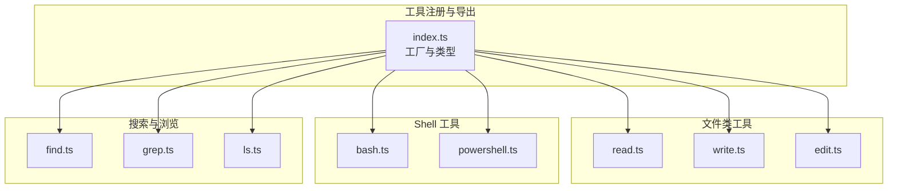

图表来源
- [packages/coding-agent/src/core/tools/index.ts:1-225](https://github.com/FDE-GROUP/oh-my-fde/blob/omca/packages/coding-agent/src/core/tools/index.ts#L1-L225)

章节来源
- [packages/coding-agent/src/core/tools/index.ts:1-225](https://github.com/FDE-GROUP/oh-my-fde/blob/omca/packages/coding-agent/src/core/tools/index.ts#L1-L225)

## 核心组件
- 工具命名空间与工厂
  - 所有内置工具名集合：read、bash、powershell、edit、write、grep、find、ls
  - 提供 createToolDefinition/createTool 按名称创建工具定义/实例
  - 提供 createCodingTools/createReadOnlyTools/createAllTools 批量装配工具集
- 通用能力
  - 路径解析与规范化：resolveToCwd、resolveReadPathAsync
  - 截断与格式化：DEFAULT_MAX_BYTES、DEFAULT_MAX_LINES、formatSize、truncateHead/truncateLine
  - 渲染器：renderers/* 将结构化内容转为人类可读文本
  - 可插拔操作：ReadOperations/WriteOperations/EditOperations/BashOperations/GrepOperations/FindOperations/LsOperations

章节来源
- [packages/coding-agent/src/core/tools/index.ts:93-225](https://github.com/FDE-GROUP/oh-my-fde/blob/omca/packages/coding-agent/src/core/tools/index.ts#L93-L225)
- [packages/coding-agent/src/core/tools/path-utils.ts:40-50](https://github.com/FDE-GROUP/oh-my-fde/blob/omca/packages/coding-agent/src/core/tools/path-utils.ts#L40-L50)
- [packages/coding-agent/src/core/tools/read.ts:12-13](https://github.com/FDE-GROUP/oh-my-fde/blob/omca/packages/coding-agent/src/core/tools/read.ts#L12-L13)

## 架构总览
下图展示了从调用方到具体工具实现的调用链，以及 Shell 工具对系统 shell 的调用关系。

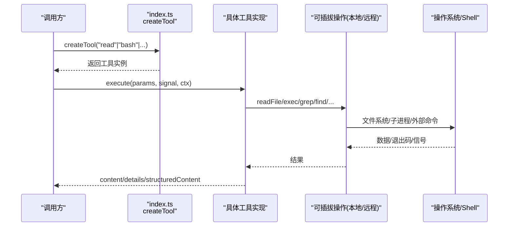

图表来源
- [packages/coding-agent/src/core/tools/index.ts:141-162](https://github.com/FDE-GROUP/oh-my-fde/blob/omca/packages/coding-agent/src/core/tools/index.ts#L141-L162)
- [packages/coding-agent/src/core/tools/bash.ts:271-448](https://github.com/FDE-GROUP/oh-my-fde/blob/omca/packages/coding-agent/src/core/tools/bash.ts#L271-L448)
- [packages/coding-agent/src/core/tools/read.ts:228-357](https://github.com/FDE-GROUP/oh-my-fde/blob/omca/packages/coding-agent/src/core/tools/read.ts#L228-L357)

## 详细组件分析

### read（读取文件）
- 功能概述
  - 读取文本文件或图片（jpg/png/gif/webp/bmp），图片以附件形式返回；文本支持 offset/limit 分页与大文件流式读取。
- 输入参数
  - path：要读取的文件路径（相对或绝对）
  - offset：起始行号（1 基）
  - limit：最大读取行数
- 输出格式
  - 文本：字符串
  - 图片：对象 { type:"image", data, mimeType, note }
  - details：包含 truncation 信息（如被截断的行数/字节数）
- 关键行为
  - 自动检测图片 MIME 类型并按需缩放
  - 大文件优先走流式读取，仅保留需要显示的行，避免内存膨胀
  - 超长首行会给出替代命令提示
  - 支持 AbortSignal 中断
- 错误处理
  - 路径不可读、offset 越界、操作中止等抛出明确错误
- 配置项
  - autoResizeImages：是否自动缩放图片
  - resizeOptions：无上下文时的回退缩放策略
  - operations：自定义 ReadOperations（例如 SSH）
- 使用示例
  - 读取某文件的第 100 行起最多 50 行：{ path:"src/main.ts", offset:100, limit:50 }
  - 读取图片并附带提示：{ path:"assets/logo.png" }
- 最佳实践
  - 大文件务必使用 offset/limit 分页
  - 若单行过长，根据提示改用 bash 命令截取

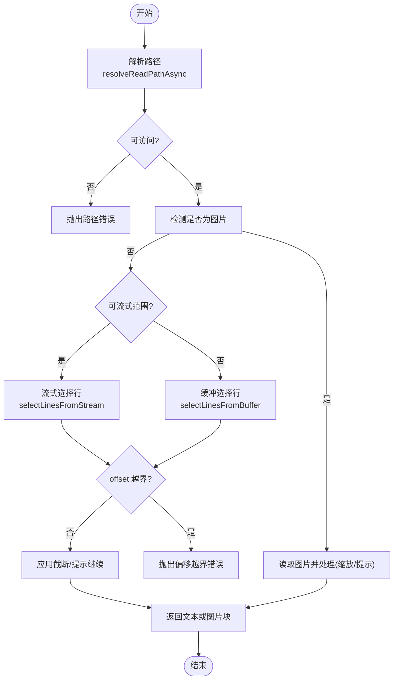

图表来源
- [packages/coding-agent/src/core/tools/read.ts:228-357](https://github.com/FDE-GROUP/oh-my-fde/blob/omca/packages/coding-agent/src/core/tools/read.ts#L228-L357)
- [packages/coding-agent/src/core/tools/path-utils.ts:86-118](https://github.com/FDE-GROUP/oh-my-fde/blob/omca/packages/coding-agent/src/core/tools/path-utils.ts#L86-L118)

章节来源
- [packages/coding-agent/src/core/tools/read.ts:14-18](https://github.com/FDE-GROUP/oh-my-fde/blob/omca/packages/coding-agent/src/core/tools/read.ts#L14-L18)
- [packages/coding-agent/src/core/tools/read.ts:33-42](https://github.com/FDE-GROUP/oh-my-fde/blob/omca/packages/coding-agent/src/core/tools/read.ts#L33-L42)
- [packages/coding-agent/src/core/tools/read.ts:48-68](https://github.com/FDE-GROUP/oh-my-fde/blob/omca/packages/coding-agent/src/core/tools/read.ts#L48-L68)
- [packages/coding-agent/src/core/tools/read.ts:86-93](https://github.com/FDE-GROUP/oh-my-fde/blob/omca/packages/coding-agent/src/core/tools/read.ts#L86-L93)
- [packages/coding-agent/src/core/tools/read.ts:228-357](https://github.com/FDE-GROUP/oh-my-fde/blob/omca/packages/coding-agent/src/core/tools/read.ts#L228-L357)

### write（写入文件）
- 功能概述
  - 创建或覆盖写入文件，自动创建父目录。
- 输入参数
  - path：目标文件路径
  - content：要写入的内容（字符串）
- 输出格式
  - 成功：文本确认消息
- 关键行为
  - 通过 withFileMutationQueue 保证同一文件并发写互斥
  - 支持 AbortSignal 在关键 await 后检查中止
- 错误处理
  - 路径不存在时自动创建父目录；其他 IO 异常向上抛出
- 配置项
  - operations：自定义 WriteOperations（例如 SSH）
- 使用示例
  - 新建配置文件：{ path:"config.json", content:"{}" }
- 最佳实践
  - 大文件建议分批写入或使用 edit 进行增量修改

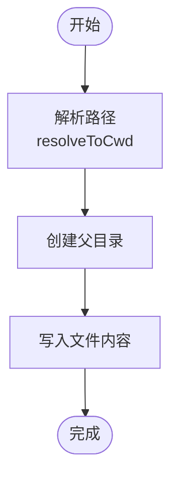

图表来源
- [packages/coding-agent/src/core/tools/write.ts:43-91](https://github.com/FDE-GROUP/oh-my-fde/blob/omca/packages/coding-agent/src/core/tools/write.ts#L43-L91)

章节来源
- [packages/coding-agent/src/core/tools/write.ts:10-13](https://github.com/FDE-GROUP/oh-my-fde/blob/omca/packages/coding-agent/src/core/tools/write.ts#L10-L13)
- [packages/coding-agent/src/core/tools/write.ts:26-31](https://github.com/FDE-GROUP/oh-my-fde/blob/omca/packages/coding-agent/src/core/tools/write.ts#L26-L31)
- [packages/coding-agent/src/core/tools/write.ts:38-41](https://github.com/FDE-GROUP/oh-my-fde/blob/omca/packages/coding-agent/src/core/tools/write.ts#L38-L41)
- [packages/coding-agent/src/core/tools/write.ts:43-91](https://github.com/FDE-GROUP/oh-my-fde/blob/omca/packages/coding-agent/src/core/tools/write.ts#L43-L91)

### edit（精确编辑文件）
- 功能概述
  - 基于 exact oldText/newText 的精准替换，支持一次调用多个不重叠编辑。
- 输入参数
  - path：目标文件路径
  - edits：[{ oldText, newText }] 数组
- 输出格式
  - 成功：文本确认
  - details：diff、patch、firstChangedLine
- 关键行为
  - 兼容旧版单条 edits 与 JSON 字符串传入
  - 标准化换行符，保留原始 BOM 与换行风格
  - 通过 withFileMutationQueue 保证并发安全
- 错误处理
  - 未找到或不可读写文件时报错；edits 校验失败报错
- 配置项
  - operations：自定义 EditOperations（例如 SSH）
- 使用示例
  - 替换某段代码：{ path:"src/a.ts", edits:[{oldText:"// TODO",newText:"// Implemented"}] }
- 最佳实践
  - 尽量合并相邻改动为一个 edit，避免重叠或嵌套

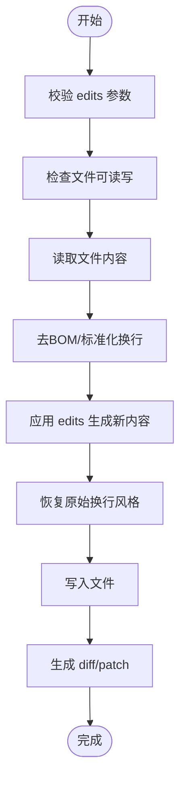

图表来源
- [packages/coding-agent/src/core/tools/edit.ts:140-212](https://github.com/FDE-GROUP/oh-my-fde/blob/omca/packages/coding-agent/src/core/tools/edit.ts#L140-L212)

章节来源
- [packages/coding-agent/src/core/tools/edit.ts:20-40](https://github.com/FDE-GROUP/oh-my-fde/blob/omca/packages/coding-agent/src/core/tools/edit.ts#L20-L40)
- [packages/coding-agent/src/core/tools/edit.ts:67-74](https://github.com/FDE-GROUP/oh-my-fde/blob/omca/packages/coding-agent/src/core/tools/edit.ts#L67-L74)
- [packages/coding-agent/src/core/tools/edit.ts:80-98](https://github.com/FDE-GROUP/oh-my-fde/blob/omca/packages/coding-agent/src/core/tools/edit.ts#L80-L98)
- [packages/coding-agent/src/core/tools/edit.ts:100-138](https://github.com/FDE-GROUP/oh-my-fde/blob/omca/packages/coding-agent/src/core/tools/edit.ts#L100-L138)
- [packages/coding-agent/src/core/tools/edit.ts:140-212](https://github.com/FDE-GROUP/oh-my-fde/blob/omca/packages/coding-agent/src/core/tools/edit.ts#L140-L212)

### bash（执行 Bash 命令）
- 功能概述
  - 在当前工作目录下执行 bash 命令，流式输出 stdout/stderr，支持超时与中止。
- 输入参数
  - command：要执行的命令
  - timeout：超时秒数（可选）
- 输出格式
  - content：面向模型的文本输出（可能截断）
  - details：truncation/fullOutputPath
  - structuredContent：面向程序调用的结构化输出（output/truncated/full_output_path/exit_code/wall_time_seconds）
- 关键行为
  - 默认使用 pi 内置本地 shell 后端，支持命令前缀与环境注入
  - 输出累积器支持临时文件持久化（当截断时）
  - 支持 kill 整个进程树，避免后台进程泄漏
- 错误处理
  - 工作目录不存在、命令中止、超时、非零退出码等均有明确提示
- 配置项
  - operations：自定义 BashOperations
  - commandPrefix：每条命令前追加的前缀
  - shellPath：显式指定 shell 路径
  - exposeSessionEnvironment：是否暴露 PI_* 会话环境变量
  - spawnHook：在执行前调整 command/cwd/env
- 使用示例
  - 列出当前目录：{ command:"ls -la" }
  - 带超时：{ command:"sleep 10", timeout:5 }
- 最佳实践
  - 长输出请重定向到文件并通过 read 查看
  - 谨慎使用 sudo/root 权限命令

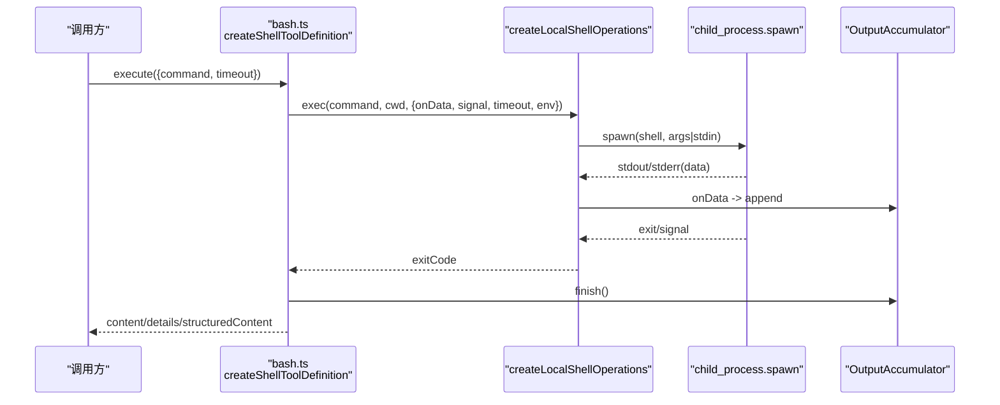

图表来源
- [packages/coding-agent/src/core/tools/bash.ts:271-448](https://github.com/FDE-GROUP/oh-my-fde/blob/omca/packages/coding-agent/src/core/tools/bash.ts#L271-L448)
- [packages/coding-agent/src/core/tools/bash.ts:110-194](https://github.com/FDE-GROUP/oh-my-fde/blob/omca/packages/coding-agent/src/core/tools/bash.ts#L110-L194)

章节来源
- [packages/coding-agent/src/core/tools/bash.ts:39-42](https://github.com/FDE-GROUP/oh-my-fde/blob/omca/packages/coding-agent/src/core/tools/bash.ts#L39-L42)
- [packages/coding-agent/src/core/tools/bash.ts:55-68](https://github.com/FDE-GROUP/oh-my-fde/blob/omca/packages/coding-agent/src/core/tools/bash.ts#L55-L68)
- [packages/coding-agent/src/core/tools/bash.ts:74-93](https://github.com/FDE-GROUP/oh-my-fde/blob/omca/packages/coding-agent/src/core/tools/bash.ts#L74-L93)
- [packages/coding-agent/src/core/tools/bash.ts:242-253](https://github.com/FDE-GROUP/oh-my-fde/blob/omca/packages/coding-agent/src/core/tools/bash.ts#L242-L253)
- [packages/coding-agent/src/core/tools/bash.ts:271-448](https://github.com/FDE-GROUP/oh-my-fde/blob/omca/packages/coding-agent/src/core/tools/bash.ts#L271-L448)

### powershell（执行 PowerShell 命令）
- 功能概述
  - 在 Windows 或跨平台环境中执行 PowerShell 命令，确保 UTF-8 输出与 ExecutionPolicy 绕过。
- 输入参数
  - 同 bash：command、timeout
- 输出格式
  - 同 bash：content/details/structuredContent
- 关键行为
  - 自动在命令前注入 UTF-8 编码设置
  - 复用 bash.ts 的 ShellToolConfig 与 createShellToolDefinition
- 错误处理
  - 找不到 PowerShell 可执行文件时抛出错误
- 配置项
  - operations/exposeSessionEnvironment/spawnHook 同 bash
- 使用示例
  - 获取执行策略：{ command:"Get-ExecutionPolicy -Scope Process" }
- 最佳实践
  - 在 Windows 上优先使用此工具；Linux/macOS 建议使用 bash

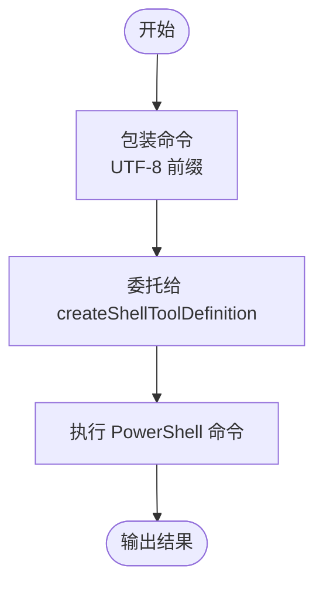

图表来源
- [packages/coding-agent/src/core/tools/powershell.ts:32-67](https://github.com/FDE-GROUP/oh-my-fde/blob/omca/packages/coding-agent/src/core/tools/powershell.ts#L32-L67)
- [packages/coding-agent/src/utils/shell.ts:155-167](https://github.com/FDE-GROUP/oh-my-fde/blob/omca/packages/coding-agent/src/utils/shell.ts#L155-L167)

章节来源
- [packages/coding-agent/src/core/tools/powershell.ts:16-21](https://github.com/FDE-GROUP/oh-my-fde/blob/omca/packages/coding-agent/src/core/tools/powershell.ts#L16-L21)
- [packages/coding-agent/src/core/tools/powershell.ts:29-36](https://github.com/FDE-GROUP/oh-my-fde/blob/omca/packages/coding-agent/src/core/tools/powershell.ts#L29-L36)
- [packages/coding-agent/src/core/tools/powershell.ts:49-67](https://github.com/FDE-GROUP/oh-my-fde/blob/omca/packages/coding-agent/src/core/tools/powershell.ts#L49-L67)
- [packages/coding-agent/src/utils/shell.ts:155-167](https://github.com/FDE-GROUP/oh-my-fde/blob/omca/packages/coding-agent/src/utils/shell.ts#L155-L167)

### find（按模式查找文件）
- 功能概述
  - 使用 glob 模式查找文件，尊重 .gitignore，返回相对路径列表。
- 输入参数
  - pattern：glob 模式（如 "*.ts"、"**/*.json"）
  - path：搜索根目录（可选）
  - limit：最大结果数（默认 1000）
- 输出格式
  - 文本：匹配文件路径列表（每行一个）
  - details：truncation/resultLimitReached
- 关键行为
  - 默认依赖 fd 工具；也可通过 custom operations.glob 自定义
  - 在非 git 仓库中使用 --no-require-git，在仓库内保持 git-aware 行为
  - 结果路径相对 searchPath 并统一为正斜杠
- 错误处理
  - fd 不可用、路径不存在、fd 执行失败等
- 配置项
  - operations：自定义 FindOperations（exists/glob）
- 使用示例
  - 查找所有 TypeScript 文件：{ pattern:"**/*.ts" }
- 最佳实践
  - 限定搜索范围以减少结果量
  - 结合 grep 做内容过滤

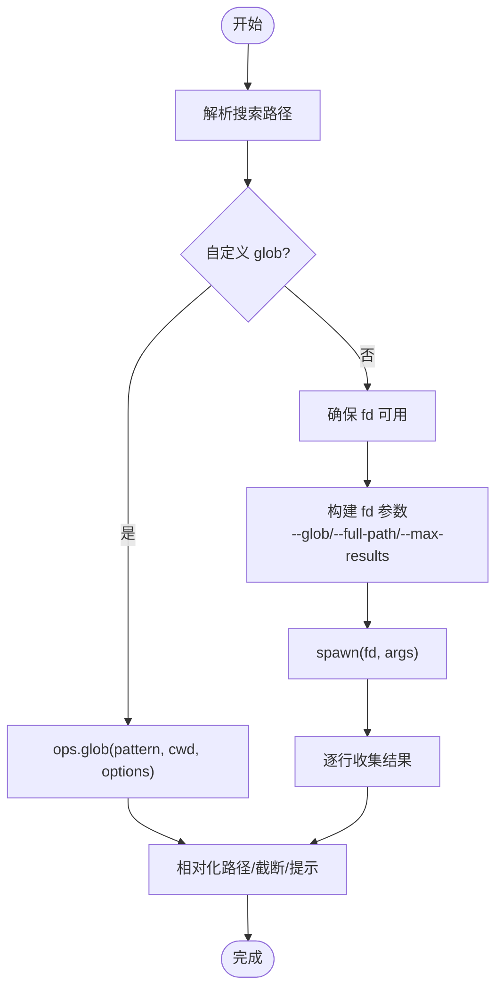

图表来源
- [packages/coding-agent/src/core/tools/find.ts:69-326](https://github.com/FDE-GROUP/oh-my-fde/blob/omca/packages/coding-agent/src/core/tools/find.ts#L69-L326)

章节来源
- [packages/coding-agent/src/core/tools/find.ts:25-31](https://github.com/FDE-GROUP/oh-my-fde/blob/omca/packages/coding-agent/src/core/tools/find.ts#L25-L31)
- [packages/coding-agent/src/core/tools/find.ts:42-45](https://github.com/FDE-GROUP/oh-my-fde/blob/omca/packages/coding-agent/src/core/tools/find.ts#L42-L45)
- [packages/coding-agent/src/core/tools/find.ts:51-67](https://github.com/FDE-GROUP/oh-my-fde/blob/omca/packages/coding-agent/src/core/tools/find.ts#L51-L67)
- [packages/coding-agent/src/core/tools/find.ts:69-326](https://github.com/FDE-GROUP/oh-my-fde/blob/omca/packages/coding-agent/src/core/tools/find.ts#L69-L326)

### grep（搜索文件内容）
- 功能概述
  - 使用 ripgrep 搜索文件内容，支持正则/字面量、忽略大小写、上下文行、glob 过滤与匹配数限制。
- 输入参数
  - pattern：搜索模式（正则或字面量）
  - path：搜索目录或文件（可选）
  - glob：文件过滤（可选）
  - ignoreCase：忽略大小写（可选）
  - literal：字面量匹配（可选）
  - context：前后上下文行数（可选）
  - limit：最大匹配数（默认 100）
- 输出格式
  - 文本：匹配行与上下文行，含文件路径与行号
  - details：truncation/matchLimitReached/linesTruncated
- 关键行为
  - 默认依赖 rg（ripgrep）；JSON 输出流式解析
  - 长行会被截断，并在 details 中提示
  - 达到匹配上限后尽快终止子进程
- 错误处理
  - rg 不可用、路径不存在、rg 执行失败等
- 配置项
  - operations：自定义 GrepOperations（isDirectory）
- 使用示例
  - 搜索所有测试文件中包含 "error" 的行：{ pattern:"error", glob:"*.test.*", ignoreCase:true }
- 最佳实践
  - 先用 find 缩小范围，再用 grep 精搜
  - 对超大文件建议配合 context=0 减少输出

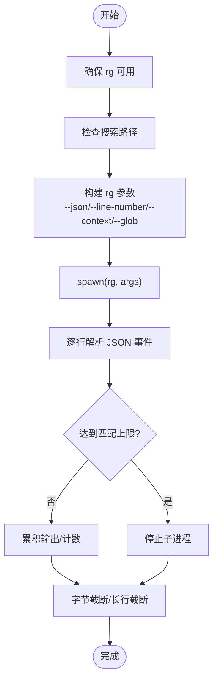

图表来源
- [packages/coding-agent/src/core/tools/grep.ts:73-316](https://github.com/FDE-GROUP/oh-my-fde/blob/omca/packages/coding-agent/src/core/tools/grep.ts#L73-L316)

章节来源
- [packages/coding-agent/src/core/tools/grep.ts:20-32](https://github.com/FDE-GROUP/oh-my-fde/blob/omca/packages/coding-agent/src/core/tools/grep.ts#L20-L32)
- [packages/coding-agent/src/core/tools/grep.ts:42-46](https://github.com/FDE-GROUP/oh-my-fde/blob/omca/packages/coding-agent/src/core/tools/grep.ts#L42-L46)
- [packages/coding-agent/src/core/tools/grep.ts:52-71](https://github.com/FDE-GROUP/oh-my-fde/blob/omca/packages/coding-agent/src/core/tools/grep.ts#L52-L71)
- [packages/coding-agent/src/core/tools/grep.ts:73-316](https://github.com/FDE-GROUP/oh-my-fde/blob/omca/packages/coding-agent/src/core/tools/grep.ts#L73-L316)

### ls（列出目录内容）
- 功能概述
  - 列出目录条目，按字母排序，目录后缀 "/"，包含隐藏文件。
- 输入参数
  - path：目录路径（可选）
  - limit：最大条目数（默认 500）
- 输出格式
  - 文本：条目列表
  - details：truncation/entryLimitReached
- 关键行为
  - 对每个条目尝试 stat 判断是否为目录
  - 支持 AbortSignal 中断
- 错误处理
  - 路径不存在、不是目录、无法读取目录等
- 配置项
  - operations：自定义 LsOperations（exists/stat/readdir）
- 使用示例
  - 列出当前目录：{ }
  - 限制条目数：{ path:"src", limit:50 }
- 最佳实践
  - 大目录建议先 find 再 ls 局部查看

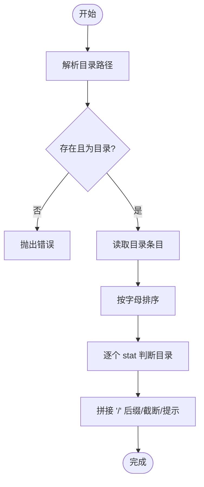

图表来源
- [packages/coding-agent/src/core/tools/ls.ts:53-170](https://github.com/FDE-GROUP/oh-my-fde/blob/omca/packages/coding-agent/src/core/tools/ls.ts#L53-L170)

章节来源
- [packages/coding-agent/src/core/tools/ls.ts:10-13](https://github.com/FDE-GROUP/oh-my-fde/blob/omca/packages/coding-agent/src/core/tools/ls.ts#L10-L13)
- [packages/coding-agent/src/core/tools/ls.ts:24-27](https://github.com/FDE-GROUP/oh-my-fde/blob/omca/packages/coding-agent/src/core/tools/ls.ts#L24-L27)
- [packages/coding-agent/src/core/tools/ls.ts:33-51](https://github.com/FDE-GROUP/oh-my-fde/blob/omca/packages/coding-agent/src/core/tools/ls.ts#L33-L51)
- [packages/coding-agent/src/core/tools/ls.ts:53-170](https://github.com/FDE-GROUP/oh-my-fde/blob/omca/packages/coding-agent/src/core/tools/ls.ts#L53-L170)

## 依赖关系分析
- 工具装配
  - index.ts 集中导出所有工具的定义与实例工厂，并提供只读/编程/全量三种装配方式
- 工具间协作
  - find/grep 依赖外部工具 fd/rg，由 ensureTool 管理可用性
  - bash/powershell 共享 createShellToolDefinition 与 createLocalShellOperations
  - read/write/edit 共享 path-utils 与 truncate 能力
- 外部依赖
  - Node.js fs/promises、child_process、readline
  - 外部二进制：fd、rg、bash、powershell.exe/pwsh.exe

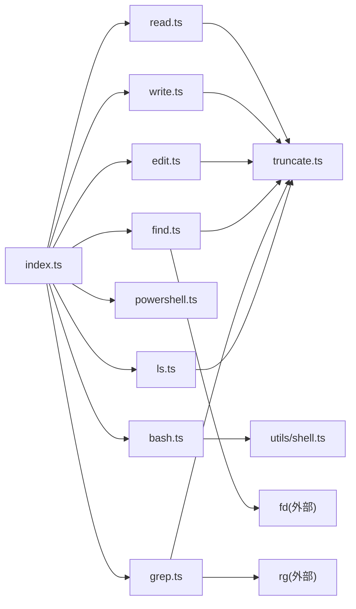

图表来源
- [packages/coding-agent/src/core/tools/index.ts:1-225](https://github.com/FDE-GROUP/oh-my-fde/blob/omca/packages/coding-agent/src/core/tools/index.ts#L1-L225)
- [packages/coding-agent/src/core/tools/bash.ts:271-448](https://github.com/FDE-GROUP/oh-my-fde/blob/omca/packages/coding-agent/src/core/tools/bash.ts#L271-L448)
- [packages/coding-agent/src/core/tools/find.ts:174-218](https://github.com/FDE-GROUP/oh-my-fde/blob/omca/packages/coding-agent/src/core/tools/find.ts#L174-L218)
- [packages/coding-agent/src/core/tools/grep.ts:120-160](https://github.com/FDE-GROUP/oh-my-fde/blob/omca/packages/coding-agent/src/core/tools/grep.ts#L120-L160)
- [packages/coding-agent/src/utils/shell.ts:155-167](https://github.com/FDE-GROUP/oh-my-fde/blob/omca/packages/coding-agent/src/utils/shell.ts#L155-L167)

章节来源
- [packages/coding-agent/src/core/tools/index.ts:93-225](https://github.com/FDE-GROUP/oh-my-fde/blob/omca/packages/coding-agent/src/core/tools/index.ts#L93-L225)
- [packages/coding-agent/src/core/tools/bash.ts:271-448](https://github.com/FDE-GROUP/oh-my-fde/blob/omca/packages/coding-agent/src/core/tools/bash.ts#L271-L448)
- [packages/coding-agent/src/core/tools/find.ts:69-326](https://github.com/FDE-GROUP/oh-my-fde/blob/omca/packages/coding-agent/src/core/tools/find.ts#L69-L326)
- [packages/coding-agent/src/core/tools/grep.ts:73-316](https://github.com/FDE-GROUP/oh-my-fde/blob/omca/packages/coding-agent/src/core/tools/grep.ts#L73-L316)

## 性能与限制
- 通用限制
  - DEFAULT_MAX_BYTES：默认字节上限（用于多处截断）
  - DEFAULT_MAX_LINES：默认行数上限（read/bash）
  - GREP_MAX_LINE_LENGTH：grep 单行最大长度
- 资源控制
  - bash：超时、进程树清理、AbortSignal
  - find/grep：尽早终止子进程，避免不必要扫描
  - read：流式读取，仅缓存需要显示的行
- 扩展性
  - 所有工具均支持 operations 注入，便于远程化（SSH/云存储）

[本节为通用指导，无需引用具体文件]

## 故障排查指南
- 常见错误与定位
  - “路径不存在/不是目录”：检查 path 是否正确，是否存在权限问题
  - “fd/rg 不可用”：安装对应工具或确保 PATH 正确
  - “PowerShell 不可用”：安装 PowerShell 或将 pwsh.exe/powershell.exe 加入 PATH
  - “命令超时/中止”：检查 timeout 设置与命令耗时，必要时拆分任务
  - “输出被截断”：根据 details.truncation 提示继续分页或查看完整输出文件
- 调试建议
  - 使用 bash 直接运行相同命令验证环境
  - 对大文件先用 find/grep 缩小范围，再用 read 查看
  - 利用 structuredContent（bash）或 details（其他工具）辅助自动化处理

章节来源
- [packages/coding-agent/src/core/tools/bash.ts:399-416](https://github.com/FDE-GROUP/oh-my-fde/blob/omca/packages/coding-agent/src/core/tools/bash.ts#L399-L416)
- [packages/coding-agent/src/core/tools/find.ts:174-182](https://github.com/FDE-GROUP/oh-my-fde/blob/omca/packages/coding-agent/src/core/tools/find.ts#L174-L182)
- [packages/coding-agent/src/core/tools/grep.ts:120-125](https://github.com/FDE-GROUP/oh-my-fde/blob/omca/packages/coding-agent/src/core/tools/grep.ts#L120-L125)
- [packages/coding-agent/src/utils/shell.ts:155-167](https://github.com/FDE-GROUP/oh-my-fde/blob/omca/packages/coding-agent/src/utils/shell.ts#L155-L167)

## 结论
本内置工具集围绕“安全、可控、可扩展”的原则设计，提供统一的参数与输出规范，支持流式处理、超时与中止、外部工具集成与远程操作扩展。在实际使用中，建议优先使用专用工具（read/write/edit/find/grep/ls），仅在必要时使用 bash/powershell 执行任意命令，并注意输出截断与资源限制。