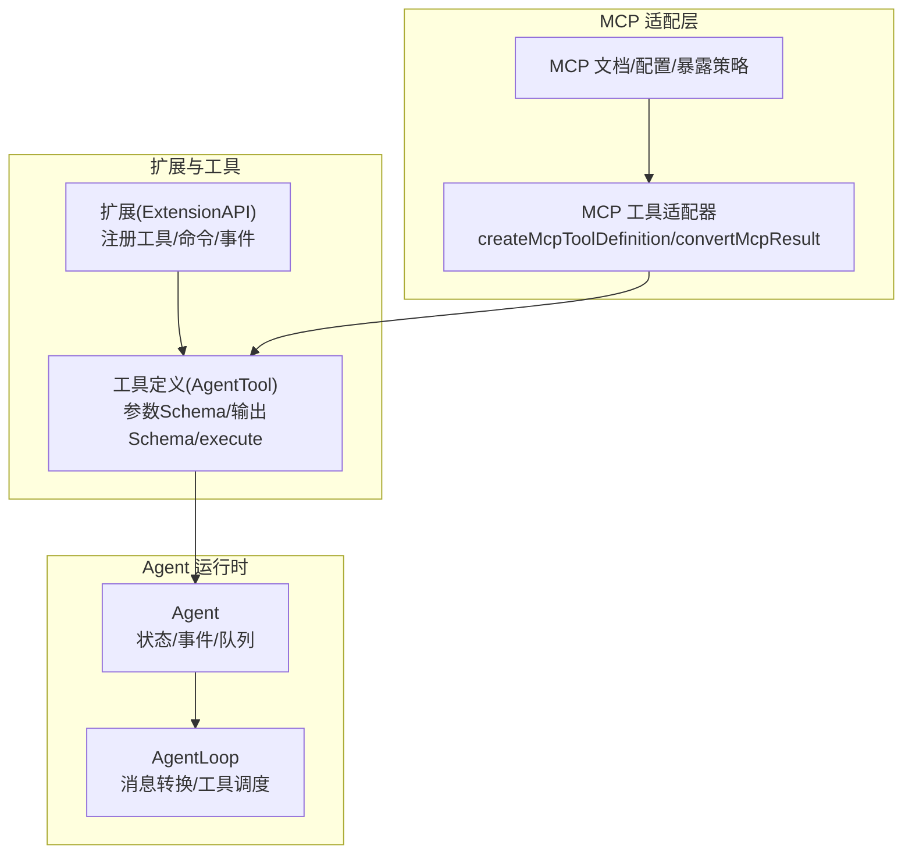
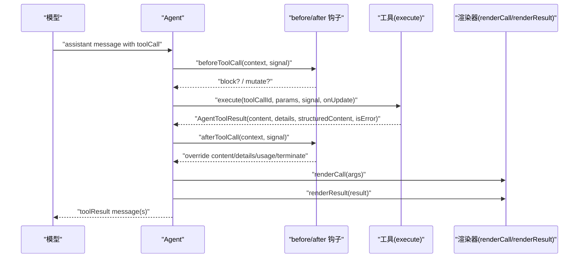
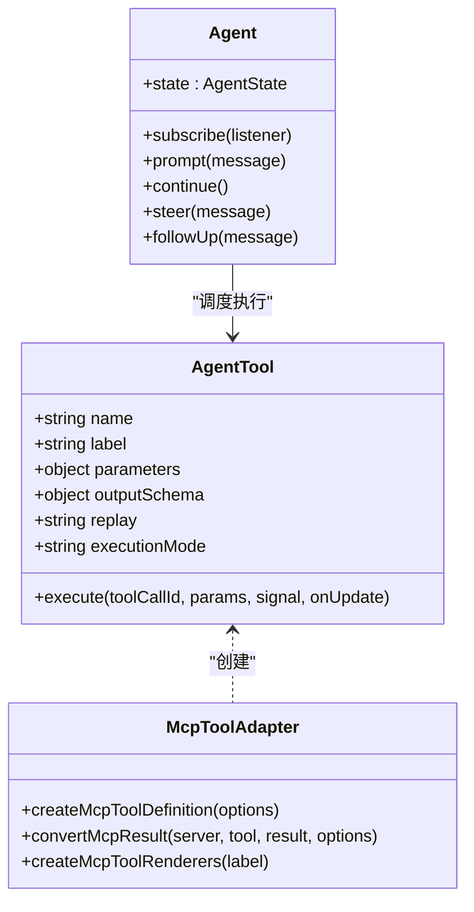

# 自定义工具开发

<cite>
**本文引用的文件**   
- [packages/agent/src/types.ts](https://github.com/FDE-GROUP/oh-my-coding-agent/blob/omca/packages/agent/src/types.ts)
- [packages/agent/src/agent.ts](https://github.com/FDE-GROUP/oh-my-coding-agent/blob/omca/packages/agent/src/agent.ts)
- [packages/coding-agent/docs/extensions.md](https://github.com/FDE-GROUP/oh-my-coding-agent/blob/omca/packages/coding-agent/docs/extensions.md)
- [packages/coding-agent/src/extensions/mcp/tools.ts](https://github.com/FDE-GROUP/oh-my-coding-agent/blob/omca/packages/coding-agent/src/extensions/mcp/tools.ts)
- [packages/coding-agent/docs/mcp.md](https://github.com/FDE-GROUP/oh-my-coding-agent/blob/omca/packages/coding-agent/docs/mcp.md)
- [packages/codemode/src/identifier.ts](https://github.com/FDE-GROUP/oh-my-coding-agent/blob/omca/packages/codemode/src/identifier.ts)
- [packages/mcp/test/naming.test.ts](https://github.com/FDE-GROUP/oh-my-coding-agent/blob/omca/packages/mcp/test/naming.test.ts)
- [README.md](https://github.com/FDE-GROUP/oh-my-coding-agent/blob/omca/README.md)
</cite>

## 目录
1. [引言](#引言)
2. [项目结构](#项目结构)
3. [核心组件](#核心组件)
4. [架构总览](#架构总览)
5. [详细组件分析](#详细组件分析)
6. [依赖关系分析](#依赖关系分析)
7. [性能考虑](#性能考虑)
8. [故障排查指南](#故障排查指南)
9. [结论](#结论)
10. [附录：从 Hello World 到文件系统工具的完整示例路径](#附录从-hello-world-到文件系统工具的完整示例路径)

## 引言
本指南面向希望为 Pi 平台开发“自定义工具”的工程师与扩展作者。内容覆盖工具定义 Schema、权限控制、错误处理、性能优化、生命周期管理、上下文访问、结果渲染，以及从简单 Hello World 到复杂文件系统操作的完整示例路径、调试技巧、测试方法与发布流程。

Pi 的工具体系由 Agent 运行时（AgentTool）与扩展系统（ExtensionAPI）共同支撑；同时提供 MCP 工具适配层，将外部 MCP 服务暴露为可被模型调用的工具。

## 项目结构
围绕自定义工具的关键代码分布在以下位置：
- Agent 运行时类型与执行流：packages/agent/src/types.ts、packages/agent/src/agent.ts
- 扩展系统与工具注册：packages/coding-agent/docs/extensions.md
- MCP 工具适配与渲染：packages/coding-agent/src/extensions/mcp/tools.ts、packages/coding-agent/docs/mcp.md
- 工具命名与标识符：packages/codemode/src/identifier.ts、packages/mcp/test/naming.test.ts
- 安全与容器化建议：README.md

图表来源
- [packages/agent/src/types.ts:474-511](https://github.com/FDE-GROUP/oh-my-coding-agent/blob/omca/packages/agent/src/types.ts#L474-L511)
- [packages/agent/src/agent.ts:194-263](https://github.com/FDE-GROUP/oh-my-coding-agent/blob/omca/packages/agent/src/agent.ts#L194-L263)
- [packages/coding-agent/src/extensions/mcp/tools.ts:249-289](https://github.com/FDE-GROUP/oh-my-coding-agent/blob/omca/packages/coding-agent/src/extensions/mcp/tools.ts#L249-L289)
- [packages/coding-agent/docs/mcp.md:191-236](https://github.com/FDE-GROUP/oh-my-coding-agent/blob/omca/packages/coding-agent/docs/mcp.md#L191-L236)

章节来源
- [packages/agent/src/types.ts:474-511](https://github.com/FDE-GROUP/oh-my-coding-agent/blob/omca/packages/agent/src/types.ts#L474-L511)
- [packages/agent/src/agent.ts:194-263](https://github.com/FDE-GROUP/oh-my-coding-agent/blob/omca/packages/agent/src/agent.ts#L194-L263)
- [packages/coding-agent/src/extensions/mcp/tools.ts:249-289](https://github.com/FDE-GROUP/oh-my-coding-agent/blob/omca/packages/coding-agent/src/extensions/mcp/tools.ts#L249-L289)
- [packages/coding-agent/docs/mcp.md:191-236](https://github.com/FDE-GROUP/oh-my-coding-agent/blob/omca/packages/coding-agent/docs/mcp.md#L191-L236)

## 核心组件
- AgentTool：Agent 运行时的工具契约，包含 label、description、parameters(JSON Schema)、outputSchema、execute、replay、executionMode 等字段。
- Agent：Agent 实例，持有会话消息、工具集合、事件订阅、队列（steer/followUp）、请求配置、工具执行模式等。
- ExtensionAPI：扩展 API，用于注册工具、命令、事件监听、UI 交互、MCP 服务器等。
- MCP 工具适配器：将 MCP 服务的工具与资源映射为 AgentTool，并负责结果裁剪、临时文件保存、渲染器注入。

章节来源
- [packages/agent/src/types.ts:474-511](https://github.com/FDE-GROUP/oh-my-coding-agent/blob/omca/packages/agent/src/types.ts#L474-L511)
- [packages/agent/src/agent.ts:194-263](https://github.com/FDE-GROUP/oh-my-coding-agent/blob/omca/packages/agent/src/agent.ts#L194-L263)
- [packages/coding-agent/docs/extensions.md:1-32](https://github.com/FDE-GROUP/oh-my-coding-agent/blob/omca/packages/coding-agent/docs/extensions.md#L1-L32)
- [packages/coding-agent/src/extensions/mcp/tools.ts:249-289](https://github.com/FDE-GROUP/oh-my-coding-agent/blob/omca/packages/coding-agent/src/extensions/mcp/tools.ts#L249-L289)

## 架构总览
下图展示一次典型的“模型调用工具”的端到端流程：模型返回 toolCall → Agent 调度 → beforeToolCall/afterToolCall 钩子 → execute 执行 → 结果渲染与结构化内容。

图表来源
- [packages/agent/src/types.ts:319-341](https://github.com/FDE-GROUP/oh-my-coding-agent/blob/omca/packages/agent/src/types.ts#L319-L341)
- [packages/agent/src/types.ts:424-511](https://github.com/FDE-GROUP/oh-my-coding-agent/blob/omca/packages/agent/src/types.ts#L424-L511)
- [packages/coding-agent/src/extensions/mcp/tools.ts:291-329](https://github.com/FDE-GROUP/oh-my-coding-agent/blob/omca/packages/coding-agent/src/extensions/mcp/tools.ts#L291-L329)

## 详细组件分析

### 工具定义与 Schema 设计
- 参数 Schema：使用 JSON Schema（TypeBox 构建），在 AgentTool.parameters 中声明。扩展文档说明 pi-schema 会进行严格校验，并提供类型提示与错误信息。
- 输出 Schema：通过 AgentTool.outputSchema 描述结构化结果（structuredContent），便于程序化消费。
- 兼容性准备：AgentTool.prepareArguments 可在校验前对原始参数做兼容转换。

实践要点
- 使用 TypeBox 构建 parameters，确保必填项、枚举、格式等约束清晰。
- 若工具返回结构化数据，务必声明 outputSchema，并在 execute 中设置 structuredContent。
- 对于历史参数或宽松输入，实现 prepareArguments 以归一化为强类型参数。

章节来源
- [packages/agent/src/types.ts:474-511](https://github.com/FDE-GROUP/oh-my-coding-agent/blob/omca/packages/agent/src/types.ts#L474-L511)
- [packages/coding-agent/docs/extensions.md:172-184](https://github.com/FDE-GROUP/oh-my-coding-agent/blob/omca/packages/coding-agent/docs/extensions.md#L172-L184)

### 权限控制与工具暴露
- 扩展侧拦截：通过 extension 的 tool_call 事件可拦截、阻止或修改工具调用，适合实现权限门控（如危险命令确认）。
- MCP 工具暴露策略：server.exposure 决定模型如何发现与调用工具（codemode/deferred/direct/hidden），并可按工具名精确覆盖 toolExposure。
- 注解提示：MCP 工具支持 readOnlyHint/destructiveHint/idempotentHint/openWorldHint，可用于权限策略判断。

实践要点
- 在扩展中使用 tool_call 事件实现细粒度权限控制，必要时结合 UI 交互确认。
- 合理选择 MCP 暴露策略：小工具集用 direct，大型服务用 deferred/codemode，隐藏敏感工具用 hidden。
- 利用注解提示辅助权限决策，例如对 destructiveHint 的工具要求二次确认。

章节来源
- [packages/coding-agent/docs/extensions.md:1-32](https://github.com/FDE-GROUP/oh-my-coding-agent/blob/omca/packages/coding-agent/docs/extensions.md#L1-L32)
- [packages/coding-agent/docs/mcp.md:191-236](https://github.com/FDE-GROUP/oh-my-coding-agent/blob/omca/packages/coding-agent/docs/mcp.md#L191-L236)
- [packages/coding-agent/src/extensions/mcp/tools.ts:237-247](https://github.com/FDE-GROUP/oh-my-coding-agent/blob/omca/packages/coding-agent/src/extensions/mcp/tools.ts#L237-L247)

### 错误处理机制
- 工具执行失败：execute 应抛出异常或返回 { isError: true }，避免仅在 content 中描述错误。
- 钩子覆盖：afterToolCall 可替换 content/details/isError/usage/terminate，统一错误呈现与结构化记录。
- MCP 结果转换：convertMcpResult 将 isError 转为 AgentToolResult.isError，并对空文本错误补充提示。

实践要点
- 始终区分“业务错误”和“系统错误”，在 structuredContent 中保留机器可读的错误码与详情。
- 在 afterToolCall 中对敏感信息进行脱敏或摘要，避免泄露日志。
- 对 MCP 长文本结果，使用 limitMcpContent 裁剪并保存全文至临时文件，同时在 result.details 中提供 fullOutputPath。

章节来源
- [packages/agent/src/types.ts:424-511](https://github.com/FDE-GROUP/oh-my-coding-agent/blob/omca/packages/agent/src/types.ts#L424-L511)
- [packages/coding-agent/src/extensions/mcp/tools.ts:214-235](https://github.com/FDE-GROUP/oh-my-coding-agent/blob/omca/packages/coding-agent/src/extensions/mcp/tools.ts#L214-L235)

### 性能优化策略
- 工具执行模式：AgentLoopConfig.toolExecution 支持 sequential/parallel；单工具也可通过 executionMode 覆盖。
- 流式更新：execute 支持 onUpdate 回调，逐步推送部分结果，提升交互体验。
- 结果裁剪与临时文件：MCP 文本超过阈值时自动裁剪并写盘，避免大对象进入上下文。
- 并行预检：并行模式下先顺序预检工具调用，再并发执行，最终结果按助手源顺序发出。

实践要点
- 对 I/O 密集型工具采用 parallel 模式，但注意幂等性；对状态变更工具谨慎使用 parallel。
- 使用 onUpdate 推送进度与中间结果，配合 UI 显示“进行中”。
- 对超大输出使用 saveToTempFile 与 limitMcpContent，减少上下文占用。

章节来源
- [packages/agent/src/types.ts:308-317](https://github.com/FDE-GROUP/oh-my-coding-agent/blob/omca/packages/agent/src/types.ts#L308-L317)
- [packages/agent/src/types.ts:457-511](https://github.com/FDE-GROUP/oh-my-coding-agent/blob/omca/packages/agent/src/types.ts#L457-L511)
- [packages/coding-agent/src/extensions/mcp/tools.ts:205-235](https://github.com/FDE-GROUP/oh-my-coding-agent/blob/omca/packages/coding-agent/src/extensions/mcp/tools.ts#L205-L235)

### 生命周期管理与上下文访问
- 工具生命周期：tool_execution_start → tool_call → tool_execution_update → tool_result → tool_execution_end。
- 钩子上下文：beforeToolCallContext/AfterToolCallContext 提供 assistantMessage、toolCall、args、result、context 等。
- Agent 状态：state.tools/messages/systemPrompt/model/thinkingLevel/pendingToolCalls/streamingMessage 等。
- 队列与引导：steer/followUp 可注入后续消息；finishTurn/prepareNextTurn 可控制下一轮行为。

实践要点
- 在 beforeToolCall 中进行鉴权、审计、参数规范化；在 afterToolCall 中修正结果、统计用量。
- 使用 context.messages/context.tools 读取当前会话与可用工具，避免硬编码。
- 使用 finishTurn/prepareNextTurn 实现“工作完成后继续下一步”的编排逻辑。

章节来源
- [packages/coding-agent/docs/extensions.md:307-425](https://github.com/FDE-GROUP/oh-my-coding-agent/blob/omca/packages/coding-agent/docs/extensions.md#L307-L425)
- [packages/agent/src/types.ts:106-180](https://github.com/FDE-GROUP/oh-my-coding-agent/blob/omca/packages/agent/src/types.ts#L106-L180)
- [packages/agent/src/agent.ts:285-342](https://github.com/FDE-GROUP/oh-my-coding-agent/blob/omca/packages/agent/src/agent.ts#L285-L342)

### 结果渲染机制
- 渲染器接口：renderCall 渲染调用过程，renderResult 渲染结果。
- MCP 渲染器：createMcpToolRenderers 提供默认渲染，包括折叠预览、颜色样式、完整输出路径提示。
- 图片与二进制：toModelContent 将 image/resource_link/resource 转换为模型可见内容；非图片二进制保存到临时文件。

实践要点
- 自定义 renderCall/renderResult 以提升可读性，尤其是结构化数据的可视化。
- 对大文本结果使用 VisualLinePreview 折叠显示，并提供展开入口。
- 对二进制资源提供下载链接或路径提示，方便用户查看。

章节来源
- [packages/coding-agent/src/extensions/mcp/tools.ts:291-329](https://github.com/FDE-GROUP/oh-my-coding-agent/blob/omca/packages/coding-agent/src/extensions/mcp/tools.ts#L291-L329)
- [packages/coding-agent/src/extensions/mcp/tools.ts:172-212](https://github.com/FDE-GROUP/oh-my-coding-agent/blob/omca/packages/coding-agent/src/extensions/mcp/tools.ts#L172-L212)

### 工具命名与标识符
- MCP 工具命名：mcp__<server>__<tool>，非法字符替换为下划线；超长名称加哈希后缀以避免冲突。
- Codemode 标识符：toCodemodeIdentifier 将工具名转换为 JS 标识符（非法字符替换为下划线）。

实践要点
- 遵循命名规范，避免冲突；对长工具名使用哈希后缀保证稳定性。
- 在脚本中通过 searchTools()/describeNamespace() 动态发现工具，不硬编码名称。

章节来源
- [packages/mcp/test/naming.test.ts:1-37](https://github.com/FDE-GROUP/oh-my-coding-agent/blob/omca/packages/mcp/test/naming.test.ts#L1-L37)
- [packages/codemode/src/identifier.ts:1-12](https://github.com/FDE-GROUP/oh-my-coding-agent/blob/omca/packages/codemode/src/identifier.ts#L1-L12)

## 依赖关系分析
- AgentTool 是扩展与 MCP 适配层的共同目标类型。
- Agent 作为运行时中枢，协调消息、工具、钩子与事件。
- MCP 适配器依赖 pi-mcp 能力（normalizeMcpInputSchema、limitMcpContent、toLlmContent）与 TUI 渲染组件。

图表来源
- [packages/agent/src/types.ts:474-511](https://github.com/FDE-GROUP/oh-my-coding-agent/blob/omca/packages/agent/src/types.ts#L474-L511)
- [packages/agent/src/agent.ts:194-263](https://github.com/FDE-GROUP/oh-my-coding-agent/blob/omca/packages/agent/src/agent.ts#L194-L263)
- [packages/coding-agent/src/extensions/mcp/tools.ts:249-289](https://github.com/FDE-GROUP/oh-my-coding-agent/blob/omca/packages/coding-agent/src/extensions/mcp/tools.ts#L249-L289)

章节来源
- [packages/agent/src/types.ts:474-511](https://github.com/FDE-GROUP/oh-my-coding-agent/blob/omca/packages/agent/src/types.ts#L474-L511)
- [packages/agent/src/agent.ts:194-263](https://github.com/FDE-GROUP/oh-my-coding-agent/blob/omca/packages/agent/src/agent.ts#L194-L263)
- [packages/coding-agent/src/extensions/mcp/tools.ts:249-289](https://github.com/FDE-GROUP/oh-my-coding-agent/blob/omca/packages/coding-agent/src/extensions/mcp/tools.ts#L249-L289)

## 性能考虑
- 工具执行模式：优先使用 parallel 提升吞吐，但对有副作用的工具谨慎评估并发安全性。
- 流式更新：onUpdate 可减少首屏等待时间，提升用户体验。
- 结果裁剪：限制文本长度，避免上下文膨胀；二进制资源落盘，避免内存压力。
- 钩子开销：before/after 钩子应避免阻塞，必要时异步处理。

[本节为通用指导，无需具体文件引用]

## 故障排查指南
- 工具未执行：检查 beforeToolCall 是否 block；确认工具名称与暴露策略正确。
- 结果过大：确认 limitMcpContent 已启用，fullOutputPath 是否存在。
- 权限拒绝：检查扩展 tool_call 钩子逻辑；确认 MCP exposure/toolExposure 配置。
- 命名冲突：核对 mcp__<server>__<tool> 命名规则与哈希后缀。

章节来源
- [packages/coding-agent/docs/extensions.md:307-425](https://github.com/FDE-GROUP/oh-my-coding-agent/blob/omca/packages/coding-agent/docs/extensions.md#L307-L425)
- [packages/coding-agent/docs/mcp.md:191-236](https://github.com/FDE-GROUP/oh-my-coding-agent/blob/omca/packages/coding-agent/docs/mcp.md#L191-L236)
- [packages/mcp/test/naming.test.ts:1-37](https://github.com/FDE-GROUP/oh-my-coding-agent/blob/omca/packages/mcp/test/naming.test.ts#L1-L37)

## 结论
通过 AgentTool 契约、扩展系统与 MCP 适配层，Pi 提供了强大而灵活的自定义工具生态。开发者可基于 JSON Schema 定义参数与输出，借助扩展钩子实现权限控制与结果定制，并通过合理的执行模式与结果裁剪策略优化性能。遵循本文档的实践要点，可快速构建从简单到复杂的工具，并确保其可观测、可维护、可扩展。

[本节为总结性内容，无需具体文件引用]

## 附录：从 Hello World 到文件系统工具的完整示例路径

- Hello World 工具
  - 参考扩展文档中的 Quick Start 示例，使用 ExtensionAPI.registerTool 注册 greet 工具，参数使用 Type.Object 定义，execute 返回文本内容。
  - 章节来源
    - [packages/coding-agent/docs/extensions.md:68-119](https://github.com/FDE-GROUP/oh-my-coding-agent/blob/omca/packages/coding-agent/docs/extensions.md#L68-L119)

- 带权限控制的工具
  - 在扩展中监听 tool_call 事件，对特定工具（如 bash rm -rf）弹出确认框，返回 { block: true, reason } 阻止执行。
  - 章节来源
    - [packages/coding-agent/docs/extensions.md:72-113](https://github.com/FDE-GROUP/oh-my-coding-agent/blob/omca/packages/coding-agent/docs/extensions.md#L72-L113)

- 复杂文件系统操作工具（MCP 方式）
  - 使用 MCP 服务器（如 filesystem server），通过 pi mcp add 添加，配置 exposure 与 toolExposure，按需暴露 read/write/ls/grep 等工具。
  - 在扩展中可通过 createMcpToolDefinition 将 MCP 工具映射为 AgentTool，并使用 convertMcpResult 处理结果与错误。
  - 章节来源
    - [packages/coding-agent/docs/mcp.md:1-29](https://github.com/FDE-GROUP/oh-my-coding-agent/blob/omca/packages/coding-agent/docs/mcp.md#L1-L29)
    - [packages/coding-agent/docs/mcp.md:30-84](https://github.com/FDE-GROUP/oh-my-coding-agent/blob/omca/packages/coding-agent/docs/mcp.md#L30-L84)
    - [packages/coding-agent/src/extensions/mcp/tools.ts:249-289](https://github.com/FDE-GROUP/oh-my-coding-agent/blob/omca/packages/coding-agent/src/extensions/mcp/tools.ts#L249-L289)

- 调试技巧
  - 使用 /reload 热重载扩展；在扩展中打印日志或使用 ctx.ui.notify 提示状态。
  - 使用 pi mcp list 诊断 MCP 连接与工具暴露。
  - 章节来源
    - [packages/coding-agent/docs/extensions.md:1-32](https://github.com/FDE-GROUP/oh-my-coding-agent/blob/omca/packages/coding-agent/docs/extensions.md#L1-L32)
    - [packages/coding-agent/docs/mcp.md:86-103](https://github.com/FDE-GROUP/oh-my-coding-agent/blob/omca/packages/coding-agent/docs/mcp.md#L86-L103)

- 测试方法
  - 针对工具参数校验，编写单元测试验证 schema 约束与 prepareArguments 兼容性。
  - 针对 MCP 工具，使用命名测试验证 createMcpToolName 与 mcpNamespace 的行为。
  - 章节来源
    - [packages/mcp/test/naming.test.ts:1-37](https://github.com/FDE-GROUP/oh-my-coding-agent/blob/omca/packages/mcp/test/naming.test.ts#L1-L37)

- 发布流程
  - 将扩展打包为 Pi 包（npm/git），在 settings.json 中声明 extensions 或 packages。
  - 使用 scripts/use-local-packages.mjs 在外部项目中本地联调。
  - 章节来源
    - [README.md:113-153](https://github.com/FDE-GROUP/oh-my-coding-agent/blob/omca/README.md#L113-L153)