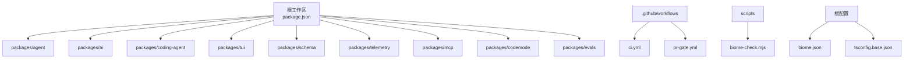
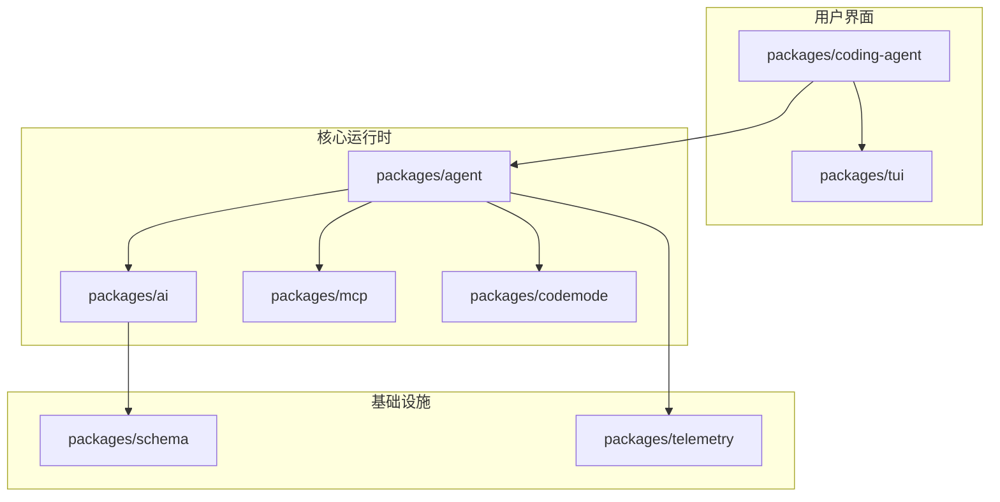
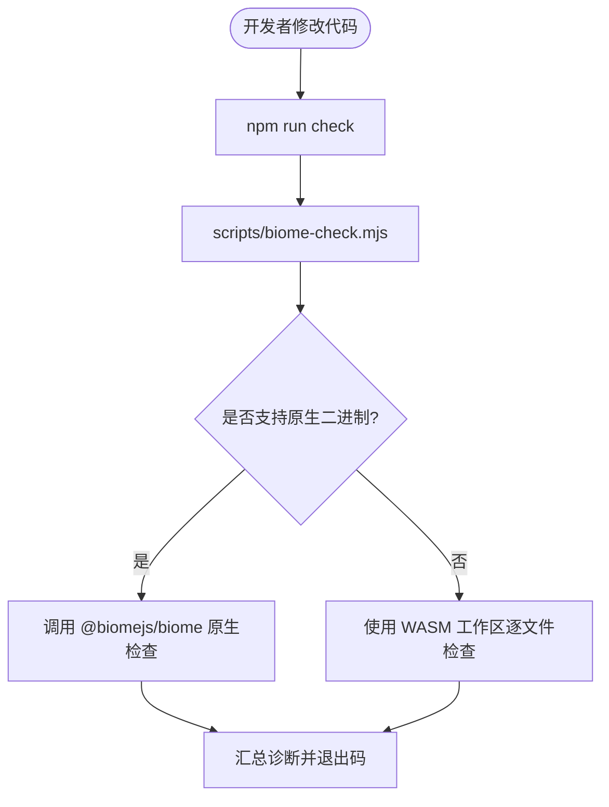
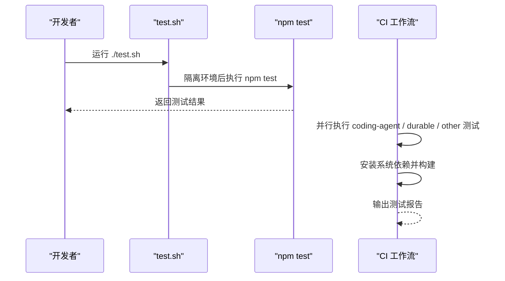
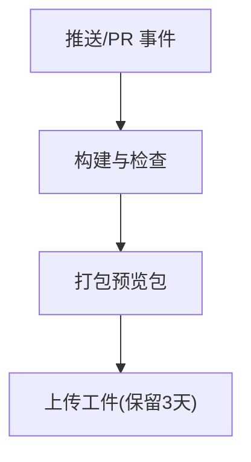
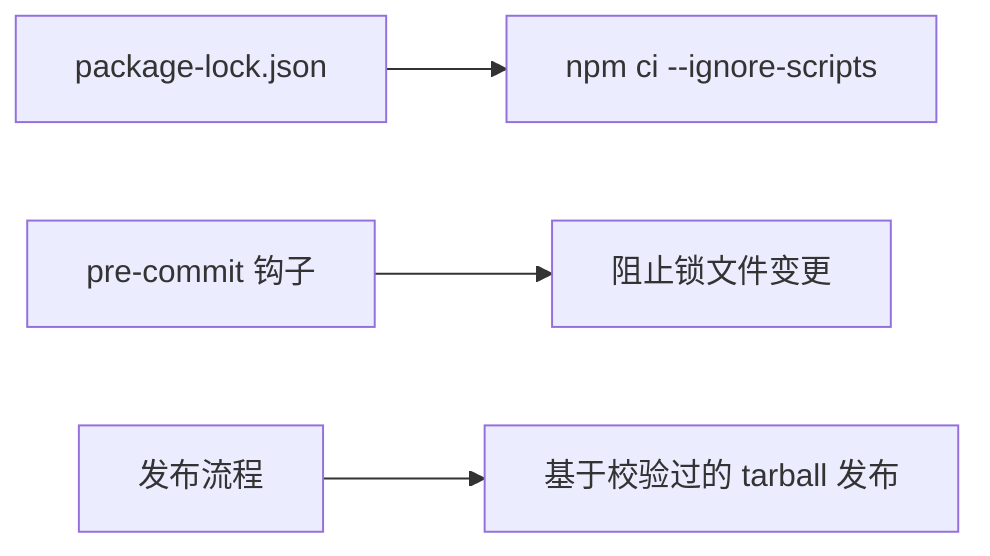
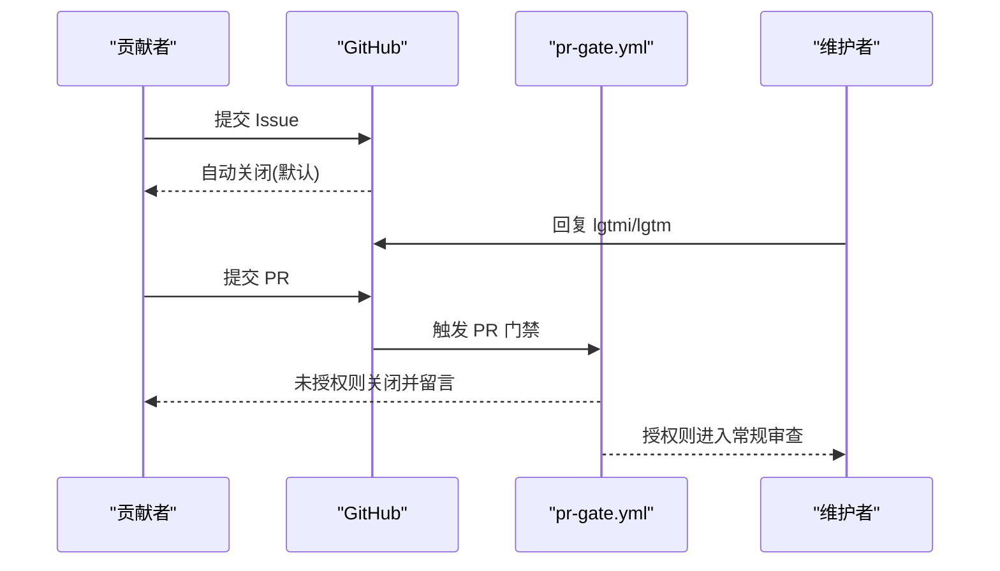

# 开发者指南

<cite>
**本文引用的文件**   
- [CONTRIBUTING.md](https://github.com/FDE-GROUP/oh-my-fde/blob/omca/CONTRIBUTING.md)
- [README.md](https://github.com/FDE-GROUP/oh-my-fde/blob/omca/README.md)
- [AGENTS.md](https://github.com/FDE-GROUP/oh-my-fde/blob/omca/AGENTS.md)
- [package.json](https://github.com/FDE-GROUP/oh-my-fde/blob/omca/package.json)
- [biome.json](https://github.com/FDE-GROUP/oh-my-fde/blob/omca/biome.json)
- [tsconfig.base.json](https://github.com/FDE-GROUP/oh-my-fde/blob/omca/tsconfig.base.json)
- [.github/workflows/ci.yml](https://github.com/FDE-GROUP/oh-my-fde/blob/omca/.github/workflows/ci.yml)
- [.github/workflows/pr-gate.yml](https://github.com/FDE-GROUP/oh-my-fde/blob/omca/.github/workflows/pr-gate.yml)
- [scripts/biome-check.mjs](https://github.com/FDE-GROUP/oh-my-fde/blob/omca/scripts/biome-check.mjs)
- [test.sh](https://github.com/FDE-GROUP/oh-my-fde/blob/omca/test.sh)
</cite>

## 目录
1. [简介](#简介)
2. [项目结构](#项目结构)
3. [核心组件](#核心组件)
4. [架构总览](#架构总览)
5. [详细组件分析](#详细组件分析)
6. [依赖分析](#依赖分析)
7. [性能与内存优化](#性能与内存优化)
8. [调试与排错](#调试与排错)
9. [开发环境与工具](#开发环境与工具)
10. [贡献流程与审查标准](#贡献流程与审查标准)
11. [结论](#结论)

## 简介
本指南面向希望为 Pi 代码库贡献的开发者，覆盖代码规范、提交约定、Pull Request 流程、代码审查标准、架构原则与设计模式、最佳实践、调试技巧、性能分析与内存泄漏检测、常见问题解决方案，以及开发环境配置、IDE 设置和效率工具推荐。Pi 是一个最小化且可扩展的智能体运行框架，强调“核心极简、扩展优先”的设计哲学。

## 项目结构
仓库采用 monorepo 组织，核心包位于 packages 下，脚本位于 scripts，CI 工作流位于 .github/workflows，根级配置文件包括 package.json、biome.json、tsconfig.base.json 等。

图表来源
- [package.json:1-75](https://github.com/FDE-GROUP/oh-my-fde/blob/omca/package.json#L1-L75)
- [.github/workflows/ci.yml:1-130](https://github.com/FDE-GROUP/oh-my-fde/blob/omca/.github/workflows/ci.yml#L1-L130)
- [.github/workflows/pr-gate.yml:1-129](https://github.com/FDE-GROUP/oh-my-fde/blob/omca/.github/workflows/pr-gate.yml#L1-L129)
- [scripts/biome-check.mjs:1-124](https://github.com/FDE-GROUP/oh-my-fde/blob/omca/scripts/biome-check.mjs#L1-L124)
- [biome.json:1-46](https://github.com/FDE-GROUP/oh-my-fde/blob/omca/biome.json#L1-L46)
- [tsconfig.base.json:1-24](https://github.com/FDE-GROUP/oh-my-fde/blob/omca/tsconfig.base.json#L1-L24)

章节来源
- [README.md:72-86](https://github.com/FDE-GROUP/oh-my-fde/blob/omca/README.md#L72-L86)
- [package.json:1-75](https://github.com/FDE-GROUP/oh-my-fde/blob/omca/package.json#L1-L75)

## 核心组件
- 智能体运行时与工具调用：packages/agent
- 多提供商统一 LLM API：packages/ai
- 交互式编码智能体 CLI：packages/coding-agent
- 终端 UI 库（差分渲染）：packages/tui
- 遥测契约与参考适配器：packages/telemetry
- MCP 客户端与集成：packages/mcp
- 模型与协议 schema：packages/schema
- 代码执行模式：packages/codemode
- 评估套件：packages/evals

这些包通过 npm workspaces 统一管理，构建与检查命令在根 package.json 中编排。

章节来源
- [README.md:72-86](https://github.com/FDE-GROUP/oh-my-fde/blob/omca/README.md#L72-L86)
- [package.json:12-55](https://github.com/FDE-GROUP/oh-my-fde/blob/omca/package.json#L12-L55)

## 架构总览
Pi 的整体架构围绕“最小核心 + 可扩展生态”展开：CLI 驱动交互，Agent 负责状态与工具调度，AI 层抽象多提供商，TUI 提供终端界面，MCP 提供外部工具协议接入，Schema/Telemetry 提供契约与可观测性。

图表来源
- [README.md:72-86](https://github.com/FDE-GROUP/oh-my-fde/blob/omca/README.md#L72-L86)
- [package.json:12-55](https://github.com/FDE-GROUP/oh-my-fde/blob/omca/package.json#L12-L55)

## 详细组件分析

### 代码质量与风格
- 使用 Biome 进行 lint 与格式化，规则由 biome.json 管理；根脚本通过 scripts/biome-check.mjs 自动选择原生或 WASM 后端执行检查。
- TypeScript 编译选项集中在 tsconfig.base.json，启用严格模式、可擦除语法、Node16 模块解析等。

图表来源
- [scripts/biome-check.mjs:1-124](https://github.com/FDE-GROUP/oh-my-fde/blob/omca/scripts/biome-check.mjs#L1-L124)
- [biome.json:1-46](https://github.com/FDE-GROUP/oh-my-fde/blob/omca/biome.json#L1-L46)
- [tsconfig.base.json:1-24](https://github.com/FDE-GROUP/oh-my-fde/blob/omca/tsconfig.base.json#L1-L24)

章节来源
- [biome.json:1-46](https://github.com/FDE-GROUP/oh-my-fde/blob/omca/biome.json#L1-L46)
- [tsconfig.base.json:1-24](https://github.com/FDE-GROUP/oh-my-fde/blob/omca/tsconfig.base.json#L1-L24)
- [scripts/biome-check.mjs:1-124](https://github.com/FDE-GROUP/oh-my-fde/blob/omca/scripts/biome-check.mjs#L1-L124)

### 测试与验证
- 根脚本 test.sh 隔离环境变量后执行 npm test，避免真实 API Key 影响测试。
- CI 将测试拆分为多个并行 job，按 suite 分组执行，确保慢用例不阻塞流水线。

图表来源
- [test.sh:35-84](https://github.com/FDE-GROUP/oh-my-fde/blob/omca/test.sh#L35-L84)
- [.github/workflows/ci.yml:55-109](https://github.com/FDE-GROUP/oh-my-fde/blob/omca/.github/workflows/ci.yml#L55-L109)

章节来源
- [test.sh:35-84](https://github.com/FDE-GROUP/oh-my-fde/blob/omca/test.sh#L35-L84)
- [.github/workflows/ci.yml:55-109](https://github.com/FDE-GROUP/oh-my-fde/blob/omca/.github/workflows/ci.yml#L55-L109)

### 发布与预览包
- CI 对 main、release tag 和来自仓库分支的 PR 打包预览包并上传工件。
- 根脚本提供 preview-packages.mjs 用于本地生成预览包。

图表来源
- [.github/workflows/ci.yml:32-53](https://github.com/FDE-GROUP/oh-my-fde/blob/omca/.github/workflows/ci.yml#L32-L53)

章节来源
- [.github/workflows/ci.yml:32-53](https://github.com/FDE-GROUP/oh-my-fde/blob/omca/.github/workflows/ci.yml#L32-L53)

## 依赖分析
- 直接依赖精确锁定，workspace 内包保持版本范围；package-lock.json 作为依赖事实源。
- 预提交钩子阻止意外提交锁文件变更，除非显式允许。
- 安装与发布路径使用 --ignore-scripts 降低供应链风险。

图表来源
- [README.md:168-180](https://github.com/FDE-GROUP/oh-my-fde/blob/omca/README.md#L168-L180)
- [package.json:57-73](https://github.com/FDE-GROUP/oh-my-fde/blob/omca/package.json#L57-L73)

章节来源
- [README.md:168-180](https://github.com/FDE-GROUP/oh-my-fde/blob/omca/README.md#L168-L180)
- [package.json:57-73](https://github.com/FDE-GROUP/oh-my-fde/blob/omca/package.json#L57-L73)

## 性能与内存优化
- 渲染与分配基准：TUI 提供帧级基准，统计每帧分配字节数、耗时与写入字节数，便于定位渲染抖动与内存增长。
- 堆采样：通过 HeapProfiler.startSampling/stopSampling 采集分配热点，结合 per-frame 指标分析 GC 压力。
- 建议
  - 减少热路径上的对象创建与拷贝，复用数据结构。
  - 使用 WeakMap 缓存并按所有者键控，配合 GC 测试验证释放行为。
  - 对长列表渲染做增量更新与虚拟化，避免整树重绘。

章节来源
- [packages/tui/test/render-churn-bench.ts:116-158](https://github.com/FDE-GROUP/oh-my-fde/blob/omca/packages/tui/test/render-churn-bench.ts#L116-L158)

## 调试与排错
- 交互式模式测试：遵循 .pi/skills/interactive-testing.md 提供的 tmux 测试流程。
- 常见错误
  - 类型检查失败：优先升级依赖而非降级代码以绕过类型错误。
  - 动态导入限制：禁止 inline import()，统一使用顶层 import。
  - 资源路径：在 coding-agent 中通过 config.ts 辅助函数解析资产，避免直接使用 __dirname。
- 日志与通知：MCP 工具不可达时会在 UI 发出警告提示，帮助快速定位工具激活问题。

章节来源
- [AGENTS.md:15-29](https://github.com/FDE-GROUP/oh-my-fde/blob/omca/AGENTS.md#L15-L29)
- [packages/coding-agent/src/extensions/mcp/index.ts:517-536](https://github.com/FDE-GROUP/oh-my-fde/blob/omca/packages/coding-agent/src/extensions/mcp/index.ts#L517-L536)

## 开发环境与工具
- Node.js 版本要求：>=22.19.0。
- 常用命令
  - 安装依赖：npm install --ignore-scripts
  - 构建：npm run build / npm run build:offline
  - 检查：npm run check
  - 测试：./test.sh
  - 从源码运行 pi：./pi-test.sh
- IDE 与工作区
  - 使用 Biome 插件以获得一致的 lint/format 体验。
  - TypeScript 配置启用严格模式与 Node16 模块解析，建议在 IDE 中开启对应语言服务。
- 安全与供应链
  - 依赖变更视为代码变更，需评审；CI 定期运行 npm audit 与签名审计。
  - 预提交钩子保护锁文件一致性。

章节来源
- [README.md:102-111](https://github.com/FDE-GROUP/oh-my-fde/blob/omca/README.md#L102-L111)
- [README.md:168-180](https://github.com/FDE-GROUP/oh-my-fde/blob/omca/README.md#L168-L180)
- [package.json:67-73](https://github.com/FDE-GROUP/oh-my-fde/blob/omca/package.json#L67-L73)
- [biome.json:1-46](https://github.com/FDE-GROUP/oh-my-fde/blob/omca/biome.json#L1-L46)

## 贡献流程与审查标准
- 贡献门槛
  - 新贡献者的 issue/PR 默认自动关闭；维护者每日审核并重新打开符合质量标准的条目。
  - 获得 lgtm 后才可提交 PR；lgtmi 仅开放 issue 权限。
- 提交前自检
  - 必须通过 npm run check 与 ./test.sh。
  - 不要编辑 CHANGELOG.md，由维护者添加。
- 提交约定
  - 提交消息格式：{feat,fix,docs}[(ai,tui,agent,coding-agent)]: <message>
  - 只暂存自己修改的文件，禁止 git add -A/. 等危险操作。
- Pull Request 门禁
  - pr-gate.yml 会校验贡献者是否在受信任名单中，否则自动关闭 PR 并留言说明。
- 代码审查要点
  - 理解你的代码及其与系统的交互；拒绝无法解释的改动。
  - 遵循 Chord v2 代码风格与切片设计文档，保证职责单一、命名一致、无多余选项。
  - 成本与内存敏感路径需有明确理由与度量。

图表来源
- [CONTRIBUTING.md:21-35](https://github.com/FDE-GROUP/oh-my-fde/blob/omca/CONTRIBUTING.md#L21-L35)
- [.github/workflows/pr-gate.yml:1-129](https://github.com/FDE-GROUP/oh-my-fde/blob/omca/.github/workflows/pr-gate.yml#L1-L129)

章节来源
- [CONTRIBUTING.md:21-35](https://github.com/FDE-GROUP/oh-my-fde/blob/omca/CONTRIBUTING.md#L21-L35)
- [CONTRIBUTING.md:56-71](https://github.com/FDE-GROUP/oh-my-fde/blob/omca/CONTRIBUTING.md#L56-L71)
- [AGENTS.md:69-114](https://github.com/FDE-GROUP/oh-my-fde/blob/omca/AGENTS.md#L69-L114)
- [.github/workflows/pr-gate.yml:1-129](https://github.com/FDE-GROUP/oh-my-fde/blob/omca/.github/workflows/pr-gate.yml#L1-L129)

## 结论
本指南总结了 Pi 项目的代码规范、提交流程、PR 门禁、审查标准与最佳实践，并提供了性能与内存优化的方向、调试方法与开发环境配置建议。遵循“核心极简、扩展优先”的原则，结合严格的依赖与安全检查，有助于维持代码库的可维护性与稳定性。贡献者在提交前务必完成自检并通过 CI 门禁，确保高质量协作。