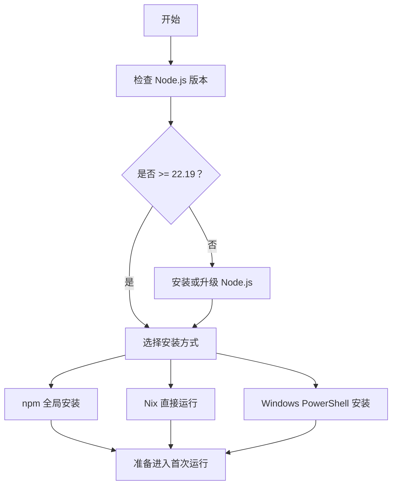
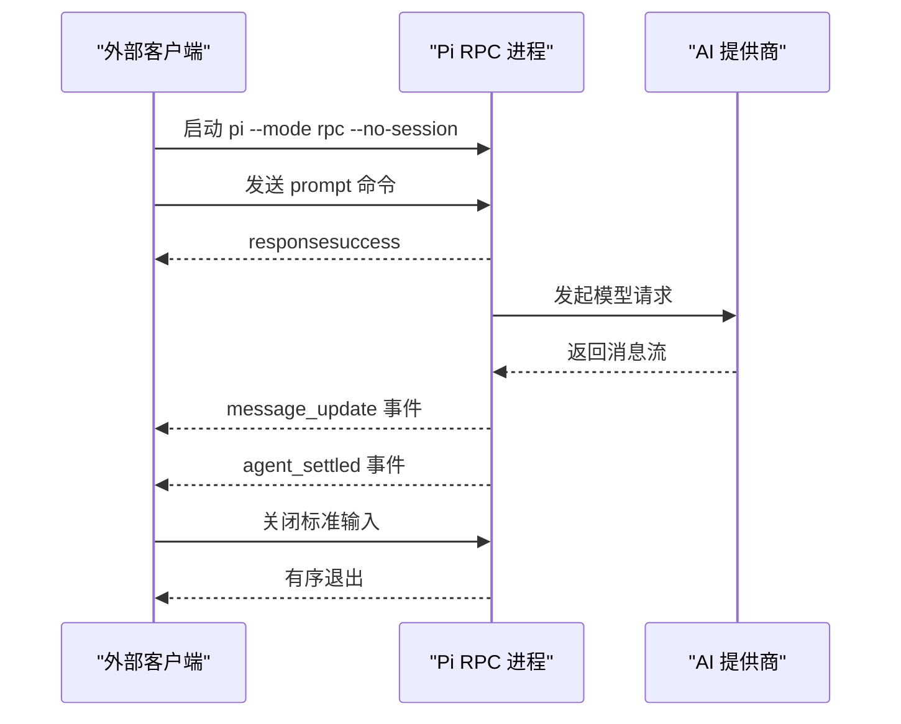
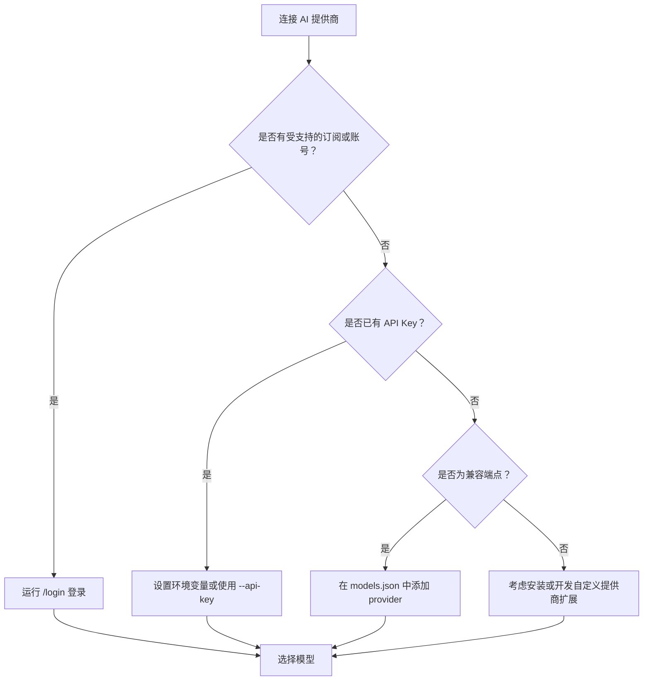
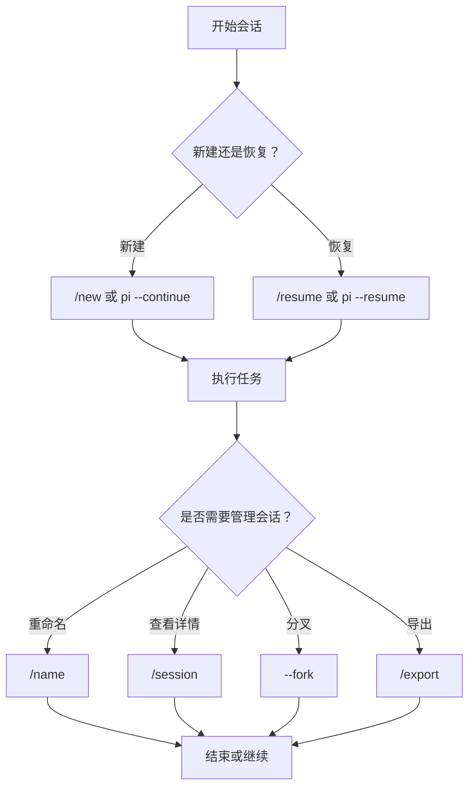

# 快速开始

<cite>
**本文引用的文件**   
- [README.md](https://github.com/FDE-GROUP/oh-my-coding-agent/blob/omca/README.md)
- [package.json](https://github.com/FDE-GROUP/oh-my-coding-agent/blob/omca/package.json)
- [cli.md](https://github.com/FDE-GROUP/oh-my-coding-agent/blob/omca/packages/coding-agent/docs/cli.md)
- [usage.md](https://github.com/FDE-GROUP/oh-my-coding-agent/blob/omca/packages/coding-agent/docs/usage.md)
- [rpc.md](https://github.com/FDE-GROUP/oh-my-coding-agent/blob/omca/packages/coding-agent/docs/rpc.md)
- [configuration.md](https://github.com/FDE-GROUP/oh-my-coding-agent/blob/omca/packages/coding-agent/docs/configuration.md)
- [models.md](https://github.com/FDE-GROUP/oh-my-coding-agent/blob/omca/packages/coding-agent/docs/models.md)
</cite>

## 目录
1. [简介](#简介)
2. [环境要求](#环境要求)
3. [安装 Pi](#安装-pi)
4. [首次运行与基本配置](#首次运行与基本配置)
5. [三种入门模式](#三种入门模式)
6. [连接 AI 提供商](#连接-ai-提供商)
7. [执行第一个任务](#执行第一个任务)
8. [会话管理基础](#会话管理基础)
9. [常见问题排查](#常见问题排查)
10. [下一步](#下一步)

## 简介
Pi 是一个轻量、可扩展的 Agent 工具，你可以把它当作终端里的编程助手：交互式对话、脚本化输出、进程间 RPC 控制都可以直接使用。它支持内置 AI 提供商、本地模型兼容接口、MCP 工具、扩展、技能、提示模板和主题，并允许通过 npm 或 Git 分享自定义包。

对于新用户，建议按以下顺序完成：
- 确认 Node.js 版本满足要求。
- 选择一种安装方式：npm 全局安装、Nix 直接运行，或 Windows PowerShell 安装。
- 在目标项目目录下启动 `pi`。
- 通过 `/login` 连接一个 AI 提供商。
- 输入第一个任务，观察交互、打印或 RPC 行为。

## 环境要求
- **Node.js 版本**：需要 Node.js 22.19 或更高版本。
- **操作系统**：macOS、Linux、Windows 均可；Nix 构建支持 ARM64 与 x86-64。
- **权限说明**：默认情况下，Pi 以启动它的用户和进程权限运行，不会自动限制文件系统、进程、网络或凭据访问。如果需要更强隔离，应使用容器或沙箱。



**图表来源** 
- [README.md:43-64](https://github.com/FDE-GROUP/oh-my-coding-agent/blob/omca/README.md#L43-L64)
- [package.json:67-68](https://github.com/FDE-GROUP/oh-my-coding-agent/blob/omca/package.json#L67-L68)

**章节来源**
- [README.md:43-64](https://github.com/FDE-GROUP/oh-my-coding-agent/blob/omca/README.md#L43-L64)
- [package.json:67-68](https://github.com/FDE-GROUP/oh-my-coding-agent/blob/omca/package.json#L67-L68)

## 安装 Pi
### 方式一：npm 全局安装
适合已经熟悉 npm 的用户。该方式不锁定传递依赖，但正常安装不需要生命周期脚本。

推荐命令：
```bash
npm install -g --ignore-scripts @earendil-works/pi-coding-agent
```

如果你希望使用官方安装器，也可以先运行安装脚本，再使用 `pi update` 更新。

### 方式二：Nix 直接运行
适合希望从源码构建、离线模型数据固定或通过 Nix 管理的用户。

常用命令：
```bash
nix run github:earendil-works/pi/stable
```

你也可以把稳定版加入 profile，并通过 profile 升级：
```bash
nix profile add github:earendil-works/pi/stable
nix profile upgrade pi
```

如果只想固定某个发布版本，可以使用带标签的地址，例如：
```bash
nix run github:earendil-works/pi/v1.0.0
```

Nix 构建是离线的，内置模型数据来自仓库中固定的模型目录版本；运行时仍会像往常一样叠加 pi.dev 上的最新目录数据。若需要刷新 Nix 使用的目录固定版本，可运行：
```bash
npm run update:model-catalog-pin
```

### 方式三：Windows PowerShell 安装
Windows 用户可通过 PowerShell 安装脚本安装。

推荐命令：
```powershell
powershell -c "irm https://pi.dev/install.ps1 | iex"
```

安装完成后，同样可以在任意项目目录下运行 `pi`。

**章节来源**
- [README.md:25-43](https://github.com/FDE-GROUP/oh-my-coding-agent/blob/omca/README.md#L25-L43)
- [README.md:56-70](https://github.com/FDE-GROUP/oh-my-coding-agent/blob/omca/README.md#L56-L70)

## 首次运行与基本配置
### 启动 Pi
进入你想让 Pi 工作的项目目录，然后运行：
```bash
cd /path/to/project
pi
```

Pi 会从当前工作目录发现文件、指令和配置，并把保存的会话按目录分组。首次进入时，Pi 可能会询问你是否信任该项目目录，这是为了决定是否加载项目本地的配置和资源。

### 用户级配置位置
用户级配置默认位于 agent 目录，通常是 `~/.pi/agent`。常见文件包括：
- `settings.json`：用户设置、默认值、资源路径、包声明等。
- `auth.json`：已保存的 API Key 或 OAuth 凭据。
- `models.json`：兼容端点、模型和模型覆盖配置。
- `mcp.json`：每个项目可用的 MCP 服务器。
- `AGENTS.md`、`CLAUDE.md`、`SYSTEM.md`、`APPEND_SYSTEM.md`：系统提示和用户指令。

### 项目级配置位置
项目级配置位于工作目录下的 `.pi` 目录，并在授予“项目信任”后加载。常见文件包括：
- `.pi/settings.json`：项目设置、资源路径、包声明。
- `.pi/mcp.json`：项目级 MCP 服务器。
- `.pi/SYSTEM.md`、`.pi/APPEND_SYSTEM.md`：项目级系统提示。
- `.pi/extensions/`、`.pi/skills/`、`.pi/prompts/`、`.pi/themes/`：项目扩展、技能、提示模板、主题。

### 交互式命令入口
在交互模式中，输入 `/` 可以搜索可用命令。常用命令包括：
- `/model`：选择模型。
- `/thinking`：选择推理强度。
- `/login`、`/logout`：管理提供商登录。
- `/settings`：修改常见偏好。
- `/new`、`/resume`、`/name`、`/session`：会话管理。

**章节来源**
- [README.md:45-54](https://github.com/FDE-GROUP/oh-my-coding-agent/blob/omca/README.md#L45-L54)
- [usage.md:1-10](https://github.com/FDE-GROUP/oh-my-coding-agent/blob/omca/packages/coding-agent/docs/usage.md#L1-L10)
- [usage.md:44-64](https://github.com/FDE-GROUP/oh-my-coding-agent/blob/omca/packages/coding-agent/docs/usage.md#L44-L64)
- [configuration.md:1-38](https://github.com/FDE-GROUP/oh-my-coding-agent/blob/omca/packages/coding-agent/docs/configuration.md#L1-L38)

## 三种入门模式
Pi 提供四种主要界面：交互式、打印、JSON、RPC。快速开始重点介绍前三种。

| 模式 | 适用场景 | 生命周期 |
|---|---|---|
| 交互式 | 人在终端里直接与 Pi 对话 | 直到用户退出 |
| 打印 | 脚本只需要最终文本结果 | 一次调用后退出 |
| JSON | 程序需要结构化事件流 | 一次调用后退出 |
| RPC | 外部进程需要双向控制 Pi | 长驻进程 |

### 交互式模式
直接运行 `pi` 即可进入终端 UI。它会显示你的提示、Pi 的回答、工具调用、结果和错误，并在底部显示当前文件夹、会话、模型、上下文用量和累计成本。

典型用法：
```bash
pi
```

在交互模式中，你可以：
- 输入请求并按回车发送。
- 使用 `@` 添加文件或图片。
- 使用 `/model`、`/thinking`、`/login`、`/settings` 调整行为。
- 使用 `/new`、`/resume`、`/continue` 管理会话。

### 打印模式
打印模式适合脚本、管道和一次性任务。它会运行提供的提示，把最终助手文本写入标准输出，然后退出。

典型用法：
```bash
pi --print "Summarize this repository"
```

也可以配合管道使用：
```bash
git diff | pi --print "Review this change"
```

### RPC 模式
RPC 模式把 Pi 作为长期子进程运行，通过标准输入和标准输出的 JSONL 记录进行控制。它适合语言无关集成、进程隔离、IDE 或自定义客户端。

启动 RPC 模式：
```bash
pi --mode rpc --no-session
```

RPC 模式下：
- 标准输入接收命令。
- 标准输出返回响应、会话事件和扩展 UI 记录。
- 不支持通过命令行参数传入 `@file` 提示，需要通过命令发送消息。
- 成功响应只表示命令被接受，不代表模型任务已完成；需要继续消费事件，等待 `agent_settled` 表示低层 Agent 运行结束。



**图表来源** 
- [rpc.md:12-20](https://github.com/FDE-GROUP/oh-my-coding-agent/blob/omca/packages/coding-agent/docs/rpc.md#L12-L20)
- [rpc.md:58-71](https://github.com/FDE-GROUP/oh-my-coding-agent/blob/omca/packages/coding-agent/docs/rpc.md#L58-L71)
- [rpc.md:91-98](https://github.com/FDE-GROUP/oh-my-coding-agent/blob/omca/packages/coding-agent/docs/rpc.md#L91-L98)

**章节来源**
- [cli.md:21-53](https://github.com/FDE-GROUP/oh-my-coding-agent/blob/omca/packages/coding-agent/docs/cli.md#L21-L53)
- [cli-integration.md:1-18](https://github.com/FDE-GROUP/oh-my-coding-agent/blob/omca/packages/coding-agent/docs/cli-integration.md#L1-L18)
- [rpc.md:1-20](https://github.com/FDE-GROUP/oh-my-coding-agent/blob/omca/packages/coding-agent/docs/rpc.md#L1-L20)
- [rpc.md:58-98](https://github.com/FDE-GROUP/oh-my-coding-agent/blob/omca/packages/coding-agent/docs/rpc.md#L58-L98)

## 连接 AI 提供商
### 使用内置提供商登录
如果你已有支持的订阅或账号，可以在交互模式中运行：
```
/login
```

Pi 会引导你完成登录流程，并把凭据保存到 `auth.json`。登录后，你就可以选择模型并开始任务。

### 使用 API Key
如果你更倾向于使用环境变量或 CI 环境，可以为对应提供商设置 API Key。Pi 会优先使用运行时 `--api-key`，其次读取 `auth.json`，再读取 `models.json` 中的 apiKey，最后回退到环境变量或云环境凭据。

### 连接兼容端点
如果你的服务支持 OpenAI、Anthropic 或 Google 兼容接口，可以在 `models.json` 中添加 provider 配置。例如 Ollama、LM Studio、vLLM、SGLang 等通常可以通过兼容端点接入。

关键要点：
- 内置提供商优先用 `/login`。
- 自定义端点优先用 `models.json`。
- 凭据敏感信息请保持私有，不要提交到不受信任的项目中。



**图表来源** 
- [models.md:5-25](https://github.com/FDE-GROUP/oh-my-coding-agent/blob/omca/packages/coding-agent/docs/models.md#L5-L25)
- [configuration.md:11-24](https://github.com/FDE-GROUP/oh-my-coding-agent/blob/omca/packages/coding-agent/docs/configuration.md#L11-L24)

**章节来源**
- [README.md:52-54](https://github.com/FDE-GROUP/oh-my-coding-agent/blob/omca/README.md#L52-L54)
- [models.md:5-25](https://github.com/FDE-GROUP/oh-my-coding-agent/blob/omca/packages/coding-agent/docs/models.md#L5-L25)
- [models.md:45-79](https://github.com/FDE-GROUP/oh-my-coding-agent/blob/omca/packages/coding-agent/docs/models.md#L45-L79)
- [configuration.md:11-24](https://github.com/FDE-GROUP/oh-my-coding-agent/blob/omca/packages/coding-agent/docs/configuration.md#L11-L24)

## 执行第一个任务
### 交互式任务示例
1. 在项目目录下运行 `pi`。
2. 如果尚未登录，运行 `/login` 并选择一个提供商。
3. 输入一个简单任务，例如：
   - “总结这个项目的结构。”
   - “帮我查看当前 git 状态。”
   - “解释这段代码的作用。”
4. 观察 Pi 的工具调用、思考过程和最终回答。

### 打印任务示例
如果你只需要最终文本，可以使用打印模式：
```bash
pi --print "Summarize this repository"
```

### RPC 任务示例
RPC 模式下，你需要：
1. 启动 `pi --mode rpc --no-session`。
2. 向标准输入写入一条 prompt 命令。
3. 从标准输出读取 response 和事件。
4. 等待 `agent_settled` 表示一次运行结束。
5. 关闭标准输入以优雅退出。

**章节来源**
- [usage.md:11-27](https://github.com/FDE-GROUP/oh-my-coding-agent/blob/omca/packages/coding-agent/docs/usage.md#L11-L27)
- [cli.md:21-53](https://github.com/FDE-GROUP/oh-my-coding-agent/blob/omca/packages/coding-agent/docs/cli.md#L21-L53)
- [rpc.md:12-20](https://github.com/FDE-GROUP/oh-my-coding-agent/blob/omca/packages/coding-agent/docs/rpc.md#L12-L20)
- [rpc.md:58-71](https://github.com/FDE-GROUP/oh-my-coding-agent/blob/omca/packages/coding-agent/docs/rpc.md#L58-L71)

## 会话管理基础
Pi 会自动保存会话，除非显式禁用会话持久化。

常用操作：
- `/new`：新建会话。
- `/resume`：打开另一个已保存会话。
- `/name`：为当前会话命名。
- `/session`：查看会话文件、ID、消息数量、token 用量和成本。
- `pi --continue`：从相同目录恢复最近会话。
- `pi --fork <path|id>`：将现有会话分叉到新会话。
- `pi --session <path|id>`：通过文件或 ID 打开会话。
- `pi --no-session`：使用内存会话，不持久化。



**图表来源** 
- [usage.md:55-66](https://github.com/FDE-GROUP/oh-my-coding-agent/blob/omca/packages/coding-agent/docs/usage.md#L55-L66)
- [cli.md:78-109](https://github.com/FDE-GROUP/oh-my-coding-agent/blob/omca/packages/coding-agent/docs/cli.md#L78-L109)

**章节来源**
- [usage.md:55-66](https://github.com/FDE-GROUP/oh-my-coding-agent/blob/omca/packages/coding-agent/docs/usage.md#L55-L66)
- [cli.md:78-109](https://github.com/FDE-GROUP/oh-my-coding-agent/blob/omca/packages/coding-agent/docs/cli.md#L78-L109)

## 常见问题排查
### 无法找到模型
- 确认所选提供商有可用的认证。
- 如果是 llama.cpp 本地模型，只有路由器当前加载的模型才会出现。
- 如果是兼容端点，检查 `models.json` 中的 API 类型和兼容性设置。

### 登录只在某个 Shell 生效
- 检查 API Key 是否来自环境变量。
- 环境变量必须存在于启动 Pi 的进程中。

### 远程机器上登录会打开浏览器
- 使用提供商提供的无头认证流程。
- 某些提供商支持粘贴最终重定向 URL 或授权码。

### 兼容端点拒绝请求
- 检查 `models.json` 中的 API 类型和兼容性字段。
- 上游服务器必须支持对应的请求字段和行为。

### 调试终端渲染或会话状态
在交互模式中运行 `/debug`，Pi 会把渲染后的终端行和当前会话消息写入 `pi-debug.log`。注意该日志可能包含提示、模型回复、工具输出、文件内容和终端数据，分享前请审查。

**章节来源**
- [models.md:210-227](https://github.com/FDE-GROUP/oh-my-coding-agent/blob/omca/packages/coding-agent/docs/models.md#L210-L227)
- [usage.md:90-94](https://github.com/FDE-GROUP/oh-my-coding-agent/blob/omca/packages/coding-agent/docs/usage.md#L90-L94)

## 下一步
- 阅读完整文档：[https://pi.dev/docs/latest](https://pi.dev/docs/latest)
- 探索模型选择、提供商配置、MCP 工具、扩展、技能和主题。
- 在自动化场景中尝试 JSON 模式和 RPC 模式。
- 如需更强安全边界，参考容器化和沙箱方案。