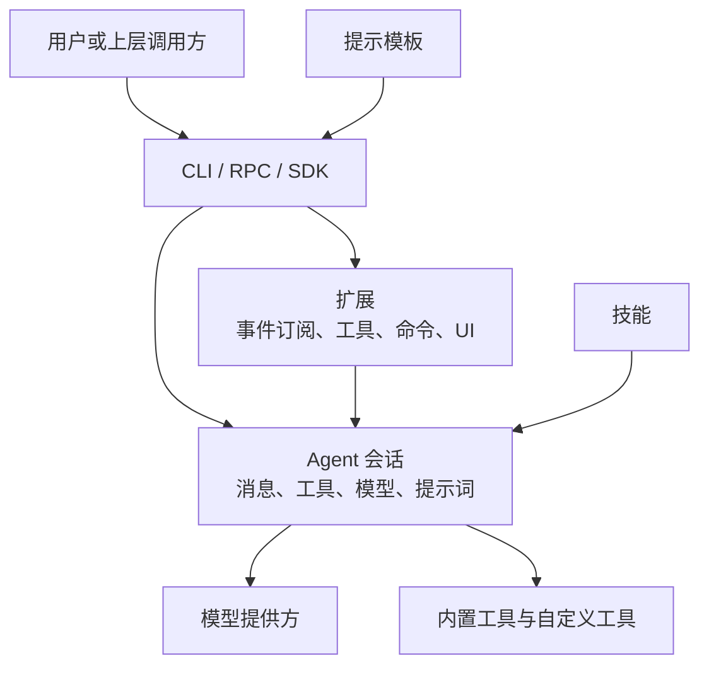
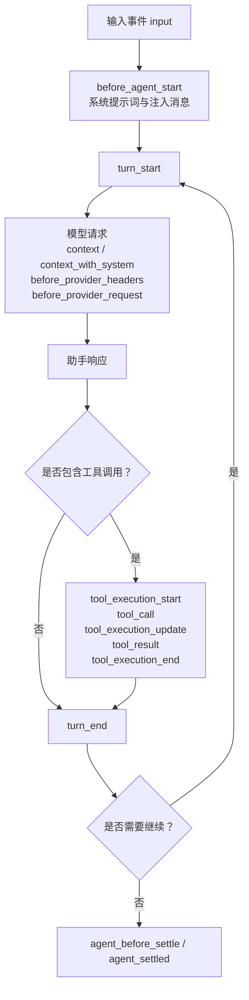
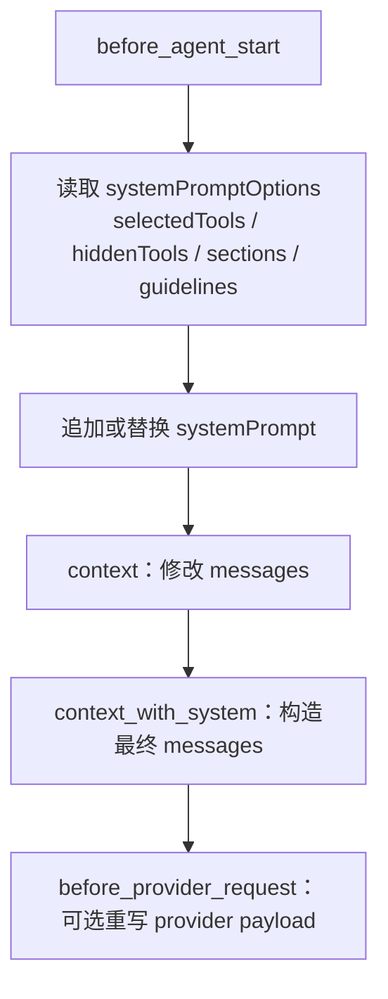
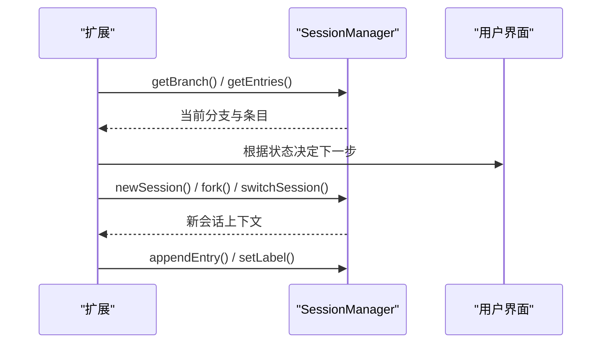
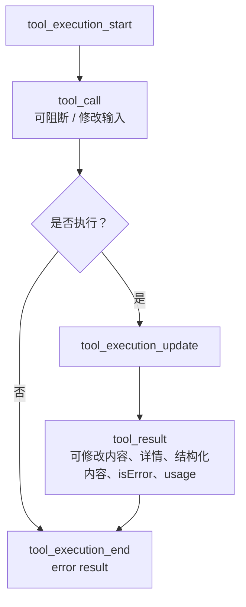
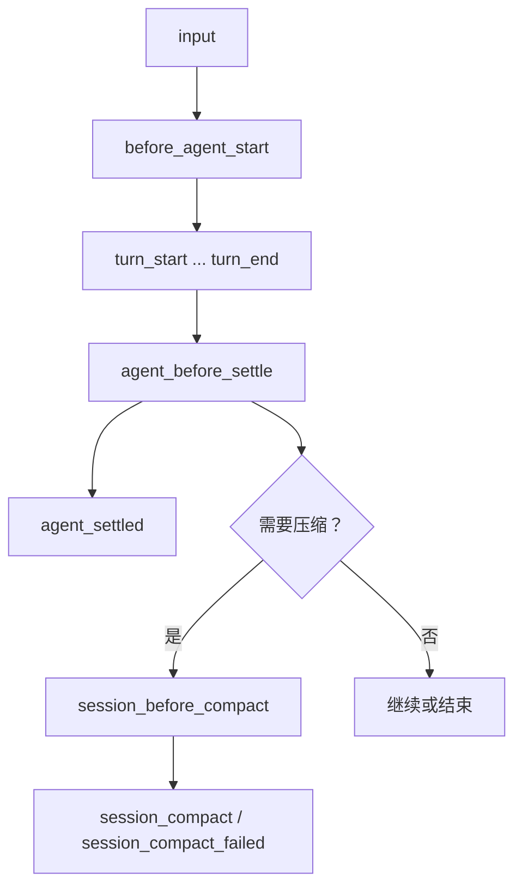
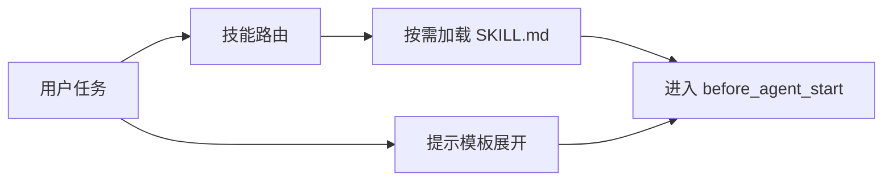
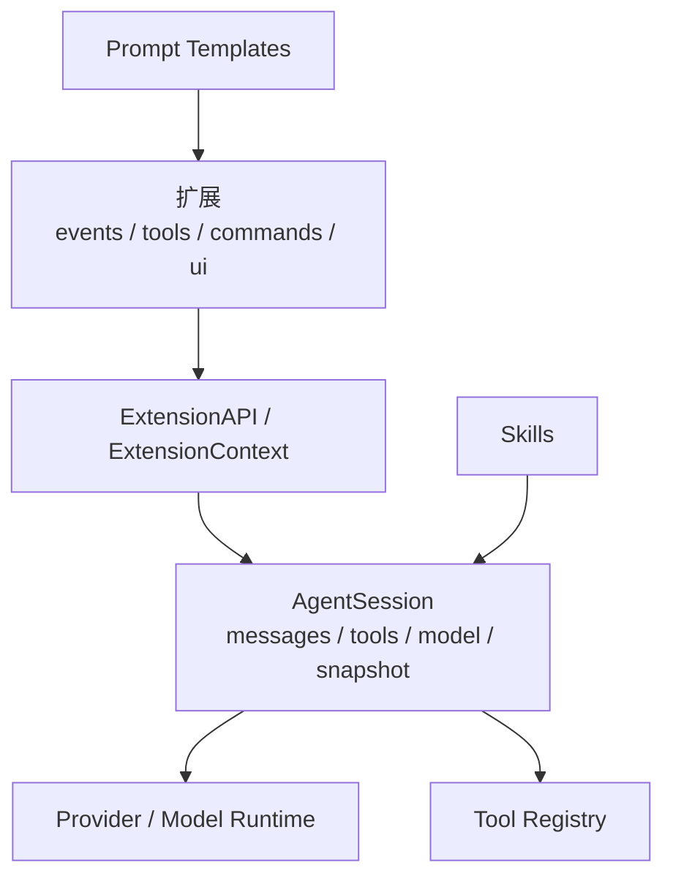

# 工作流定制

<cite>
**本文引用的文件**   
- [README.md](https://github.com/FDE-GROUP/oh-my-fde/blob/omca/README.md)
- [extensions.md](https://github.com/FDE-GROUP/oh-my-fde/blob/omca/packages/coding-agent/docs/extensions.md)
- [skills.md](https://github.com/FDE-GROUP/oh-my-fde/blob/omca/packages/coding-agent/docs/skills.md)
- [prompt-templates.md](https://github.com/FDE-GROUP/oh-my-fde/blob/omca/packages/coding-agent/docs/prompt-templates.md)
- [extensions/README.md](https://github.com/FDE-GROUP/oh-my-fde/blob/omca/packages/coding-agent/examples/extensions/README.md)
- [reviewer.md](https://github.com/FDE-GROUP/oh-my-fde/blob/omca/packages/coding-agent/examples/extensions/subagent/agents/reviewer.md)
- [worker.md](https://github.com/FDE-GROUP/oh-my-fde/blob/omca/packages/coding-agent/examples/extensions/subagent/agents/worker.md)
- [pr.md](https://github.com/FDE-GROUP/oh-my-fde/blob/omca/.pi/prompts/pr.md)
- [agent-session.ts](https://github.com/FDE-GROUP/oh-my-fde/blob/omca/packages/coding-agent/src/core/agent-session.ts)
- [agent-session-concurrent.test.ts](https://github.com/FDE-GROUP/oh-my-fde/blob/omca/packages/coding-agent/test/agent-session-concurrent.test.ts)
- [system-prompt-updates.test.ts](https://github.com/FDE-GROUP/oh-my-fde/blob/omca/packages/coding-agent/test/system-prompt-updates.test.ts)
</cite>

## 目录
1. [引言](#引言)
2. [项目结构](#项目结构)
3. [核心组件](#核心组件)
4. [架构总览](#架构总览)
5. [详细组件分析](#详细组件分析)
6. [依赖关系分析](#依赖关系分析)
7. [性能与可扩展性](#性能与可扩展性)
8. [故障排查指南](#故障排查指南)
9. [结论](#结论)
10. [附录：常见工作流模式实现示例](#附录常见工作流模式实现示例)

## 引言
本文面向希望基于 Pi 扩展 Agent 工作流的开发者，系统说明如何通过扩展机制定制 Agent 的工作流程，包括：
- 系统提示词定制
- 会话状态管理
- 工具执行流程控制
- 工作流钩子、条件判断与分支处理
- 常见工作流模式的实现思路（代码审查、自动化部署等）
- 工作流的测试与监控方法

Pi 的定位是“最小且可定制的 Agent 运行框架”，通过扩展、技能、提示模板和主题等方式适配你的工作流，而不是让工作流去适应固定能力。你可以交互式使用、在 CLI 中自动化、通过 RPC 控制，或使用 TypeScript SDK 构建应用。

**章节来源**
- [README.md:13-21](https://github.com/FDE-GROUP/oh-my-fde/blob/omca/README.md#L13-L21)

## 项目结构
从工作流定制的角度，仓库中与扩展和工作流最相关的部分集中在 `packages/coding-agent`：
- `docs/extensions.md`：扩展 API、事件生命周期、钩子、上下文、工具注册、命令、UI、MCP、错误处理、模式行为等完整文档。
- `docs/skills.md`：技能规范，用于按任务类型动态加载指令与辅助资源。
- `docs/prompt-templates.md`：提示模板，将 Markdown 转为可复用的 `/` 命令。
- `examples/extensions/`：大量可直接参考的扩展示例，涵盖权限门控、Git 集成、自定义工具、命令与 UI、系统提示词、消息渲染、外部依赖等。
- `src/core/agent-session.ts`：Agent 会话运行时核心，负责消息投影、工具注册表、系统提示词选项、会话快照等。
- 测试文件：覆盖并发会话、系统提示词稳定性、工具声明序列化等关键行为。

**图表来源**
- [extensions.md:5-32](https://github.com/FDE-GROUP/oh-my-fde/blob/omca/packages/coding-agent/docs/extensions.md#L5-L32)
- [skills.md:1-9](https://github.com/FDE-GROUP/oh-my-fde/blob/omca/packages/coding-agent/docs/skills.md#L1-L9)
- [prompt-templates.md:1-6](https://github.com/FDE-GROUP/oh-my-fde/blob/omca/packages/coding-agent/docs/prompt-templates.md#L1-L6)
- [agent-session.ts:501-515](https://github.com/FDE-GROUP/oh-my-fde/blob/omca/packages/coding-agent/src/core/agent-session.ts#L501-L515)

**章节来源**
- [extensions.md:5-32](https://github.com/FDE-GROUP/oh-my-fde/blob/omca/packages/coding-agent/docs/extensions.md#L5-L32)
- [skills.md:1-9](https://github.com/FDE-GROUP/oh-my-fde/blob/omca/packages/coding-agent/docs/skills.md#L1-L9)
- [prompt-templates.md:1-6](https://github.com/FDE-GROUP/oh-my-fde/blob/omca/packages/coding-agent/docs/prompt-templates.md#L1-L6)
- [agent-session.ts:501-515](https://github.com/FDE-GROUP/oh-my-fde/blob/omca/packages/coding-agent/src/core/agent-session.ts#L501-L515)

## 核心组件
围绕工作流定制，核心能力可以归纳为以下五类：

| 维度 | 能力 | 主要入口 |
|---|---|---|
| 扩展与事件 | 订阅生命周期、拦截工具调用、注入上下文、自定义压缩、持久化会话条目 | `pi.on(...)`、`ExtensionContext` |
| 工具执行控制 | 修改参数、阻断调用、修改结果、观测执行过程 | `tool_call`、`tool_result`、`tool_execution_*` |
| 系统提示词定制 | 追加/替换系统提示词、结构化提示词选项、工具规则 | `before_agent_start`、`context`、`context_with_system` |
| 会话状态管理 | 读取当前分支、树导航、会话切换、分叉、克隆、压缩 | `ctx.sessionManager`、`ctx.fork()`、`ctx.switchSession()` |
| 输入与工作流编排 | 拦截原始输入、技能与模板展开、命令路由、继续下一轮 | `input`、`turn_end`、`agent_before_settle` |

这些能力共同构成“工作流钩子 + 条件判断 + 分支处理”的基础设施。

**章节来源**
- [extensions.md:307-425](https://github.com/FDE-GROUP/oh-my-fde/blob/omca/packages/coding-agent/docs/extensions.md#L307-L425)
- [extensions.md:613-750](https://github.com/FDE-GROUP/oh-my-fde/blob/omca/packages/coding-agent/docs/extensions.md#L613-L750)
- [extensions.md:815-929](https://github.com/FDE-GROUP/oh-my-fde/blob/omca/packages/coding-agent/docs/extensions.md#L815-L929)
- [extensions.md:969-1159](https://github.com/FDE-GROUP/oh-my-fde/blob/omca/packages/coding-agent/docs/extensions.md#L969-L1159)
- [extensions.md:1161-1512](https://github.com/FDE-GROUP/oh-my-fde/blob/omca/packages/coding-agent/docs/extensions.md#L1161-L1512)

## 架构总览
下图展示一次典型 Agent 运行的工作流控制点：

**图表来源**
- [extensions.md:311-371](https://github.com/FDE-GROUP/oh-my-fde/blob/omca/packages/coding-agent/docs/extensions.md#L311-L371)
- [extensions.md:815-929](https://github.com/FDE-GROUP/oh-my-fde/blob/omca/packages/coding-agent/docs/extensions.md#L815-L929)
- [extensions.md:969-1159](https://github.com/FDE-GROUP/oh-my-fde/blob/omca/packages/coding-agent/docs/extensions.md#L969-L1159)
- [extensions.md:613-750](https://github.com/FDE-GROUP/oh-my-fde/blob/omca/packages/coding-agent/docs/extensions.md#L613-L750)

## 详细组件分析

### 系统提示词定制
系统提示词是 Agent 行为的“全局指令层”。Pi 提供结构化选项与多阶段钩子，使扩展可以在不同粒度上定制提示词：

- `before_agent_start`：在每个 run 开始前，可注入持久消息、追加或替换系统提示词，并访问结构化提示词选项，如当前激活工具、隐藏工具、工具片段、工具规则、自定义段落、工作目录、上下文文件、已加载技能等。
- `context`：每次 LLM 调用前，可非破坏性地修改对话消息；Pi 会回放 prompt 与工具声明到新的 system message 中，避免过滤掉关键上下文。
- `context_with_system`：在 `context` 之后运行，持有完整 transcript，包括 leading system message 与 mid-conversation prompt/tool patch；返回的消息即为本次请求实际发送的内容。
- `before_provider_request`：可在 provider 具体 payload 构建完成后重写请求体，适合调试 provider 序列化或缓存行为。

**图表来源**
- [extensions.md:613-659](https://github.com/FDE-GROUP/oh-my-fde/blob/omca/packages/coding-agent/docs/extensions.md#L613-L659)
- [extensions.md:815-844](https://github.com/FDE-GROUP/oh-my-fde/blob/omca/packages/coding-agent/docs/extensions.md#L815-L844)
- [extensions.md:864-879](https://github.com/FDE-GROUP/oh-my-fde/blob/omca/packages/coding-agent/docs/extensions.md#L864-L879)

实践要点：
- 优先修改结构化选项，例如 `sections`、`selectedTools`、`promptGuidelines`，以便 Pi 只增量更新变化的部分。
- 如果需要完全替换系统提示词，可使用 `forceSystemPrompt` 或直接返回 `systemPrompt`，但要注意这会带来 provider 缓存 miss。
- 若需要精确控制发送给 provider 的最终消息，应使用 `context_with_system`，并确保 index 0 保留 system message。

**章节来源**
- [extensions.md:613-659](https://github.com/FDE-GROUP/oh-my-fde/blob/omca/packages/coding-agent/docs/extensions.md#L613-L659)
- [extensions.md:815-844](https://github.com/FDE-GROUP/oh-my-fde/blob/omca/packages/coding-agent/docs/extensions.md#L815-L844)
- [extensions.md:864-879](https://github.com/FDE-GROUP/oh-my-fde/blob/omca/packages/coding-agent/docs/extensions.md#L864-L879)

### 会话状态管理
会话是工作流状态的载体。扩展可通过 `ctx.sessionManager` 读取当前会话、分支、树节点、条目，并通过命令级 API 创建新会话、分叉、克隆、切换会话、导航树节点。

关键能力：
- 读取会话：`getCwd()`、`getSessionId()`、`getEntries()`、`getBranch()`、`getTree()`、`buildContextEntries()`、`buildSessionProjection()`。
- 会话操作：`newSession()`、`fork()`、`clone()`、`switchSession()`、`navigateTree()`。
- 会话生命周期：`session_start`、`session_shutdown`、`session_before_switch`、`session_before_fork`、`session_info_changed`。
- 状态持久化：通过工具结果的 `details` 字段持久化状态，并在 `session_start` 时从历史条目重建内存状态。

**图表来源**
- [extensions.md:1203-1214](https://github.com/FDE-GROUP/oh-my-fde/blob/omca/packages/coding-agent/docs/extensions.md#L1203-L1214)
- [extensions.md:1337-1444](https://github.com/FDE-GROUP/oh-my-fde/blob/omca/packages/coding-agent/docs/extensions.md#L1337-L1444)
- [extensions.md:469-611](https://github.com/FDE-GROUP/oh-my-fde/blob/omca/packages/coding-agent/docs/extensions.md#L469-L611)

注意事项：
- 会话替换后，旧 `ctx` 与旧 `sessionManager` 对象失效，必须在 `withSession` 回调中使用新上下文。
- 工具结果中的 `details` 会被持久化，适合跨 fork/clone 的状态恢复。
- 复杂状态建议以“可序列化数据 + 重建逻辑”的方式维护，避免持有不可序列化的运行时对象。

**章节来源**
- [extensions.md:1203-1214](https://github.com/FDE-GROUP/oh-my-fde/blob/omca/packages/coding-agent/docs/extensions.md#L1203-L1214)
- [extensions.md:1337-1444](https://github.com/FDE-GROUP/oh-my-fde/blob/omca/packages/coding-agent/docs/extensions.md#L1337-L1444)
- [extensions.md:469-611](https://github.com/FDE-GROUP/oh-my-fde/blob/omca/packages/coding-agent/docs/extensions.md#L469-L611)
- [extensions/README.md:198-215](https://github.com/FDE-GROUP/oh-my-fde/blob/omca/packages/coding-agent/examples/extensions/README.md#L198-L215)

### 工具执行流程控制
工具是 Agent 与工作流外部世界交互的主要方式。Pi 提供了完整的工具执行生命周期钩子，支持参数修改、调用阻断、结果修改、执行观测与并行执行语义。

核心钩子顺序：
1. `tool_execution_start`
2. `tool_call`（可阻断或修改输入）
3. `tool_execution_update`
4. `tool_result`（可修改结果）
5. `tool_execution_end`

**图表来源**
- [extensions.md:361-370](https://github.com/FDE-GROUP/oh-my-fde/blob/omca/packages/coding-agent/docs/extensions.md#L361-L370)
- [extensions.md:788-813](https://github.com/FDE-GROUP/oh-my-fde/blob/omca/packages/coding-agent/docs/extensions.md#L788-L813)
- [extensions.md:969-1075](https://github.com/FDE-GROUP/oh-my-fde/blob/omca/packages/coding-agent/docs/extensions.md#L969-L1075)

关键点：
- `tool_call` 可返回 `{ block: true, reason?, terminate? }`，其中 `terminate` 会在批量终止条件下提前结束 Agent。
- `tool_result` 支持部分补丁，例如只改 `content` 或 `details`；注意替换 `content` 时可能需要同步调整 `structuredContent`。
- 并行工具模式下，兄弟工具调用预检串行、执行并发；`tool_call` 不一定能看到同一条 assistant 消息中其他兄弟工具的结果。
- 所有工具调用最终都会触发 `tool_execution_end`，适合做统一观测、埋点、审计。

**章节来源**
- [extensions.md:361-370](https://github.com/FDE-GROUP/oh-my-fde/blob/omca/packages/coding-agent/docs/extensions.md#L361-L370)
- [extensions.md:788-813](https://github.com/FDE-GROUP/oh-my-fde/blob/omca/packages/coding-agent/docs/extensions.md#L788-L813)
- [extensions.md:969-1075](https://github.com/FDE-GROUP/oh-my-fde/blob/omca/packages/coding-agent/docs/extensions.md#L969-L1075)

### 工作流钩子、条件判断与分支处理
工作流的核心不是单一钩子，而是多个边界事件的组合：

| 边界 | 作用 | 典型用法 |
|---|---|---|
| `input` | 拦截原始输入，支持 transform/handled/continue | 自定义命令、输入改写、跳过 LLM |
| `before_agent_start` | 注入消息、定制系统提示词 | 安全策略、上下文增强 |
| `turn_start / turn_end` | 每轮模型响应与工具调用边界 | 重试、补充指令、追加自定义消息 |
| `agent_before_settle` | 最后一个可行动边界 | 追加检查项、请求一次 continuation |
| `agent_settled` | 最终通知边界 | 上报状态、触发外部集成 |
| `session_before_compact / session_compact` | 压缩前后 | 自定义摘要、取消压缩 |
| `session_before_tree / session_tree` | 树导航前后 | 自定义分支摘要、标记节点 |

**图表来源**
- [extensions.md:311-371](https://github.com/FDE-GROUP/oh-my-fde/blob/omca/packages/coding-agent/docs/extensions.md#L311-L371)
- [extensions.md:532-599](https://github.com/FDE-GROUP/oh-my-fde/blob/omca/packages/coding-agent/docs/extensions.md#L532-L599)
- [extensions.md:613-750](https://github.com/FDE-GROUP/oh-my-fde/blob/omca/packages/coding-agent/docs/extensions.md#L613-L750)
- [extensions.md:1110-1159](https://github.com/FDE-GROUP/oh-my-fde/blob/omca/packages/coding-agent/docs/extensions.md#L1110-L1159)

条件判断与分支处理建议：
- 使用 `event.outcome`、`event.toolResults.length`、`ctx.isIdle()`、`ctx.getContextUsage()` 等上下文信息做分支决策。
- 对危险操作使用 `tool_call` 阻断；对可恢复问题使用 `turn_end` 追加指令并重试。
- 对长会话使用 `session_before_compact` 自定义压缩策略，避免丢失关键上下文。
- 对分支工作流使用 `session_before_fork`、`fork()`、`clone()`、`navigateTree()` 显式建模分支。

**章节来源**
- [extensions.md:311-371](https://github.com/FDE-GROUP/oh-my-fde/blob/omca/packages/coding-agent/docs/extensions.md#L311-L371)
- [extensions.md:532-599](https://github.com/FDE-GROUP/oh-my-fde/blob/omca/packages/coding-agent/docs/extensions.md#L532-L599)
- [extensions.md:613-750](https://github.com/FDE-GROUP/oh-my-fde/blob/omca/packages/coding-agent/docs/extensions.md#L613-L750)
- [extensions.md:1110-1159](https://github.com/FDE-GROUP/oh-my-fde/blob/omca/packages/coding-agent/docs/extensions.md#L1110-L1159)

### 技能与提示模板
技能与提示模板是“轻量工作流配置”的重要补充：

- 技能：按任务类型提供专用指令与辅助文件，默认不加载完整指令，只在模型认为相关时加载。可通过 `/skill:name` 强制调用。
- 提示模板：将 Markdown 转为可复用命令，适合不需要可执行能力的重复提示。

**图表来源**
- [skills.md:1-9](https://github.com/FDE-GROUP/oh-my-fde/blob/omca/packages/coding-agent/docs/skills.md#L1-L9)
- [skills.md:41-63](https://github.com/FDE-GROUP/oh-my-fde/blob/omca/packages/coding-agent/docs/skills.md#L41-L63)
- [prompt-templates.md:1-6](https://github.com/FDE-GROUP/oh-my-fde/blob/omca/packages/coding-agent/docs/prompt-templates.md#L1-L6)
- [prompt-templates.md:25-49](https://github.com/FDE-GROUP/oh-my-fde/blob/omca/packages/coding-agent/docs/prompt-templates.md#L25-L49)

**章节来源**
- [skills.md:1-9](https://github.com/FDE-GROUP/oh-my-fde/blob/omca/packages/coding-agent/docs/skills.md#L1-L9)
- [skills.md:41-63](https://github.com/FDE-GROUP/oh-my-fde/blob/omca/packages/coding-agent/docs/skills.md#L41-L63)
- [prompt-templates.md:1-6](https://github.com/FDE-GROUP/oh-my-fde/blob/omca/packages/coding-agent/docs/prompt-templates.md#L1-L6)
- [prompt-templates.md:25-49](https://github.com/FDE-GROUP/oh-my-fde/blob/omca/packages/coding-agent/docs/prompt-templates.md#L25-L49)

## 依赖关系分析
从工作流定制角度，模块之间的依赖关系如下：

- 扩展依赖 `ExtensionAPI` 与 `ExtensionContext`，通过事件与上下文访问会话、模型、工具、UI。
- `AgentSession` 维护工具注册表、隐藏工具集合、工具定义、工具提示片段与规则、系统提示词选项、会话快照等。
- 技能与提示模板作为配置型资源，最终影响 `before_agent_start` 与 `input` 阶段的提示词与输入。

**图表来源**
- [extensions.md:155-184](https://github.com/FDE-GROUP/oh-my-fde/blob/omca/packages/coding-agent/docs/extensions.md#L155-L184)
- [extensions.md:1567-1594](https://github.com/FDE-GROUP/oh-my-fde/blob/omca/packages/coding-agent/docs/extensions.md#L1567-L1594)
- [agent-session.ts:501-515](https://github.com/FDE-GROUP/oh-my-fde/blob/omca/packages/coding-agent/src/core/agent-session.ts#L501-L515)
- [skills.md:41-63](https://github.com/FDE-GROUP/oh-my-fde/blob/omca/packages/coding-agent/docs/skills.md#L41-L63)
- [prompt-templates.md:25-49](https://github.com/FDE-GROUP/oh-my-fde/blob/omca/packages/coding-agent/docs/prompt-templates.md#L25-L49)

**章节来源**
- [extensions.md:155-184](https://github.com/FDE-GROUP/oh-my-fde/blob/omca/packages/coding-agent/docs/extensions.md#L155-L184)
- [extensions.md:1567-1594](https://github.com/FDE-GROUP/oh-my-fde/blob/omca/packages/coding-agent/docs/extensions.md#L1567-L1594)
- [agent-session.ts:501-515](https://github.com/FDE-GROUP/oh-my-fde/blob/omca/packages/coding-agent/src/core/agent-session.ts#L501-L515)
- [skills.md:41-63](https://github.com/FDE-GROUP/oh-my-fde/blob/omca/packages/coding-agent/docs/skills.md#L41-L63)
- [prompt-templates.md:25-49](https://github.com/FDE-GROUP/oh-my-fde/blob/omca/packages/coding-agent/docs/prompt-templates.md#L25-L49)

## 性能与可扩展性
- 扩展运行在 Pi 进程内，拥有与宿主相同的系统权限，因此扩展应谨慎加载，仅信任可靠来源。
- 流式事件上的 handler 不应执行慢操作，否则会阻塞流消费。
- 工具并行执行提升吞吐，但要求扩展避免依赖“同一 assistant 消息中兄弟工具结果”的顺序假设。
- 系统提示词变更可能引起 provider 缓存 miss，应优先使用结构化选项增量更新。
- 会话压缩可缓解上下文膨胀，但自定义压缩需保证关键上下文不被丢弃。
- 扩展工厂应避免启动长期后台资源；应在 `session_start` 或具体 hook/tool/command 中懒启动，并在 `session_shutdown` 中清理。

**章节来源**
- [extensions.md:5-8](https://github.com/FDE-GROUP/oh-my-fde/blob/omca/packages/coding-agent/docs/extensions.md#L5-L8)
- [extensions.md:252-257](https://github.com/FDE-GROUP/oh-my-fde/blob/omca/packages/coding-agent/docs/extensions.md#L252-L257)
- [extensions.md:409-425](https://github.com/FDE-GROUP/oh-my-fde/blob/omca/packages/coding-agent/docs/extensions.md#L409-L425)
- [extensions.md:899-910](https://github.com/FDE-GROUP/oh-my-fde/blob/omca/packages/coding-agent/docs/extensions.md#L899-L910)
- [extensions.md:969-1075](https://github.com/FDE-GROUP/oh-my-fde/blob/omca/packages/coding-agent/docs/extensions.md#L969-L1075)

## 故障排查指南
常见问题与定位建议：

| 现象 | 可能原因 | 排查建议 |
|---|---|---|
| 系统提示词不稳定或被意外替换 | 多次 `systemPrompt` 或 `forceSystemPrompt` 导致缓存 miss 或覆盖 | 检查 `before_agent_start` 与 `context_with_system` 的返回值 |
| 工具调用被意外阻断 | `tool_call` 返回了 `block: true` | 查看阻断 reason，确认条件判断是否正确 |
| 工具结果缺少结构化内容 | 替换 `content` 但未同步 `structuredContent` | 在 `tool_result` 中保持两者一致 |
| 会话状态在 fork/clone 后丢失 | 状态未放入 `details` 或未在 `session_start` 重建 | 检查工具结果 `details` 与 session 重建逻辑 |
| 长时间无响应 | 扩展在流式事件中做了慢操作 | 移除阻塞逻辑，改用异步与 `ctx.signal` |
| 压缩后上下文丢失 | 自定义压缩丢弃了 prompt 或工具声明 | 使用 `session_before_compact` 保留必要头部 |
| 刷新缓存无效 | provider 请求被缓存或 header 未变化 | 使用 `before_provider_headers` 与 `before_provider_request` 观察 |

**章节来源**
- [extensions.md:361-370](https://github.com/FDE-GROUP/oh-my-fde/blob/omca/packages/coding-agent/docs/extensions.md#L361-L370)
- [extensions.md:815-844](https://github.com/FDE-GROUP/oh-my-fde/blob/omca/packages/coding-agent/docs/extensions.md#L815-L844)
- [extensions.md:899-910](https://github.com/FDE-GROUP/oh-my-fde/blob/omca/packages/coding-agent/docs/extensions.md#L899-L910)
- [extensions.md:969-1075](https://github.com/FDE-GROUP/oh-my-fde/blob/omca/packages/coding-agent/docs/extensions.md#L969-L1075)
- [extensions.md:1203-1214](https://github.com/FDE-GROUP/oh-my-fde/blob/omca/packages/coding-agent/docs/extensions.md#L1203-L1214)

## 结论
Pi 的工作流定制能力建立在“扩展事件 + 工具执行钩子 + 会话状态 + 提示词结构化选项”之上。通过合理组合 `input`、`before_agent_start`、`context`、`context_with_system`、`tool_call`、`tool_result`、`turn_end`、`agent_before_settle`、`session_before_compact`、`session_before_fork` 等钩子，可以实现从简单权限门控到复杂多分支工作流的广泛场景。测试方面，应覆盖系统提示词稳定性、工具声明序列化、并发会话、工具执行路径与结果修正；监控方面，可利用 `tool_execution_*`、`message_*`、`provider_stream_event`、`cache_warming_decision` 等事件进行观测与诊断。

[本节不直接分析具体文件，无需章节来源]

## 附录：常见工作流模式实现示例

### 代码审查工作流
目标：在提交或 PR 阶段自动触发代码审查，输出结构化评审意见。

实现思路：
- 使用提示模板 `/review` 或技能描述引导模型聚焦正确性、安全性、错误处理。
- 使用 `before_agent_start` 注入审查上下文，例如当前分支、最近 diff、相关文件。
- 使用 `tool_call` 限制 bash 为只读命令，防止误写。
- 使用 `turn_end` 在模型未给出结构化评审时追加指令重试。
- 使用 `agent_settled` 输出评审结果或写入报告。

参考材料：
- 提示模板：`.pi/prompts/pr.md`
- 子代理 reviewer 指令：`packages/coding-agent/examples/extensions/subagent/agents/reviewer.md`
- 扩展事件与工具控制：`packages/coding-agent/docs/extensions.md`

**章节来源**
- [.pi/prompts/pr.md:1-38](https://github.com/FDE-GROUP/oh-my-fde/blob/omca/.pi/prompts/pr.md#L1-L38)
- [reviewer.md:1-36](https://github.com/FDE-GROUP/oh-my-fde/blob/omca/packages/coding-agent/examples/extensions/subagent/agents/reviewer.md#L1-L36)
- [extensions.md:613-750](https://github.com/FDE-GROUP/oh-my-fde/blob/omca/packages/coding-agent/docs/extensions.md#L613-L750)
- [extensions.md:969-1159](https://github.com/FDE-GROUP/oh-my-fde/blob/omca/packages/coding-agent/docs/extensions.md#L969-L1159)

### 自动化部署工作流
目标：在特定条件下自动执行构建、测试、发布等步骤，并对失败进行回滚或告警。

实现思路：
- 使用 `input` 或命令触发部署流程。
- 使用 `tool_call` 对危险命令加确认或白名单。
- 使用 `tool_execution_update` 实时显示部署进度。
- 使用 `tool_result` 标准化部署结果，记录到 `details`。
- 使用 `agent_before_settle` 追加部署检查结果，必要时请求 continuation 修复。
- 使用 `agent_settled` 触发外部通知或 CI 状态更新。

参考材料：
- 权限门控与危险命令确认：`packages/coding-agent/examples/extensions/permission-gate.ts`
- Git 集成与 checkpoint：`packages/coding-agent/examples/extensions/git-checkpoint.ts`
- 工具执行生命周期：`packages/coding-agent/docs/extensions.md`

**章节来源**
- [extensions/README.md:17-28](https://github.com/FDE-GROUP/oh-my-fde/blob/omca/packages/coding-agent/examples/extensions/README.md#L17-L28)
- [extensions.md:969-1159](https://github.com/FDE-GROUP/oh-my-fde/blob/omca/packages/coding-agent/docs/extensions.md#L969-L1159)

### 工作流测试方法
- 使用测试 harness 模拟会话与工具执行，验证消息角色顺序、工具结果、系统提示词稳定性。
- 重点覆盖：
  - 并发会话中的消息顺序
  - 系统提示词在 JSON round-trip 后的稳定性
  - 工具声明序列化不包含执行函数等敏感字段
  - Bash 执行结果记录与会话条目类型

参考测试：
- 并发会话消息顺序：`packages/coding-agent/test/agent-session-concurrent.test.ts`
- 系统提示词与工具声明稳定性：`packages/coding-agent/test/system-prompt-updates.test.ts`

**章节来源**
- [agent-session-concurrent.test.ts:616-630](https://github.com/FDE-GROUP/oh-my-fde/blob/omca/packages/coding-agent/test/agent-session-concurrent.test.ts#L616-L630)
- [system-prompt-updates.test.ts:293-320](https://github.com/FDE-GROUP/oh-my-fde/blob/omca/packages/coding-agent/test/system-prompt-updates.test.ts#L293-L320)

### 工作流监控方法
- 使用 `tool_execution_start/update/end` 统计工具耗时、失败率。
- 使用 `message_start/update/end` 追踪助手消息生成与流式更新。
- 使用 `provider_stream_event` 观察 provider 原始事件，便于定位 provider 差异。
- 使用 `cache_warming_decision` 控制缓存预热策略，降低冷启动成本。
- 使用 `agent_settled` 汇总一次 run 的最终状态，上报到监控系统。

**章节来源**
- [extensions.md:788-813](https://github.com/FDE-GROUP/oh-my-fde/blob/omca/packages/coding-agent/docs/extensions.md#L788-L813)
- [extensions.md:752-787](https://github.com/FDE-GROUP/oh-my-fde/blob/omca/packages/coding-agent/docs/extensions.md#L752-L787)
- [extensions.md:899-910](https://github.com/FDE-GROUP/oh-my-fde/blob/omca/packages/coding-agent/docs/extensions.md#L899-L910)
- [extensions.md:912-929](https://github.com/FDE-GROUP/oh-my-fde/blob/omca/packages/coding-agent/docs/extensions.md#L912-L929)