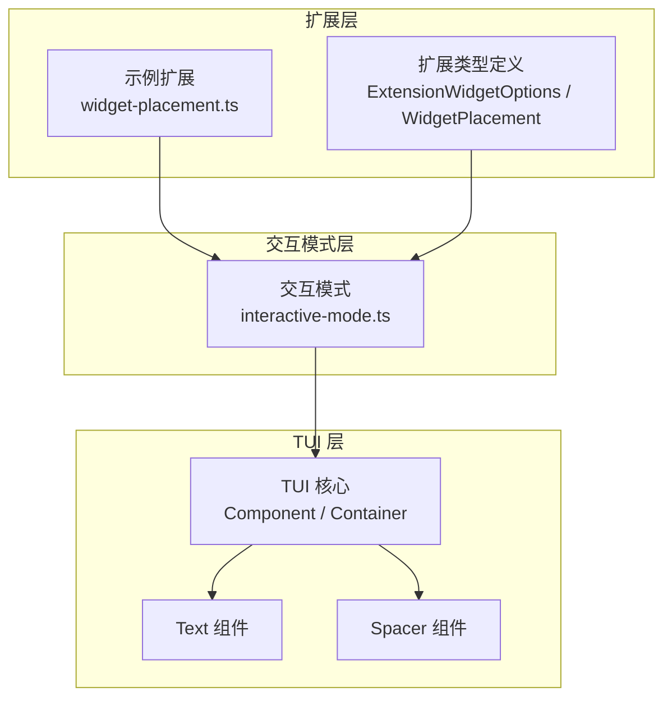
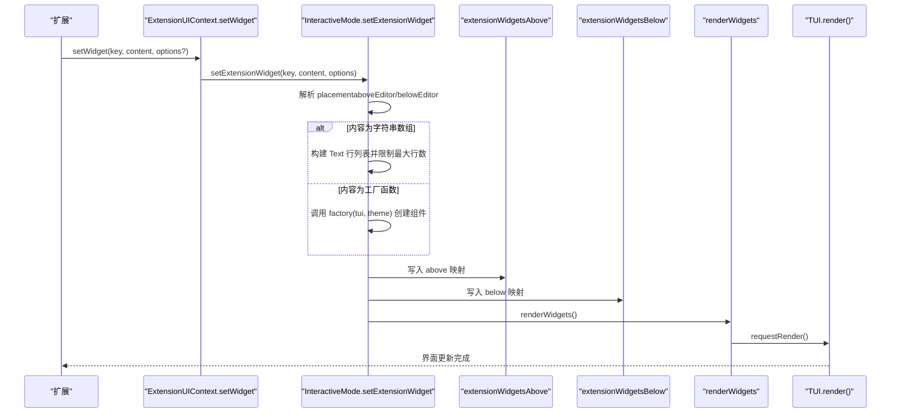
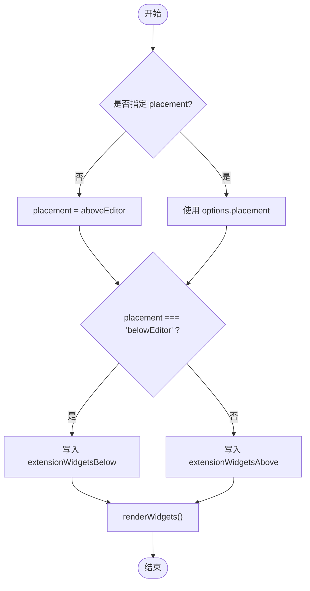
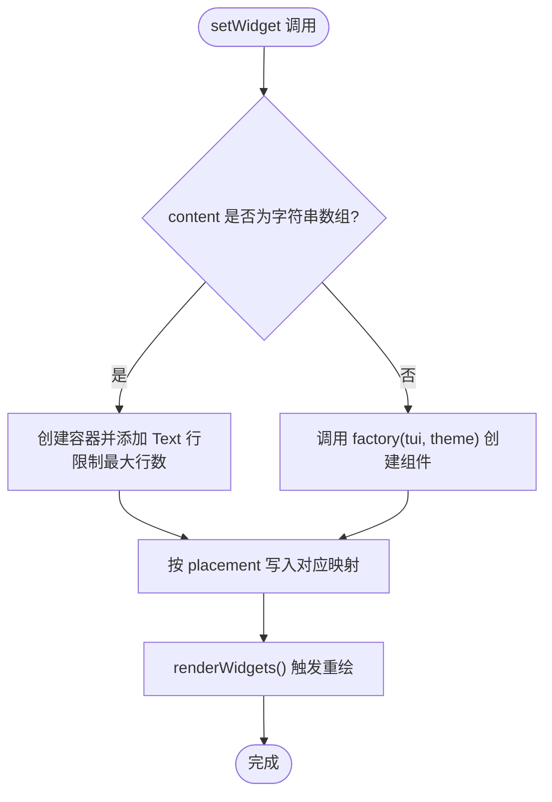
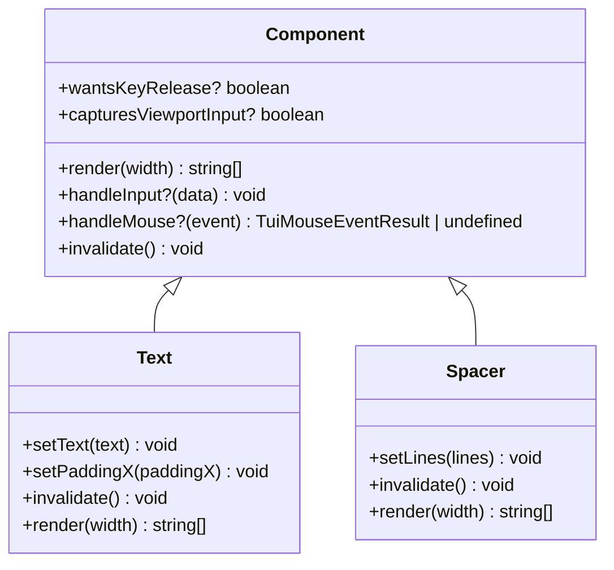
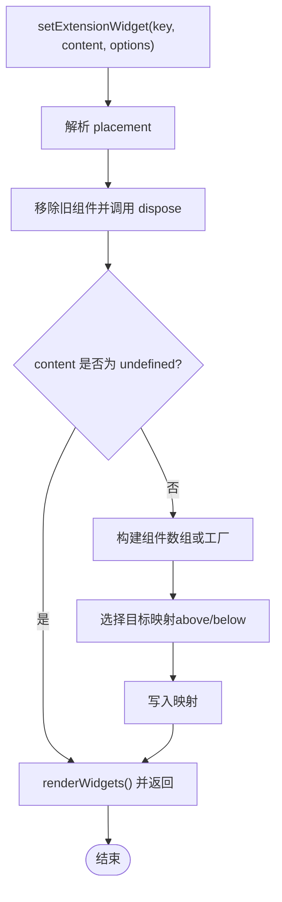
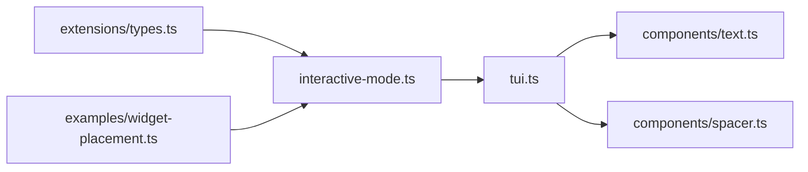
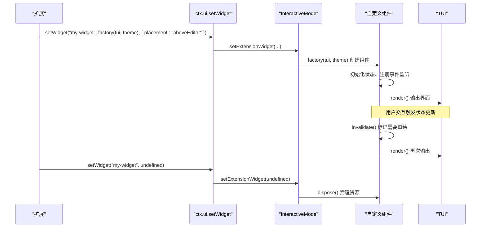

# Widget开发指南

<cite>
**本文引用的文件**   
- [packages/coding-agent/src/core/extensions/types.ts](https://github.com/FDE-GROUP/oh-my-coding-agent/blob/omca/packages/coding-agent/src/core/extensions/types.ts)
- [packages/coding-agent/src/modes/interactive/interactive-mode.ts](https://github.com/FDE-GROUP/oh-my-coding-agent/blob/omca/packages/coding-agent/src/modes/interactive/interactive-mode.ts)
- [packages/tui/src/tui.ts](https://github.com/FDE-GROUP/oh-my-coding-agent/blob/omca/packages/tui/src/tui.ts)
- [packages/tui/src/components/text.ts](https://github.com/FDE-GROUP/oh-my-coding-agent/blob/omca/packages/tui/src/components/text.ts)
- [packages/tui/src/components/spacer.ts](https://github.com/FDE-GROUP/oh-my-coding-agent/blob/omca/packages/tui/src/components/spacer.ts)
- [packages/coding-agent/examples/extensions/widget-placement.ts](https://github.com/FDE-GROUP/oh-my-coding-agent/blob/omca/packages/coding-agent/examples/extensions/widget-placement.ts)
</cite>

## 目录
1. [简介](#简介)
2. [项目结构](#项目结构)
3. [核心概念](#核心概念)
4. [架构总览](#架构总览)
5. [详细组件分析](#详细组件分析)
6. [依赖关系分析](#依赖关系分析)
7. [性能与优化](#性能与优化)
8. [故障排查](#故障排查)
9. [结论](#结论)
10. [附录：完整Widget开发示例](#附录完整widget开发示例)

## 简介
本指南面向扩展开发者，系统讲解如何在 TUI 系统中开发 Widget。内容覆盖：
- ExtensionWidgetOptions 与 WidgetPlacement 的配置方式
- setWidget 的两种用法：字符串数组内容与组件工厂函数
- Component 接口与生命周期管理（含 dispose）
- 状态管理、事件处理与主题集成
- Widget 与 TUI 系统的集成方式与性能优化技巧

## 项目结构
与 Widget 开发直接相关的代码主要分布在以下位置：
- 扩展类型定义：ExtensionWidgetOptions、WidgetPlacement、setWidget 等
- 交互模式实现：setExtensionWidget、renderWidgets、clearExtensionWidgets 等
- TUI 基础：Component 接口、Container 容器、Spacer 等内置组件
- 示例：在会话开始时设置 aboveEditor 与 belowEditor 位置的 Widget

**图表来源**
- [packages/coding-agent/src/core/extensions/types.ts:124-130](https://github.com/FDE-GROUP/oh-my-coding-agent/blob/omca/packages/coding-agent/src/core/extensions/types.ts#L124-L130)
- [packages/coding-agent/src/modes/interactive/interactive-mode.ts:2521-2564](https://github.com/FDE-GROUP/oh-my-coding-agent/blob/omca/packages/coding-agent/src/modes/interactive/interactive-mode.ts#L2521-L2564)
- [packages/tui/src/tui.ts:117-148](https://github.com/FDE-GROUP/oh-my-coding-agent/blob/omca/packages/tui/src/tui.ts#L117-L148)
- [packages/tui/src/components/text.ts:1-116](https://github.com/FDE-GROUP/oh-my-coding-agent/blob/omca/packages/tui/src/components/text.ts#L1-L116)
- [packages/tui/src/components/spacer.ts:1-28](https://github.com/FDE-GROUP/oh-my-coding-agent/blob/omca/packages/tui/src/components/spacer.ts#L1-L28)
- [packages/coding-agent/examples/extensions/widget-placement.ts:1-10](https://github.com/FDE-GROUP/oh-my-coding-agent/blob/omca/packages/coding-agent/examples/extensions/widget-placement.ts#L1-L10)

**章节来源**
- [packages/coding-agent/src/core/extensions/types.ts:124-130](https://github.com/FDE-GROUP/oh-my-coding-agent/blob/omca/packages/coding-agent/src/core/extensions/types.ts#L124-L130)
- [packages/coding-agent/src/modes/interactive/interactive-mode.ts:2521-2564](https://github.com/FDE-GROUP/oh-my-coding-agent/blob/omca/packages/coding-agent/src/modes/interactive/interactive-mode.ts#L2521-L2564)
- [packages/tui/src/tui.ts:117-148](https://github.com/FDE-GROUP/oh-my-coding-agent/blob/omca/packages/tui/src/tui.ts#L117-L148)
- [packages/tui/src/components/text.ts:1-116](https://github.com/FDE-GROUP/oh-my-coding-agent/blob/omca/packages/tui/src/components/text.ts#L1-L116)
- [packages/tui/src/components/spacer.ts:1-28](https://github.com/FDE-GROUP/oh-my-coding-agent/blob/omca/packages/tui/src/components/spacer.ts#L1-L28)
- [packages/coding-agent/examples/extensions/widget-placement.ts:1-10](https://github.com/FDE-GROUP/oh-my-coding-agent/blob/omca/packages/coding-agent/examples/extensions/widget-placement.ts#L1-L10)

## 核心概念
- WidgetPlacement：Widget 的显示位置，支持 aboveEditor（编辑器上方）与 belowEditor（编辑器下方）。
- ExtensionWidgetOptions：用于配置 Widget 的选项，其中 placement 决定渲染位置；未指定时默认位于编辑器上方。
- setWidget：扩展 UI 上下文提供的方法，用于设置或清除 Widget。支持两种内容形式：
  - 字符串数组：自动包装为文本行展示，并限制最大行数。
  - 组件工厂函数：接收 TUI 与 Theme，返回一个实现了 Component 接口的对象，可附带可选的 dispose 方法。

**章节来源**
- [packages/coding-agent/src/core/extensions/types.ts:124-130](https://github.com/FDE-GROUP/oh-my-coding-agent/blob/omca/packages/coding-agent/src/core/extensions/types.ts#L124-L130)
- [packages/coding-agent/src/core/extensions/types.ts:202-208](https://github.com/FDE-GROUP/oh-my-coding-agent/blob/omca/packages/coding-agent/src/core/extensions/types.ts#L202-L208)

## 架构总览
下图展示了从扩展到 TUI 的调用链：扩展通过 ctx.ui.setWidget 设置 Widget，交互模式根据 placement 将组件放入对应容器，最终由 TUI 渲染。

**图表来源**
- [packages/coding-agent/src/core/extensions/types.ts:202-208](https://github.com/FDE-GROUP/oh-my-coding-agent/blob/omca/packages/coding-agent/src/core/extensions/types.ts#L202-L208)
- [packages/coding-agent/src/modes/interactive/interactive-mode.ts:2521-2564](https://github.com/FDE-GROUP/oh-my-coding-agent/blob/omca/packages/coding-agent/src/modes/interactive/interactive-mode.ts#L2521-L2564)
- [packages/coding-agent/src/modes/interactive/interactive-mode.ts:2615-2643](https://github.com/FDE-GROUP/oh-my-coding-agent/blob/omca/packages/coding-agent/src/modes/interactive/interactive-mode.ts#L2615-L2643)
- [packages/tui/src/tui.ts:117-148](https://github.com/FDE-GROUP/oh-my-coding-agent/blob/omca/packages/tui/src/tui.ts#L117-L148)

## 详细组件分析

### ExtensionWidgetOptions 与 WidgetPlacement
- WidgetPlacement 是联合类型，包含 aboveEditor 与 belowEditor 两个值。
- ExtensionWidgetOptions 仅包含 placement 可选字段，默认值为 aboveEditor。
- 使用示例：在会话开始时分别设置编辑器上方与下方的 Widget。

**图表来源**
- [packages/coding-agent/src/core/extensions/types.ts:124-130](https://github.com/FDE-GROUP/oh-my-coding-agent/blob/omca/packages/coding-agent/src/core/extensions/types.ts#L124-L130)
- [packages/coding-agent/src/modes/interactive/interactive-mode.ts:2521-2564](https://github.com/FDE-GROUP/oh-my-coding-agent/blob/omca/packages/coding-agent/src/modes/interactive/interactive-mode.ts#L2521-L2564)

**章节来源**
- [packages/coding-agent/src/core/extensions/types.ts:124-130](https://github.com/FDE-GROUP/oh-my-coding-agent/blob/omca/packages/coding-agent/src/core/extensions/types.ts#L124-L130)
- [packages/coding-agent/examples/extensions/widget-placement.ts:1-10](https://github.com/FDE-GROUP/oh-my-coding-agent/blob/omca/packages/coding-agent/examples/extensions/widget-placement.ts#L1-L10)

### setWidget 的两种使用方式
- 字符串数组：
  - 行为：自动创建一个容器，并将每行字符串包装为 Text 组件。
  - 限制：最多显示固定数量的行，超出部分会追加截断提示。
  - 适用场景：快速展示日志、状态行等简单文本。
- 组件工厂函数：
  - 签名：(tui: TUI, theme: Theme) => Component & { dispose?(): void }
  - 行为：由框架调用工厂函数创建自定义组件，并可返回可选的 dispose 方法用于资源清理。
  - 适用场景：需要复杂布局、交互、状态管理或主题集成的 Widget。

**图表来源**
- [packages/coding-agent/src/modes/interactive/interactive-mode.ts:2521-2564](https://github.com/FDE-GROUP/oh-my-coding-agent/blob/omca/packages/coding-agent/src/modes/interactive/interactive-mode.ts#L2521-L2564)

**章节来源**
- [packages/coding-agent/src/modes/interactive/interactive-mode.ts:2521-2564](https://github.com/FDE-GROUP/oh-my-coding-agent/blob/omca/packages/coding-agent/src/modes/interactive/interactive-mode.ts#L2521-L2564)

### Component 接口与生命周期管理
- Component 接口要求实现 render(width)，并提供可选的 handleInput、handleMouse、invalidate 等方法。
- invalidate 用于清空缓存渲染状态，确保下一次渲染从零开始。
- dispose 是可选的生命周期钩子，当 Widget 被替换或销毁时由框架调用，用于释放定时器、监听器等资源。

**图表来源**
- [packages/tui/src/tui.ts:117-148](https://github.com/FDE-GROUP/oh-my-coding-agent/blob/omca/packages/tui/src/tui.ts#L117-L148)
- [packages/tui/src/components/text.ts:1-116](https://github.com/FDE-GROUP/oh-my-coding-agent/blob/omca/packages/tui/src/components/text.ts#L1-L116)
- [packages/tui/src/components/spacer.ts:1-28](https://github.com/FDE-GROUP/oh-my-coding-agent/blob/omca/packages/tui/src/components/spacer.ts#L1-L28)

**章节来源**
- [packages/tui/src/tui.ts:117-148](https://github.com/FDE-GROUP/oh-my-coding-agent/blob/omca/packages/tui/src/tui.ts#L117-L148)
- [packages/tui/src/components/text.ts:1-116](https://github.com/FDE-GROUP/oh-my-coding-agent/blob/omca/packages/tui/src/components/text.ts#L1-L116)
- [packages/tui/src/components/spacer.ts:1-28](https://github.com/FDE-GROUP/oh-my-coding-agent/blob/omca/packages/tui/src/components/spacer.ts#L1-L28)

### 交互模式中的 Widget 管理
- setExtensionWidget：
  - 解析 placement，默认 aboveEditor。
  - 若传入字符串数组，则构建 Text 行容器，并限制最大行数。
  - 若传入工厂函数，则调用该函数创建组件。
  - 将组件写入对应映射（above/below），然后调用 renderWidgets。
- clearExtensionWidgets：
  - 遍历所有已注册的 Widget，调用其可选的 dispose 方法，再清空映射并触发重绘。
- renderWidgets：
  - 清空容器并按顺序添加 Spacer 与 Widget 组件，最后请求 TUI 重绘。

**图表来源**
- [packages/coding-agent/src/modes/interactive/interactive-mode.ts:2521-2564](https://github.com/FDE-GROUP/oh-my-coding-agent/blob/omca/packages/coding-agent/src/modes/interactive/interactive-mode.ts#L2521-L2564)
- [packages/coding-agent/src/modes/interactive/interactive-mode.ts:2566-2576](https://github.com/FDE-GROUP/oh-my-coding-agent/blob/omca/packages/coding-agent/src/modes/interactive/interactive-mode.ts#L2566-L2576)
- [packages/coding-agent/src/modes/interactive/interactive-mode.ts:2615-2643](https://github.com/FDE-GROUP/oh-my-coding-agent/blob/omca/packages/coding-agent/src/modes/interactive/interactive-mode.ts#L2615-L2643)

**章节来源**
- [packages/coding-agent/src/modes/interactive/interactive-mode.ts:2521-2564](https://github.com/FDE-GROUP/oh-my-coding-agent/blob/omca/packages/coding-agent/src/modes/interactive/interactive-mode.ts#L2521-L2564)
- [packages/coding-agent/src/modes/interactive/interactive-mode.ts:2566-2576](https://github.com/FDE-GROUP/oh-my-coding-agent/blob/omca/packages/coding-agent/src/modes/interactive/interactive-mode.ts#L2566-L2576)
- [packages/coding-agent/src/modes/interactive/interactive-mode.ts:2615-2643](https://github.com/FDE-GROUP/oh-my-coding-agent/blob/omca/packages/coding-agent/src/modes/interactive/interactive-mode.ts#L2615-L2643)

## 依赖关系分析
- 扩展类型定义（types.ts）声明了 ExtensionWidgetOptions、WidgetPlacement 以及 setWidget 的 API 契约。
- 交互模式（interactive-mode.ts）实现 setExtensionWidget、renderWidgets、clearExtensionWidgets，负责将 Widget 挂载到 TUI 容器。
- TUI 层（tui.ts）定义了 Component 接口与 Container 容器，Text 与 Spacer 等内置组件实现该接口。
- 示例扩展（widget-placement.ts）演示了如何使用 setWidget 设置 aboveEditor 与 belowEditor 位置的 Widget。

**图表来源**
- [packages/coding-agent/src/core/extensions/types.ts:124-130](https://github.com/FDE-GROUP/oh-my-coding-agent/blob/omca/packages/coding-agent/src/core/extensions/types.ts#L124-L130)
- [packages/coding-agent/src/modes/interactive/interactive-mode.ts:2521-2564](https://github.com/FDE-GROUP/oh-my-coding-agent/blob/omca/packages/coding-agent/src/modes/interactive/interactive-mode.ts#L2521-L2564)
- [packages/tui/src/tui.ts:117-148](https://github.com/FDE-GROUP/oh-my-coding-agent/blob/omca/packages/tui/src/tui.ts#L117-L148)
- [packages/tui/src/components/text.ts:1-116](https://github.com/FDE-GROUP/oh-my-coding-agent/blob/omca/packages/tui/src/components/text.ts#L1-L116)
- [packages/tui/src/components/spacer.ts:1-28](https://github.com/FDE-GROUP/oh-my-coding-agent/blob/omca/packages/tui/src/components/spacer.ts#L1-L28)
- [packages/coding-agent/examples/extensions/widget-placement.ts:1-10](https://github.com/FDE-GROUP/oh-my-coding-agent/blob/omca/packages/coding-agent/examples/extensions/widget-placement.ts#L1-L10)

**章节来源**
- [packages/coding-agent/src/core/extensions/types.ts:124-130](https://github.com/FDE-GROUP/oh-my-coding-agent/blob/omca/packages/coding-agent/src/core/extensions/types.ts#L124-L130)
- [packages/coding-agent/src/modes/interactive/interactive-mode.ts:2521-2564](https://github.com/FDE-GROUP/oh-my-coding-agent/blob/omca/packages/coding-agent/src/modes/interactive/interactive-mode.ts#L2521-L2564)
- [packages/tui/src/tui.ts:117-148](https://github.com/FDE-GROUP/oh-my-coding-agent/blob/omca/packages/tui/src/tui.ts#L117-L148)
- [packages/tui/src/components/text.ts:1-116](https://github.com/FDE-GROUP/oh-my-coding-agent/blob/omca/packages/tui/src/components/text.ts#L1-L116)
- [packages/tui/src/components/spacer.ts:1-28](https://github.com/FDE-GROUP/oh-my-coding-agent/blob/omca/packages/tui/src/components/spacer.ts#L1-L28)
- [packages/coding-agent/examples/extensions/widget-placement.ts:1-10](https://github.com/FDE-GROUP/oh-my-coding-agent/blob/omca/packages/coding-agent/examples/extensions/widget-placement.ts#L1-L10)

## 性能与优化
- 控制 Widget 行数：
  - 字符串数组会被限制为固定最大行数，避免视图溢出。
  - 建议在工厂函数中按需渲染，避免一次性生成过多 DOM 或文本行。
- 合理使用 invalidate：
  - 当组件内部状态变化时调用 invalidate，确保下次渲染重新计算输出。
  - 对于无缓存状态的组件，invalidate 可为空实现。
- 及时释放资源：
  - 在组件的 dispose 中清理定时器、事件监听器、外部引用等，防止内存泄漏。
  - 当 setWidget 被再次调用或会话重置时，框架会调用已有组件的 dispose。
- 减少重绘频率：
  - 批量更新状态后再触发一次 invalidate，避免频繁重绘。
  - 使用 Spacer 控制空白区域，避免不必要的布局抖动。

[本节为通用指导，不直接分析具体文件]

## 故障排查
- Widget 不显示：
  - 检查 placement 是否正确（aboveEditor 或 belowEditor）。
  - 确认 setWidget 是否在 hasUI 为 true 的环境中调用。
- 组件未销毁导致内存泄漏：
  - 确保组件实现可选的 dispose 方法并在其中释放资源。
  - 当 setWidget 被重复调用或会话重置时，框架会尝试调用 dispose。
- 渲染异常或卡顿：
  - 检查 invalidate 是否正确清空缓存。
  - 避免在 render 中进行昂贵计算，必要时拆分组件或使用节流策略。

**章节来源**
- [packages/coding-agent/src/modes/interactive/interactive-mode.ts:2521-2564](https://github.com/FDE-GROUP/oh-my-coding-agent/blob/omca/packages/coding-agent/src/modes/interactive/interactive-mode.ts#L2521-L2564)
- [packages/coding-agent/src/modes/interactive/interactive-mode.ts:2566-2576](https://github.com/FDE-GROUP/oh-my-coding-agent/blob/omca/packages/coding-agent/src/modes/interactive/interactive-mode.ts#L2566-L2576)
- [packages/tui/src/tui.ts:117-148](https://github.com/FDE-GROUP/oh-my-coding-agent/blob/omca/packages/tui/src/tui.ts#L117-L148)

## 结论
通过 ExtensionWidgetOptions 与 WidgetPlacement，扩展可以灵活地将 Widget 放置在编辑器上方或下方。setWidget 同时支持简单的字符串数组与复杂的组件工厂函数，配合 Component 接口与 dispose 生命周期，能够构建出高性能、可维护且主题友好的 TUI 界面。遵循本文的最佳实践，可以有效避免内存泄漏、渲染卡顿等问题，提升用户体验。

[本节为总结性内容，不直接分析具体文件]

## 附录：完整Widget开发示例
以下示例展示如何开发一个具备状态管理、事件处理与主题集成的 Widget：
- 使用组件工厂函数创建自定义组件
- 在组件内部维护状态（如计数、加载状态）
- 响应键盘输入与鼠标事件
- 使用 Theme 进行样式设置
- 在 dispose 中清理资源

**图表来源**
- [packages/coding-agent/src/core/extensions/types.ts:202-208](https://github.com/FDE-GROUP/oh-my-coding-agent/blob/omca/packages/coding-agent/src/core/extensions/types.ts#L202-L208)
- [packages/coding-agent/src/modes/interactive/interactive-mode.ts:2521-2564](https://github.com/FDE-GROUP/oh-my-coding-agent/blob/omca/packages/coding-agent/src/modes/interactive/interactive-mode.ts#L2521-L2564)
- [packages/tui/src/tui.ts:117-148](https://github.com/FDE-GROUP/oh-my-coding-agent/blob/omca/packages/tui/src/tui.ts#L117-L148)

**章节来源**
- [packages/coding-agent/src/core/extensions/types.ts:202-208](https://github.com/FDE-GROUP/oh-my-coding-agent/blob/omca/packages/coding-agent/src/core/extensions/types.ts#L202-L208)
- [packages/coding-agent/src/modes/interactive/interactive-mode.ts:2521-2564](https://github.com/FDE-GROUP/oh-my-coding-agent/blob/omca/packages/coding-agent/src/modes/interactive/interactive-mode.ts#L2521-L2564)
- [packages/tui/src/tui.ts:117-148](https://github.com/FDE-GROUP/oh-my-coding-agent/blob/omca/packages/tui/src/tui.ts#L117-L148)