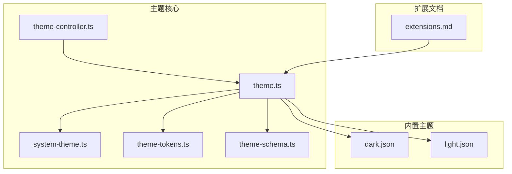
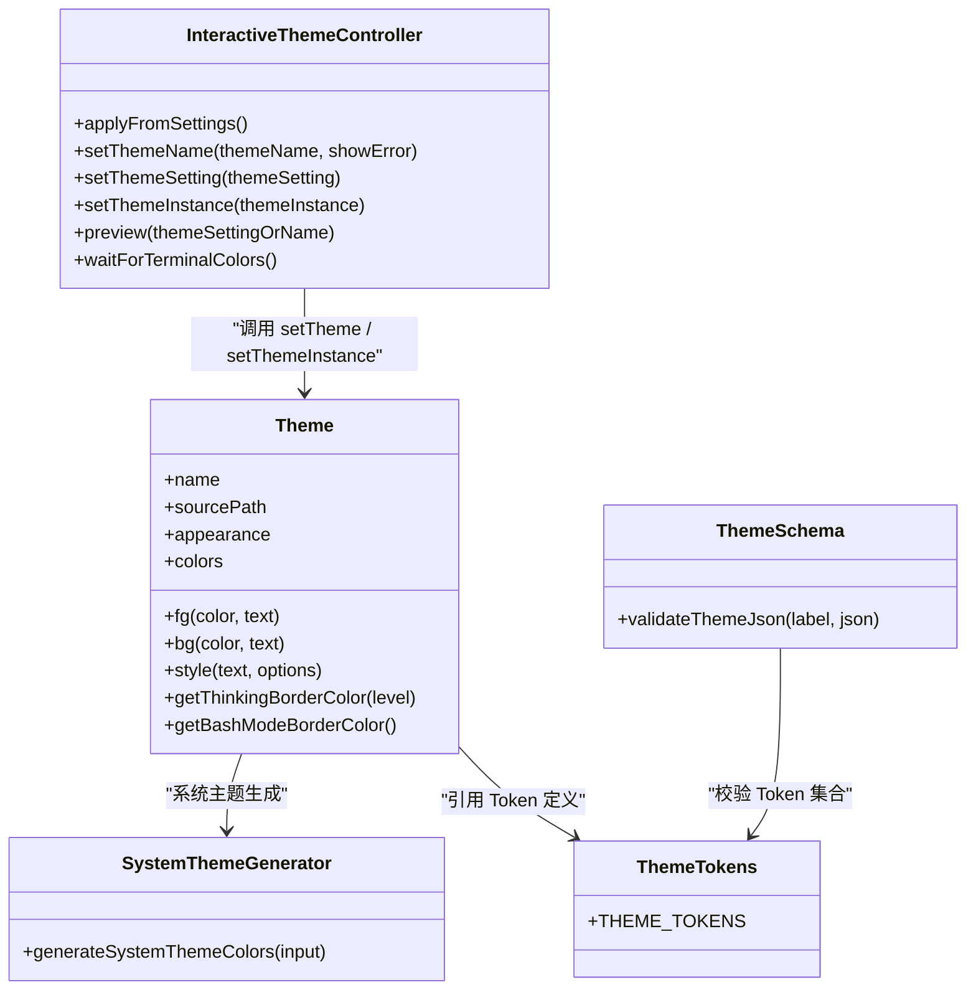
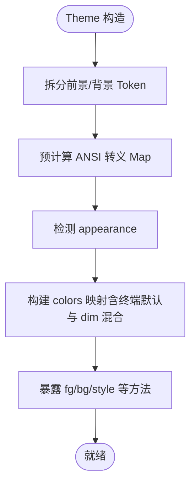
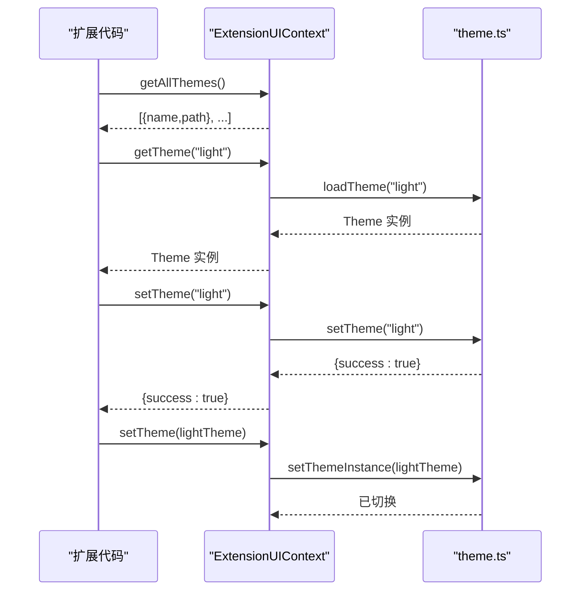
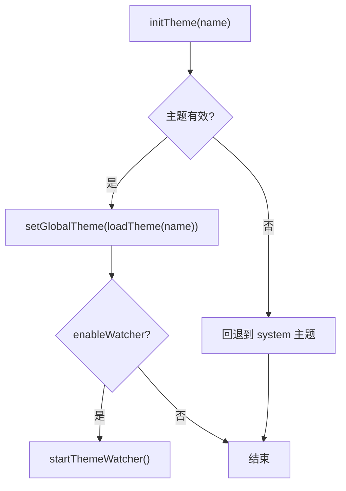
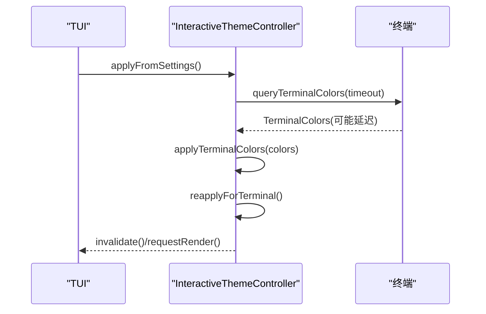
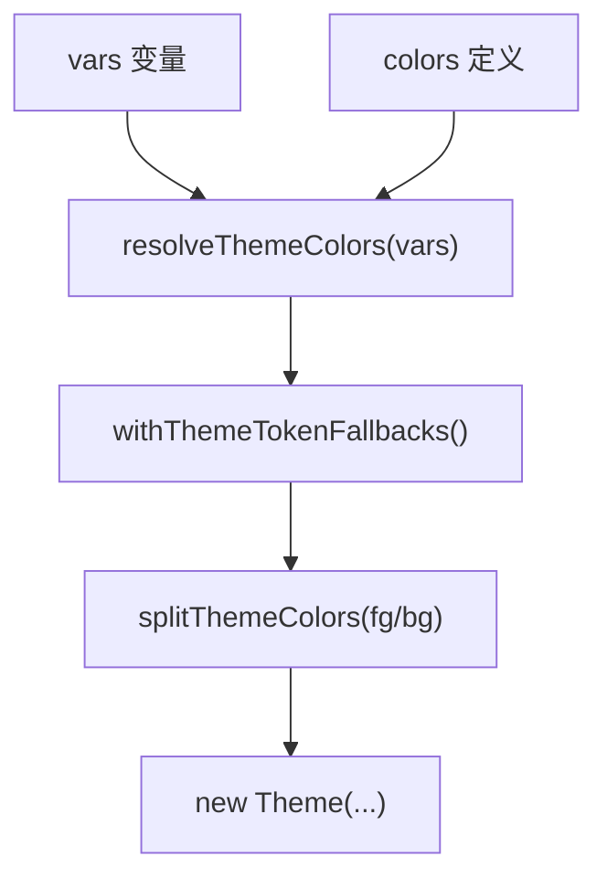
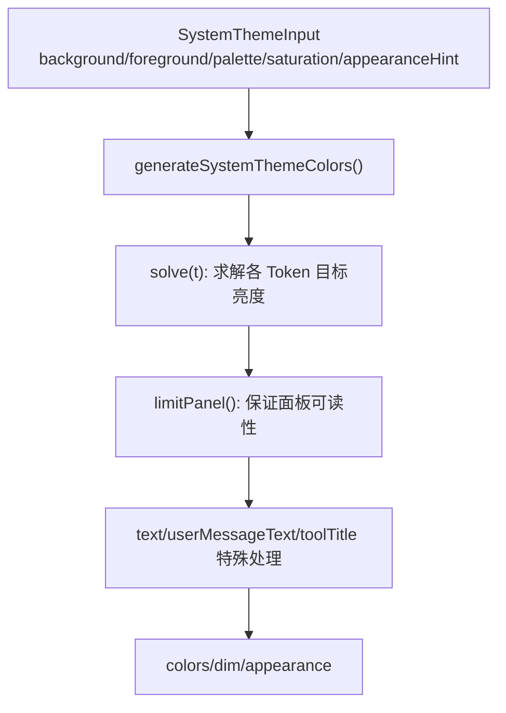
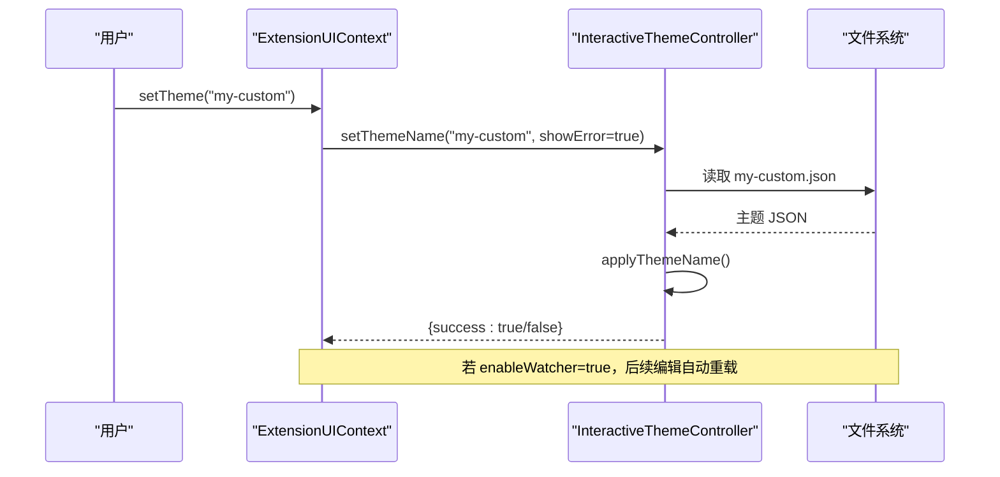
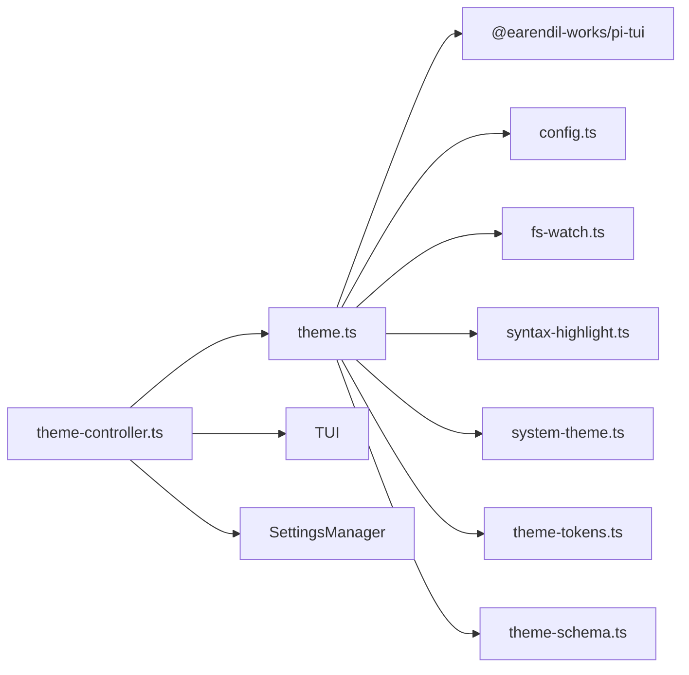

# 主题系统

<cite>
**本文引用的文件**   
- [theme.ts](https://github.com/FDE-GROUP/oh-my-coding-agent/blob/omca/packages/coding-agent/src/modes/interactive/theme/theme.ts)
- [theme-controller.ts](https://github.com/FDE-GROUP/oh-my-coding-agent/blob/omca/packages/coding-agent/src/modes/interactive/theme/theme-controller.ts)
- [theme-schema.ts](https://github.com/FDE-GROUP/oh-my-coding-agent/blob/omca/packages/coding-agent/src/modes/interactive/theme/theme-schema.ts)
- [theme-tokens.ts](https://github.com/FDE-GROUP/oh-my-coding-agent/blob/omca/packages/coding-agent/src/modes/interactive/theme/theme-tokens.ts)
- [system-theme.ts](https://github.com/FDE-GROUP/oh-my-coding-agent/blob/omca/packages/coding-agent/src/modes/interactive/theme/system-theme.ts)
- [dark.json](https://github.com/FDE-GROUP/oh-my-coding-agent/blob/omca/packages/coding-agent/src/modes/interactive/theme/dark.json)
- [light.json](https://github.com/FDE-GROUP/oh-my-coding-agent/blob/omca/packages/coding-agent/src/modes/interactive/theme/light.json)
- [extensions.md](https://github.com/FDE-GROUP/oh-my-coding-agent/blob/omca/packages/coding-agent/docs/extensions.md)
</cite>

## 目录
1. [简介](#简介)
2. [项目结构](#项目结构)
3. [核心组件](#核心组件)
4. [架构总览](#架构总览)
5. [详细组件分析](#详细组件分析)
6. [依赖关系分析](#依赖关系分析)
7. [性能与可维护性](#性能与可维护性)
8. [故障排查指南](#故障排查指南)
9. [结论](#结论)
10. [附录：主题文件格式与命名规范](#附录主题文件格式与命名规范)

## 简介
本文件系统性梳理主题系统的实现与使用方式，覆盖 Theme 对象结构与属性、ExtensionUIContext 中的主题操作方法（getAllThemes、getTheme、setTheme）、自定义主题文件的创建与命名规范、动态主题切换与持久化存储、主题继承机制与样式覆盖规则，以及调试工具与最佳实践。文档面向不同技术背景的读者，提供从概念到代码级的完整说明。

## 项目结构
主题系统位于交互式模式的主题模块中，核心由以下文件组成：
- theme.ts：主题加载、全局主题实例、可用主题列表、自动/手动切换、文件监听与热重载。
- theme-controller.ts：与 TUI 和设置管理器交互的控制器，负责应用主题设置、终端颜色同步、自动跟随终端明暗。
- theme-schema.ts：主题 JSON 的结构校验与错误信息生成。
- theme-tokens.ts：主题 Token 定义、槽位（前景/背景）与可选 Token 的类型推导。
- system-theme.ts：基于终端颜色的“系统主题”自动生成器，保证对比度与可读性。
- dark.json / light.json：内置主题示例，展示 vars/colors/export 等字段用法。
- extensions.md：扩展 API 文档，包含 ExtensionUIContext 的主题管理方法示例。

图示来源
- [theme.ts:1-120](https://github.com/FDE-GROUP/oh-my-coding-agent/blob/omca/packages/coding-agent/src/modes/interactive/theme/theme.ts#L1-L120)
- [theme-controller.ts:1-120](https://github.com/FDE-GROUP/oh-my-coding-agent/blob/omca/packages/coding-agent/src/modes/interactive/theme/theme-controller.ts#L1-L120)
- [system-theme.ts:1-60](https://github.com/FDE-GROUP/oh-my-coding-agent/blob/omca/packages/coding-agent/src/modes/interactive/theme/system-theme.ts#L1-L60)
- [theme-tokens.ts:1-40](https://github.com/FDE-GROUP/oh-my-coding-agent/blob/omca/packages/coding-agent/src/modes/interactive/theme/theme-tokens.ts#L1-L40)
- [theme-schema.ts:1-40](https://github.com/FDE-GROUP/oh-my-coding-agent/blob/omca/packages/coding-agent/src/modes/interactive/theme/theme-schema.ts#L1-L40)
- [dark.json:1-20](https://github.com/FDE-GROUP/oh-my-coding-agent/blob/omca/packages/coding-agent/src/modes/interactive/theme/dark.json#L1-L20)
- [light.json:1-20](https://github.com/FDE-GROUP/oh-my-coding-agent/blob/omca/packages/coding-agent/src/modes/interactive/theme/light.json#L1-L20)
- [extensions.md:2990-2999](https://github.com/FDE-GROUP/oh-my-coding-agent/blob/omca/packages/coding-agent/docs/extensions.md#L2990-L2999)

章节来源
- [theme.ts:1-120](https://github.com/FDE-GROUP/oh-my-coding-agent/blob/omca/packages/coding-agent/src/modes/interactive/theme/theme.ts#L1-L120)
- [theme-controller.ts:1-120](https://github.com/FDE-GROUP/oh-my-coding-agent/blob/omca/packages/coding-agent/src/modes/interactive/theme/theme-controller.ts#L1-L120)
- [extensions.md:2990-2999](https://github.com/FDE-GROUP/oh-my-coding-agent/blob/omca/packages/coding-agent/docs/extensions.md#L2990-L2999)

## 核心组件
- Theme 类：封装主题的颜色、样式、ANSI 转义序列缓存、外观检测、思考层级边框色等能力。
- InteractiveThemeController：将主题设置与终端颜色、明暗模式联动，提供预览、切换、持久化入口。
- 主题 Token 与 Schema：Token 元数据、类型约束与 JSON 校验，确保主题文件正确性与一致性。
- 系统主题生成器：根据终端颜色自动生成高可读性的主题，支持灰度过渡与对比度保障。
- 内置主题示例：dark.json 与 light.json 展示 vars/colors/export 的使用方式。

章节来源
- [theme.ts:185-373](https://github.com/FDE-GROUP/oh-my-coding-agent/blob/omca/packages/coding-agent/src/modes/interactive/theme/theme.ts#L185-L373)
- [theme-controller.ts:58-163](https://github.com/FDE-GROUP/oh-my-coding-agent/blob/omca/packages/coding-agent/src/modes/interactive/theme/theme-controller.ts#L58-L163)
- [theme-tokens.ts:24-101](https://github.com/FDE-GROUP/oh-my-coding-agent/blob/omca/packages/coding-agent/src/modes/interactive/theme/theme-tokens.ts#L24-L101)
- [theme-schema.ts:52-90](https://github.com/FDE-GROUP/oh-my-coding-agent/blob/omca/packages/coding-agent/src/modes/interactive/theme/theme-schema.ts#L52-L90)
- [system-theme.ts:465-587](https://github.com/FDE-GROUP/oh-my-coding-agent/blob/omca/packages/coding-agent/src/modes/interactive/theme/system-theme.ts#L465-L587)
- [dark.json:1-79](https://github.com/FDE-GROUP/oh-my-coding-agent/blob/omca/packages/coding-agent/src/modes/interactive/theme/dark.json#L1-L79)
- [light.json:1-79](https://github.com/FDE-GROUP/oh-my-coding-agent/blob/omca/packages/coding-agent/src/modes/interactive/theme/light.json#L1-L79)

## 架构总览
主题系统以 Theme 为核心对象，通过 theme.ts 暴露初始化、切换、监听与注册能力；InteractiveThemeController 作为控制器协调 UI、设置与终端颜色；schema 与 tokens 提供类型与校验；system-theme 在缺少用户主题或需要自适应时生成主题；内置主题提供参考实现。

图示来源
- [theme.ts:185-373](https://github.com/FDE-GROUP/oh-my-coding-agent/blob/omca/packages/coding-agent/src/modes/interactive/theme/theme.ts#L185-L373)
- [theme-controller.ts:58-163](https://github.com/FDE-GROUP/oh-my-coding-agent/blob/omca/packages/coding-agent/src/modes/interactive/theme/theme-controller.ts#L58-L163)
- [system-theme.ts:465-587](https://github.com/FDE-GROUP/oh-my-coding-agent/blob/omca/packages/coding-agent/src/modes/interactive/theme/system-theme.ts#L465-L587)
- [theme-tokens.ts:24-101](https://github.com/FDE-GROUP/oh-my-coding-agent/blob/omca/packages/coding-agent/src/modes/interactive/theme/theme-tokens.ts#L24-L101)
- [theme-schema.ts:96-146](https://github.com/FDE-GROUP/oh-my-coding-agent/blob/omca/packages/coding-agent/src/modes/interactive/theme/theme-schema.ts#L96-L146)

## 详细组件分析

### Theme 对象结构与属性
- 名称与来源：name、sourcePath、sourceInfo 用于标识主题来源与调试信息。
- 外观与模式：appearance 表示主题适配的背景（light/dark），mode 为终端颜色模式。
- 颜色解析：colors 返回所有 Token 的具体颜色，空字符串表示使用终端默认色；dimTokens 标记需渲染为较淡的前景 Token。
- 样式方法：fg/bg/style 提供前景/背景/组合样式输出，内部预计算 ANSI 转义以提升渲染性能。
- 语义化接口：getThinkingBorderColor/getBashModeBorderColor 提供特定场景的边框色函数。

图示来源
- [theme.ts:202-243](https://github.com/FDE-GROUP/oh-my-coding-agent/blob/omca/packages/coding-agent/src/modes/interactive/theme/theme.ts#L202-L243)
- [theme.ts:245-373](https://github.com/FDE-GROUP/oh-my-coding-agent/blob/omca/packages/coding-agent/src/modes/interactive/theme/theme.ts#L245-L373)

章节来源
- [theme.ts:185-373](https://github.com/FDE-GROUP/oh-my-coding-agent/blob/omca/packages/coding-agent/src/modes/interactive/theme/theme.ts#L185-L373)

### ExtensionUIContext 主题操作方法
扩展上下文对外暴露的主题管理方法包括：
- getAllThemes：返回可用主题列表（含 name/path）。
- getTheme：按名称加载主题但不切换当前主题。
- setTheme：按名称或 Theme 对象切换主题，返回成功状态与错误信息。

这些方法在扩展文档中有示例用法，并可通过 ctx.ui.theme 访问当前主题进行样式渲染。

图示来源
- [extensions.md:2990-2999](https://github.com/FDE-GROUP/oh-my-coding-agent/blob/omca/packages/coding-agent/docs/extensions.md#L2990-L2999)
- [theme.ts:394-434](https://github.com/FDE-GROUP/oh-my-coding-agent/blob/omca/packages/coding-agent/src/modes/interactive/theme/theme.ts#L394-L434)
- [theme.ts:551-574](https://github.com/FDE-GROUP/oh-my-coding-agent/blob/omca/packages/coding-agent/src/modes/interactive/theme/theme.ts#L551-L574)
- [theme.ts:703-737](https://github.com/FDE-GROUP/oh-my-coding-agent/blob/omca/packages/coding-agent/src/modes/interactive/theme/theme.ts#L703-L737)

章节来源
- [extensions.md:2990-2999](https://github.com/FDE-GROUP/oh-my-coding-agent/blob/omca/packages/coding-agent/docs/extensions.md#L2990-L2999)
- [theme.ts:394-434](https://github.com/FDE-GROUP/oh-my-coding-agent/blob/omca/packages/coding-agent/src/modes/interactive/theme/theme.ts#L394-L434)
- [theme.ts:551-574](https://github.com/FDE-GROUP/oh-my-coding-agent/blob/omca/packages/coding-agent/src/modes/interactive/theme/theme.ts#L551-L574)
- [theme.ts:703-737](https://github.com/FDE-GROUP/oh-my-coding-agent/blob/omca/packages/coding-agent/src/modes/interactive/theme/theme.ts#L703-L737)

### 主题加载与切换流程
- initTheme：初始化主题，若失败则静默回退到系统主题。
- setTheme：按名称切换主题，支持启用文件监听；失败时回退到系统主题并返回错误信息。
- setThemeInstance：直接注入 Theme 实例，停止文件监听。
- onThemeChange：订阅主题变更回调，用于 UI 刷新。

图示来源
- [theme.ts:687-701](https://github.com/FDE-GROUP/oh-my-coding-agent/blob/omca/packages/coding-agent/src/modes/interactive/theme/theme.ts#L687-L701)
- [theme.ts:703-737](https://github.com/FDE-GROUP/oh-my-coding-agent/blob/omca/packages/coding-agent/src/modes/interactive/theme/theme.ts#L703-L737)
- [theme.ts:739-800](https://github.com/FDE-GROUP/oh-my-coding-agent/blob/omca/packages/coding-agent/src/modes/interactive/theme/theme.ts#L739-L800)

章节来源
- [theme.ts:687-737](https://github.com/FDE-GROUP/oh-my-coding-agent/blob/omca/packages/coding-agent/src/modes/interactive/theme/theme.ts#L687-L737)
- [theme.ts:739-800](https://github.com/FDE-GROUP/oh-my-coding-agent/blob/omca/packages/coding-agent/src/modes/interactive/theme/theme.ts#L739-L800)

### 主题控制器与终端颜色联动
InteractiveThemeController 负责：
- 应用主题设置并查询终端颜色，延迟应用直到颜色到达或超时。
- 自动跟随终端明暗变化（当主题为 system 或 light/dark 对时）。
- 提供 preview 预览、setThemeSetting/setThemeName/setThemeInstance 等切换入口。
- 通过 waitForTerminalColors 等待最新颜色查询完成，便于构建包含主题色的启动内容。

图示来源
- [theme-controller.ts:31-40](https://github.com/FDE-GROUP/oh-my-coding-agent/blob/omca/packages/coding-agent/src/modes/interactive/theme/theme-controller.ts#L31-L40)
- [theme-controller.ts:103-118](https://github.com/FDE-GROUP/oh-my-coding-agent/blob/omca/packages/coding-agent/src/modes/interactive/theme/theme-controller.ts#L103-L118)
- [theme-controller.ts:197-223](https://github.com/FDE-GROUP/oh-my-coding-agent/blob/omca/packages/coding-agent/src/modes/interactive/theme/theme-controller.ts#L197-L223)

章节来源
- [theme-controller.ts:58-163](https://github.com/FDE-GROUP/oh-my-coding-agent/blob/omca/packages/coding-agent/src/modes/interactive/theme/theme-controller.ts#L58-L163)
- [theme-controller.ts:188-223](https://github.com/FDE-GROUP/oh-my-coding-agent/blob/omca/packages/coding-agent/src/modes/interactive/theme/theme-controller.ts#L188-L223)

### 主题 Token、变量与样式覆盖
- Token 定义：theme-tokens.ts 定义了所有 Token 的名称、槽位（foreground/background）、描述与可选 fallback。
- 变量复用：vars 允许在 colors 中引用变量，避免重复值。
- 样式覆盖：colors 中未定义的可选 Token 会使用 fallback 值；"" 表示使用终端默认色。
- 外观声明：appearance 可显式声明，否则从颜色推断。

图示来源
- [theme.ts:79-122](https://github.com/FDE-GROUP/oh-my-coding-agent/blob/omca/packages/coding-agent/src/modes/interactive/theme/theme.ts#L79-L122)
- [theme.ts:509-534](https://github.com/FDE-GROUP/oh-my-coding-agent/blob/omca/packages/coding-agent/src/modes/interactive/theme/theme.ts#L509-L534)
- [theme-tokens.ts:24-101](https://github.com/FDE-GROUP/oh-my-coding-agent/blob/omca/packages/coding-agent/src/modes/interactive/theme/theme-tokens.ts#L24-L101)

章节来源
- [theme.ts:79-122](https://github.com/FDE-GROUP/oh-my-coding-agent/blob/omca/packages/coding-agent/src/modes/interactive/theme/theme.ts#L79-L122)
- [theme.ts:509-534](https://github.com/FDE-GROUP/oh-my-coding-agent/blob/omca/packages/coding-agent/src/modes/interactive/theme/theme.ts#L509-L534)
- [theme-tokens.ts:24-101](https://github.com/FDE-GROUP/oh-my-coding-agent/blob/omca/packages/coding-agent/src/modes/interactive/theme/theme-tokens.ts#L24-L101)

### 系统主题生成与对比度保障
system-theme.ts 根据终端报告的 foreground/background/palette 生成主题：
- 色彩家族与 Token 映射：每个 Token 属于一个家族，决定色相与饱和度曲线。
- 对比度目标：基于 OKLab/OKHSL 的目标亮度曲线，确保在不同背景上达到 WCAG 对比度。
- 面板与文本：面板背景与正文文本分别采用不同的可读性策略，必要时向极端色靠拢。
- 无终端颜色时的降级：使用 ANSI 索引与默认色，中性 Token 使用较淡渲染。

图示来源
- [system-theme.ts:465-587](https://github.com/FDE-GROUP/oh-my-coding-agent/blob/omca/packages/coding-agent/src/modes/interactive/theme/system-theme.ts#L465-L587)
- [system-theme.ts:642-655](https://github.com/FDE-GROUP/oh-my-coding-agent/blob/omca/packages/coding-agent/src/modes/interactive/theme/system-theme.ts#L642-L655)

章节来源
- [system-theme.ts:465-587](https://github.com/FDE-GROUP/oh-my-coding-agent/blob/omca/packages/coding-agent/src/modes/interactive/theme/system-theme.ts#L465-L587)
- [system-theme.ts:642-655](https://github.com/FDE-GROUP/oh-my-coding-agent/blob/omca/packages/coding-agent/src/modes/interactive/theme/system-theme.ts#L642-L655)

### 主题继承机制与样式覆盖规则
- 继承来源：
  - 变量继承：vars 中定义的变量可在 colors 中引用，形成变量级继承。
  - Token 回退：可选 Token 未定义时使用 fallback 值。
  - 终端默认：值为 "" 的 Token 使用终端默认前景/背景色。
- 覆盖优先级：
  - 显式 colors 覆盖 > fallback > 终端默认。
  - appearance 显式声明优先于颜色推断。
- 系统主题：当主题为 system 时，完全由终端颜色生成，不受用户 colors 影响。

章节来源
- [theme.ts:79-122](https://github.com/FDE-GROUP/oh-my-coding-agent/blob/omca/packages/coding-agent/src/modes/interactive/theme/theme.ts#L79-L122)
- [theme.ts:509-534](https://github.com/FDE-GROUP/oh-my-coding-agent/blob/omca/packages/coding-agent/src/modes/interactive/theme/theme.ts#L509-L534)
- [theme.ts:557-566](https://github.com/FDE-GROUP/oh-my-coding-agent/blob/omca/packages/coding-agent/src/modes/interactive/theme/theme.ts#L557-L566)

### 动态主题切换与持久化存储
- 动态切换：
  - 通过 ctx.ui.setTheme(name) 或 ctx.ui.setTheme(themeObj) 切换。
  - 支持 enableWatcher 开启文件监听，编辑自定义主题后自动重载。
- 持久化：
  - 主题设置可由设置管理器保存，控制器通过 setThemeSetting 应用。
  - 无效主题名不会写入设置，避免污染配置。

图示来源
- [extensions.md:2990-2999](https://github.com/FDE-GROUP/oh-my-coding-agent/blob/omca/packages/coding-agent/docs/extensions.md#L2990-L2999)
- [theme-controller.ts:124-144](https://github.com/FDE-GROUP/oh-my-coding-agent/blob/omca/packages/coding-agent/src/modes/interactive/theme/theme-controller.ts#L124-L144)
- [theme.ts:703-737](https://github.com/FDE-GROUP/oh-my-coding-agent/blob/omca/packages/coding-agent/src/modes/interactive/theme/theme.ts#L703-L737)
- [theme.ts:739-800](https://github.com/FDE-GROUP/oh-my-coding-agent/blob/omca/packages/coding-agent/src/modes/interactive/theme/theme.ts#L739-L800)

章节来源
- [extensions.md:2990-2999](https://github.com/FDE-GROUP/oh-my-coding-agent/blob/omca/packages/coding-agent/docs/extensions.md#L2990-L2999)
- [theme-controller.ts:124-144](https://github.com/FDE-GROUP/oh-my-coding-agent/blob/omca/packages/coding-agent/src/modes/interactive/theme/theme-controller.ts#L124-L144)
- [theme.ts:703-737](https://github.com/FDE-GROUP/oh-my-coding-agent/blob/omca/packages/coding-agent/src/modes/interactive/theme/theme.ts#L703-L737)
- [theme.ts:739-800](https://github.com/FDE-GROUP/oh-my-coding-agent/blob/omca/packages/coding-agent/src/modes/interactive/theme/theme.ts#L739-L800)

## 依赖关系分析
- theme.ts 依赖：
  - pi-tui：颜色解析、ANSI 转义、终端颜色模式等。
  - config.ts：获取内置主题目录与自定义主题目录。
  - fs-watch.ts：文件监听与错误处理。
  - syntax-highlight.ts：语法高亮相关能力（被部分渲染器使用）。
  - system-theme.ts：系统主题生成。
  - theme-tokens.ts：Token 定义与类型。
  - theme-schema.ts：JSON 校验（可选安装）。
- theme-controller.ts 依赖：
  - TUI：终端颜色查询与明暗通知。
  - SettingsManager：读取/写入主题设置。
  - theme.ts：主题初始化、切换、终端颜色设置。

图示来源
- [theme.ts:1-31](https://github.com/FDE-GROUP/oh-my-coding-agent/blob/omca/packages/coding-agent/src/modes/interactive/theme/theme.ts#L1-L31)
- [theme-controller.ts:1-16](https://github.com/FDE-GROUP/oh-my-coding-agent/blob/omca/packages/coding-agent/src/modes/interactive/theme/theme-controller.ts#L1-L16)

章节来源
- [theme.ts:1-31](https://github.com/FDE-GROUP/oh-my-coding-agent/blob/omca/packages/coding-agent/src/modes/interactive/theme/theme.ts#L1-L31)
- [theme-controller.ts:1-16](https://github.com/FDE-GROUP/oh-my-coding-agent/blob/omca/packages/coding-agent/src/modes/interactive/theme/theme-controller.ts#L1-L16)

## 性能与可维护性
- 性能优化：
  - Theme 预计算 ANSI 转义 Map，减少渲染路径开销。
  - colors 结果冻结并缓存，避免重复解析。
  - 终端颜色查询带超时与延迟回复处理，避免阻塞。
- 可维护性：
  - Token 与 Schema 分离，降低主模块体积与耦合。
  - 系统主题生成逻辑独立，便于测试与调优。
  - 内置主题示例清晰，便于扩展者参考。

[本节为通用指导，不直接分析具体文件]

## 故障排查指南
- 主题未初始化：
  - 现象：访问 theme 抛出“Theme not initialized”。
  - 原因：未调用 initTheme。
  - 解决：在应用启动时调用 initTheme。
- 主题不存在或无效：
  - 现象：setTheme 返回 success:false 并携带 error。
  - 原因：文件名不存在、JSON 解析失败、必填 Token 缺失。
  - 解决：检查主题文件名与 JSON 结构，参考内置主题。
- 主题名非法：
  - 现象：包含 "/" 的主题名被拒绝。
  - 原因："/" 保留给自动 light/dark 设置。
  - 解决：移除 "/" 或使用 light/dark 对格式。
- 终端颜色未报告：
  - 现象：系统主题初期为灰阶，随后恢复彩色。
  - 原因：终端尚未报告颜色或不支持。
  - 解决：等待 waitForTerminalColors 或接受降级行为。

章节来源
- [theme.ts:651-659](https://github.com/FDE-GROUP/oh-my-coding-agent/blob/omca/packages/coding-agent/src/modes/interactive/theme/theme.ts#L651-L659)
- [theme.ts:703-723](https://github.com/FDE-GROUP/oh-my-coding-agent/blob/omca/packages/coding-agent/src/modes/interactive/theme/theme.ts#L703-L723)
- [theme.ts:461-467](https://github.com/FDE-GROUP/oh-my-coding-agent/blob/omca/packages/coding-agent/src/modes/interactive/theme/theme.ts#L461-L467)
- [theme-controller.ts:112-118](https://github.com/FDE-GROUP/oh-my-coding-agent/blob/omca/packages/coding-agent/src/modes/interactive/theme/theme-controller.ts#L112-L118)

## 结论
主题系统以 Theme 为核心，结合 Token 定义、Schema 校验与系统主题生成，提供了稳定、可扩展且高性能的主题能力。ExtensionUIContext 暴露了简洁的主题管理 API，配合 InteractiveThemeController 实现与终端颜色与明暗模式的联动。通过 vars/colors/export 与 fallback 机制，用户可以灵活定制主题，并通过文件监听实现热重载。遵循命名规范与最佳实践，可获得一致且可维护的主题体验。

[本节为总结性内容，不直接分析具体文件]

## 附录：主题文件格式与命名规范
- 文件位置：
  - 内置主题：themes/dark.json、themes/light.json。
  - 自定义主题：用户主题目录下以 <name>.json 命名。
- 字段说明：
  - $schema：JSON Schema 引用（可选）。
  - name：主题名，不能包含 "/"。
  - appearance：light/dark（可选，未声明则从颜色推断）。
  - vars：可复用颜色变量。
  - colors：Token 颜色定义，支持变量引用与 "" 表示终端默认。
  - export：HTML 导出用的页面/卡片/信息区背景（可选）。
- 命名规范：
  - 主题名仅字母数字与下划线，避免 "/"。
  - 自定义主题文件名为 <name>.json。
- 示例参考：
  - dark.json 与 light.json 展示了 vars/colors/export 的完整用法。

章节来源
- [theme-schema.ts:52-90](https://github.com/FDE-GROUP/oh-my-coding-agent/blob/omca/packages/coding-agent/src/modes/interactive/theme/theme-schema.ts#L52-L90)
- [dark.json:1-79](https://github.com/FDE-GROUP/oh-my-coding-agent/blob/omca/packages/coding-agent/src/modes/interactive/theme/dark.json#L1-L79)
- [light.json:1-79](https://github.com/FDE-GROUP/oh-my-coding-agent/blob/omca/packages/coding-agent/src/modes/interactive/theme/light.json#L1-L79)