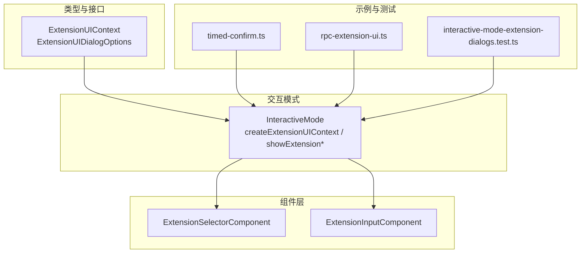
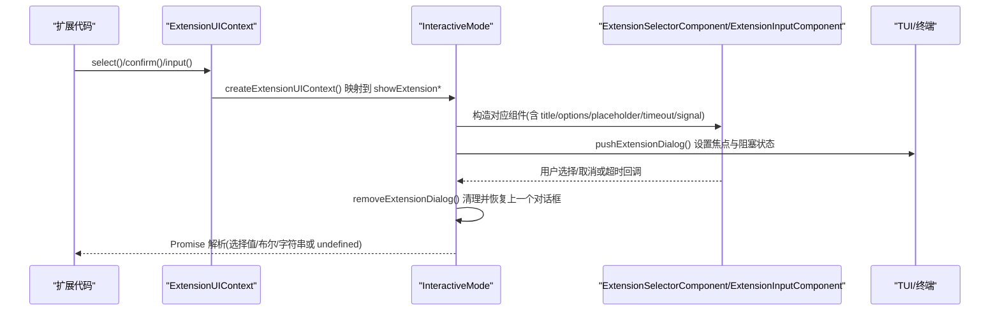
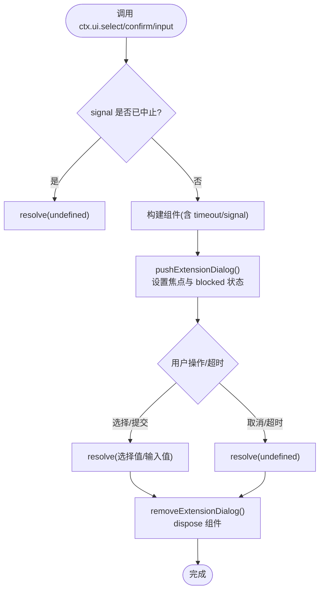
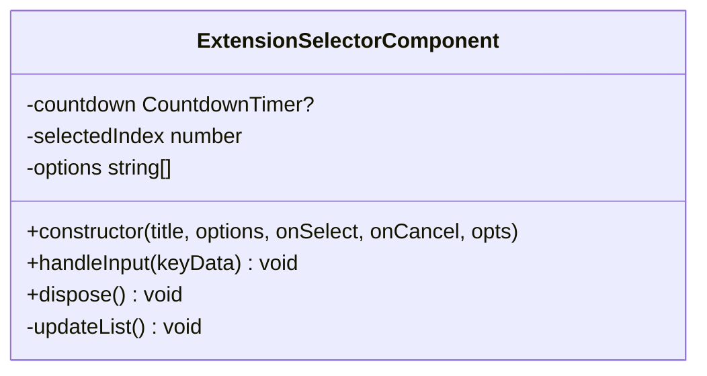
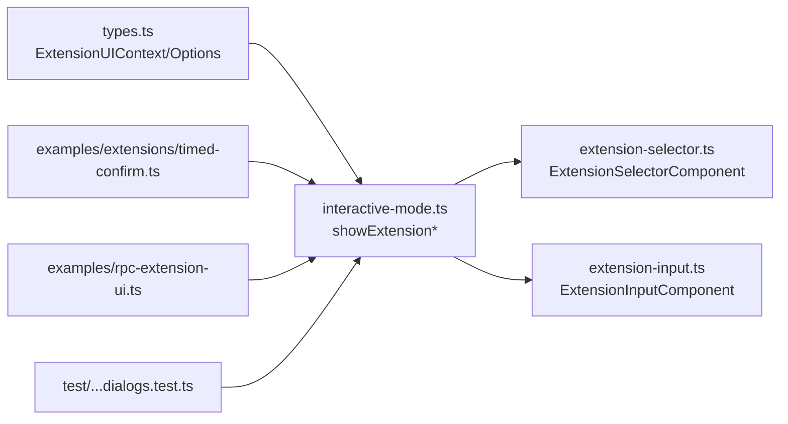

# 对话框组件

<cite>
**本文引用的文件**   
- [types.ts](https://github.com/FDE-GROUP/oh-my-coding-agent/blob/omca/packages/coding-agent/src/core/extensions/types.ts)
- [interactive-mode.ts](https://github.com/FDE-GROUP/oh-my-coding-agent/blob/omca/packages/coding-agent/src/modes/interactive/interactive-mode.ts)
- [extension-selector.ts](https://github.com/FDE-GROUP/oh-my-coding-agent/blob/omca/packages/coding-agent/src/modes/interactive/components/extension-selector.ts)
- [extension-input.ts](https://github.com/FDE-GROUP/oh-my-coding-agent/blob/omca/packages/coding-agent/src/modes/interactive/components/extension-input.ts)
- [timed-confirm.ts](https://github.com/FDE-GROUP/oh-my-coding-agent/blob/omca/packages/coding-agent/examples/extensions/timed-confirm.ts)
- [rpc-extension-ui.ts](https://github.com/FDE-GROUP/oh-my-coding-agent/blob/omca/packages/coding-agent/examples/rpc-extension-ui.ts)
- [interactive-mode-extension-dialogs.test.ts](https://github.com/FDE-GROUP/oh-my-coding-agent/blob/omca/packages/coding-agent/test/interactive-mode-extension-dialogs.test.ts)
</cite>

## 目录
1. [简介](#简介)
2. [项目结构](#项目结构)
3. [核心组件](#核心组件)
4. [架构总览](#架构总览)
5. [详细组件分析](#详细组件分析)
6. [依赖关系分析](#依赖关系分析)
7. [性能与可访问性](#性能与可访问性)
8. [故障排查指南](#故障排查指南)
9. [结论](#结论)
10. [附录：使用示例与最佳实践](#附录使用示例与最佳实践)

## 简介
本文面向扩展开发者，系统说明如何通过 ExtensionUIContext 提供的 select、confirm、input 方法创建交互式对话框。文档涵盖以下主题：
- ExtensionUIDialogOptions 配置项（signal、timeout）的行为与用法
- 选择器、确认框、文本输入框的完整实现思路与调用流程
- 对话框生命周期管理（堆叠显示、销毁、焦点恢复）
- 错误处理与取消语义（用户取消、超时、AbortSignal）
- 响应式设计与可访问性最佳实践

## 项目结构
本功能主要涉及以下模块与文件：
- 类型定义：ExtensionUIContext、ExtensionUIDialogOptions
- 交互模式实现：InteractiveMode 中扩展 UI 上下文与对话框调度
- 组件实现：选择器与输入框组件
- 示例与测试：计时确认、RPC 模式下的对话框适配、回归测试

图表来源
- [types.ts:116-121](https://github.com/FDE-GROUP/oh-my-coding-agent/blob/omca/packages/coding-agent/src/core/extensions/types.ts#L116-L121)
- [types.ts:164-172](https://github.com/FDE-GROUP/oh-my-coding-agent/blob/omca/packages/coding-agent/src/core/extensions/types.ts#L164-L172)
- [interactive-mode.ts:2757-2809](https://github.com/FDE-GROUP/oh-my-coding-agent/blob/omca/packages/coding-agent/src/modes/interactive/interactive-mode.ts#L2757-L2809)
- [interactive-mode.ts:2844-2930](https://github.com/FDE-GROUP/oh-my-coding-agent/blob/omca/packages/coding-agent/src/modes/interactive/interactive-mode.ts#L2844-L2930)
- [extension-selector.ts:19-131](https://github.com/FDE-GROUP/oh-my-coding-agent/blob/omca/packages/coding-agent/src/modes/interactive/components/extension-selector.ts#L19-L131)
- [extension-input.ts:18-18](https://github.com/FDE-GROUP/oh-my-coding-agent/blob/omca/packages/coding-agent/src/modes/interactive/components/extension-input.ts#L18-L18)
- [timed-confirm.ts:1-71](https://github.com/FDE-GROUP/oh-my-coding-agent/blob/omca/packages/coding-agent/examples/extensions/timed-confirm.ts#L1-L71)
- [rpc-extension-ui.ts:386-408](https://github.com/FDE-GROUP/oh-my-coding-agent/blob/omca/packages/coding-agent/examples/rpc-extension-ui.ts#L386-L408)
- [interactive-mode-extension-dialogs.test.ts:66-98](https://github.com/FDE-GROUP/oh-my-coding-agent/blob/omca/packages/coding-agent/test/interactive-mode-extension-dialogs.test.ts#L66-L98)

章节来源
- [types.ts:116-121](https://github.com/FDE-GROUP/oh-my-coding-agent/blob/omca/packages/coding-agent/src/core/extensions/types.ts#L116-L121)
- [types.ts:164-172](https://github.com/FDE-GROUP/oh-my-coding-agent/blob/omca/packages/coding-agent/src/core/extensions/types.ts#L164-L172)
- [interactive-mode.ts:2757-2809](https://github.com/FDE-GROUP/oh-my-coding-agent/blob/omca/packages/coding-agent/src/modes/interactive/interactive-mode.ts#L2757-L2809)
- [interactive-mode.ts:2844-2930](https://github.com/FDE-GROUP/oh-my-coding-agent/blob/omca/packages/coding-agent/src/modes/interactive/interactive-mode.ts#L2844-L2930)
- [extension-selector.ts:19-131](https://github.com/FDE-GROUP/oh-my-coding-agent/blob/omca/packages/coding-agent/src/modes/interactive/components/extension-selector.ts#L19-L131)
- [extension-input.ts:18-18](https://github.com/FDE-GROUP/oh-my-coding-agent/blob/omca/packages/coding-agent/src/modes/interactive/components/extension-input.ts#L18-L18)
- [timed-confirm.ts:1-71](https://github.com/FDE-GROUP/oh-my-coding-agent/blob/omca/packages/coding-agent/examples/extensions/timed-confirm.ts#L1-L71)
- [rpc-extension-ui.ts:386-408](https://github.com/FDE-GROUP/oh-my-coding-agent/blob/omca/packages/coding-agent/examples/rpc-extension-ui.ts#L386-L408)
- [interactive-mode-extension-dialogs.test.ts:66-98](https://github.com/FDE-GROUP/oh-my-coding-agent/blob/omca/packages/coding-agent/test/interactive-mode-extension-dialogs.test.ts#L66-L98)

## 核心组件
- ExtensionUIContext：为扩展提供 select、confirm、input、notify 等交互能力。
- ExtensionUIDialogOptions：对话框配置，包含 signal（用于程序化关闭）和 timeout（自动倒计时关闭）。
- InteractiveMode：在交互模式下实现扩展 UI 上下文，并负责对话框的堆叠、展示与销毁。
- ExtensionSelectorComponent：通用选项选择器组件，支持键盘导航、描述文本、倒计时。
- ExtensionInputComponent：单行文本输入组件，支持占位符与倒计时。

章节来源
- [types.ts:116-121](https://github.com/FDE-GROUP/oh-my-coding-agent/blob/omca/packages/coding-agent/src/core/extensions/types.ts#L116-L121)
- [types.ts:164-172](https://github.com/FDE-GROUP/oh-my-coding-agent/blob/omca/packages/coding-agent/src/core/extensions/types.ts#L164-L172)
- [interactive-mode.ts:2757-2809](https://github.com/FDE-GROUP/oh-my-coding-agent/blob/omca/packages/coding-agent/src/modes/interactive/interactive-mode.ts#L2757-L2809)
- [extension-selector.ts:19-131](https://github.com/FDE-GROUP/oh-my-coding-agent/blob/omca/packages/coding-agent/src/modes/interactive/components/extension-selector.ts#L19-L131)
- [extension-input.ts:18-18](https://github.com/FDE-GROUP/oh-my-coding-agent/blob/omca/packages/coding-agent/src/modes/interactive/components/extension-input.ts#L18-L18)

## 架构总览
下图展示了从扩展调用到具体组件渲染与结果返回的整体流程。

图表来源
- [interactive-mode.ts:2757-2809](https://github.com/FDE-GROUP/oh-my-coding-agent/blob/omca/packages/coding-agent/src/modes/interactive/interactive-mode.ts#L2757-L2809)
- [interactive-mode.ts:2844-2930](https://github.com/FDE-GROUP/oh-my-coding-agent/blob/omca/packages/coding-agent/src/modes/interactive/interactive-mode.ts#L2844-L2930)
- [extension-selector.ts:19-131](https://github.com/FDE-GROUP/oh-my-coding-agent/blob/omca/packages/coding-agent/src/modes/interactive/components/extension-selector.ts#L19-L131)
- [extension-input.ts:18-18](https://github.com/FDE-GROUP/oh-my-coding-agent/blob/omca/packages/coding-agent/src/modes/interactive/components/extension-input.ts#L18-L18)

## 详细组件分析

### ExtensionUIContext 与 ExtensionUIDialogOptions
- ExtensionUIContext 暴露 select(title, options, opts)、confirm(title, message, opts)、input(title, placeholder?, opts)。
- ExtensionUIDialogOptions 支持：
  - signal：AbortSignal，用于程序化关闭对话框；若已中止则直接返回 undefined。
  - timeout：毫秒数，启用后组件内部显示倒计时并在结束时触发取消回调。

章节来源
- [types.ts:116-121](https://github.com/FDE-GROUP/oh-my-coding-agent/blob/omca/packages/coding-agent/src/core/extensions/types.ts#L116-L121)
- [types.ts:164-172](https://github.com/FDE-GROUP/oh-my-coding-agent/blob/omca/packages/coding-agent/src/core/extensions/types.ts#L164-L172)

### InteractiveMode 中的对话框调度
- createExtensionUIContext 将 select/confirm/input 映射到 showExtensionSelector/showExtensionConfirm/showExtensionInput。
- showExtensionSelector：
  - 若传入 signal 已中止，立即 resolve(undefined)。
  - 监听 abort 事件，完成后移除监听并 dispose 组件。
  - 通过 pushExtensionDialog 将组件压入栈并设置焦点与阻塞状态。
- showExtensionConfirm：基于选择器封装“是/否”选项，返回布尔值。
- showExtensionInput：与选择器类似，但使用 ExtensionInputComponent。

图表来源
- [interactive-mode.ts:2844-2930](https://github.com/FDE-GROUP/oh-my-coding-agent/blob/omca/packages/coding-agent/src/modes/interactive/interactive-mode.ts#L2844-L2930)

章节来源
- [interactive-mode.ts:2757-2809](https://github.com/FDE-GROUP/oh-my-coding-agent/blob/omca/packages/coding-agent/src/modes/interactive/interactive-mode.ts#L2757-L2809)
- [interactive-mode.ts:2844-2930](https://github.com/FDE-GROUP/oh-my-coding-agent/blob/omca/packages/coding-agent/src/modes/interactive/interactive-mode.ts#L2844-L2930)

### ExtensionSelectorComponent（选择器）
- 功能要点：
  - 键盘导航（上/下或 j/k），当前选中项高亮。
  - 支持 description 描述文本。
  - 支持 timeout：内部使用倒计时器，标题实时显示剩余秒数，到期触发取消回调。
  - 支持 onToggleToolsExpanded：允许在对话框内切换工具输出展开状态。
- 交互键绑定：
  - 确认键：tui.select.confirm 或回车。
  - 取消键：tui.select.cancel。
  - 工具展开：app.tools.expand。

图表来源
- [extension-selector.ts:19-131](https://github.com/FDE-GROUP/oh-my-coding-agent/blob/omca/packages/coding-agent/src/modes/interactive/components/extension-selector.ts#L19-L131)

章节来源
- [extension-selector.ts:19-131](https://github.com/FDE-GROUP/oh-my-coding-agent/blob/omca/packages/coding-agent/src/modes/interactive/components/extension-selector.ts#L19-L131)

### ExtensionInputComponent（文本输入）
- 功能要点：
  - 单行文本输入，支持 placeholder。
  - 支持 timeout：倒计时结束后触发取消回调。
  - 由 InteractiveMode.showExtensionInput 创建并压入对话框栈。

章节来源
- [extension-input.ts:18-18](https://github.com/FDE-GROUP/oh-my-coding-agent/blob/omca/packages/coding-agent/src/modes/interactive/components/extension-input.ts#L18-L18)
- [interactive-mode.ts:2902-2930](https://github.com/FDE-GROUP/oh-my-coding-agent/blob/omca/packages/coding-agent/src/modes/interactive/interactive-mode.ts#L2902-L2930)

### RPC 模式下的对话框适配
- RPC 示例中将扩展 UI 请求映射为本地对话框：
  - select：打开选择对话框，根据用户选择返回 value 或 cancelled。
  - confirm：以“是/否”选项模拟确认，返回 confirmed。

章节来源
- [rpc-extension-ui.ts:386-408](https://github.com/FDE-GROUP/oh-my-coding-agent/blob/omca/packages/coding-agent/examples/rpc-extension-ui.ts#L386-L408)

## 依赖关系分析
- 类型与实现分离：ExtensionUIContext 仅定义契约，InteractiveMode 提供交互模式的具体实现。
- 组件解耦：选择器与输入组件独立于业务逻辑，便于复用与扩展。
- 外部依赖：
  - TUI 框架：容器、文本、按键绑定、焦点管理等。
  - 主题系统：样式与颜色。
  - 倒计时器：用于 timeout 倒计时。

图表来源
- [types.ts:116-121](https://github.com/FDE-GROUP/oh-my-coding-agent/blob/omca/packages/coding-agent/src/core/extensions/types.ts#L116-L121)
- [types.ts:164-172](https://github.com/FDE-GROUP/oh-my-coding-agent/blob/omca/packages/coding-agent/src/core/extensions/types.ts#L164-L172)
- [interactive-mode.ts:2757-2809](https://github.com/FDE-GROUP/oh-my-coding-agent/blob/omca/packages/coding-agent/src/modes/interactive/interactive-mode.ts#L2757-L2809)
- [extension-selector.ts:19-131](https://github.com/FDE-GROUP/oh-my-coding-agent/blob/omca/packages/coding-agent/src/modes/interactive/components/extension-selector.ts#L19-L131)
- [extension-input.ts:18-18](https://github.com/FDE-GROUP/oh-my-coding-agent/blob/omca/packages/coding-agent/src/modes/interactive/components/extension-input.ts#L18-L18)
- [timed-confirm.ts:1-71](https://github.com/FDE-GROUP/oh-my-coding-agent/blob/omca/packages/coding-agent/examples/extensions/timed-confirm.ts#L1-L71)
- [rpc-extension-ui.ts:386-408](https://github.com/FDE-GROUP/oh-my-coding-agent/blob/omca/packages/coding-agent/examples/rpc-extension-ui.ts#L386-L408)
- [interactive-mode-extension-dialogs.test.ts:66-98](https://github.com/FDE-GROUP/oh-my-coding-agent/blob/omca/packages/coding-agent/test/interactive-mode-extension-dialogs.test.ts#L66-L98)

章节来源
- [types.ts:116-121](https://github.com/FDE-GROUP/oh-my-coding-agent/blob/omca/packages/coding-agent/src/core/extensions/types.ts#L116-L121)
- [types.ts:164-172](https://github.com/FDE-GROUP/oh-my-coding-agent/blob/omca/packages/coding-agent/src/core/extensions/types.ts#L164-L172)
- [interactive-mode.ts:2757-2809](https://github.com/FDE-GROUP/oh-my-coding-agent/blob/omca/packages/coding-agent/src/modes/interactive/interactive-mode.ts#L2757-L2809)
- [extension-selector.ts:19-131](https://github.com/FDE-GROUP/oh-my-coding-agent/blob/omca/packages/coding-agent/src/modes/interactive/components/extension-selector.ts#L19-L131)
- [extension-input.ts:18-18](https://github.com/FDE-GROUP/oh-my-coding-agent/blob/omca/packages/coding-agent/src/modes/interactive/components/extension-input.ts#L18-L18)
- [timed-confirm.ts:1-71](https://github.com/FDE-GROUP/oh-my-coding-agent/blob/omca/packages/coding-agent/examples/extensions/timed-confirm.ts#L1-L71)
- [rpc-extension-ui.ts:386-408](https://github.com/FDE-GROUP/oh-my-coding-agent/blob/omca/packages/coding-agent/examples/rpc-extension-ui.ts#L386-L408)
- [interactive-mode-extension-dialogs.test.ts:66-98](https://github.com/FDE-GROUP/oh-my-coding-agent/blob/omca/packages/coding-agent/test/interactive-mode-extension-dialogs.test.ts#L66-L98)

## 性能与可访问性
- 性能
  - 对话框采用栈式管理，避免重复创建与销毁开销；仅在必要时更新列表与倒计时。
  - 选择器列表采用可视窗口裁剪，减少渲染压力。
  - 倒计时使用定时器，仅在需要时刷新界面。
- 可访问性
  - 键盘优先：支持方向键/j/k 导航，回车确认，Esc 取消。
  - 键提示：底部显示操作提示，帮助无鼠标用户快速上手。
  - 焦点管理：每次弹出对话框自动聚焦，关闭后恢复上一焦点。
  - 状态栏：通过 programStatus.setBlocked 标记“扩展对话框”，使宿主知道当前处于用户输入阻塞状态。

章节来源
- [extension-selector.ts:19-131](https://github.com/FDE-GROUP/oh-my-coding-agent/blob/omca/packages/coding-agent/src/modes/interactive/components/extension-selector.ts#L19-L131)
- [interactive-mode.ts:2831-2839](https://github.com/FDE-GROUP/oh-my-coding-agent/blob/omca/packages/coding-agent/src/modes/interactive/interactive-mode.ts#L2831-L2839)

## 故障排查指南
- 常见问题
  - 多个对话框并发导致 Promise 未解决：确保每个对话框都正确 dispose 并从栈中移除。
  - 信号已中止但未及时清理：在 finish 回调中移除 abort 监听并 dispose 组件。
  - 超时未生效：检查 timeout 是否大于 0，且组件构造时传入了有效的 TUI 实例。
- 调试建议
  - 使用 notify 输出关键路径信息。
  - 在测试中验证多对话框顺序与焦点恢复行为。

章节来源
- [interactive-mode.ts:2844-2930](https://github.com/FDE-GROUP/oh-my-coding-agent/blob/omca/packages/coding-agent/src/modes/interactive/interactive-mode.ts#L2844-L2930)
- [interactive-mode-extension-dialogs.test.ts:66-98](https://github.com/FDE-GROUP/oh-my-coding-agent/blob/omca/packages/coding-agent/test/interactive-mode-extension-dialogs.test.ts#L66-L98)

## 结论
ExtensionUIContext 提供了简洁一致的对话框 API，配合 ExtensionUIDialogOptions 的 signal 与 timeout，能够覆盖大多数交互式场景。InteractiveMode 负责对话框的生命周期与焦点管理，组件层保持职责单一、易于扩展。遵循本文的最佳实践，可在保证用户体验的同时，获得稳定可靠的交互行为。

## 附录：使用示例与最佳实践

### 选择器（select）
- 典型用法：传入标题与选项数组，等待用户选择；若取消或未选择则返回 undefined。
- 推荐做法：
  - 对长列表进行分页或过滤，提升可用性。
  - 结合 onToggleToolsExpanded 允许用户在对话框内展开工具输出。

章节来源
- [interactive-mode.ts:2844-2873](https://github.com/FDE-GROUP/oh-my-coding-agent/blob/omca/packages/coding-agent/src/modes/interactive/interactive-mode.ts#L2844-L2873)
- [extension-selector.ts:19-131](https://github.com/FDE-GROUP/oh-my-coding-agent/blob/omca/packages/coding-agent/src/modes/interactive/components/extension-selector.ts#L19-L131)

### 确认框（confirm）
- 典型用法：标题+消息，返回布尔值；“是”为 true，“否”或取消为 false。
- 推荐做法：
  - 对破坏性操作使用 confirm，明确风险与后果。
  - 结合 notify 反馈用户选择结果。

章节来源
- [interactive-mode.ts:2879-2889](https://github.com/FDE-GROUP/oh-my-coding-agent/blob/omca/packages/coding-agent/src/modes/interactive/interactive-mode.ts#L2879-L2889)

### 文本输入框（input）
- 典型用法：标题+占位符，返回用户输入的字符串或 undefined。
- 推荐做法：
  - 对敏感输入进行二次确认。
  - 对空输入做校验与提示。

章节来源
- [interactive-mode.ts:2902-2930](https://github.com/FDE-GROUP/oh-my-coding-agent/blob/omca/packages/coding-agent/src/modes/interactive/interactive-mode.ts#L2902-L2930)

### 使用 timeout 与 AbortSignal
- 使用 timeout：
  - 适合简单场景，自动倒计时并在结束时取消。
- 使用 AbortSignal：
  - 适合需要区分“超时取消”与“用户取消”的场景。
  - 建议在 await 之后清理定时器，避免内存泄漏。

章节来源
- [timed-confirm.ts:1-71](https://github.com/FDE-GROUP/oh-my-coding-agent/blob/omca/packages/coding-agent/examples/extensions/timed-confirm.ts#L1-L71)
- [interactive-mode.ts:2844-2930](https://github.com/FDE-GROUP/oh-my-coding-agent/blob/omca/packages/coding-agent/src/modes/interactive/interactive-mode.ts#L2844-L2930)

### 生命周期与错误处理
- 生命周期：
  - pushExtensionDialog：压栈并显示顶部对话框。
  - removeExtensionDialog：出栈并恢复上一个对话框或编辑器。
  - showTopExtensionDialog：清空容器、添加组件、设置焦点与阻塞状态。
- 错误处理：
  - 若 signal 已中止，直接返回 undefined。
  - 在 finish 回调中移除 abort 监听并 dispose 组件，避免悬挂引用。

章节来源
- [interactive-mode.ts:2817-2839](https://github.com/FDE-GROUP/oh-my-coding-agent/blob/omca/packages/coding-agent/src/modes/interactive/interactive-mode.ts#L2817-L2839)
- [interactive-mode.ts:2844-2930](https://github.com/FDE-GROUP/oh-my-coding-agent/blob/omca/packages/coding-agent/src/modes/interactive/interactive-mode.ts#L2844-L2930)

### 响应式设计与可访问性最佳实践
- 响应式：
  - 列表项数量较多时，使用可视窗口裁剪与滚动提示。
  - 倒计时期间动态更新标题，提供明确的时间反馈。
- 可访问性：
  - 始终提供键盘操作路径与键提示。
  - 合理设置焦点，避免用户迷失。
  - 使用 programStatus.setBlocked 告知宿主当前处于用户输入阻塞状态。

章节来源
- [extension-selector.ts:19-131](https://github.com/FDE-GROUP/oh-my-coding-agent/blob/omca/packages/coding-agent/src/modes/interactive/components/extension-selector.ts#L19-L131)
- [interactive-mode.ts:2831-2839](https://github.com/FDE-GROUP/oh-my-coding-agent/blob/omca/packages/coding-agent/src/modes/interactive/interactive-mode.ts#L2831-L2839)