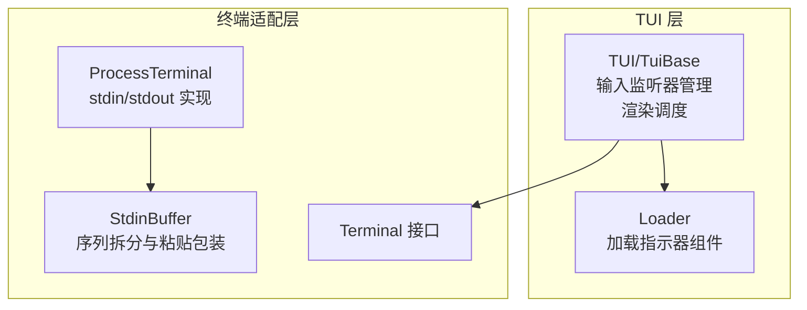
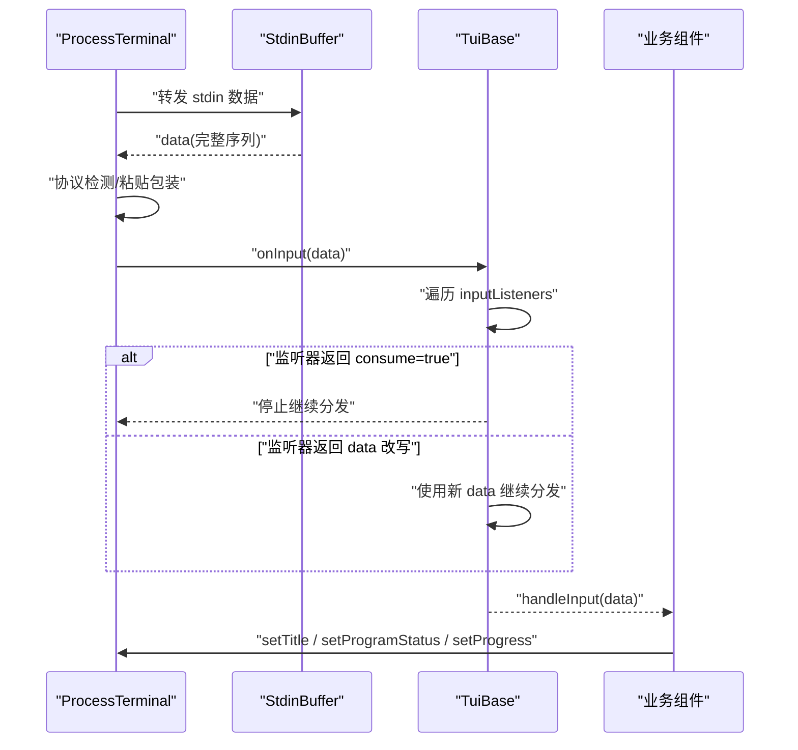
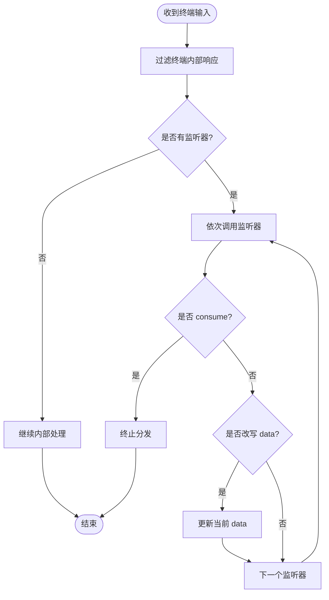
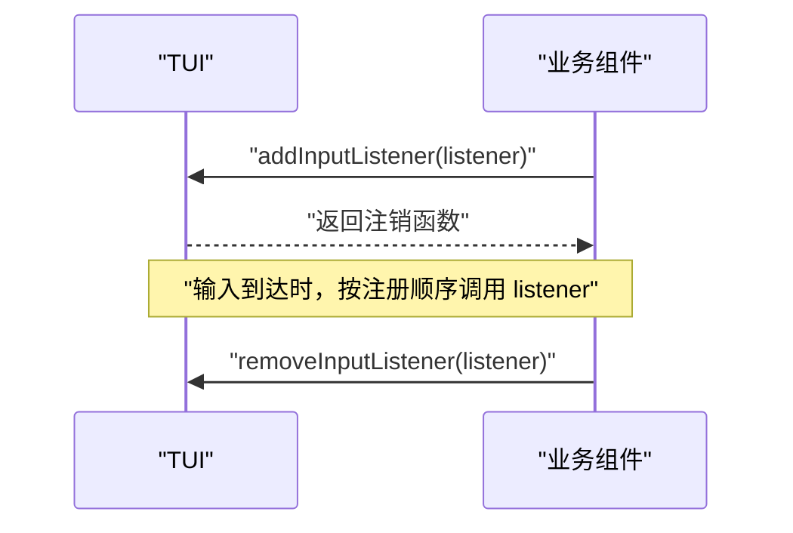
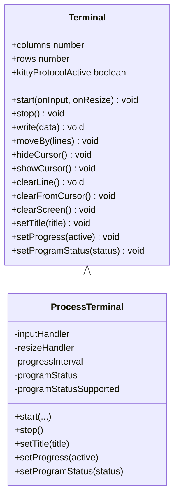
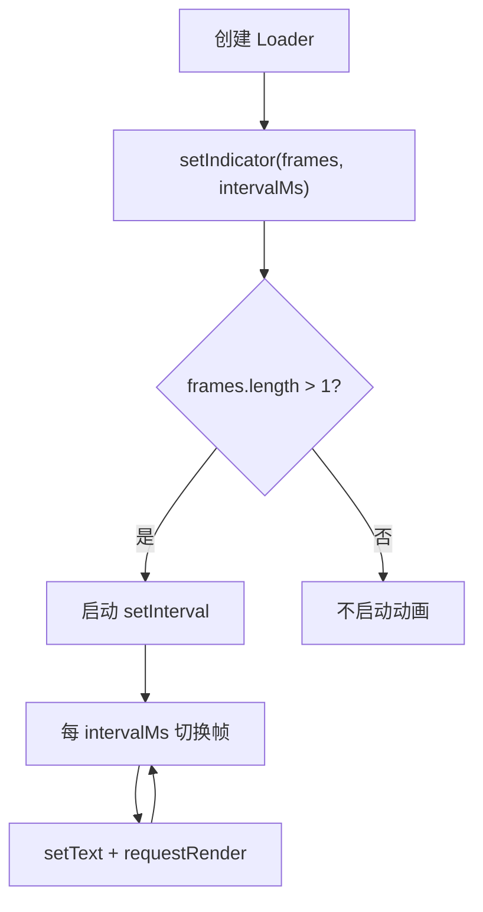
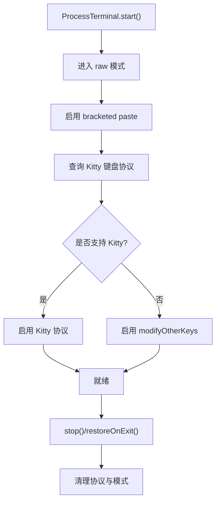
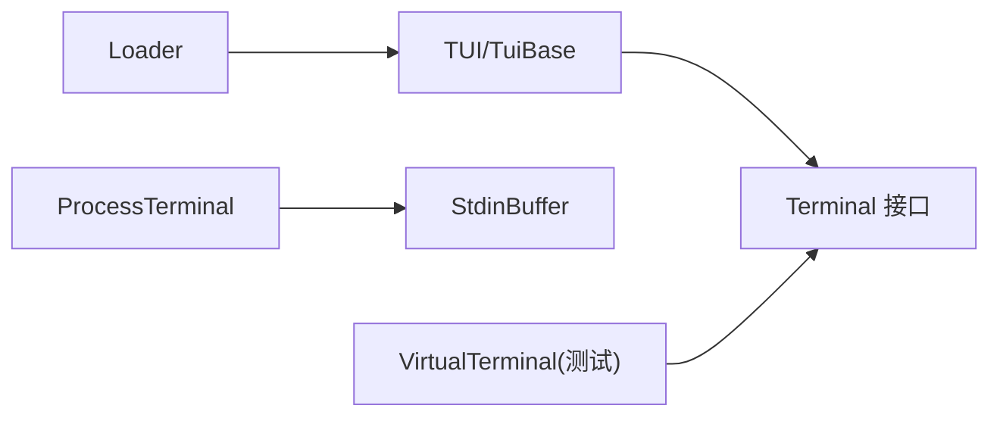

# 终端集成

<cite>
**本文引用的文件**   
- [packages/tui/src/terminal.ts](https://github.com/FDE-GROUP/oh-my-fde/blob/omca/packages/tui/src/terminal.ts)
- [packages/tui/src/tui.ts](https://github.com/FDE-GROUP/oh-my-fde/blob/omca/packages/tui/src/tui.ts)
- [packages/tui/src/components/loader.ts](https://github.com/FDE-GROUP/oh-my-fde/blob/omca/packages/tui/src/components/loader.ts)
- [packages/tui/src/stdin-buffer.ts](https://github.com/FDE-GROUP/oh-my-fde/blob/omca/packages/tui/src/stdin-buffer.ts)
- [packages/tui/test/virtual-terminal.ts](https://github.com/FDE-GROUP/oh-my-fde/blob/omca/packages/tui/test/virtual-terminal.ts)
- [packages/tui/test/terminal.test.ts](https://github.com/FDE-GROUP/oh-my-fde/blob/omca/packages/tui/test/terminal.test.ts)
</cite>

## 目录
1. [简介](#简介)
2. [项目结构](#项目结构)
3. [核心组件](#核心组件)
4. [架构总览](#架构总览)
5. [详细组件分析](#详细组件分析)
6. [依赖关系分析](#依赖关系分析)
7. [性能与兼容性](#性能与兼容性)
8. [故障排查指南](#故障排查指南)
9. [结论](#结论)
10. [附录：完整交互示例](#附录完整交互示例)

## 简介
本文面向需要在终端中实现交互式界面的开发者，系统性说明以下能力：
- 如何通过输入监听机制接收并消费终端输入。
- 如何注册和注销输入处理器，实现对数据流的精确控制。
- 如何设置终端窗口标题与管理程序状态栏。
- 如何配置加载指示器的动画帧与间隔时间。
- 如何在真实终端环境中处理兼容性问题与错误恢复。

本仓库的终端抽象位于 TUI 包中，核心包括：
- Terminal 接口与 ProcessTerminal 实现，负责底层 I/O、协议协商、事件分发。
- TUI/TuiBase 提供输入监听器管理、渲染调度、颜色查询等上层能力。
- Loader 组件提供可配置的加载动画指示器。
- StdinBuffer 将原始输入流拆分为完整的转义序列，避免误解析。

## 项目结构
下图展示了与终端集成相关的关键模块及其职责：

图表来源
- [packages/tui/src/tui.ts:470-516](https://github.com/FDE-GROUP/oh-my-fde/blob/omca/packages/tui/src/tui.ts#L470-L516)
- [packages/tui/src/terminal.ts:83-140](https://github.com/FDE-GROUP/oh-my-fde/blob/omca/packages/tui/src/terminal.ts#L83-L140)
- [packages/tui/src/terminal.ts:164-284](https://github.com/FDE-GROUP/oh-my-fde/blob/omca/packages/tui/src/terminal.ts#L164-L284)
- [packages/tui/src/components/loader.ts:4-9](https://github.com/FDE-GROUP/oh-my-fde/blob/omca/packages/tui/src/components/loader.ts#L4-L9)

章节来源
- [packages/tui/src/tui.ts:470-516](https://github.com/FDE-GROUP/oh-my-fde/blob/omca/packages/tui/src/tui.ts#L470-L516)
- [packages/tui/src/terminal.ts:83-140](https://github.com/FDE-GROUP/oh-my-fde/blob/omca/packages/tui/src/terminal.ts#L83-L140)
- [packages/tui/src/components/loader.ts:4-9](https://github.com/FDE-GROUP/oh-my-fde/blob/omca/packages/tui/src/components/loader.ts#L4-L9)

## 核心组件
本节聚焦终端集成的关键概念与接口：
- Terminal 接口定义了启动、停止、写入、尺寸、光标、标题、进度、程序状态等能力。
- ProcessTerminal 是真实终端的实现，负责 raw 模式、Kitty 键盘协议、modifyOtherKeys、粘贴包装、OSC 进度与 OSC 7501 程序状态。
- TUI/TuiBase 暴露 addInputListener/removeInputListener，用于注册和注销输入监听器，支持 consume 与 data 改写。
- LoaderIndicatorOptions 定义加载指示器的 frames 与 intervalMs。

章节来源
- [packages/tui/src/terminal.ts:83-140](https://github.com/FDE-GROUP/oh-my-fde/blob/omca/packages/tui/src/terminal.ts#L83-L140)
- [packages/tui/src/terminal.ts:164-284](https://github.com/FDE-GROUP/oh-my-fde/blob/omca/packages/tui/src/terminal.ts#L164-L284)
- [packages/tui/src/tui.ts:470-516](https://github.com/FDE-GROUP/oh-my-fde/blob/omca/packages/tui/src/tui.ts#L470-L516)
- [packages/tui/src/components/loader.ts:4-9](https://github.com/FDE-GROUP/oh-my-fde/blob/omca/packages/tui/src/components/loader.ts#L4-L9)

## 架构总览
下图展示从终端输入到应用逻辑的处理流程，以及输出控制（标题、状态栏）的位置：

图表来源
- [packages/tui/src/terminal.ts:248-284](https://github.com/FDE-GROUP/oh-my-fde/blob/omca/packages/tui/src/terminal.ts#L248-L284)
- [packages/tui/src/tui.ts:1087-1115](https://github.com/FDE-GROUP/oh-my-fde/blob/omca/packages/tui/src/tui.ts#L1087-L1115)
- [packages/tui/src/terminal.ts:600-631](https://github.com/FDE-GROUP/oh-my-fde/blob/omca/packages/tui/src/terminal.ts#L600-L631)

## 详细组件分析

### 输入监听与消费控制
TUI 提供统一的输入监听机制，允许多个监听器对同一输入进行观察或拦截：
- 通过 addInputListener 注册监听器，返回一个注销函数。
- 监听器可以返回 consume=true 以阻止后续监听器继续处理。
- 监听器可以返回 data 字段以改写传递给下一个监听器的数据。
- 当所有监听器都未消费且最终数据为空时，TUI 会丢弃该输入。

图表来源
- [packages/tui/src/tui.ts:1087-1115](https://github.com/FDE-GROUP/oh-my-fde/blob/omca/packages/tui/src/tui.ts#L1087-L1115)

章节来源
- [packages/tui/src/tui.ts:491-493](https://github.com/FDE-GROUP/oh-my-fde/blob/omca/packages/tui/src/tui.ts#L491-L493)
- [packages/tui/src/tui.ts:1087-1115](https://github.com/FDE-GROUP/oh-my-fde/blob/omca/packages/tui/src/tui.ts#L1087-L1115)

### onTerminalInput 的注册与注销
虽然代码中没有名为 onTerminalInput 的方法，但 TUI 提供了标准的输入监听 API：
- 注册：addInputListener(listener)，listener 类型为 (data: string) => { consume?: boolean; data?: string } | undefined。
- 注销：removeInputListener(listener)。
- 典型用法：在组件初始化时注册，在 dispose 或卸载时调用返回的注销函数。

图表来源
- [packages/tui/src/tui.ts:491-493](https://github.com/FDE-GROUP/oh-my-fde/blob/omca/packages/tui/src/tui.ts#L491-L493)
- [packages/tui/src/tui.ts:1087-1115](https://github.com/FDE-GROUP/oh-my-fde/blob/omca/packages/tui/src/tui.ts#L1087-L1115)

章节来源
- [packages/tui/src/tui.ts:491-493](https://github.com/FDE-GROUP/oh-my-fde/blob/omca/packages/tui/src/tui.ts#L491-L493)
- [packages/tui/src/tui.ts:1087-1115](https://github.com/FDE-GROUP/oh-my-fde/blob/omca/packages/tui/src/tui.ts#L1087-L1115)

### 终端窗口标题与状态栏管理
- 标题设置：Terminal.setTitle(title) 使用 OSC 0 序列设置终端窗口标题，并对控制字符进行替换，防止意外截断序列。
- 程序状态栏：Terminal.setProgramStatus(status) 使用 OSC 7501 向支持的终端报告程序状态；若终端不支持则不发送。
- 进度指示：Terminal.setProgress(active) 使用 OSC 9;4 显示不确定进度，并在活跃期间周期性保活。

图表来源
- [packages/tui/src/terminal.ts:83-140](https://github.com/FDE-GROUP/oh-my-fde/blob/omca/packages/tui/src/terminal.ts#L83-L140)
- [packages/tui/src/terminal.ts:600-631](https://github.com/FDE-GROUP/oh-my-fde/blob/omca/packages/tui/src/terminal.ts#L600-L631)

章节来源
- [packages/tui/src/terminal.ts:600-631](https://github.com/FDE-GROUP/oh-my-fde/blob/omca/packages/tui/src/terminal.ts#L600-L631)
- [packages/tui/test/terminal.test.ts:405-423](https://github.com/FDE-GROUP/oh-my-fde/blob/omca/packages/tui/test/terminal.test.ts#L405-L423)

### WorkingIndicatorOptions 的配置
注意：代码中实际类型名为 LoaderIndicatorOptions，而非 WorkingIndicatorOptions。其配置项如下：
- frames：动画帧字符串数组；传入空数组可隐藏指示器。
- intervalMs：动画帧间隔毫秒数；默认值为 80ms。

Loader 组件会根据 frames 长度决定是否启动定时器，并通过 setInterval 循环切换 currentFrame，同时调用 ui.requestRender() 触发重绘。

图表来源
- [packages/tui/src/components/loader.ts:4-9](https://github.com/FDE-GROUP/oh-my-fde/blob/omca/packages/tui/src/components/loader.ts#L4-L9)
- [packages/tui/src/components/loader.ts:69-86](https://github.com/FDE-GROUP/oh-my-fde/blob/omca/packages/tui/src/components/loader.ts#L69-L86)
- [packages/tui/src/components/loader.ts:93-100](https://github.com/FDE-GROUP/oh-my-fde/blob/omca/packages/tui/src/components/loader.ts#L93-L100)

章节来源
- [packages/tui/src/components/loader.ts:4-9](https://github.com/FDE-GROUP/oh-my-fde/blob/omca/packages/tui/src/components/loader.ts#L4-L9)
- [packages/tui/src/components/loader.ts:69-86](https://github.com/FDE-GROUP/oh-my-fde/blob/omca/packages/tui/src/components/loader.ts#L69-L86)

### 终端兼容性处理与错误恢复
- Kitty 键盘协议协商：ProcessTerminal 启动时发送 Kitty 协议查询，根据响应启用或禁用 modifyOtherKeys，确保按键事件类型、修饰键、重复与释放事件正确上报。
- 粘贴包装：启用 bracketed paste 模式，并将粘贴内容包裹为 \x1b[200~ ... \x1b[201~，便于编辑器识别。
- 原生 Shift+Enter 归一化：针对 Apple Terminal 与 Windows 平台，将特定 ESC+CR 序列归一化为标准 Shift+Enter 序列。
- 退出恢复：stop() 与 restoreOnExit() 负责清理 raw 模式、Kitty 协议、modifyOtherKeys、粘贴模式与进度状态，避免子进程退出后污染父 shell。
- SSH 与高延迟环境：通过 resolveEscapeTimeoutMs 调整 ESC 序列重组超时，避免 Alt+key 被误判为 Escape。

图表来源
- [packages/tui/src/terminal.ts:207-238](https://github.com/FDE-GROUP/oh-my-fde/blob/omca/packages/tui/src/terminal.ts#L207-L238)
- [packages/tui/src/terminal.ts:302-344](https://github.com/FDE-GROUP/oh-my-fde/blob/omca/packages/tui/src/terminal.ts#L302-L344)
- [packages/tui/src/terminal.ts:481-533](https://github.com/FDE-GROUP/oh-my-fde/blob/omca/packages/tui/src/terminal.ts#L481-L533)
- [packages/tui/src/terminal.ts:142-159](https://github.com/FDE-GROUP/oh-my-fde/blob/omca/packages/tui/src/terminal.ts#L142-L159)

章节来源
- [packages/tui/src/terminal.ts:207-238](https://github.com/FDE-GROUP/oh-my-fde/blob/omca/packages/tui/src/terminal.ts#L207-L238)
- [packages/tui/src/terminal.ts:302-344](https://github.com/FDE-GROUP/oh-my-fde/blob/omca/packages/tui/src/terminal.ts#L302-L344)
- [packages/tui/src/terminal.ts:481-533](https://github.com/FDE-GROUP/oh-my-fde/blob/omca/packages/tui/src/terminal.ts#L481-L533)
- [packages/tui/src/terminal.ts:142-159](https://github.com/FDE-GROUP/oh-my-fde/blob/omca/packages/tui/src/terminal.ts#L142-L159)

## 依赖关系分析
- TUI 依赖 Terminal 抽象，但不直接依赖具体实现，便于测试与替换。
- ProcessTerminal 依赖 StdinBuffer 完成输入序列拆分与粘贴包装。
- Loader 依赖 TUI 以请求渲染，并通过回调函数着色 spinner 与消息。
- 测试中使用 VirtualTerminal 模拟 setTitle、setProgress 等方法，验证行为。

图表来源
- [packages/tui/src/tui.ts:470-516](https://github.com/FDE-GROUP/oh-my-fde/blob/omca/packages/tui/src/tui.ts#L470-L516)
- [packages/tui/src/terminal.ts:164-284](https://github.com/FDE-GROUP/oh-my-fde/blob/omca/packages/tui/src/terminal.ts#L164-L284)
- [packages/tui/src/components/loader.ts:1-3](https://github.com/FDE-GROUP/oh-my-fde/blob/omca/packages/tui/src/components/loader.ts#L1-L3)
- [packages/tui/test/virtual-terminal.ts:98-104](https://github.com/FDE-GROUP/oh-my-fde/blob/omca/packages/tui/test/virtual-terminal.ts#L98-L104)

章节来源
- [packages/tui/src/tui.ts:470-516](https://github.com/FDE-GROUP/oh-my-fde/blob/omca/packages/tui/src/tui.ts#L470-L516)
- [packages/tui/src/terminal.ts:164-284](https://github.com/FDE-GROUP/oh-my-fde/blob/omca/packages/tui/src/terminal.ts#L164-L284)
- [packages/tui/src/components/loader.ts:1-3](https://github.com/FDE-GROUP/oh-my-fde/blob/omca/packages/tui/src/components/loader.ts#L1-L3)
- [packages/tui/test/virtual-terminal.ts:98-104](https://github.com/FDE-GROUP/oh-my-fde/blob/omca/packages/tui/test/virtual-terminal.ts#L98-L104)

## 性能与兼容性
- 渲染节流：TUI 维护最小渲染间隔，避免频繁重绘导致终端卡顿。
- 进度保活：OSC 9;4 进度在活跃状态下周期性发送，保持终端侧进度条可见。
- 输入缓冲：StdinBuffer 通过超时策略区分普通字符与转义序列，减少误解析。
- 协议协商：Kitty 协议优先，失败回退至 modifyOtherKeys，保证跨终端一致性。
- 平台差异：Windows 下启用虚拟终端输入以获得修饰键信息；Apple Terminal 特殊处理 Shift+Enter。

章节来源
- [packages/tui/src/tui.ts:1061-1085](https://github.com/FDE-GROUP/oh-my-fde/blob/omca/packages/tui/src/tui.ts#L1061-L1085)
- [packages/tui/src/terminal.ts:617-631](https://github.com/FDE-GROUP/oh-my-fde/blob/omca/packages/tui/src/terminal.ts#L617-L631)
- [packages/tui/src/stdin-buffer.ts:1-33](https://github.com/FDE-GROUP/oh-my-fde/blob/omca/packages/tui/src/stdin-buffer.ts#L1-L33)
- [packages/tui/src/terminal.ts:428-441](https://github.com/FDE-GROUP/oh-my-fde/blob/omca/packages/tui/src/terminal.ts#L428-L441)
- [packages/tui/src/terminal.ts:63-81](https://github.com/FDE-GROUP/oh-my-fde/blob/omca/packages/tui/src/terminal.ts#L63-L81)

## 故障排查指南
常见问题与定位建议：
- 标题异常截断：检查 setTitle 传入的 title 是否包含 BEL 或 ESC 控制字符；ProcessTerminal 已自动替换控制字符，但仍应避免传递不可打印字符。
- 进度条不消失：确认在任务完成后调用 setProgress(false)；stop() 会自动清理进度区间。
- 输入丢失或错乱：检查是否在多处注册了输入监听器且未正确处理 consume；必要时使用 removeInputListener 注销旧监听器。
- Kitty 协议不稳定：在高延迟 SSH 环境下，适当增大 PI_TUI_ESC_TIMEOUT；或通过环境变量强制程序状态支持。
- 退出后父 shell 异常：确保调用 stop() 或使用 restoreOnExit 清理 raw 模式与协议状态。

章节来源
- [packages/tui/test/terminal.test.ts:405-423](https://github.com/FDE-GROUP/oh-my-fde/blob/omca/packages/tui/test/terminal.test.ts#L405-L423)
- [packages/tui/src/terminal.ts:481-533](https://github.com/FDE-GROUP/oh-my-fde/blob/omca/packages/tui/src/terminal.ts#L481-L533)
- [packages/tui/src/terminal.ts:617-631](https://github.com/FDE-GROUP/oh-my-fde/blob/omca/packages/tui/src/terminal.ts#L617-L631)
- [packages/tui/src/tui.ts:1087-1115](https://github.com/FDE-GROUP/oh-my-fde/blob/omca/packages/tui/src/tui.ts#L1087-L1115)

## 结论
通过 Terminal 抽象与 TUI 输入监听机制，开发者可以在多种终端环境中实现稳定、可控的交互体验。结合标题与状态栏管理、加载指示器配置，以及完善的兼容性与错误恢复策略，能够覆盖从轻量工具到复杂 TUI 应用的广泛场景。

## 附录：完整交互示例
以下示例描述一个典型的终端交互流程，涵盖实时输入处理、进度显示与用户反馈。为避免泄露源码，此处仅给出步骤与对应源码路径。

- 初始化终端与 TUI
  - 创建 ProcessTerminal 实例并调用 start，传入 onInput 与 onResize。
  - 创建 TUI 实例并挂载根组件。
  - 参考：[packages/tui/src/terminal.ts:207-238](https://github.com/FDE-GROUP/oh-my-fde/blob/omca/packages/tui/src/terminal.ts#L207-L238)、[packages/tui/src/tui.ts:549-556](https://github.com/FDE-GROUP/oh-my-fde/blob/omca/packages/tui/src/tui.ts#L549-L556)

- 注册输入监听器
  - 在组件初始化时调用 addInputListener，保存返回的注销函数。
  - 在监听器中判断 key 组合，必要时返回 consume=true 或改写 data。
  - 参考：[packages/tui/src/tui.ts:491-493](https://github.com/FDE-GROUP/oh-my-fde/blob/omca/packages/tui/src/tui.ts#L491-L493)、[packages/tui/src/tui.ts:1087-1115](https://github.com/FDE-GROUP/oh-my-fde/blob/omca/packages/tui/src/tui.ts#L1087-L1115)

- 处理实时输入
  - 在 handleInput 中解析 matchesKey 结果，执行业务逻辑。
  - 如需关闭或切换界面，调用 removeInputListener 注销监听器。
  - 参考：[packages/coding-agent/examples/extensions/overlay-qa-tests.ts:794-803](https://github.com/FDE-GROUP/oh-my-fde/blob/omca/packages/coding-agent/examples/extensions/overlay-qa-tests.ts#L794-L803)

- 显示进度与状态
  - 任务开始时调用 setProgress(true)，结束时调用 setProgress(false)。
  - 使用 setProgramStatus 报告当前操作状态（如“正在克隆仓库”）。
  - 参考：[packages/tui/src/terminal.ts:617-631](https://github.com/FDE-GROUP/oh-my-fde/blob/omca/packages/tui/src/terminal.ts#L617-L631)、[packages/tui/src/terminal.ts:606-615](https://github.com/FDE-GROUP/oh-my-fde/blob/omca/packages/tui/src/terminal.ts#L606-L615)

- 设置窗口标题
  - 在任务阶段变化时调用 setTitle，例如“pi - 工作区”。
  - 参考：[packages/tui/src/terminal.ts:600-604](https://github.com/FDE-GROUP/oh-my-fde/blob/omca/packages/tui/src/terminal.ts#L600-L604)

- 配置加载指示器
  - 创建 Loader 组件，传入 LoaderIndicatorOptions（frames、intervalMs）。
  - 在任务进行中调用 start，结束后调用 stop。
  - 参考：[packages/tui/src/components/loader.ts:4-9](https://github.com/FDE-GROUP/oh-my-fde/blob/omca/packages/tui/src/components/loader.ts#L4-L9)、[packages/tui/src/components/loader.ts:69-86](https://github.com/FDE-GROUP/oh-my-fde/blob/omca/packages/tui/src/components/loader.ts#L69-L86)

- 清理与恢复
  - 在组件销毁时调用 removeInputListener 与 Loader.stop。
  - 在应用退出前调用 TUI.stop 与 ProcessTerminal.stop，确保协议与模式恢复。
  - 参考：[packages/tui/src/terminal.ts:481-533](https://github.com/FDE-GROUP/oh-my-fde/blob/omca/packages/tui/src/terminal.ts#L481-L533)