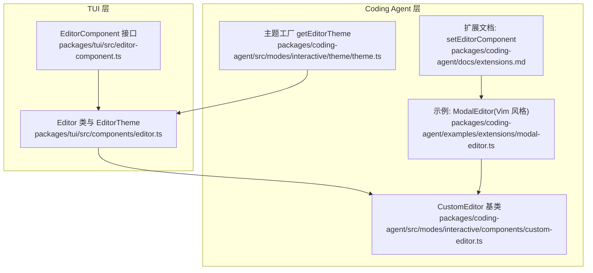
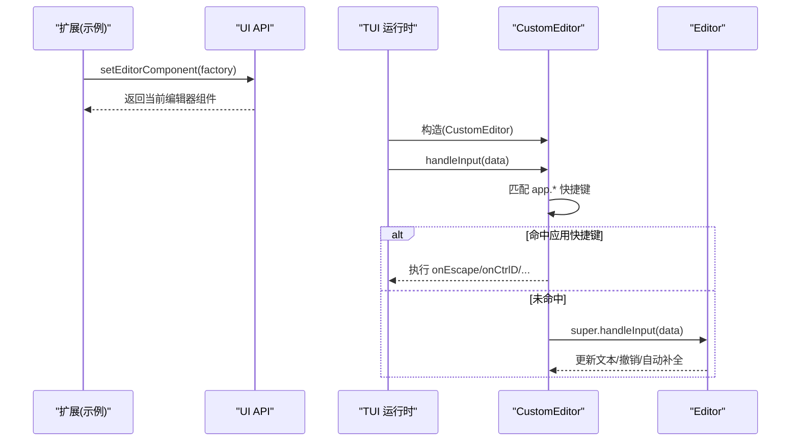
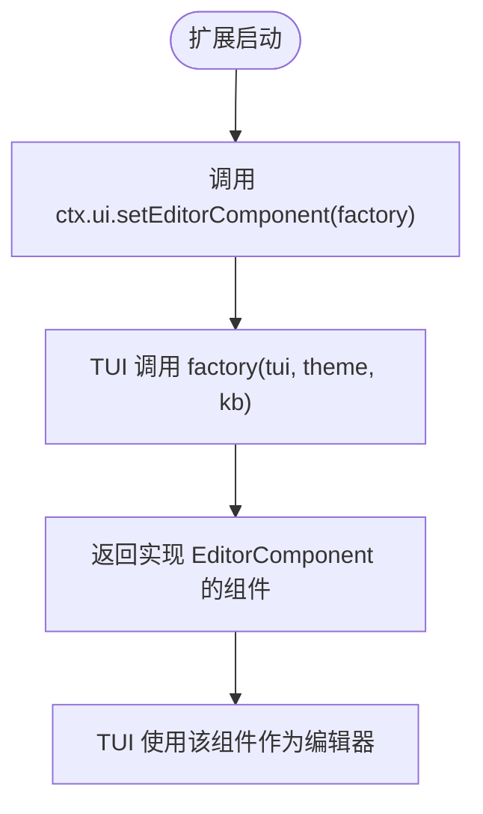
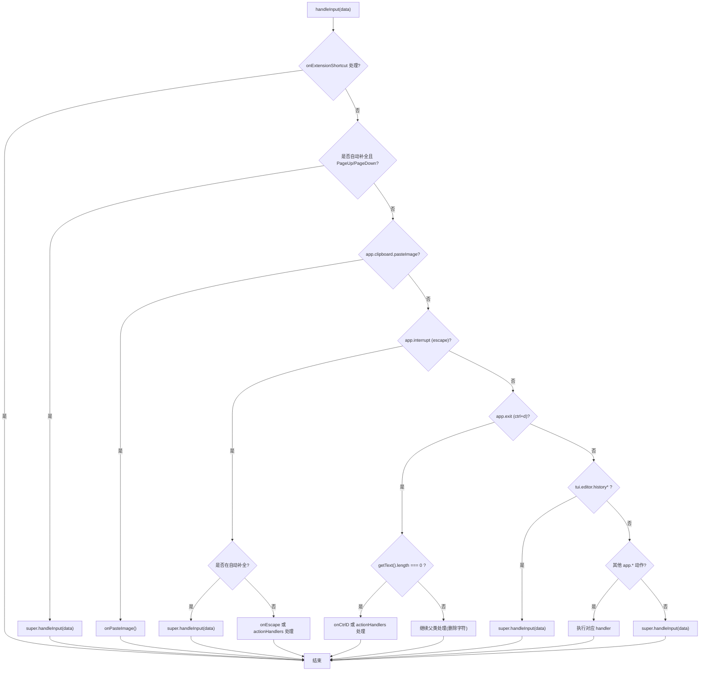
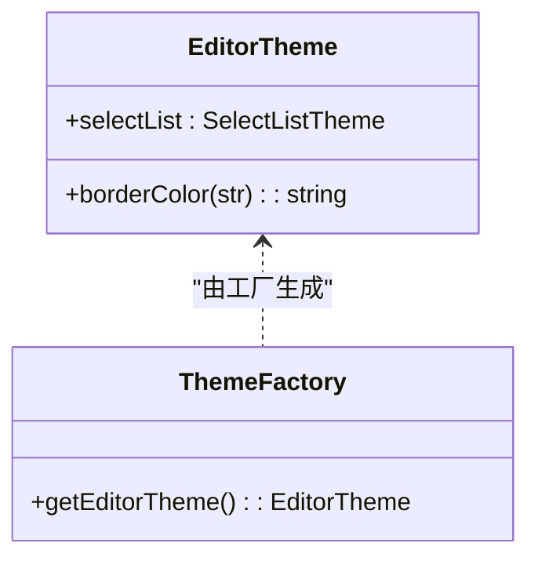
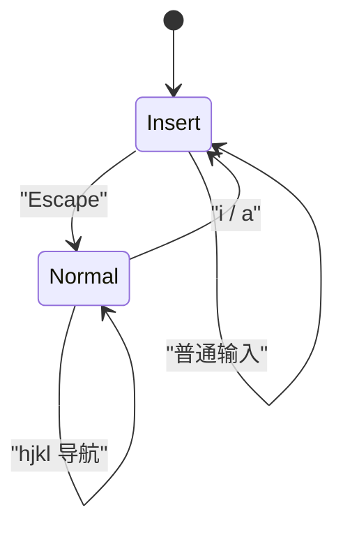
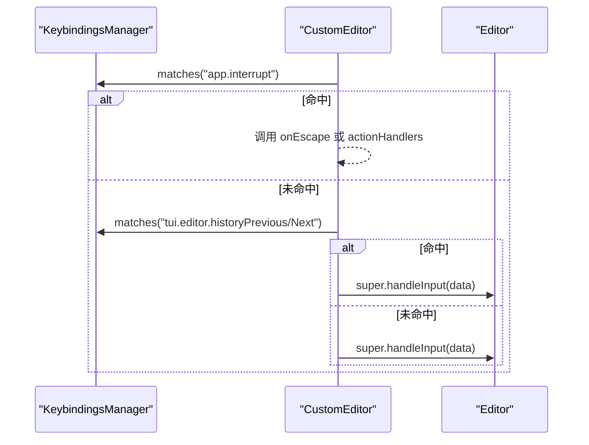
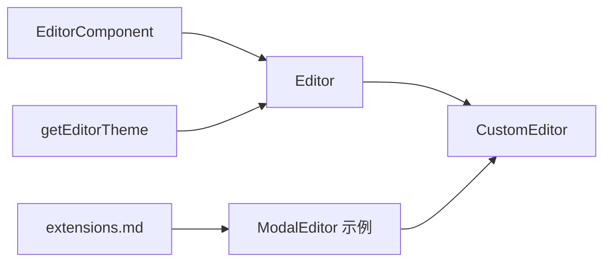

# 自定义编辑器

<cite>
**本文引用的文件**   
- [packages/tui/src/editor-component.ts](https://github.com/FDE-GROUP/oh-my-fde/blob/omca/packages/tui/src/editor-component.ts)
- [packages/tui/src/components/editor.ts](https://github.com/FDE-GROUP/oh-my-fde/blob/omca/packages/tui/src/components/editor.ts)
- [packages/coding-agent/src/modes/interactive/components/custom-editor.ts](https://github.com/FDE-GROUP/oh-my-fde/blob/omca/packages/coding-agent/src/modes/interactive/components/custom-editor.ts)
- [packages/coding-agent/examples/extensions/modal-editor.ts](https://github.com/FDE-GROUP/oh-my-fde/blob/omca/packages/coding-agent/examples/extensions/modal-editor.ts)
- [packages/coding-agent/src/modes/interactive/theme/theme.ts](https://github.com/FDE-GROUP/oh-my-fde/blob/omca/packages/coding-agent/src/modes/interactive/theme/theme.ts)
- [packages/coding-agent/docs/extensions.md](https://github.com/FDE-GROUP/oh-my-fde/blob/omca/packages/coding-agent/docs/extensions.md)
- [packages/coding-agent/test/custom-editor-keybindings.test.ts](https://github.com/FDE-GROUP/oh-my-fde/blob/omca/packages/coding-agent/test/custom-editor-keybindings.test.ts)
- [packages/tui/test/editor.test.ts](https://github.com/FDE-GROUP/oh-my-fde/blob/omca/packages/tui/test/editor.test.ts)
</cite>

## 目录
1. [简介](#简介)
2. [项目结构](#项目结构)
3. [核心组件](#核心组件)
4. [架构总览](#架构总览)
5. [详细组件分析](#详细组件分析)
6. [依赖关系分析](#依赖关系分析)
7. [性能考虑](#性能考虑)
8. [故障排查指南](#故障排查指南)
9. [结论](#结论)
10. [附录](#附录)

## 简介
本指南面向希望为应用提供“自定义编辑器”的开发者，目标是帮助你：
- 理解 EditorFactory 函数签名与 EditorComponent 接口要求
- 使用 CustomEditor 基类实现键盘绑定、状态管理与系统快捷键处理
- 集成编辑器主题 EditorTheme 并定制样式
- 参考完整示例（如 Vim 风格模态编辑器）快速上手
- 将编辑器与应用程序键绑定系统集成，正确处理 escape、ctrl+d 等系统快捷键
- 管理编辑器内部状态并优化渲染与输入性能

## 项目结构
围绕“自定义编辑器”的关键代码分布在以下位置：
- TUI 层定义编辑器通用能力与主题类型
- Coding Agent 层提供 CustomEditor 基类与扩展点
- 示例扩展展示如何注册自定义编辑器
- 文档说明如何通过 UI API 替换默认编辑器

**图表来源**
- [packages/tui/src/editor-component.ts:11-74](https://github.com/FDE-GROUP/oh-my-fde/blob/omca/packages/tui/src/editor-component.ts#L11-L74)
- [packages/tui/src/components/editor.ts:238-246](https://github.com/FDE-GROUP/oh-my-fde/blob/omca/packages/tui/src/components/editor.ts#L238-L246)
- [packages/coding-agent/src/modes/interactive/components/custom-editor.ts:1-30](https://github.com/FDE-GROUP/oh-my-fde/blob/omca/packages/coding-agent/src/modes/interactive/components/custom-editor.ts#L1-L30)
- [packages/coding-agent/src/modes/interactive/theme/theme.ts:1095-1100](https://github.com/FDE-GROUP/oh-my-fde/blob/omca/packages/coding-agent/src/modes/interactive/theme/theme.ts#L1095-L1100)
- [packages/coding-agent/examples/extensions/modal-editor.ts:1-86](https://github.com/FDE-GROUP/oh-my-fde/blob/omca/packages/coding-agent/examples/extensions/modal-editor.ts#L1-L86)
- [packages/coding-agent/docs/extensions.md:2982-2988](https://github.com/FDE-GROUP/oh-my-fde/blob/omca/packages/coding-agent/docs/extensions.md#L2982-L2988)

**章节来源**
- [packages/tui/src/editor-component.ts:11-74](https://github.com/FDE-GROUP/oh-my-fde/blob/omca/packages/tui/src/editor-component.ts#L11-L74)
- [packages/tui/src/components/editor.ts:238-246](https://github.com/FDE-GROUP/oh-my-fde/blob/omca/packages/tui/src/components/editor.ts#L238-L246)
- [packages/coding-agent/src/modes/interactive/components/custom-editor.ts:1-30](https://github.com/FDE-GROUP/oh-my-fde/blob/omca/packages/coding-agent/src/modes/interactive/components/custom-editor.ts#L1-L30)
- [packages/coding-agent/src/modes/interactive/theme/theme.ts:1095-1100](https://github.com/FDE-GROUP/oh-my-fde/blob/omca/packages/coding-agent/src/modes/interactive/theme/theme.ts#L1095-L1100)
- [packages/coding-agent/examples/extensions/modal-editor.ts:1-86](https://github.com/FDE-GROUP/oh-my-fde/blob/omca/packages/coding-agent/examples/extensions/modal-editor.ts#L1-L86)
- [packages/coding-agent/docs/extensions.md:2982-2988](https://github.com/FDE-GROUP/oh-my-fde/blob/omca/packages/coding-agent/docs/extensions.md#L2982-L2988)

## 核心组件
本节聚焦三类关键构件：
- EditorComponent 接口：自定义编辑器的最小契约
- Editor 与 EditorTheme：基础编辑器能力与主题类型
- CustomEditor：在 Editor 之上增加应用级快捷键与扩展点

### EditorComponent 接口
- 必须实现 getText/setText/handleInput
- 可选回调 onSubmit/onChange
- 可选历史 addToHistory
- 可选高级文本操作 insertTextAtCursor/getExpandedText
- 可选自动补全 setAutocompleteProvider
- 可选外观 borderColor/setPaddingX/setAutocompleteMaxVisible

这些方法确保你的自定义编辑器能够被宿主 UI 正确读取、写入、渲染和交互。

**章节来源**
- [packages/tui/src/editor-component.ts:11-74](https://github.com/FDE-GROUP/oh-my-fde/blob/omca/packages/tui/src/editor-component.ts#L11-L74)

### Editor 与 EditorTheme
- EditorTheme 包含 borderColor 与 selectList 主题项
- EditorOptions 支持 paddingX 与 autocompleteMaxVisible
- Editor 提供文本编辑、撤销、自动补全、粘贴、光标移动、滚动等能力

**章节来源**
- [packages/tui/src/components/editor.ts:238-246](https://github.com/FDE-GROUP/oh-my-fde/blob/omca/packages/tui/src/components/editor.ts#L238-L246)
- [packages/tui/src/components/editor.ts:297-429](https://github.com/FDE-GROUP/oh-my-fde/blob/omca/packages/tui/src/components/editor.ts#L297-L429)

### CustomEditor 基类
- 继承 Editor，注入 KeybindingsManager
- 暴露 onEscape/onCtrlD/onPasteImage/onExtensionShortcut 等钩子
- handleInput 中优先处理应用级快捷键（escape、ctrl+d、剪贴板粘贴等），再回退到父类处理
- 支持在顶部边框嵌入工作状态指示器

**章节来源**
- [packages/coding-agent/src/modes/interactive/components/custom-editor.ts:1-30](https://github.com/FDE-GROUP/oh-my-fde/blob/omca/packages/coding-agent/src/modes/interactive/components/custom-editor.ts#L1-L30)
- [packages/coding-agent/src/modes/interactive/components/custom-editor.ts:88-157](https://github.com/FDE-GROUP/oh-my-fde/blob/omca/packages/coding-agent/src/modes/interactive/components/custom-editor.ts#L88-L157)

## 架构总览
下图展示了从扩展到 TUI 的调用链：扩展通过 UI API 设置自定义编辑器工厂；运行时由 TUI 创建编辑器实例；用户输入经 Terminal/TUI 分发至 Editor.handleInput；CustomEditor 拦截应用级快捷键后交由父类或业务逻辑处理。

**图表来源**
- [packages/coding-agent/docs/extensions.md:2982-2988](https://github.com/FDE-GROUP/oh-my-fde/blob/omca/packages/coding-agent/docs/extensions.md#L2982-L2988)
- [packages/coding-agent/examples/extensions/modal-editor.ts:81-85](https://github.com/FDE-GROUP/oh-my-fde/blob/omca/packages/coding-agent/examples/extensions/modal-editor.ts#L81-L85)
- [packages/coding-agent/src/modes/interactive/components/custom-editor.ts:88-157](https://github.com/FDE-GROUP/oh-my-fde/blob/omca/packages/coding-agent/src/modes/interactive/components/custom-editor.ts#L88-L157)
- [packages/tui/src/components/editor.ts:297-429](https://github.com/FDE-GROUP/oh-my-fde/blob/omca/packages/tui/src/components/editor.ts#L297-L429)

## 详细组件分析

### EditorFactory 函数签名与 EditorComponent 接口
- 工厂函数签名：setEditorComponent((tui, theme, keybindings) => Component)
- 返回的组件需满足 EditorComponent 接口
- 该工厂允许你在会话开始时动态替换默认编辑器

**图表来源**
- [packages/coding-agent/docs/extensions.md:2982-2988](https://github.com/FDE-GROUP/oh-my-fde/blob/omca/packages/coding-agent/docs/extensions.md#L2982-L2988)
- [packages/tui/src/editor-component.ts:11-74](https://github.com/FDE-GROUP/oh-my-fde/blob/omca/packages/tui/src/editor-component.ts#L11-L74)

**章节来源**
- [packages/coding-agent/docs/extensions.md:2982-2988](https://github.com/FDE-GROUP/oh-my-fde/blob/omca/packages/coding-agent/docs/extensions.md#L2982-L2988)
- [packages/tui/src/editor-component.ts:11-74](https://github.com/FDE-GROUP/oh-my-fde/blob/omca/packages/tui/src/editor-component.ts#L11-L74)

### CustomEditor 基类与 handleInput 流程
CustomEditor 在 handleInput 中按优先级处理：
1. 扩展注册的快捷键 onExtensionShortcut
2. 自动补全菜单翻页键（PageUp/PageDown）
3. 剪贴板粘贴快捷键
4. 应用中断快捷键（escape），仅在非自动补全时触发 onEscape
5. 退出快捷键（ctrl+d），仅当编辑器为空时触发 onCtrlD
6. 历史上下翻（tui.editor.historyPrevious/historyNext）
7. 其他应用动作
8. 回退到父类 Editor.handleInput

**图表来源**
- [packages/coding-agent/src/modes/interactive/components/custom-editor.ts:88-157](https://github.com/FDE-GROUP/oh-my-fde/blob/omca/packages/coding-agent/src/modes/interactive/components/custom-editor.ts#L88-L157)

**章节来源**
- [packages/coding-agent/src/modes/interactive/components/custom-editor.ts:88-157](https://github.com/FDE-GROUP/oh-my-fde/blob/omca/packages/coding-agent/src/modes/interactive/components/custom-editor.ts#L88-L157)

### 编辑器主题集成（EditorTheme）
- EditorTheme 提供 borderColor 与 selectList 主题项
- 应用侧通过 getEditorTheme 生成 EditorTheme，并与全局 theme 联动
- 自定义编辑器可通过 borderColor 函数统一边框样式

**图表来源**
- [packages/tui/src/components/editor.ts:238-246](https://github.com/FDE-GROUP/oh-my-fde/blob/omca/packages/tui/src/components/editor.ts#L238-L246)
- [packages/coding-agent/src/modes/interactive/theme/theme.ts:1095-1100](https://github.com/FDE-GROUP/oh-my-fde/blob/omca/packages/coding-agent/src/modes/interactive/theme/theme.ts#L1095-L1100)

**章节来源**
- [packages/tui/src/components/editor.ts:238-246](https://github.com/FDE-GROUP/oh-my-fde/blob/omca/packages/tui/src/components/editor.ts#L238-L246)
- [packages/coding-agent/src/modes/interactive/theme/theme.ts:1095-1100](https://github.com/FDE-GROUP/oh-my-fde/blob/omca/packages/coding-agent/src/modes/interactive/theme/theme.ts#L1095-L1100)

### 完整示例：Vim 风格模态编辑器
示例 ModalEditor 继承 CustomEditor，演示：
- 两种模式：insert 与 normal
- Escape 切换模式或在 normal 模式下透传给上层（用于中止 agent）
- hjkl 映射为方向键
- i/a 进入插入模式
- render 时在底部边框显示模式标签

**图表来源**
- [packages/coding-agent/examples/extensions/modal-editor.ts:28-79](https://github.com/FDE-GROUP/oh-my-fde/blob/omca/packages/coding-agent/examples/extensions/modal-editor.ts#L28-L79)

**章节来源**
- [packages/coding-agent/examples/extensions/modal-editor.ts:1-86](https://github.com/FDE-GROUP/oh-my-fde/blob/omca/packages/coding-agent/examples/extensions/modal-editor.ts#L1-L86)

### 编辑器与应用程序键绑定的集成
- 通过 KeybindingsManager 匹配 app.* 与 tui.* 键位
- 在 CustomEditor.handleInput 中优先处理应用级快捷键
- 测试用例验证了历史键绑定（如 ctrl+p/ctrl+n）对模型循环的优先级覆盖

**图表来源**
- [packages/coding-agent/src/modes/interactive/components/custom-editor.ts:112-145](https://github.com/FDE-GROUP/oh-my-fde/blob/omca/packages/coding-agent/src/modes/interactive/components/custom-editor.ts#L112-L145)
- [packages/coding-agent/test/custom-editor-keybindings.test.ts:12-33](https://github.com/FDE-GROUP/oh-my-fde/blob/omca/packages/coding-agent/test/custom-editor-keybindings.test.ts#L12-L33)

**章节来源**
- [packages/coding-agent/src/modes/interactive/components/custom-editor.ts:112-145](https://github.com/FDE-GROUP/oh-my-fde/blob/omca/packages/coding-agent/src/modes/interactive/components/custom-editor.ts#L112-L145)
- [packages/coding-agent/test/custom-editor-keybindings.test.ts:12-33](https://github.com/FDE-GROUP/oh-my-fde/blob/omca/packages/coding-agent/test/custom-editor-keybindings.test.ts#L12-L33)

## 依赖关系分析
- EditorComponent 是扩展与宿主之间的稳定契约
- Editor 提供通用编辑能力，CustomEditor 在其上叠加应用级快捷键
- 主题通过 EditorTheme 注入样式，getEditorTheme 负责装配
- 示例扩展通过 UI API 注册自定义编辑器工厂

**图表来源**
- [packages/tui/src/editor-component.ts:11-74](https://github.com/FDE-GROUP/oh-my-fde/blob/omca/packages/tui/src/editor-component.ts#L11-L74)
- [packages/tui/src/components/editor.ts:297-429](https://github.com/FDE-GROUP/oh-my-fde/blob/omca/packages/tui/src/components/editor.ts#L297-L429)
- [packages/coding-agent/src/modes/interactive/components/custom-editor.ts:1-30](https://github.com/FDE-GROUP/oh-my-fde/blob/omca/packages/coding-agent/src/modes/interactive/components/custom-editor.ts#L1-L30)
- [packages/coding-agent/src/modes/interactive/theme/theme.ts:1095-1100](https://github.com/FDE-GROUP/oh-my-fde/blob/omca/packages/coding-agent/src/modes/interactive/theme/theme.ts#L1095-L1100)
- [packages/coding-agent/examples/extensions/modal-editor.ts:1-86](https://github.com/FDE-GROUP/oh-my-fde/blob/omca/packages/coding-agent/examples/extensions/modal-editor.ts#L1-L86)
- [packages/coding-agent/docs/extensions.md:2982-2988](https://github.com/FDE-GROUP/oh-my-fde/blob/omca/packages/coding-agent/docs/extensions.md#L2982-L2988)

**章节来源**
- [packages/tui/src/editor-component.ts:11-74](https://github.com/FDE-GROUP/oh-my-fde/blob/omca/packages/tui/src/editor-component.ts#L11-L74)
- [packages/tui/src/components/editor.ts:297-429](https://github.com/FDE-GROUP/oh-my-fde/blob/omca/packages/tui/src/components/editor.ts#L297-L429)
- [packages/coding-agent/src/modes/interactive/components/custom-editor.ts:1-30](https://github.com/FDE-GROUP/oh-my-fde/blob/omca/packages/coding-agent/src/modes/interactive/components/custom-editor.ts#L1-L30)
- [packages/coding-agent/src/modes/interactive/theme/theme.ts:1095-1100](https://github.com/FDE-GROUP/oh-my-fde/blob/omca/packages/coding-agent/src/modes/interactive/theme/theme.ts#L1095-L1100)
- [packages/coding-agent/examples/extensions/modal-editor.ts:1-86](https://github.com/FDE-GROUP/oh-my-fde/blob/omca/packages/coding-agent/examples/extensions/modal-editor.ts#L1-L86)
- [packages/coding-agent/docs/extensions.md:2982-2988](https://github.com/FDE-GROUP/oh-my-fde/blob/omca/packages/coding-agent/docs/extensions.md#L2982-L2988)

## 性能考虑
- 避免在 handleInput 中进行昂贵计算，必要时使用异步或节流
- 合理使用 undo/redo，提交后清空撤销栈以减少内存占用
- 控制自动补全列表的最大可见项数，避免渲染过多节点
- 大段粘贴时使用 bracketed paste 缓冲，减少频繁重绘
- 仅在必要时请求渲染，避免重复 invalidate

**章节来源**
- [packages/tui/test/editor.test.ts:1926-1972](https://github.com/FDE-GROUP/oh-my-fde/blob/omca/packages/tui/test/editor.test.ts#L1926-L1972)
- [packages/tui/src/components/editor.ts:732-777](https://github.com/FDE-GROUP/oh-my-fde/blob/omca/packages/tui/src/components/editor.ts#L732-L777)

## 故障排查指南
- 快捷键冲突：确认 app.* 与 tui.* 的优先级，必要时在 CustomEditor.handleInput 中调整顺序
- 历史键绑定无效：检查是否覆盖了 tui.editor.historyPrevious/Next
- 自动补全干扰：若需要保留 Ctrl+V 等组合键，注意在自动补全打开时的特殊处理
- 主题不生效：确认 EditorTheme.borderColor 已正确传入，并使用 getEditorTheme 生成的主题对象
- 编辑器替换后对话框消失：确保替换编辑器时保持焦点与容器结构正确

**章节来源**
- [packages/coding-agent/test/custom-editor-keybindings.test.ts:12-33](https://github.com/FDE-GROUP/oh-my-fde/blob/omca/packages/coding-agent/test/custom-editor-keybindings.test.ts#L12-L33)
- [packages/coding-agent/src/modes/interactive/components/custom-editor.ts:88-157](https://github.com/FDE-GROUP/oh-my-fde/blob/omca/packages/coding-agent/src/modes/interactive/components/custom-editor.ts#L88-L157)
- [packages/coding-agent/src/modes/interactive/theme/theme.ts:1095-1100](https://github.com/FDE-GROUP/oh-my-fde/blob/omca/packages/coding-agent/src/modes/interactive/theme/theme.ts#L1095-L1100)

## 结论
通过 EditorComponent 接口与 Editor/CustomEditor 基类，你可以以最小成本实现高度可定制的编辑器体验。结合 EditorTheme 与应用键绑定，既能保证与宿主系统的无缝集成，又能灵活扩展交互行为。建议从示例入手，逐步加入模式切换、快捷键映射与主题定制，并在测试中验证关键路径的行为。

## 附录
- 如何在扩展中注册自定义编辑器：参见扩展文档中的 setEditorComponent 用法
- 主题开发：通过 getEditorTheme 获取 EditorTheme，并结合全局 theme 进行样式定制

**章节来源**
- [packages/coding-agent/docs/extensions.md:2982-2999](https://github.com/FDE-GROUP/oh-my-fde/blob/omca/packages/coding-agent/docs/extensions.md#L2982-L2999)
- [packages/coding-agent/src/modes/interactive/theme/theme.ts:1095-1100](https://github.com/FDE-GROUP/oh-my-fde/blob/omca/packages/coding-agent/src/modes/interactive/theme/theme.ts#L1095-L1100)