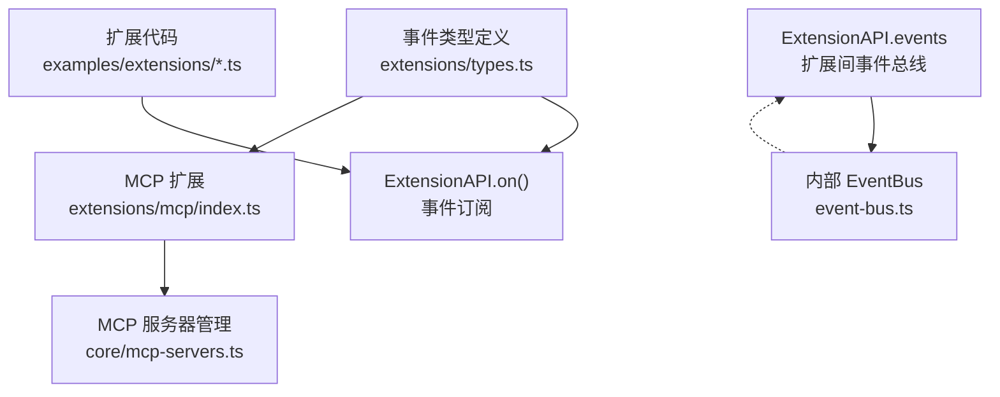
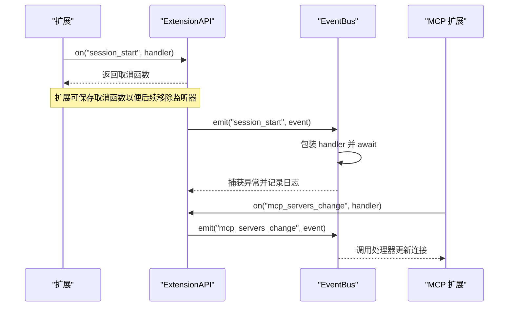
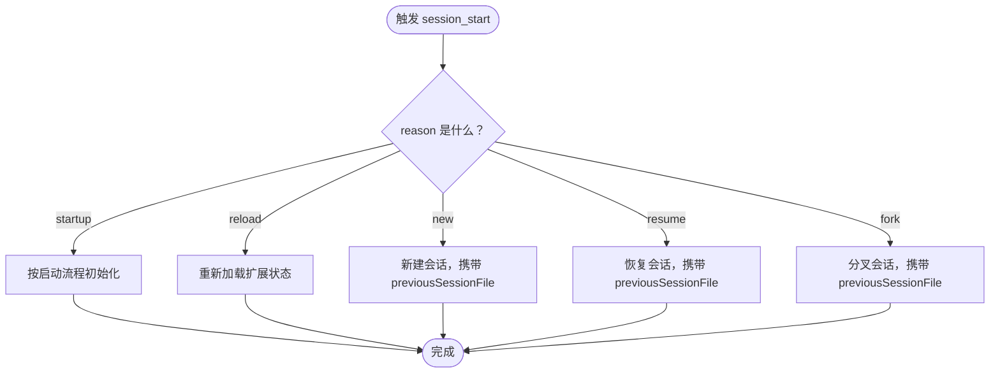
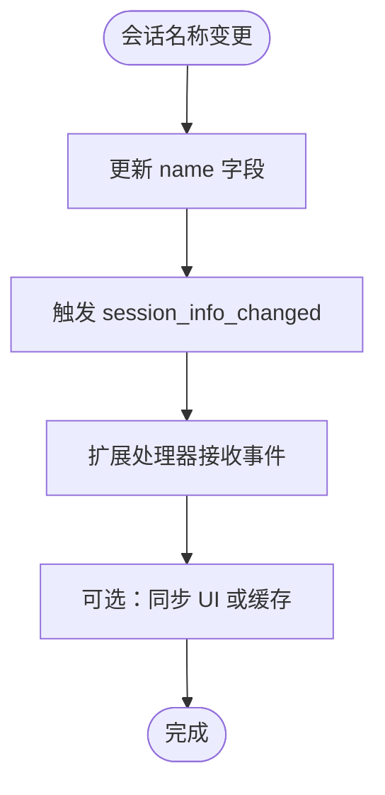
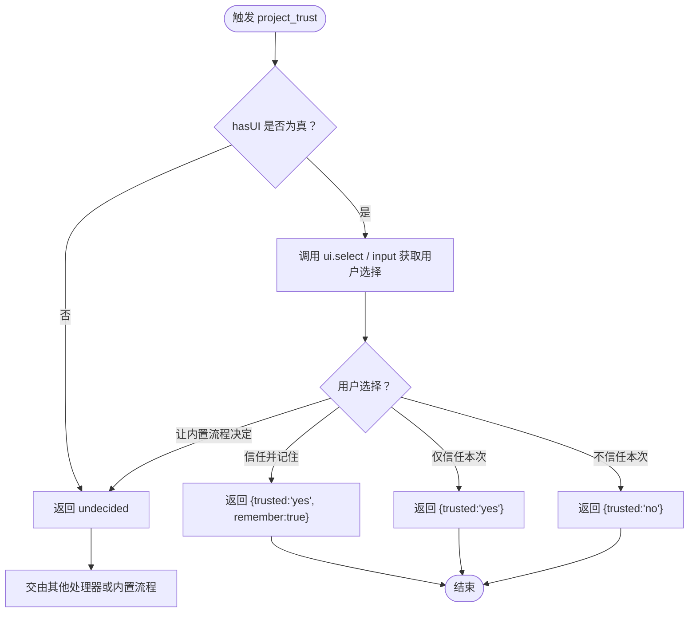
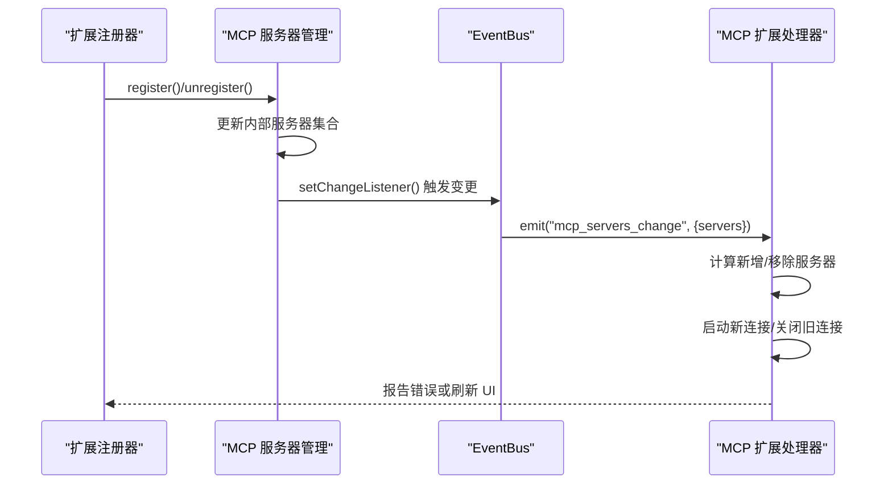
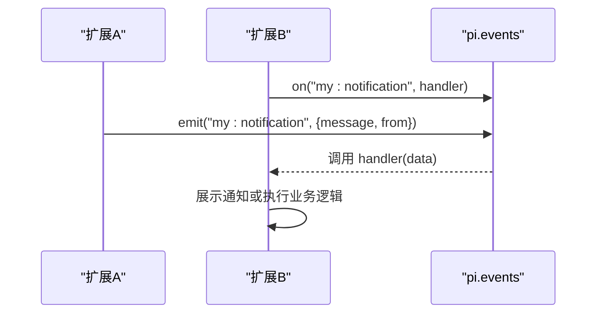
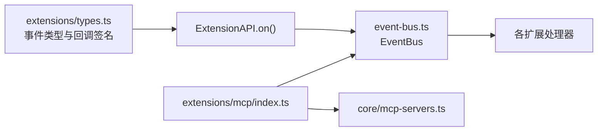

# 事件系统使用

<cite>
**本文引用的文件**   
- [packages/coding-agent/src/core/extensions/types.ts](https://github.com/FDE-GROUP/oh-my-fde/blob/omca/packages/coding-agent/src/core/extensions/types.ts)
- [packages/coding-agent/src/core/event-bus.ts](https://github.com/FDE-GROUP/oh-my-fde/blob/omca/packages/coding-agent/src/core/event-bus.ts)
- [packages/coding-agent/examples/extensions/event-bus.ts](https://github.com/FDE-GROUP/oh-my-fde/blob/omca/packages/coding-agent/examples/extensions/event-bus.ts)
- [packages/coding-agent/examples/extensions/project-trust.ts](https://github.com/FDE-GROUP/oh-my-fde/blob/omca/packages/coding-agent/examples/extensions/project-trust.ts)
- [packages/coding-agent/src/extensions/mcp/index.ts](https://github.com/FDE-GROUP/oh-my-fde/blob/omca/packages/coding-agent/src/extensions/mcp/index.ts)
- [packages/coding-agent/src/core/mcp-servers.ts](https://github.com/FDE-GROUP/oh-my-fde/blob/omca/packages/coding-agent/src/core/mcp-servers.ts)
</cite>

## 目录
1. [简介](#简介)
2. [项目结构](#项目结构)
3. [核心组件](#核心组件)
4. [架构总览](#架构总览)
5. [详细组件分析](#详细组件分析)
6. [依赖关系分析](#依赖关系分析)
7. [性能与可靠性考虑](#性能与可靠性考虑)
8. [故障排查指南](#故障排查指南)
9. [结论](#结论)
10. [附录：事件参考表](#附录事件参考表)

## 简介
本指南面向扩展开发者，系统性说明 Pi 编码代理的事件系统。重点覆盖以下事件及其用法：
- 会话事件：session_start、session_info_changed
- 项目信任事件：project_trust
- MCP 服务器事件：mcp_servers_change

你将了解：
- 事件的触发时机
- 回调函数签名与事件数据格式
- 如何注册、移除监听器并处理错误
- 事件驱动架构的设计模式与最佳实践

## 项目结构
事件系统由“扩展 API 定义”“内部事件总线”“示例扩展”“MCP 扩展实现”等部分组成：
- 扩展 API 类型定义集中声明了所有事件名、事件数据结构以及回调签名。
- 内部事件总线提供通用的 on/emit 能力，并对异步处理器进行错误捕获。
- 示例扩展演示了 session_start、project_trust 的使用方式。
- MCP 扩展在运行时响应 mcp_servers_change，动态连接或断开 MCP 服务器。

图表来源
- [packages/coding-agent/src/core/extensions/types.ts:1630-1710](https://github.com/FDE-GROUP/oh-my-fde/blob/omca/packages/coding-agent/src/core/extensions/types.ts#L1630-L1710)
- [packages/coding-agent/src/core/event-bus.ts:1-34](https://github.com/FDE-GROUP/oh-my-fde/blob/omca/packages/coding-agent/src/core/event-bus.ts#L1-L34)
- [packages/coding-agent/examples/extensions/event-bus.ts:1-44](https://github.com/FDE-GROUP/oh-my-fde/blob/omca/packages/coding-agent/examples/extensions/event-bus.ts#L1-L44)
- [packages/coding-agent/src/extensions/mcp/index.ts:1217-1259](https://github.com/FDE-GROUP/oh-my-fde/blob/omca/packages/coding-agent/src/extensions/mcp/index.ts#L1217-L1259)
- [packages/coding-agent/src/core/mcp-servers.ts:242-268](https://github.com/FDE-GROUP/oh-my-fde/blob/omca/packages/coding-agent/src/core/mcp-servers.ts#L242-L268)

章节来源
- [packages/coding-agent/src/core/extensions/types.ts:1630-1710](https://github.com/FDE-GROUP/oh-my-fde/blob/omca/packages/coding-agent/src/core/extensions/types.ts#L1630-L1710)
- [packages/coding-agent/src/core/event-bus.ts:1-34](https://github.com/FDE-GROUP/oh-my-fde/blob/omca/packages/coding-agent/src/core/event-bus.ts#L1-L34)
- [packages/coding-agent/examples/extensions/event-bus.ts:1-44](https://github.com/FDE-GROUP/oh-my-fde/blob/omca/packages/coding-agent/examples/extensions/event-bus.ts#L1-L44)
- [packages/coding-agent/src/extensions/mcp/index.ts:1217-1259](https://github.com/FDE-GROUP/oh-my-fde/blob/omca/packages/coding-agent/src/extensions/mcp/index.ts#L1217-L1259)
- [packages/coding-agent/src/core/mcp-servers.ts:242-268](https://github.com/FDE-GROUP/oh-my-fde/blob/omca/packages/coding-agent/src/core/mcp-servers.ts#L242-L268)

## 核心组件
- ExtensionAPI.on(event, handler)
  - 用于订阅系统事件，如 session_start、session_info_changed、project_trust、mcp_servers_change 等。
  - 返回一个取消函数，调用后可移除该监听器。
- ExtensionHandler 通用回调签名
  - 形如 (event, ctx) => Promise<R | void> | R | void。
  - event 为具体事件对象；ctx 为扩展上下文，包含 UI、工作目录、模式等信息。
- 内部 EventBus
  - 提供 emit/on/clear 能力，对异步处理器进行 try/catch 包装，避免未捕获异常导致进程崩溃。
- 扩展间事件总线
  - pi.events.on(channel, handler) 和 pi.events.emit(channel, data) 用于扩展之间的轻量通信。

章节来源
- [packages/coding-agent/src/core/extensions/types.ts:1630-1710](https://github.com/FDE-GROUP/oh-my-fde/blob/omca/packages/coding-agent/src/core/extensions/types.ts#L1630-L1710)
- [packages/coding-agent/src/core/event-bus.ts:1-34](https://github.com/FDE-GROUP/oh-my-fde/blob/omca/packages/coding-agent/src/core/event-bus.ts#L1-L34)
- [packages/coding-agent/examples/extensions/event-bus.ts:1-44](https://github.com/FDE-GROUP/oh-my-fde/blob/omca/packages/coding-agent/examples/extensions/event-bus.ts#L1-L44)

## 架构总览
下图展示了扩展如何通过 ExtensionAPI 订阅系统事件，并通过内部 EventBus 安全地执行回调；同时，扩展之间也可通过 pi.events 进行消息传递。

图表来源
- [packages/coding-agent/src/core/extensions/types.ts:1630-1710](https://github.com/FDE-GROUP/oh-my-fde/blob/omca/packages/coding-agent/src/core/extensions/types.ts#L1630-L1710)
- [packages/coding-agent/src/core/event-bus.ts:1-34](https://github.com/FDE-GROUP/oh-my-fde/blob/omca/packages/coding-agent/src/core/event-bus.ts#L1-L34)
- [packages/coding-agent/src/extensions/mcp/index.ts:1217-1259](https://github.com/FDE-GROUP/oh-my-fde/blob/omca/packages/coding-agent/src/extensions/mcp/index.ts#L1217-L1259)

## 详细组件分析

### 会话事件：session_start
- 触发时机
  - 会话启动、加载、重载时触发。
  - reason 字段指示触发原因，包括 startup、reload、new、resume、fork。
  - previousSessionFile 在新建、恢复、分叉场景下携带上一个活动会话文件路径。
- 回调签名
  - handler(event: SessionStartEvent, ctx: ExtensionContext) => Promise<void> | void
- 典型用途
  - 初始化会话级资源、注册工具、显示欢迎信息、读取配置等。

图表来源
- [packages/coding-agent/src/core/extensions/types.ts:775-781](https://github.com/FDE-GROUP/oh-my-fde/blob/omca/packages/coding-agent/src/core/extensions/types.ts#L775-L781)

章节来源
- [packages/coding-agent/src/core/extensions/types.ts:775-781](https://github.com/FDE-GROUP/oh-my-fde/blob/omca/packages/coding-agent/src/core/extensions/types.ts#L775-L781)
- [packages/coding-agent/examples/extensions/event-bus.ts:16-18](https://github.com/FDE-GROUP/oh-my-fde/blob/omca/packages/coding-agent/examples/extensions/event-bus.ts#L16-L18)

### 会话信息变更事件：session_info_changed
- 触发时机
  - 当前会话元数据发生变化时触发，例如会话名称被修改或清空。
- 回调签名
  - handler(event: SessionInfoChangedEvent, ctx: ExtensionContext) => Promise<void> | void
- 事件数据
  - name 字段表示当前规范化后的会话名称；当名称被清空时为 undefined。
- 典型用途
  - 同步 UI 标题、缓存会话名称、根据名称变化调整行为。

图表来源
- [packages/coding-agent/src/core/extensions/types.ts:784-788](https://github.com/FDE-GROUP/oh-my-fde/blob/omca/packages/coding-agent/src/core/extensions/types.ts#L784-L788)

章节来源
- [packages/coding-agent/src/core/extensions/types.ts:784-788](https://github.com/FDE-GROUP/oh-my-fde/blob/omca/packages/coding-agent/src/core/extensions/types.ts#L784-L788)

### 项目信任事件：project_trust
- 触发时机
  - 在扩展加载阶段评估项目信任决策时触发。
  - 多个扩展均可注册处理器；第一个返回明确 yes/no 的处理器将决定结果，并阻止内置提示。
- 回调签名
  - handler(event: ProjectTrustEvent, ctx: ProjectTrustContext) => Promise<ProjectTrustEventResult> | ProjectTrustEventResult
- 事件数据
  - cwd：项目根目录路径。
- 上下文
  - mode：扩展运行模式。
  - hasUI：是否具备 UI 能力。
  - ui：提供 select/confirm/input/notify 等交互方法。
- 返回值
  - trusted：yes/no/undecided。
  - remember：是否记住该信任决策（可选）。
- 典型用途
  - 自定义信任策略、交互式确认、记录审计日志。

图表来源
- [packages/coding-agent/src/core/extensions/types.ts:720-742](https://github.com/FDE-GROUP/oh-my-fde/blob/omca/packages/coding-agent/src/core/extensions/types.ts#L720-L742)
- [packages/coding-agent/examples/extensions/project-trust.ts:26-58](https://github.com/FDE-GROUP/oh-my-fde/blob/omca/packages/coding-agent/examples/extensions/project-trust.ts#L26-L58)

章节来源
- [packages/coding-agent/src/core/extensions/types.ts:720-742](https://github.com/FDE-GROUP/oh-my-fde/blob/omca/packages/coding-agent/src/core/extensions/types.ts#L720-L742)
- [packages/coding-agent/examples/extensions/project-trust.ts:1-65](https://github.com/FDE-GROUP/oh-my-fde/blob/omca/packages/coding-agent/examples/extensions/project-trust.ts#L1-L65)

### MCP 服务器事件：mcp_servers_change
- 触发时机
  - 扩展在绑定后通过 registerMcpServer/unregisterMcpServer 动态注册或注销 MCP 服务器时触发。
  - 首次 session_start 时，会读取扩展在加载期间注册的服务器列表。
- 回调签名
  - handler(event: McpServersChangeEvent, ctx: ExtensionContext) => Promise<void> | void
- 事件数据
  - servers：变更后所有已注册服务器的快照。
- 典型用途
  - 动态建立或关闭 MCP 连接、暴露工具、报告问题、刷新 UI。

图表来源
- [packages/coding-agent/src/core/mcp-servers.ts:242-268](https://github.com/FDE-GROUP/oh-my-fde/blob/omca/packages/coding-agent/src/core/mcp-servers.ts#L242-L268)
- [packages/coding-agent/src/extensions/mcp/index.ts:1217-1259](https://github.com/FDE-GROUP/oh-my-fde/blob/omca/packages/coding-agent/src/extensions/mcp/index.ts#L1217-L1259)

章节来源
- [packages/coding-agent/src/core/extensions/types.ts:758-768](https://github.com/FDE-GROUP/oh-my-fde/blob/omca/packages/coding-agent/src/core/extensions/types.ts#L758-L768)
- [packages/coding-agent/src/core/mcp-servers.ts:242-268](https://github.com/FDE-GROUP/oh-my-fde/blob/omca/packages/coding-agent/src/core/mcp-servers.ts#L242-L268)
- [packages/coding-agent/src/extensions/mcp/index.ts:1217-1259](https://github.com/FDE-GROUP/oh-my-fde/blob/omca/packages/coding-agent/src/extensions/mcp/index.ts#L1217-L1259)

### 扩展间事件总线：pi.events
- 作用
  - 允许不同扩展之间通过命名通道发送和接收消息。
- 常用接口
  - pi.events.on(channel, handler)：订阅通道。
  - pi.events.emit(channel, data)：发布消息。
- 典型用途
  - 跨扩展通知、命令联动、状态广播。

图表来源
- [packages/coding-agent/examples/extensions/event-bus.ts:21-33](https://github.com/FDE-GROUP/oh-my-fde/blob/omca/packages/coding-agent/examples/extensions/event-bus.ts#L21-L33)

章节来源
- [packages/coding-agent/examples/extensions/event-bus.ts:1-44](https://github.com/FDE-GROUP/oh-my-fde/blob/omca/packages/coding-agent/examples/extensions/event-bus.ts#L1-L44)

## 依赖关系分析
- ExtensionAPI.on 与事件类型解耦
  - 所有事件名与数据结构集中在 types.ts 中定义，扩展无需关心内部实现细节。
- EventBus 作为统一调度层
  - 所有系统事件最终通过 EventBus 分发，确保异步处理器异常被捕获，避免影响主流程。
- MCP 扩展对 mcp_servers_change 的强依赖
  - MCP 扩展通过监听变更事件来维护连接生命周期，保证工具可用性与 UI 一致性。

图表来源
- [packages/coding-agent/src/core/extensions/types.ts:1630-1710](https://github.com/FDE-GROUP/oh-my-fde/blob/omca/packages/coding-agent/src/core/extensions/types.ts#L1630-L1710)
- [packages/coding-agent/src/core/event-bus.ts:1-34](https://github.com/FDE-GROUP/oh-my-fde/blob/omca/packages/coding-agent/src/core/event-bus.ts#L1-L34)
- [packages/coding-agent/src/extensions/mcp/index.ts:1217-1259](https://github.com/FDE-GROUP/oh-my-fde/blob/omca/packages/coding-agent/src/extensions/mcp/index.ts#L1217-L1259)
- [packages/coding-agent/src/core/mcp-servers.ts:242-268](https://github.com/FDE-GROUP/oh-my-fde/blob/omca/packages/coding-agent/src/core/mcp-servers.ts#L242-L268)

章节来源
- [packages/coding-agent/src/core/extensions/types.ts:1630-1710](https://github.com/FDE-GROUP/oh-my-fde/blob/omca/packages/coding-agent/src/core/extensions/types.ts#L1630-L1710)
- [packages/coding-agent/src/core/event-bus.ts:1-34](https://github.com/FDE-GROUP/oh-my-fde/blob/omca/packages/coding-agent/src/core/event-bus.ts#L1-L34)
- [packages/coding-agent/src/extensions/mcp/index.ts:1217-1259](https://github.com/FDE-GROUP/oh-my-fde/blob/omca/packages/coding-agent/src/extensions/mcp/index.ts#L1217-L1259)
- [packages/coding-agent/src/core/mcp-servers.ts:242-268](https://github.com/FDE-GROUP/oh-my-fde/blob/omca/packages/coding-agent/src/core/mcp-servers.ts#L242-L268)

## 性能与可靠性考虑
- 异步处理器安全
  - EventBus 对每个处理器进行 try/catch 包装，避免未捕获异常导致进程崩溃。
- 事件处理器应轻量
  - 避免在 session_start 等高频事件中执行耗时操作；必要时采用延迟初始化或后台任务。
- 并发连接管理
  - MCP 扩展在处理 mcp_servers_change 时应批量启动连接，并在会话关闭时统一清理。
- 取消监听器
  - 使用 on 返回的取消函数及时移除监听器，防止内存泄漏。

[本节为通用指导，不直接分析具体文件]

## 故障排查指南
- 事件处理器抛出异常
  - 现象：控制台输出事件处理器错误日志。
  - 排查：检查处理器中的异步逻辑与外部依赖；确保错误被捕获并给出友好提示。
- MCP 服务器连接失败
  - 现象：mcp_servers_change 处理后出现连接错误。
  - 排查：检查服务器配置、网络连通性；查看 MCP 扩展的错误上报逻辑。
- 项目信任未生效
  - 现象：内置信任提示仍然出现。
  - 排查：确认处理器返回了明确的 yes/no；若返回 undecided，则继续交由内置流程。

章节来源
- [packages/coding-agent/src/core/event-bus.ts:18-27](https://github.com/FDE-GROUP/oh-my-fde/blob/omca/packages/coding-agent/src/core/event-bus.ts#L18-L27)
- [packages/coding-agent/src/extensions/mcp/index.ts:1245-1247](https://github.com/FDE-GROUP/oh-my-fde/blob/omca/packages/coding-agent/src/extensions/mcp/index.ts#L1245-L1247)
- [packages/coding-agent/examples/extensions/project-trust.ts:26-58](https://github.com/FDE-GROUP/oh-my-fde/blob/omca/packages/coding-agent/examples/extensions/project-trust.ts#L26-L58)

## 结论
Pi 的事件系统以 ExtensionAPI.on 为核心入口，结合内部 EventBus 提供稳定、可扩展的事件分发机制。通过 session_start、session_info_changed、project_trust、mcp_servers_change 等事件，扩展可以在合适的时机执行初始化、状态同步、信任决策与资源管理。遵循本文的最佳实践，可以构建健壮、可维护且高性能的事件驱动扩展。

[本节为总结性内容，不直接分析具体文件]

## 附录：事件参考表
- session_start
  - 触发时机：会话启动、加载、重载
  - 事件数据：reason、previousSessionFile
  - 回调签名：(event: SessionStartEvent, ctx: ExtensionContext) => Promise<void> | void
- session_info_changed
  - 触发时机：会话元数据变化（如名称）
  - 事件数据：name
  - 回调签名：(event: SessionInfoChangedEvent, ctx: ExtensionContext) => Promise<void> | void
- project_trust
  - 触发时机：项目信任决策阶段
  - 事件数据：cwd
  - 上下文：mode、hasUI、ui
  - 回调签名：(event: ProjectTrustEvent, ctx: ProjectTrustContext) => Promise<ProjectTrustEventResult> | ProjectTrustEventResult
- mcp_servers_change
  - 触发时机：扩展动态注册/注销 MCP 服务器后
  - 事件数据：servers
  - 回调签名：(event: McpServersChangeEvent, ctx: ExtensionContext) => Promise<void> | void

章节来源
- [packages/coding-agent/src/core/extensions/types.ts:720-742](https://github.com/FDE-GROUP/oh-my-fde/blob/omca/packages/coding-agent/src/core/extensions/types.ts#L720-L742)
- [packages/coding-agent/src/core/extensions/types.ts:758-768](https://github.com/FDE-GROUP/oh-my-fde/blob/omca/packages/coding-agent/src/core/extensions/types.ts#L758-L768)
- [packages/coding-agent/src/core/extensions/types.ts:775-788](https://github.com/FDE-GROUP/oh-my-fde/blob/omca/packages/coding-agent/src/core/extensions/types.ts#L775-L788)
- [packages/coding-agent/src/core/extensions/types.ts:1630-1710](https://github.com/FDE-GROUP/oh-my-fde/blob/omca/packages/coding-agent/src/core/extensions/types.ts#L1630-L1710)