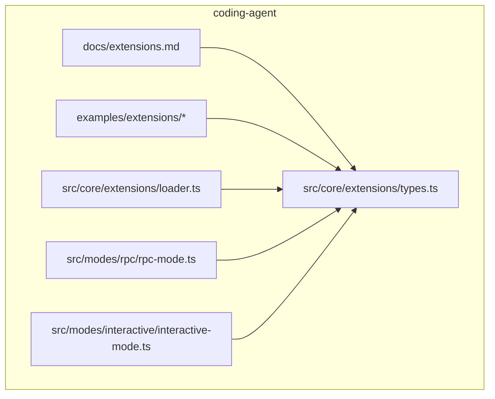
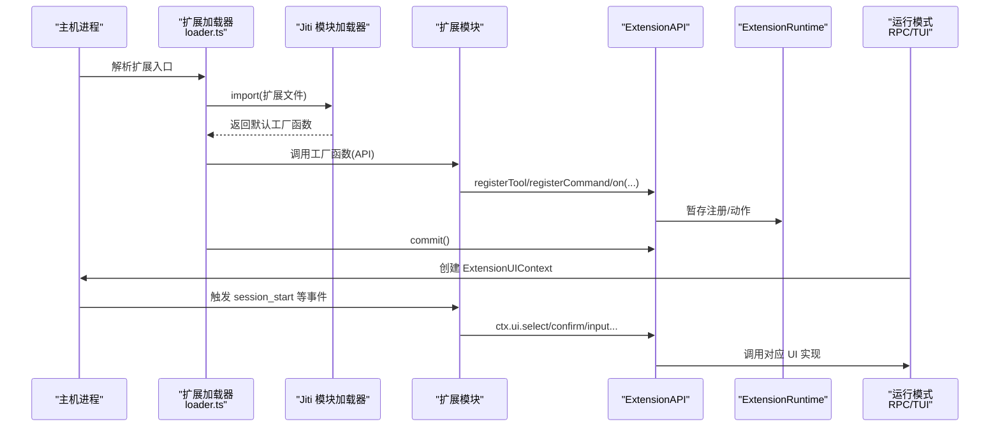
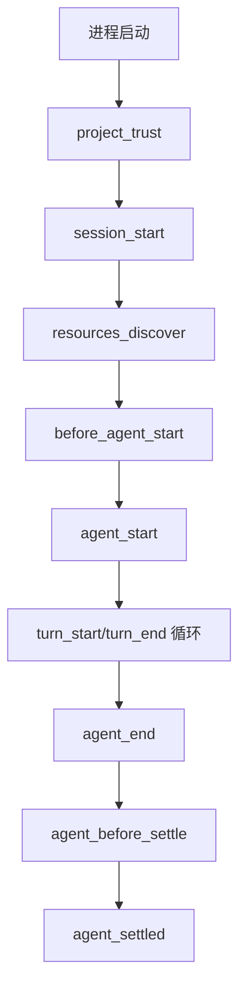
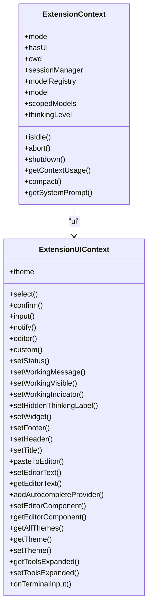
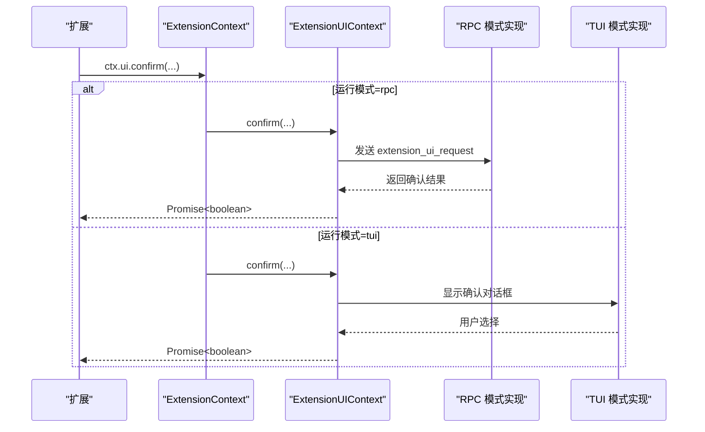
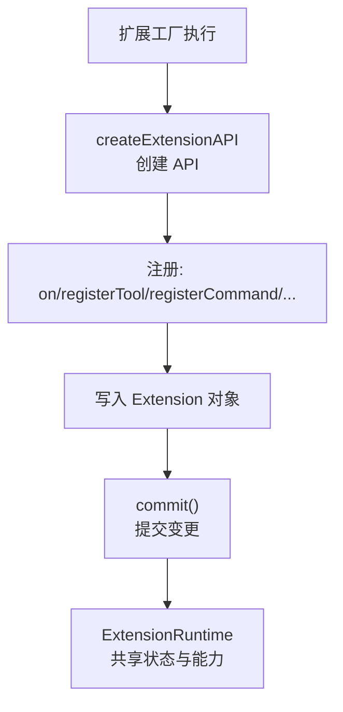
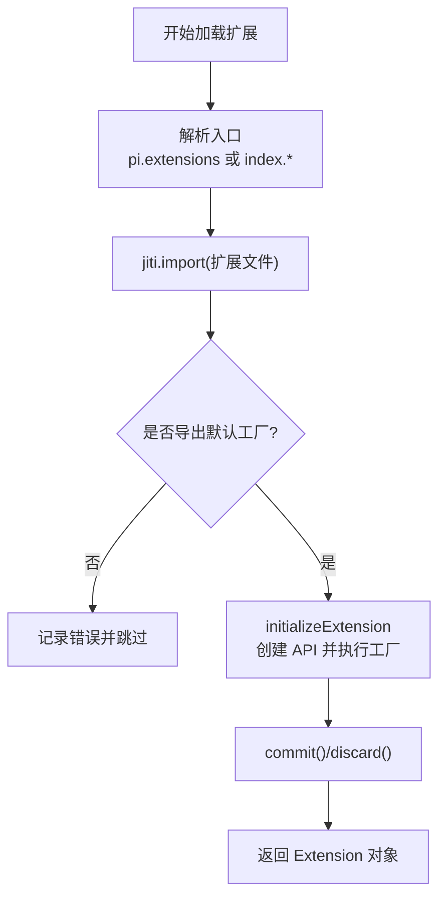
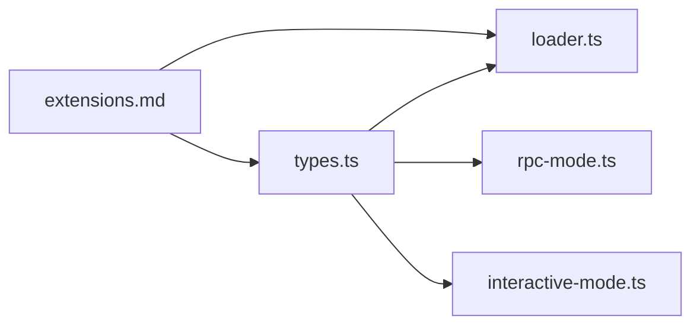

# 扩展基础概念

<cite>
**本文引用的文件**   
- [packages/coding-agent/docs/extensions.md](https://github.com/FDE-GROUP/oh-my-coding-agent/blob/omca/packages/coding-agent/docs/extensions.md)
- [packages/coding-agent/src/core/extensions/types.ts](https://github.com/FDE-GROUP/oh-my-coding-agent/blob/omca/packages/coding-agent/src/core/extensions/types.ts)
- [packages/coding-agent/src/core/extensions/loader.ts](https://github.com/FDE-GROUP/oh-my-coding-agent/blob/omca/packages/coding-agent/src/core/extensions/loader.ts)
- [packages/coding-agent/src/modes/rpc/rpc-mode.ts](https://github.com/FDE-GROUP/oh-my-coding-agent/blob/omca/packages/coding-agent/src/modes/rpc/rpc-mode.ts)
- [packages/coding-agent/src/modes/interactive/interactive-mode.ts](https://github.com/FDE-GROUP/oh-my-coding-agent/blob/omca/packages/coding-agent/src/modes/interactive/interactive-mode.ts)
- [packages/coding-agent/examples/extensions/hello.ts](https://github.com/FDE-GROUP/oh-my-coding-agent/blob/omca/packages/coding-agent/examples/extensions/hello.ts)
- [packages/coding-agent/examples/extensions/README.md](https://github.com/FDE-GROUP/oh-my-coding-agent/blob/omca/packages/coding-agent/examples/extensions/README.md)
- [packages/coding-agent/test/suite/regressions/extension-factory-cache.test.ts](https://github.com/FDE-GROUP/oh-my-coding-agent/blob/omca/packages/coding-agent/test/suite/regressions/extension-factory-cache.test.ts)
</cite>

## 目录
1. [引言](#引言)
2. [项目结构](#项目结构)
3. [核心组件](#核心组件)
4. [架构总览](#架构总览)
5. [详细组件分析](#详细组件分析)
6. [依赖分析](#依赖分析)
7. [性能考虑](#性能考虑)
8. [故障排查指南](#故障排查指南)
9. [结论](#结论)
10. [附录](#附录)

## 引言
本章节面向初次接触 Pi 扩展的开发者，系统解释“什么是扩展”、扩展的基本结构与生命周期，以及 ExtensionContext 与 ExtensionUIContext 的职责。同时说明扩展的运行模式（tui、rpc、json、print）与环境上下文，介绍扩展的注册机制、依赖注入原理和模块加载流程，并提供一个最小化的 Hello World 扩展示例路径，最后给出开发前置知识与环境准备步骤。

## 项目结构
Pi 的扩展能力集中在 coding-agent 包中：
- 文档与示例位于 packages/coding-agent/docs 与 examples/extensions。
- 扩展类型定义在 src/core/extensions/types.ts。
- 扩展加载与运行时在 src/core/extensions/loader.ts。
- 不同运行模式下 UI 上下文实现分别在 modes/rpc 与 modes/interactive。

图表来源
- [packages/coding-agent/docs/extensions.md:1-800](https://github.com/FDE-GROUP/oh-my-coding-agent/blob/omca/packages/coding-agent/docs/extensions.md#L1-L800)
- [packages/coding-agent/src/core/extensions/types.ts:1-800](https://github.com/FDE-GROUP/oh-my-coding-agent/blob/omca/packages/coding-agent/src/core/extensions/types.ts#L1-L800)
- [packages/coding-agent/src/core/extensions/loader.ts:1-800](https://github.com/FDE-GROUP/oh-my-coding-agent/blob/omca/packages/coding-agent/src/core/extensions/loader.ts#L1-L800)
- [packages/coding-agent/src/modes/rpc/rpc-mode.ts:119-154](https://github.com/FDE-GROUP/oh-my-coding-agent/blob/omca/packages/coding-agent/src/modes/rpc/rpc-mode.ts#L119-L154)
- [packages/coding-agent/src/modes/interactive/interactive-mode.ts:2757-2779](https://github.com/FDE-GROUP/oh-my-coding-agent/blob/omca/packages/coding-agent/src/modes/interactive/interactive-mode.ts#L2757-L2779)

章节来源
- [packages/coding-agent/docs/extensions.md:1-800](https://github.com/FDE-GROUP/oh-my-coding-agent/blob/omca/packages/coding-agent/docs/extensions.md#L1-L800)

## 核心组件
- 扩展工厂函数：每个扩展导出一个默认工厂函数，接收 ExtensionAPI，用于订阅事件、注册工具、命令、快捷键、标志位、渲染器等。
- ExtensionAPI：扩展对外暴露的能力集合，包括 on/registerTool/registerCommand/registerShortcut/registerFlag 等。
- ExtensionRuntime：扩展运行期共享状态与行为，如消息发送、会话管理、模型注册、MCP 服务器、虚拟模型等。
- ExtensionContext：扩展事件处理器收到的上下文，包含 ui、mode、hasUI、cwd、sessionManager、modelRegistry、model、scopedModels、thinkingLevel、isIdle、abort、shutdown 等。
- ExtensionUIContext：扩展交互 UI 抽象，提供 select/confirm/input/notify/editor/custom 等方法，由具体运行模式实现。

章节来源
- [packages/coding-agent/src/core/extensions/types.ts:160-320](https://github.com/FDE-GROUP/oh-my-coding-agent/blob/omca/packages/coding-agent/src/core/extensions/types.ts#L160-L320)
- [packages/coding-agent/src/core/extensions/types.ts:340-455](https://github.com/FDE-GROUP/oh-my-coding-agent/blob/omca/packages/coding-agent/src/core/extensions/types.ts#L340-L455)
- [packages/coding-agent/src/core/extensions/loader.ts:160-244](https://github.com/FDE-GROUP/oh-my-coding-agent/blob/omca/packages/coding-agent/src/core/extensions/loader.ts#L160-L244)
- [packages/coding-agent/src/core/extensions/loader.ts:253-561](https://github.com/FDE-GROUP/oh-my-coding-agent/blob/omca/packages/coding-agent/src/core/extensions/loader.ts#L253-L561)

## 架构总览
扩展从“被加载”到“被调用”的关键路径如下：
- 入口发现：根据约定目录或 package.json 中的 pi.extensions 字段解析扩展入口。
- 模块加载：通过 jiti 动态导入 TypeScript/JavaScript 模块，并设置别名以复用宿主包的类型与实现。
- 工厂执行：创建 ExtensionAPI 并调用扩展工厂，收集注册信息。
- 绑定运行期：将 ExtensionAPI 的注册写入 Extension 对象，并在合适时机提交变更。
- 事件分发：扩展通过 ExtensionAPI.on 订阅生命周期事件；运行时按顺序触发。
- UI 上下文：根据当前运行模式（tui/rpc/json/print）注入不同的 ExtensionUIContext 实现。

图表来源
- [packages/coding-agent/src/core/extensions/loader.ts:571-602](https://github.com/FDE-GROUP/oh-my-coding-agent/blob/omca/packages/coding-agent/src/core/extensions/loader.ts#L571-L602)
- [packages/coding-agent/src/core/extensions/loader.ts:625-644](https://github.com/FDE-GROUP/oh-my-coding-agent/blob/omca/packages/coding-agent/src/core/extensions/loader.ts#L625-L644)
- [packages/coding-agent/src/core/extensions/loader.ts:688-746](https://github.com/FDE-GROUP/oh-my-coding-agent/blob/omca/packages/coding-agent/src/core/extensions/loader.ts#L688-L746)
- [packages/coding-agent/src/modes/rpc/rpc-mode.ts:119-154](https://github.com/FDE-GROUP/oh-my-coding-agent/blob/omca/packages/coding-agent/src/modes/rpc/rpc-mode.ts#L119-L154)
- [packages/coding-agent/src/modes/interactive/interactive-mode.ts:2757-2779](https://github.com/FDE-GROUP/oh-my-coding-agent/blob/omca/packages/coding-agent/src/modes/interactive/interactive-mode.ts#L2757-L2779)

## 详细组件分析

### 扩展基本结构与生命周期
- 基本结构：扩展是一个导出默认工厂函数的 TypeScript/JavaScript 模块，工厂可同步或异步。
- 生命周期概览：
  - 启动阶段：project_trust → session_start → resources_discover。
  - 运行阶段：before_agent_start → agent_start → turn_start/turn_end → agent_end → agent_before_settle → agent_settled。
  - 会话切换/关闭：session_before_switch/session_before_fork → session_shutdown。
- 事件组合：通知型、就地修改、链式转换、门控、边界点追加条目/请求继续。

图表来源
- [packages/coding-agent/docs/extensions.md:307-408](https://github.com/FDE-GROUP/oh-my-coding-agent/blob/omca/packages/coding-agent/docs/extensions.md#L307-L408)

章节来源
- [packages/coding-agent/docs/extensions.md:186-257](https://github.com/FDE-GROUP/oh-my-coding-agent/blob/omca/packages/coding-agent/docs/extensions.md#L186-L257)
- [packages/coding-agent/docs/extensions.md:307-408](https://github.com/FDE-GROUP/oh-my-coding-agent/blob/omca/packages/coding-agent/docs/extensions.md#L307-L408)
- [packages/coding-agent/docs/extensions.md:412-425](https://github.com/FDE-GROUP/oh-my-coding-agent/blob/omca/packages/coding-agent/docs/extensions.md#L412-L425)

### ExtensionContext 与 ExtensionUIContext
- ExtensionContext：
  - mode：当前运行模式，值为 tui、rpc、json、print。
  - hasUI：是否具备对话框能力（tui/rpc 为真）。
  - cwd、sessionManager、modelRegistry、model、scopedModels、thinkingLevel、isIdle、signal、abort、shutdown、getContextUsage、compact、getSystemPrompt 等。
- ExtensionUIContext：
  - 交互方法：select、confirm、input、notify、editor、custom。
  - TUI 控制：setStatus、setWorkingMessage、setWorkingVisible、setWorkingIndicator、setHiddenThinkingLabel、setWidget、setFooter、setHeader、setTitle、pasteToEditor、setEditorText/getEditorText、addAutocompleteProvider、setEditorComponent/getEditorComponent、theme/getAllThemes/getTheme/setTheme、getToolsExpanded/setToolsExpanded。
  - 终端输入监听：onTerminalInput（仅交互式模式）。

图表来源
- [packages/coding-agent/src/core/extensions/types.ts:160-320](https://github.com/FDE-GROUP/oh-my-coding-agent/blob/omca/packages/coding-agent/src/core/extensions/types.ts#L160-L320)
- [packages/coding-agent/src/core/extensions/types.ts:340-455](https://github.com/FDE-GROUP/oh-my-coding-agent/blob/omca/packages/coding-agent/src/core/extensions/types.ts#L340-L455)

章节来源
- [packages/coding-agent/src/core/extensions/types.ts:160-320](https://github.com/FDE-GROUP/oh-my-coding-agent/blob/omca/packages/coding-agent/src/core/extensions/types.ts#L160-L320)
- [packages/coding-agent/src/core/extensions/types.ts:340-455](https://github.com/FDE-GROUP/oh-my-coding-agent/blob/omca/packages/coding-agent/src/core/extensions/types.ts#L340-L455)

### 运行模式与环境上下文
- 运行模式：
  - tui：交互式终端界面，支持完整 UI 能力。
  - rpc：远程过程调用模式，UI 通过 RPC 协议桥接。
  - json/print：非交互式输出模式，UI 能力受限。
- 环境上下文：
  - ExtensionContext.mode 标识当前模式。
  - ExtensionContext.hasUI 表示是否具备对话框能力。
  - 不同模式提供各自的 ExtensionUIContext 实现：
    - RPC 模式：通过 createDialogPromise 封装 select/confirm/input，并以 extension_ui_request 消息与外部交互。
    - 交互式模式：直接对接 TUI 组件与终端输入。

图表来源
- [packages/coding-agent/src/modes/rpc/rpc-mode.ts:119-154](https://github.com/FDE-GROUP/oh-my-coding-agent/blob/omca/packages/coding-agent/src/modes/rpc/rpc-mode.ts#L119-L154)
- [packages/coding-agent/src/modes/interactive/interactive-mode.ts:2757-2779](https://github.com/FDE-GROUP/oh-my-coding-agent/blob/omca/packages/coding-agent/src/modes/interactive/interactive-mode.ts#L2757-L2779)

章节来源
- [packages/coding-agent/src/core/extensions/types.ts:340-385](https://github.com/FDE-GROUP/oh-my-coding-agent/blob/omca/packages/coding-agent/src/core/extensions/types.ts#L340-L385)
- [packages/coding-agent/src/modes/rpc/rpc-mode.ts:119-154](https://github.com/FDE-GROUP/oh-my-coding-agent/blob/omca/packages/coding-agent/src/modes/rpc/rpc-mode.ts#L119-L154)
- [packages/coding-agent/src/modes/interactive/interactive-mode.ts:2757-2779](https://github.com/FDE-GROUP/oh-my-coding-agent/blob/omca/packages/coding-agent/src/modes/interactive/interactive-mode.ts#L2757-L2779)

### 扩展注册机制与依赖注入
- 注册机制：
  - 扩展通过 ExtensionAPI.on 订阅事件。
  - 通过 registerTool/registerCommand/registerShortcut/registerFlag 注册能力。
  - 通过 registerMessageRenderer/registerEntryRenderer/registerToolRenderer 自定义渲染。
  - 通过 registerProvider/unregisterProvider 注册模型提供者。
  - 通过 registerVirtualModel/unregisterVirtualModel 注册虚拟模型。
  - 通过 registerMcpServer/unregisterMcpServer 注册 MCP 服务器。
- 依赖注入：
  - ExtensionAPI 在扩展加载时创建，所有注册方法先写入扩展对象，commit 后生效。
  - ExtensionRuntime 提供跨扩展共享的状态与能力（如事件总线、MCP 服务器注册表、待处理的 Provider/VirtualModel 注册队列）。
  - 在构建 ExtensionAPI 时，将 cwd、eventBus、runtime 注入，确保扩展能访问宿主能力。

图表来源
- [packages/coding-agent/src/core/extensions/loader.ts:253-561](https://github.com/FDE-GROUP/oh-my-coding-agent/blob/omca/packages/coding-agent/src/core/extensions/loader.ts#L253-L561)
- [packages/coding-agent/src/core/extensions/loader.ts:160-244](https://github.com/FDE-GROUP/oh-my-coding-agent/blob/omca/packages/coding-agent/src/core/extensions/loader.ts#L160-L244)

章节来源
- [packages/coding-agent/src/core/extensions/loader.ts:253-561](https://github.com/FDE-GROUP/oh-my-coding-agent/blob/omca/packages/coding-agent/src/core/extensions/loader.ts#L253-L561)

### 模块加载流程
- 入口解析：
  - 优先读取 package.json 中的 pi.extensions 字段，若存在则加载声明的入口。
  - 否则查找 index.ts/index.js。
- 模块导入：
  - 使用 jiti 动态导入 TypeScript/JavaScript 模块。
  - 根据运行环境（Bun/Node SEA/Bundled Node/Source TS）选择不同的解析策略（virtualModules/tsconfigPaths/alias）。
- 工厂缓存：
  - 对相同 cwd 的重复加载进行工厂级缓存，但每次仍会重新执行工厂函数，保证扩展实例隔离。
- 错误处理：
  - 工厂不存在或抛出异常时，记录错误并跳过该扩展。

图表来源
- [packages/coding-agent/src/core/extensions/loader.ts:761-791](https://github.com/FDE-GROUP/oh-my-coding-agent/blob/omca/packages/coding-agent/src/core/extensions/loader.ts#L761-L791)
- [packages/coding-agent/src/core/extensions/loader.ts:571-602](https://github.com/FDE-GROUP/oh-my-coding-agent/blob/omca/packages/coding-agent/src/core/extensions/loader.ts#L571-L602)
- [packages/coding-agent/src/core/extensions/loader.ts:625-669](https://github.com/FDE-GROUP/oh-my-coding-agent/blob/omca/packages/coding-agent/src/core/extensions/loader.ts#L625-L669)

章节来源
- [packages/coding-agent/src/core/extensions/loader.ts:761-791](https://github.com/FDE-GROUP/oh-my-coding-agent/blob/omca/packages/coding-agent/src/core/extensions/loader.ts#L761-L791)
- [packages/coding-agent/src/core/extensions/loader.ts:571-602](https://github.com/FDE-GROUP/oh-my-coding-agent/blob/omca/packages/coding-agent/src/core/extensions/loader.ts#L571-L602)
- [packages/coding-agent/src/core/extensions/loader.ts:625-669](https://github.com/FDE-GROUP/oh-my-coding-agent/blob/omca/packages/coding-agent/src/core/extensions/loader.ts#L625-L669)

### Hello World 扩展示例
- 最小实现结构：
  - 导出默认工厂函数，接收 ExtensionAPI。
  - 订阅 session_start 事件，使用 ctx.ui.notify 输出提示。
  - 可选：注册一个简单工具或命令。
- 参考示例路径：
  - 最小工具示例：[hello.ts](https://github.com/FDE-GROUP/oh-my-coding-agent/blob/omca/packages/coding-agent/examples/extensions/hello.ts)
  - 快速开始与示例索引：[extensions.md Quick Start:68-119](https://github.com/FDE-GROUP/oh-my-coding-agent/blob/omca/packages/coding-agent/docs/extensions.md#L68-L119)、[examples/extensions/README.md:146-183](https://github.com/FDE-GROUP/oh-my-coding-agent/blob/omca/packages/coding-agent/examples/extensions/README.md#L146-L183)

章节来源
- [packages/coding-agent/docs/extensions.md:68-119](https://github.com/FDE-GROUP/oh-my-coding-agent/blob/omca/packages/coding-agent/docs/extensions.md#L68-L119)
- [packages/coding-agent/examples/extensions/README.md:146-183](https://github.com/FDE-GROUP/oh-my-coding-agent/blob/omca/packages/coding-agent/examples/extensions/README.md#L146-L183)
- [packages/coding-agent/examples/extensions/hello.ts](https://github.com/FDE-GROUP/oh-my-coding-agent/blob/omca/packages/coding-agent/examples/extensions/hello.ts)

## 依赖分析
- 扩展与宿主的关系：
  - 扩展通过 ExtensionAPI 与 ExtensionRuntime 与宿主解耦。
  - 扩展通过 ExtensionContext 获取运行期能力（会话、模型、设置、事件总线等）。
  - 扩展通过 ExtensionUIContext 与具体运行模式解耦。
- 关键依赖链：
  - loader.ts 依赖 types.ts 的类型定义。
  - rpc-mode.ts 与 interactive-mode.ts 分别实现 ExtensionUIContext。
  - extensions.md 作为用户文档，描述扩展能力与用法。

图表来源
- [packages/coding-agent/src/core/extensions/types.ts:1-800](https://github.com/FDE-GROUP/oh-my-coding-agent/blob/omca/packages/coding-agent/src/core/extensions/types.ts#L1-L800)
- [packages/coding-agent/src/core/extensions/loader.ts:1-800](https://github.com/FDE-GROUP/oh-my-coding-agent/blob/omca/packages/coding-agent/src/core/extensions/loader.ts#L1-L800)
- [packages/coding-agent/src/modes/rpc/rpc-mode.ts:119-154](https://github.com/FDE-GROUP/oh-my-coding-agent/blob/omca/packages/coding-agent/src/modes/rpc/rpc-mode.ts#L119-L154)
- [packages/coding-agent/src/modes/interactive/interactive-mode.ts:2757-2779](https://github.com/FDE-GROUP/oh-my-coding-agent/blob/omca/packages/coding-agent/src/modes/interactive/interactive-mode.ts#L2757-L2779)
- [packages/coding-agent/docs/extensions.md:1-800](https://github.com/FDE-GROUP/oh-my-coding-agent/blob/omca/packages/coding-agent/docs/extensions.md#L1-L800)

章节来源
- [packages/coding-agent/src/core/extensions/types.ts:1-800](https://github.com/FDE-GROUP/oh-my-coding-agent/blob/omca/packages/coding-agent/src/core/extensions/types.ts#L1-L800)
- [packages/coding-agent/src/core/extensions/loader.ts:1-800](https://github.com/FDE-GROUP/oh-my-coding-agent/blob/omca/packages/coding-agent/src/core/extensions/loader.ts#L1-L800)
- [packages/coding-agent/src/modes/rpc/rpc-mode.ts:119-154](https://github.com/FDE-GROUP/oh-my-coding-agent/blob/omca/packages/coding-agent/src/modes/rpc/rpc-mode.ts#L119-L154)
- [packages/coding-agent/src/modes/interactive/interactive-mode.ts:2757-2779](https://github.com/FDE-GROUP/oh-my-coding-agent/blob/omca/packages/coding-agent/src/modes/interactive/interactive-mode.ts#L2757-L2779)
- [packages/coding-agent/docs/extensions.md:1-800](https://github.com/FDE-GROUP/oh-my-coding-agent/blob/omca/packages/coding-agent/docs/extensions.md#L1-L800)

## 性能考虑
- 模块加载优化：
  - 使用 jiti 避免预编译，按需加载 TypeScript。
  - 根据运行环境选择合适的解析策略，减少不必要的虚拟模块或别名开销。
- 工厂缓存：
  - 对同工作目录的扩展工厂进行缓存，避免重复解析模块；但每次仍执行工厂，保证实例隔离。
- 事件与 UI：
  - 避免在流式事件中做重计算；UI 操作应轻量，必要时使用 setWorkingIndicator 或 setStatus 反馈进度。

章节来源
- [packages/coding-agent/src/core/extensions/loader.ts:571-602](https://github.com/FDE-GROUP/oh-my-coding-agent/blob/omca/packages/coding-agent/src/core/extensions/loader.ts#L571-L602)
- [packages/coding-agent/test/suite/regressions/extension-factory-cache.test.ts:69-81](https://github.com/FDE-GROUP/oh-my-coding-agent/blob/omca/packages/coding-agent/test/suite/regressions/extension-factory-cache.test.ts#L69-L81)

## 故障排查指南
- 扩展未导出工厂：
  - 现象：加载失败，记录“未导出有效工厂函数”。
  - 排查：检查扩展文件是否导出默认函数。
- 工厂抛出异常：
  - 现象：扩展加载失败，记录错误信息。
  - 排查：查看工厂内部初始化逻辑与依赖是否正确。
- 旧上下文失效：
  - 现象：在 session 替换或重载后继续使用捕获的 ctx 报错。
  - 排查：遵循“不要在 ctx.newSession/fork/switchSession/reload 之后继续使用旧 ctx”，改用 withSession 回调中的新 ctx。
- UI 不可用：
  - 现象：在非 tui/rpc 模式下调用 ctx.ui 相关方法无效或受限。
  - 排查：检查 ExtensionContext.mode 与 hasUI，仅在可用模式下调用 UI 方法。

章节来源
- [packages/coding-agent/src/core/extensions/loader.ts:652-669](https://github.com/FDE-GROUP/oh-my-coding-agent/blob/omca/packages/coding-agent/src/core/extensions/loader.ts#L652-L669)
- [packages/coding-agent/src/core/extensions/loader.ts:160-244](https://github.com/FDE-GROUP/oh-my-coding-agent/blob/omca/packages/coding-agent/src/core/extensions/loader.ts#L160-L244)
- [packages/coding-agent/src/core/extensions/types.ts:340-385](https://github.com/FDE-GROUP/oh-my-coding-agent/blob/omca/packages/coding-agent/src/core/extensions/types.ts#L340-L385)

## 结论
扩展是 Pi 的可插拔能力单元，通过工厂函数与 ExtensionAPI 注册行为，借助 ExtensionContext 与 ExtensionUIContext 在不同运行模式下安全地与宿主交互。理解扩展的生命周期、注册机制与模块加载流程，有助于编写健壮、可维护且高性能的扩展。

## 附录

### 开发前置知识
- TypeScript 基础与模块导出语法。
- 事件驱动编程与异步处理。
- JSON Schema/TypeBox 参数校验基础。
- Node.js 文件系统与路径处理。

### 环境准备步骤
- 安装 Pi CLI 或使用 Nix 运行。
- 在 ~/.pi/agent/extensions 或 .pi/extensions 放置扩展文件，或通过 --extension/-e 指定测试。
- 如需 npm 依赖，在扩展目录添加 package.json 并执行 npm install。
- 使用 docs/extensions.md 的 Quick Start 与 examples/extensions 中的示例进行验证。

章节来源
- [packages/coding-agent/docs/extensions.md:68-119](https://github.com/FDE-GROUP/oh-my-coding-agent/blob/omca/packages/coding-agent/docs/extensions.md#L68-L119)
- [packages/coding-agent/examples/extensions/README.md:1-14](https://github.com/FDE-GROUP/oh-my-coding-agent/blob/omca/packages/coding-agent/examples/extensions/README.md#L1-L14)