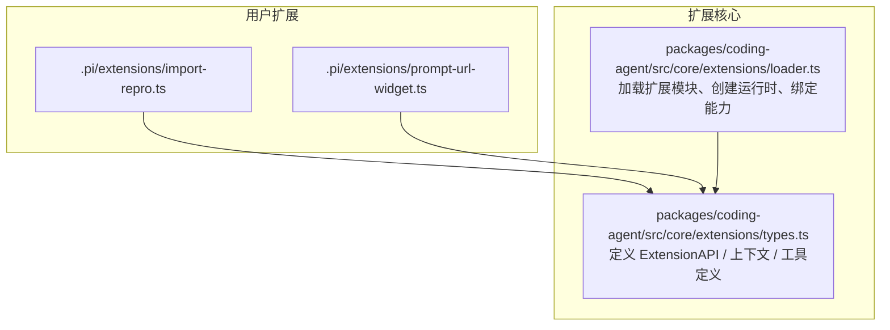
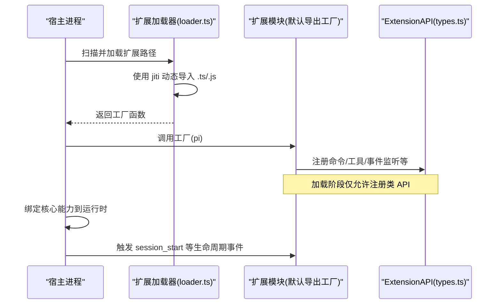
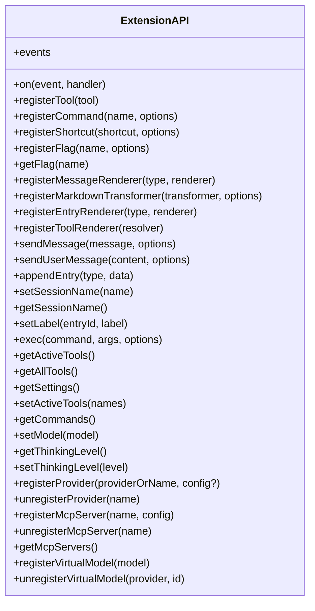
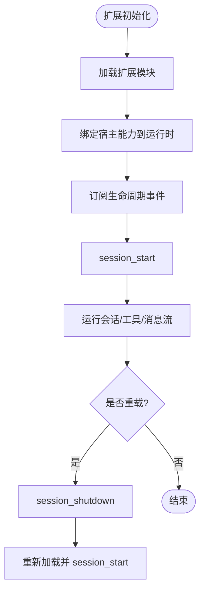
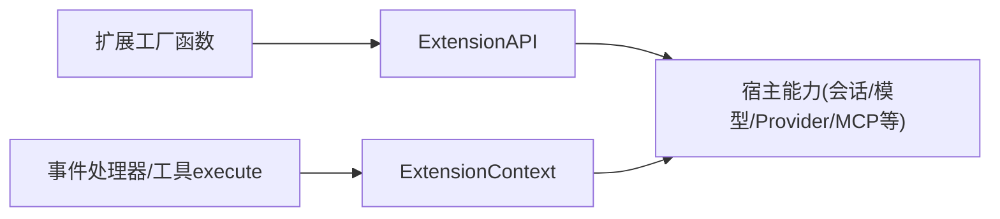
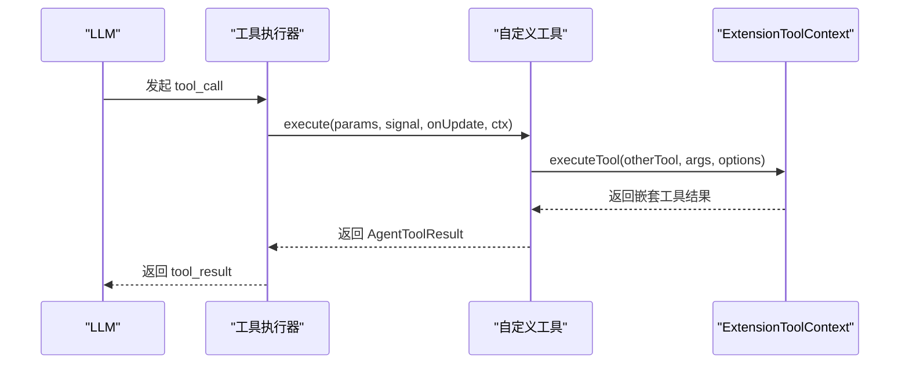
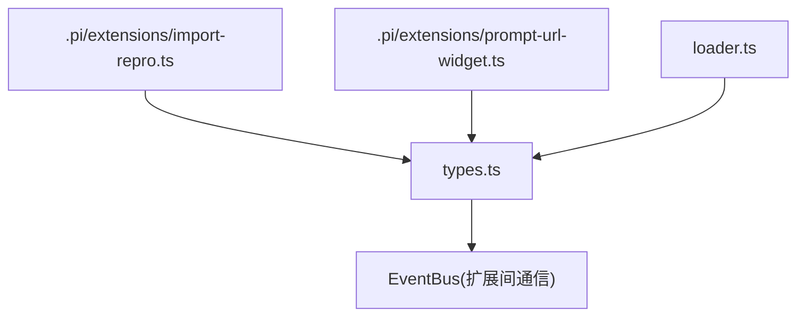
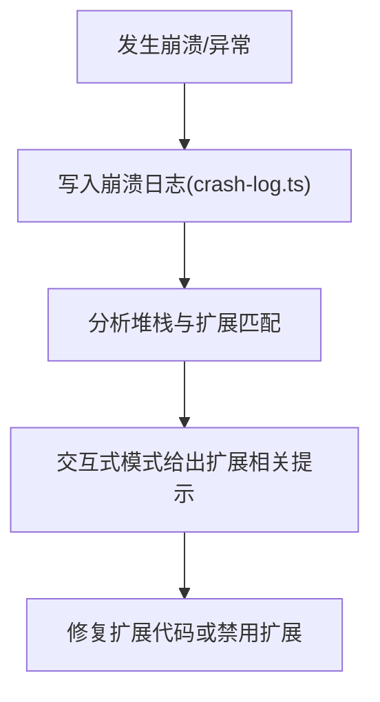

# 扩展开发指南

<cite>
**本文引用的文件**   
- [packages/coding-agent/src/core/extensions/types.ts](https://github.com/FDE-GROUP/oh-my-fde/blob/omca/packages/coding-agent/src/core/extensions/types.ts)
- [packages/coding-agent/src/core/extensions/loader.ts](https://github.com/FDE-GROUP/oh-my-fde/blob/omca/packages/coding-agent/src/core/extensions/loader.ts)
- [.pi/extensions/import-repro.ts](https://github.com/FDE-GROUP/oh-my-fde/blob/omca/.pi/extensions/import-repro.ts)
- [.pi/extensions/prompt-url-widget.ts](https://github.com/FDE-GROUP/oh-my-fde/blob/omca/.pi/extensions/prompt-url-widget.ts)
- [packages/coding-agent/test/suite/agent-session-model-extension.test.ts](https://github.com/FDE-GROUP/oh-my-fde/blob/omca/packages/coding-agent/test/suite/agent-session-model-extension.test.ts)
- [packages/coding-agent/src/modes/interactive/interactive-mode.ts](https://github.com/FDE-GROUP/oh-my-fde/blob/omca/packages/coding-agent/src/modes/interactive/interactive-mode.ts)
- [packages/coding-agent/src/core/crash-log.ts](https://github.com/FDE-GROUP/oh-my-fde/blob/omca/packages/coding-agent/src/core/crash-log.ts)
</cite>

## 目录
1. [简介](#简介)
2. [项目结构](#项目结构)
3. [核心组件](#核心组件)
4. [架构总览](#架构总览)
5. [详细组件分析](#详细组件分析)
6. [依赖关系分析](#依赖关系分析)
7. [性能考虑](#性能考虑)
8. [故障排查指南](#故障排查指南)
9. [结论](#结论)
10. [附录：示例与最佳实践](#附录示例与最佳实践)

## 简介
本指南面向希望为 Pi 编码代理系统编写自定义扩展的开发者。内容涵盖扩展的基本结构、生命周期管理、依赖注入机制，以及 ExtensionAPI 接口的使用方法（工具注册、命令钩子、事件监听等）。文档同时提供从简单到复杂的扩展示例路径、调试技巧、错误处理与性能优化建议，帮助你在不深入源码细节的情况下快速上手并写出高质量扩展。

## 项目结构
仓库中内置了若干示例扩展，位于 `.pi/extensions` 目录；扩展类型与运行时由 `packages/coding-agent/src/core/extensions` 提供。典型扩展以默认导出的工厂函数形式存在，接收一个 `ExtensionAPI` 实例进行能力注册与事件订阅。

**图表来源**  
- [.pi/extensions/import-repro.ts:293-365](https://github.com/FDE-GROUP/oh-my-fde/blob/omca/.pi/extensions/import-repro.ts#L293-L365)  
- [.pi/extensions/prompt-url-widget.ts:172-270](https://github.com/FDE-GROUP/oh-my-fde/blob/omca/.pi/extensions/prompt-url-widget.ts#L172-L270)  
- [packages/coding-agent/src/core/extensions/types.ts:1637-1966](https://github.com/FDE-GROUP/oh-my-fde/blob/omca/packages/coding-agent/src/core/extensions/types.ts#L1637-L1966)  
- [packages/coding-agent/src/core/extensions/loader.ts:579-601](https://github.com/FDE-GROUP/oh-my-fde/blob/omca/packages/coding-agent/src/core/extensions/loader.ts#L579-L601)

**章节来源**  
- [.pi/extensions/import-repro.ts:1-366](https://github.com/FDE-GROUP/oh-my-fde/blob/omca/.pi/extensions/import-repro.ts#L1-L366)  
- [.pi/extensions/prompt-url-widget.ts:1-271](https://github.com/FDE-GROUP/oh-my-fde/blob/omca/.pi/extensions/prompt-url-widget.ts#L1-L271)  
- [packages/coding-agent/src/core/extensions/types.ts:1-120](https://github.com/FDE-GROUP/oh-my-fde/blob/omca/packages/coding-agent/src/core/extensions/types.ts#L1-L120)  
- [packages/coding-agent/src/core/extensions/loader.ts:1-60](https://github.com/FDE-GROUP/oh-my-fde/blob/omca/packages/coding-agent/src/core/extensions/loader.ts#L1-L60)

## 核心组件
- ExtensionAPI：扩展对外暴露的统一接口，包含事件订阅、工具注册、命令/快捷键/CLI 标志注册、消息渲染、会话元数据操作、模型与思考级别控制、Provider 注册、MCP 服务器注册、虚拟模型注册、共享事件总线等。
- ExtensionContext：扩展事件处理器和工具执行时获得的运行上下文，包括 UI 交互、工作目录、会话管理器、模型信息、当前思考级别、中止信号、上下文使用量、系统提示获取等。
- ToolDefinition：定义 LLM 可调用的工具，含参数 Schema、描述、执行逻辑、渲染器、暴露策略、命名空间、执行模式等。
- Loader：基于 jiti 的动态加载器，负责解析 TypeScript 扩展、构建扩展运行时、缓存模块与工厂函数、在扩展加载阶段阻止调用未初始化的 Action。

**章节来源**  
- [packages/coding-agent/src/core/extensions/types.ts:1637-1966](https://github.com/FDE-GROUP/oh-my-fde/blob/omca/packages/coding-agent/src/core/extensions/types.ts#L1637-L1966)  
- [packages/coding-agent/src/core/extensions/types.ts:345-472](https://github.com/FDE-GROUP/oh-my-fde/blob/omca/packages/coding-agent/src/core/extensions/types.ts#L345-L472)  
- [packages/coding-agent/src/core/extensions/types.ts:599-688](https://github.com/FDE-GROUP/oh-my-fde/blob/omca/packages/coding-agent/src/core/extensions/types.ts#L599-L688)  
- [packages/coding-agent/src/core/extensions/loader.ts:160-200](https://github.com/FDE-GROUP/oh-my-fde/blob/omca/packages/coding-agent/src/core/extensions/loader.ts#L160-L200)

## 架构总览
扩展的生命周期大致如下：
- 启动或重载时，Loader 通过 jiti 动态导入扩展模块，提取默认导出的工厂函数。
- 在扩展加载阶段，仅允许注册类 API（如 registerTool），其他 Action 方法会被保护，防止提前访问宿主能力。
- 宿主完成绑定后，扩展可订阅事件、注册命令、工具、Provider、MCP 服务器等，并在会话生命周期内响应事件。

**图表来源**  
- [packages/coding-agent/src/core/extensions/loader.ts:579-601](https://github.com/FDE-GROUP/oh-my-fde/blob/omca/packages/coding-agent/src/core/extensions/loader.ts#L579-L601)  
- [packages/coding-agent/src/core/extensions/loader.ts:160-200](https://github.com/FDE-GROUP/oh-my-fde/blob/omca/packages/coding-agent/src/core/extensions/loader.ts#L160-L200)  
- [packages/coding-agent/src/core/extensions/types.ts:1637-1966](https://github.com/FDE-GROUP/oh-my-fde/blob/omca/packages/coding-agent/src/core/extensions/types.ts#L1637-L1966)

## 详细组件分析

### ExtensionAPI 接口详解
ExtensionAPI 是扩展与宿主之间的契约，主要能力分组如下：
- 事件订阅：on(...) 支持大量生命周期与运行时事件，例如 session_start、session_shutdown、tool_call、message_update、before_agent_start、after_provider_response 等。
- 工具注册：registerTool() 用于注册 LLM 可调用的工具，支持参数校验、结果结构化输出、渲染器、暴露策略、命名空间、执行模式等。
- 命令/快捷键/标志：registerCommand()、registerShortcut()、registerFlag()/getFlag()。
- 消息渲染：registerMessageRenderer()、registerMarkdownTransformer()、registerEntryRenderer()、registerToolRenderer()。
- 会话与状态：sendMessage()、sendUserMessage()、appendEntry()、setSessionName()/getSessionName()、setLabel()、exec()、getActiveTools()/getAllTools()/setActiveTools()、getCommands()。
- 模型与 Provider：setModel()/getThinkingLevel()/setThinkingLevel()、registerProvider()/unregisterProvider()。
- MCP 与虚拟模型：registerMcpServer()/unregisterMcpServer()/getMcpServers()、registerVirtualModel()/unregisterVirtualModel()。
- 事件总线：events 属性提供扩展间通信。

**图表来源**  
- [packages/coding-agent/src/core/extensions/types.ts:1637-1966](https://github.com/FDE-GROUP/oh-my-fde/blob/omca/packages/coding-agent/src/core/extensions/types.ts#L1637-L1966)

**章节来源**  
- [packages/coding-agent/src/core/extensions/types.ts:1637-1966](https://github.com/FDE-GROUP/oh-my-fde/blob/omca/packages/coding-agent/src/core/extensions/types.ts#L1637-L1966)

### 扩展生命周期与事件流
- 关键事件：session_start、session_shutdown、session_before_switch、session_before_fork、session_compact、session_tree、context、before_provider_request、provider_stream_event、before_agent_start、agent_start、agent_end、agent_settled、turn_start、turn_end、message_start、message_update、message_end、tool_execution_start/update/end、model_select、thinking_level_select、tool_call、tool_result、user_bash、input 等。
- 测试验证：bindExtensions 会触发 session_start；reload 会先触发 session_shutdown 再触发 session_start。

**图表来源**  
- [packages/coding-agent/test/suite/agent-session-model-extension.test.ts:538-559](https://github.com/FDE-GROUP/oh-my-fde/blob/omca/packages/coding-agent/test/suite/agent-session-model-extension.test.ts#L538-L559)  
- [packages/coding-agent/src/core/extensions/types.ts:1642-1710](https://github.com/FDE-GROUP/oh-my-fde/blob/omca/packages/coding-agent/src/core/extensions/types.ts#L1642-L1710)

**章节来源**  
- [packages/coding-agent/test/suite/agent-session-model-extension.test.ts:538-559](https://github.com/FDE-GROUP/oh-my-fde/blob/omca/packages/coding-agent/test/suite/agent-session-model-extension.test.ts#L538-L559)  
- [packages/coding-agent/src/core/extensions/types.ts:1642-1710](https://github.com/FDE-GROUP/oh-my-fde/blob/omca/packages/coding-agent/src/core/extensions/types.ts#L1642-L1710)

### 依赖注入机制
- 扩展工厂接收 ExtensionAPI 作为唯一参数，所有宿主能力均通过该接口暴露。
- 扩展内部不应直接 import 宿主实现，而是通过 ExtensionAPI 的方法间接访问，以保证在不同运行环境（TUI/RPC/JSON/Print）下行为一致。
- 扩展上下文 ExtensionContext 在事件处理器和工具 execute 中注入，提供 UI、会话、模型、信号、系统提示等能力。

**图表来源**  
- [packages/coding-agent/src/core/extensions/types.ts:345-472](https://github.com/FDE-GROUP/oh-my-fde/blob/omca/packages/coding-agent/src/core/extensions/types.ts#L345-L472)  
- [packages/coding-agent/src/core/extensions/types.ts:1637-1966](https://github.com/FDE-GROUP/oh-my-fde/blob/omca/packages/coding-agent/src/core/extensions/types.ts#L1637-L1966)

**章节来源**  
- [packages/coding-agent/src/core/extensions/types.ts:345-472](https://github.com/FDE-GROUP/oh-my-fde/blob/omca/packages/coding-agent/src/core/extensions/types.ts#L345-L472)  
- [packages/coding-agent/src/core/extensions/types.ts:1637-1966](https://github.com/FDE-GROUP/oh-my-fde/blob/omca/packages/coding-agent/src/core/extensions/types.ts#L1637-L1966)

### 工具注册与执行流程
- 使用 pi.registerTool() 注册工具，定义 name、label、description、parameters、execute 等字段。
- 工具可通过 ctx.executeTool() 调用其他工具，统一走验证、钩子和权限检查。
- 工具可自定义 renderCall/renderResult 渲染器，并通过 ToolRenderContext 获取执行状态。

**图表来源**  
- [packages/coding-agent/src/core/extensions/types.ts:599-688](https://github.com/FDE-GROUP/oh-my-fde/blob/omca/packages/coding-agent/src/core/extensions/types.ts#L599-L688)  
- [packages/coding-agent/src/core/extensions/types.ts:387-415](https://github.com/FDE-GROUP/oh-my-fde/blob/omca/packages/coding-agent/src/core/extensions/types.ts#L387-L415)

**章节来源**  
- [packages/coding-agent/src/core/extensions/types.ts:599-688](https://github.com/FDE-GROUP/oh-my-fde/blob/omca/packages/coding-agent/src/core/extensions/types.ts#L599-L688)  
- [packages/coding-agent/src/core/extensions/types.ts:387-415](https://github.com/FDE-GROUP/oh-my-fde/blob/omca/packages/coding-agent/src/core/extensions/types.ts#L387-L415)

### 命令钩子与 CLI 标志
- 使用 pi.registerCommand() 注册斜杠命令，handler 接收参数与 ExtensionCommandContext，可进行会话切换、发送消息、等待空闲等操作。
- 使用 pi.registerFlag() 注册 CLI 标志，配合 getFlag() 读取值。
- 使用 pi.registerShortcut() 注册键盘快捷键。

**章节来源**  
- [packages/coding-agent/src/core/extensions/types.ts:1724-1753](https://github.com/FDE-GROUP/oh-my-fde/blob/omca/packages/coding-agent/src/core/extensions/types.ts#L1724-L1753)

### 事件监听与 UI 交互
- 通过 pi.on() 订阅事件，例如 before_agent_start、session_start、tool_call、message_update 等。
- 使用 ExtensionUIContext 进行对话框、通知、状态栏、工作指示器、Widget、Footer/Header、编辑器替换、自动补全增强等交互。

**章节来源**  
- [packages/coding-agent/src/core/extensions/types.ts:1642-1710](https://github.com/FDE-GROUP/oh-my-fde/blob/omca/packages/coding-agent/src/core/extensions/types.ts#L1642-L1710)  
- [packages/coding-agent/src/core/extensions/types.ts:115-320](https://github.com/FDE-GROUP/oh-my-fde/blob/omca/packages/coding-agent/src/core/extensions/types.ts#L115-L320)

## 依赖关系分析
- 扩展模块依赖 ExtensionAPI 提供的能力，避免直接耦合宿主实现。
- Loader 负责将扩展模块与宿主能力解耦，通过运行时注入真实实现。
- 扩展之间通过 EventBus 进行通信，避免强耦合。

**图表来源**  
- [.pi/extensions/import-repro.ts:293-365](https://github.com/FDE-GROUP/oh-my-fde/blob/omca/.pi/extensions/import-repro.ts#L293-L365)  
- [.pi/extensions/prompt-url-widget.ts:172-270](https://github.com/FDE-GROUP/oh-my-fde/blob/omca/.pi/extensions/prompt-url-widget.ts#L172-L270)  
- [packages/coding-agent/src/core/extensions/types.ts:1964-1966](https://github.com/FDE-GROUP/oh-my-fde/blob/omca/packages/coding-agent/src/core/extensions/types.ts#L1964-L1966)  
- [packages/coding-agent/src/core/extensions/loader.ts:579-601](https://github.com/FDE-GROUP/oh-my-fde/blob/omca/packages/coding-agent/src/core/extensions/loader.ts#L579-L601)

**章节来源**  
- [.pi/extensions/import-repro.ts:293-365](https://github.com/FDE-GROUP/oh-my-fde/blob/omca/.pi/extensions/import-repro.ts#L293-L365)  
- [.pi/extensions/prompt-url-widget.ts:172-270](https://github.com/FDE-GROUP/oh-my-fde/blob/omca/.pi/extensions/prompt-url-widget.ts#L172-L270)  
- [packages/coding-agent/src/core/extensions/types.ts:1964-1966](https://github.com/FDE-GROUP/oh-my-fde/blob/omca/packages/coding-agent/src/core/extensions/types.ts#L1964-L1966)  
- [packages/coding-agent/src/core/extensions/loader.ts:579-601](https://github.com/FDE-GROUP/oh-my-fde/blob/omca/packages/coding-agent/src/core/extensions/loader.ts#L579-L601)

## 性能考虑
- 扩展模块缓存：Loader 对扩展模块进行缓存，减少重复加载开销；但工厂函数会在每次加载时重新执行，确保会话级状态隔离。
- 避免在事件处理器中进行阻塞 I/O 或长时间计算；必要时使用异步并发与超时控制。
- 合理使用工具执行模式（sequential/parallel）与暴露策略（direct/model-only/codemode/deferred/hidden），减少不必要的模型可见性与调度开销。
- 谨慎注册 Provider 与 MCP 服务器，仅在需要时启用，避免连接过多外部服务。

**章节来源**  
- [packages/coding-agent/src/core/extensions/loader.ts:145-158](https://github.com/FDE-GROUP/oh-my-fde/blob/omca/packages/coding-agent/src/core/extensions/loader.ts#L145-L158)  
- [packages/coding-agent/src/core/extensions/loader.ts:579-601](https://github.com/FDE-GROUP/oh-my-fde/blob/omca/packages/coding-agent/src/core/extensions/loader.ts#L579-L601)  
- [packages/coding-agent/src/core/extensions/types.ts:521-536](https://github.com/FDE-GROUP/oh-my-fde/blob/omca/packages/coding-agent/src/core/extensions/types.ts#L521-L536)

## 故障排查指南
- 扩展加载失败：Loader 捕获异常并记录错误信息，便于定位问题。
- 崩溃日志：系统维护崩溃记录，包含时间戳、版本、错误消息、堆栈、会话文件、cwd 等，可用于回溯问题。
- 终端错误提示：交互式模式下对终端相关错误进行识别与提示，辅助判断是否为终端环境问题。
- 扩展堆栈匹配：崩溃日志工具可匹配扩展堆栈，帮助定位具体扩展。

**图表来源**  
- [packages/coding-agent/src/core/crash-log.ts:1-47](https://github.com/FDE-GROUP/oh-my-fde/blob/omca/packages/coding-agent/src/core/crash-log.ts#L1-L47)  
- [packages/coding-agent/src/modes/interactive/interactive-mode.ts:310-325](https://github.com/FDE-GROUP/oh-my-fde/blob/omca/packages/coding-agent/src/modes/interactive/interactive-mode.ts#L310-L325)

**章节来源**  
- [packages/coding-agent/src/core/extensions/loader.ts:662-668](https://github.com/FDE-GROUP/oh-my-fde/blob/omca/packages/coding-agent/src/core/extensions/loader.ts#L662-L668)  
- [packages/coding-agent/src/core/crash-log.ts:1-47](https://github.com/FDE-GROUP/oh-my-fde/blob/omca/packages/coding-agent/src/core/crash-log.ts#L1-L47)  
- [packages/coding-agent/src/modes/interactive/interactive-mode.ts:310-325](https://github.com/FDE-GROUP/oh-my-fde/blob/omca/packages/coding-agent/src/modes/interactive/interactive-mode.ts#L310-L325)

## 结论
通过 ExtensionAPI 与 ExtensionContext，扩展可以安全地接入宿主能力，完成工具注册、命令扩展、事件监听与 UI 交互。Loader 提供了稳定的加载与运行时绑定机制，保证扩展在不同环境下的一致行为。遵循本文的结构化指南与最佳实践，你可以快速构建从简单到复杂的扩展，并在调试与性能方面获得良好体验。

## 附录：示例与最佳实践

### 示例一：Hello World 扩展（概念性步骤）
- 创建一个默认导出的工厂函数，接收 ExtensionAPI。
- 使用 pi.registerCommand() 注册一个简单命令，打印欢迎信息。
- 使用 pi.on("session_start", ...) 在会话开始时输出提示。
- 使用 pi.ui.notify() 展示通知。

[本节为概念性说明，不直接分析具体文件]

### 示例二：复杂业务逻辑（参考现有扩展）
- import-repro.ts：演示如何注册命令、解析多种输入源、调用外部 API、读写文件、会话切换与消息发送。
- prompt-url-widget.ts：演示如何在会话开始前解析用户消息、拉取 GitHub 元数据、设置 Widget、更新会话名称、重建 UI。

**章节来源**  
- [.pi/extensions/import-repro.ts:293-365](https://github.com/FDE-GROUP/oh-my-fde/blob/omca/.pi/extensions/import-repro.ts#L293-L365)  
- [.pi/extensions/prompt-url-widget.ts:172-270](https://github.com/FDE-GROUP/oh-my-fde/blob/omca/.pi/extensions/prompt-url-widget.ts#L172-L270)

### 最佳实践清单
- 始终通过 ExtensionAPI 访问宿主能力，避免直接耦合。
- 在事件处理器中保持轻量，避免阻塞；必要时使用 AbortSignal 取消长任务。
- 合理设置工具的 exposure 与 executionMode，减少模型负担。
- 使用 registerMarkdownTransformer/registerToolRenderer 定制渲染，提升用户体验。
- 使用 EventBus 进行扩展间通信，避免全局状态污染。
- 在 Provider 与 MCP 注册时做好错误处理与重试策略。

[本节为通用指导，不直接分析具体文件]