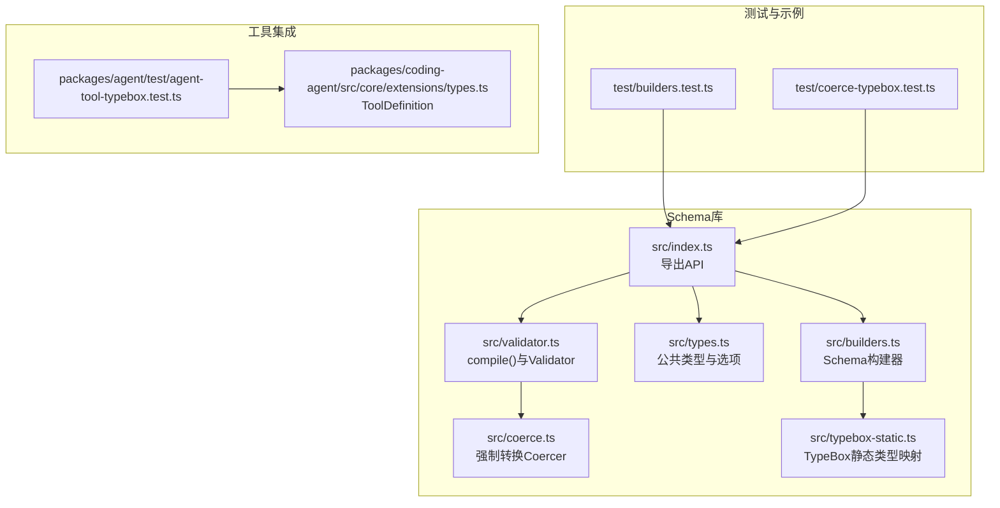
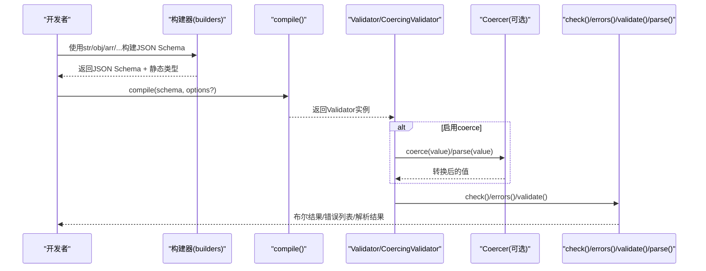
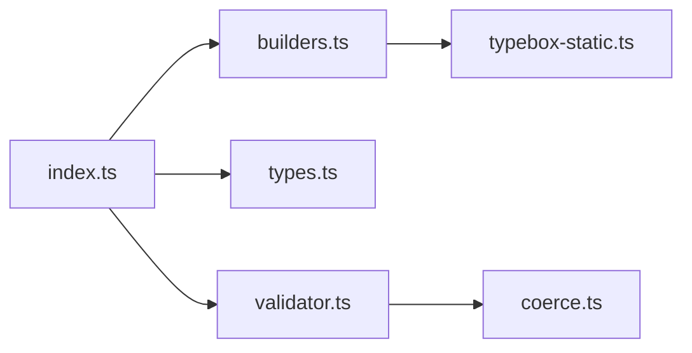

# 参数Schema定义

<cite>
**本文引用的文件**   
- [packages/schema/README.md](https://github.com/FDE-GROUP/oh-my-fde/blob/omca/packages/schema/README.md)
- [packages/schema/src/index.ts](https://github.com/FDE-GROUP/oh-my-fde/blob/omca/packages/schema/src/index.ts)
- [packages/schema/src/builders.ts](https://github.com/FDE-GROUP/oh-my-fde/blob/omca/packages/schema/src/builders.ts)
- [packages/schema/src/types.ts](https://github.com/FDE-GROUP/oh-my-fde/blob/omca/packages/schema/src/types.ts)
- [packages/schema/src/typebox-static.ts](https://github.com/FDE-GROUP/oh-my-fde/blob/omca/packages/schema/src/typebox-static.ts)
- [packages/schema/src/validator.ts](https://github.com/FDE-GROUP/oh-my-fde/blob/omca/packages/schema/src/validator.ts)
- [packages/schema/src/coerce.ts](https://github.com/FDE-GROUP/oh-my-fde/blob/omca/packages/schema/src/coerce.ts)
- [packages/schema/test/builders.test.ts](https://github.com/FDE-GROUP/oh-my-fde/blob/omca/packages/schema/test/builders.test.ts)
- [packages/schema/test/coerce-typebox.test.ts](https://github.com/FDE-GROUP/oh-my-fde/blob/omca/packages/schema/test/coerce-typebox.test.ts)
- [packages/agent/test/agent-tool-typebox.test.ts](https://github.com/FDE-GROUP/oh-my-fde/blob/omca/packages/agent/test/agent-tool-typebox.test.ts)
- [packages/coding-agent/src/core/extensions/types.ts](https://github.com/FDE-GROUP/oh-my-fde/blob/omca/packages/coding-agent/src/core/extensions/types.ts)
</cite>

## 目录
1. [引言](#引言)
2. [项目结构](#项目结构)
3. [核心组件](#核心组件)
4. [架构总览](#架构总览)
5. [详细组件分析](#详细组件分析)
6. [依赖关系分析](#依赖关系分析)
7. [性能与行为特性](#性能与行为特性)
8. [工具开发中的Schema设计模式](#工具开发中的schema设计模式)
9. [常见陷阱与排错指南](#常见陷阱与排错指南)
10. [结论](#结论)
11. [附录：从简单到复杂的完整示例路径](#附录从简单到复杂的完整示例路径)

## 引言
本指南面向使用 TypeBox 或 JSON Schema 定义工具输入参数的开发者，系统讲解如何在项目中基于 pi-schema（@earendil-works/pi-schema）构建、编译、校验和推断类型。内容覆盖基本类型、对象、数组、元组、联合、可空、递归等类型；required、default、描述信息等选项；以及参数验证机制、错误处理、类型推断与强制转换（coercion）。同时总结在真实工具开发中的Schema设计模式与常见陷阱。

## 项目结构
本仓库中与“参数Schema定义”直接相关的代码集中在 packages/schema 包中，辅以 agent 与 coding-agent 中对 ToolDefinition 的集成使用。

**图表来源**
- [packages/schema/src/index.ts:1-37](https://github.com/FDE-GROUP/oh-my-fde/blob/omca/packages/schema/src/index.ts#L1-L37)
- [packages/schema/src/builders.ts:1-241](https://github.com/FDE-GROUP/oh-my-fde/blob/omca/packages/schema/src/builders.ts#L1-L241)
- [packages/schema/src/types.ts:1-50](https://github.com/FDE-GROUP/oh-my-fde/blob/omca/packages/schema/src/types.ts#L1-L50)
- [packages/schema/src/validator.ts:1-105](https://github.com/FDE-GROUP/oh-my-fde/blob/omca/packages/schema/src/validator.ts#L1-L105)
- [packages/schema/src/coerce.ts:1-591](https://github.com/FDE-GROUP/oh-my-fde/blob/omca/packages/schema/src/coerce.ts#L1-L591)
- [packages/schema/src/typebox-static.ts:1-89](https://github.com/FDE-GROUP/oh-my-fde/blob/omca/packages/schema/src/typebox-static.ts#L1-L89)
- [packages/schema/test/builders.test.ts:1-164](https://github.com/FDE-GROUP/oh-my-fde/blob/omca/packages/schema/test/builders.test.ts#L1-L164)
- [packages/schema/test/coerce-typebox.test.ts:1-800](https://github.com/FDE-GROUP/oh-my-fde/blob/omca/packages/schema/test/coerce-typebox.test.ts#L1-L800)
- [packages/agent/test/agent-tool-typebox.test.ts:1-66](https://github.com/FDE-GROUP/oh-my-fde/blob/omca/packages/agent/test/agent-tool-typebox.test.ts#L1-L66)
- [packages/coding-agent/src/core/extensions/types.ts:596-624](https://github.com/FDE-GROUP/oh-my-fde/blob/omca/packages/coding-agent/src/core/extensions/types.ts#L596-L624)

**章节来源**
- [packages/schema/src/index.ts:1-37](https://github.com/FDE-GROUP/oh-my-fde/blob/omca/packages/schema/src/index.ts#L1-L37)
- [packages/schema/src/builders.ts:1-241](https://github.com/FDE-GROUP/oh-my-fde/blob/omca/packages/schema/src/builders.ts#L1-L241)
- [packages/schema/src/types.ts:1-50](https://github.com/FDE-GROUP/oh-my-fde/blob/omca/packages/schema/src/types.ts#L1-L50)
- [packages/schema/src/validator.ts:1-105](https://github.com/FDE-GROUP/oh-my-fde/blob/omca/packages/schema/src/validator.ts#L1-L105)
- [packages/schema/src/coerce.ts:1-591](https://github.com/FDE-GROUP/oh-my-fde/blob/omca/packages/schema/src/coerce.ts#L1-L591)
- [packages/schema/src/typebox-static.ts:1-89](https://github.com/FDE-GROUP/oh-my-fde/blob/omca/packages/schema/src/typebox-static.ts#L1-L89)
- [packages/schema/test/builders.test.ts:1-164](https://github.com/FDE-GROUP/oh-my-fde/blob/omca/packages/schema/test/builders.test.ts#L1-L164)
- [packages/schema/test/coerce-typebox.test.ts:1-800](https://github.com/FDE-GROUP/oh-my-fde/blob/omca/packages/schema/test/coerce-typebox.test.ts#L1-L800)
- [packages/agent/test/agent-tool-typebox.test.ts:1-66](https://github.com/FDE-GROUP/oh-my-fde/blob/omca/packages/agent/test/agent-tool-typebox.test.ts#L1-L66)
- [packages/coding-agent/src/core/extensions/types.ts:596-624](https://github.com/FDE-GROUP/oh-my-fde/blob/omca/packages/coding-agent/src/core/extensions/types.ts#L596-L624)

## 核心组件
- Schema构建器（builders）：提供 str、num、int、bool、nul、unknown、lit、oneOf、union、nullable、arr、tuple、map、obj、recursive、bytes、opt 等函数，返回标准 JSON Schema 对象并携带 TypeScript 静态类型。
- compile 与 Validator：将任意 JSON Schema（包括 TypeBox 生成的形状）编译为高性能 check 函数，并提供 errors、validate、parse（配合 coerce）等方法。
- Coercer：当启用 coerce 时，对松散输入进行三阶段转换（可选null清理、TypeBox风格转换、按type的基础类型转换），再执行校验。
- TypeBox静态类型映射：在不引入 TypeBox 的前提下，根据 TypeBox 1.x 的类型形状推导 Static 类型。
- 公共类型与选项：CompileOptions、ParseResult、ValidationError 等。

**章节来源**
- [packages/schema/src/builders.ts:1-241](https://github.com/FDE-GROUP/oh-my-fde/blob/omca/packages/schema/src/builders.ts#L1-L241)
- [packages/schema/src/validator.ts:1-105](https://github.com/FDE-GROUP/oh-my-fde/blob/omca/packages/schema/src/validator.ts#L1-L105)
- [packages/schema/src/coerce.ts:1-591](https://github.com/FDE-GROUP/oh-my-fde/blob/omca/packages/schema/src/coerce.ts#L1-L591)
- [packages/schema/src/typebox-static.ts:1-89](https://github.com/FDE-GROUP/oh-my-fde/blob/omca/packages/schema/src/typebox-static.ts#L1-L89)
- [packages/schema/src/types.ts:1-50](https://github.com/FDE-GROUP/oh-my-fde/blob/omca/packages/schema/src/types.ts#L1-L50)

## 架构总览
下图展示从Schema定义到校验与类型推断的关键流程。

**图表来源**
- [packages/schema/src/builders.ts:1-241](https://github.com/FDE-GROUP/oh-my-fde/blob/omca/packages/schema/src/builders.ts#L1-L241)
- [packages/schema/src/validator.ts:1-105](https://github.com/FDE-GROUP/oh-my-fde/blob/omca/packages/schema/src/validator.ts#L1-L105)
- [packages/schema/src/coerce.ts:1-591](https://github.com/FDE-GROUP/oh-my-fde/blob/omca/packages/schema/src/coerce.ts#L1-L591)

## 详细组件分析

### Schema构建器（builders）
- 基本类型：str、num、int、bool、nul、unknown、bigint、bytes
- 字面量与枚举：lit、oneOf
- 组合类型：union、nullable、arr、tuple、map
- 对象：obj（默认additionalProperties=false，可通过open:true放宽）、opt标记可选属性
- 递归：recursive（需显式指定泛型类型与唯一$id）
- 注解：title、description、examples、deprecated、default（仅注解，不插入默认值）

要点
- obj 默认生成 closed object（禁止额外属性），适合工具参数强约束。
- opt 用于声明可选属性；未标记的属性视为 required。
- tuple 通过 prefixItems 表达固定长度与顺序的数组。
- map 表达 Record<string, T>。
- recursive 需要显式类型标注，因为TS无法从构建器自动推断递归类型。

**章节来源**
- [packages/schema/src/builders.ts:27-35](https://github.com/FDE-GROUP/oh-my-fde/blob/omca/packages/schema/src/builders.ts#L27-L35)
- [packages/schema/src/builders.ts:43-99](https://github.com/FDE-GROUP/oh-my-fde/blob/omca/packages/schema/src/builders.ts#L43-L99)
- [packages/schema/src/builders.ts:101-131](https://github.com/FDE-GROUP/oh-my-fde/blob/omca/packages/schema/src/builders.ts#L101-L131)
- [packages/schema/src/builders.ts:133-184](https://github.com/FDE-GROUP/oh-my-fde/blob/omca/packages/schema/src/builders.ts#L133-L184)
- [packages/schema/src/builders.ts:186-241](https://github.com/FDE-GROUP/oh-my-fde/blob/omca/packages/schema/src/builders.ts#L186-L241)

### 编译与校验（compile、Validator、CoercingValidator）
- compile(schema, options?) 返回 Validator；若 options.coerce=true 则返回 CoercingValidator。
- Validator.check(value) 快速布尔判断；errors(value) 返回错误路径与关键字；validate(value) 合并两者。
- CoercingValidator.coerce(value) 执行宽松输入转换；parse(value) 先转换后校验。

关键选项（CompileOptions）
- draft: "2020-12" | "7"
- formats: 自定义格式校验器
- schemas: $ref 外部文档映射
- unresolvedRefs: "throw" | "reject"
- coerce: 是否启用强制转换

**章节来源**
- [packages/schema/src/validator.ts:1-105](https://github.com/FDE-GROUP/oh-my-fde/blob/omca/packages/schema/src/validator.ts#L1-L105)
- [packages/schema/src/types.ts:12-31](https://github.com/FDE-GROUP/oh-my-fde/blob/omca/packages/schema/src/types.ts#L12-L31)

### 强制转换（Coercer）
三阶段转换（仅在 coerce=true 时生效）：
1. 可选null清理：可选属性的 null 且其schema拒绝null时，视为缺失。
2. TypeBox风格转换：按$ref/const/enum/anyOf/oneOf/allOf/type等进行转换（如字符串转数字、true/false、单值包装为数组等）。
3. 基础类型转换：针对type或type数组做最终兜底转换（如"1"→1、"true"→true等）。

注意
- 转换过程采用写时复制，未变更路径返回原引用，避免不必要拷贝。
- union分支按顺序尝试，首个接受的分支即成功。
- 递归/$ref场景有防重入与缓存，避免指数级开销。

**章节来源**
- [packages/schema/src/coerce.ts:1-591](https://github.com/FDE-GROUP/oh-my-fde/blob/omca/packages/schema/src/coerce.ts#L1-L591)

### TypeBox静态类型映射（Static）
- 支持读取 TypeBox 1.x 的类型形状（~kind、~optional、~readonly、~unsafe），无需引入 TypeBox。
- 常见Kind映射：String/Number/Integer/Boolean/Null/BigInt/Undefined/Unknown/Any/Literal/Array/Object/Union/Record/Enum/Tuple。
- 其他Kind（Intersect/Cyclic/Ref等）退化为 unknown。

**章节来源**
- [packages/schema/src/typebox-static.ts:1-89](https://github.com/FDE-GROUP/oh-my-fde/blob/omca/packages/schema/src/typebox-static.ts#L1-L89)

### 工具集成（ToolDefinition）
- ToolDefinition.parameters 接受任意 JSON Schema（TypeBox 或 builders 构建均可）。
- prepareArguments 可用于在验证前做兼容预处理，返回值必须满足 TParams（由 Static<TParams> 约束）。
- outputSchema 用于结构化输出。

**章节来源**
- [packages/coding-agent/src/core/extensions/types.ts:596-624](https://github.com/FDE-GROUP/oh-my-fde/blob/omca/packages/coding-agent/src/core/extensions/types.ts#L596-L624)

## 依赖关系分析
- index.ts 统一导出 builders、types、validator 等模块。
- validator.ts 依赖 compiler、coerce、explain 等内部模块。
- coerce.ts 依赖 compiler 与 resolver/shared 等。
- typebox-static.ts 仅依赖 builders.ts 的 Static 类型。
- 测试文件验证 builders 产出、类型推断与 coercion 行为。

**图表来源**
- [packages/schema/src/index.ts:1-37](https://github.com/FDE-GROUP/oh-my-fde/blob/omca/packages/schema/src/index.ts#L1-L37)
- [packages/schema/src/validator.ts:1-105](https://github.com/FDE-GROUP/oh-my-fde/blob/omca/packages/schema/src/validator.ts#L1-L105)
- [packages/schema/src/coerce.ts:1-591](https://github.com/FDE-GROUP/oh-my-fde/blob/omca/packages/schema/src/coerce.ts#L1-L591)
- [packages/schema/src/builders.ts:1-241](https://github.com/FDE-GROUP/oh-my-fde/blob/omca/packages/schema/src/builders.ts#L1-L241)
- [packages/schema/src/typebox-static.ts:1-89](https://github.com/FDE-GROUP/oh-my-fde/blob/omca/packages/schema/src/typebox-static.ts#L1-L89)

**章节来源**
- [packages/schema/src/index.ts:1-37](https://github.com/FDE-GROUP/oh-my-fde/blob/omca/packages/schema/src/index.ts#L1-L37)
- [packages/schema/src/validator.ts:1-105](https://github.com/FDE-GROUP/oh-my-fde/blob/omca/packages/schema/src/validator.ts#L1-L105)
- [packages/schema/src/coerce.ts:1-591](https://github.com/FDE-GROUP/oh-my-fde/blob/omca/packages/schema/src/coerce.ts#L1-L591)
- [packages/schema/src/builders.ts:1-241](https://github.com/FDE-GROUP/oh-my-fde/blob/omca/packages/schema/src/builders.ts#L1-L241)
- [packages/schema/src/typebox-static.ts:1-89](https://github.com/FDE-GROUP/oh-my-fde/blob/omca/packages/schema/src/typebox-static.ts#L1-L89)

## 性能与行为特性
- compile 一次编译，check 接近原生函数速度；errors 首次失败后缓存解释器。
- coerce 仅在首次调用 coerce/parse 时构建规则，后续复用。
- 严格CSP环境无eval，所有检查均为纯闭包。
- 支持 Draft 2020-12 与 Draft 7，并通过官方测试套件大量用例。

参考
- README 的性能与基准说明、CSP兼容性、Draft支持与formats配置。

**章节来源**
- [packages/schema/README.md:1-320](https://github.com/FDE-GROUP/oh-my-fde/blob/omca/packages/schema/README.md#L1-L320)

## 工具开发中的Schema设计模式
- 使用 obj 定义强约束的参数对象，默认关闭 additionalProperties，避免未知字段污染。
- 用 opt 标记可选参数；未标记即为 required。
- 使用 oneOf/lit 表达受限枚举或标签化联合（discriminated union）。
- 使用 arr/tuple/map 表达集合与字典结构。
- 使用 nullable 表达可为空的字段。
- 使用 recursive 表达树形结构（需显式类型与唯一$id）。
- 使用 default/title/description/examples/deprecated 丰富元数据（仅注解，不改变校验语义）。
- 对于来自外部的MCP/第三方Schema，可使用 unsafe 包裹以保留TS类型提示，但运行时仍遵循JSON Schema语义。

实践建议
- 优先使用 builders 构建Schema，以获得最佳类型推断与一致性。
- 对外部Schema使用 normalize/适配层后再传入 compile。
- 对模型侧传来的松散输入，开启 coerce 并配合 parse 获取强类型结果。

**章节来源**
- [packages/schema/src/builders.ts:186-241](https://github.com/FDE-GROUP/oh-my-fde/blob/omca/packages/schema/src/builders.ts#L186-L241)
- [packages/schema/README.md:53-98](https://github.com/FDE-GROUP/oh-my-fde/blob/omca/packages/schema/README.md#L53-L98)
- [packages/schema/README.md:122-133](https://github.com/FDE-GROUP/oh-my-fde/blob/omca/packages/schema/README.md#L122-L133)

## 常见陷阱与排错指南
- default 不会自动填充：它是注解，校验不会插入默认值。如需默认值逻辑，应在业务层处理或使用 prepareArguments。
- obj 默认禁止额外属性：若上游可能带扩展字段，使用 open:true 或在外层适配。
- undefined 与缺失字段区别：undefined 在TypeBox语义中计为缺失；required 字段设为 undefined 会被视为缺失。
- union 分支顺序敏感：转换与校验按声明顺序尝试，确保更具体的分支在前。
- 递归Schema需显式类型：recursive 的泛型类型必须给出，否则TS无法推断。
- $ref 未解析：unresolvedRefs="throw" 会在编译期抛错；"reject" 会编译为false并在该位置报错。
- format 校验需显式注入：draft 2020-12 下 format 仅为注解，除非提供 formats。
- 强制转换边界：pass 2 与 pass 3 冲突时以 pass 2 为准；某些值无法转换时会保持原样，随后校验失败。

调试建议
- 使用 validate(value) 获取 {ok, value|errors}。
- 使用 errors(value) 查看 JSON Pointer 路径与失败关键字。
- 在复杂联合/递归结构中，逐步缩小范围定位问题节点。

**章节来源**
- [packages/schema/src/builders.ts:27-35](https://github.com/FDE-GROUP/oh-my-fde/blob/omca/packages/schema/src/builders.ts#L27-L35)
- [packages/schema/src/builders.ts:215-241](https://github.com/FDE-GROUP/oh-my-fde/blob/omca/packages/schema/src/builders.ts#L215-L241)
- [packages/schema/src/types.ts:12-31](https://github.com/FDE-GROUP/oh-my-fde/blob/omca/packages/schema/src/types.ts#L12-L31)
- [packages/schema/src/coerce.ts:1-591](https://github.com/FDE-GROUP/oh-my-fde/blob/omca/packages/schema/src/coerce.ts#L1-L591)
- [packages/schema/README.md:99-120](https://github.com/FDE-GROUP/oh-my-fde/blob/omca/packages/schema/README.md#L99-L120)

## 结论
pi-schema 提供了轻量、高性能且类型安全的 JSON Schema 构建与校验能力，既能无缝兼容 TypeBox 1.x 的形状，又能独立于 TypeBox 运行。结合 builders、compile、coerce 与 Static 类型推断，可在工具开发中实现严谨的参数契约、友好的错误信息与稳定的类型体验。推荐在工具参数定义中优先使用 builders，必要时通过 unsafe 兼容外部Schema，并在需要宽松输入时使用 coerce+parse。

## 附录：从简单到复杂的完整示例路径
以下示例均位于测试文件中，便于对照理解：
- 基本类型与对象、数组、元组、联合、可空、递归、unsafe 等构建器的用法与类型推断：[packages/schema/test/builders.test.ts:1-164](https://github.com/FDE-GROUP/oh-my-fde/blob/omca/packages/schema/test/builders.test.ts#L1-L164)
- TypeBox风格的强制转换用例（数组、布尔、整数、字面量、交集、枚举、null等）：[packages/schema/test/coerce-typebox.test.ts:1-800](https://github.com/FDE-GROUP/oh-my-fde/blob/omca/packages/schema/test/coerce-typebox.test.ts#L1-L800)
- AgentTool 中使用 TypeBox 形状的 parameters 并推断 execute/prepareArguments 参数类型：[packages/agent/test/agent-tool-typebox.test.ts:1-66](https://github.com/FDE-GROUP/oh-my-fde/blob/omca/packages/agent/test/agent-tool-typebox.test.ts#L1-L66)