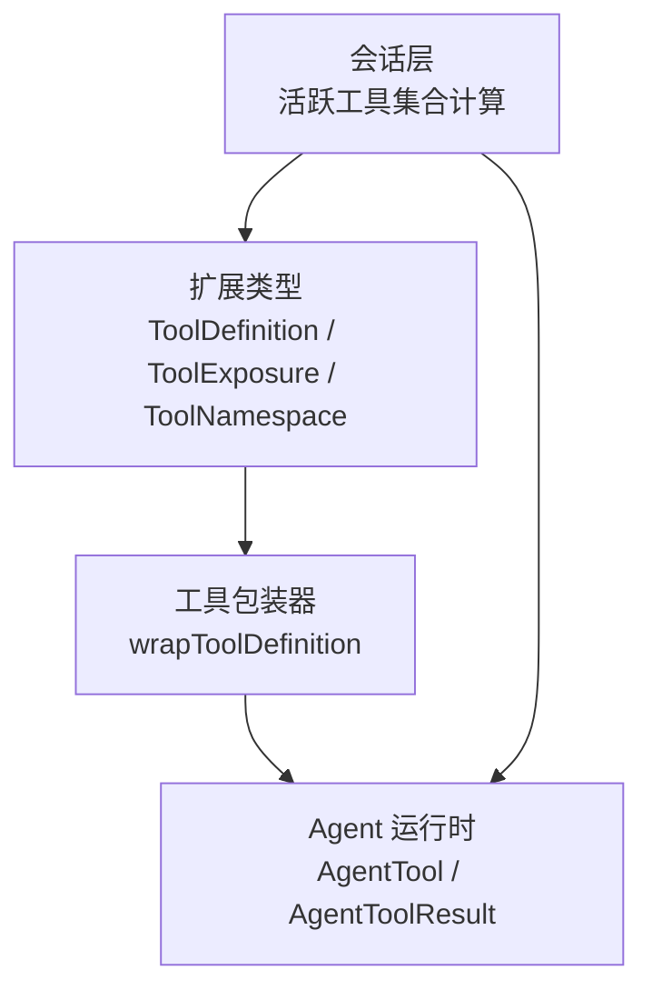
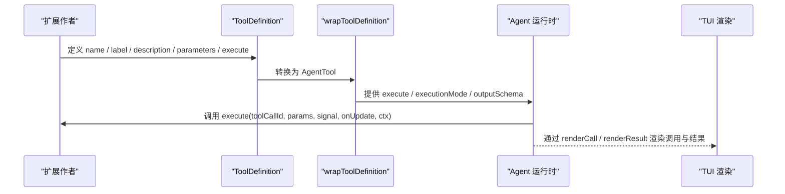
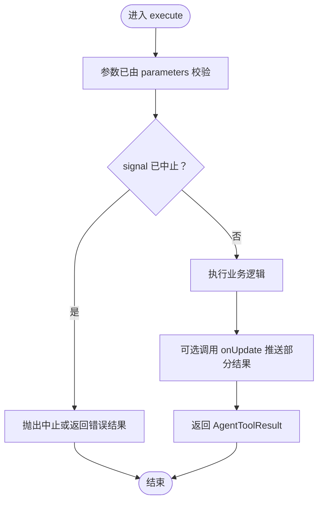
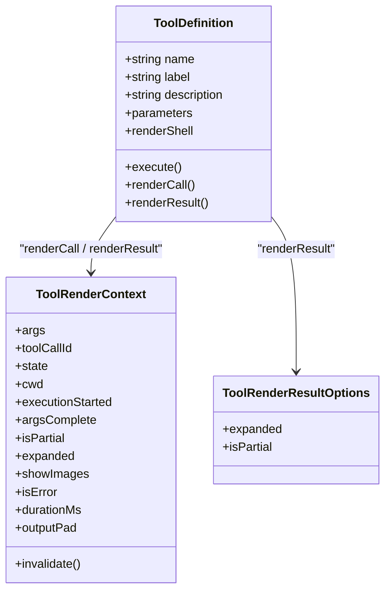
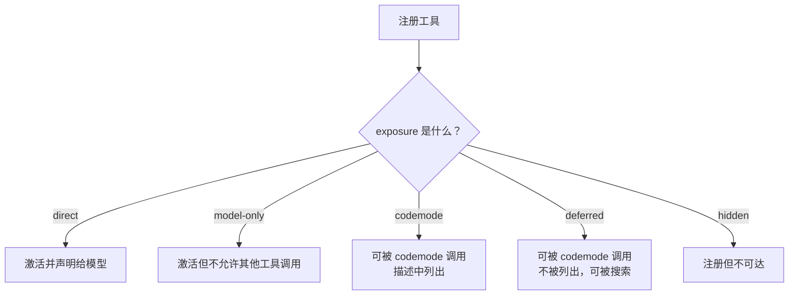
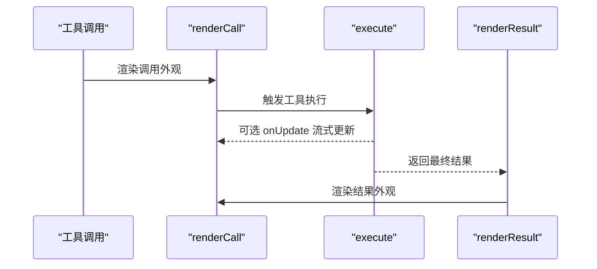
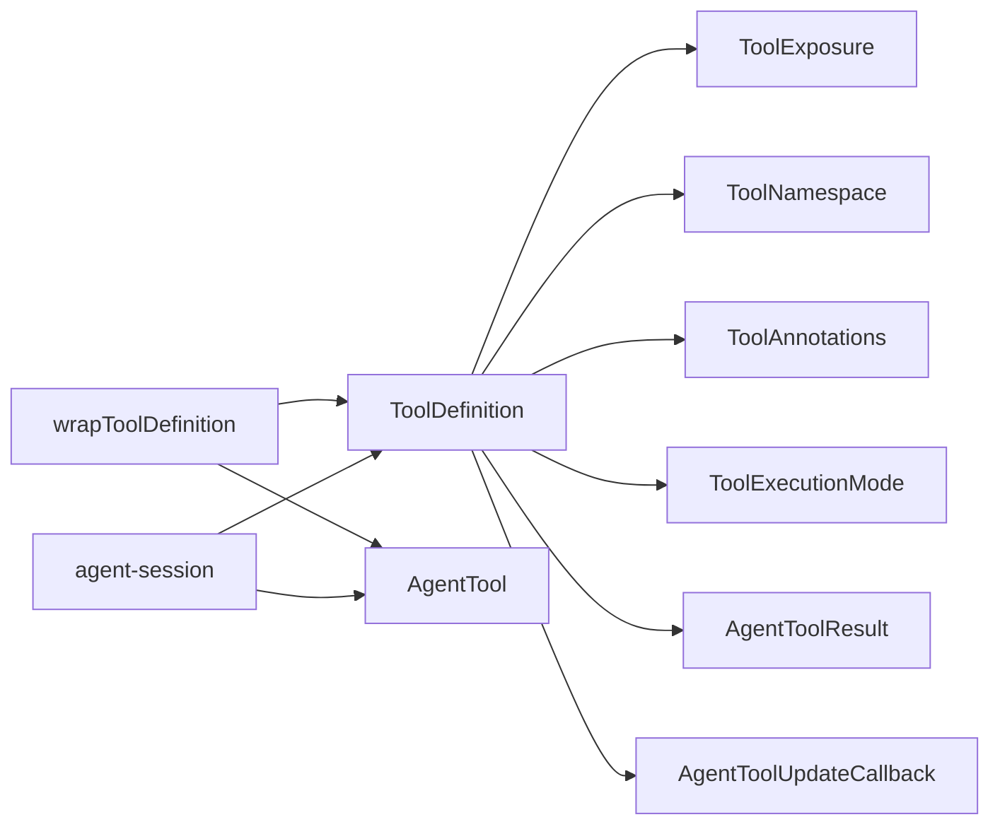

# 工具定义与接口

<cite>
**本文引用的文件**   
- [packages/coding-agent/src/core/extensions/types.ts](https://github.com/FDE-GROUP/oh-my-fde/blob/omca/packages/coding-agent/src/core/extensions/types.ts)
- [packages/agent/src/types.ts](https://github.com/FDE-GROUP/oh-my-fde/blob/omca/packages/agent/src/types.ts)
- [packages/coding-agent/src/core/tools/tool-definition-wrapper.ts](https://github.com/FDE-GROUP/oh-my-fde/blob/omca/packages/coding-agent/src/core/tools/tool-definition-wrapper.ts)
- [packages/coding-agent/src/core/agent-session.ts](https://github.com/FDE-GROUP/oh-my-fde/blob/omca/packages/coding-agent/src/core/agent-session.ts)
- [packages/coding-agent/docs/extensions.md](https://github.com/FDE-GROUP/oh-my-fde/blob/omca/packages/coding-agent/docs/extensions.md)
- [packages/coding-agent/docs/mcp.md](https://github.com/FDE-GROUP/oh-my-fde/blob/omca/packages/coding-agent/docs/mcp.md)
</cite>

## 目录
1. [引言](#引言)
2. [项目结构定位](#项目结构定位)
3. [核心组件总览](#核心组件总览)
4. [架构概览](#架构概览)
5. [ToolDefinition 接口详解](#toolddefinition-接口详解)
6. [暴露模式 exposure 详解](#暴露模式-exposure-详解)
7. [命名空间、注解与执行模式](#命名空间注解与执行模式)
8. [自定义渲染 renderCall 与 renderResult](#自定义渲染-rendercall-与-renderresult)
9. [TypeScript 类型定义示例与最佳实践](#typescript-类型定义示例与最佳实践)
10. [依赖关系分析](#依赖关系分析)
11. [性能与并发特性](#性能与并发特性)
12. [故障排查指南](#故障排查指南)
13. [结论](#结论)

## 引言
本文围绕工具定义接口 ToolDefinition 展开，系统解释其基础属性、参数 Schema、执行函数签名、自定义渲染方法，以及暴露模式、命名空间、工具注解、执行模式等高级能力。文档同时给出面向扩展开发者的 TypeScript 类型使用建议、调用流程说明和常见问题排查思路，帮助你在不同运行环境中安全、稳定地注册和使用模型可调用的工具。

## 项目结构定位
ToolDefinition 是扩展系统中用于描述“可被大模型调用的工具”的核心类型。它位于编码代理扩展类型文件中，并与底层 Agent 运行时中的工具执行模式、结果类型相互协作：

- 扩展层类型定义集中在扩展类型文件中，包含 ToolDefinition、ToolExposure、ToolNamespace、ToolAnnotations、ToolRenderContext 等。
- 底层 Agent 类型中定义了 ToolExecutionMode、AgentToolResult 等运行时类型。
- 包装器将扩展层的 ToolDefinition 适配为运行时使用的 AgentTool。
- 会话层负责根据 exposure、defaultActive、prepareLoadout 等规则计算“声明给模型的活跃工具集合”。

**图表来源**
- [packages/coding-agent/src/core/extensions/types.ts:596-688](https://github.com/FDE-GROUP/oh-my-fde/blob/omca/packages/coding-agent/src/core/extensions/types.ts#L596-L688)
- [packages/coding-agent/src/core/tools/tool-definition-wrapper.ts:26-49](https://github.com/FDE-GROUP/oh-my-fde/blob/omca/packages/coding-agent/src/core/tools/tool-definition-wrapper.ts#L26-L49)
- [packages/agent/src/types.ts:40-47](https://github.com/FDE-GROUP/oh-my-fde/blob/omca/packages/agent/src/types.ts#L40-L47)
- [packages/coding-agent/src/core/agent-session.ts:1629-1655](https://github.com/FDE-GROUP/oh-my-fde/blob/omca/packages/coding-agent/src/core/agent-session.ts#L1629-L1655)

**章节来源**
- [packages/coding-agent/src/core/extensions/types.ts:596-688](https://github.com/FDE-GROUP/oh-my-fde/blob/omca/packages/coding-agent/src/core/extensions/types.ts#L596-L688)
- [packages/agent/src/types.ts:40-47](https://github.com/FDE-GROUP/oh-my-fde/blob/omca/packages/agent/src/types.ts#L40-L47)
- [packages/coding-agent/src/core/tools/tool-definition-wrapper.ts:26-49](https://github.com/FDE-GROUP/oh-my-fde/blob/omca/packages/coding-agent/src/core/tools/tool-definition-wrapper.ts#L26-L49)
- [packages/coding-agent/src/core/agent-session.ts:1629-1655](https://github.com/FDE-GROUP/oh-my-fde/blob/omca/packages/coding-agent/src/core/agent-session.ts#L1629-L1655)

## 核心组件总览
- ToolDefinition：工具定义对象，描述名称、标签、描述、参数 Schema、输出 Schema、执行逻辑、渲染方式、暴露策略、命名空间、注解、执行模式等。
- ToolExposure：工具暴露模式，控制模型能否直接看到工具、脚本是否可调用、是否可被搜索加载。
- ToolNamespace：工具分组命名空间，支持别名、简短描述和详细说明。
- ToolAnnotations：工具行为提示，例如只读、破坏性、幂等、开放世界访问。
- ToolRenderContext / ToolRenderResultOptions：自定义渲染上下文和选项。
- ToolExecutionMode：工具执行模式，sequential 或 parallel。
- AgentToolResult：工具执行返回结果，包含内容、结构化内容、错误标志、用量等。

**章节来源**
- [packages/coding-agent/src/core/extensions/types.ts:478-519](https://github.com/FDE-GROUP/oh-my-fde/blob/omca/packages/coding-agent/src/core/extensions/types.ts#L478-L519)
- [packages/coding-agent/src/core/extensions/types.ts:521-569](https://github.com/FDE-GROUP/oh-my-fde/blob/omca/packages/coding-agent/src/core/extensions/types.ts#L521-L569)
- [packages/coding-agent/src/core/extensions/types.ts:596-688](https://github.com/FDE-GROUP/oh-my-fde/blob/omca/packages/coding-agent/src/core/extensions/types.ts#L596-L688)
- [packages/agent/src/types.ts:40-47](https://github.com/FDE-GROUP/oh-my-fde/blob/omca/packages/agent/src/types.ts#L40-L47)
- [packages/agent/src/types.ts:424-430](https://github.com/FDE-GROUP/oh-my-fde/blob/omca/packages/agent/src/types.ts#L424-L430)

## 架构概览
下图展示从扩展定义到运行时执行的典型路径：

**图表来源**
- [packages/coding-agent/src/core/extensions/types.ts:596-688](https://github.com/FDE-GROUP/oh-my-fde/blob/omca/packages/coding-agent/src/core/extensions/types.ts#L596-L688)
- [packages/coding-agent/src/core/tools/tool-definition-wrapper.ts:26-49](https://github.com/FDE-GROUP/oh-my-fde/blob/omca/packages/coding-agent/src/core/tools/tool-definition-wrapper.ts#L26-L49)
- [packages/agent/src/types.ts:40-47](https://github.com/FDE-GROUP/oh-my-fde/blob/omca/packages/agent/src/types.ts#L40-L47)

## ToolDefinition 接口详解
ToolDefinition 是扩展开发者注册工具时提供的对象。它既决定模型如何理解工具，也决定运行时如何执行工具，还决定 TUI 如何显示工具调用和结果。

### 基础属性
- name：工具名称，用于 LLM 的工具调用标识。
- label：人类可读的标签，主要用于界面展示。
- description：给大模型看的工具描述，影响模型是否选择该工具以及如何传参。
- promptSnippet：可选的一行摘要，用于默认系统提示中的“可用工具”部分；未提供时自定义工具会被省略。
- promptGuidelines：可选的行为指导要点，当工具激活时会追加到默认系统提示的 Guidelines 部分。

这些字段共同构成工具的“对外契约”：name 是机器识别键，label 是用户可见名，description 是模型决策依据，promptSnippet 和 promptGuidelines 则影响系统提示质量。

**章节来源**
- [packages/coding-agent/src/core/extensions/types.ts:599-609](https://github.com/FDE-GROUP/oh-my-fde/blob/omca/packages/coding-agent/src/core/extensions/types.ts#L599-L609)

### 参数与输出 Schema
- parameters：TypeBox 参数 Schema，用于校验传入参数并生成类型信息。
- prepareArguments：可选的参数预处理钩子，在 schema 校验前对原始参数进行兼容转换，必须返回符合 TParams 的对象。
- outputSchema：可选的输出结构化内容 Schema；如果声明了 structuredContent，工具应始终设置它，以便 codemode 脚本接收结构化数据而非纯文本。
- constrainedSampling：可选的受限采样配置，false 表示显式禁用，undefined 表示不覆盖默认行为。

parameters 是工具输入契约的核心，outputSchema 是工具成功输出的结构化契约。prepareArguments 适合处理历史版本或外部来源的不规范参数。

**章节来源**
- [packages/coding-agent/src/core/extensions/types.ts:610-624](https://github.com/FDE-GROUP/oh-my-fde/blob/omca/packages/coding-agent/src/core/extensions/types.ts#L610-L624)

### 执行函数 execute
execute 是工具的业务入口，签名如下：

- toolCallId：本次工具调用的唯一标识。
- params：经 parameters Schema 校验后的参数，类型为 Static<TParams>。
- signal：可选的 AbortSignal，用于取消长时间运行的工具。
- onUpdate：可选的部分结果回调，用于流式更新。
- ctx：扩展工具上下文，包含 UI、会话、模型、其他工具调用能力等。

返回值是 Promise<AgentToolResult<TDetails>>，其中 TDetails 是 details 字段的业务类型。

**图表来源**
- [packages/coding-agent/src/core/extensions/types.ts:669-676](https://github.com/FDE-GROUP/oh-my-fde/blob/omca/packages/coding-agent/src/core/extensions/types.ts#L669-L676)
- [packages/agent/src/types.ts:424-430](https://github.com/FDE-GROUP/oh-my-fde/blob/omca/packages/agent/src/types.ts#L424-L430)

**章节来源**
- [packages/coding-agent/src/core/extensions/types.ts:669-676](https://github.com/FDE-GROUP/oh-my-fde/blob/omca/packages/coding-agent/src/core/extensions/types.ts#L669-L676)
- [packages/agent/src/types.ts:424-430](https://github.com/FDE-GROUP/oh-my-fde/blob/omca/packages/agent/src/types.ts#L424-L430)

### 自定义渲染 renderCall 与 renderResult
- renderShell：控制是否使用默认的彩色 shell 渲染，还是由工具自行渲染外层框架。
- renderCall：自定义工具调用显示的组件。
- renderResult：自定义工具结果显示的组件。

它们都依赖 Theme 和 ToolRenderContext。renderCall 接收参数、主题和渲染上下文；renderResult 接收结果、渲染选项、主题和渲染上下文。

**图表来源**
- [packages/coding-agent/src/core/extensions/types.ts:478-519](https://github.com/FDE-GROUP/oh-my-fde/blob/omca/packages/coding-agent/src/core/extensions/types.ts#L478-L519)
- [packages/coding-agent/src/core/extensions/types.ts:614-687](https://github.com/FDE-GROUP/oh-my-fde/blob/omca/packages/coding-agent/src/core/extensions/types.ts#L614-L687)

**章节来源**
- [packages/coding-agent/src/core/extensions/types.ts:478-519](https://github.com/FDE-GROUP/oh-my-fde/blob/omca/packages/coding-agent/src/core/extensions/types.ts#L478-L519)
- [packages/coding-agent/src/core/extensions/types.ts:614-687](https://github.com/FDE-GROUP/oh-my-fde/blob/omca/packages/coding-agent/src/core/extensions/types.ts#L614-L687)

## 暴露模式 exposure 详解
exposure 控制模型和其他工具如何到达一个工具。它同时影响“是否声明给模型”“是否可由其他工具调用”“是否可被 codemode 列出或搜索”。

### 五种暴露模式
- direct：注册即激活，声明给模型，并在激活期间可被模型调用。
- model-only：注册即激活，声明给模型，但不可被其他工具调用；适用于编排型或交互式工具。
- codemode：注册即可被 codemode 脚本调用，除非显式激活否则不声明给模型；codemode 的描述会列出它。
- deferred：与 codemode 类似，但 codemode 不会在描述中列出；可通过工具搜索找到并加载。
- hidden：已注册但不可达；激活它没有效果。

direct 和 model-only 在注册时激活；codemode、deferred、hidden 不会在注册时激活。活跃工具集（声明给模型的集合）由 getActiveTools/setActiveTools 管理。

**图表来源**
- [packages/coding-agent/src/core/extensions/types.ts:521-536](https://github.com/FDE-GROUP/oh-my-fde/blob/omca/packages/coding-agent/src/core/extensions/types.ts#L521-L536)

### 使用场景建议
- 普通模型工具：使用 direct。
- 编排工具或需要交互但不希望被其他工具直接调用：使用 model-only。
- 需要通过 codemode 脚本调用的工具：使用 codemode。
- 希望可被搜索加载但不想污染 codemode 列表的工具：使用 deferred。
- 临时隐藏或保留注册但不暴露的工具：使用 hidden。

**章节来源**
- [packages/coding-agent/src/core/extensions/types.ts:521-536](https://github.com/FDE-GROUP/oh-my-fde/blob/omca/packages/coding-agent/src/core/extensions/types.ts#L521-L536)
- [packages/coding-agent/docs/extensions.md:2760-2786](https://github.com/FDE-GROUP/oh-my-fde/blob/omca/packages/coding-agent/docs/extensions.md#L2760-L2786)
- [packages/coding-agent/docs/mcp.md:206-228](https://github.com/FDE-GROUP/oh-my-fde/blob/omca/packages/coding-agent/docs/mcp.md#L206-L228)

## 命名空间、注解与执行模式
### 命名空间 namespace
namespace 用于把相关工具分组，例如来自同一个 MCP 服务器的工具。它包含：
- name：命名空间名称，例如 mcp__docs。
- aliases：其他可用来查找命名空间的名称。
- description：简短摘要，出现在模型侧工具列表的分组处。
- instructions：更详细的用法说明，通常不在列表中直接出现，而是由 describeNamespace 等机制返回。

命名空间有助于组织大量工具，提升模型理解和用户检索体验。

**章节来源**
- [packages/coding-agent/src/core/extensions/types.ts:553-569](https://github.com/FDE-GROUP/oh-my-fde/blob/omca/packages/coding-agent/src/core/extensions/types.ts#L553-L569)

### 工具注解 annotations
annotations 是工具作者提供的行为提示，不会被系统验证，但权限扩展可以据此决定是否要求确认：
- readOnlyHint：工具不修改环境。
- destructiveHint：可能删除或覆盖数据。
- idempotentHint：重复调用相同参数不会产生额外副作用。
- openWorldHint：工具访问开放外部实体，如网络。

**章节来源**
- [packages/coding-agent/src/core/extensions/types.ts:538-551](https://github.com/FDE-GROUP/oh-my-fde/blob/omca/packages/coding-agent/src/core/extensions/types.ts#L538-L551)

### 执行模式 executionMode
executionMode 是 per-tool 的执行模式覆盖：
- sequential：与其他工具调用串行执行。
- parallel：可与其他工具调用并发执行。

若省略，则使用默认执行模式。底层 Agent 类型明确定义 ToolExecutionMode 为 sequential 或 parallel。

**章节来源**
- [packages/coding-agent/src/core/extensions/types.ts:660-667](https://github.com/FDE-GROUP/oh-my-fde/blob/omca/packages/coding-agent/src/core/extensions/types.ts#L660-L667)
- [packages/agent/src/types.ts:40-47](https://github.com/FDE-GROUP/oh-my-fde/blob/omca/packages/agent/src/types.ts#L40-L47)

## 自定义渲染 renderCall 与 renderResult
### 渲染上下文 ToolRenderContext
ToolRenderContext 提供渲染所需的状态和信息：
- args：当前工具调用参数。
- toolCallId：稳定的工具执行唯一标识。
- invalidate：使该次工具执行组件失效并重绘。
- state：共享渲染状态。
- cwd：工具执行工作目录。
- executionStarted、argsComplete、isPartial、expanded、showImages、isError、durationMs、outputPad：渲染状态和布局信息。

### 渲染选项 ToolRenderResultOptions
- expanded：结果视图是否展开。
- isPartial：是否为部分流式结果。

### 渲染生命周期
- renderCall：在工具调用开始时渲染调用外观。
- renderResult：在工具结果产生后渲染结果外观。
- renderShell：决定使用默认 shell 还是工具自渲染外壳。

**图表来源**
- [packages/coding-agent/src/core/extensions/types.ts:478-519](https://github.com/FDE-GROUP/oh-my-fde/blob/omca/packages/coding-agent/src/core/extensions/types.ts#L478-L519)
- [packages/coding-agent/src/core/extensions/types.ts:614-687](https://github.com/FDE-GROUP/oh-my-fde/blob/omca/packages/coding-agent/src/core/extensions/types.ts#L614-L687)

**章节来源**
- [packages/coding-agent/src/core/extensions/types.ts:478-519](https://github.com/FDE-GROUP/oh-my-fde/blob/omca/packages/coding-agent/src/core/extensions/types.ts#L478-L519)
- [packages/coding-agent/src/core/extensions/types.ts:614-687](https://github.com/FDE-GROUP/oh-my-fde/blob/omca/packages/coding-agent/src/core/extensions/types.ts#L614-L687)

## TypeScript 类型定义示例与最佳实践
以下示例以“类型定义说明”的形式呈现，避免直接粘贴代码内容，便于你对照仓库中的实际类型定义编写自己的工具。

### 完整 ToolDefinition 类型骨架
你可以参考以下字段顺序和类型约束来定义工具：

- name：字符串，工具 ID。
- label：字符串，界面标签。
- description：字符串，模型描述。
- promptSnippet：可选字符串，系统提示中的工具摘要。
- promptGuidelines：可选字符串数组，系统提示中的行为指导。
- parameters：TypeBox Schema，参数校验与类型推断。
- constrainedSampling：可选 false 或受限采样配置。
- renderShell：可选 "default" 或 "self"。
- prepareArguments：可选函数，预处理参数。
- outputSchema：可选 TypeBox Schema，结构化输出。
- exposure：可选 ToolExposure，默认 direct。
- namespace：可选 ToolNamespace。
- reachesTools：可选函数，描述工具可达范围。
- annotations：可选 ToolAnnotations。
- defaultActive：可选布尔值，控制注册时是否激活。
- prepareLoadout：可选函数，调整活跃工具集合对模型的呈现。
- executionMode：可选 ToolExecutionMode。
- execute：必需函数，实现工具逻辑。
- renderCall：可选函数，自定义调用渲染。
- renderResult：可选函数，自定义结果渲染。

**章节来源**
- [packages/coding-agent/src/core/extensions/types.ts:596-688](https://github.com/FDE-GROUP/oh-my-fde/blob/omca/packages/coding-agent/src/core/extensions/types.ts#L596-L688)

### defineTool 辅助函数
defineTool 用于保持独立工具定义的参数类型推断，避免赋值给变量或放入数组时参数类型被收窄为 unknown。当你把工具放入 customTools 等数组时，建议使用 defineTool 包裹。

**章节来源**
- [packages/coding-agent/src/core/extensions/types.ts:703-714](https://github.com/FDE-GROUP/oh-my-fde/blob/omca/packages/coding-agent/src/core/extensions/types.ts#L703-L714)

### 最佳实践
- 始终提供清晰的 description，让模型能正确选择工具。
- 使用 parameters 精确描述输入，必要时用 prepareArguments 兼容旧格式。
- 如果工具返回结构化数据，声明 outputSchema 并始终设置 structuredContent。
- 对危险操作设置 destructiveHint，对幂等操作设置 idempotentHint。
- 对需要脚本调用的工具使用 codemode 或 deferred。
- 对编排工具使用 model-only，避免被其他工具误调用。
- 对长耗时工具支持 signal 取消，并通过 onUpdate 推送部分结果。
- 对复杂 UI 使用 renderCall 和 renderResult 自定义渲染，提高可读性。

## 依赖关系分析
ToolDefinition 与多个运行时类型存在依赖关系：

- ToolDefinition 依赖 ToolExposure、ToolNamespace、ToolAnnotations、ToolExecutionMode、AgentToolResult、AgentToolUpdateCallback。
- wrapToolDefinition 将 ToolDefinition 映射为 AgentTool，传递 name、label、description、parameters、outputSchema、constrainedSampling、prepareArguments、executionMode、execute。
- agent-session 根据 exposure、defaultActive、prepareLoadout 计算活跃工具集合，并决定哪些工具声明给模型。

**图表来源**
- [packages/coding-agent/src/core/extensions/types.ts:521-688](https://github.com/FDE-GROUP/oh-my-fde/blob/omca/packages/coding-agent/src/core/extensions/types.ts#L521-L688)
- [packages/coding-agent/src/core/tools/tool-definition-wrapper.ts:26-49](https://github.com/FDE-GROUP/oh-my-fde/blob/omca/packages/coding-agent/src/core/tools/tool-definition-wrapper.ts#L26-L49)
- [packages/coding-agent/src/core/agent-session.ts:1629-1655](https://github.com/FDE-GROUP/oh-my-fde/blob/omca/packages/coding-agent/src/core/agent-session.ts#L1629-L1655)

**章节来源**
- [packages/coding-agent/src/core/extensions/types.ts:521-688](https://github.com/FDE-GROUP/oh-my-fde/blob/omca/packages/coding-agent/src/core/extensions/types.ts#L521-L688)
- [packages/coding-agent/src/core/tools/tool-definition-wrapper.ts:26-49](https://github.com/FDE-GROUP/oh-my-fde/blob/omca/packages/coding-agent/src/core/tools/tool-definition-wrapper.ts#L26-L49)
- [packages/coding-agent/src/core/agent-session.ts:1629-1655](https://github.com/FDE-GROUP/oh-my-fde/blob/omca/packages/coding-agent/src/core/agent-session.ts#L1629-L1655)

## 性能与并发特性
- executionMode 为 sequential 时，工具调用串行执行，适合有状态、互斥资源或需要严格顺序的场景。
- executionMode 为 parallel 时，工具调用可并发执行，适合无副作用或可并行处理的 I/O 任务。
- 当多个工具中存在 sequential 工具时，整体调度会强制串行，以避免竞争条件。
- 使用 onUpdate 可实现流式结果，减少用户等待时间，但要注意 UI 重绘频率和性能。
- 合理使用 outputSchema 可减少解析成本，并为 codemode 提供更高效的类型化数据。

**章节来源**
- [packages/agent/src/types.ts:40-47](https://github.com/FDE-GROUP/oh-my-fde/blob/omca/packages/agent/src/types.ts#L40-L47)
- [packages/coding-agent/src/core/extensions/types.ts:660-667](https://github.com/FDE-GROUP/oh-my-fde/blob/omca/packages/coding-agent/src/core/extensions/types.ts#L660-L667)

## 故障排查指南
### 工具未被模型看到
- 检查 exposure 是否为 direct 或 model-only；codemode、deferred、hidden 不会自动声明给模型。
- 检查 defaultActive 是否为 true；对于非 direct/model-only 工具，需通过 --tools、defaultTools 或 setActiveTools 激活。
- 检查 prepareLoadout 是否隐藏了声明；hiddenDeclarations 会保留活跃集合但不出现在系统提示的工具列表中。

**章节来源**
- [packages/coding-agent/src/core/extensions/types.ts:521-536](https://github.com/FDE-GROUP/oh-my-fde/blob/omca/packages/coding-agent/src/core/extensions/types.ts#L521-L536)
- [packages/coding-agent/src/core/extensions/types.ts:646-658](https://github.com/FDE-GROUP/oh-my-fde/blob/omca/packages/coding-agent/src/core/extensions/types.ts#L646-L658)
- [packages/coding-agent/docs/extensions.md:2760-2786](https://github.com/FDE-GROUP/oh-my-fde/blob/omca/packages/coding-agent/docs/extensions.md#L2760-L2786)

### 工具无法被 codemode 脚本调用
- 检查 exposure 是否为 codemode 或 deferred。
- 注意 deferred 工具不会出现在 codemode 描述中，但可通过 searchTools 找到。

**章节来源**
- [packages/coding-agent/docs/extensions.md:2760-2786](https://github.com/FDE-GROUP/oh-my-fde/blob/omca/packages/coding-agent/docs/extensions.md#L2760-L2786)
- [packages/coding-agent/docs/mcp.md:206-228](https://github.com/FDE-GROUP/oh-my-fde/blob/omca/packages/coding-agent/docs/mcp.md#L206-L228)

### 工具执行异常或结果不正确
- 检查 parameters 是否与传入参数匹配，必要时使用 prepareArguments 做兼容转换。
- 如果声明了 outputSchema，确保返回的 structuredContent 与之匹配。
- 检查 execute 是否正确处理 signal 取消和 onUpdate 流式更新。
- 查看 AgentToolResult 的 isError、content、details、structuredContent 字段是否符合预期。

**章节来源**
- [packages/coding-agent/src/core/extensions/types.ts:610-676](https://github.com/FDE-GROUP/oh-my-fde/blob/omca/packages/coding-agent/src/core/extensions/types.ts#L610-L676)
- [packages/agent/src/types.ts:424-430](https://github.com/FDE-GROUP/oh-my-fde/blob/omca/packages/agent/src/types.ts#L424-L430)

### 渲染异常或 UI 卡顿
- 检查 renderCall 和 renderResult 是否频繁调用 invalidate 导致过多重绘。
- 对大型结果使用 isPartial 和 expanded 控制展示粒度。
- 如需自定义外壳，设置 renderShell 为 "self" 并自行处理 padding 和布局。

**章节来源**
- [packages/coding-agent/src/core/extensions/types.ts:478-519](https://github.com/FDE-GROUP/oh-my-fde/blob/omca/packages/coding-agent/src/core/extensions/types.ts#L478-L519)
- [packages/coding-agent/src/core/extensions/types.ts:614-687](https://github.com/FDE-GROUP/oh-my-fde/blob/omca/packages/coding-agent/src/core/extensions/types.ts#L614-L687)

## 结论
ToolDefinition 是扩展系统中连接“模型理解”“运行时执行”“用户界面”的关键桥梁。通过合理配置 name、label、description、parameters、outputSchema、exposure、namespace、annotations、executionMode、execute、renderCall、renderResult 等字段，你可以构建出语义清晰、行为可控、用户体验良好的工具。建议在定义工具时遵循最小必要暴露原则、严格参数校验、结构化输出、可取消与流式更新、以及清晰的命名空间和注解，从而在大模型与工程系统之间建立稳定可靠的工具契约。