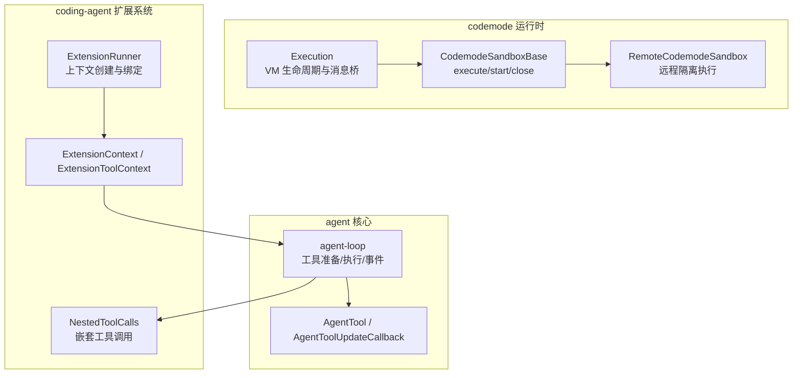
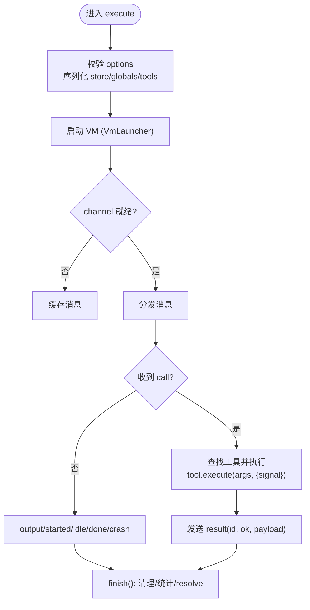
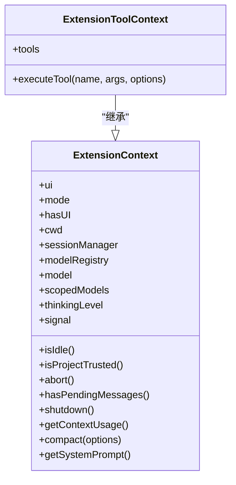
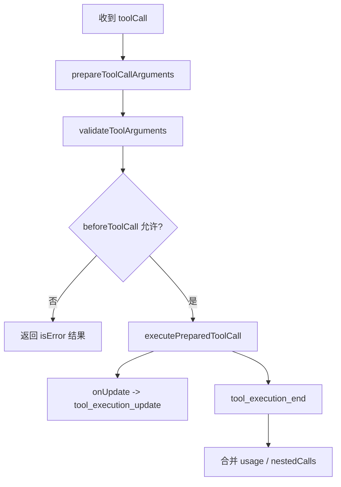
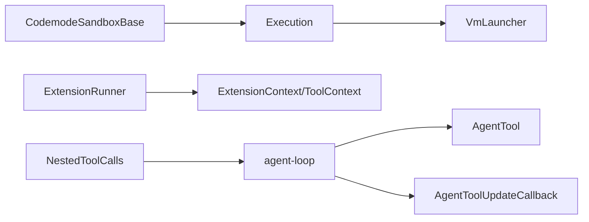

# 执行逻辑实现

<cite>
**本文引用的文件**   
- [execution.ts](https://github.com/FDE-GROUP/oh-my-fde/blob/omca/packages/codemode/src/runtime/execution.ts)
- [types.ts](https://github.com/FDE-GROUP/oh-my-fde/blob/omca/packages/coding-agent/src/core/extensions/types.ts)
- [runner.ts](https://github.com/FDE-GROUP/oh-my-fde/blob/omca/packages/coding-agent/src/core/extensions/runner.ts)
- [agent-loop.ts](https://github.com/FDE-GROUP/oh-my-fde/blob/omca/packages/agent/src/agent-loop.ts)
- [types.ts](https://github.com/FDE-GROUP/oh-my-fde/blob/omca/packages/agent/src/types.ts)
- [nested-tool-calls.ts](https://github.com/FDE-GROUP/oh-my-fde/blob/omca/packages/coding-agent/src/core/nested-tool-calls.ts)
- [bash-executor.ts](https://github.com/FDE-GROUP/oh-my-fde/blob/omca/packages/coding-agent/src/core/bash-executor.ts)
- [remote.ts](https://github.com/FDE-GROUP/oh-my-fde/blob/omca/packages/codemode/src/runtime/remote.ts)
</cite>

## 目录
1. [引言](#引言)
2. [项目结构](#项目结构)
3. [核心组件](#核心组件)
4. [架构总览](#架构总览)
5. [详细组件分析](#详细组件分析)
6. [依赖关系分析](#依赖关系分析)
7. [性能与资源管理](#性能与资源管理)
8. [故障排查指南](#故障排查指南)
9. [结论](#结论)
10. [附录：从简单到复杂的实现示例](#附录从简单到复杂的实现示例)

## 引言
本文面向“设备执行逻辑”的实现，聚焦以下目标：
- 深入解释 execute 函数的实现模式：参数处理、异步操作、错误处理、进度更新。
- 详细说明 ExtensionToolContext 上下文的使用方法：tools 调用、session 管理、模型访问等。
- 介绍 AgentToolUpdateCallback 回调机制用于流式结果更新。
- 提供从简单文件操作到复杂业务逻辑的完整实现思路。
- 给出性能优化、资源管理与调试技巧。

本指南以仓库中的 codemode 沙箱执行器、扩展上下文、Agent 工具执行循环为核心，串联“脚本执行 → 工具调用 → 事件流 → UI 展示”的完整链路。

## 项目结构
围绕“执行逻辑”，关键代码分布在以下模块：
- codemode 运行时：负责在隔离 VM 中执行用户脚本，并通过工具表与宿主通信。
- coding-agent 扩展系统：提供 ExtensionContext / ExtensionToolContext，封装 UI、会话、模型、命令等能力。
- agent 核心：定义 AgentTool、AgentToolUpdateCallback，并驱动工具执行、事件分发与并行/串行调度。
- 嵌套工具调用：支持工具内部再调用其他工具，记录 parentToolCallId 与 nestedCalls。
- bash 执行器：演示如何在工具中使用 onUpdate 进行流式输出。



**图表来源**
- [execution.ts:187-448](https://github.com/FDE-GROUP/oh-my-fde/blob/omca/packages/codemode/src/runtime/execution.ts#L187-L448)
- [execution.ts:460-573](https://github.com/FDE-GROUP/oh-my-fde/blob/omca/packages/codemode/src/runtime/execution.ts#L460-L573)
- [remote.ts:1-21](https://github.com/FDE-GROUP/oh-my-fde/blob/omca/packages/codemode/src/runtime/remote.ts#L1-L21)
- [types.ts:345-415](https://github.com/FDE-GROUP/oh-my-fde/blob/omca/packages/coding-agent/src/core/extensions/types.ts#L345-L415)
- [runner.ts:887-943](https://github.com/FDE-GROUP/oh-my-fde/blob/omca/packages/coding-agent/src/core/extensions/runner.ts#L887-L943)
- [agent-loop.ts:518-639](https://github.com/FDE-GROUP/oh-my-fde/blob/omca/packages/agent/src/agent-loop.ts#L518-L639)
- [agent-loop.ts:735-798](https://github.com/FDE-GROUP/oh-my-fde/blob/omca/packages/agent/src/agent-loop.ts#L735-L798)
- [types.ts:460-511](https://github.com/FDE-GROUP/oh-my-fde/blob/omca/packages/agent/src/types.ts#L460-L511)
- [nested-tool-calls.ts:103-129](https://github.com/FDE-GROUP/oh-my-fde/blob/omca/packages/coding-agent/src/core/nested-tool-calls.ts#L103-L129)

**章节来源**
- [execution.ts:1-574](https://github.com/FDE-GROUP/oh-my-fde/blob/omca/packages/codemode/src/runtime/execution.ts#L1-L574)
- [types.ts:345-415](https://github.com/FDE-GROUP/oh-my-fde/blob/omca/packages/coding-agent/src/core/extensions/types.ts#L345-L415)
- [runner.ts:887-943](https://github.com/FDE-GROUP/oh-my-fde/blob/omca/packages/coding-agent/src/core/extensions/runner.ts#L887-L943)
- [agent-loop.ts:518-798](https://github.com/FDE-GROUP/oh-my-fde/blob/omca/packages/agent/src/agent-loop.ts#L518-L798)
- [types.ts:460-511](https://github.com/FDE-GROUP/oh-my-fde/blob/omca/packages/agent/src/types.ts#L460-L511)
- [nested-tool-calls.ts:103-129](https://github.com/FDE-GROUP/oh-my-fde/blob/omca/packages/coding-agent/src/core/nested-tool-calls.ts#L103-L129)

## 核心组件
- Execution：单条脚本执行的宿主侧控制器，负责超时、中止、消息收发、工具调用、结果汇总。
- CodemodeSandboxBase：沙箱基类，维护工具表、全局函数、内存限制、并发执行集合，并提供 execute/start/close。
- ExtensionContext / ExtensionToolContext：扩展上下文，暴露 UI、会话、模型、信号、工具调用等能力。
- AgentTool / AgentToolUpdateCallback：Agent 工具定义与流式更新回调类型。
- agent-loop：工具准备、校验、执行（串行/并行）、事件发射、进度更新。
- NestedToolCalls：嵌套工具调用的记录与使用量聚合。
- BashExecutor：工具内流式输出的参考实现。

**章节来源**
- [execution.ts:187-448](https://github.com/FDE-GROUP/oh-my-fde/blob/omca/packages/codemode/src/runtime/execution.ts#L187-L448)
- [execution.ts:460-573](https://github.com/FDE-GROUP/oh-my-fde/blob/omca/packages/codemode/src/runtime/execution.ts#L460-L573)
- [types.ts:345-415](https://github.com/FDE-GROUP/oh-my-fde/blob/omca/packages/coding-agent/src/core/extensions/types.ts#L345-L415)
- [types.ts:460-511](https://github.com/FDE-GROUP/oh-my-fde/blob/omca/packages/agent/src/types.ts#L460-L511)
- [agent-loop.ts:518-798](https://github.com/FDE-GROUP/oh-my-fde/blob/omca/packages/agent/src/agent-loop.ts#L518-L798)
- [nested-tool-calls.ts:103-129](https://github.com/FDE-GROUP/oh-my-fde/blob/omca/packages/coding-agent/src/core/nested-tool-calls.ts#L103-L129)
- [bash-executor.ts:48-120](https://github.com/FDE-GROUP/oh-my-fde/blob/omca/packages/coding-agent/src/core/bash-executor.ts#L48-L120)

## 架构总览
下图展示了“脚本执行 → 工具调用 → 事件流 → UI 展示”的整体流程，以及各层之间的职责边界。

```mermaid
sequenceDiagram
participant User as "调用方"
participant Sandbox as "CodemodeSandboxBase"
participant Exec as "Execution"
participant VM as "VM(Worker/Inline/Remote)"
participant Tool as "工具(CodemodeTool/AgentTool)"
participant Loop as "agent-loop"
participant UI as "UI/Transcript"
User->>Sandbox : execute(code, options)
Sandbox->>Exec : new Execution(...)
Exec->>VM : launch(data, events)
VM-->>Exec : started/idle/output/call
Exec->>Tool : tool.execute(args, {signal})
Tool-->>Exec : result or error
Exec-->>VM : result(id, ok, payload)
VM-->>Exec : done/crash
Exec-->>Sandbox : CodemodeResult
Sandbox-->>User : Promise<CodemodeResult>
Note over Loop,UI : Agent 工具执行时，通过 onUpdate 推送 partialResult<br/>Loop 发出 tool_execution_update 事件，UI 实时渲染
```

**图表来源**
- [execution.ts:206-258](https://github.com/FDE-GROUP/oh-my-fde/blob/omca/packages/codemode/src/runtime/execution.ts#L206-L258)
- [execution.ts:330-408](https://github.com/FDE-GROUP/oh-my-fde/blob/omca/packages/codemode/src/runtime/execution.ts#L330-L408)
- [execution.ts:410-448](https://github.com/FDE-GROUP/oh-my-fde/blob/omca/packages/codemode/src/runtime/execution.ts#L410-L448)
- [agent-loop.ts:789-798](https://github.com/FDE-GROUP/oh-my-fde/blob/omca/packages/agent/src/agent-loop.ts#L789-L798)

## 详细组件分析

### 1. Execution 与 CodemodeSandboxBase：execute 的实现模式
- 参数处理
  - 接收 code、tools、globals、timeoutMs、memoryLimitBytes、store、deterministic、launch 等选项。
  - 对 globals 名称做合法性检查，避免覆盖内置全局名。
  - store 值会被序列化后传入 VM，并在返回时解析为结构化写入。
- 异步操作
  - 通过 VmLauncher 启动 VM，可能立即返回 channel，也可能异步返回；未返回前产生的消息会缓存。
  - 工具调用是异步的，PendingCall 持有 AbortController，支持取消。
  - finish() 会清理 pending、定时器、AbortSignal 监听，并停止 channel。
- 错误处理
  - 工具执行异常被捕获，转为 { ok: false, payload: errorMessage(error) }。
  - 桥接 JSON 解析失败或非法消息会触发 BridgeError，最终作为 sandbox 错误。
  - 超时、abort、crash、done 均汇聚到 finish()，保证幂等结束。
- 进度更新
  - 对于 host-controlled run（start），通过 deliver(seq, now, id, outcome) 将工具结果回传 VM。
  - 普通 execute 不直接暴露 onUpdate，但工具可通过返回值与 output 项传递中间状态。



**图表来源**
- [execution.ts:206-258](https://github.com/FDE-GROUP/oh-my-fde/blob/omca/packages/codemode/src/runtime/execution.ts#L206-L258)
- [execution.ts:330-408](https://github.com/FDE-GROUP/oh-my-fde/blob/omca/packages/codemode/src/runtime/execution.ts#L330-L408)
- [execution.ts:410-448](https://github.com/FDE-GROUP/oh-my-fde/blob/omca/packages/codemode/src/runtime/execution.ts#L410-L448)

**章节来源**
- [execution.ts:187-448](https://github.com/FDE-GROUP/oh-my-fde/blob/omca/packages/codemode/src/runtime/execution.ts#L187-L448)
- [execution.ts:460-573](https://github.com/FDE-GROUP/oh-my-fde/blob/omca/packages/codemode/src/runtime/execution.ts#L460-L573)

### 2. ExtensionContext / ExtensionToolContext：上下文使用
- ExtensionContext
  - 提供 UI 交互（select/confirm/input/notify/editor/custom 等）。
  - 提供运行模式（tui/rpc/json/print）、工作目录、会话管理器、模型注册表、当前模型、受限模型集。
  - 提供 isIdle、isProjectTrusted、signal、abort、hasPendingMessages、shutdown、getContextUsage、compact、getSystemPrompt 等方法。
- ExtensionToolContext
  - 继承 ExtensionContext，额外暴露 tools 列表与 executeTool(name, args, options)。
  - executeTool 会复用相同的验证、钩子与权限检查，并以 parentToolCallId 关联嵌套调用。
  - 不会因工具失败而抛出异常，而是返回 isError: true 的结果对象。



**图表来源**
- [types.ts:345-415](https://github.com/FDE-GROUP/oh-my-fde/blob/omca/packages/coding-agent/src/core/extensions/types.ts#L345-L415)

**章节来源**
- [types.ts:345-415](https://github.com/FDE-GROUP/oh-my-fde/blob/omca/packages/coding-agent/src/core/extensions/types.ts#L345-L415)
- [runner.ts:887-943](https://github.com/FDE-GROUP/oh-my-fde/blob/omca/packages/coding-agent/src/core/extensions/runner.ts#L887-L943)

### 3. AgentToolUpdateCallback：流式结果更新
- AgentToolUpdateCallback<T> 是一个回调类型，用于在工具执行过程中推送部分结果。
- agent-loop 在执行工具时，会为每个工具生成 emitToolExecutionUpdate，将 onUpdate 包装成事件发射器。
- 当工具调用 onUpdate(partialResult)，Loop 会发出 tool_execution_update 事件，UI 可据此实时更新。
- 测试用例表明：即使工具已 settle，后续 onUpdate 也会被忽略；并行工具之间也不会互相干扰。

```mermaid
sequenceDiagram
participant Loop as "agent-loop"
participant Tool as "AgentTool.execute"
participant Sink as "emitToolExecutionUpdate"
participant UI as "UI/Transcript"
Loop->>Tool : execute(toolCallId, params, signal, onUpdate)
Tool->>Sink : onUpdate(partialResult)
Sink-->>UI : tool_execution_update(partialResult)
Tool-->>Loop : final result
```

**图表来源**
- [agent-loop.ts:789-798](https://github.com/FDE-GROUP/oh-my-fde/blob/omca/packages/agent/src/agent-loop.ts#L789-L798)
- [types.ts:460-511](https://github.com/FDE-GROUP/oh-my-fde/blob/omca/packages/agent/src/types.ts#L460-L511)

**章节来源**
- [agent-loop.ts:789-798](https://github.com/FDE-GROUP/oh-my-fde/blob/omca/packages/agent/src/agent-loop.ts#L789-L798)
- [types.ts:460-511](https://github.com/FDE-GROUP/oh-my-fde/blob/omca/packages/agent/src/types.ts#L460-L511)

### 4. 工具执行流程：prepare → validate → execute → event
- prepareToolCallArguments：兼容旧参数，转换为 TParams。
- validateToolArguments：基于 schema 校验参数。
- beforeToolCall：可选拦截器，支持 block/terminate。
- executePreparedToolCall：实际执行工具，支持 onUpdate 与 duration 统计。
- 并行/串行执行：根据 executionMode 决定并发策略。



**图表来源**
- [agent-loop.ts:735-798](https://github.com/FDE-GROUP/oh-my-fde/blob/omca/packages/agent/src/agent-loop.ts#L735-L798)
- [agent-loop.ts:518-639](https://github.com/FDE-GROUP/oh-my-fde/blob/omca/packages/agent/src/agent-loop.ts#L518-L639)

**章节来源**
- [agent-loop.ts:518-639](https://github.com/FDE-GROUP/oh-my-fde/blob/omca/packages/agent/src/agent-loop.ts#L518-L639)
- [agent-loop.ts:735-798](https://github.com/FDE-GROUP/oh-my-fde/blob/omca/packages/agent/src/agent-loop.ts#L735-L798)

### 5. 嵌套工具调用：parentToolCallId 与 nestedCalls
- ExtensionToolContext.executeTool 会在同一会话中调用另一个工具。
- 嵌套调用不会出现在 transcript 中，但会保留 bounded 记录于父工具的 result 的 nestedCalls。
- NestedToolCalls 跟踪 start/update/end 事件，并聚合 usage。

```mermaid
sequenceDiagram
participant Parent as "父工具"
participant Ctx as "ExtensionToolContext"
participant Loop as "agent-loop"
participant Child as "子工具"
Parent->>Ctx : executeTool(childName, args, {onUpdate})
Ctx->>Loop : 发起嵌套调用
Loop->>Child : execute(...)
Child-->>Loop : onUpdate/partialResult
Loop-->>Parent : tool_execution_update(parentToolCallId)
Child-->>Loop : final result
Loop-->>Parent : tool_execution_end(nestedCalls)
```

**图表来源**
- [types.ts:403-415](https://github.com/FDE-GROUP/oh-my-fde/blob/omca/packages/coding-agent/src/core/extensions/types.ts#L403-L415)
- [nested-tool-calls.ts:103-129](https://github.com/FDE-GROUP/oh-my-fde/blob/omca/packages/coding-agent/src/core/nested-tool-calls.ts#L103-L129)

**章节来源**
- [types.ts:403-415](https://github.com/FDE-GROUP/oh-my-fde/blob/omca/packages/coding-agent/src/core/extensions/types.ts#L403-L415)
- [nested-tool-calls.ts:103-129](https://github.com/FDE-GROUP/oh-my-fde/blob/omca/packages/coding-agent/src/core/nested-tool-calls.ts#L103-L129)

### 6. 流式输出示例：Bash 工具
- Bash 工具在 exec 过程中，通过 onUpdate 推送阶段性输出，使 UI 能逐步显示命令执行进展。
- 这体现了“长耗时任务”的最佳实践：频繁 but 轻量地推送 partialResult，避免阻塞主线程。

**章节来源**
- [bash-executor.ts:48-120](https://github.com/FDE-GROUP/oh-my-fde/blob/omca/packages/coding-agent/src/core/bash-executor.ts#L48-L120)

## 依赖关系分析
- Execution 依赖 VmLauncher 与协议消息，屏蔽底层 Worker/Inline/Remote 差异。
- CodemodeSandboxBase 维护工具表与全局函数，统一超时、内存限制、并发执行集合。
- ExtensionRunner 负责绑定上下文与 UI，createContext 暴露给扩展使用。
- agent-loop 依赖 AgentTool 定义与 AgentToolUpdateCallback，驱动事件流。
- NestedToolCalls 与 session-manager/model-registry 等共同支撑会话级能力。



**图表来源**
- [execution.ts:187-448](https://github.com/FDE-GROUP/oh-my-fde/blob/omca/packages/codemode/src/runtime/execution.ts#L187-L448)
- [execution.ts:460-573](https://github.com/FDE-GROUP/oh-my-fde/blob/omca/packages/codemode/src/runtime/execution.ts#L460-L573)
- [runner.ts:887-943](https://github.com/FDE-GROUP/oh-my-fde/blob/omca/packages/coding-agent/src/core/extensions/runner.ts#L887-L943)
- [agent-loop.ts:518-798](https://github.com/FDE-GROUP/oh-my-fde/blob/omca/packages/agent/src/agent-loop.ts#L518-L798)
- [nested-tool-calls.ts:103-129](https://github.com/FDE-GROUP/oh-my-fde/blob/omca/packages/coding-agent/src/core/nested-tool-calls.ts#L103-L129)

**章节来源**
- [execution.ts:187-573](https://github.com/FDE-GROUP/oh-my-fde/blob/omca/packages/codemode/src/runtime/execution.ts#L187-L573)
- [runner.ts:887-943](https://github.com/FDE-GROUP/oh-my-fde/blob/omca/packages/coding-agent/src/core/extensions/runner.ts#L887-L943)
- [agent-loop.ts:518-798](https://github.com/FDE-GROUP/oh-my-fde/blob/omca/packages/agent/src/agent-loop.ts#L518-L798)
- [nested-tool-calls.ts:103-129](https://github.com/FDE-GROUP/oh-my-fde/blob/omca/packages/coding-agent/src/core/nested-tool-calls.ts#L103-L129)

## 性能与资源管理
- 超时控制
  - Execution 构造函数设置 setTimeout，超时后 finish() 终止执行。
  - 建议为长时间运行的工具设置合理 timeoutMs，避免资源泄漏。
- 中止传播
  - PendingCall 持有 AbortController，finish() 会 abort 所有 pending 调用。
  - 外部 signal 也会触发 onAbort，确保上层取消能下钻到工具。
- 并发与隔离
  - CodemodeSandboxBase.running 集合追踪所有执行实例，close() 会批量 abort。
  - Remote 执行将 VM 放在独立 isolate，避免阻塞宿主线程。
- 内存限制
  - memoryLimitBytes 透传到 VM，防止脚本占用过多内存。
- 确定性执行
  - start() 支持 deterministic 模式，固定 startedAt 与 seed，便于回放与复现。

**章节来源**
- [execution.ts:206-258](https://github.com/FDE-GROUP/oh-my-fde/blob/omca/packages/codemode/src/runtime/execution.ts#L206-L258)
- [execution.ts:305-308](https://github.com/FDE-GROUP/oh-my-fde/blob/omca/packages/codemode/src/runtime/execution.ts#L305-L308)
- [execution.ts:410-448](https://github.com/FDE-GROUP/oh-my-fde/blob/omca/packages/codemode/src/runtime/execution.ts#L410-L448)
- [execution.ts:530-566](https://github.com/FDE-GROUP/oh-my-fde/blob/omca/packages/codemode/src/runtime/execution.ts#L530-L566)
- [execution.ts:568-573](https://github.com/FDE-GROUP/oh-my-fde/blob/omca/packages/codemode/src/runtime/execution.ts#L568-L573)
- [remote.ts:1-21](https://github.com/FDE-GROUP/oh-my-fde/blob/omca/packages/codemode/src/runtime/remote.ts#L1-L21)

## 故障排查指南
- 常见错误类型
  - sandbox：VM 崩溃、transport 失败、BridgeError（JSON 解析失败、非法消息）。
  - script：脚本抛错，name/message/stack 需符合规范。
  - timeout：超过 timeoutMs。
  - aborted：外部 AbortSignal 触发。
- 定位步骤
  - 检查 output 数组与 calls 记录，确认工具是否被调用及状态。
  - 查看 storeWrites 是否包含预期写入。
  - 若出现 BridgeError，检查脚本是否修改了全局原型（如 Array.prototype.toJSON）。
  - 对于嵌套工具，检查 parentToolCallId 与 nestedCalls 是否完整。
- 调试建议
  - 使用 deterministic 模式回放问题场景。
  - 在工具中频繁调用 onUpdate 输出中间状态，配合 tool_execution_update 事件观察。
  - 对长耗时工具增加日志与计时，结合 durationMs 分析瓶颈。

**章节来源**
- [execution.ts:131-143](https://github.com/FDE-GROUP/oh-my-fde/blob/omca/packages/codemode/src/runtime/execution.ts#L131-L143)
- [execution.ts:330-408](https://github.com/FDE-GROUP/oh-my-fde/blob/omca/packages/codemode/src/runtime/execution.ts#L330-L408)
- [execution.ts:410-448](https://github.com/FDE-GROUP/oh-my-fde/blob/omca/packages/codemode/src/runtime/execution.ts#L410-L448)

## 结论
- execute 的核心在于：参数校验与序列化、VM 生命周期管理、工具调用与结果回传、错误收敛与资源清理。
- ExtensionToolContext 提供了统一的扩展上下文，屏蔽 UI、会话、模型等细节，让工具专注于业务逻辑。
- AgentToolUpdateCallback 使得长耗时工具能够流式反馈进度，提升用户体验与可观测性。
- 通过合理的超时、中止、内存限制与确定性执行，可以在保证安全的同时获得良好的性能与稳定性。

## 附录：从简单到复杂的实现示例

### 示例一：简单文件读取工具
- 目标：读取指定路径的文件内容，返回文本。
- 关键点：
  - 使用 ExtensionToolContext.cwd 获取工作目录。
  - 使用 fs 或平台 API 读取文件。
  - 返回 content 与 details，必要时设置 structuredContent。
- 参考路径：
  - [types.ts:670-676](https://github.com/FDE-GROUP/oh-my-fde/blob/omca/packages/coding-agent/src/core/extensions/types.ts#L670-L676)

### 示例二：带进度的长耗时任务
- 目标：模拟一个需要数秒的任务，期间通过 onUpdate 推送进度。
- 关键点：
  - 在 execute 中周期性调用 onUpdate({ content, details })。
  - 响应 AbortSignal，及时退出。
  - 最终返回 terminate 或正常结果。
- 参考路径：
  - [agent-loop.ts:789-798](https://github.com/FDE-GROUP/oh-my-fde/blob/omca/packages/agent/src/agent-loop.ts#L789-L798)
  - [bash-executor.ts:48-120](https://github.com/FDE-GROUP/oh-my-fde/blob/omca/packages/coding-agent/src/core/bash-executor.ts#L48-L120)

### 示例三：嵌套工具调用
- 目标：在一个工具中调用另一个工具，并收集嵌套调用结果。
- 关键点：
  - 使用 ctx.executeTool(name, args, { onUpdate })。
  - 父工具结果中包含 nestedCalls 记录。
  - 注意 onError 不会抛出，而是 isError: true。
- 参考路径：
  - [types.ts:403-415](https://github.com/FDE-GROUP/oh-my-fde/blob/omca/packages/coding-agent/src/core/extensions/types.ts#L403-L415)
  - [nested-tool-calls.ts:103-129](https://github.com/FDE-GROUP/oh-my-fde/blob/omca/packages/coding-agent/src/core/nested-tool-calls.ts#L103-L129)

### 示例四：复杂业务编排
- 目标：组合多个工具完成端到端流程（如拉取数据 → 转换 → 写入 → 通知）。
- 关键点：
  - 使用 ExtensionContext.sessionManager 管理会话。
  - 使用 modelRegistry 与 model 访问模型信息。
  - 使用 ui.notify 或 setWorkingMessage 反馈状态。
  - 合理使用 executionMode 控制并行/串行。
- 参考路径：
  - [types.ts:345-415](https://github.com/FDE-GROUP/oh-my-fde/blob/omca/packages/coding-agent/src/core/extensions/types.ts#L345-L415)
  - [runner.ts:887-943](https://github.com/FDE-GROUP/oh-my-fde/blob/omca/packages/coding-agent/src/core/extensions/runner.ts#L887-L943)