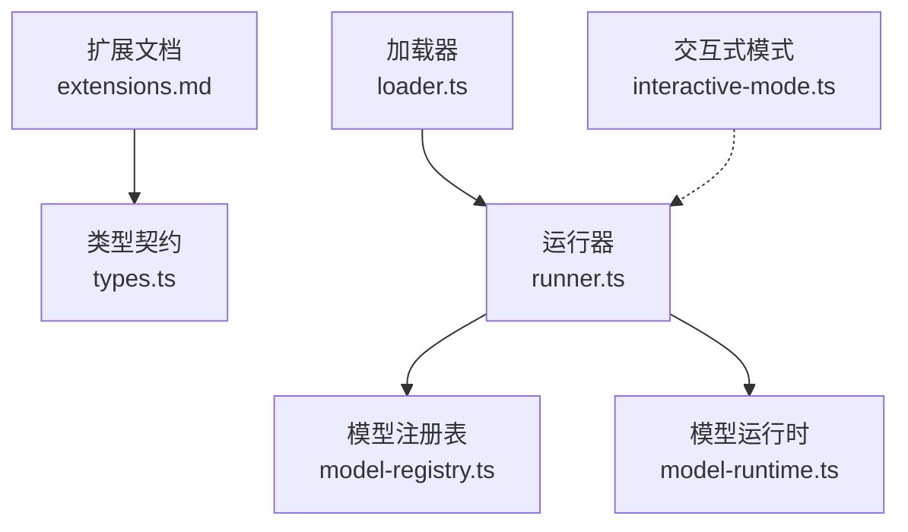
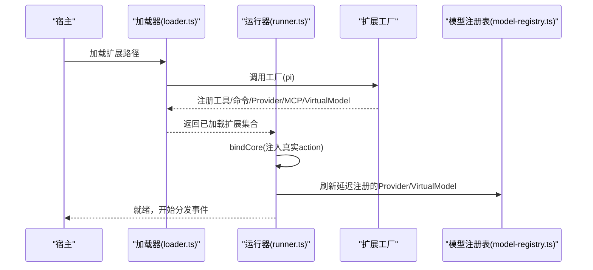
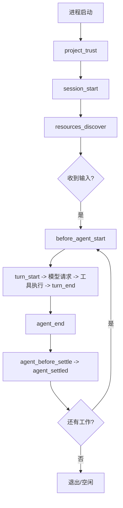
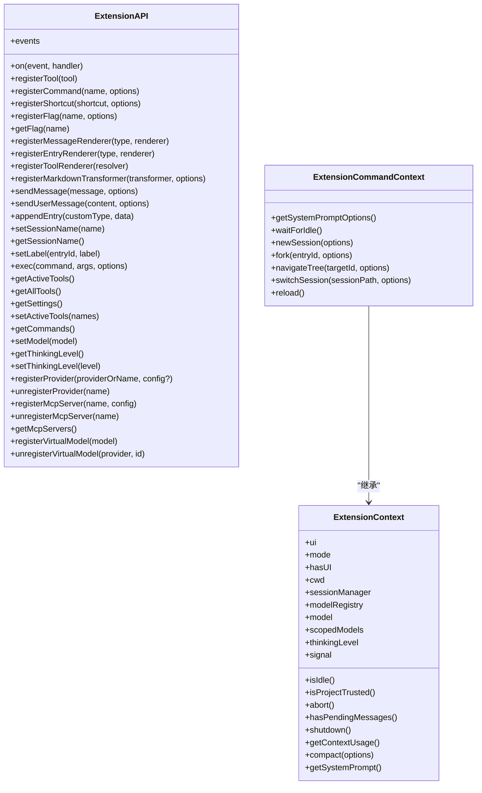
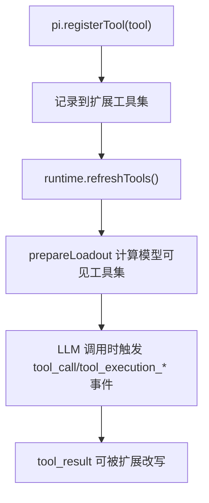
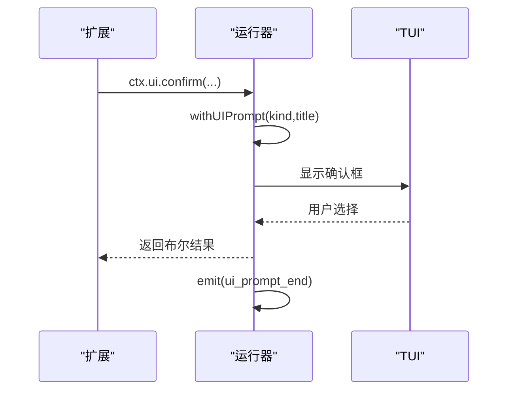
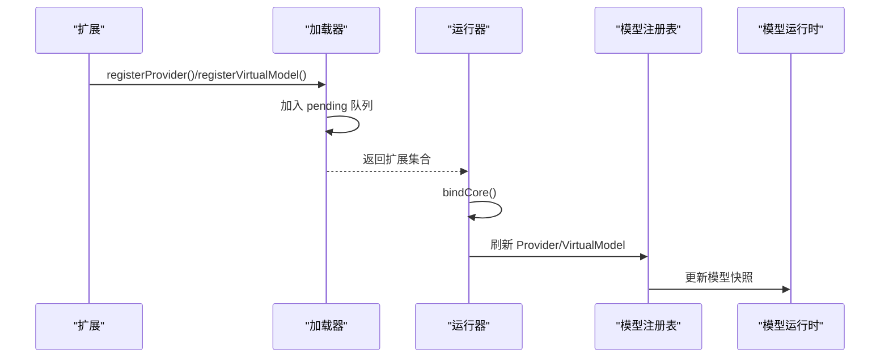
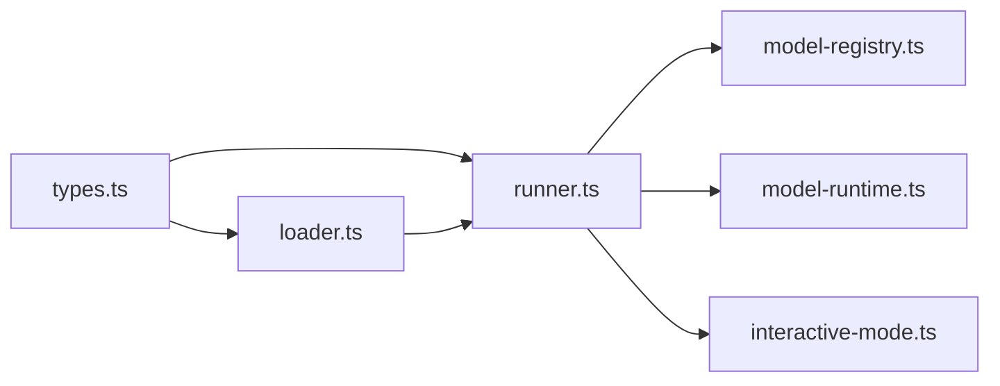

# 扩展系统

<cite>
**本文引用的文件**   
- [README.md](https://github.com/FDE-GROUP/oh-my-coding-agent/blob/omca/README.md)
- [extensions.md](https://github.com/FDE-GROUP/oh-my-coding-agent/blob/omca/packages/coding-agent/docs/extensions.md)
- [loader.ts](https://github.com/FDE-GROUP/oh-my-coding-agent/blob/omca/packages/coding-agent/src/core/extensions/loader.ts)
- [runner.ts](https://github.com/FDE-GROUP/oh-my-coding-agent/blob/omca/packages/coding-agent/src/core/extensions/runner.ts)
- [types.ts](https://github.com/FDE-GROUP/oh-my-coding-agent/blob/omca/packages/coding-agent/src/core/extensions/types.ts)
- [interactive-mode.ts](https://github.com/FDE-GROUP/oh-my-coding-agent/blob/omca/packages/coding-agent/src/modes/interactive/interactive-mode.ts)
- [model-registry.ts](https://github.com/FDE-GROUP/oh-my-coding-agent/blob/omca/packages/coding-agent/src/core/model-registry.ts)
- [model-runtime.ts](https://github.com/FDE-GROUP/oh-my-coding-agent/blob/omca/packages/coding-agent/src/core/model-runtime.ts)
- [agent-session-model-extension.test.ts](https://github.com/FDE-GROUP/oh-my-coding-agent/blob/omca/packages/coding-agent/test/suite/agent-session-model-extension.test.ts)
</cite>

## 目录
1. [简介](#简介)
2. [项目结构](#项目结构)
3. [核心组件](#核心组件)
4. [架构总览](#架构总览)
5. [详细组件分析](#详细组件分析)
6. [依赖关系分析](#依赖关系分析)
7. [性能与可靠性](#性能与可靠性)
8. [故障排查指南](#故障排查指南)
9. [结论](#结论)
10. [附录：开发清单与最佳实践](#附录开发清单与最佳实践)

## 简介
本文件系统性说明 Pi 的扩展系统，包括插件架构、扩展开发接口、技能与工作流定制、事件模型、工具注册、命令钩子、UI 交互、生命周期管理、依赖注入、配置管理与发布流程。读者可据此从零开始编写自定义扩展，安全地接入 LLM 调用链，并在 TUI/RPC/Print 多模式下稳定运行。

## 项目结构
Pi 的扩展能力集中在 coding-agent 包的扩展子系统中，围绕“加载器 + 运行器 + 类型契约”三层组织：
- 加载器负责发现、解析、缓存并执行扩展模块工厂函数。
- 运行器负责绑定上下文、分发事件、协调会话与模型注册等运行时行为。
- 类型契约定义扩展 API、事件、工具、命令、渲染器等所有对外接口。

图示来源
- [extensions.md:1-800](https://github.com/FDE-GROUP/oh-my-coding-agent/blob/omca/packages/coding-agent/docs/extensions.md#L1-L800)
- [types.ts:1600-2353](https://github.com/FDE-GROUP/oh-my-coding-agent/blob/omca/packages/coding-agent/src/core/extensions/types.ts#L1600-L2353)
- [loader.ts:1-800](https://github.com/FDE-GROUP/oh-my-coding-agent/blob/omca/packages/coding-agent/src/core/extensions/loader.ts#L1-L800)
- [runner.ts:1-800](https://github.com/FDE-GROUP/oh-my-coding-agent/blob/omca/packages/coding-agent/src/core/extensions/runner.ts#L1-L800)
- [model-registry.ts:206-244](https://github.com/FDE-GROUP/oh-my-coding-agent/blob/omca/packages/coding-agent/src/core/model-registry.ts#L206-L244)
- [model-runtime.ts:996-1020](https://github.com/FDE-GROUP/oh-my-coding-agent/blob/omca/packages/coding-agent/src/core/model-runtime.ts#L996-L1020)
- [interactive-mode.ts:2811-2839](https://github.com/FDE-GROUP/oh-my-coding-agent/blob/omca/packages/coding-agent/src/modes/interactive/interactive-mode.ts#L2811-L2839)

章节来源
- [README.md:13-21](https://github.com/FDE-GROUP/oh-my-coding-agent/blob/omca/README.md#L13-L21)
- [extensions.md:1-800](https://github.com/FDE-GROUP/oh-my-coding-agent/blob/omca/packages/coding-agent/docs/extensions.md#L1-L800)

## 核心组件
- 扩展加载器（loader.ts）
  - 使用 jiti 动态加载 TypeScript 扩展模块。
  - 提供扩展工厂执行环境、API 包装、缓存与热重载支持。
  - 将 provider/MCP/virtual model 等注册在 bindCore 前排队，bindCore 后统一刷新。
- 扩展运行器（runner.ts）
  - 绑定宿主上下文（UI、会话、模型、命令、快捷键）。
  - 分发扩展事件，处理边界事件（turn_end、agent_before_settle）。
  - 维护 MCP 服务器连接状态与未处理告警。
- 类型契约（types.ts）
  - 定义 ExtensionAPI、ExtensionContext、ToolDefinition、RegisteredCommand、事件类型等。
  - 明确工具暴露策略、命名空间、渲染器、Markdown 转换器、虚拟模型路由等。
- 交互式 UI（interactive-mode.ts）
  - 管理扩展对话框栈，控制编辑器焦点与阻塞状态。
- 模型注册与运行时（model-registry.ts / model-runtime.ts）
  - 接收扩展注册的 Provider、Virtual Model，更新可用模型快照。

章节来源
- [loader.ts:160-244](https://github.com/FDE-GROUP/oh-my-coding-agent/blob/omca/packages/coding-agent/src/core/extensions/loader.ts#L160-L244)
- [loader.ts:246-561](https://github.com/FDE-GROUP/oh-my-coding-agent/blob/omca/packages/coding-agent/src/core/extensions/loader.ts#L246-L561)
- [runner.ts:364-551](https://github.com/FDE-GROUP/oh-my-coding-agent/blob/omca/packages/coding-agent/src/core/extensions/runner.ts#L364-L551)
- [types.ts:1600-2353](https://github.com/FDE-GROUP/oh-my-coding-agent/blob/omca/packages/coding-agent/src/core/extensions/types.ts#L1600-L2353)
- [interactive-mode.ts:2811-2839](https://github.com/FDE-GROUP/oh-my-coding-agent/blob/omca/packages/coding-agent/src/modes/interactive/interactive-mode.ts#L2811-L2839)
- [model-registry.ts:206-244](https://github.com/FDE-GROUP/oh-my-coding-agent/blob/omca/packages/coding-agent/src/core/model-registry.ts#L206-L244)
- [model-runtime.ts:996-1020](https://github.com/FDE-GROUP/oh-my-coding-agent/blob/omca/packages/coding-agent/src/core/model-runtime.ts#L996-L1020)

## 架构总览
扩展系统采用“工厂 + 运行时 + 事件总线”的解耦设计：
- 扩展以默认导出工厂函数形式存在，接收 ExtensionAPI。
- 加载器创建 ExtensionRuntime（含待执行的 action stub），随后由运行器 bindCore 注入真实实现。
- 运行器统一管理事件分发、会话切换、模型注册刷新、MCP 服务器连接与错误上报。

图示来源
- [loader.ts:625-683](https://github.com/FDE-GROUP/oh-my-coding-agent/blob/omca/packages/coding-agent/src/core/extensions/loader.ts#L625-L683)
- [runner.ts:417-551](https://github.com/FDE-GROUP/oh-my-coding-agent/blob/omca/packages/coding-agent/src/core/extensions/runner.ts#L417-L551)
- [model-registry.ts:206-244](https://github.com/FDE-GROUP/oh-my-coding-agent/blob/omca/packages/coding-agent/src/core/model-registry.ts#L206-L244)

## 详细组件分析

### 扩展生命周期与事件模型
- 启动阶段
  - project_trust：决定是否信任当前项目资源。
  - session_start：会话启动/重载/新建/恢复/分叉。
  - resources_discover：补充 skill/prompt/theme 路径。
- 运行阶段
  - before_agent_start：注入消息或修改系统提示。
  - turn_start/turn_end：每轮对话的开始与结束，支持追加条目与请求继续。
  - agent_start/agent_end/agent_before_settle/agent_settled：低层 Agent 循环边界。
  - message_start/update/end：消息生命周期，message_end 可替换最终消息。
  - tool_execution_start/update/end、tool_call/tool_result：工具执行全链路。
  - user_bash/input：用户 Bash 与输入拦截。
- 会话变更
  - session_before_switch/session_before_fork/session_before_compact/session_before_tree：可取消或自定义摘要。
  - session_shutdown：清理会话级资源。

图示来源
- [extensions.md:305-408](https://github.com/FDE-GROUP/oh-my-coding-agent/blob/omca/packages/coding-agent/docs/extensions.md#L305-L408)
- [runner.ts:261-329](https://github.com/FDE-GROUP/oh-my-coding-agent/blob/omca/packages/coding-agent/src/core/extensions/runner.ts#L261-L329)

章节来源
- [extensions.md:305-800](https://github.com/FDE-GROUP/oh-my-coding-agent/blob/omca/packages/coding-agent/docs/extensions.md#L305-L800)
- [runner.ts:261-329](https://github.com/FDE-GROUP/oh-my-coding-agent/blob/omca/packages/coding-agent/src/core/extensions/runner.ts#L261-L329)

### 扩展 API 与上下文
- ExtensionAPI
  - 事件订阅：on(...) 支持全部扩展事件。
  - 工具注册：registerTool(...)，支持参数 Schema、输出 Schema、渲染器、暴露策略、命名空间、执行模式等。
  - 命令/快捷键/标志：registerCommand/registerShortcut/registerFlag/getFlag。
  - 渲染扩展：registerMessageRenderer/registerEntryRenderer/registerToolRenderer/registerMarkdownTransformer。
  - 动作：sendMessage/sendUserMessage/appendEntry/setSessionName/getSessionName/setLabel/exec/getActiveTools/getAllTools/getSettings/setActiveTools/getCommands/setModel/getThinkingLevel/setThinkingLevel。
  - Provider/MCP/VirtualModel：registerProvider/unregisterProvider/registerMcpServer/unregisterMcpServer/getMcpServers/registerVirtualModel/unregisterVirtualModel/events。
- ExtensionContext
  - UI 交互：select/confirm/input/notify/editor/custom/pasteToEditor/setEditorText/getEditorText/addAutocompleteProvider/setEditorComponent/getEditorComponent 等。
  - 会话与模型：isIdle/isProjectTrusted/abort/shutdown/getContextUsage/compact/getSystemPrompt 等。
  - 命令上下文：ExtensionCommandContext 提供 newSession/fork/navigateTree/switchSession/reload/waitForIdle 等。

图示来源
- [types.ts:1600-2353](https://github.com/FDE-GROUP/oh-my-coding-agent/blob/omca/packages/coding-agent/src/core/extensions/types.ts#L1600-L2353)

章节来源
- [types.ts:1600-2353](https://github.com/FDE-GROUP/oh-my-coding-agent/blob/omca/packages/coding-agent/src/core/extensions/types.ts#L1600-L2353)

### 工具系统与自定义工具
- 工具定义 ToolDefinition
  - name/label/description/parameters/outputSchema/exposure/namespace/annotations/prepareLoadout/reachesTools/defaultActive/executionMode/renderCall/renderResult。
  - execute(toolCallId, params, signal, onUpdate, ctx) 返回 AgentToolResult。
- 工具暴露策略
  - direct：对模型可见且可调用。
  - model-only：对模型可见但不可被其他工具调用。
  - codemode：仅通过 codemode 脚本调用。
  - deferred：codemode 搜索可发现但不声明给模型。
  - hidden：注册但不可达。
- 工具渲染
  - 可通过 renderCall/renderResult 自定义调用与结果展示；也可通过 registerToolRenderer 全局解析渲染器。

图示来源
- [loader.ts:298-310](https://github.com/FDE-GROUP/oh-my-coding-agent/blob/omca/packages/coding-agent/src/core/extensions/loader.ts#L298-L310)
- [types.ts:596-688](https://github.com/FDE-GROUP/oh-my-coding-agent/blob/omca/packages/coding-agent/src/core/extensions/types.ts#L596-L688)

章节来源
- [types.ts:596-688](https://github.com/FDE-GROUP/oh-my-coding-agent/blob/omca/packages/coding-agent/src/core/extensions/types.ts#L596-L688)
- [loader.ts:298-310](https://github.com/FDE-GROUP/oh-my-coding-agent/blob/omca/packages/coding-agent/src/core/extensions/loader.ts#L298-L310)

### 命令钩子与快捷键
- 命令注册：pi.registerCommand("name", { description, getArgumentCompletions?, handler })。
- 快捷键注册：pi.registerShortcut(keyId, { description, handler })，与内置快捷键冲突时受保护规则约束。
- CLI 标志：pi.registerFlag(name, { type, default? })，并通过 pi.getFlag(name) 读取。

章节来源
- [types.ts:1614-1624](https://github.com/FDE-GROUP/oh-my-coding-agent/blob/omca/packages/coding-agent/src/core/extensions/types.ts#L1614-L1624)
- [types.ts:1724-1753](https://github.com/FDE-GROUP/oh-my-coding-agent/blob/omca/packages/coding-agent/src/core/extensions/types.ts#L1724-L1753)
- [runner.ts:680-727](https://github.com/FDE-GROUP/oh-my-coding-agent/blob/omca/packages/coding-agent/src/core/extensions/runner.ts#L680-L727)

### 事件监听与边界处理
- 通知型事件：返回值被忽略，适合观察与日志。
- 变换型事件：后续处理器看到前序返回值或就地修改后的值。
- 门控型事件：input/tool_call/session_before_* 等可取消或阻断正常流程。
- 边界事件：turn_end/agent_before_settle 支持追加条目与请求继续，用于编排后续工作流。

章节来源
- [extensions.md:412-425](https://github.com/FDE-GROUP/oh-my-coding-agent/blob/omca/packages/coding-agent/docs/extensions.md#L412-L425)
- [extensions.md:715-750](https://github.com/FDE-GROUP/oh-my-coding-agent/blob/omca/packages/coding-agent/docs/extensions.md#L715-L750)

### UI 交互与扩展对话框
- 扩展可通过 ctx.ui 发起 select/confirm/input/editor/custom 等交互。
- 运行器会包装 UI 方法，自动派发 ui_prompt_start/ui_prompt_end 事件，便于宿主显示“等待用户输入”。
- 交互式模式中，扩展对话框以栈方式管理，支持嵌套与阻塞状态标记。

图示来源
- [runner.ts:577-622](https://github.com/FDE-GROUP/oh-my-coding-agent/blob/omca/packages/coding-agent/src/core/extensions/runner.ts#L577-L622)
- [interactive-mode.ts:2811-2839](https://github.com/FDE-GROUP/oh-my-coding-agent/blob/omca/packages/coding-agent/src/modes/interactive/interactive-mode.ts#L2811-L2839)

章节来源
- [runner.ts:577-622](https://github.com/FDE-GROUP/oh-my-coding-agent/blob/omca/packages/coding-agent/src/core/extensions/runner.ts#L577-L622)
- [interactive-mode.ts:2811-2839](https://github.com/FDE-GROUP/oh-my-coding-agent/blob/omca/packages/coding-agent/src/modes/interactive/interactive-mode.ts#L2811-L2839)

### 依赖注入与 Provider/MCP/VirtualModel
- 依赖注入
  - loader 创建 ExtensionRuntime（包含 action stubs），runner.bindCore 注入真实实现。
  - 扩展在加载期无法调用需运行时上下文的方法，否则会抛出“未初始化”错误。
- Provider 注册
  - 加载期注册会被队列化，bindCore 后统一刷新至 model-registry。
  - 运行期注册立即生效，无需 /reload。
- MCP 服务器
  - 扩展可注册/注销 MCP 服务器；若没有扩展处理 mcp_servers_change，将报告未连接告警。
- Virtual Model
  - 扩展可注册虚拟模型路由，运行时合并物理模型与虚拟模型，更新模型快照。

图示来源
- [loader.ts:219-241](https://github.com/FDE-GROUP/oh-my-coding-agent/blob/omca/packages/coding-agent/src/core/extensions/loader.ts#L219-L241)
- [runner.ts:470-551](https://github.com/FDE-GROUP/oh-my-coding-agent/blob/omca/packages/coding-agent/src/core/extensions/runner.ts#L470-L551)
- [model-registry.ts:206-244](https://github.com/FDE-GROUP/oh-my-coding-agent/blob/omca/packages/coding-agent/src/core/model-registry.ts#L206-L244)
- [model-runtime.ts:996-1020](https://github.com/FDE-GROUP/oh-my-coding-agent/blob/omca/packages/coding-agent/src/core/model-runtime.ts#L996-L1020)

章节来源
- [loader.ts:219-241](https://github.com/FDE-GROUP/oh-my-coding-agent/blob/omca/packages/coding-agent/src/core/extensions/loader.ts#L219-L241)
- [runner.ts:470-551](https://github.com/FDE-GROUP/oh-my-coding-agent/blob/omca/packages/coding-agent/src/core/extensions/runner.ts#L470-L551)
- [model-registry.ts:206-244](https://github.com/FDE-GROUP/oh-my-coding-agent/blob/omca/packages/coding-agent/src/core/model-registry.ts#L206-L244)
- [model-runtime.ts:996-1020](https://github.com/FDE-GROUP/oh-my-coding-agent/blob/omca/packages/coding-agent/src/core/model-runtime.ts#L996-L1020)

### 配置管理与设置
- 扩展可通过 pi.getSettings() 获取合并后的有效设置。
- 扩展可在 session_start/resources_discover 等事件中贡献额外资源路径（skill/prompt/theme）。
- 项目信任机制允许扩展在 project_trust 中参与决策。

章节来源
- [extensions.md:427-467](https://github.com/FDE-GROUP/oh-my-coding-agent/blob/omca/packages/coding-agent/docs/extensions.md#L427-L467)
- [types.ts:1819-1820](https://github.com/FDE-GROUP/oh-my-coding-agent/blob/omca/packages/coding-agent/src/core/extensions/types.ts#L1819-L1820)

### 发布与包管理
- 扩展位置
  - 全局：~/.pi/agent/extensions/*.ts 或 *.js，以及子目录 index.ts/index.js 或 package.json 中 pi.extensions。
  - 项目本地：.pi/extensions/...，仅在项目可信后加载。
- 包式扩展
  - 在扩展目录下提供 package.json，声明 dependencies 与 pi.extensions。
  - 通过 npm install 安装依赖后，node_modules 中的导入可直接使用。
- 作为 Pi 包分享
  - 可将扩展打包为 Pi 包，通过 npm/git 分发；详见 packages.md。

章节来源
- [extensions.md:121-170](https://github.com/FDE-GROUP/oh-my-coding-agent/blob/omca/packages/coding-agent/docs/extensions.md#L121-L170)
- [extensions.md:277-303](https://github.com/FDE-GROUP/oh-my-coding-agent/blob/omca/packages/coding-agent/docs/extensions.md#L277-L303)

## 依赖关系分析
- 耦合性
  - loader 与 runner 职责清晰：loader 专注模块加载与 API 构造，runner 专注运行时绑定与事件分发。
  - types 作为契约，降低各模块间直接耦合。
- 外部依赖
  - jiti 用于 TS 即时编译加载。
  - @earendil-works/pi-ai 提供 Provider/Model/Transcript 等类型与能力。
  - @earendil-works/pi-tui 提供 TUI 组件与主题。
  - @earendil-works/pi-mcp 提供 MCP 命名空间与校验。
- 潜在循环依赖
  - 通过 ExtensionRuntime 的延迟注入与 pending 队列避免加载期对运行时的强依赖。

图示来源
- [types.ts:1600-2353](https://github.com/FDE-GROUP/oh-my-coding-agent/blob/omca/packages/coding-agent/src/core/extensions/types.ts#L1600-L2353)
- [loader.ts:1-800](https://github.com/FDE-GROUP/oh-my-coding-agent/blob/omca/packages/coding-agent/src/core/extensions/loader.ts#L1-L800)
- [runner.ts:1-800](https://github.com/FDE-GROUP/oh-my-coding-agent/blob/omca/packages/coding-agent/src/core/extensions/runner.ts#L1-L800)
- [model-registry.ts:206-244](https://github.com/FDE-GROUP/oh-my-coding-agent/blob/omca/packages/coding-agent/src/core/model-registry.ts#L206-L244)
- [model-runtime.ts:996-1020](https://github.com/FDE-GROUP/oh-my-coding-agent/blob/omca/packages/coding-agent/src/core/model-runtime.ts#L996-L1020)
- [interactive-mode.ts:2811-2839](https://github.com/FDE-GROUP/oh-my-coding-agent/blob/omca/packages/coding-agent/src/modes/interactive/interactive-mode.ts#L2811-L2839)

章节来源
- [loader.ts:1-800](https://github.com/FDE-GROUP/oh-my-coding-agent/blob/omca/packages/coding-agent/src/core/extensions/loader.ts#L1-L800)
- [runner.ts:1-800](https://github.com/FDE-GROUP/oh-my-coding-agent/blob/omca/packages/coding-agent/src/core/extensions/runner.ts#L1-L800)
- [types.ts:1600-2353](https://github.com/FDE-GROUP/oh-my-coding-agent/blob/omca/packages/coding-agent/src/core/extensions/types.ts#L1600-L2353)

## 性能与可靠性
- 加载缓存
  - loader 按 cwd 与 generation 维度缓存扩展工厂，减少重复加载成本。
- 事件开销
  - 通知型事件应避免耗时操作；流式事件（如 message_update）尤其注意。
- 边界事件
  - turn_end/agent_before_settle 的 entries/continue 会在所有处理器完成后统一校验与提交，避免部分应用导致的语义错误。
- 会话替换
  - 会话替换或重载会使旧 ctx 失效，扩展应使用 withSession 回调中的新 ctx，避免 stale 引用。

章节来源
- [loader.ts:136-158](https://github.com/FDE-GROUP/oh-my-coding-agent/blob/omca/packages/coding-agent/src/core/extensions/loader.ts#L136-L158)
- [extensions.md:746-750](https://github.com/FDE-GROUP/oh-my-coding-agent/blob/omca/packages/coding-agent/docs/extensions.md#L746-L750)
- [loader.ts:200-207](https://github.com/FDE-GROUP/oh-my-coding-agent/blob/omca/packages/coding-agent/src/core/extensions/loader.ts#L200-L207)

## 故障排查指南
- 常见错误
  - “扩展运行时未初始化”：在加载期调用了需要运行时上下文的方法。
  - “扩展失败，API 不再活跃”：工厂抛错导致扩展进入 failed 状态。
  - “MCP 服务器已注册但未连接”：无扩展处理 mcp_servers_change。
  - “命令/工具注册参数无效”：名称为空、缺少 handler、参数 schema 非对象等。
- 诊断建议
  - 使用 ctx.ui.notify 与 events.emit 输出调试信息。
  - 在 agent_before_settle/agent_settled 中检查是否仍有待处理工作。
  - 检查 extension 的 replaceable/builtin 配置是否与内置扩展冲突。
- 测试参考
  - 生命周期事件顺序可通过测试用例验证，例如 session_start/session_shutdown 在 reload 场景下的触发顺序。

章节来源
- [loader.ts:164-174](https://github.com/FDE-GROUP/oh-my-coding-agent/blob/omca/packages/coding-agent/src/core/extensions/loader.ts#L164-L174)
- [loader.ts:263-268](https://github.com/FDE-GROUP/oh-my-coding-agent/blob/omca/packages/coding-agent/src/core/extensions/loader.ts#L263-L268)
- [runner.ts:759-770](https://github.com/FDE-GROUP/oh-my-coding-agent/blob/omca/packages/coding-agent/src/core/extensions/runner.ts#L759-L770)
- [agent-session-model-extension.test.ts:538-559](https://github.com/FDE-GROUP/oh-my-coding-agent/blob/omca/packages/coding-agent/test/suite/agent-session-model-extension.test.ts#L538-L559)

## 结论
Pi 的扩展系统通过清晰的加载器/运行器分层、完备的类型契约与丰富的生命周期事件，为开发者提供了强大的工作流定制能力。借助工具注册、命令钩子、UI 交互、Provider/MCP/VirtualModel 扩展点，可以在不侵入核心代码的前提下，安全地增强 Pi 的行为。遵循本文的生命周期与最佳实践，可构建高内聚、低耦合、易维护的扩展生态。

## 附录：开发清单与最佳实践
- 开发步骤
  - 确定扩展位置（全局/项目本地/包式）。
  - 编写默认导出的工厂函数，接收 ExtensionAPI。
  - 在 session_start 中初始化会话级资源，在 session_shutdown 中释放。
  - 使用 pi.registerTool 注册工具，定义参数 Schema 与渲染器。
  - 使用 pi.registerCommand 注册命令，必要时提供补全逻辑。
  - 使用 pi.on 订阅关键事件，避免在通知型事件中做重活。
  - 如需 Provider/MCP/VirtualModel，优先在加载期注册，让 runner 统一刷新。
- 最佳实践
  - 避免在工厂中启动后台任务；延后至 session_start 或具体触发点。
  - 使用 ToolExposure 精确控制工具的可见性与可调用范围。
  - 谨慎使用 continue: true，防止无限循环。
  - 在会话替换/重载后，始终使用新的 ctx，避免 stale 引用。
  - 对敏感操作（如 rm -rf）通过 tool_call 事件进行权限门控。
  - 使用 events.emit 与 ui_prompt_start/ui_prompt_end 配合宿主状态显示。
  - 发布前检查依赖声明与 pi.extensions 入口是否正确。

章节来源
- [extensions.md:186-257](https://github.com/FDE-GROUP/oh-my-coding-agent/blob/omca/packages/coding-agent/docs/extensions.md#L186-L257)
- [extensions.md:427-467](https://github.com/FDE-GROUP/oh-my-coding-agent/blob/omca/packages/coding-agent/docs/extensions.md#L427-L467)
- [extensions.md:613-750](https://github.com/FDE-GROUP/oh-my-coding-agent/blob/omca/packages/coding-agent/docs/extensions.md#L613-L750)
- [types.ts:521-536](https://github.com/FDE-GROUP/oh-my-coding-agent/blob/omca/packages/coding-agent/src/core/extensions/types.ts#L521-L536)
- [types.ts:1715-1772](https://github.com/FDE-GROUP/oh-my-coding-agent/blob/omca/packages/coding-agent/src/core/extensions/types.ts#L1715-L1772)