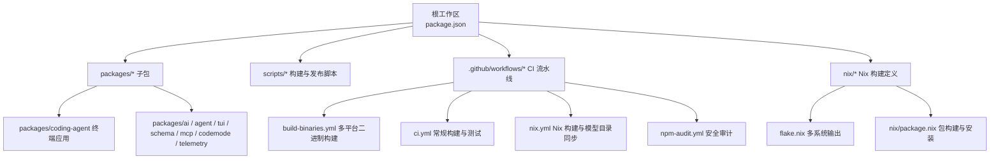
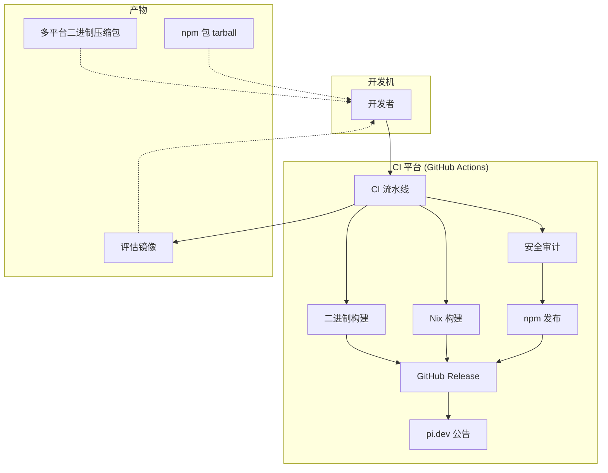
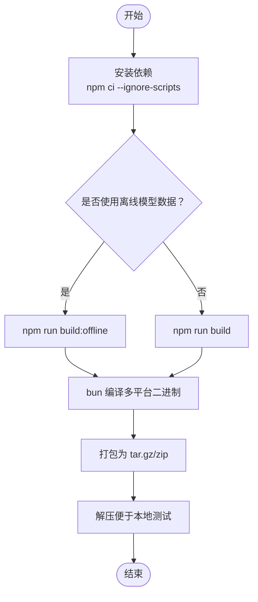
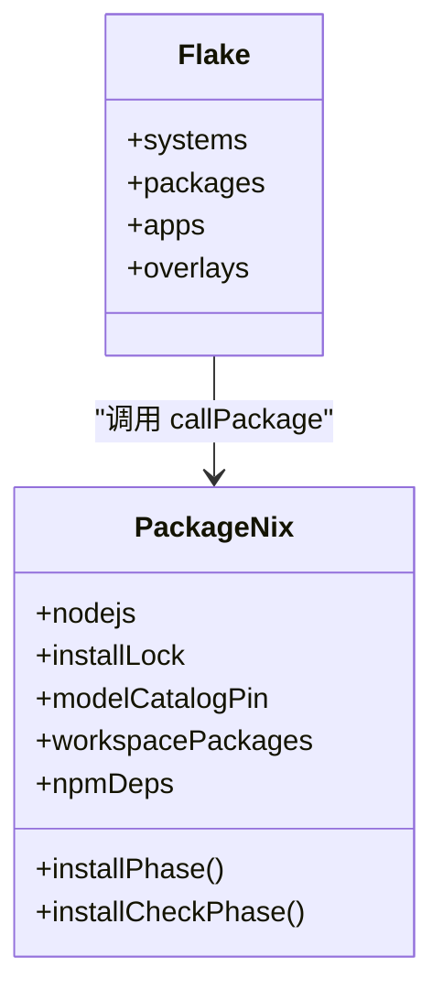
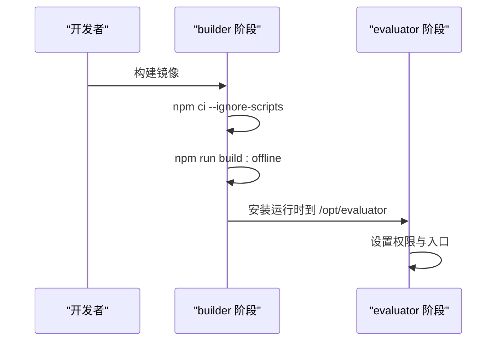
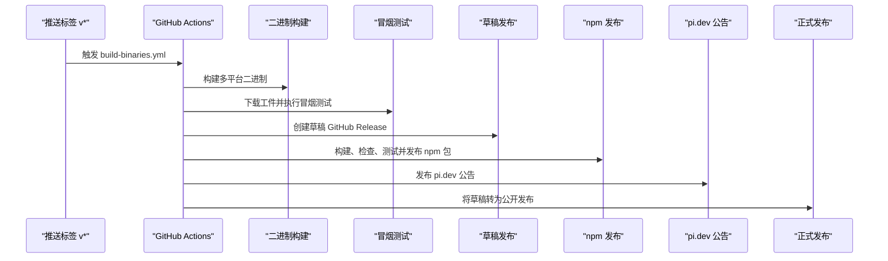
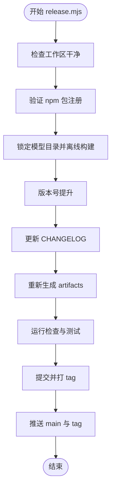
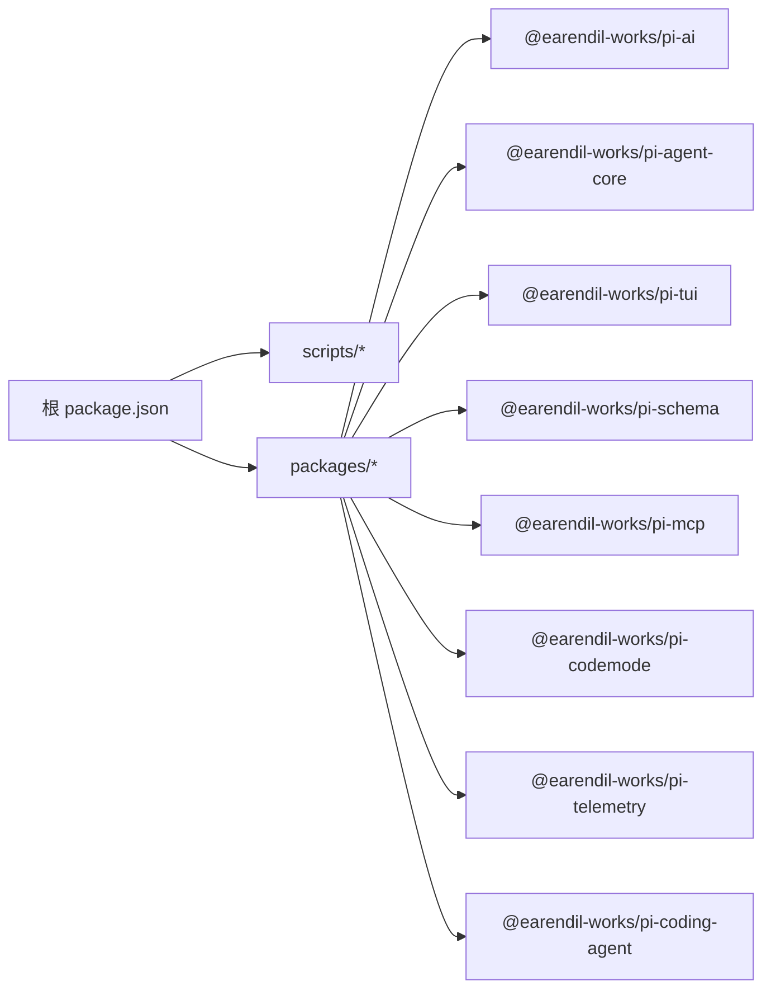

# 构建与部署

<cite>
**本文引用的文件**   
- [README.md](https://github.com/FDE-GROUP/oh-my-coding-agent/blob/omca/README.md)
- [package.json](https://github.com/FDE-GROUP/oh-my-coding-agent/blob/omca/package.json)
- [flake.nix](https://github.com/FDE-GROUP/oh-my-coding-agent/blob/omca/flake.nix)
- [nix/package.nix](https://github.com/FDE-GROUP/oh-my-coding-agent/blob/omca/nix/package.nix)
- [scripts/build-binaries.sh](https://github.com/FDE-GROUP/oh-my-coding-agent/blob/omca/scripts/build-binaries.sh)
- [.github/workflows/ci.yml](https://github.com/FDE-GROUP/oh-my-coding-agent/blob/omca/.github/workflows/ci.yml)
- [.github/workflows/build-binaries.yml](https://github.com/FDE-GROUP/oh-my-coding-agent/blob/omca/.github/workflows/build-binaries.yml)
- [.github/workflows/nix.yml](https://github.com/FDE-GROUP/oh-my-coding-agent/blob/omca/.github/workflows/nix.yml)
- [.github/workflows/npm-audit.yml](https://github.com/FDE-GROUP/oh-my-coding-agent/blob/omca/.github/workflows/npm-audit.yml)
- [packages/evals/docker/Dockerfile](https://github.com/FDE-GROUP/oh-my-coding-agent/blob/omca/packages/evals/docker/Dockerfile)
- [scripts/publish.mjs](https://github.com/FDE-GROUP/oh-my-coding-agent/blob/omca/scripts/publish.mjs)
- [scripts/release.mjs](https://github.com/FDE-GROUP/oh-my-coding-agent/blob/omca/scripts/release.mjs)
</cite>

## 目录
1. [简介](#简介)
2. [项目结构](#项目结构)
3. [核心组件](#核心组件)
4. [架构总览](#架构总览)
5. [详细组件分析](#详细组件分析)
6. [依赖分析](#依赖分析)
7. [性能考虑](#性能考虑)
8. [故障排除指南](#故障排除指南)
9. [结论](#结论)
10. [附录](#附录)

## 简介
本指南面向开发者与维护者，系统化说明 Pi monorepo 的开发环境搭建、Monorepo 构建流程、二进制打包与发布流程，并覆盖 Nix 构建系统、Docker 容器化、CI/CD 管道与版本管理。文档还包含依赖治理、安全扫描、性能测试与部署最佳实践，以及跨平台构建配置与常见问题排查方法。

## 项目结构
仓库采用 npm workspaces 的 Monorepo 组织方式，根脚本统一编排各子包的构建、检查与测试；Nix flake 提供可复现的多平台构建；GitHub Actions 负责 CI、二进制构建、npm 发布与安全审计；Docker 用于评估环境的隔离运行。

**图示来源**
- [package.json:1-75](https://github.com/FDE-GROUP/oh-my-coding-agent/blob/omca/package.json#L1-L75)
- [flake.nix:1-55](https://github.com/FDE-GROUP/oh-my-coding-agent/blob/omca/flake.nix#L1-L55)
- [nix/package.nix:1-183](https://github.com/FDE-GROUP/oh-my-coding-agent/blob/omca/nix/package.nix#L1-L183)
- [.github/workflows/build-binaries.yml:1-485](https://github.com/FDE-GROUP/oh-my-coding-agent/blob/omca/.github/workflows/build-binaries.yml#L1-L485)
- [.github/workflows/ci.yml:1-130](https://github.com/FDE-GROUP/oh-my-coding-agent/blob/omca/.github/workflows/ci.yml#L1-L130)
- [.github/workflows/nix.yml:1-190](https://github.com/FDE-GROUP/oh-my-coding-agent/blob/omca/.github/workflows/nix.yml#L1-L190)
- [.github/workflows/npm-audit.yml:1-32](https://github.com/FDE-GROUP/oh-my-coding-agent/blob/omca/.github/workflows/npm-audit.yml#L1-L32)

**章节来源**
- [package.json:1-75](https://github.com/FDE-GROUP/oh-my-coding-agent/blob/omca/package.json#L1-L75)
- [README.md:102-179](https://github.com/FDE-GROUP/oh-my-coding-agent/blob/omca/README.md#L102-L179)

## 核心组件
- 根工作区与脚本
  - 统一构建入口：`npm run build`、`npm run build:offline`、`npm run check`、`npm test`。
  - 本地二进制构建：`scripts/build-binaries.sh` 支持多平台与离线模型数据。
  - 发布与版本：`scripts/release.mjs`、`scripts/publish.mjs`。
- Nix 构建
  - `flake.nix` 暴露多系统 packages/apps/overlays。
  - `nix/package.nix` 使用 Node.js 22、导入 install-lock、注入模型目录、打包 workspace 包并生成可执行包装器。
- CI/CD
  - `ci.yml`：常规构建、预览包打包、测试矩阵、MCP 一致性测试。
  - `build-binaries.yml`：从源码归档构建多平台二进制、冒烟测试、草稿发布、npm 发布、pi.dev 公告、最终发布与清理。
  - `nix.yml`：模型目录 pin 校验与更新、多系统 Nix 构建、稳定分支快进、提交新 pin。
  - `npm-audit.yml`：定时安全审计与签名验证。
- Docker
  - `packages/evals/docker/Dockerfile`：基于 node:24-slim 构建评估运行时，分离 with_docs/without_docs 变体，最小化权限。

**章节来源**
- [package.json:12-55](https://github.com/FDE-GROUP/oh-my-coding-agent/blob/omca/package.json#L12-L55)
- [scripts/build-binaries.sh:1-201](https://github.com/FDE-GROUP/oh-my-coding-agent/blob/omca/scripts/build-binaries.sh#L1-L201)
- [scripts/release.mjs:1-341](https://github.com/FDE-GROUP/oh-my-coding-agent/blob/omca/scripts/release.mjs#L1-L341)
- [scripts/publish.mjs:1-65](https://github.com/FDE-GROUP/oh-my-coding-agent/blob/omca/scripts/publish.mjs#L1-L65)
- [flake.nix:1-55](https://github.com/FDE-GROUP/oh-my-coding-agent/blob/omca/flake.nix#L1-L55)
- [nix/package.nix:1-183](https://github.com/FDE-GROUP/oh-my-coding-agent/blob/omca/nix/package.nix#L1-L183)
- [.github/workflows/ci.yml:1-130](https://github.com/FDE-GROUP/oh-my-coding-agent/blob/omca/.github/workflows/ci.yml#L1-L130)
- [.github/workflows/build-binaries.yml:1-485](https://github.com/FDE-GROUP/oh-my-coding-agent/blob/omca/.github/workflows/build-binaries.yml#L1-L485)
- [.github/workflows/nix.yml:1-190](https://github.com/FDE-GROUP/oh-my-coding-agent/blob/omca/.github/workflows/nix.yml#L1-L190)
- [.github/workflows/npm-audit.yml:1-32](https://github.com/FDE-GROUP/oh-my-coding-agent/blob/omca/.github/workflows/npm-audit.yml#L1-L32)
- [packages/evals/docker/Dockerfile:1-45](https://github.com/FDE-GROUP/oh-my-coding-agent/blob/omca/packages/evals/docker/Dockerfile#L1-L45)

## 架构总览
下图展示从代码到制品的关键路径：源代码经 NPM/Nix/Bun 构建产出二进制与 npm 包，CI 在多个平台上进行构建、测试与发布，Docker 用于评估环境隔离。

**图示来源**
- [.github/workflows/build-binaries.yml:1-485](https://github.com/FDE-GROUP/oh-my-coding-agent/blob/omca/.github/workflows/build-binaries.yml#L1-L485)
- [.github/workflows/nix.yml:1-190](https://github.com/FDE-GROUP/oh-my-coding-agent/blob/omca/.github/workflows/nix.yml#L1-L190)
- [.github/workflows/npm-audit.yml:1-32](https://github.com/FDE-GROUP/oh-my-coding-agent/blob/omca/.github/workflows/npm-audit.yml#L1-L32)
- [packages/evals/docker/Dockerfile:1-45](https://github.com/FDE-GROUP/oh-my-coding-agent/blob/omca/packages/evals/docker/Dockerfile#L1-L45)

## 详细组件分析

### 开发环境与 Monorepo 构建
- 环境要求
  - Node.js 22+（根 package.json engines 指定）。
  - 可选：Bun（用于二进制编译）、Rust/NDK（env daemon 构建，非必需）。
- 常用命令
  - 安装依赖：`npm ci --ignore-scripts`
  - 构建全部包：`npm run build`
  - 离线模型数据构建：`npm run build:offline`
  - 检查：`npm run check`
  - 测试：`./test.sh` 或 `npm test`
  - 本地运行 pi：`./pi-test.sh`
- 本地二进制构建
  - 使用 `scripts/build-binaries.sh`，支持 `--skip-install`、`--skip-build`、`--offline-model-data`、`--platform`、`--out`。
  - 输出产物：darwin-arm64/x64、linux-x64/arm64、windows-x64/arm64 的压缩包与解压目录。

**图示来源**
- [scripts/build-binaries.sh:1-201](https://github.com/FDE-GROUP/oh-my-coding-agent/blob/omca/scripts/build-binaries.sh#L1-L201)
- [package.json:12-55](https://github.com/FDE-GROUP/oh-my-coding-agent/blob/omca/package.json#L12-L55)

**章节来源**
- [README.md:102-179](https://github.com/FDE-GROUP/oh-my-coding-agent/blob/omca/README.md#L102-L179)
- [package.json:12-55](https://github.com/FDE-GROUP/oh-my-coding-agent/blob/omca/package.json#L12-L55)
- [scripts/build-binaries.sh:1-201](https://github.com/FDE-GROUP/oh-my-coding-agent/blob/omca/scripts/build-binaries.sh#L1-L201)

### Nix 构建系统
- flake 输出
  - 支持 aarch64-darwin、aarch64-linux、x86_64-darwin、x86_64-linux。
  - 暴露 packages/default、apps/default、overlays.default。
- 包构建逻辑
  - 使用 Node.js 22，通过 importNpmLock 解析依赖。
  - 从 nix/model-catalog.json 拉取固定版本的模型目录，离线构建。
  - 将 workspace 包逐个 npm pack，再替换 install-lock 中的内部包引用为本地 tarball。
  - 安装阶段复制源码至 $out/lib/pi，并用 makeWrapper 生成 bin/pi，注入 fd、ripgrep、Linux 剪贴板工具等 PATH。
  - 安装检查验证 `pi --version` 与原生 TUI 预编译模块加载。

**图示来源**
- [flake.nix:1-55](https://github.com/FDE-GROUP/oh-my-coding-agent/blob/omca/flake.nix#L1-L55)
- [nix/package.nix:1-183](https://github.com/FDE-GROUP/oh-my-coding-agent/blob/omca/nix/package.nix#L1-L183)

**章节来源**
- [flake.nix:1-55](https://github.com/FDE-GROUP/oh-my-coding-agent/blob/omca/flake.nix#L1-L55)
- [nix/package.nix:1-183](https://github.com/FDE-GROUP/oh-my-coding-agent/blob/omca/nix/package.nix#L1-L183)

### Docker 容器化
- 构建阶段
  - 基于 node:24-slim，挂载源码目录并缓存 npm 目录。
  - 执行 `npm ci --ignore-scripts` 与 `npm run build:offline`，然后安装运行时到 /opt/evaluator。
- 镜像变体
  - without_docs：移除 coding-agent 文档与示例以减小体积。
  - evaluator：以 root 启动 Vitest，随后降权至 UID 65532；限制敏感目录权限。
- 入口
  - ENTRYPOINT 指向 docker/entrypoint.ts。

**图示来源**
- [packages/evals/docker/Dockerfile:1-45](https://github.com/FDE-GROUP/oh-my-coding-agent/blob/omca/packages/evals/docker/Dockerfile#L1-L45)

**章节来源**
- [packages/evals/docker/Dockerfile:1-45](https://github.com/FDE-GROUP/oh-my-coding-agent/blob/omca/packages/evals/docker/Dockerfile#L1-L45)

### CI/CD 管道
- 常规 CI（ci.yml）
  - 构建、预览包打包与上传、测试矩阵（coding-agent/durable/other）、MCP 一致性测试。
- 二进制构建与发布（build-binaries.yml）
  - 触发条件：tag v*.*.* 或手动触发。
  - 步骤：检出源码、安装 Bun/Node、生成源码归档、离线构建二进制、准备发布载荷、上传工件、多平台冒烟测试、创建草稿 GitHub Release、并行构建 env-daemons、npm 发布、pi.dev 公告、正式发布、失败清理草稿。
- Nix 构建（nix.yml）
  - 模型目录 pin 校验与自动更新、多系统构建、稳定分支快进、提交新 pin。
- 安全审计（npm-audit.yml）
  - 定时任务运行 npm audit 与签名验证。

**图示来源**
- [.github/workflows/build-binaries.yml:1-485](https://github.com/FDE-GROUP/oh-my-coding-agent/blob/omca/.github/workflows/build-binaries.yml#L1-L485)

**章节来源**
- [.github/workflows/ci.yml:1-130](https://github.com/FDE-GROUP/oh-my-coding-agent/blob/omca/.github/workflows/ci.yml#L1-L130)
- [.github/workflows/build-binaries.yml:1-485](https://github.com/FDE-GROUP/oh-my-coding-agent/blob/omca/.github/workflows/build-binaries.yml#L1-L485)
- [.github/workflows/nix.yml:1-190](https://github.com/FDE-GROUP/oh-my-coding-agent/blob/omca/.github/workflows/nix.yml#L1-L190)
- [.github/workflows/npm-audit.yml:1-32](https://github.com/FDE-GROUP/oh-my-coding-agent/blob/omca/.github/workflows/npm-audit.yml#L1-L32)

### 版本管理与发布流程
- 本地发布脚本（release.mjs）
  - 检查未提交变更、验证 npm 包注册、锁定最新模型目录并离线构建、版本号提升、更新 CHANGELOG、重新生成 artifacts、运行检查与测试、提交并打 tag、推送 main 与 tag。
- npm 发布（publish.mjs）
  - 校验 dist 存在、生成 artifact set、检测已发布状态、使用 provenance 发布 tarball。
- 发布产物
  - GitHub Release 包含源码归档、多平台二进制、install lock 文件、SHA256SUMS、RELEASE_NOTES.md。

**图示来源**
- [scripts/release.mjs:1-341](https://github.com/FDE-GROUP/oh-my-coding-agent/blob/omca/scripts/release.mjs#L1-L341)
- [scripts/publish.mjs:1-65](https://github.com/FDE-GROUP/oh-my-coding-agent/blob/omca/scripts/publish.mjs#L1-L65)

**章节来源**
- [scripts/release.mjs:1-341](https://github.com/FDE-GROUP/oh-my-coding-agent/blob/omca/scripts/release.mjs#L1-L341)
- [scripts/publish.mjs:1-65](https://github.com/FDE-GROUP/oh-my-coding-agent/blob/omca/scripts/publish.mjs#L1-L65)

## 依赖分析
- 依赖治理策略
  - 外部依赖精确版本锁定，内部 workspace 包保持范围版本。
  - `.npmrc` 启用 `save-exact=true` 与 `min-release-age=2`，避免同日依赖发布影响。
  - `package-lock.json` 为权威依赖图；pre-commit 阻止意外锁文件变更（可通过环境变量绕过）。
  - 安装锁生成与校验：`npm run check:install-lock:coding-agent` 与 `npm run install-lock:coding-agent`。
  - CI 使用 `npm ci --ignore-scripts`，定时任务运行 `npm audit` 与 `npm audit signatures`。
- 工作区依赖关系
  - 根 package.json 声明 workspaces 与 scripts，串联各子包构建顺序。
  - Nix 构建中通过 importNpmLock 解析依赖，并将 workspace 包替换为本地 tarball。

**图示来源**
- [package.json:1-75](https://github.com/FDE-GROUP/oh-my-coding-agent/blob/omca/package.json#L1-L75)

**章节来源**
- [README.md:168-179](https://github.com/FDE-GROUP/oh-my-coding-agent/blob/omca/README.md#L168-L179)
- [package.json:1-75](https://github.com/FDE-GROUP/oh-my-coding-agent/blob/omca/package.json#L1-L75)
- [nix/package.nix:18-92](https://github.com/FDE-GROUP/oh-my-coding-agent/blob/omca/nix/package.nix#L18-L92)

## 性能考虑
- 构建优化
  - 使用 `npm ci --ignore-scripts` 与 `--offline-model-data` 减少网络与脚本开销。
  - Nix 构建复用缓存，避免重复下载依赖与模型数据。
  - 二进制构建时禁用 bunfig/.env 自动加载，避免无关项目环境干扰。
- 运行时优化
  - Docker 评估镜像分离 with_docs/without_docs 变体，按需裁剪体积。
  - 安装锁与精确依赖版本降低安装时间与不确定性。

[本节为通用指导，不直接分析具体文件]

## 故障排除指南
- 构建失败
  - 确认 Node.js 版本满足 engines 要求。
  - 若模型目录相关错误，运行 `npm run generate:models` 与 `npm run check:model-data`。
  - Nix 构建失败时，检查 `nix/model-catalog.json` 是否与当前 checkout 匹配；必要时运行 `npm run update:model-catalog-pin`。
- 二进制无法运行
  - Linux 缺少共享库：确保 autoPatchelfHook 生效，或安装必要系统库。
  - Windows 缺少 Visual C++ 运行库：使用静态链接的 env daemon 或安装对应运行库。
  - 剪贴板功能不可用：确认 wl-clipboard/xclip 在 PATH 中（Linux）。
- 发布问题
  - npm 发布前需确保 dist 目录存在且所有包版本一致。
  - 草稿 GitHub Release 不存在或已公开会报错；CI 会在失败时清理草稿。
  - pi.dev 公告需要正确的 AWS/R2 凭据与 bucket 配置。

**章节来源**
- [nix/package.nix:109-164](https://github.com/FDE-GROUP/oh-my-coding-agent/blob/omca/nix/package.nix#L109-L164)
- [scripts/build-binaries.sh:117-160](https://github.com/FDE-GROUP/oh-my-coding-agent/blob/omca/scripts/build-binaries.sh#L117-L160)
- [.github/workflows/build-binaries.yml:228-303](https://github.com/FDE-GROUP/oh-my-coding-agent/blob/omca/.github/workflows/build-binaries.yml#L228-L303)
- [scripts/publish.mjs:30-65](https://github.com/FDE-GROUP/oh-my-coding-agent/blob/omca/scripts/publish.mjs#L30-L65)

## 结论
本项目通过 npm workspaces、Nix flake、Bun 二进制编译与 GitHub Actions 流水线，实现了可复现、跨平台、安全的构建与发布体系。依赖治理与安全扫描贯穿始终，Docker 为评估场景提供隔离环境。遵循本文档的流程与最佳实践，可在不同平台上高效完成开发、构建、测试与发布。

[本节为总结性内容，不直接分析具体文件]

## 附录
- 常用命令速查
  - 构建：`npm run build`、`npm run build:offline`
  - 检查：`npm run check`
  - 测试：`./test.sh`
  - 本地二进制：`./scripts/build-binaries.sh --offline-model-data --platform linux-x64 --out ./out`
  - Nix：`nix build .`、`nix run .`
  - Docker：参考 `packages/evals/docker/Dockerfile`
- 关键脚本路径
  - 二进制构建：`scripts/build-binaries.sh`
  - 版本与发布：`scripts/release.mjs`、`scripts/publish.mjs`
  - CI 流水线：`.github/workflows/*.yml`
  - Nix 定义：`flake.nix`、`nix/package.nix`

[本节为补充信息，不直接分析具体文件]