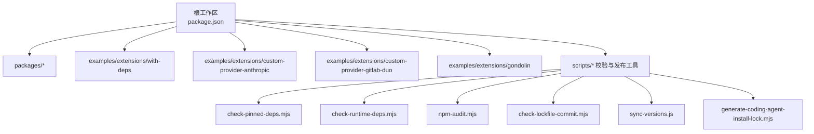
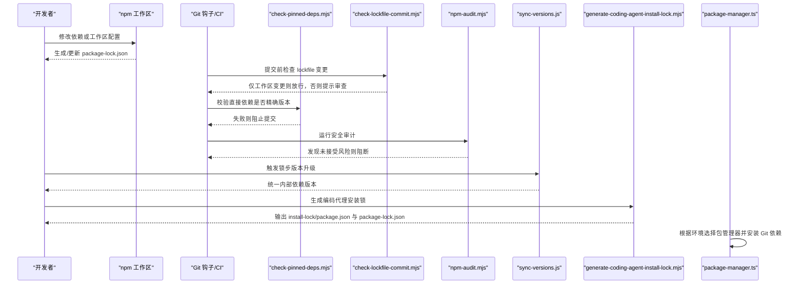
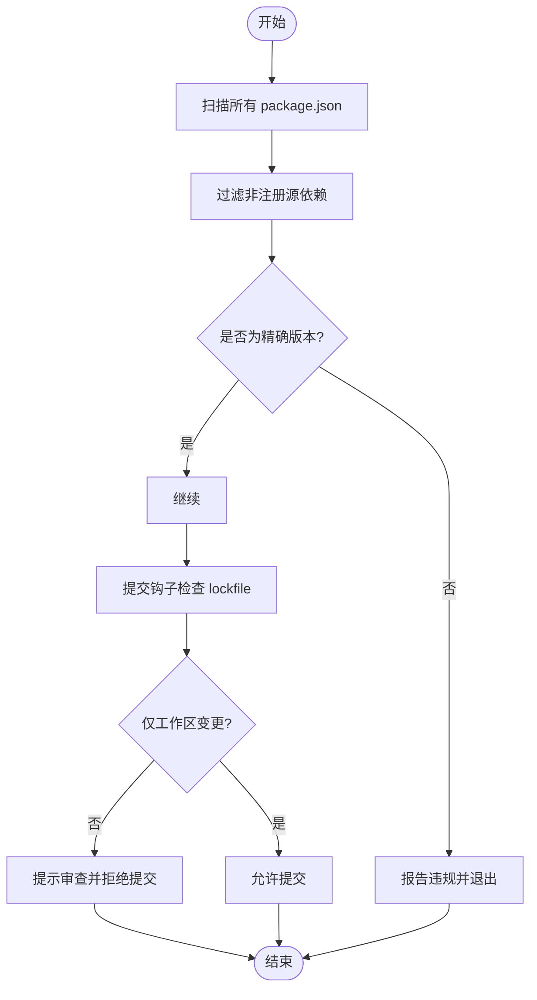
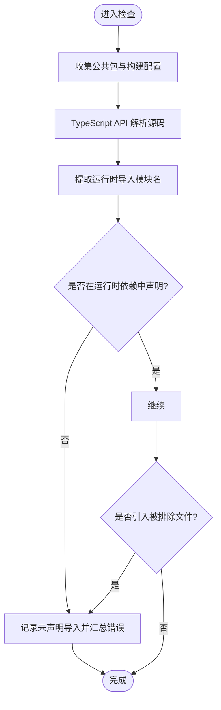
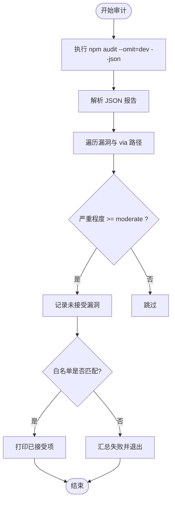
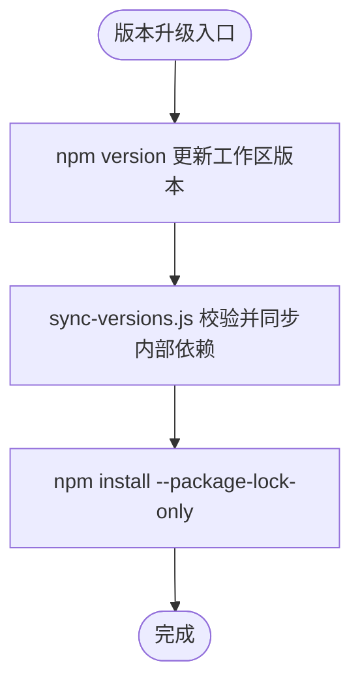
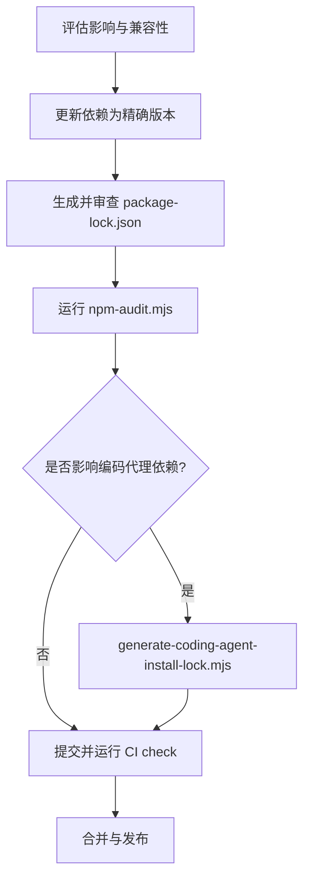
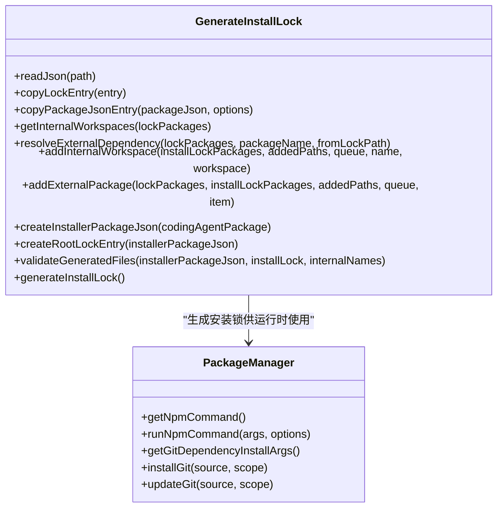
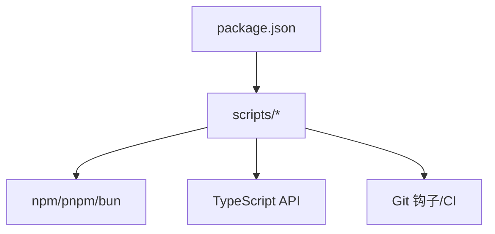

# 依赖管理

<cite>
**本文引用的文件**   
- [package.json](https://github.com/FDE-GROUP/oh-my-fde/blob/omca/package.json)
- [.npmrc](https://github.com/FDE-GROUP/oh-my-fde/blob/omca/.npmrc)
- [scripts/check-pinned-deps.mjs](https://github.com/FDE-GROUP/oh-my-fde/blob/omca/scripts/check-pinned-deps.mjs)
- [scripts/check-runtime-deps.mjs](https://github.com/FDE-GROUP/oh-my-fde/blob/omca/scripts/check-runtime-deps.mjs)
- [scripts/sync-versions.js](https://github.com/FDE-GROUP/oh-my-fde/blob/omca/scripts/sync-versions.js)
- [scripts/npm-audit.mjs](https://github.com/FDE-GROUP/oh-my-fde/blob/omca/scripts/npm-audit.mjs)
- [scripts/check-lockfile-commit.mjs](https://github.com/FDE-GROUP/oh-my-fde/blob/omca/scripts/check-lockfile-commit.mjs)
- [scripts/generate-coding-agent-install-lock.mjs](https://github.com/FDE-GROUP/oh-my-fde/blob/omca/scripts/generate-coding-agent-install-lock.mjs)
- [packages/coding-agent/src/core/package-manager.ts](https://github.com/FDE-GROUP/oh-my-fde/blob/omca/packages/coding-agent/src/core/package-manager.ts)
</cite>

## 目录
1. [简介](#简介)
2. [项目结构](#项目结构)
3. [核心组件](#核心组件)
4. [架构总览](#架构总览)
5. [详细组件分析](#详细组件分析)
6. [依赖关系分析](#依赖关系分析)
7. [性能与体积优化建议](#性能与体积优化建议)
8. [故障排查指南](#故障排查指南)
9. [结论](#结论)

## 简介
本仓库采用 npm Workspaces 构建 Monorepo，并通过一系列脚本和钩子实现严格的依赖锁定、运行时依赖检查、版本同步与安全审计。整体策略强调：
- 所有直接第三方依赖必须使用精确版本号（pinned）。
- 通过 npm 的 save-exact 与 min-release-age 控制安装行为。
- 在提交阶段对 package-lock.json 变更进行审查。
- 公共包运行时导入必须在 dependencies/optionalDependencies/peerDependencies 中声明。
- 发布包之间采用“锁步版本”策略，内部依赖统一指向同一版本。
- 为编码代理生成独立的安装锁，隔离平台相关依赖并限制可执行脚本。
- 安全审计以中等及以上风险为阻断线，支持白名单接受已知风险。

## 项目结构
仓库根目录包含顶层工作区配置、脚本工具集以及多个 packages 子模块。Monorepo 的工作区范围由根 package.json 定义，示例扩展也作为独立工作区纳入统一管理。

**图示来源**
- [package.json:5-10](https://github.com/FDE-GROUP/oh-my-fde/blob/omca/package.json#L5-L10)
- [scripts/check-pinned-deps.mjs:1-60](https://github.com/FDE-GROUP/oh-my-fde/blob/omca/scripts/check-pinned-deps.mjs#L1-L60)
- [scripts/check-runtime-deps.mjs:1-142](https://github.com/FDE-GROUP/oh-my-fde/blob/omca/scripts/check-runtime-deps.mjs#L1-L142)
- [scripts/npm-audit.mjs:1-76](https://github.com/FDE-GROUP/oh-my-fde/blob/omca/scripts/npm-audit.mjs#L1-L76)
- [scripts/check-lockfile-commit.mjs:1-121](https://github.com/FDE-GROUP/oh-my-fde/blob/omca/scripts/check-lockfile-commit.mjs#L1-L121)
- [scripts/sync-versions.js:1-99](https://github.com/FDE-GROUP/oh-my-fde/blob/omca/scripts/sync-versions.js#L1-L99)
- [scripts/generate-coding-agent-install-lock.mjs:1-455](https://github.com/FDE-GROUP/oh-my-fde/blob/omca/scripts/generate-coding-agent-install-lock.mjs#L1-L455)

**章节来源**
- [package.json:1-75](https://github.com/FDE-GROUP/oh-my-fde/blob/omca/package.json#L1-L75)

## 核心组件
- 工作区与版本入口
  - 根 package.json 定义了 workspaces、脚本命令、Node 引擎要求与全局 overrides。
  - .npmrc 启用精确保存与最小发行年龄限制。
- 依赖锁定与安全检查
  - check-pinned-deps.mjs：强制直接依赖使用精确版本。
  - check-lockfile-commit.mjs：提交时拦截非工作区包的 lockfile 变更。
  - npm-audit.mjs：运行 npm audit 并按风险等级阻断未接受的漏洞。
- 运行时依赖检查
  - check-runtime-deps.mjs：基于 TypeScript API 扫描公共包源码，确保运行时导入已声明。
- 版本同步
  - sync-versions.js：校验并发布包之间的“锁步版本”，并将内部依赖统一更新到目标版本。
- 安装锁生成
  - generate-coding-agent-install-lock.mjs：从根 package-lock.json 派生编码代理的安装锁，过滤平台相关依赖并限制可执行脚本。
- 运行时包管理器集成
  - packages/coding-agent/src/core/package-manager.ts：根据环境选择 npm/pnpm/bun，并以严格参数安装 Git 依赖。

**章节来源**
- [package.json:1-75](https://github.com/FDE-GROUP/oh-my-fde/blob/omca/package.json#L1-L75)
- [.npmrc:1-3](https://github.com/FDE-GROUP/oh-my-fde/blob/omca/.npmrc#L1-L3)
- [scripts/check-pinned-deps.mjs:1-60](https://github.com/FDE-GROUP/oh-my-fde/blob/omca/scripts/check-pinned-deps.mjs#L1-L60)
- [scripts/check-lockfile-commit.mjs:1-121](https://github.com/FDE-GROUP/oh-my-fde/blob/omca/scripts/check-lockfile-commit.mjs#L1-L121)
- [scripts/npm-audit.mjs:1-76](https://github.com/FDE-GROUP/oh-my-fde/blob/omca/scripts/npm-audit.mjs#L1-L76)
- [scripts/check-runtime-deps.mjs:1-142](https://github.com/FDE-GROUP/oh-my-fde/blob/omca/scripts/check-runtime-deps.mjs#L1-L142)
- [scripts/sync-versions.js:1-99](https://github.com/FDE-GROUP/oh-my-fde/blob/omca/scripts/sync-versions.js#L1-L99)
- [scripts/generate-coding-agent-install-lock.mjs:1-455](https://github.com/FDE-GROUP/oh-my-fde/blob/omca/scripts/generate-coding-agent-install-lock.mjs#L1-L455)
- [packages/coding-agent/src/core/package-manager.ts:1978-2108](https://github.com/FDE-GROUP/oh-my-fde/blob/omca/packages/coding-agent/src/core/package-manager.ts#L1978-L2108)

## 架构总览
下图展示了依赖管理的端到端流程：从开发时的依赖声明与锁定，到提交阶段的校验，再到发布前的版本同步与安全审计，最终在运行时由编码代理按策略安装依赖。

**图示来源**
- [scripts/check-lockfile-commit.mjs:77-121](https://github.com/FDE-GROUP/oh-my-fde/blob/omca/scripts/check-lockfile-commit.mjs#L77-L121)
- [scripts/check-pinned-deps.mjs:38-59](https://github.com/FDE-GROUP/oh-my-fde/blob/omca/scripts/check-pinned-deps.mjs#L38-L59)
- [scripts/npm-audit.mjs:15-76](https://github.com/FDE-GROUP/oh-my-fde/blob/omca/scripts/npm-audit.mjs#L15-L76)
- [scripts/sync-versions.js:22-87](https://github.com/FDE-GROUP/oh-my-fde/blob/omca/scripts/sync-versions.js#L22-L87)
- [scripts/generate-coding-agent-install-lock.mjs:370-455](https://github.com/FDE-GROUP/oh-my-fde/blob/omca/scripts/generate-coding-agent-install-lock.mjs#L370-L455)
- [packages/coding-agent/src/core/package-manager.ts:1978-2108](https://github.com/FDE-GROUP/oh-my-fde/blob/omca/packages/coding-agent/src/core/package-manager.ts#L1978-L2108)

## 详细组件分析

### 依赖锁定与版本策略
- 精确版本强制
  - check-pinned-deps.mjs 遍历所有 package.json，排除 workspace/file/git/https 等非注册源，要求其余依赖必须是语义化精确版本。
  - .npmrc 设置 save-exact=true，确保新增依赖默认精确；min-release-age=2 避免刚发布的包被立即解析。
- 提交级锁文件保护
  - check-lockfile-commit.mjs 比较 HEAD 与暂存区的 package-lock.json，若变更涉及 node_modules 下的第三方包，则拒绝提交并给出审查清单；仅工作区元数据变更可放行。
- 版本同步与内部依赖对齐
  - sync-versions.js 校验所有非私有包版本一致，随后将所有工作区与 apps 中对内部包的依赖更新为目标版本，保持 Monorepo 内依赖树稳定。

**图示来源**
- [scripts/check-pinned-deps.mjs:24-59](https://github.com/FDE-GROUP/oh-my-fde/blob/omca/scripts/check-pinned-deps.mjs#L24-L59)
- [scripts/check-lockfile-commit.mjs:33-121](https://github.com/FDE-GROUP/oh-my-fde/blob/omca/scripts/check-lockfile-commit.mjs#L33-L121)

**章节来源**
- [scripts/check-pinned-deps.mjs:1-60](https://github.com/FDE-GROUP/oh-my-fde/blob/omca/scripts/check-pinned-deps.mjs#L1-L60)
- [.npmrc:1-3](https://github.com/FDE-GROUP/oh-my-fde/blob/omca/.npmrc#L1-L3)
- [scripts/check-lockfile-commit.mjs:1-121](https://github.com/FDE-GROUP/oh-my-fde/blob/omca/scripts/check-lockfile-commit.mjs#L1-L121)
- [scripts/sync-versions.js:1-99](https://github.com/FDE-GROUP/oh-my-fde/blob/omca/scripts/sync-versions.js#L1-L99)

### 运行时依赖检查
- 目的
  - 确保公共包的运行时导入（import/export/dynamic require）均在 dependencies/optionalDependencies/peerDependencies 中声明，避免打包产物缺失依赖。
- 机制
  - check-runtime-deps.mjs 使用 TypeScript API 解析每个公共包的 tsconfig.build.json（无构建配置时使用合成配置），遍历源码 AST，识别 import/export/require 调用，提取模块名并与 manifest 中的运行时依赖集合比对。
  - 同时检测被 build 排除的文件被引入的情况，防止意外引入。

**图示来源**
- [scripts/check-runtime-deps.mjs:26-89](https://github.com/FDE-GROUP/oh-my-fde/blob/omca/scripts/check-runtime-deps.mjs#L26-L89)
- [scripts/check-runtime-deps.mjs:91-142](https://github.com/FDE-GROUP/oh-my-fde/blob/omca/scripts/check-runtime-deps.mjs#L91-L142)

**章节来源**
- [scripts/check-runtime-deps.mjs:1-142](https://github.com/FDE-GROUP/oh-my-fde/blob/omca/scripts/check-runtime-deps.mjs#L1-L142)

### 安全审计与漏洞处理
- 审计策略
  - npm-audit.mjs 调用 npm audit --omit=dev --json，解析 JSON 报告，将信息/低/中/高/严重分级，默认以 moderate 为阻断阈值。
  - 支持 acceptedAdvisories 白名单，需注明受影响包与原因；当漏洞修复后应移除条目，脚本会警告不再匹配的白名单项。
- 输出与失败处理
  - 未接受的漏洞达到阈值即退出并打印详细信息；已通过白名单的项目会打印说明。

**图示来源**
- [scripts/npm-audit.mjs:15-76](https://github.com/FDE-GROUP/oh-my-fde/blob/omca/scripts/npm-audit.mjs#L15-L76)

**章节来源**
- [scripts/npm-audit.mjs:1-76](https://github.com/FDE-GROUP/oh-my-fde/blob/omca/scripts/npm-audit.mjs#L1-L76)

### Monorepo 依赖管理与版本同步
- 工作区范围
  - 根 package.json 的 workspaces 字段包含 packages/* 与若干 examples/extensions 子目录，便于统一构建与测试。
- 锁步版本
  - sync-versions.js 先校验所有非私有包版本一致，再遍历工作区与 apps 的依赖，将内部包依赖更新为目标版本，保证发布一致性。
- 版本脚本
  - 根 package.json 提供 version:patch/minor/major/set 等脚本，配合 sync-versions.js 与 npm install --package-lock-only 完成版本升级与锁定。

**图示来源**
- [package.json:41-44](https://github.com/FDE-GROUP/oh-my-fde/blob/omca/package.json#L41-L44)
- [scripts/sync-versions.js:22-87](https://github.com/FDE-GROUP/oh-my-fde/blob/omca/scripts/sync-versions.js#L22-L87)

**章节来源**
- [package.json:1-75](https://github.com/FDE-GROUP/oh-my-fde/blob/omca/package.json#L1-L75)
- [scripts/sync-versions.js:1-99](https://github.com/FDE-GROUP/oh-my-fde/blob/omca/scripts/sync-versions.js#L1-L99)

### 第三方库更新流程
推荐流程如下：
1. 评估影响范围与兼容性，确认是否需要升级。
2. 在工作区中更新依赖版本，确保使用精确版本（遵循 check-pinned-deps.mjs）。
3. 重新生成 package-lock.json 并运行 check-lockfile-commit.mjs 审查变更。
4. 运行 npm-audit.mjs 检查是否存在新漏洞。
5. 如变更影响编码代理安装锁，运行 generate-coding-agent-install-lock.mjs 生成并校验 install-lock。
6. 提交变更并通过 CI 的 check 脚本（包含类型检查、lint、运行时依赖检查等）。

**图示来源**
- [scripts/check-pinned-deps.mjs:38-59](https://github.com/FDE-GROUP/oh-my-fde/blob/omca/scripts/check-pinned-deps.mjs#L38-L59)
- [scripts/check-lockfile-commit.mjs:77-121](https://github.com/FDE-GROUP/oh-my-fde/blob/omca/scripts/check-lockfile-commit.mjs#L77-L121)
- [scripts/npm-audit.mjs:15-76](https://github.com/FDE-GROUP/oh-my-fde/blob/omca/scripts/npm-audit.mjs#L15-L76)
- [scripts/generate-coding-agent-install-lock.mjs:370-455](https://github.com/FDE-GROUP/oh-my-fde/blob/omca/scripts/generate-coding-agent-install-lock.mjs#L370-L455)

### 运行时依赖检查与冲突解决
- 冲突定位
  - 若 check-runtime-deps.mjs 报错，说明某运行时导入未在依赖中声明，需在对应包的 dependencies/optionalDependencies/peerDependencies 中添加。
  - 若出现重复或不同版本的依赖，优先通过根 package.json 的 overrides 或工作区内的 peerDependencies 约束解决。
- 常见场景
  - 动态 require/import 未被静态分析捕获：需显式声明或在代码中改为静态导入。
  - 构建排除文件被引入：调整 tsconfig.build.json 或重构导入路径。

**章节来源**
- [scripts/check-runtime-deps.mjs:26-89](https://github.com/FDE-GROUP/oh-my-fde/blob/omca/scripts/check-runtime-deps.mjs#L26-L89)
- [scripts/check-runtime-deps.mjs:91-142](https://github.com/FDE-GROUP/oh-my-fde/blob/omca/scripts/check-runtime-deps.mjs#L91-L142)

### 编码代理安装锁与运行时包管理器
- 安装锁生成
  - generate-coding-agent-install-lock.mjs 从根 package-lock.json 派生 install-lock/package.json 与 package-lock.json，过滤 dev/extraneous/link 等元数据，限制本地 resolved 值，并对 hasInstallScript 进行白名单校验。
  - 内部包（@earendil-works/pi-*）会被替换为 registry tarball URL，确保安装器不依赖本地工作区链接。
- 运行时包管理器选择
  - packages/coding-agent/src/core/package-manager.ts 根据环境选择 npm/pnpm/bun，并为 Git 依赖安装传递严格参数（如 --omit=dev、--legacy-peer-deps、--no-audit 等），减少不必要的生命周期脚本与审计开销。

**图示来源**
- [scripts/generate-coding-agent-install-lock.mjs:31-455](https://github.com/FDE-GROUP/oh-my-fde/blob/omca/scripts/generate-coding-agent-install-lock.mjs#L31-L455)
- [packages/coding-agent/src/core/package-manager.ts:1978-2108](https://github.com/FDE-GROUP/oh-my-fde/blob/omca/packages/coding-agent/src/core/package-manager.ts#L1978-L2108)

**章节来源**
- [scripts/generate-coding-agent-install-lock.mjs:1-455](https://github.com/FDE-GROUP/oh-my-fde/blob/omca/scripts/generate-coding-agent-install-lock.mjs#L1-L455)
- [packages/coding-agent/src/core/package-manager.ts:1978-2108](https://github.com/FDE-GROUP/oh-my-fde/blob/omca/packages/coding-agent/src/core/package-manager.ts#L1978-L2108)

## 依赖关系分析
- 耦合与内聚
  - 根 package.json 与工作区脚本高度耦合，集中了构建、检查、发布流程。
  - scripts 目录内各脚本职责清晰：锁定检查、运行时依赖检查、安全审计、版本同步、安装锁生成。
- 外部依赖与集成点
  - npm/pnpm/bun 作为包管理器后端。
  - TypeScript API 用于静态分析运行时导入。
  - Git 钩子与 CI 集成以执行检查与审计。
- 潜在循环依赖
  - 脚本之间通过命令行调用而非模块引用，降低循环依赖风险。

**图示来源**
- [package.json:1-75](https://github.com/FDE-GROUP/oh-my-fde/blob/omca/package.json#L1-L75)
- [scripts/check-runtime-deps.mjs:1-142](https://github.com/FDE-GROUP/oh-my-fde/blob/omca/scripts/check-runtime-deps.mjs#L1-L142)

**章节来源**
- [package.json:1-75](https://github.com/FDE-GROUP/oh-my-fde/blob/omca/package.json#L1-L75)
- [scripts/check-runtime-deps.mjs:1-142](https://github.com/FDE-GROUP/oh-my-fde/blob/omca/scripts/check-runtime-deps.mjs#L1-L142)

## 性能与体积优化建议
- 依赖树精简
  - 使用 check-runtime-deps.mjs 确保只声明必要的运行时依赖，避免冗余。
  - 利用 root package.json 的 overrides 收敛关键依赖版本，减少多版本实例。
- 安装与构建优化
  - 在 CI 中使用 npm ci 与 --ignore-scripts 提升安装稳定性与速度。
  - 对不需要生命周期的依赖，考虑使用 --no-audit 与 --no-fund 减少网络与解析开销（已在编码代理 Git 依赖安装中体现）。
- 缓存与离线构建
  - 结合 npm 缓存与镜像源加速依赖解析；必要时使用 build:offline 脚本链。

[本节为通用指导，不直接分析具体文件]

## 故障排查指南
- 提交被拒绝且提示 package-lock.json 变更
  - 检查是否为第三方包版本变更；若是，请确认变更意图并重新运行 npm install 生成锁文件。
  - 若仅为工作区元数据变更，脚本会自动放行。
- 直接依赖版本不精确
  - 运行 check-pinned-deps.mjs 查看违规项，将依赖升级为精确版本。
- 运行时导入未声明
  - 运行 check-runtime-deps.mjs，根据报错在对应包的依赖中添加缺失项。
- 安全审计失败
  - 运行 npm-audit.mjs，查看未接受的漏洞；若确认为误报或可接受风险，需在脚本中更新白名单并说明原因。
- 编码代理安装锁不一致
  - 运行 generate-coding-agent-install-lock.mjs 生成最新锁文件，并在 CI 中通过 --check 模式验证。

**章节来源**
- [scripts/check-lockfile-commit.mjs:77-121](https://github.com/FDE-GROUP/oh-my-fde/blob/omca/scripts/check-lockfile-commit.mjs#L77-L121)
- [scripts/check-pinned-deps.mjs:38-59](https://github.com/FDE-GROUP/oh-my-fde/blob/omca/scripts/check-pinned-deps.mjs#L38-L59)
- [scripts/check-runtime-deps.mjs:136-142](https://github.com/FDE-GROUP/oh-my-fde/blob/omca/scripts/check-runtime-deps.mjs#L136-L142)
- [scripts/npm-audit.mjs:61-76](https://github.com/FDE-GROUP/oh-my-fde/blob/omca/scripts/npm-audit.mjs#L61-L76)
- [scripts/generate-coding-agent-install-lock.mjs:421-455](https://github.com/FDE-GROUP/oh-my-fde/blob/omca/scripts/generate-coding-agent-install-lock.mjs#L421-L455)

## 结论
该项目的依赖管理以“精确版本、严格锁定、运行时可见、安全可控”为核心原则，通过 npm Workspaces 与一系列脚本形成闭环：
- 开发期：精确版本与最小发行年龄保障依赖确定性。
- 提交期：lockfile 变更审查与依赖精确性检查防止漂移。
- 发布期：锁步版本与安装锁生成确保跨环境一致性。
- 运行期：包管理器策略与运行时依赖检查保障产物完整性。
建议在团队中严格执行上述流程，并结合 CI 自动化检查，持续提升依赖质量与安全性。