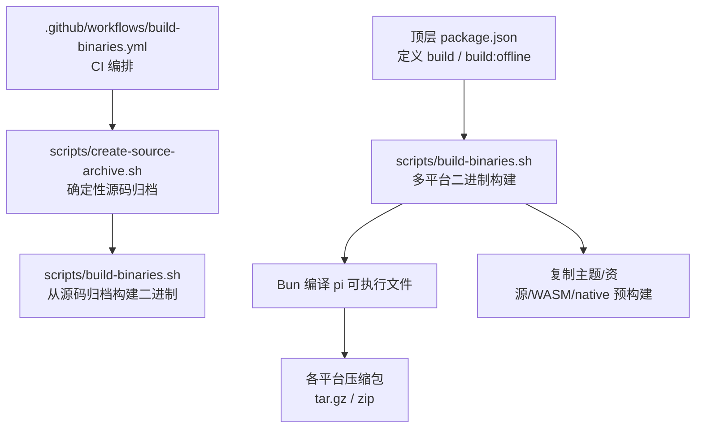
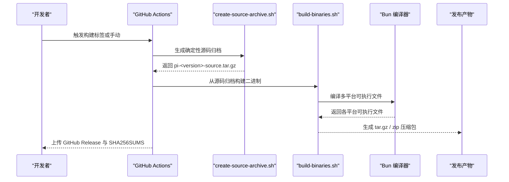
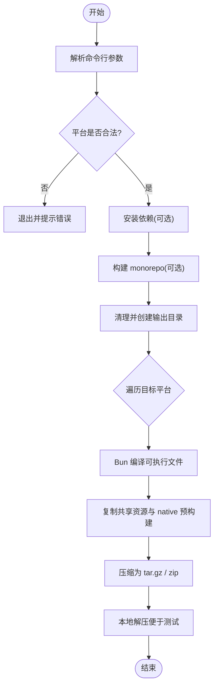
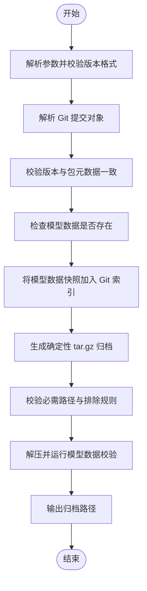
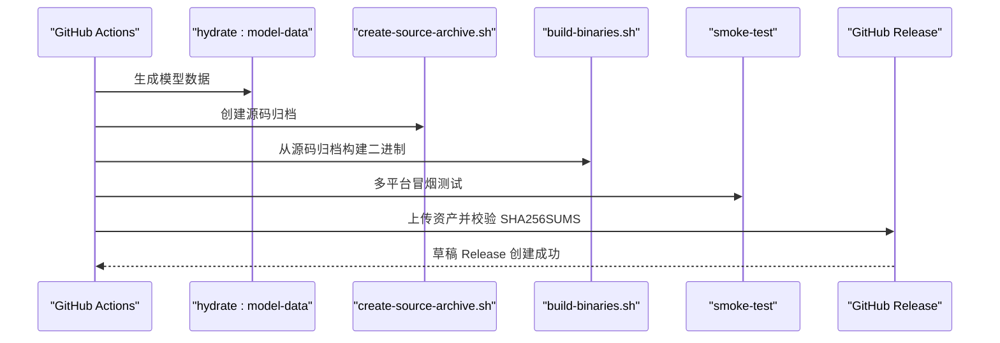
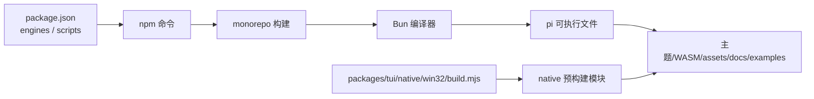

# 二进制构建脚本

<cite>
**本文引用的文件**   
- [scripts/build-binaries.sh](https://github.com/FDE-GROUP/oh-my-coding-agent/blob/omca/scripts/build-binaries.sh)
- [scripts/create-source-archive.sh](https://github.com/FDE-GROUP/oh-my-coding-agent/blob/omca/scripts/create-source-archive.sh)
- [.github/workflows/build-binaries.yml](https://github.com/FDE-GROUP/oh-my-coding-agent/blob/omca/.github/workflows/build-binaries.yml)
- [package.json](https://github.com/FDE-GROUP/oh-my-coding-agent/blob/omca/package.json)
- [packages/tui/native/win32/build.mjs](https://github.com/FDE-GROUP/oh-my-coding-agent/blob/omca/packages/tui/native/win32/build.mjs)
</cite>

## 目录
1. [简介](#简介)
2. [项目结构](#项目结构)
3. [核心组件](#核心组件)
4. [架构总览](#架构总览)
5. [详细组件分析](#详细组件分析)
6. [依赖关系分析](#依赖关系分析)
7. [性能与体积优化](#性能与体积优化)
8. [故障排查指南](#故障排查指南)
9. [结论](#结论)

## 简介
本文面向二进制发布与源码归档的构建流程，重点说明以下两个脚本的职责、参数、平台差异处理、依赖打包策略以及完整性校验机制：
- `scripts/build-binaries.sh`：在本地或 CI 中为多个目标平台编译并打包可执行文件。
- `scripts/create-source-archive.sh`：生成用于发布的确定性源码归档包，包含版本校验、必要路径检查与模型数据验证。

同时补充 GitHub Actions 工作流 `.github/workflows/build-binaries.yml` 如何串联源码归档、二进制构建、产物校验与发布，帮助读者理解端到端构建链路。

## 项目结构
与二进制构建直接相关的脚本和配置位于如下位置：
- 二进制构建脚本：`scripts/build-binaries.sh`
- 源码归档脚本：`scripts/create-source-archive.sh`
- 构建编排工作流：`.github/workflows/build-binaries.yml`
- 顶层 npm 脚本入口：`package.json`
- Windows 原生预构建工具链脚本（与二进制产物中的 native 模块相关）：`packages/tui/native/win32/build.mjs`

**图表来源**
- [scripts/build-binaries.sh:1-201](https://github.com/FDE-GROUP/oh-my-coding-agent/blob/omca/scripts/build-binaries.sh#L1-L201)
- [scripts/create-source-archive.sh:1-162](https://github.com/FDE-GROUP/oh-my-coding-agent/blob/omca/scripts/create-source-archive.sh#L1-L162)
- [.github/workflows/build-binaries.yml:52-76](https://github.com/FDE-GROUP/oh-my-coding-agent/blob/omca/.github/workflows/build-binaries.yml#L52-L76)
- [package.json:12-18](https://github.com/FDE-GROUP/oh-my-coding-agent/blob/omca/package.json#L12-L18)

**章节来源**
- [scripts/build-binaries.sh:1-201](https://github.com/FDE-GROUP/oh-my-coding-agent/blob/omca/scripts/build-binaries.sh#L1-L201)
- [scripts/create-source-archive.sh:1-162](https://github.com/FDE-GROUP/oh-my-coding-agent/blob/omca/scripts/create-source-archive.sh#L1-L162)
- [.github/workflows/build-binaries.yml:1-130](https://github.com/FDE-GROUP/oh-my-coding-agent/blob/omca/.github/workflows/build-binaries.yml#L1-L130)
- [package.json:12-18](https://github.com/FDE-GROUP/oh-my-coding-agent/blob/omca/package.json#L12-L18)

## 核心组件
本节对两个关键脚本进行概览式说明，并给出调用关系与职责边界。

### `scripts/build-binaries.sh`
- 负责安装依赖、构建 monorepo、使用 Bun 将 Node/Bun 应用编译为跨平台独立可执行文件。
- 支持跳过安装、跳过构建、离线模型数据模式、指定目标平台、自定义输出目录等参数。
- 为每个平台复制运行时所需资源：主题、静态资源、WASM、native 预构建模块、文档与示例。
- 最终产出各平台的压缩包，并在本地自动解压便于测试。

**章节来源**
- [scripts/build-binaries.sh:1-201](https://github.com/FDE-GROUP/oh-my-coding-agent/blob/omca/scripts/build-binaries.sh#L1-L201)

### `scripts/create-source-archive.sh`
- 基于 Git 提交树生成确定性源码归档，要求版本号与仓库中 `packages/coding-agent/package.json` 的版本一致。
- 强制注入生成的模型数据快照，确保归档可复现。
- 校验归档必须包含的关键路径，禁止包含 `node_modules` 与已构建的二进制目录。
- 解压后运行模型数据校验脚本，保证模型数据一致性。

**章节来源**
- [scripts/create-source-archive.sh:1-162](https://github.com/FDE-GROUP/oh-my-coding-agent/blob/omca/scripts/create-source-archive.sh#L1-L162)

## 架构总览
下图展示从源码到发布产物的完整构建链路，包括本地脚本与 CI 工作流的协作方式。

**图表来源**
- [.github/workflows/build-binaries.yml:52-76](https://github.com/FDE-GROUP/oh-my-coding-agent/blob/omca/.github/workflows/build-binaries.yml#L52-L76)
- [scripts/create-source-archive.sh:55-113](https://github.com/FDE-GROUP/oh-my-coding-agent/blob/omca/scripts/create-source-archive.sh#L55-L113)
- [scripts/build-binaries.sh:84-137](https://github.com/FDE-GROUP/oh-my-coding-agent/blob/omca/scripts/build-binaries.sh#L84-L137)

## 详细组件分析

### 二进制构建脚本 `scripts/build-binaries.sh`

#### 参数与选项
- `--skip-install`：跳过 `npm ci`。
- `--skip-build`：跳过 monorepo 构建。
- `--offline-model-data`：使用已生成的模型数据构建，避免网络访问。
- `--platform <name>`：仅构建指定平台，如 `darwin-arm64`、`linux-x64`、`windows-arm64` 等。
- `--out <dir>`：自定义输出目录，默认 `packages/coding-agent/binaries`。

#### 平台支持与产物命名
- 支持平台：`darwin-arm64`、`darwin-x64`、`linux-x64`、`linux-arm64`、`windows-x64`、`windows-arm64`。
- Unix 平台产物：`pi-<platform>.tar.gz`。
- Windows 平台产物：`pi-<platform>.zip`。

#### 构建流程要点
1. 解析参数并校验平台合法性。
2. 根据是否跳过安装与构建，决定执行 `npm ci --ignore-scripts` 与 `npm run build` 或 `npm run build:offline`。
3. 进入 `packages/coding-agent`，清理并创建各平台输出目录。
4. 针对 x64 平台追加 `-baseline` 目标以适配 Bun 的基线编译。
5. 使用 `bun build --compile` 将主入口与 worker 脚本编译进独立可执行文件，并禁用自动加载 bunfig 与 .env，防止环境泄漏。
6. 复制共享资源：`package.json`、`README.md`、`CHANGELOG.md`、WASM、主题 JSON、assets、HTML 导出模板、docs、examples。
7. 复制 native 预构建模块至对应架构目录。
8. 压缩为 tar.gz 或 zip，并在本地解压以便快速测试。

**图表来源**
- [scripts/build-binaries.sh:35-75](https://github.com/FDE-GROUP/oh-my-coding-agent/blob/omca/scripts/build-binaries.sh#L35-L75)
- [scripts/build-binaries.sh:84-137](https://github.com/FDE-GROUP/oh-my-coding-agent/blob/omca/scripts/build-binaries.sh#L84-L137)
- [scripts/build-binaries.sh:141-186](https://github.com/FDE-GROUP/oh-my-coding-agent/blob/omca/scripts/build-binaries.sh#L141-L186)

**章节来源**
- [scripts/build-binaries.sh:1-201](https://github.com/FDE-GROUP/oh-my-coding-agent/blob/omca/scripts/build-binaries.sh#L1-L201)

### 源码归档脚本 `scripts/create-source-archive.sh`

#### 参数与校验
- `--version <version>`：必填，用于归档根目录前缀与版本校验。
- `--ref <git-ref>`：可选，默认 `HEAD`，用于确定构建提交的 Git 对象。
- `--out <archive.tar.gz>`：必填，输出归档路径。
- 版本格式正则校验，拒绝非法字符。
- 校验传入版本与 `packages/coding-agent/package.json` 的版本一致。

#### 模型数据与确定性
- 要求 `packages/ai/src/providers/data/.manifest.json` 存在，否则提示先执行 `npm run hydrate:model-data`。
- 通过临时 Git index 将忽略的模型数据快照加入归档树，确保相同提交与模型数据产生相同归档。
- 使用 `git archive` 与 `gzip -n -9` 生成无时间戳、高压缩比的归档。

#### 必需路径与排除规则
- 强制包含关键路径：包元数据、构建脚本、模型生成文件、native 头文件与预构建模块、coding-agent 资源等。
- 禁止包含 `node_modules` 与 `packages/coding-agent/binaries`，避免将依赖与二进制产物混入源码归档。
- 校验所有条目均以归档根目录前缀开头，防止路径逃逸。

#### 完整性验证
- 解压归档到临时目录，执行 `packages/ai/scripts/check-model-data.ts` 校验模型数据一致性。
- 成功后移动临时归档到目标路径，并打印输出路径。

**图表来源**
- [scripts/create-source-archive.sh:15-63](https://github.com/FDE-GROUP/oh-my-coding-agent/blob/omca/scripts/create-source-archive.sh#L15-L63)
- [scripts/create-source-archive.sh:68-113](https://github.com/FDE-GROUP/oh-my-coding-agent/blob/omca/scripts/create-source-archive.sh#L68-L113)
- [scripts/create-source-archive.sh:116-159](https://github.com/FDE-GROUP/oh-my-coding-agent/blob/omca/scripts/create-source-archive.sh#L116-L159)

**章节来源**
- [scripts/create-source-archive.sh:1-162](https://github.com/FDE-GROUP/oh-my-coding-agent/blob/omca/scripts/create-source-archive.sh#L1-L162)

### CI 工作流 `.github/workflows/build-binaries.yml`

#### 构建阶段
- 检出代码，设置 Bun 与 Node.js 环境。
- 执行 `npm run hydrate:model-data` 生成模型数据。
- 调用 `scripts/create-source-archive.sh` 生成源码归档。
- 从源码归档中提取并执行 `scripts/build-binaries.sh --offline-model-data`，确保构建完全可复现。

#### 产物准备与校验
- 收集二进制压缩包、源码归档、安装锁文件、SHA256SUMS 与发布说明。
- 校验所有预期资产存在，并使用 `sha256sum -c` 校验完整性。

#### 冒烟测试
- 在 Ubuntu、macOS、Windows Runner 上下载对应平台二进制，解压并执行 `--help`、`--version` 与 smoke test 脚本。

#### 发布阶段
- 创建草稿 GitHub Release，上传所有资产。
- 校验草稿 Release 资产集合与期望一致。
- 后续步骤完成 npm 发布与公告，最后将草稿 Release 转为正式发布。

**图表来源**
- [.github/workflows/build-binaries.yml:52-76](https://github.com/FDE-GROUP/oh-my-coding-agent/blob/omca/.github/workflows/build-binaries.yml#L52-L76)
- [.github/workflows/build-binaries.yml:78-129](https://github.com/FDE-GROUP/oh-my-coding-agent/blob/omca/.github/workflows/build-binaries.yml#L78-L129)
- [.github/workflows/build-binaries.yml:131-209](https://github.com/FDE-GROUP/oh-my-coding-agent/blob/omca/.github/workflows/build-binaries.yml#L131-L209)
- [.github/workflows/build-binaries.yml:228-302](https://github.com/FDE-GROUP/oh-my-coding-agent/blob/omca/.github/workflows/build-binaries.yml#L228-L302)

**章节来源**
- [.github/workflows/build-binaries.yml:1-485](https://github.com/FDE-GROUP/oh-my-coding-agent/blob/omca/.github/workflows/build-binaries.yml#L1-L485)

## 依赖关系分析

### 构建依赖与环境
- Node.js：由顶层 `package.json` 的 `engines` 字段约束最低版本。
- Bun：CI 中固定版本用于编译独立可执行文件。
- npm：用于 monorepo 依赖安装与构建脚本调度。
- 系统工具：`zip`、`tar`、`gzip`、`git`、`sha256sum` 等。

### 平台特定依赖
- Windows 原生预构建模块由 `packages/tui/native/win32/build.mjs` 管理，支持 MSVC 与 MinGW 工具链，环境变量控制工具链选择与交叉编译。
- macOS 与 Linux 的 native 预构建模块同样需要对应平台工具链，但二进制构建脚本主要复制已有预构建产物。

**图表来源**
- [package.json:67-74](https://github.com/FDE-GROUP/oh-my-coding-agent/blob/omca/package.json#L67-L74)
- [packages/tui/native/win32/build.mjs:203-232](https://github.com/FDE-GROUP/oh-my-coding-agent/blob/omca/packages/tui/native/win32/build.mjs#L203-L232)
- [scripts/build-binaries.sh:141-160](https://github.com/FDE-GROUP/oh-my-coding-agent/blob/omca/scripts/build-binaries.sh#L141-L160)

**章节来源**
- [package.json:67-74](https://github.com/FDE-GROUP/oh-my-coding-agent/blob/omca/package.json#L67-L74)
- [packages/tui/native/win32/build.mjs:43-232](https://github.com/FDE-GROUP/oh-my-coding-agent/blob/omca/packages/tui/native/win32/build.mjs#L43-L232)
- [scripts/build-binaries.sh:141-160](https://github.com/FDE-GROUP/oh-my-coding-agent/blob/omca/scripts/build-binaries.sh#L141-L160)

## 性能与体积优化
- 使用 `bun build --compile` 将 JS/TS 与 worker 脚本编译进单一可执行文件，减少运行时依赖。
- 针对 x64 平台使用 `-baseline` 目标，降低对宿主 CPU 特性的依赖，提升兼容性。
- 禁用自动加载 bunfig 与 .env，避免启动时额外开销与环境污染。
- 源码归档使用 `gzip -n -9` 高压缩比且无时间戳，提升传输效率与确定性。
- 仅复制必要的主题、assets、docs、examples 与 native 预构建模块，避免冗余依赖。

[本节为通用指导，不直接分析具体文件]

## 故障排查指南

### 常见错误与处理
- **无效平台名称**：当 `--platform` 传入不支持的平台时，脚本会立即退出并列出有效平台列表。
- **版本不匹配**：源码归档脚本要求 `--version` 与 `packages/coding-agent/package.json` 的版本一致，否则报错退出。
- **缺失模型数据**：若未执行 `npm run hydrate:model-data`，源码归档脚本会提示先生成模型数据。
- **归档缺少必需路径**：脚本会列出缺失的关键路径，需检查 Git 提交与模型数据快照是否正确注入。
- **归档包含禁止内容**：若归档中包含 `node_modules` 或 `packages/coding-agent/binaries`，脚本会拒绝生成。
- **Windows 原生构建失败**：若未安装 Visual Studio C++ 工具链或未正确配置 MinGW，`packages/tui/native/win32/build.mjs` 会抛出明确错误信息。

### 建议的调试步骤
1. 确认 Node.js 与 Bun 版本符合 CI 与脚本要求。
2. 执行 `npm run hydrate:model-data` 确保模型数据可用。
3. 使用 `--skip-install` 与 `--skip-build` 逐步定位问题阶段。
4. 在 CI 中查看 `build-binaries.yml` 的日志，确认源码归档与二进制构建步骤是否成功。
5. 对于 Windows 原生模块，检查 `PI_TUI_WIN32_TOOLCHAIN` 与编译器路径配置。

**章节来源**
- [scripts/build-binaries.sh:64-75](https://github.com/FDE-GROUP/oh-my-coding-agent/blob/omca/scripts/build-binaries.sh#L64-L75)
- [scripts/create-source-archive.sh:60-74](https://github.com/FDE-GROUP/oh-my-coding-agent/blob/omca/scripts/create-source-archive.sh#L60-L74)
- [scripts/create-source-archive.sh:82-94](https://github.com/FDE-GROUP/oh-my-coding-agent/blob/omca/scripts/create-source-archive.sh#L82-L94)
- [scripts/create-source-archive.sh:139-154](https://github.com/FDE-GROUP/oh-my-coding-agent/blob/omca/scripts/create-source-archive.sh#L139-L154)
- [packages/tui/native/win32/build.mjs:216-232](https://github.com/FDE-GROUP/oh-my-coding-agent/blob/omca/packages/tui/native/win32/build.mjs#L216-L232)

## 结论
`scripts/build-binaries.sh` 与 `scripts/create-source-archive.sh` 共同构成了项目二进制发布与源码归档的核心能力。前者负责多平台编译、资源打包与产物压缩，后者确保源码归档的可复现性与完整性。配合 `.github/workflows/build-binaries.yml`，整个流程实现了从源码到发布产物的自动化、可验证与可审计。通过合理的参数控制、平台差异化处理与严格的校验机制，该构建体系能够在不同环境中稳定产出高质量的可执行文件与源码归档。