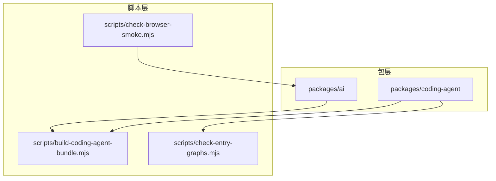
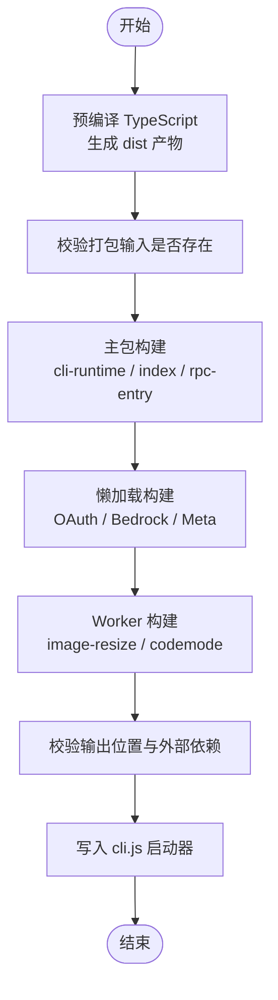
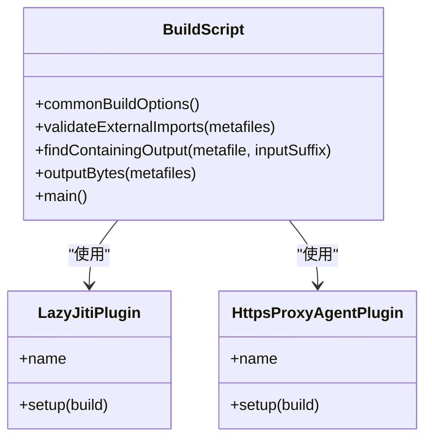
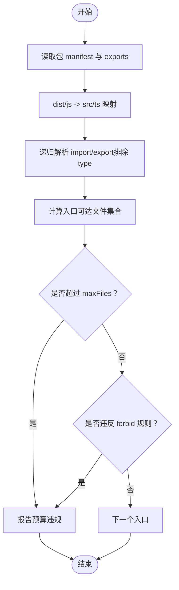
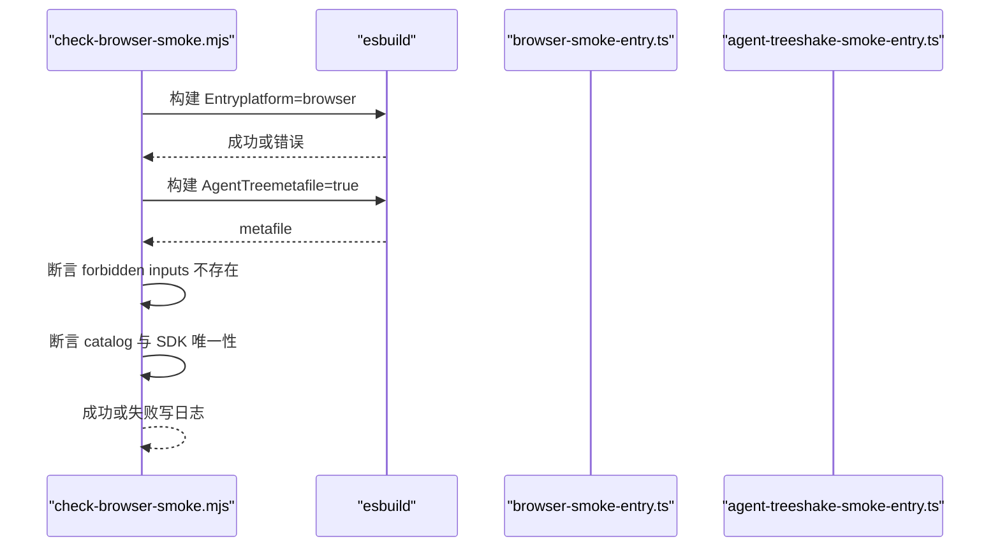
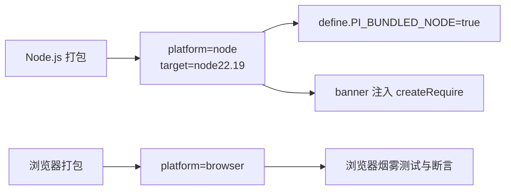

# 代码打包脚本

<cite>
**本文引用的文件**   
- [scripts/build-coding-agent-bundle.mjs](https://github.com/FDE-GROUP/oh-my-coding-agent/blob/omca/scripts/build-coding-agent-bundle.mjs)
- [scripts/check-entry-graphs.mjs](https://github.com/FDE-GROUP/oh-my-coding-agent/blob/omca/scripts/check-entry-graphs.mjs)
- [scripts/check-browser-smoke.mjs](https://github.com/FDE-GROUP/oh-my-coding-agent/blob/omca/scripts/check-browser-smoke.mjs)
- [scripts/browser-smoke-entry.ts](https://github.com/FDE-GROUP/oh-my-coding-agent/blob/omca/scripts/browser-smoke-entry.ts)
- [packages/coding-agent/package.json](https://github.com/FDE-GROUP/oh-my-coding-agent/blob/omca/packages/coding-agent/package.json)
- [packages/ai/package.json](https://github.com/FDE-GROUP/oh-my-coding-agent/blob/omca/packages/ai/package.json)
</cite>

## 目录
1. [引言](#引言)
2. [项目结构与入口](#项目结构与入口)
3. [核心组件总览](#核心组件总览)
4. [架构概览](#架构概览)
5. [详细组件分析](#详细组件分析)
6. [依赖与导出契约分析](#依赖与导出契约分析)
7. [性能优化与增量构建](#性能优化与增量构建)
8. [调试方法](#调试方法)
9. [浏览器与 Node.js 差异化打包策略](#浏览器与-nodejs-差异化打包策略)
10. [故障排查](#故障排查)
11. [结论](#结论)

## 引言
本文件面向“代码打包和捆绑脚本”的配置与优化，重点说明以下目标：
- 如何使用 esbuild 对 coding-agent 进行多入口、多阶段打包。
- 如何验证模块依赖图的正确性与规模预算。
- 如何调优打包性能、配置增量构建与调试。
- 如何在浏览器与 Node.js 环境中采用差异化打包策略。

## 项目结构与入口
仓库中与打包相关的关键脚本位于 scripts 目录，被 packages 的 npm scripts 调用：
- coding-agent 包通过自身 build 脚本先编译 TypeScript，再执行 bundling 脚本生成 bundle。
- ai 包提供供 coding-agent 使用的预编译产物，作为编码代理打包的输入来源之一。
- 浏览器侧通过独立的 smoke 检查脚本验证浏览器兼容性。

**图表来源**
- [scripts/build-coding-agent-bundle.mjs:1-20](https://github.com/FDE-GROUP/oh-my-coding-agent/blob/omca/scripts/build-coding-agent-bundle.mjs#L1-L20)
- [scripts/check-entry-graphs.mjs:1-30](https://github.com/FDE-GROUP/oh-my-coding-agent/blob/omca/scripts/check-entry-graphs.mjs#L1-L30)
- [scripts/check-browser-smoke.mjs:1-25](https://github.com/FDE-GROUP/oh-my-coding-agent/blob/omca/scripts/check-browser-smoke.mjs#L1-L25)
- [packages/coding-agent/package.json:31-36](https://github.com/FDE-GROUP/oh-my-coding-agent/blob/omca/packages/coding-agent/package.json#L31-L36)
- [packages/ai/package.json:66-75](https://github.com/FDE-GROUP/oh-my-coding-agent/blob/omca/packages/ai/package.json#L66-L75)

**章节来源**
- [packages/coding-agent/package.json:31-36](https://github.com/FDE-GROUP/oh-my-coding-agent/blob/omca/packages/coding-agent/package.json#L31-L36)
- [packages/ai/package.json:66-75](https://github.com/FDE-GROUP/oh-my-coding-agent/blob/omca/packages/ai/package.json#L66-L75)

## 核心组件总览
- build-coding-agent-bundle.mjs：基于 esbuild 的多阶段打包脚本，负责主入口、懒加载入口、worker 入口等输出，并校验外部依赖与输出位置约束。
- check-entry-graphs.mjs：静态扫描源码导入关系，按包的 exports 映射计算每个入口的依赖图规模，并强制预算与禁止路径规则。
- check-browser-smoke.mjs：在浏览器平台下对示例入口进行 esbuild 打包，验证浏览器兼容性、树摇行为与 SDK 引入范围。

**章节来源**
- [scripts/build-coding-agent-bundle.mjs:1-20](https://github.com/FDE-GROUP/oh-my-coding-agent/blob/omca/scripts/build-coding-agent-bundle.mjs#L1-L20)
- [scripts/check-entry-graphs.mjs:1-30](https://github.com/FDE-GROUP/oh-my-coding-agent/blob/omca/scripts/check-entry-graphs.mjs#L1-L30)
- [scripts/check-browser-smoke.mjs:1-25](https://github.com/FDE-GROUP/oh-my-coding-agent/blob/omca/scripts/check-browser-smoke.mjs#L1-L25)

## 架构概览
coding-agent 的打包流程分为三个阶段：
1. 预编译：TypeScript 编译为 JavaScript（由 tsc 完成）。
2. 主包构建：esbuild 将 CLI、index、RPC 入口打包为主 bundle，启用代码分割与共享 chunk。
3. 懒加载与 worker 构建：单独构建 OAuth 流、Bedrock 流、image-resize worker、codemode worker 等独立产物，确保运行时按需加载且满足环境约束。

**图表来源**
- [scripts/build-coding-agent-bundle.mjs:140-168](https://github.com/FDE-GROUP/oh-my-coding-agent/blob/omca/scripts/build-coding-agent-bundle.mjs#L140-L168)
- [scripts/build-coding-agent-bundle.mjs:181-210](https://github.com/FDE-GROUP/oh-my-coding-agent/blob/omca/scripts/build-coding-agent-bundle.mjs#L181-L210)
- [scripts/build-coding-agent-bundle.mjs:216-234](https://github.com/FDE-GROUP/oh-my-coding-agent/blob/omca/scripts/build-coding-agent-bundle.mjs#L216-L234)
- [scripts/build-coding-agent-bundle.mjs:247-255](https://github.com/FDE-GROUP/oh-my-coding-agent/blob/omca/scripts/build-coding-agent-bundle.mjs#L247-L255)

**章节来源**
- [scripts/build-coding-agent-bundle.mjs:140-168](https://github.com/FDE-GROUP/oh-my-coding-agent/blob/omca/scripts/build-coding-agent-bundle.mjs#L140-L168)
- [scripts/build-coding-agent-bundle.mjs:181-210](https://github.com/FDE-GROUP/oh-my-coding-agent/blob/omca/scripts/build-coding-agent-bundle.mjs#L181-L210)
- [scripts/build-coding-agent-bundle.mjs:216-234](https://github.com/FDE-GROUP/oh-my-coding-agent/blob/omca/scripts/build-coding-agent-bundle.mjs#L216-L234)
- [scripts/build-coding-agent-bundle.mjs:247-255](https://github.com/FDE-GROUP/oh-my-coding-agent/blob/omca/scripts/build-coding-agent-bundle.mjs#L247-L255)

## 详细组件分析

### 组件一：build-coding-agent-bundle.mjs
该脚本是 Node.js 环境的打包核心，使用 esbuild 完成多入口、多阶段的 bundle 构建，并对输出进行严格校验。

#### 关键配置项
- 平台与目标：platform=node，target=node22.19，format=esm。
- 压缩与元信息：minifySyntax/minifyWhitespace=true，metafile=true，legalComments=none，sourcemap=false。
- 定义与外部化：define.PI_BUNDLED_NODE=true，external=["@silvia-odwyer/photon-node"]。
- 插件：lazy-jiti-transform、https-proxy-agent-named-export。
- 代码分割：splitting=true，chunkNames="chunks/[name]-[hash]"。

这些配置保证：
- 产物符合 Node ESM 运行要求。
- 体积最小化且不包含法律注释。
- 通过 metafile 进行后续校验与分析。
- 共享模块被正确分割到 chunks 目录。

**章节来源**
- [scripts/build-coding-agent-bundle.mjs:78-103](https://github.com/FDE-GROUP/oh-my-coding-agent/blob/omca/scripts/build-coding-agent-bundle.mjs#L78-L103)

#### 入口点分析与模块解析
主包入口包括：
- cli-runtime：对应 dist/cli.js。
- index：对应 dist/index.js。
- rpc-entry：对应 dist/rpc-entry.js。

脚本会先校验所有输入文件是否存在，若缺失则提示先构建工作区包。随后清理并创建 bundle 目录，调用 esbuild.build 生成主 bundle。

模块解析方面：
- 忽略 monorepo 的 tsconfig path aliases，避免发布产物与安装后行为不一致。
- 通过自定义插件处理 jiti/static 的懒加载与 https-proxy-agent 的动态导入命名导出兼容。

**章节来源**
- [scripts/build-coding-agent-bundle.mjs:140-168](https://github.com/FDE-GROUP/oh-my-coding-agent/blob/omca/scripts/build-coding-agent-bundle.mjs#L140-L168)
- [scripts/build-coding-agent-bundle.mjs:30-76](https://github.com/FDE-GROUP/oh-my-coding-agent/blob/omca/scripts/build-coding-agent-bundle.mjs#L30-L76)
- [scripts/build-coding-agent-bundle.mjs:99-103](https://github.com/FDE-GROUP/oh-my-coding-agent/blob/omca/scripts/build-coding-agent-bundle.mjs#L99-L103)

#### 代码分割与懒加载
主包启用 splitting，共享模块会被拆分到 chunks 目录。脚本还根据 metafile 定位特定实现所在的输出文件，例如 bedrock-converse-stream、oauth load、image-resize、config 等，并校验它们是否处于预期目录。

懒加载入口包括多个 OAuth 流与 Bedrock 流，以及 image-resize worker 与 codemode worker。这些实现通过变量名动态导入或 data URL 访问，因此需要单独构建为自包含文件。

**章节来源**
- [scripts/build-coding-agent-bundle.mjs:166-176](https://github.com/FDE-GROUP/oh-my-coding-agent/blob/omca/scripts/build-coding-agent-bundle.mjs#L166-L176)
- [scripts/build-coding-agent-bundle.mjs:181-210](https://github.com/FDE-GROUP/oh-my-coding-agent/blob/omca/scripts/build-coding-agent-bundle.mjs#L181-L210)
- [scripts/build-coding-agent-bundle.mjs:216-234](https://github.com/FDE-GROUP/oh-my-coding-agent/blob/omca/scripts/build-coding-agent-bundle.mjs#L216-L234)

#### 树摇优化与外部依赖校验
脚本通过 validateExternalImports 遍历 metafile.inputs.imports，仅允许 Node 内置模块、显式 external 列表与 allowedExternalPackages 中的可选原生加速包。其余意外外部导入会抛出错误，防止发布产物中残留未预期的外部依赖。

同时，codemode worker 必须只导入 Node 内置模块，且不能使用 import.meta；否则视为不合规。

**章节来源**
- [scripts/build-coding-agent-bundle.mjs:106-121](https://github.com/FDE-GROUP/oh-my-coding-agent/blob/omca/scripts/build-coding-agent-bundle.mjs#L106-L121)
- [scripts/build-coding-agent-bundle.mjs:224-234](https://github.com/FDE-GROUP/oh-my-coding-agent/blob/omca/scripts/build-coding-agent-bundle.mjs#L224-L234)

#### 输出产物与启动器
最终产物包括：
- bundle/cli.js：可执行启动器，启用 Node 编译缓存并通过 createRequire 加载 cli-runtime。
- bundle/rpc-entry.js：RPC 入口。
- bundle/chunks/*：共享模块。
- 懒加载与 worker 产物：与 loader 同目录，便于运行时按相对路径解析。

脚本还会打印构建统计，包括文件数量与总字节数。

**章节来源**
- [scripts/build-coding-agent-bundle.mjs:247-259](https://github.com/FDE-GROUP/oh-my-coding-agent/blob/omca/scripts/build-coding-agent-bundle.mjs#L247-L259)

#### 类图（打包脚本内部结构）

**图表来源**
- [scripts/build-coding-agent-bundle.mjs:30-76](https://github.com/FDE-GROUP/oh-my-coding-agent/blob/omca/scripts/build-coding-agent-bundle.mjs#L30-L76)
- [scripts/build-coding-agent-bundle.mjs:78-138](https://github.com/FDE-GROUP/oh-my-coding-agent/blob/omca/scripts/build-coding-agent-bundle.mjs#L78-L138)

### 组件二：check-entry-graphs.mjs
该脚本用于验证各包的入口依赖图是否符合预算与禁止规则，避免 barrel export 导致意外的体积膨胀。

#### 工作原理
- 读取每个包的 package.json 的 exports 映射。
- 将 dist/*.js 映射回 src/*.ts。
- 使用正则匹配 import/export（排除 type），递归解析本地与工作区依赖。
- 计算每个入口可达的文件集合，并与 BUDGETS 中的 maxFiles、forbid、allow、overrides 进行比较。
- 若超出预算或违反禁止规则，则输出错误并退出非零状态码。

#### 预算与规则
- schema/models：限制格式检查相关模块的引入范围。
- ai/models：限制遥测与身份相关的引入，禁止 providers、models.generated、index、validation、string-enum。
- ai/utils/*：通用工具限制，但 validation 有更高预算以容纳 TypeBox 校验逻辑。
- codemode/.：Node/Bun 用户不会加载 Cloudflare 入口，禁止 cloudflare.ts。
- codemode/portable 与 codemode/cloudflare：禁止 host/worker/wasm 等 Node 专属实现。

**章节来源**
- [scripts/check-entry-graphs.mjs:31-72](https://github.com/FDE-GROUP/oh-my-coding-agent/blob/omca/scripts/check-entry-graphs.mjs#L31-L72)
- [scripts/check-entry-graphs.mjs:74-110](https://github.com/FDE-GROUP/oh-my-coding-agent/blob/omca/scripts/check-entry-graphs.mjs#L74-L110)
- [scripts/check-entry-graphs.mjs:112-126](https://github.com/FDE-GROUP/oh-my-coding-agent/blob/omca/scripts/check-entry-graphs.mjs#L112-L126)
- [scripts/check-entry-graphs.mjs:128-172](https://github.com/FDE-GROUP/oh-my-coding-agent/blob/omca/scripts/check-entry-graphs.mjs#L128-L172)

#### 流程图（入口图校验）

**图表来源**
- [scripts/check-entry-graphs.mjs:112-172](https://github.com/FDE-GROUP/oh-my-coding-agent/blob/omca/scripts/check-entry-graphs.mjs#L112-L172)

### 组件三：check-browser-smoke.mjs
该脚本在浏览器平台下进行 esbuild 打包，用于检测浏览器兼容性、树摇行为与 SDK 引入范围。

#### 关键行为
- 使用 platform=browser、format=esm 打包 browser-smoke-entry.ts。
- 对 agent-treeshake-smoke-entry.ts 进行 metafile 分析，断言不应包含某些文件（如 compat、models.generated、providers/all）。
- 断言仅包含一个 provider catalog（anthropic.json）与一个 AI SDK（@anthropic-ai/sdk）。
- 捕获 esbuild errors 并写入日志文件，便于调试。

**章节来源**
- [scripts/check-browser-smoke.mjs:43-108](https://github.com/FDE-GROUP/oh-my-coding-agent/blob/omca/scripts/check-browser-smoke.mjs#L43-L108)
- [scripts/check-browser-smoke.mjs:111-129](https://github.com/FDE-GROUP/oh-my-coding-agent/blob/omca/scripts/check-browser-smoke.mjs#L111-L129)

#### 序列图（浏览器烟雾测试）

**图表来源**
- [scripts/check-browser-smoke.mjs:43-108](https://github.com/FDE-GROUP/oh-my-coding-agent/blob/omca/scripts/check-browser-smoke.mjs#L43-L108)

## 依赖与导出契约分析
- coding-agent 包的 bin 指向 dist/bundle/cli.js，main 与 exports["."] 指向 dist/index.js，exports["./rpc-entry"] 指向 dist/bundle/rpc-entry.js。
- ai 包的 exports 暴露 models、compat、providers/*、api/*、utils/*、oauth、bedrock-provider、bun-oauth、lazy-bedrock-provider、lazy-oauth 等子路径。

这保证了：
- 命令行入口走 bundle 产物。
- 库入口走模块化产物，利于使用者按需引入。
- RPC 入口走 bundle 产物，保持运行时一致性。

**章节来源**
- [packages/coding-agent/package.json:9-22](https://github.com/FDE-GROUP/oh-my-coding-agent/blob/omca/packages/coding-agent/package.json#L9-L22)
- [packages/ai/package.json:13-58](https://github.com/FDE-GROUP/oh-my-coding-agent/blob/omca/packages/ai/package.json#L13-L58)

## 性能优化与增量构建
- 压缩与体积控制：启用 minifySyntax/minifyWhitespace，移除 legalComments，关闭 sourcemap，减少产物体积。
- 代码分割：splitting=true 与 chunkNames 使共享模块被提取到 chunks，降低重复代码。
- 懒加载：OAuth 流、Bedrock 流、worker 单独构建，避免主包体积膨胀。
- 外部依赖白名单：allowedExternalPackages 与 external 列表避免不必要的依赖进入 bundle。
- 增量构建建议：
  - 使用 esbuild.context 替代多次 build 调用，可减少初始化开销。
  - 将 commonBuildOptions 抽离为共享上下文配置，复用 plugins、define、platform、target 等。
  - 对懒加载与 worker 构建使用 write=false 与 metafile 分析，避免磁盘 I/O。
  - 结合文件系统监听与任务编排工具（如 concurrently）并行构建互不依赖的阶段。

**章节来源**
- [scripts/build-coding-agent-bundle.mjs:78-103](https://github.com/FDE-GROUP/oh-my-coding-agent/blob/omca/scripts/build-coding-agent-bundle.mjs#L78-L103)
- [scripts/build-coding-agent-bundle.mjs:166-176](https://github.com/FDE-GROUP/oh-my-coding-agent/blob/omca/scripts/build-coding-agent-bundle.mjs#L166-L176)
- [scripts/build-coding-agent-bundle.mjs:181-210](https://github.com/FDE-GROUP/oh-my-coding-agent/blob/omca/scripts/build-coding-agent-bundle.mjs#L181-L210)

## 调试方法
- 查看 metafile：启用 metafile=true 后，可通过 analyzeMetafile 或自行遍历 outputs/inputs 分析依赖贡献与体积。
- 日志级别：logLevel=warning 或 silent，便于聚焦关键问题。
- 浏览器烟雾测试错误日志：check-browser-smoke.mjs 会将 esbuild.errors 与堆栈写入临时文件，便于定位具体错误位置。
- 外部依赖校验失败：validateExternalImports 会列出意外外部导入，帮助发现遗漏的 external 或 allowedExternalPackages。
- 输出位置校验失败：当懒加载与 worker 产物不在预期目录时，脚本会抛出明确错误，便于修正构建配置。

**章节来源**
- [scripts/build-coding-agent-bundle.mjs:106-121](https://github.com/FDE-GROUP/oh-my-coding-agent/blob/omca/scripts/build-coding-agent-bundle.mjs#L106-L121)
- [scripts/build-coding-agent-bundle.mjs:170-176](https://github.com/FDE-GROUP/oh-my-coding-agent/blob/omca/scripts/build-coding-agent-bundle.mjs#L170-L176)
- [scripts/check-browser-smoke.mjs:111-129](https://github.com/FDE-GROUP/oh-my-coding-agent/blob/omca/scripts/check-browser-smoke.mjs#L111-L129)

## 浏览器与 Node.js 差异化打包策略
- Node.js 环境：
  - platform=node，target=node22.19，format=esm。
  - define.PI_BUNDLED_NODE=true 用于区分运行时。
  - banner 注入 createRequire，以便在 ESM 中使用 require。
  - external 与 allowedExternalPackages 控制原生与可选依赖。
- 浏览器环境：
  - platform=browser，format=esm。
  - 通过 check-browser-smoke.mjs 验证浏览器兼容性，确保不包含 Node 专属模块。
  - 对 provider catalog 与 SDK 引入范围进行断言，确保树摇有效。

**图表来源**
- [scripts/build-coding-agent-bundle.mjs:78-103](https://github.com/FDE-GROUP/oh-my-coding-agent/blob/omca/scripts/build-coding-agent-bundle.mjs#L78-L103)
- [scripts/check-browser-smoke.mjs:43-64](https://github.com/FDE-GROUP/oh-my-coding-agent/blob/omca/scripts/check-browser-smoke.mjs#L43-L64)

**章节来源**
- [scripts/build-coding-agent-bundle.mjs:78-103](https://github.com/FDE-GROUP/oh-my-coding-agent/blob/omca/scripts/build-coding-agent-bundle.mjs#L78-L103)
- [scripts/check-browser-smoke.mjs:43-64](https://github.com/FDE-GROUP/oh-my-coding-agent/blob/omca/scripts/check-browser-smoke.mjs#L43-L64)

## 故障排查
常见问题与解决思路：
- 缺少输入文件：bundle 脚本会报错提示先构建工作区包。请确认 tsc 已生成 dist 产物。
- 懒加载模块缺失：新增 OAuth 流需在 lazyEntryPoints 中添加条目，并确保 load.ts 中的 importOAuthModule 名称一致。
- 外部依赖意外进入 bundle：检查 external 与 allowedExternalPackages，必要时添加白名单。
- worker 不合规：确保 worker 只导入 Node 内置模块，不使用 import.meta。
- 浏览器兼容性失败：查看 check-browser-smoke.mjs 生成的错误日志，定位具体错误位置。

**章节来源**
- [scripts/build-coding-agent-bundle.mjs:140-152](https://github.com/FDE-GROUP/oh-my-coding-agent/blob/omca/scripts/build-coding-agent-bundle.mjs#L140-L152)
- [scripts/build-coding-agent-bundle.mjs:195-202](https://github.com/FDE-GROUP/oh-my-coding-agent/blob/omca/scripts/build-coding-agent-bundle.mjs#L195-L202)
- [scripts/build-coding-agent-bundle.mjs:224-234](https://github.com/FDE-GROUP/oh-my-coding-agent/blob/omca/scripts/build-coding-agent-bundle.mjs#L224-L234)
- [scripts/check-browser-smoke.mjs:111-129](https://github.com/FDE-GROUP/oh-my-coding-agent/blob/omca/scripts/check-browser-smoke.mjs#L111-L129)

## 结论
本项目的打包脚本通过多阶段 esbuild 构建与严格的依赖图校验，实现了：
- 清晰的入口划分与懒加载策略。
- 有效的代码分割与体积控制。
- 针对浏览器与 Node.js 的差异化打包。
- 可审计的依赖边界与预算约束。

建议在后续迭代中：
- 引入 esbuild.context 提升增量构建性能。
- 持续维护 BUDGETS 与 allowedExternalPackages，防止依赖蔓延。
- 扩展浏览器侧 smoke 测试覆盖更多导出路径。