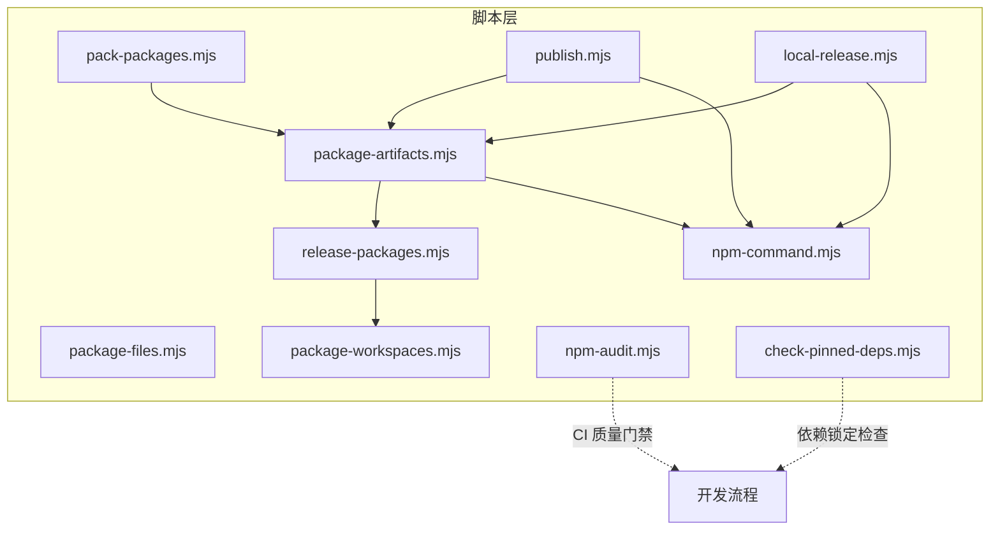
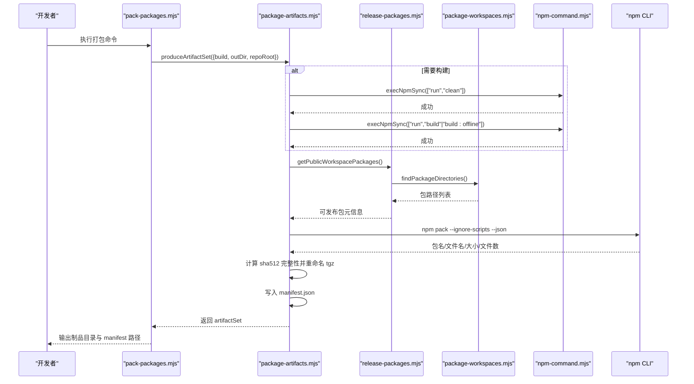
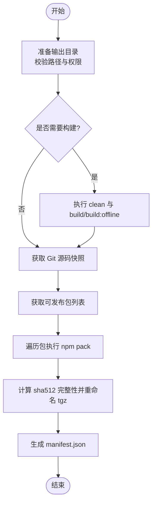
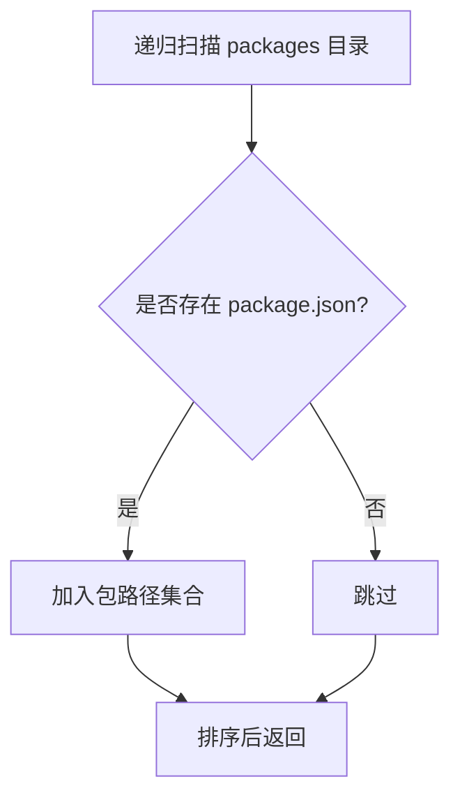
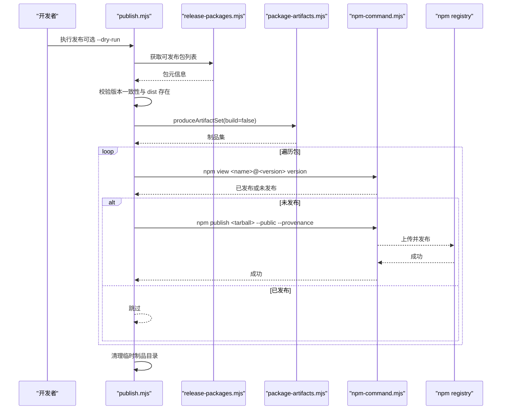
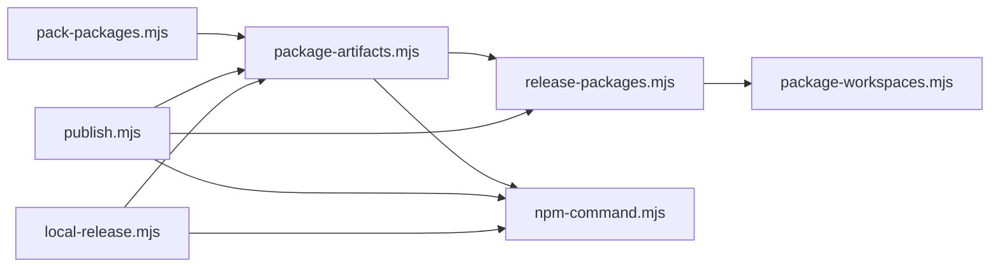

# 包管理脚本

<cite>
**本文引用的文件**   
- [scripts/pack-packages.mjs](https://github.com/FDE-GROUP/oh-my-fde/blob/omca/scripts/pack-packages.mjs)
- [scripts/package-artifacts.mjs](https://github.com/FDE-GROUP/oh-my-fde/blob/omca/scripts/package-artifacts.mjs)
- [scripts/package-files.mjs](https://github.com/FDE-GROUP/oh-my-fde/blob/omca/scripts/package-files.mjs)
- [scripts/package-workspaces.mjs](https://github.com/FDE-GROUP/oh-my-fde/blob/omca/scripts/package-workspaces.mjs)
- [scripts/release-packages.mjs](https://github.com/FDE-GROUP/oh-my-fde/blob/omca/scripts/release-packages.mjs)
- [scripts/npm-command.mjs](https://github.com/FDE-GROUP/oh-my-fde/blob/omca/scripts/npm-command.mjs)
- [scripts/npm-audit.mjs](https://github.com/FDE-GROUP/oh-my-fde/blob/omca/scripts/npm-audit.mjs)
- [scripts/check-pinned-deps.mjs](https://github.com/FDE-GROUP/oh-my-fde/blob/omca/scripts/check-pinned-deps.mjs)
- [scripts/publish.mjs](https://github.com/FDE-GROUP/oh-my-fde/blob/omca/scripts/publish.mjs)
- [scripts/local-release.mjs](https://github.com/FDE-GROUP/oh-my-fde/blob/omca/scripts/local-release.mjs)
</cite>

## 目录
1. [简介](#简介)
2. [项目结构](#项目结构)
3. [核心组件](#核心组件)
4. [架构总览](#架构总览)
5. [详细组件分析](#详细组件分析)
6. [依赖关系分析](#依赖关系分析)
7. [性能与可靠性考虑](#性能与可靠性考虑)
8. [故障排查指南](#故障排查指南)
9. [结论](#结论)

## 简介
本文件面向仓库中的“包管理与分发”相关脚本，系统性说明以下能力：
- 使用 pack-packages.mjs 构建并打包所有对外发布的 npm 包，生成可复用的本地制品集。
- 通过 package-artifacts.mjs 完成产物打包、完整性校验与清单生成。
- 借助 package-files.mjs 进行跨平台文件筛选与复制。
- 基于 package-workspaces.mjs 和 release-packages.mjs 管理 monorepo 工作区，识别可发布包。
- 提供版本一致性检查、依赖锁定策略与安全审计（npm-audit.mjs）。
- 支持自动化发布流程（publish.mjs）和本地发布验证（local-release.mjs）。

该文档既适合快速上手，也适合深入理解实现细节与扩展点。

## 项目结构
与包管理相关的脚本集中在 scripts 目录下，围绕“发现包 → 构建 → 打包 → 校验 → 发布/本地验证”的流水线组织。

图表来源
- [scripts/pack-packages.mjs:1-49](https://github.com/FDE-GROUP/oh-my-fde/blob/omca/scripts/pack-packages.mjs#L1-L49)
- [scripts/package-artifacts.mjs:1-142](https://github.com/FDE-GROUP/oh-my-fde/blob/omca/scripts/package-artifacts.mjs#L1-L142)
- [scripts/package-files.mjs:1-31](https://github.com/FDE-GROUP/oh-my-fde/blob/omca/scripts/package-files.mjs#L1-L31)
- [scripts/package-workspaces.mjs:1-25](https://github.com/FDE-GROUP/oh-my-fde/blob/omca/scripts/package-workspaces.mjs#L1-L25)
- [scripts/release-packages.mjs:1-14](https://github.com/FDE-GROUP/oh-my-fde/blob/omca/scripts/release-packages.mjs#L1-L14)
- [scripts/npm-command.mjs:1-11](https://github.com/FDE-GROUP/oh-my-fde/blob/omca/scripts/npm-command.mjs#L1-L11)
- [scripts/npm-audit.mjs:1-76](https://github.com/FDE-GROUP/oh-my-fde/blob/omca/scripts/npm-audit.mjs#L1-L76)
- [scripts/check-pinned-deps.mjs:1-60](https://github.com/FDE-GROUP/oh-my-fde/blob/omca/scripts/check-pinned-deps.mjs#L1-L60)
- [scripts/publish.mjs:1-65](https://github.com/FDE-GROUP/oh-my-fde/blob/omca/scripts/publish.mjs#L1-L65)
- [scripts/local-release.mjs:1-163](https://github.com/FDE-GROUP/oh-my-fde/blob/omca/scripts/local-release.mjs#L1-L163)

章节来源
- [scripts/pack-packages.mjs:1-49](https://github.com/FDE-GROUP/oh-my-fde/blob/omca/scripts/pack-packages.mjs#L1-L49)
- [scripts/package-artifacts.mjs:1-142](https://github.com/FDE-GROUP/oh-my-fde/blob/omca/scripts/package-artifacts.mjs#L1-L142)
- [scripts/package-files.mjs:1-31](https://github.com/FDE-GROUP/oh-my-fde/blob/omca/scripts/package-files.mjs#L1-L31)
- [scripts/package-workspaces.mjs:1-25](https://github.com/FDE-GROUP/oh-my-fde/blob/omca/scripts/package-workspaces.mjs#L1-L25)
- [scripts/release-packages.mjs:1-14](https://github.com/FDE-GROUP/oh-my-fde/blob/omca/scripts/release-packages.mjs#L1-L14)
- [scripts/npm-command.mjs:1-11](https://github.com/FDE-GROUP/oh-my-fde/blob/omca/scripts/npm-command.mjs#L1-L11)
- [scripts/npm-audit.mjs:1-76](https://github.com/FDE-GROUP/oh-my-fde/blob/omca/scripts/npm-audit.mjs#L1-L76)
- [scripts/check-pinned-deps.mjs:1-60](https://github.com/FDE-GROUP/oh-my-fde/blob/omca/scripts/check-pinned-deps.mjs#L1-L60)
- [scripts/publish.mjs:1-65](https://github.com/FDE-GROUP/oh-my-fde/blob/omca/scripts/publish.mjs#L1-L65)
- [scripts/local-release.mjs:1-163](https://github.com/FDE-GROUP/oh-my-fde/blob/omca/scripts/local-release.mjs#L1-L163)

## 核心组件
- pack-packages.mjs：入口脚本，解析参数，调用 produceArtifactSet 生成统一制品集，并输出使用提示。
- package-artifacts.mjs：核心打包器，负责清理/构建、npm pack、计算完整性、生成 manifest.json，并提供读取与校验接口。
- package-files.mjs：轻量级跨平台文件工具，支持 clean/copy/executable 三类操作。
- package-workspaces.mjs：递归扫描 packages 目录，返回包含 package.json 的包路径列表。
- release-packages.mjs：在 workspace 基础上过滤出非 private 的可发布包。
- npm-command.mjs：封装 npm CLI 调用，兼容 Windows 环境。
- npm-audit.mjs：运行 npm audit，按严重级别拦截未接受的漏洞。
- check-pinned-deps.mjs：强制直接依赖使用精确版本号，避免浮动版本。
- publish.mjs：检查版本一致性与 dist 存在性，生成制品集并逐个发布到 npm。
- local-release.mjs：本地发布演练，构建二进制、安装 tarball、执行冒烟测试。

章节来源
- [scripts/pack-packages.mjs:1-49](https://github.com/FDE-GROUP/oh-my-fde/blob/omca/scripts/pack-packages.mjs#L1-L49)
- [scripts/package-artifacts.mjs:1-142](https://github.com/FDE-GROUP/oh-my-fde/blob/omca/scripts/package-artifacts.mjs#L1-L142)
- [scripts/package-files.mjs:1-31](https://github.com/FDE-GROUP/oh-my-fde/blob/omca/scripts/package-files.mjs#L1-L31)
- [scripts/package-workspaces.mjs:1-25](https://github.com/FDE-GROUP/oh-my-fde/blob/omca/scripts/package-workspaces.mjs#L1-L25)
- [scripts/release-packages.mjs:1-14](https://github.com/FDE-GROUP/oh-my-fde/blob/omca/scripts/release-packages.mjs#L1-L14)
- [scripts/npm-command.mjs:1-11](https://github.com/FDE-GROUP/oh-my-fde/blob/omca/scripts/npm-command.mjs#L1-L11)
- [scripts/npm-audit.mjs:1-76](https://github.com/FDE-GROUP/oh-my-fde/blob/omca/scripts/npm-audit.mjs#L1-L76)
- [scripts/check-pinned-deps.mjs:1-60](https://github.com/FDE-GROUP/oh-my-fde/blob/omca/scripts/check-pinned-deps.mjs#L1-L60)
- [scripts/publish.mjs:1-65](https://github.com/FDE-GROUP/oh-my-fde/blob/omca/scripts/publish.mjs#L1-L65)
- [scripts/local-release.mjs:1-163](https://github.com/FDE-GROUP/oh-my-fde/blob/omca/scripts/local-release.mjs#L1-L163)

## 架构总览
下图展示从“入口脚本”到“制品集生成与发布”的整体流程。

图表来源
- [scripts/pack-packages.mjs:21-49](https://github.com/FDE-GROUP/oh-my-fde/blob/omca/scripts/pack-packages.mjs#L21-L49)
- [scripts/package-artifacts.mjs:76-100](https://github.com/FDE-GROUP/oh-my-fde/blob/omca/scripts/package-artifacts.mjs#L76-L100)
- [scripts/release-packages.mjs:5-13](https://github.com/FDE-GROUP/oh-my-fde/blob/omca/scripts/release-packages.mjs#L5-L13)
- [scripts/package-workspaces.mjs:6-24](https://github.com/FDE-GROUP/oh-my-fde/blob/omca/scripts/package-workspaces.mjs#L6-L24)
- [scripts/npm-command.mjs:4-10](https://github.com/FDE-GROUP/oh-my-fde/blob/omca/scripts/npm-command.mjs#L4-L10)

## 详细组件分析

### pack-packages.mjs：打包入口与参数处理
- 功能要点
  - 解析命令行参数：--out、--force、--offline-model-data、--skip-build、--help。
  - 校验必要参数 --out。
  - 调用 produceArtifactSet 生成制品集，打印制品目录与 manifest 路径，并给出外部项目使用本地包的提示。
- 关键行为
  - 当 --skip-build 为真时，跳过构建步骤，直接复用已有构建产物。
  - 当 --offline-model-data 为真时，触发离线模型数据构建流程。
- 错误处理
  - 缺少 --out 直接抛出错误。
  - 帮助模式直接退出。

章节来源
- [scripts/pack-packages.mjs:7-49](https://github.com/FDE-GROUP/oh-my-fde/blob/omca/scripts/pack-packages.mjs#L7-L49)

### package-artifacts.mjs：制品集生成与校验
- 功能要点
  - 准备输出目录：拒绝危险路径（仓库根或其祖先），限制仓库内输出必须在 .artifacts 下；支持 --force 覆盖。
  - 可选构建：先 clean，再 build 或 build:offline。
  - 获取 Git 源码快照：commit 哈希与是否 dirty。
  - 遍历可发布包，执行 npm pack，重命名 tgz 并附加短哈希后缀，记录 integrity（sha512 base64）。
  - 生成 manifest.json，包含 schemaVersion、source、packages 列表（name/version/tarball/integrity）。
  - 提供 readArtifactSet 用于读取并校验 manifest 与 tgz 完整性。
- 复杂度与性能
  - 对每个包执行一次 npm pack，I/O 密集；manifest 排序按包名字典序。
  - 完整性校验采用 sha512，安全但开销较高。
- 错误处理
  - 输出目录非法、已存在且未 --force、npm pack 返回异常、manifest 字段缺失或重复、tarball 缺失或完整性不匹配等均有明确报错。

图表来源
- [scripts/package-artifacts.mjs:58-100](https://github.com/FDE-GROUP/oh-my-fde/blob/omca/scripts/package-artifacts.mjs#L58-L100)
- [scripts/package-artifacts.mjs:103-141](https://github.com/FDE-GROUP/oh-my-fde/blob/omca/scripts/package-artifacts.mjs#L103-L141)

章节来源
- [scripts/package-artifacts.mjs:1-142](https://github.com/FDE-GROUP/oh-my-fde/blob/omca/scripts/package-artifacts.mjs#L1-L142)

### package-files.mjs：跨平台文件工具
- 功能要点
  - clean <paths...>：递归删除目标路径。
  - copy <sources...> <directory>：glob 匹配源文件并复制到目标目录，保持文件名不变。
  - executable <files...>：为文件添加可执行位。
- 设计特点
  - 仅使用 Node 内置模块，保证跨平台一致性。
  - 对 glob 无匹配的情况直接报错，便于早期发现问题。

章节来源
- [scripts/package-files.mjs:1-31](https://github.com/FDE-GROUP/oh-my-fde/blob/omca/scripts/package-files.mjs#L1-L31)

### package-workspaces.mjs 与 release-packages.mjs：工作区与可发布包发现
- package-workspaces.mjs
  - 递归扫描 packages 目录，忽略 dist 与 node_modules。
  - 收集包含 package.json 的目录，并返回排序后的路径数组。
- release-packages.mjs
  - 基于 findPackageDirectories 结果，读取各包 package.json。
  - 过滤 private !== true 的包，返回 {directory, name, version} 列表供后续打包与发布使用。

图表来源
- [scripts/package-workspaces.mjs:6-24](https://github.com/FDE-GROUP/oh-my-fde/blob/omca/scripts/package-workspaces.mjs#L6-L24)
- [scripts/release-packages.mjs:5-13](https://github.com/FDE-GROUP/oh-my-fde/blob/omca/scripts/release-packages.mjs#L5-L13)

章节来源
- [scripts/package-workspaces.mjs:1-25](https://github.com/FDE-GROUP/oh-my-fde/blob/omca/scripts/package-workspaces.mjs#L1-L25)
- [scripts/release-packages.mjs:1-14](https://github.com/FDE-GROUP/oh-my-fde/blob/omca/scripts/release-packages.mjs#L1-L14)

### npm-command.mjs：npm CLI 封装
- 功能要点
  - 在非 Windows 平台直接调用 npm。
  - 在 Windows 平台通过 process.env.npm_execpath 定位 npm CLI，若不存在则抛出错误。
- 用途
  - 被 package-artifacts.mjs、publish.mjs、local-release.mjs 等脚本复用，确保跨平台稳定性。

章节来源
- [scripts/npm-command.mjs:1-11](https://github.com/FDE-GROUP/oh-my-fde/blob/omca/scripts/npm-command.mjs#L1-L11)

### npm-audit.mjs：安全审计与漏洞治理
- 功能要点
  - 运行 npm audit --omit=dev --json，解析 JSON 报告。
  - 定义最低严重级别（默认 moderate），高于等于该级别的漏洞将被视为失败。
  - 维护 acceptedAdvisories 白名单，允许特定漏洞在限定包上暂时接受，需附带原因。
  - 对不再匹配的已接受条目发出警告，提醒清理。
- 输出
  - 未接受的漏洞列表及详细信息；若无问题则输出成功消息。

章节来源
- [scripts/npm-audit.mjs:1-76](https://github.com/FDE-GROUP/oh-my-fde/blob/omca/scripts/npm-audit.mjs#L1-L76)

### check-pinned-deps.mjs：依赖锁定策略
- 功能要点
  - 递归收集仓库中所有 package.json。
  - 检查 dependencies/devDependencies/optionalDependencies。
  - 忽略非 registry 来源（workspace:/file:/link:/portal:/git+/github:/https:/ssh: 等）。
  - 要求 registry 依赖必须使用精确语义化版本（不含范围符号）。
- 目的
  - 防止浮动版本导致的不确定性，提升构建可重现性与安全性。

章节来源
- [scripts/check-pinned-deps.mjs:1-60](https://github.com/FDE-GROUP/oh-my-fde/blob/omca/scripts/check-pinned-deps.mjs#L1-L60)

### publish.mjs：发布流程编排
- 前置检查
  - 校验所有可发布包版本一致（lockstep 版本）。
  - 校验每个包的 dist 目录存在，否则提示先执行构建。
- 发布流程
  - 调用 produceArtifactSet(build=false) 复用已有构建产物。
  - 查询 npm 远端是否已发布同名同版本包，跳过已发布包。
  - 对未发布包执行 npm publish --access public --provenance --ignore-scripts。
  - 支持 --dry-run 预览发布过程。
- 清理
  - 最终删除临时制品目录。

图表来源
- [scripts/publish.mjs:13-64](https://github.com/FDE-GROUP/oh-my-fde/blob/omca/scripts/publish.mjs#L13-L64)
- [scripts/package-artifacts.mjs:76-100](https://github.com/FDE-GROUP/oh-my-fde/blob/omca/scripts/package-artifacts.mjs#L76-L100)
- [scripts/release-packages.mjs:5-13](https://github.com/FDE-GROUP/oh-my-fde/blob/omca/scripts/release-packages.mjs#L5-L13)
- [scripts/npm-command.mjs:4-10](https://github.com/FDE-GROUP/oh-my-fde/blob/omca/scripts/npm-command.mjs#L4-L10)

章节来源
- [scripts/publish.mjs:1-65](https://github.com/FDE-GROUP/oh-my-fde/blob/omca/scripts/publish.mjs#L1-L65)

### local-release.mjs：本地发布演练与冒烟测试
- 功能要点
  - 生成模型数据（generate:models），可选执行 check。
  - 调用 produceArtifactSet(build=true, offlineModelData=true) 构建并打包。
  - 构建 Bun 平台二进制发布包，并拷贝归档。
  - 在隔离目录安装 tarball，执行 npm 消费者冒烟测试；对 coding-agent 包额外执行专用冒烟测试。
  - 创建 pi 命令 shim（Windows 与类 Unix 分别处理）。
  - 可选创建 Bun 环境的独立安装并进行冒烟测试。
- 输出
  - 打印本地制品目录、manifest、tarball 列表，以及二进制与 CLI 的使用方式。

章节来源
- [scripts/local-release.mjs:1-163](https://github.com/FDE-GROUP/oh-my-fde/blob/omca/scripts/local-release.mjs#L1-L163)

## 依赖关系分析
- 组件耦合
  - pack-packages.mjs 仅依赖 package-artifacts.mjs。
  - package-artifacts.mjs 依赖 release-packages.mjs、npm-command.mjs。
  - release-packages.mjs 依赖 package-workspaces.mjs。
  - publish.mjs 依赖 package-artifacts.mjs、release-packages.mjs、npm-command.mjs。
  - local-release.mjs 依赖 package-artifacts.mjs、npm-command.mjs 及其他冒烟测试脚本。
- 外部依赖
  - npm CLI：通过 npm-command.mjs 统一调用。
  - git：用于获取 commit 与状态。
  - Node.js 内置 fs/crypto/os/path/child_process/util 等。

图表来源
- [scripts/pack-packages.mjs:5-6](https://github.com/FDE-GROUP/oh-my-fde/blob/omca/scripts/pack-packages.mjs#L5-L6)
- [scripts/package-artifacts.mjs:6-7](https://github.com/FDE-GROUP/oh-my-fde/blob/omca/scripts/package-artifacts.mjs#L6-L7)
- [scripts/release-packages.mjs:3-12](https://github.com/FDE-GROUP/oh-my-fde/blob/omca/scripts/release-packages.mjs#L3-L12)
- [scripts/publish.mjs:5-7](https://github.com/FDE-GROUP/oh-my-fde/blob/omca/scripts/publish.mjs#L5-L7)
- [scripts/local-release.mjs:9-11](https://github.com/FDE-GROUP/oh-my-fde/blob/omca/scripts/local-release.mjs#L9-L11)

章节来源
- [scripts/pack-packages.mjs:1-49](https://github.com/FDE-GROUP/oh-my-fde/blob/omca/scripts/pack-packages.mjs#L1-L49)
- [scripts/package-artifacts.mjs:1-142](https://github.com/FDE-GROUP/oh-my-fde/blob/omca/scripts/package-artifacts.mjs#L1-L142)
- [scripts/release-packages.mjs:1-14](https://github.com/FDE-GROUP/oh-my-fde/blob/omca/scripts/release-packages.mjs#L1-L14)
- [scripts/publish.mjs:1-65](https://github.com/FDE-GROUP/oh-my-fde/blob/omca/scripts/publish.mjs#L1-L65)
- [scripts/local-release.mjs:1-163](https://github.com/FDE-GROUP/oh-my-fde/blob/omca/scripts/local-release.mjs#L1-L163)

## 性能与可靠性考虑
- 构建与打包
  - 可通过 --skip-build 跳过构建以加速本地迭代。
  - 使用 --offline-model-data 减少网络依赖，提高构建稳定性。
- 完整性与可重现性
  - 使用 sha512 计算 tarball 完整性，并在 manifest 中持久化。
  - 依赖锁定通过 check-pinned-deps.mjs 强制精确版本，降低不确定性。
- 输出目录安全
  - 禁止将输出目录置于仓库根或其祖先，仓库内输出必须位于 .artifacts 下，避免误写。
- 并发与 I/O
  - npm pack 串行执行，避免并发导致的资源竞争；如需优化，可在未来引入可控并发。
- 发布幂等
  - publish.mjs 会查询远端是否已发布同名同版本包，避免重复发布。

[本节为通用指导，不直接分析具体文件]

## 故障排查指南
- 常见错误与处理
  - 缺少 --out 参数：pack-packages.mjs 会直接报错，请补充 --out 指定输出目录。
  - 输出目录非法：package-artifacts.mjs 会拒绝仓库根或其祖先路径，请改为 .artifacts 下的子目录。
  - 输出目录已存在：使用 --force 覆盖，或手动清理后再试。
  - npm 不可用（Windows）：确保通过 npm 脚本运行或在环境变量中提供 npm_execpath。
  - 依赖未精确锁定：check-pinned-deps.mjs 会列出违规项，请将范围版本改为精确版本。
  - 安全漏洞未接受：npm-audit.mjs 会中断流程，需在 acceptedAdvisories 中添加理由或升级依赖。
  - 发布前未构建：publish.mjs 会检查 dist 目录，请先执行构建。
  - 版本不一致：publish.mjs 会校验所有可发布包版本一致，请统一版本。
- 调试建议
  - 使用 --dry-run 预览发布流程。
  - 使用 local-release.mjs 在隔离环境中验证安装与冒烟测试。
  - 查看 manifest.json 与 tarball 完整性，确认制品未被篡改。

章节来源
- [scripts/pack-packages.mjs:21-49](https://github.com/FDE-GROUP/oh-my-fde/blob/omca/scripts/pack-packages.mjs#L21-L49)
- [scripts/package-artifacts.mjs:58-100](https://github.com/FDE-GROUP/oh-my-fde/blob/omca/scripts/package-artifacts.mjs#L58-L100)
- [scripts/npm-command.mjs:4-10](https://github.com/FDE-GROUP/oh-my-fde/blob/omca/scripts/npm-command.mjs#L4-L10)
- [scripts/check-pinned-deps.mjs:36-59](https://github.com/FDE-GROUP/oh-my-fde/blob/omca/scripts/check-pinned-deps.mjs#L36-L59)
- [scripts/npm-audit.mjs:35-75](https://github.com/FDE-GROUP/oh-my-fde/blob/omca/scripts/npm-audit.mjs#L35-L75)
- [scripts/publish.mjs:30-64](https://github.com/FDE-GROUP/oh-my-fde/blob/omca/scripts/publish.mjs#L30-L64)

## 结论
本套脚本形成了完整的包管理与分发体系：
- 以 pack-packages.mjs 为入口，配合 package-artifacts.mjs 实现构建、打包、完整性校验与清单生成。
- 通过 package-workspaces.mjs 与 release-packages.mjs 精准识别可发布包，保障发布范围正确。
- 借助 npm-audit.mjs 与 check-pinned-deps.mjs 建立质量与安全门禁，确保依赖稳定与漏洞受控。
- 由 publish.mjs 与 local-release.mjs 提供生产发布与本地验证的双通道，提升发布可靠性与可追溯性。

建议在 CI 中集成 npm-audit.mjs 与 check-pinned-deps.mjs，在发布前强制本地演练 local-release.mjs，以确保发布流程的稳定与高效。