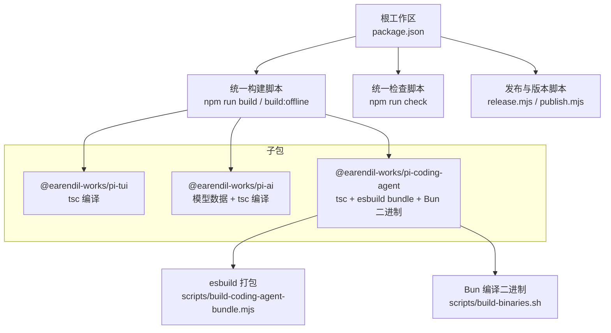
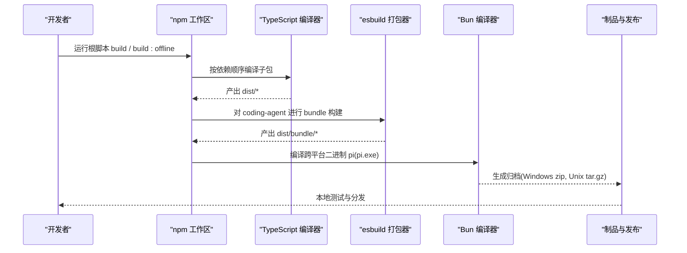
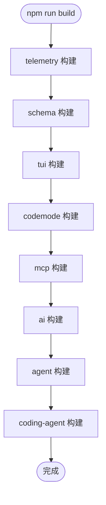
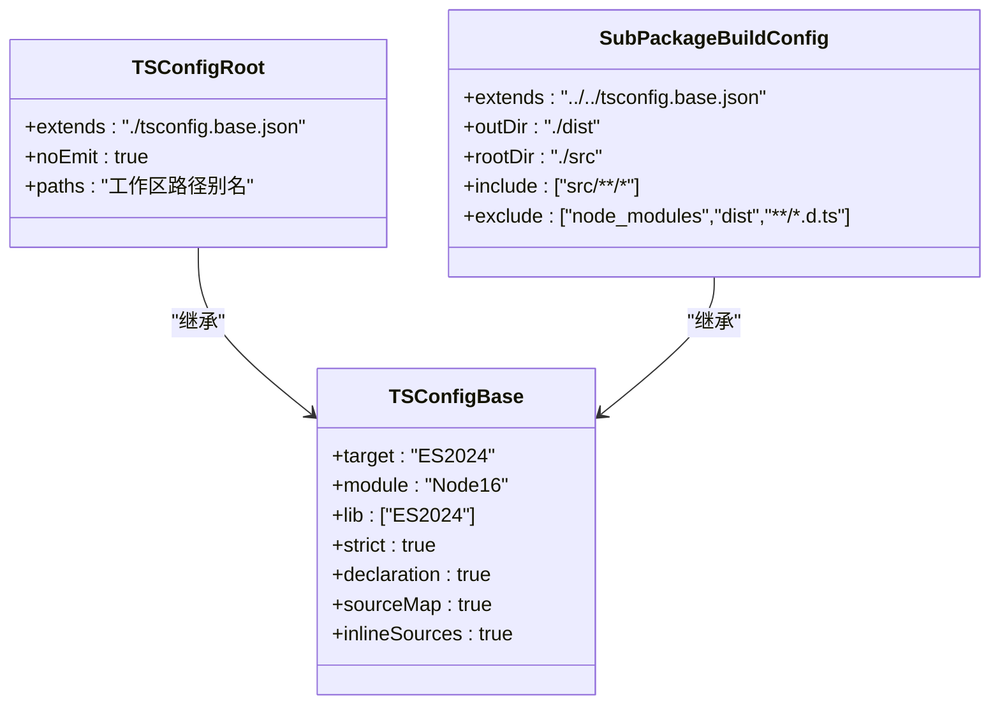
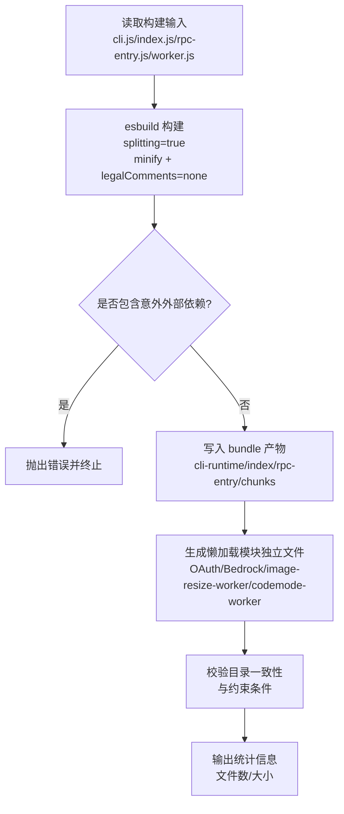
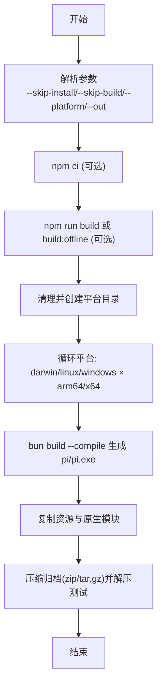
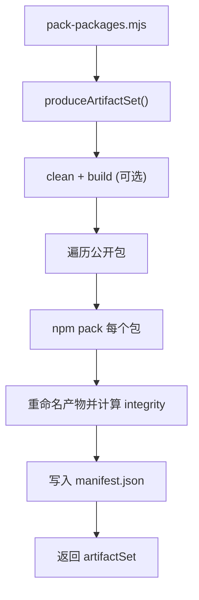
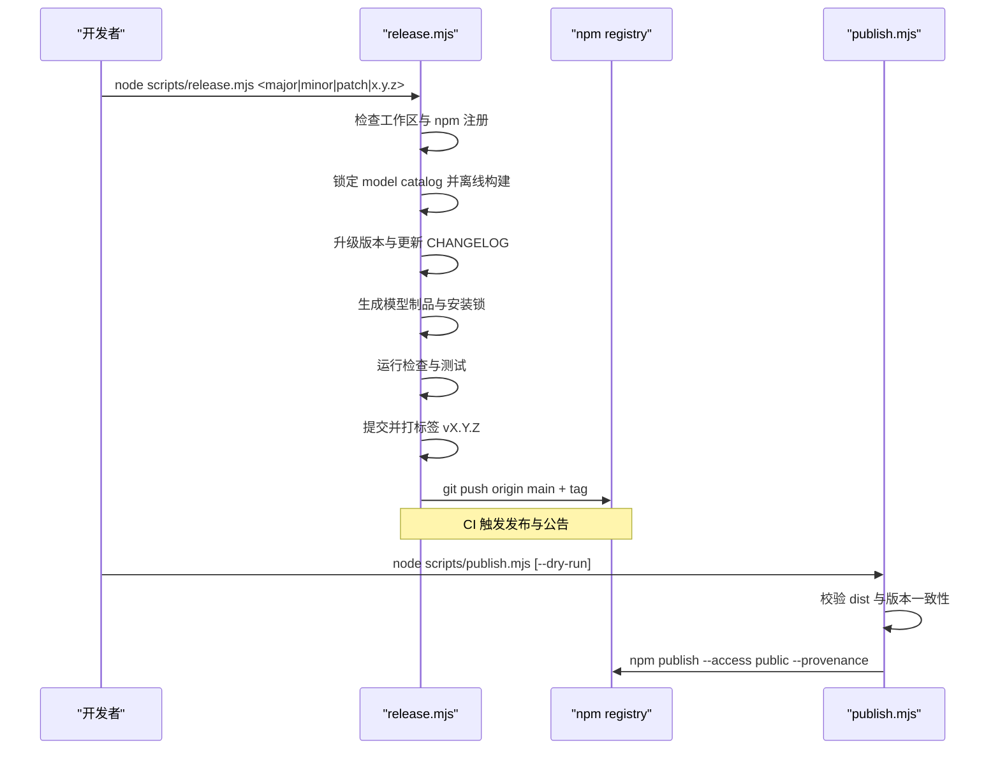
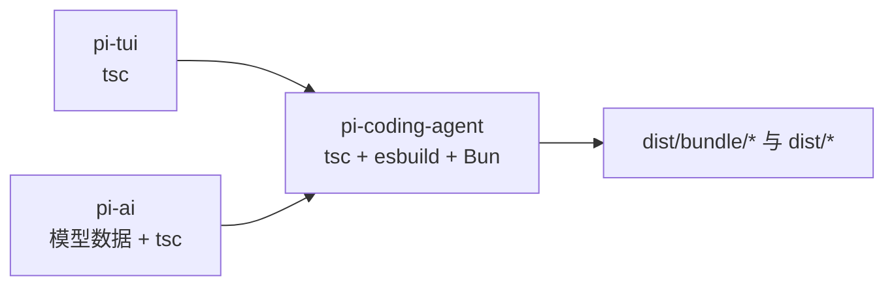
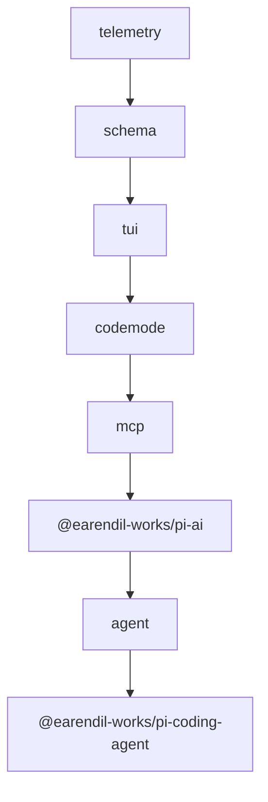

# 构建脚本

<cite>
**本文引用的文件**   
- [package.json](https://github.com/FDE-GROUP/oh-my-coding-agent/blob/omca/package.json)
- [tsconfig.base.json](https://github.com/FDE-GROUP/oh-my-coding-agent/blob/omca/tsconfig.base.json)
- [tsconfig.json](https://github.com/FDE-GROUP/oh-my-coding-agent/blob/omca/tsconfig.json)
- [scripts/build-coding-agent-bundle.mjs](https://github.com/FDE-GROUP/oh-my-coding-agent/blob/omca/scripts/build-coding-agent-bundle.mjs)
- [scripts/build-binaries.sh](https://github.com/FDE-GROUP/oh-my-coding-agent/blob/omca/scripts/build-binaries.sh)
- [scripts/pack-packages.mjs](https://github.com/FDE-GROUP/oh-my-coding-agent/blob/omca/scripts/pack-packages.mjs)
- [scripts/package-artifacts.mjs](https://github.com/FDE-GROUP/oh-my-coding-agent/blob/omca/scripts/package-artifacts.mjs)
- [scripts/publish.mjs](https://github.com/FDE-GROUP/oh-my-coding-agent/blob/omca/scripts/publish.mjs)
- [scripts/release.mjs](https://github.com/FDE-GROUP/oh-my-coding-agent/blob/omca/scripts/release.mjs)
- [packages/coding-agent/package.json](https://github.com/FDE-GROUP/oh-my-coding-agent/blob/omca/packages/coding-agent/package.json)
- [packages/ai/package.json](https://github.com/FDE-GROUP/oh-my-coding-agent/blob/omca/packages/ai/package.json)
- [packages/tui/package.json](https://github.com/FDE-GROUP/oh-my-coding-agent/blob/omca/packages/tui/package.json)
</cite>

## 目录
1. [简介](#简介)
2. [项目结构](#项目结构)
3. [核心组件](#核心组件)
4. [架构总览](#架构总览)
5. [详细组件分析](#详细组件分析)
6. [依赖关系分析](#依赖关系分析)
7. [性能与增量构建](#性能与增量构建)
8. [故障诊断](#故障诊断)
9. [结论](#结论)

## 简介
本文件系统性说明该仓库的构建与发布体系，覆盖：
- 多包工作区的统一构建入口与顺序
- TypeScript 编译配置与产物组织
- esbuild 打包、代码分割与树摇优化
- 二进制可执行文件构建（Bun）与跨平台归档
- 包打包、版本管理与发布流程
- 自定义构建任务、并行化策略与增量构建建议
- 构建性能调优与常见错误诊断方法

## 项目结构
仓库采用 npm workspaces 管理多个子包。根 package.json 定义了统一的构建、检查、测试与发布脚本；各子包通过各自的 tsconfig.build.json 输出到 dist 目录；coding-agent 子包进一步使用 esbuild 生成运行时 bundle，并通过 Bun 编译为跨平台二进制。

**图示来源**
- [package.json:12-46](https://github.com/FDE-GROUP/oh-my-coding-agent/blob/omca/package.json#L12-L46)
- [packages/coding-agent/package.json:31-37](https://github.com/FDE-GROUP/oh-my-coding-agent/blob/omca/packages/coding-agent/package.json#L31-L37)
- [scripts/build-coding-agent-bundle.mjs:78-104](https://github.com/FDE-GROUP/oh-my-coding-agent/blob/omca/scripts/build-coding-agent-bundle.mjs#L78-L104)
- [scripts/build-binaries.sh:117-136](https://github.com/FDE-GROUP/oh-my-coding-agent/blob/omca/scripts/build-binaries.sh#L117-L136)

**章节来源**
- [package.json:1-75](https://github.com/FDE-GROUP/oh-my-coding-agent/blob/omca/package.json#L1-L75)

## 核心组件
- 统一构建入口：根 scripts 定义 monorepo 级别的构建顺序，确保依赖包先于上层包构建。
- TypeScript 编译：各子包使用 tsconfig.build.json 继承 tsconfig.base.json，输出类型声明、源码映射与 JS。
- 运行时打包：coding-agent 使用 esbuild 将 CLI、RPC 入口和若干懒加载模块打包为 bundle，并注入 Node 兼容层。
- 二进制构建：Bun 将已打包的 CLI 与 worker 编译为跨平台可执行文件，并打包资源与原生预编译模块。
- 包制品与发布：pack-packages.mjs 与 package-artifacts.mjs 负责产出 tarball 与清单；publish.mjs 校验并发布到 npm。
- 版本与发布流水线：release.mjs 协调版本号、CHANGELOG、模型目录锁定、构建验证、提交打标签与推送。

**章节来源**
- [package.json:12-46](https://github.com/FDE-GROUP/oh-my-coding-agent/blob/omca/package.json#L12-L46)
- [tsconfig.base.json:1-24](https://github.com/FDE-GROUP/oh-my-coding-agent/blob/omca/tsconfig.base.json#L1-L24)
- [packages/coding-agent/package.json:31-37](https://github.com/FDE-GROUP/oh-my-coding-agent/blob/omca/packages/coding-agent/package.json#L31-L37)
- [scripts/build-coding-agent-bundle.mjs:78-104](https://github.com/FDE-GROUP/oh-my-coding-agent/blob/omca/scripts/build-coding-agent-bundle.mjs#L78-L104)
- [scripts/build-binaries.sh:117-136](https://github.com/FDE-GROUP/oh-my-coding-agent/blob/omca/scripts/build-binaries.sh#L117-L136)
- [scripts/pack-packages.mjs:1-49](https://github.com/FDE-GROUP/oh-my-coding-agent/blob/omca/scripts/pack-packages.mjs#L1-L49)
- [scripts/package-artifacts.mjs:76-101](https://github.com/FDE-GROUP/oh-my-coding-agent/blob/omca/scripts/package-artifacts.mjs#L76-L101)
- [scripts/publish.mjs:1-65](https://github.com/FDE-GROUP/oh-my-coding-agent/blob/omca/scripts/publish.mjs#L1-L65)
- [scripts/release.mjs:1-341](https://github.com/FDE-GROUP/oh-my-coding-agent/blob/omca/scripts/release.mjs#L1-L341)

## 架构总览
下图展示从源码到最终制品的关键路径：TypeScript 编译 → esbuild 打包 → Bun 二进制 → 归档与发布。

**图示来源**
- [package.json:12-18](https://github.com/FDE-GROUP/oh-my-coding-agent/blob/omca/package.json#L12-L18)
- [packages/coding-agent/package.json:31-37](https://github.com/FDE-GROUP/oh-my-coding-agent/blob/omca/packages/coding-agent/package.json#L31-L37)
- [scripts/build-coding-agent-bundle.mjs:140-168](https://github.com/FDE-GROUP/oh-my-coding-agent/blob/omca/scripts/build-coding-agent-bundle.mjs#L140-L168)
- [scripts/build-binaries.sh:117-136](https://github.com/FDE-GROUP/oh-my-coding-agent/blob/omca/scripts/build-binaries.sh#L117-L136)

## 详细组件分析

### 统一构建与检查脚本
- 根 package.json 提供 clean、build、build:offline、check 等命令，按固定顺序构建 telemetry → schema → tui → codemode → mcp → ai → agent → coding-agent。
- build:offline 在 ai 子包使用离线模型数据构建，避免在线拉取。
- check 聚合代码风格、依赖校验、TS 类型检查与浏览器冒烟测试。

**图示来源**
- [package.json:12-18](https://github.com/FDE-GROUP/oh-my-coding-agent/blob/omca/package.json#L12-L18)

**章节来源**
- [package.json:12-46](https://github.com/FDE-GROUP/oh-my-coding-agent/blob/omca/package.json#L12-L46)

### TypeScript 编译选项与产物组织
- tsconfig.base.json 启用严格模式、Node16 模块解析、ES2024 目标、声明与源码映射、内联源码等。
- 根 tsconfig.json 仅用于类型检查（noEmit），并提供大量路径别名以支持开发期导入。
- 各子包 tsconfig.build.json 指定 outDir 与 rootDir，仅包含 src，排除 dist 与 d.ts，保证发布产物干净。

**图示来源**
- [tsconfig.base.json:1-24](https://github.com/FDE-GROUP/oh-my-coding-agent/blob/omca/tsconfig.base.json#L1-L24)
- [tsconfig.json:1-75](https://github.com/FDE-GROUP/oh-my-coding-agent/blob/omca/tsconfig.json#L1-L75)

**章节来源**
- [tsconfig.base.json:1-24](https://github.com/FDE-GROUP/oh-my-coding-agent/blob/omca/tsconfig.base.json#L1-L24)
- [tsconfig.json:1-75](https://github.com/FDE-GROUP/oh-my-coding-agent/blob/omca/tsconfig.json#L1-L75)

### esbuild 打包与优化（coding-agent bundle）
- 入口：CLI、index、rpc-entry 以及若干懒加载模块（OAuth、Bedrock、image-resize-worker、codemode-worker）。
- 关键配置：
  - platform=node、format=esm、target=node22.19
  - minifySyntax/minifyWhitespace=true，legalComments=none
  - splitting=true 实现代码分割，chunkNames 带 hash
  - metafile=true 用于外部依赖审计与产物定位
  - 自定义插件：lazy-jiti-transform、https-proxy-agent-named-export
  - 注入 Node require 兼容 banner，便于 ESM 环境调用 require
  - tsconfigRaw 清空路径别名，确保发布产物与安装后行为一致
- 安全与约束：
  - 校验未预期的外部依赖，抛出明确错误
  - codemode-worker 仅允许 Node 内置模块，禁止 import.meta
  - 懒加载模块必须与主 bundle 同目录，否则报错

**图示来源**
- [scripts/build-coding-agent-bundle.mjs:78-104](https://github.com/FDE-GROUP/oh-my-coding-agent/blob/omca/scripts/build-coding-agent-bundle.mjs#L78-L104)
- [scripts/build-coding-agent-bundle.mjs:140-168](https://github.com/FDE-GROUP/oh-my-coding-agent/blob/omca/scripts/build-coding-agent-bundle.mjs#L140-L168)
- [scripts/build-coding-agent-bundle.mjs:204-234](https://github.com/FDE-GROUP/oh-my-coding-agent/blob/omca/scripts/build-coding-agent-bundle.mjs#L204-L234)

**章节来源**
- [scripts/build-coding-agent-bundle.mjs:1-260](https://github.com/FDE-GROUP/oh-my-coding-agent/blob/omca/scripts/build-coding-agent-bundle.mjs#L1-L260)

### 二进制构建与跨平台归档
- 脚本：scripts/build-binaries.sh
- 功能：
  - 可选跳过依赖安装与包构建
  - 支持 --platform 指定平台或全部平台
  - 使用 bun build --compile 将 CLI 与 worker 编译为原生二进制
  - 复制主题、资源、文档、示例与原生预编译模块
  - 生成 Windows zip 与 Unix tar.gz，并解压供本地测试
- 注意事项：
  - 禁用自动加载 bunfig.toml 与 .env，防止污染二进制运行环境
  - x64 平台使用 baseline 目标以获得更广泛兼容性

**图示来源**
- [scripts/build-binaries.sh:25-82](https://github.com/FDE-GROUP/oh-my-coding-agent/blob/omca/scripts/build-binaries.sh#L25-L82)
- [scripts/build-binaries.sh:117-136](https://github.com/FDE-GROUP/oh-my-coding-agent/blob/omca/scripts/build-binaries.sh#L117-L136)
- [scripts/build-binaries.sh:139-200](https://github.com/FDE-GROUP/oh-my-coding-agent/blob/omca/scripts/build-binaries.sh#L139-L200)

**章节来源**
- [scripts/build-binaries.sh:1-201](https://github.com/FDE-GROUP/oh-my-coding-agent/blob/omca/scripts/build-binaries.sh#L1-L201)

### 包打包与制品清单
- pack-packages.mjs：封装 produceArtifactSet，支持 --out、--force、--offline-model-data、--skip-build。
- package-artifacts.mjs：
  - 清理并构建工作区（可选）
  - 遍历公开工作区包，逐个 npm pack，重命名为含哈希的文件名
  - 计算 sha512 integrity，生成 manifest.json
  - 提供 readArtifactSet 校验完整性与读取制品

**图示来源**
- [scripts/pack-packages.mjs:1-49](https://github.com/FDE-GROUP/oh-my-coding-agent/blob/omca/scripts/pack-packages.mjs#L1-L49)
- [scripts/package-artifacts.mjs:76-101](https://github.com/FDE-GROUP/oh-my-coding-agent/blob/omca/scripts/package-artifacts.mjs#L76-L101)

**章节来源**
- [scripts/pack-packages.mjs:1-49](https://github.com/FDE-GROUP/oh-my-coding-agent/blob/omca/scripts/pack-packages.mjs#L1-L49)
- [scripts/package-artifacts.mjs:1-142](https://github.com/FDE-GROUP/oh-my-coding-agent/blob/omca/scripts/package-artifacts.mjs#L1-L142)

### 版本管理与发布流程
- release.mjs：
  - 检查工作区干净、npm 包注册状态
  - 锁定最新 model catalog 并离线构建验证
  - 升级版本（major/minor/patch 或显式语义化版本）
  - 更新 CHANGELOG.md，重新生成模型制品与安装锁
  - 运行检查与测试，打包 consumer 安装校验
  - 提交、打标签、推送 main 与 tag，触发 CI 发布与公告
- publish.mjs：
  - 校验所有公开包 dist 存在且版本一致
  - 生成制品集，检测是否已发布
  - 逐包 npm publish --access public --provenance --ignore-scripts

**图示来源**
- [scripts/release.mjs:1-341](https://github.com/FDE-GROUP/oh-my-coding-agent/blob/omca/scripts/release.mjs#L1-L341)
- [scripts/publish.mjs:1-65](https://github.com/FDE-GROUP/oh-my-coding-agent/blob/omca/scripts/publish.mjs#L1-L65)

**章节来源**
- [scripts/release.mjs:1-341](https://github.com/FDE-GROUP/oh-my-coding-agent/blob/omca/scripts/release.mjs#L1-L341)
- [scripts/publish.mjs:1-65](https://github.com/FDE-GROUP/oh-my-coding-agent/blob/omca/scripts/publish.mjs#L1-L65)

### 子包构建职责与入口
- @earendil-works/pi-tui：纯 TypeScript 库，tsc 编译，提供 native 构建脚本。
- @earendil-works/pi-ai：生成模型目录与数据，tsc 编译，支持离线构建。
- @earendil-works/pi-coding-agent：
  - build:unbundled：tsc 编译 + 拷贝资源
  - build：先 unbundled，再执行 esbuild bundle
  - build:binary：依赖 tui/telemetry/ai/agent 构建，再用 Bun 编译二进制并拷贝资源

**图示来源**
- [packages/tui/package.json:7-14](https://github.com/FDE-GROUP/oh-my-coding-agent/blob/omca/packages/tui/package.json#L7-L14)
- [packages/ai/package.json:66-75](https://github.com/FDE-GROUP/oh-my-coding-agent/blob/omca/packages/ai/package.json#L66-L75)
- [packages/coding-agent/package.json:31-37](https://github.com/FDE-GROUP/oh-my-coding-agent/blob/omca/packages/coding-agent/package.json#L31-L37)

**章节来源**
- [packages/tui/package.json:1-64](https://github.com/FDE-GROUP/oh-my-coding-agent/blob/omca/packages/tui/package.json#L1-L64)
- [packages/ai/package.json:1-116](https://github.com/FDE-GROUP/oh-my-coding-agent/blob/omca/packages/ai/package.json#L1-L116)
- [packages/coding-agent/package.json:1-98](https://github.com/FDE-GROUP/oh-my-coding-agent/blob/omca/packages/coding-agent/package.json#L1-L98)

## 依赖关系分析
- 工作区依赖顺序由根 build 脚本硬编码，确保底层库先构建。
- coding-agent 依赖 tui、telemetry、ai、agent 等包，其 bundle 会引入 ai 的 OAuth 与 Bedrock 懒加载模块。
- 发布流程要求所有公开包版本一致，并在发布前校验 npm 注册状态。

**图示来源**
- [package.json:12-18](https://github.com/FDE-GROUP/oh-my-coding-agent/blob/omca/package.json#L12-L18)

**章节来源**
- [package.json:12-18](https://github.com/FDE-GROUP/oh-my-coding-agent/blob/omca/package.json#L12-L18)

## 性能与增量构建
- 增量构建现状：
  - TypeScript 编译默认开启增量缓存（取决于 tsconfig 与工具链），但根脚本每次均调用 tsc 与 esbuild。
  - esbuild 本身具备快速增量能力，但未显式启用 incremental 或 cache 选项。
- 并行构建建议：
  - 当前根 build 脚本串行构建子包，可通过并发工具（如 pnpm parallel、nx、turbo）并行构建无依赖的子包。
  - 对于 coding-agent 的 bundle 构建，可拆分懒加载模块为独立任务并行打包。
- 构建性能调优：
  - 使用 build:offline 避免在线拉取模型数据，减少网络 IO。
  - 在 CI 中缓存 node_modules 与 esbuild 缓存目录，缩短冷启动时间。
  - 针对大体积 bundle，评估 tree-shaking 与 external 列表，减少不必要依赖。
  - 使用 metafile 分析 bundle 体积与依赖图，定位热点模块。
- 增量策略建议：
  - 仅在变更包及其下游依赖时重建，避免全量构建。
  - 对静态资源与模型数据生成步骤做幂等校验，避免重复生成。

[本节为通用指导，不直接分析具体文件]

## 故障诊断
- 构建阶段常见问题：
  - 缺少 dist 产物：发布脚本会检查 dist 是否存在，若缺失需先执行构建。
  - 外部依赖异常：esbuild 会报告意外的外部依赖，需调整 allowedExternalPackages 或修复导入。
  - 懒加载模块目录不一致：bundle 脚本会校验懒加载模块与主 bundle 目录一致性。
  - codemode-worker 限制：仅允许 Node 内置模块，禁止 import.meta。
- 二进制构建问题：
  - 平台目标不匹配：x64 平台应使用 baseline 目标。
  - 环境变量污染：Bun 编译时禁用了自动加载 bunfig.toml 与 .env，避免运行期污染。
- 发布与版本问题：
  - 版本不一致：发布脚本要求所有公开包版本一致。
  - npm 包未注册：release.mjs 会在开始前检查公开包是否已在 npm 注册。
  - 模型目录不兼容：release.mjs 会锁定最新 model catalog 并离线构建，失败则提示修复。

**章节来源**
- [scripts/publish.mjs:30-39](https://github.com/FDE-GROUP/oh-my-coding-agent/blob/omca/scripts/publish.mjs#L30-L39)
- [scripts/build-coding-agent-bundle.mjs:106-121](https://github.com/FDE-GROUP/oh-my-coding-agent/blob/omca/scripts/build-coding-agent-bundle.mjs#L106-L121)
- [scripts/build-coding-agent-bundle.mjs:170-176](https://github.com/FDE-GROUP/oh-my-coding-agent/blob/omca/scripts/build-coding-agent-bundle.mjs#L170-L176)
- [scripts/build-coding-agent-bundle.mjs:224-234](https://github.com/FDE-GROUP/oh-my-coding-agent/blob/omca/scripts/build-coding-agent-bundle.mjs#L224-L234)
- [scripts/build-binaries.sh:117-136](https://github.com/FDE-GROUP/oh-my-coding-agent/blob/omca/scripts/build-binaries.sh#L117-L136)
- [scripts/release.mjs:57-87](https://github.com/FDE-GROUP/oh-my-coding-agent/blob/omca/scripts/release.mjs#L57-L87)
- [scripts/release.mjs:97-129](https://github.com/FDE-GROUP/oh-my-coding-agent/blob/omca/scripts/release.mjs#L97-L129)

## 结论
该项目的构建体系围绕“TypeScript 编译 + esbuild 打包 + Bun 二进制 + npm 工作区”展开，通过根脚本统一编排构建顺序，coding-agent 子包承担运行时 bundle 与二进制构建职责，配合完善的制品与发布脚本，形成从源码到分发的完整闭环。建议在 CI 中引入并行构建与缓存策略，结合 metafile 分析持续优化 bundle 体积与构建速度。