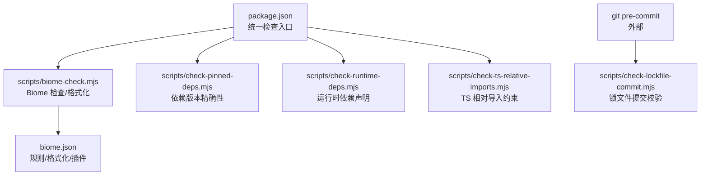
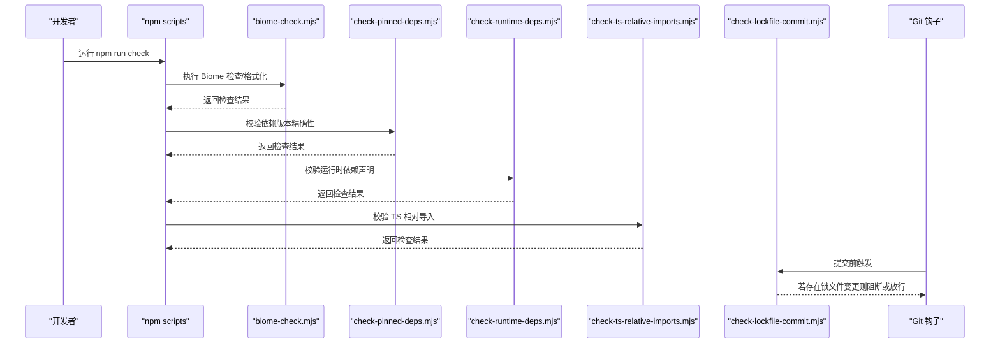
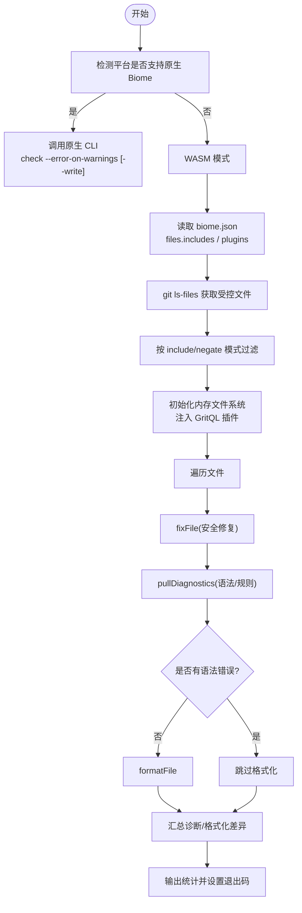
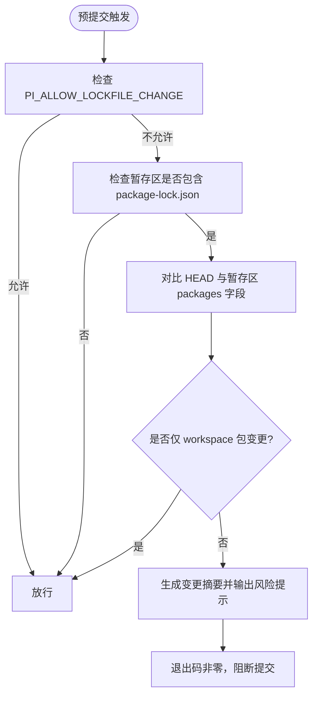
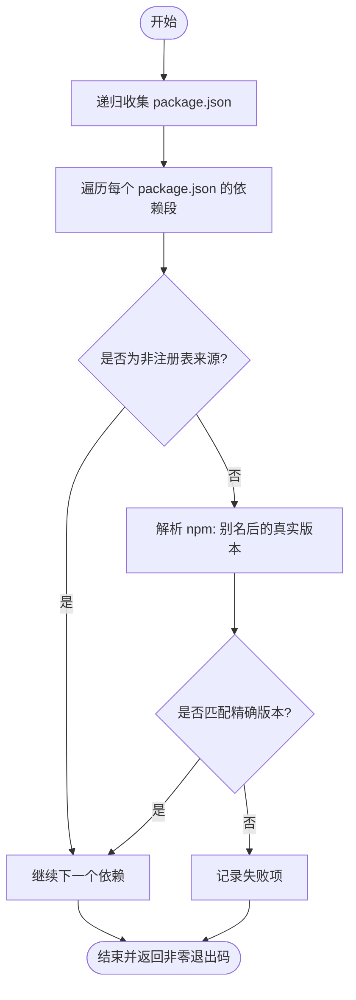
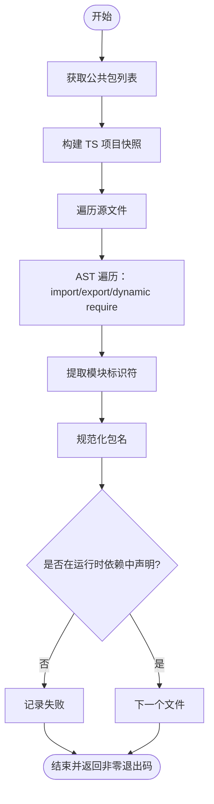
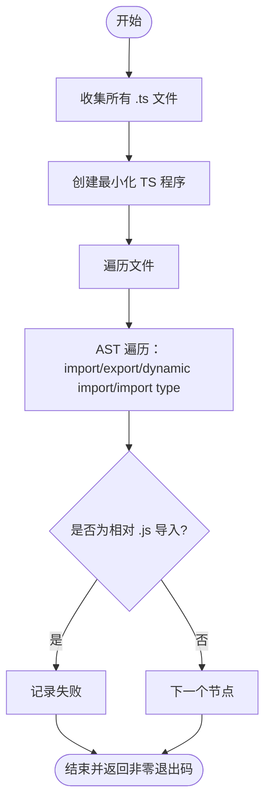
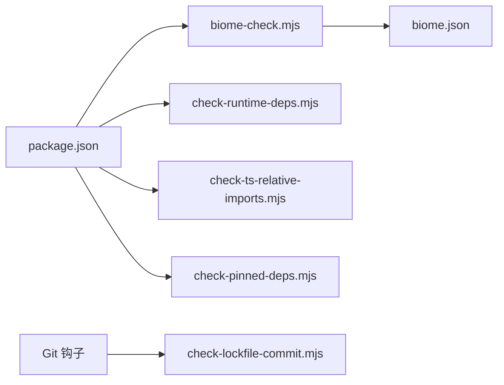

# 质量检查脚本

<cite>
**本文引用的文件**   
- [biome-check.mjs](https://github.com/FDE-GROUP/oh-my-fde/blob/omca/scripts/biome-check.mjs)
- [check-lockfile-commit.mjs](https://github.com/FDE-GROUP/oh-my-fde/blob/omca/scripts/check-lockfile-commit.mjs)
- [check-pinned-deps.mjs](https://github.com/FDE-GROUP/oh-my-fde/blob/omca/scripts/check-pinned-deps.mjs)
- [check-runtime-deps.mjs](https://github.com/FDE-GROUP/oh-my-fde/blob/omca/scripts/check-runtime-deps.mjs)
- [check-ts-relative-imports.mjs](https://github.com/FDE-GROUP/oh-my-fde/blob/omca/scripts/check-ts-relative-imports.mjs)
- [biome.json](https://github.com/FDE-GROUP/oh-my-fde/blob/omca/biome.json)
- [package.json](https://github.com/FDE-GROUP/oh-my-fde/blob/omca/package.json)
</cite>

## 目录
1. [简介](#简介)
2. [项目结构](#项目结构)
3. [核心组件](#核心组件)
4. [架构总览](#架构总览)
5. [详细组件分析](#详细组件分析)
6. [依赖关系分析](#依赖关系分析)
7. [性能与稳定性考量](#性能与稳定性考量)
8. [故障排查指南](#故障排查指南)
9. [结论](#结论)
10. [附录](#附录)

## 简介
本仓库提供一套面向多包工作区的代码质量与依赖校验脚本，覆盖以下关键维度：
- 代码格式与静态检查：通过 Biome 原生二进制或 WASM 模式统一格式化与规则检查。
- 锁文件提交规范：在 Git 预提交阶段拦截对 package-lock.json 的变更，要求显式确认。
- 依赖版本锁定：强制所有直接注册表依赖使用精确版本号，避免语义化范围带来的不确定性。
- 运行时依赖声明：确保公共包的源码中动态导入的模块都在运行时依赖中声明。
- TypeScript 相对导入约束：禁止在非声明文件中以 .js 后缀进行相对导入，保证构建产物一致性。

这些脚本通过根 npm scripts 串联，形成统一的“全量检查”入口，便于本地开发与 CI 环境复用。

## 项目结构
质量检查相关脚本集中在 scripts 目录下，并与根级配置和脚本命令紧密耦合：
- scripts/biome-check.mjs：Biome 检查封装，自动选择原生或 WASM 执行路径。
- scripts/check-lockfile-commit.mjs：Git 钩子前置检查，限制锁文件提交。
- scripts/check-pinned-deps.mjs：遍历所有 package.json，校验依赖版本是否精确锁定。
- scripts/check-runtime-deps.mjs：基于 TypeScript API 扫描公共包源码，校验运行时依赖声明完整性。
- scripts/check-ts-relative-imports.mjs：基于 TypeScript AST 扫描，禁止非声明文件的 .js 相对导入。
- biome.json：Biome 的规则、格式化与文件包含策略。
- package.json：统一编排 check 流程与各子任务。

**图表来源**
- [package.json:12-26](https://github.com/FDE-GROUP/oh-my-fde/blob/omca/package.json#L12-L26)
- [biome.json:1-45](https://github.com/FDE-GROUP/oh-my-fde/blob/omca/biome.json#L1-L45)

**章节来源**
- [package.json:12-26](https://github.com/FDE-GROUP/oh-my-fde/blob/omca/package.json#L12-L26)
- [biome.json:1-45](https://github.com/FDE-GROUP/oh-my-fde/blob/omca/biome.json#L1-L45)

## 核心组件
- Biome 集成检查器：根据平台能力自动选择原生二进制或 WASM 模式，支持 --write 修复与严格警告处理。
- 锁文件提交守卫：仅在允许环境变量下放行，否则输出变更摘要并阻止提交。
- 依赖锁定检查器：递归收集 package.json，排除本地协议与非注册表来源，仅校验注册表依赖必须为精确版本。
- 运行时依赖检查器：解析公共包源码中的 import/export/dynamic require，校验是否在 manifest 的运行时依赖中声明。
- TS 相对导入检查器：构造最小化 TS 程序，遍历所有 .ts 文件，拒绝 .js 后缀的相对导入。

**章节来源**
- [biome-check.mjs:1-124](https://github.com/FDE-GROUP/oh-my-fde/blob/omca/scripts/biome-check.mjs#L1-L124)
- [check-lockfile-commit.mjs:1-121](https://github.com/FDE-GROUP/oh-my-fde/blob/omca/scripts/check-lockfile-commit.mjs#L1-L121)
- [check-pinned-deps.mjs:1-60](https://github.com/FDE-GROUP/oh-my-fde/blob/omca/scripts/check-pinned-deps.mjs#L1-L60)
- [check-runtime-deps.mjs:1-142](https://github.com/FDE-GROUP/oh-my-fde/blob/omca/scripts/check-runtime-deps.mjs#L1-L142)
- [check-ts-relative-imports.mjs:1-106](https://github.com/FDE-GROUP/oh-my-fde/blob/omca/scripts/check-ts-relative-imports.mjs#L1-L106)

## 架构总览
整体检查流程由根脚本驱动，各子脚本相互独立但共享仓库上下文（文件系统、Git、TypeScript、Biome）。

**图表来源**
- [package.json:12-26](https://github.com/FDE-GROUP/oh-my-fde/blob/omca/package.json#L12-L26)
- [biome-check.mjs:1-124](https://github.com/FDE-GROUP/oh-my-fde/blob/omca/scripts/biome-check.mjs#L1-L124)
- [check-pinned-deps.mjs:1-60](https://github.com/FDE-GROUP/oh-my-fde/blob/omca/scripts/check-pinned-deps.mjs#L1-L60)
- [check-runtime-deps.mjs:1-142](https://github.com/FDE-GROUP/oh-my-fde/blob/omca/scripts/check-runtime-deps.mjs#L1-L142)
- [check-ts-relative-imports.mjs:1-106](https://github.com/FDE-GROUP/oh-my-fde/blob/omca/scripts/check-ts-relative-imports.mjs#L1-L106)
- [check-lockfile-commit.mjs:1-121](https://github.com/FDE-GROUP/oh-my-fde/blob/omca/scripts/check-lockfile-commit.mjs#L1-L121)

## 详细组件分析

### Biome 集成检查器（biome-check.mjs）
该脚本负责：
- 检测平台是否具备原生 Biome 二进制；若有，则直接调用 CLI 执行 check --error-on-warnings，并可选 --write 修复。
- 若无原生二进制（如 Android/Termux），回退到 @biomejs/wasm-nodejs：
  - 读取 biome.json 的 files.includes 作为匹配模式。
  - 通过 git ls-files 获取受控文件列表，并按 include/negate 模式过滤。
  - 将 biome.json 中配置的 GritQL 插件注入内存文件系统。
  - 逐文件执行 fixFile（安全修复）、pullDiagnostics（语法/规则诊断）、formatFile（无语法错误时格式化）。
  - 忽略 hint 级别诊断与特定 schema 版本不匹配的误报。
  - 统计检查文件数与失败数，设置退出码。

**图表来源**
- [biome-check.mjs:11-22](https://github.com/FDE-GROUP/oh-my-fde/blob/omca/scripts/biome-check.mjs#L11-L22)
- [biome-check.mjs:24-57](https://github.com/FDE-GROUP/oh-my-fde/blob/omca/scripts/biome-check.mjs#L24-L57)
- [biome-check.mjs:59-124](https://github.com/FDE-GROUP/oh-my-fde/blob/omca/scripts/biome-check.mjs#L59-L124)

**章节来源**
- [biome-check.mjs:1-124](https://github.com/FDE-GROUP/oh-my-fde/blob/omca/scripts/biome-check.mjs#L1-L124)
- [biome.json:1-45](https://github.com/FDE-GROUP/oh-my-fde/blob/omca/biome.json#L1-L45)

### 锁文件提交守卫（check-lockfile-commit.mjs）
该脚本用于 Git 预提交阶段，防止未经审查的 package-lock.json 变更被提交：
- 读取环境变量 PI_ALLOW_LOCKFILE_CHANGE，允许值为 1/true/yes 时放行。
- 若暂存区不包含 package-lock.json，直接放行。
- 比较 HEAD 与暂存区 diff，提取 packages 字段变化。
- 如果变更仅涉及 workspace 包元数据（路径以 packages/ 开头），视为内部更新并放行。
- 否则输出变更摘要（新增/删除/版本变更），提示风险点（生命周期脚本、安装门控等），并以非零退出码阻断提交。

**图表来源**
- [check-lockfile-commit.mjs:5-10](https://github.com/FDE-GROUP/oh-my-fde/blob/omca/scripts/check-lockfile-commit.mjs#L5-L10)
- [check-lockfile-commit.mjs:33-56](https://github.com/FDE-GROUP/oh-my-fde/blob/omca/scripts/check-lockfile-commit.mjs#L33-L56)
- [check-lockfile-commit.mjs:77-121](https://github.com/FDE-GROUP/oh-my-fde/blob/omca/scripts/check-lockfile-commit.mjs#L77-L121)

**章节来源**
- [check-lockfile-commit.mjs:1-121](https://github.com/FDE-GROUP/oh-my-fde/blob/omca/scripts/check-lockfile-commit.mjs#L1-L121)

### 依赖版本锁定检查（check-pinned-deps.mjs）
该脚本递归扫描仓库内所有 package.json，确保直接注册表依赖使用精确版本：
- 忽略 .git/dist/node_modules 目录。
- 对 dependencies/devDependencies/optionalDependencies 三个段进行检查。
- 跳过非注册表来源（workspace:/file:/link:/portal:/git+*/github:/https:/ssh: 等）。
- 对 npm: 别名形式，解析真实版本段。
- 使用正则匹配语义化精确版本（含 prerelease/build metadata），不符合则记录失败。
- 如有失败，输出具体位置与发现值，并以非零退出码结束。

**图表来源**
- [check-pinned-deps.mjs:4-6](https://github.com/FDE-GROUP/oh-my-fde/blob/omca/scripts/check-pinned-deps.mjs#L4-L6)
- [check-pinned-deps.mjs:9-22](https://github.com/FDE-GROUP/oh-my-fde/blob/omca/scripts/check-pinned-deps.mjs#L9-L22)
- [check-pinned-deps.mjs:24-34](https://github.com/FDE-GROUP/oh-my-fde/blob/omca/scripts/check-pinned-deps.mjs#L24-L34)
- [check-pinned-deps.mjs:36-60](https://github.com/FDE-GROUP/oh-my-fde/blob/omca/scripts/check-pinned-deps.mjs#L36-L60)

**章节来源**
- [check-pinned-deps.mjs:1-60](https://github.com/FDE-GROUP/oh-my-fde/blob/omca/scripts/check-pinned-deps.mjs#L1-L60)

### 运行时依赖声明检查（check-runtime-deps.mjs）
该脚本针对公共包（getPublicWorkspacePackages）进行运行时依赖校验：
- 收集每个公共包的 src 目录与 manifest，若缺少 tsconfig.build.json，则使用合成配置。
- 使用 TypeScript Sync API 打开项目快照，解析源文件集合。
- 对每个源文件进行 AST 遍历，识别：
  - import 语句（区分类型导入）
  - export 语句（区分类型导出）
  - dynamic import() 与 require()/require.resolve()
- 对于每个模块标识符，提取包名并判断是否在 manifest 的 dependencies/optionalDependencies/peerDependencies 中声明。
- 同时检查被 exclude 的文件是否被引入，拒绝此类行为。
- 输出未声明的运行时导入清单，并以非零退出码结束。

**图表来源**
- [check-runtime-deps.mjs:19-24](https://github.com/FDE-GROUP/oh-my-fde/blob/omca/scripts/check-runtime-deps.mjs#L19-L24)
- [check-runtime-deps.mjs:26-89](https://github.com/FDE-GROUP/oh-my-fde/blob/omca/scripts/check-runtime-deps.mjs#L26-L89)
- [check-runtime-deps.mjs:91-142](https://github.com/FDE-GROUP/oh-my-fde/blob/omca/scripts/check-runtime-deps.mjs#L91-L142)

**章节来源**
- [check-runtime-deps.mjs:1-142](https://github.com/FDE-GROUP/oh-my-fde/blob/omca/scripts/check-runtime-deps.mjs#L1-L142)

### TypeScript 相对导入检查（check-ts-relative-imports.mjs）
该脚本禁止在非声明 .ts 文件中使用 .js 后缀的相对导入：
- 递归收集所有 .ts 文件（排除 .d.ts）。
- 构造最小化 TS 程序（noResolve/noLib/types=[]），仅包含目标文件。
- 遍历 AST，识别 import/export/dynamic import/import type 中的字符串字面量。
- 若匹配相对 .js 导入（以 .. 或 . 开头且以 .js 结尾），记录失败。
- 输出失败位置与具体导入，并以非零退出码结束。

**图表来源**
- [check-ts-relative-imports.mjs:15-31](https://github.com/FDE-GROUP/oh-my-fde/blob/omca/scripts/check-ts-relative-imports.mjs#L15-L31)
- [check-ts-relative-imports.mjs:33-45](https://github.com/FDE-GROUP/oh-my-fde/blob/omca/scripts/check-ts-relative-imports.mjs#L33-L45)
- [check-ts-relative-imports.mjs:47-106](https://github.com/FDE-GROUP/oh-my-fde/blob/omca/scripts/check-ts-relative-imports.mjs#L47-L106)

**章节来源**
- [check-ts-relative-imports.mjs:1-106](https://github.com/FDE-GROUP/oh-my-fde/blob/omca/scripts/check-ts-relative-imports.mjs#L1-L106)

## 依赖关系分析
- 脚本间耦合度低，各自独立执行，通过 package.json 的 scripts 串联。
- 外部依赖：
  - Biome 原生二进制或 WASM 绑定。
  - TypeScript unstable API（用于 AST 分析与项目快照）。
  - Node.js 标准库（child_process/fs/path/module）。
- 配置文件：
  - biome.json 控制规则、格式化与插件。
  - package.json 定义统一检查入口与子任务。

**图表来源**
- [package.json:12-26](https://github.com/FDE-GROUP/oh-my-fde/blob/omca/package.json#L12-L26)
- [biome.json:1-45](https://github.com/FDE-GROUP/oh-my-fde/blob/omca/biome.json#L1-L45)

**章节来源**
- [package.json:12-26](https://github.com/FDE-GROUP/oh-my-fde/blob/omca/package.json#L12-L26)
- [biome.json:1-45](https://github.com/FDE-GROUP/oh-my-fde/blob/omca/biome.json#L1-L45)

## 性能与稳定性考量
- Biome 原生优先：在有原生二进制的平台上直接调用 CLI，避免 WASM 开销。
- WASM 模式优化：
  - 仅加载 biome.json 中配置的插件到内存文件系统。
  - 使用 git ls-files 减少无关文件扫描。
  - 跳过语法错误文件的格式化，降低无效计算。
- TypeScript 检查：
  - 使用最小化 TS 程序（noResolve/noLib/types=[]）减少类型解析成本。
  - 仅遍历公开包的 src 目录，避免 node_modules 与 dist 干扰。
- 锁文件检查：
  - 仅在暂存区包含 package-lock.json 时进行 diff，避免无谓计算。
  - 变更摘要限制输出数量，避免控制台过载。

[本节为通用指导，不涉及具体文件分析]

## 故障排查指南
- Biome 检查失败：
  - 查看控制台输出的诊断信息，定位文件与规则类别。
  - 若为 schema 版本不匹配（WASM 模式下），属于预期忽略项。
  - 使用 --write 自动修复可接受的安全修复。
- 锁文件提交被阻断：
  - 确认变更是否仅为 workspace 包元数据更新；若是，应自动放行。
  - 如需提交锁文件变更，设置 PI_ALLOW_LOCKFILE_CHANGE=1 后重试。
  - 审查变更摘要，关注新增/删除/版本变更的生命周期脚本风险。
- 依赖版本未精确锁定：
  - 根据失败输出定位具体 package.json 与依赖项，改为精确版本。
  - 非注册表来源（workspace/file/git 等）不受此规则约束。
- 运行时依赖未声明：
  - 根据失败输出定位文件与行号，补充对应依赖到 manifest。
  - 注意 peerDependencies 也需声明，避免运行时缺失。
- TS 相对 .js 导入违规：
  - 将 .js 后缀移除或使用正确的 TS 导入路径。
  - 若确需 JS 互操作，考虑重构为 TS 或通过类型声明桥接。

**章节来源**
- [biome-check.mjs:94-124](https://github.com/FDE-GROUP/oh-my-fde/blob/omca/scripts/biome-check.mjs#L94-L124)
- [check-lockfile-commit.mjs:86-121](https://github.com/FDE-GROUP/oh-my-fde/blob/omca/scripts/check-lockfile-commit.mjs#L86-L121)
- [check-pinned-deps.mjs:47-60](https://github.com/FDE-GROUP/oh-my-fde/blob/omca/scripts/check-pinned-deps.mjs#L47-L60)
- [check-runtime-deps.mjs:115-142](https://github.com/FDE-GROUP/oh-my-fde/blob/omca/scripts/check-runtime-deps.mjs#L115-L142)
- [check-ts-relative-imports.mjs:67-106](https://github.com/FDE-GROUP/oh-my-fde/blob/omca/scripts/check-ts-relative-imports.mjs#L67-L106)

## 结论
这套质量检查脚本围绕“确定性、可审计、可自动化”的目标，覆盖了从代码风格到依赖安全的多个层面。通过根脚本统一编排，既适合本地开发体验，也易于集成到 CI 流水线。建议：
- 在 CI 中固定 Node 版本与包管理器，确保结果一致。
- 将 check-lockfile-commit.mjs 接入 husky pre-commit，强化提交门禁。
- 定期回顾 Biome 规则与 TypeScript 检查策略，随项目演进持续优化。

[本节为总结性内容，不涉及具体文件分析]

## 附录
- 自定义检查规则扩展建议：
  - 在 biome.json 中添加或调整 rules，结合 GritQL 插件实现领域特定检查。
  - 在 check-runtime-deps.mjs 中扩展允许的运行时依赖白名单或忽略模式。
  - 在 check-ts-relative-imports.mjs 中放宽或收紧 .js 相对导入策略。
- CI 集成示例思路：
  - 在 GitHub Actions 中执行 npm run check，并在失败时上传日志。
  - 在 GitLab CI 中配置 before_script 安装依赖后运行 check。
  - 将 PI_ALLOW_LOCKFILE_CHANGE 作为 CI 变量按需启用（谨慎使用）。

[本节为通用指导，不涉及具体文件分析]