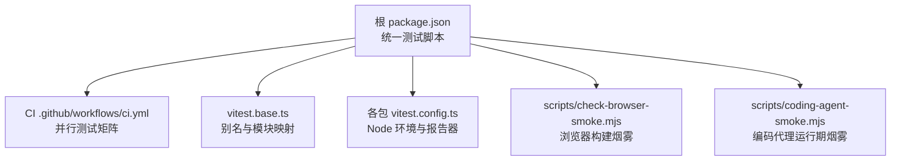
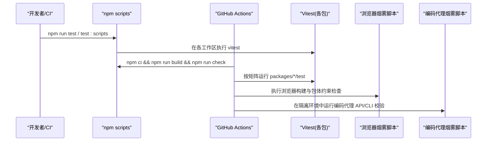
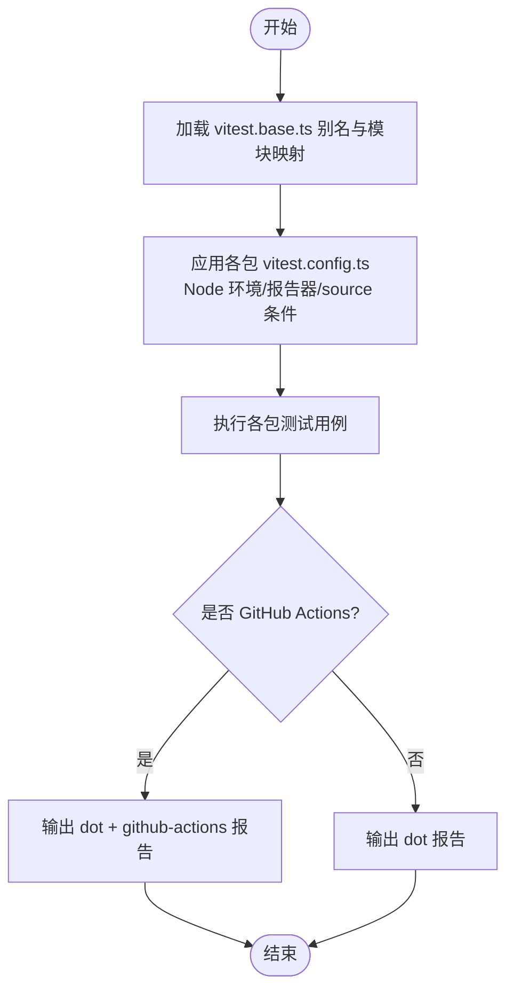
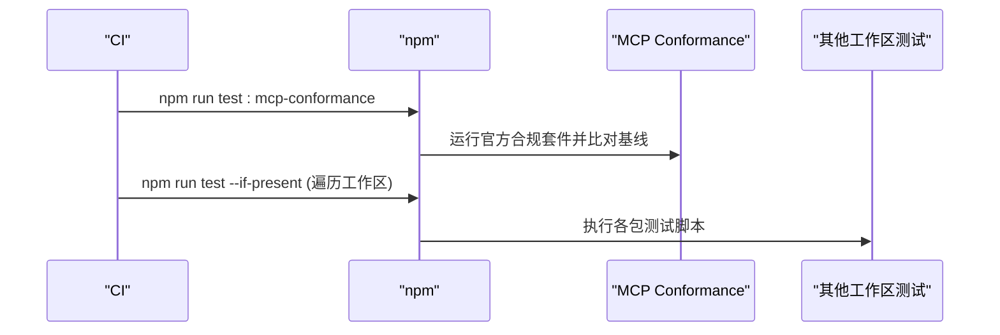
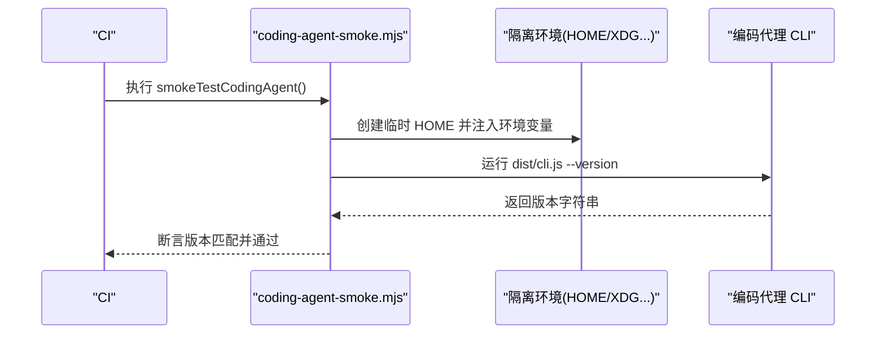
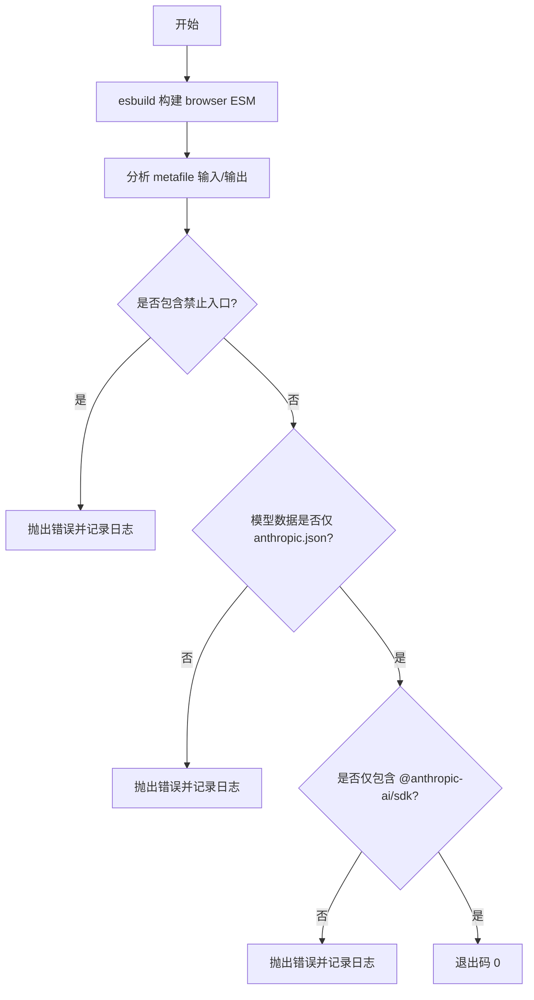
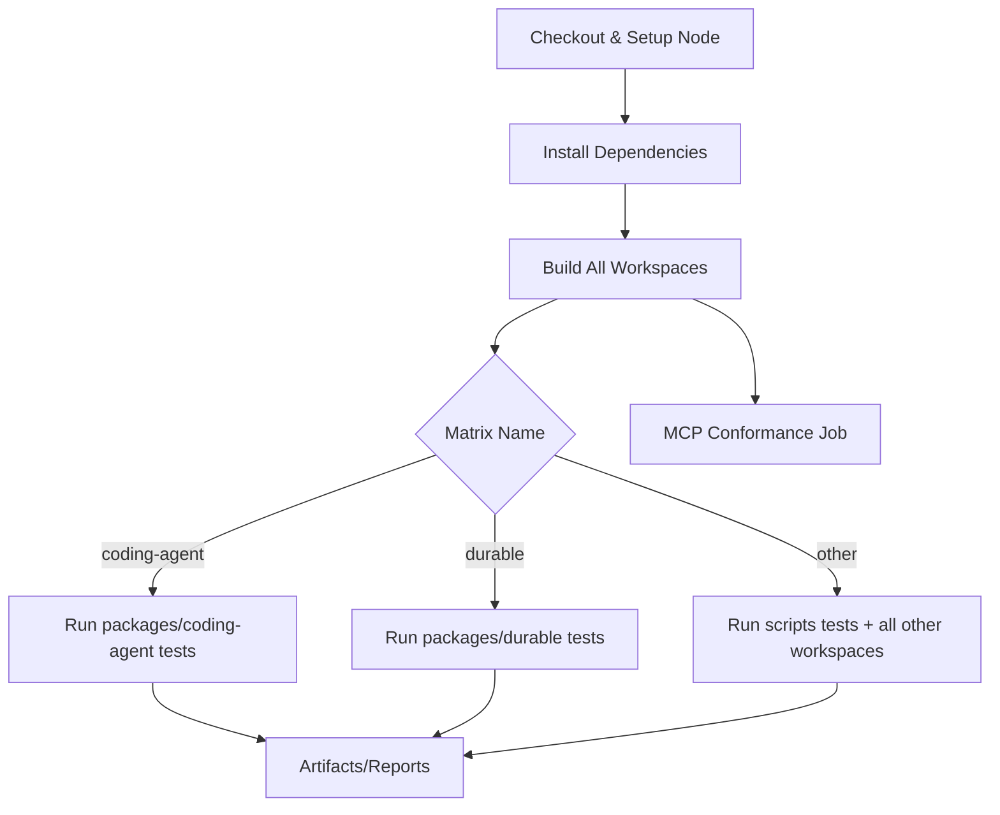
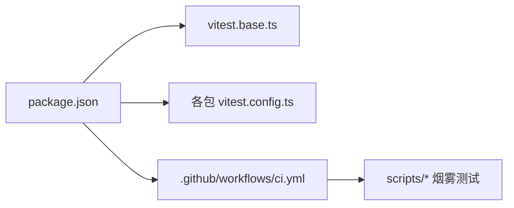

# 测试策略

<cite>
**本文引用的文件**   
- [package.json](https://github.com/FDE-GROUP/oh-my-fde/blob/omca/package.json)
- [vitest.base.ts](https://github.com/FDE-GROUP/oh-my-fde/blob/omca/vitest.base.ts)
- [packages/codemode/vitest.config.ts](https://github.com/FDE-GROUP/oh-my-fde/blob/omca/packages/codemode/vitest.config.ts)
- [packages/mcp/vitest.config.ts](https://github.com/FDE-GROUP/oh-my-fde/blob/omca/packages/mcp/vitest.config.ts)
- [packages/schema/vitest.config.ts](https://github.com/FDE-GROUP/oh-my-fde/blob/omca/packages/schema/vitest.config.ts)
- [.github/workflows/ci.yml](https://github.com/FDE-GROUP/oh-my-fde/blob/omca/.github/workflows/ci.yml)
- [scripts/check-browser-smoke.mjs](https://github.com/FDE-GROUP/oh-my-fde/blob/omca/scripts/check-browser-smoke.mjs)
- [scripts/coding-agent-smoke.mjs](https://github.com/FDE-GROUP/oh-my-fde/blob/omca/scripts/coding-agent-smoke.mjs)
</cite>

## 目录
1. [简介](#简介)
2. [项目结构](#项目结构)
3. [核心组件](#核心组件)
4. [架构总览](#架构总览)
5. [详细组件分析](#详细组件分析)
6. [依赖关系分析](#依赖关系分析)
7. [性能考虑](#性能考虑)
8. [故障排查指南](#故障排查指南)
9. [结论](#结论)
10. [附录](#附录)

## 简介
本文件系统性说明本仓库的测试策略与框架配置，覆盖单元测试（Vitest）、集成测试、端到端测试与烟雾测试的配置与执行方式；解释测试覆盖率要求、Mock 策略、测试数据管理以及 CI/CD 中的测试管道。同时给出性能测试、负载测试与兼容性测试的实践建议。

## 项目结构
仓库采用多工作区（workspaces）组织，测试相关配置主要分布在：
- 根级脚本与工作区入口：通过 npm scripts 统一编排测试任务
- Vitest 基础配置：集中定义别名与模块解析规则
- 各包独立 vitest.config.ts：启用 Node 环境、报告器与 source 条件
- GitHub Actions CI：并行化测试矩阵、系统依赖安装与 MCP 合规性检查
- 烟雾测试脚本：浏览器构建校验与编码代理运行期验证

图示来源
- [package.json:12-39](https://github.com/FDE-GROUP/oh-my-fde/blob/omca/package.json#L12-L39)
- [.github/workflows/ci.yml:56-109](https://github.com/FDE-GROUP/oh-my-fde/blob/omca/.github/workflows/ci.yml#L56-L109)
- [vitest.base.ts:45-96](https://github.com/FDE-GROUP/oh-my-fde/blob/omca/vitest.base.ts#L45-L96)
- [packages/codemode/vitest.config.ts:1-11](https://github.com/FDE-GROUP/oh-my-fde/blob/omca/packages/codemode/vitest.config.ts#L1-L11)
- [scripts/check-browser-smoke.mjs:43-110](https://github.com/FDE-GROUP/oh-my-fde/blob/omca/scripts/check-browser-smoke.mjs#L43-L110)
- [scripts/coding-agent-smoke.mjs:8-51](https://github.com/FDE-GROUP/oh-my-fde/blob/omca/scripts/coding-agent-smoke.mjs#L8-L51)

章节来源
- [package.json:12-39](https://github.com/FDE-GROUP/oh-my-fde/blob/omca/package.json#L12-L39)
- [.github/workflows/ci.yml:56-109](https://github.com/FDE-GROUP/oh-my-fde/blob/omca/.github/workflows/ci.yml#L56-L109)

## 核心组件
- 测试编排与入口
  - 根脚本提供 test、test:scripts 等命令，统一触发工作区测试与脚本测试
- Vitest 基础配置
  - 集中定义 @earendil-works/* 包到源码路径的别名，确保测试直接加载源码而非已构建产物
  - 为 AI/MCP/Agent/TUI 等包提供细粒度子路径别名
- 各包 Vitest 配置
  - 启用 globals、Node 环境、GitHub Actions 下的 dot/github-actions 报告器
  - 使用 resolve.conditions=["source"] 与 ssr.resolve.conditions=["source"] 以支持源码模式
- CI 测试矩阵
  - 将测试拆分为 coding-agent、durable、other 三个并行 job
  - other 会遍历除特定包外的所有工作区并执行其测试脚本
  - 额外运行 MCP 客户端合规性测试
- 烟雾测试
  - 浏览器构建烟雾：校验 esbuild 在浏览器平台打包成功，且选择性 provider 包体仅包含预期 SDK 与模型数据
  - 编码代理运行期烟雾：在隔离 HOME 下导入 API、CLI --version 输出与版本一致

章节来源
- [package.json:12-39](https://github.com/FDE-GROUP/oh-my-fde/blob/omca/package.json#L12-L39)
- [vitest.base.ts:4-43](https://github.com/FDE-GROUP/oh-my-fde/blob/omca/vitest.base.ts#L4-L43)
- [vitest.base.ts:45-96](https://github.com/FDE-GROUP/oh-my-fde/blob/omca/vitest.base.ts#L45-L96)
- [packages/codemode/vitest.config.ts:1-11](https://github.com/FDE-GROUP/oh-my-fde/blob/omca/packages/codemode/vitest.config.ts#L1-L11)
- [packages/mcp/vitest.config.ts:1-11](https://github.com/FDE-GROUP/oh-my-fde/blob/omca/packages/mcp/vitest.config.ts#L1-L11)
- [packages/schema/vitest.config.ts:1-11](https://github.com/FDE-GROUP/oh-my-fde/blob/omca/packages/schema/vitest.config.ts#L1-L11)
- [.github/workflows/ci.yml:56-109](https://github.com/FDE-GROUP/oh-my-fde/blob/omca/.github/workflows/ci.yml#L56-L109)
- [.github/workflows/ci.yml:111-129](https://github.com/FDE-GROUP/oh-my-fde/blob/omca/.github/workflows/ci.yml#L111-L129)
- [scripts/check-browser-smoke.mjs:43-110](https://github.com/FDE-GROUP/oh-my-fde/blob/omca/scripts/check-browser-smoke.mjs#L43-L110)
- [scripts/coding-agent-smoke.mjs:8-51](https://github.com/FDE-GROUP/oh-my-fde/blob/omca/scripts/coding-agent-smoke.mjs#L8-L51)

## 架构总览
下图展示从开发者或 CI 触发测试到具体执行层的调用链与职责划分。

图示来源
- [package.json:12-39](https://github.com/FDE-GROUP/oh-my-fde/blob/omca/package.json#L12-L39)
- [.github/workflows/ci.yml:17-53](https://github.com/FDE-GROUP/oh-my-fde/blob/omca/.github/workflows/ci.yml#L17-L53)
- [.github/workflows/ci.yml:56-109](https://github.com/FDE-GROUP/oh-my-fde/blob/omca/.github/workflows/ci.yml#L56-L109)
- [scripts/check-browser-smoke.mjs:43-110](https://github.com/FDE-GROUP/oh-my-fde/blob/omca/scripts/check-browser-smoke.mjs#L43-L110)
- [scripts/coding-agent-smoke.mjs:8-51](https://github.com/FDE-GROUP/oh-my-fde/blob/omca/scripts/coding-agent-smoke.mjs#L8-L51)

## 详细组件分析

### 单元测试（Vitest）
- 全局配置
  - 通过 vitest.base.ts 集中定义别名，使测试直接引用源码，避免构建产物差异影响断言
  - 对 AI/MCP/Agent/TUI 等包的子路径进行精确映射，保证 import 行为与运行时一致
- 工作区配置
  - 各包 vitest.config.ts 启用 Node 环境、globals，并在 GitHub Actions 下输出 dot 与 github-actions 报告
  - 使用 resolve/ssr 的 conditions=["source"]，确保测试走源码路径
- 执行方式
  - 根脚本 test 会先执行 test:scripts（Node 原生测试），再在工作区中执行 vitest
  - CI 中按矩阵拆分测试，coding-agent/durable/other 并行执行，提升吞吐

图示来源
- [vitest.base.ts:45-96](https://github.com/FDE-GROUP/oh-my-fde/blob/omca/vitest.base.ts#L45-L96)
- [packages/codemode/vitest.config.ts:1-11](https://github.com/FDE-GROUP/oh-my-fde/blob/omca/packages/codemode/vitest.config.ts#L1-L11)
- [packages/mcp/vitest.config.ts:1-11](https://github.com/FDE-GROUP/oh-my-fde/blob/omca/packages/mcp/vitest.config.ts#L1-L11)
- [packages/schema/vitest.config.ts:1-11](https://github.com/FDE-GROUP/oh-my-fde/blob/omca/packages/schema/vitest.config.ts#L1-L11)

章节来源
- [vitest.base.ts:4-43](https://github.com/FDE-GROUP/oh-my-fde/blob/omca/vitest.base.ts#L4-L43)
- [vitest.base.ts:45-96](https://github.com/FDE-GROUP/oh-my-fde/blob/omca/vitest.base.ts#L45-L96)
- [packages/codemode/vitest.config.ts:1-11](https://github.com/FDE-GROUP/oh-my-fde/blob/omca/packages/codemode/vitest.config.ts#L1-L11)
- [packages/mcp/vitest.config.ts:1-11](https://github.com/FDE-GROUP/oh-my-fde/blob/omca/packages/mcp/vitest.config.ts#L1-L11)
- [packages/schema/vitest.config.ts:1-11](https://github.com/FDE-GROUP/oh-my-fde/blob/omca/packages/schema/vitest.config.ts#L1-L11)
- [package.json:38-40](https://github.com/FDE-GROUP/oh-my-fde/blob/omca/package.json#L38-L40)

### 集成测试
- MCP 客户端合规性测试
  - CI 中单独 job 运行 MCP conformance 套件，基于固定基线对比回归
- 其他工作区集成
  - CI 的 other 矩阵会遍历除 coding-agent/durable 之外的所有工作区，执行各自定义的测试脚本，形成跨包集成验证面

图示来源
- [.github/workflows/ci.yml:111-129](https://github.com/FDE-GROUP/oh-my-fde/blob/omca/.github/workflows/ci.yml#L111-L129)
- [.github/workflows/ci.yml:94-109](https://github.com/FDE-GROUP/oh-my-fde/blob/omca/.github/workflows/ci.yml#L94-L109)

章节来源
- [.github/workflows/ci.yml:94-109](https://github.com/FDE-GROUP/oh-my-fde/blob/omca/.github/workflows/ci.yml#L94-L109)
- [.github/workflows/ci.yml:111-129](https://github.com/FDE-GROUP/oh-my-fde/blob/omca/.github/workflows/ci.yml#L111-L129)

### 端到端测试
- 编码代理运行期端到端验证
  - 在临时 HOME 下启动编码代理，校验 API 可导入、CLI --version 输出与包版本一致
  - 设置 PI_OFFLINE=1、PI_TELEMETRY=0 等环境变量，确保离线与无遥测场景稳定
- 浏览器构建端到端验证
  - 使用 esbuild 在 browser 平台构建 smoke entry，验证无 Node 专属依赖污染
  - 校验选择性 provider bundle 仅包含 Anthropic SDK 与对应模型数据

图示来源
- [scripts/coding-agent-smoke.mjs:8-51](https://github.com/FDE-GROUP/oh-my-fde/blob/omca/scripts/coding-agent-smoke.mjs#L8-L51)

章节来源
- [scripts/coding-agent-smoke.mjs:8-51](https://github.com/FDE-GROUP/oh-my-fde/blob/omca/scripts/coding-agent-smoke.mjs#L8-L51)

### 烟雾测试
- 浏览器构建烟雾
  - 构建 browser 平台 ESM 包，禁用日志，生成 metafile 分析包体
  - 禁止引入 compat/models.generated/all providers 等全量入口
  - 仅允许 anthropic.json 模型数据进入最终包
  - 仅允许 @anthropic-ai/sdk 被引入，其余 AI SDK 不得入包
  - 失败时输出详细错误日志到 tmp 目录
- 编码代理烟雾
  - 在隔离 HOME 下执行 API 可用性断言与 CLI --version 一致性校验
  - 超时保护与清理临时目录

图示来源
- [scripts/check-browser-smoke.mjs:43-110](https://github.com/FDE-GROUP/oh-my-fde/blob/omca/scripts/check-browser-smoke.mjs#L43-L110)

章节来源
- [scripts/check-browser-smoke.mjs:43-110](https://github.com/FDE-GROUP/oh-my-fde/blob/omca/scripts/check-browser-smoke.mjs#L43-L110)

### 测试覆盖率要求
- 当前仓库未配置统一的覆盖率阈值或覆盖率收集开关
- 建议在需要时于各包 vitest.config.ts 中开启 coverage 并提供阈值（例如 80%+），并结合 CI 阻断低覆盖率变更

[本节不直接分析具体文件]

### Mock 策略
- 当前代码库未发现集中式 mock 框架或全局 mock 配置
- 建议在以下场景引入 mock：
  - 外部网络请求（HTTP/SDK）
  - 文件系统与进程调用
  - 第三方服务（如模型提供商）
- 推荐实践：
  - 使用 Vitest 内置 mock 能力（vi.fn/vi.mock）
  - 针对 AI/MCP 等对外接口，提供可替换的适配器或工厂函数，便于注入 mock 实现
  - 在测试数据目录集中管理 fixture 与 stub 响应

[本节不直接分析具体文件]

### 测试数据管理
- 浏览器烟雾脚本处理了“未生成的模型数据”占位逻辑，确保 fresh checkout 也能通过构建阶段
- 建议：
  - 将静态测试数据放入各包的 test/fixtures 或 test/data 目录
  - 对动态数据（如时间戳、随机 ID）使用确定性生成器或种子
  - 对大体积数据使用懒加载或分片加载，缩短测试启动时间

章节来源
- [scripts/check-browser-smoke.mjs:11-25](https://github.com/FDE-GROUP/oh-my-fde/blob/omca/scripts/check-browser-smoke.mjs#L11-L25)

### CI/CD 中的测试管道
- 构建与检查
  - 安装依赖、构建全部工作区、预发布前检查（lint/type-check/entry-graphs/browser-smoke）
- 测试矩阵
  - coding-agent：专用测试集
  - durable：持久化相关测试
  - other：遍历其余工作区并执行其测试脚本
- 系统依赖
  - 非 durable 矩阵安装 fd-find 与 ripgrep，供工具类测试使用
- MCP 合规性
  - 单独 job 运行 MCP 客户端合规套件，并与 baseline 对比

图示来源
- [.github/workflows/ci.yml:17-53](https://github.com/FDE-GROUP/oh-my-fde/blob/omca/.github/workflows/ci.yml#L17-L53)
- [.github/workflows/ci.yml:56-109](https://github.com/FDE-GROUP/oh-my-fde/blob/omca/.github/workflows/ci.yml#L56-L109)
- [.github/workflows/ci.yml:111-129](https://github.com/FDE-GROUP/oh-my-fde/blob/omca/.github/workflows/ci.yml#L111-L129)

章节来源
- [.github/workflows/ci.yml:17-53](https://github.com/FDE-GROUP/oh-my-fde/blob/omca/.github/workflows/ci.yml#L17-L53)
- [.github/workflows/ci.yml:56-109](https://github.com/FDE-GROUP/oh-my-fde/blob/omca/.github/workflows/ci.yml#L56-L109)
- [.github/workflows/ci.yml:111-129](https://github.com/FDE-GROUP/oh-my-fde/blob/omca/.github/workflows/ci.yml#L111-L129)

## 依赖关系分析
- 顶层依赖
  - package.json 定义了 workspaces 与测试脚本入口
- Vitest 配置依赖
  - vitest.base.ts 为各包提供一致的别名与模块解析
  - 各包 vitest.config.ts 继承 Node 环境与报告器策略
- CI 依赖
  - 依赖 Node 22、fd/ripgrep（部分矩阵）
  - 依赖 npm scripts 与 workspace 机制

图示来源
- [package.json:1-11](https://github.com/FDE-GROUP/oh-my-fde/blob/omca/package.json#L1-L11)
- [package.json:12-39](https://github.com/FDE-GROUP/oh-my-fde/blob/omca/package.json#L12-L39)
- [vitest.base.ts:45-96](https://github.com/FDE-GROUP/oh-my-fde/blob/omca/vitest.base.ts#L45-L96)
- [packages/codemode/vitest.config.ts:1-11](https://github.com/FDE-GROUP/oh-my-fde/blob/omca/packages/codemode/vitest.config.ts#L1-L11)
- [.github/workflows/ci.yml:56-109](https://github.com/FDE-GROUP/oh-my-fde/blob/omca/.github/workflows/ci.yml#L56-L109)

章节来源
- [package.json:1-11](https://github.com/FDE-GROUP/oh-my-fde/blob/omca/package.json#L1-L11)
- [package.json:12-39](https://github.com/FDE-GROUP/oh-my-fde/blob/omca/package.json#L12-L39)
- [vitest.base.ts:45-96](https://github.com/FDE-GROUP/oh-my-fde/blob/omca/vitest.base.ts#L45-L96)
- [packages/codemode/vitest.config.ts:1-11](https://github.com/FDE-GROUP/oh-my-fde/blob/omca/packages/codemode/vitest.config.ts#L1-L11)
- [.github/workflows/ci.yml:56-109](https://github.com/FDE-GROUP/oh-my-fde/blob/omca/.github/workflows/ci.yml#L56-L109)

## 性能考虑
- 测试并行化
  - CI 使用 matrix 并行执行不同测试集，避免慢用例串行阻塞
- 构建优化
  - 浏览器烟雾测试通过 metafile 分析包体大小与依赖，防止无关 SDK 膨胀
- 资源隔离
  - 编码代理烟雾测试使用临时 HOME 与最小环境变量，减少 I/O 与状态干扰
- 建议
  - 对长耗时测试拆分至独立 job 或 suite
  - 使用 Vitest 的 pool/threads 参数控制并发度
  - 对网络/IO 密集测试增加重试与超时保护

[本节不直接分析具体文件]

## 故障排查指南
- 浏览器构建失败
  - 检查是否引入了禁止的全量入口或多余 AI SDK
  - 查看 tmp 目录的错误日志，定位 esbuild 报错位置
- 编码代理版本不一致
  - 确认 dist/cli.js 与包 manifest.version 一致
  - 检查 PI_OFFLINE/PI_TELEMETRY 等环境变量是否正确注入
- CI 测试失败
  - 确认 Node 版本为 22，依赖安装步骤完整
  - 对于 other 矩阵，确认新工作区已具备测试脚本或已被正确排除

章节来源
- [scripts/check-browser-smoke.mjs:111-128](https://github.com/FDE-GROUP/oh-my-fde/blob/omca/scripts/check-browser-smoke.mjs#L111-L128)
- [scripts/coding-agent-smoke.mjs:28-49](https://github.com/FDE-GROUP/oh-my-fde/blob/omca/scripts/coding-agent-smoke.mjs#L28-L49)
- [.github/workflows/ci.yml:70-88](https://github.com/FDE-GROUP/oh-my-fde/blob/omca/.github/workflows/ci.yml#L70-L88)

## 结论
本项目以 Vitest 为核心进行单元测试，配合 CI 矩阵化执行与 MCP 合规性检查，辅以浏览器构建与编码代理运行期的烟雾测试，形成从单元到端到端的完整质量保障体系。当前未统一配置覆盖率阈值与集中式 Mock 框架，建议在后续迭代中补齐覆盖率门禁与 Mock 基础设施，进一步提升稳定性与可维护性。

[本节不直接分析具体文件]

## 附录
- 性能测试、负载测试与兼容性测试指导
  - 性能测试
    - 使用 Node 性能分析工具（如 --prof）对关键路径采样
    - 在 CI 中增加基准回归任务，比较 PR 前后关键指标
  - 负载测试
    - 对 HTTP/RPC 接口使用专业压测工具（如 autocannon/k6）
    - 在独立环境运行，避免与常规测试互相干扰
  - 兼容性测试
    - 在 CI 中增加多 Node 版本矩阵（如 LTS 与最新稳定版）
    - 对不同操作系统（Linux/macOS/Windows）运行关键用例
  - 建议落地
    - 新增 .github/workflows/perf.yml 与 load-test.yml
    - 在 vitest.config.ts 中按需开启 coverage 与 threshold
    - 建立性能基线与告警机制

[本节不直接分析具体文件]