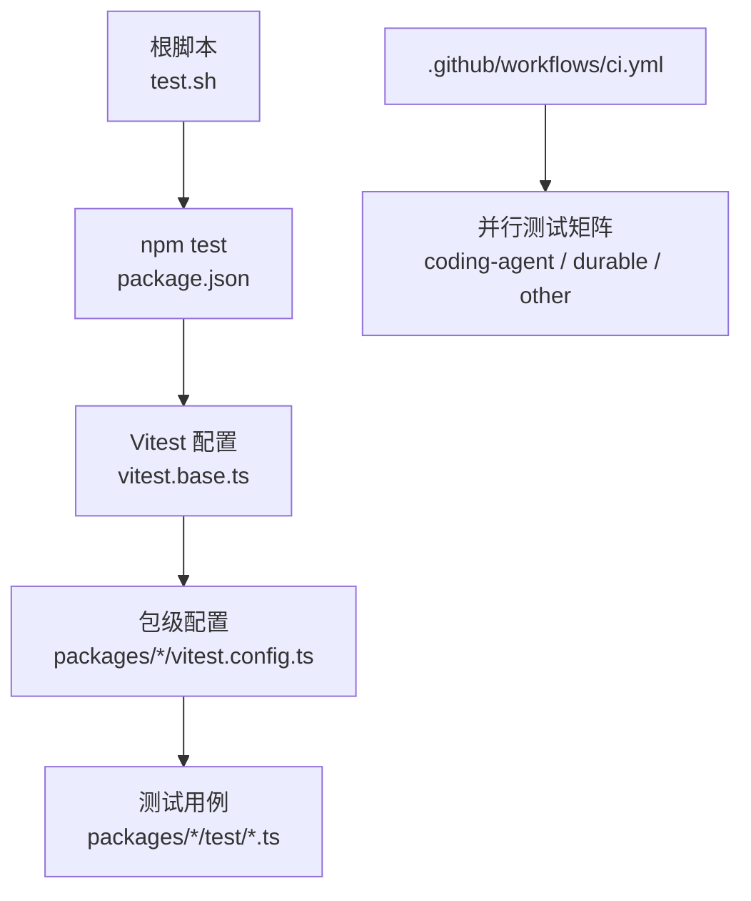
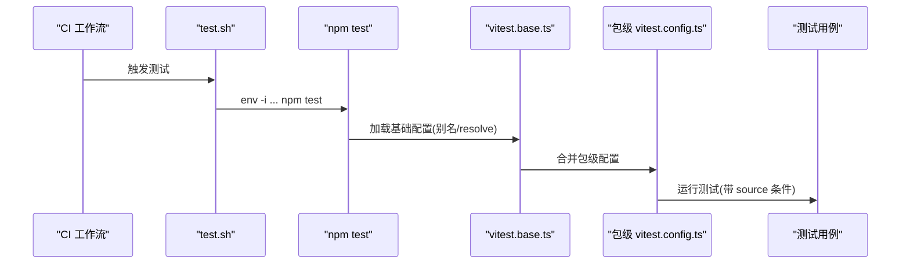
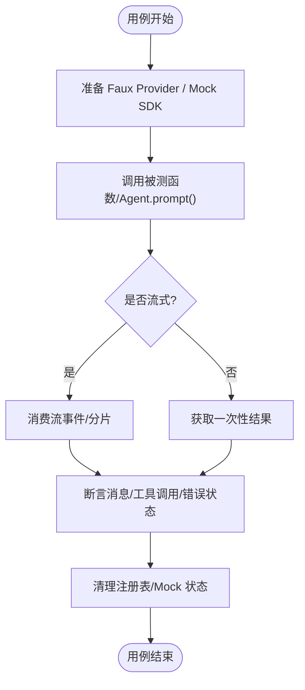
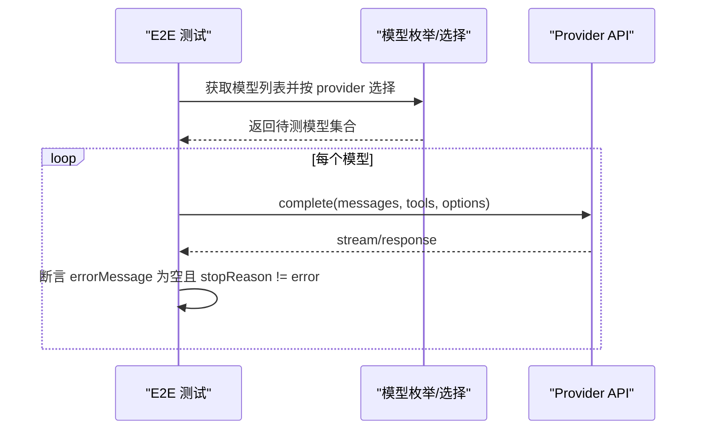
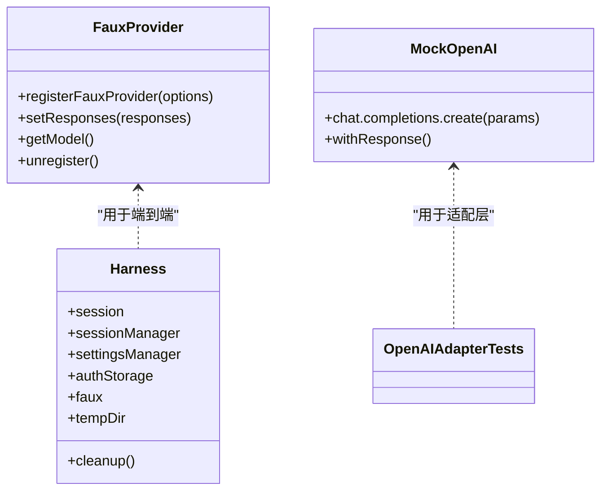
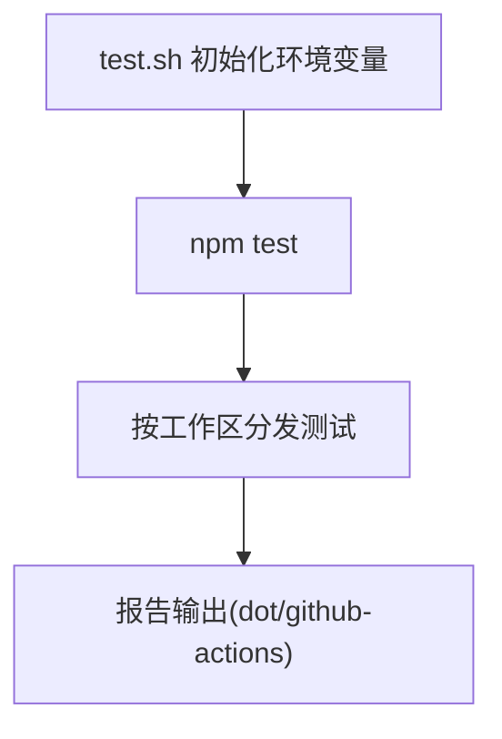
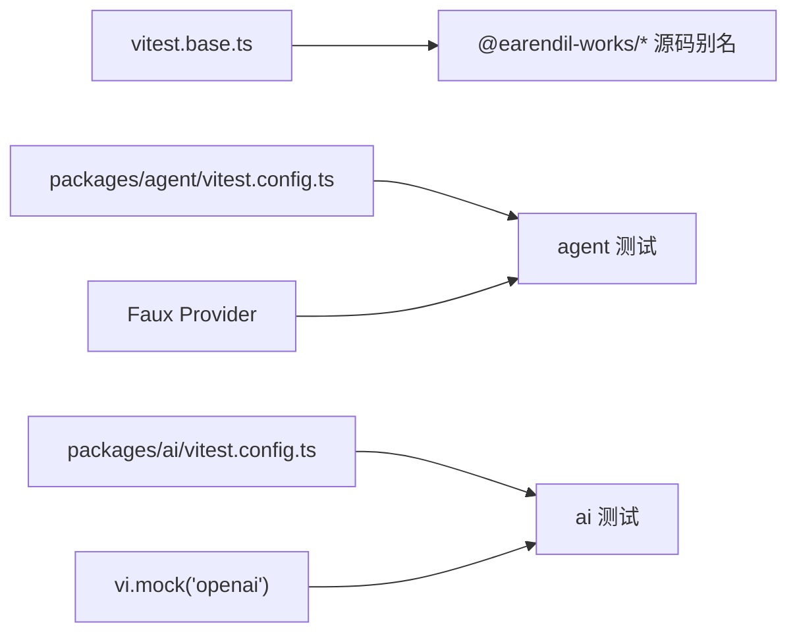

# 测试指南

<cite>
**本文引用的文件**   
- [README.md](https://github.com/FDE-GROUP/oh-my-coding-agent/blob/omca/README.md)
- [package.json](https://github.com/FDE-GROUP/oh-my-coding-agent/blob/omca/package.json)
- [vitest.base.ts](https://github.com/FDE-GROUP/oh-my-coding-agent/blob/omca/vitest.base.ts)
- [packages/agent/vitest.config.ts](https://github.com/FDE-GROUP/oh-my-coding-agent/blob/omca/packages/agent/vitest.config.ts)
- [packages/ai/vitest.config.ts](https://github.com/FDE-GROUP/oh-my-coding-agent/blob/omca/packages/ai/vitest.config.ts)
- [.github/workflows/ci.yml](https://github.com/FDE-GROUP/oh-my-coding-agent/blob/omca/.github/workflows/ci.yml)
- [test.sh](https://github.com/FDE-GROUP/oh-my-coding-agent/blob/omca/test.sh)
- [packages/agent/test/e2e.test.ts](https://github.com/FDE-GROUP/oh-my-coding-agent/blob/omca/packages/agent/test/e2e.test.ts)
- [packages/ai/test/anthropic-eager-tool-input-e2e.test.ts](https://github.com/FDE-GROUP/oh-my-coding-agent/blob/omca/packages/ai/test/anthropic-eager-tool-input-e2e.test.ts)
- [packages/ai/test/openai-completions-tool-choice.test.ts](https://github.com/FDE-GROUP/oh-my-coding-agent/blob/omca/packages/ai/test/openai-completions-tool-choice.test.ts)
- [packages/schema/test/conformance.test.ts](https://github.com/FDE-GROUP/oh-my-coding-agent/blob/omca/packages/schema/test/conformance.test.ts)
- [packages/coding-agent/test/suite/harness.ts](https://github.com/FDE-GROUP/oh-my-coding-agent/blob/omca/packages/coding-agent/test/suite/harness.ts)
</cite>

## 目录
1. [简介](#简介)
2. [项目结构](#项目结构)
3. [核心组件](#核心组件)
4. [架构总览](#架构总览)
5. [详细组件分析](#详细组件分析)
6. [依赖关系分析](#依赖关系分析)
7. [性能与并发测试注意事项](#性能与并发测试注意事项)
8. [故障排查指南](#故障排查指南)
9. [结论](#结论)
10. [附录](#附录)

## 简介
本指南面向 Pi 多包仓库的测试策略与实践，覆盖单元测试、集成测试、端到端测试与性能测试的实施方法；说明测试框架配置、Mock 策略、测试数据管理、测试环境搭建；并给出 LLM 相关测试的特殊处理、异步与并发测试注意事项、覆盖率建议与持续集成配置。目标是让不同技术背景的读者都能理解并落地可靠的测试体系。

## 项目结构
仓库采用 monorepo 组织，测试以 Vitest 为主，根脚本统一入口，CI 将测试按工作区拆分并行执行。关键要点：
- 根脚本 test.sh 提供隔离环境运行 npm test，避免污染用户资源与凭据。
- 各包通过 vitest.config.ts 配置测试运行时、别名与 reporter。
- CI 使用矩阵任务并行执行 coding-agent、durable、other 三类测试集。
- README 提供了本地开发常用命令，包括构建、检查与测试。

图示来源
- [test.sh:1-85](https://github.com/FDE-GROUP/oh-my-coding-agent/blob/omca/test.sh#L1-L85)
- [package.json:12-40](https://github.com/FDE-GROUP/oh-my-coding-agent/blob/omca/package.json#L12-L40)
- [vitest.base.ts:45-96](https://github.com/FDE-GROUP/oh-my-coding-agent/blob/omca/vitest.base.ts#L45-L96)
- [packages/agent/vitest.config.ts:9-26](https://github.com/FDE-GROUP/oh-my-coding-agent/blob/omca/packages/agent/vitest.config.ts#L9-L26)
- [packages/ai/vitest.config.ts:6-19](https://github.com/FDE-GROUP/oh-my-coding-agent/blob/omca/packages/ai/vitest.config.ts#L6-L19)
- [.github/workflows/ci.yml:55-109](https://github.com/FDE-GROUP/oh-my-coding-agent/blob/omca/.github/workflows/ci.yml#L55-L109)

章节来源
- [README.md:102-111](https://github.com/FDE-GROUP/oh-my-coding-agent/blob/omca/README.md#L102-L111)
- [package.json:12-40](https://github.com/FDE-GROUP/oh-my-coding-agent/blob/omca/package.json#L12-L40)
- [test.sh:1-85](https://github.com/FDE-GROUP/oh-my-coding-agent/blob/omca/test.sh#L1-L85)
- [.github/workflows/ci.yml:55-109](https://github.com/FDE-GROUP/oh-my-coding-agent/blob/omca/.github/workflows/ci.yml#L55-L109)

## 核心组件
- 测试运行器与全局配置
  - Vitest 作为测试框架，根级 vitest.base.ts 集中定义 workspace 源路径别名，便于在测试中直接引用源码而非已编译产物。
  - 包级 vitest.config.ts 设置 globals、environment、testTimeout、reporter 等运行时参数，并在 resolve.conditions 中启用 source 条件以直连源码。
- 测试入口与环境隔离
  - test.sh 创建临时 HOME/TMPDIR/NPM 缓存目录，注入最小化环境变量（如 PI_NO_LOCAL_LLM=1），确保测试不依赖本地 LLM 或外部凭据。
- 持续集成
  - CI 矩阵任务并行执行测试，安装系统工具（fd、ripgrep）以满足部分工具类测试需求；对 MCP conformance 单独执行。

章节来源
- [vitest.base.ts:4-96](https://github.com/FDE-GROUP/oh-my-coding-agent/blob/omca/vitest.base.ts#L4-L96)
- [packages/agent/vitest.config.ts:9-26](https://github.com/FDE-GROUP/oh-my-coding-agent/blob/omca/packages/agent/vitest.config.ts#L9-L26)
- [packages/ai/vitest.config.ts:6-19](https://github.com/FDE-GROUP/oh-my-coding-agent/blob/omca/packages/ai/vitest.config.ts#L6-L19)
- [test.sh:1-85](https://github.com/FDE-GROUP/oh-my-coding-agent/blob/omca/test.sh#L1-L85)
- [.github/workflows/ci.yml:55-109](https://github.com/FDE-GROUP/oh-my-coding-agent/blob/omca/.github/workflows/ci.yml#L55-L109)

## 架构总览
下图展示从 CI 到具体测试执行的调用链，以及测试对源码别名的解析路径。

图示来源
- [.github/workflows/ci.yml:55-109](https://github.com/FDE-GROUP/oh-my-coding-agent/blob/omca/.github/workflows/ci.yml#L55-L109)
- [test.sh:1-85](https://github.com/FDE-GROUP/oh-my-coding-agent/blob/omca/test.sh#L1-L85)
- [vitest.base.ts:45-96](https://github.com/FDE-GROUP/oh-my-coding-agent/blob/omca/vitest.base.ts#L45-L96)
- [packages/agent/vitest.config.ts:9-26](https://github.com/FDE-GROUP/oh-my-coding-agent/blob/omca/packages/agent/vitest.config.ts#L9-L26)

## 详细组件分析

### 单元测试与集成测试实践
- Agent 层集成测试
  - 使用 faux provider 模拟 LLM 响应，验证 Agent 的消息流、工具调用、中止、状态事件与多轮对话上下文保持。
  - 通过 afterEach 清理注册表，避免跨用例污染。
  - 断言重点：消息角色顺序、toolResult 内容、pendingToolCalls 生命周期、abort 后的 stopReason 与 errorMessage。
- OpenAI Completions 适配层测试
  - 使用 vi.mock 替换 openai SDK，捕获请求参数与流式分片，校验 tool_choice、strict mode、reasoning_effort、finish_reason 映射等。
  - 通过 onPayload 回调捕获实际构造的 API 载荷，断言兼容字段是否按模型 compat 正确注入。
- Schema 合规性测试
  - 基于 JSON Schema Test Suite 驱动，逐组断言 check 与 errors 一致性，支持 known failures 标记。

图示来源
- [packages/agent/test/e2e.test.ts:18-37](https://github.com/FDE-GROUP/oh-my-coding-agent/blob/omca/packages/agent/test/e2e.test.ts#L18-L37)
- [packages/agent/test/e2e.test.ts:39-162](https://github.com/FDE-GROUP/oh-my-coding-agent/blob/omca/packages/agent/test/e2e.test.ts#L39-L162)
- [packages/ai/test/openai-completions-tool-choice.test.ts:23-64](https://github.com/FDE-GROUP/oh-my-coding-agent/blob/omca/packages/ai/test/openai-completions-tool-choice.test.ts#L23-L64)
- [packages/schema/test/conformance.test.ts:24-51](https://github.com/FDE-GROUP/oh-my-coding-agent/blob/omca/packages/schema/test/conformance.test.ts#L24-L51)

章节来源
- [packages/agent/test/e2e.test.ts:18-417](https://github.com/FDE-GROUP/oh-my-coding-agent/blob/omca/packages/agent/test/e2e.test.ts#L18-L417)
- [packages/ai/test/openai-completions-tool-choice.test.ts:23-800](https://github.com/FDE-GROUP/oh-my-coding-agent/blob/omca/packages/ai/test/openai-completions-tool-choice.test.ts#L23-L800)
- [packages/schema/test/conformance.test.ts:24-51](https://github.com/FDE-GROUP/oh-my-coding-agent/blob/omca/packages/schema/test/conformance.test.ts#L24-L51)

### 端到端测试（LLM 真实调用）
- Anthropic eager tool input streaming E2E
  - 动态枚举所有 anthropic-messages 模型，按 provider 去重选择代表性模型进行探测。
  - 使用 skipIf(!apiKey) 跳过无凭据场景，并通过 retry 提升稳定性。
  - 断言 response.errorMessage 为空且 stopReason 非 error，验证工具流式输入被接受。
- 跨提供商交接（示例）
  - 预生成会话上下文 fixture，再针对目标 provider/model 对进行 handoff 测试，若无足够 fixture 则跳过。

图示来源
- [packages/ai/test/anthropic-eager-tool-input-e2e.test.ts:39-85](https://github.com/FDE-GROUP/oh-my-coding-agent/blob/omca/packages/ai/test/anthropic-eager-tool-input-e2e.test.ts#L39-L85)
- [packages/ai/test/anthropic-eager-tool-input-e2e.test.ts:97-155](https://github.com/FDE-GROUP/oh-my-coding-agent/blob/omca/packages/ai/test/anthropic-eager-tool-input-e2e.test.ts#L97-L155)

章节来源
- [packages/ai/test/anthropic-eager-tool-input-e2e.test.ts:1-156](https://github.com/FDE-GROUP/oh-my-coding-agent/blob/omca/packages/ai/test/anthropic-eager-tool-input-e2e.test.ts#L1-L156)

### Mock 策略与测试数据管理
- 第三方 SDK Mock
  - 使用 vi.mock 替换 openai 模块，构造可迭代的流对象，记录 lastParams/chunks，用于断言请求参数与流行为。
- Faux Provider
  - 通过 registerFauxProvider 注册虚拟模型，setResponses 控制响应序列，支持 thinking/toolCall/text 等多类型块。
  - 在 afterEach 中统一 unregister，避免跨用例状态泄漏。
- 测试数据与 Fixture
  - Schema 测试使用 JSON Schema Test Suite 的 fixtures。
  - 编码代理套件 harness 提供 tempDir、sessionManager、settingsManager、authStorage 等基础设施，便于端到端场景复用。

图示来源
- [packages/agent/test/e2e.test.ts:18-37](https://github.com/FDE-GROUP/oh-my-coding-agent/blob/omca/packages/agent/test/e2e.test.ts#L18-L37)
- [packages/ai/test/openai-completions-tool-choice.test.ts:23-64](https://github.com/FDE-GROUP/oh-my-coding-agent/blob/omca/packages/ai/test/openai-completions-tool-choice.test.ts#L23-L64)
- [packages/coding-agent/test/suite/harness.ts:111-149](https://github.com/FDE-GROUP/oh-my-coding-agent/blob/omca/packages/coding-agent/test/suite/harness.ts#L111-L149)

章节来源
- [packages/agent/test/e2e.test.ts:18-37](https://github.com/FDE-GROUP/oh-my-coding-agent/blob/omca/packages/agent/test/e2e.test.ts#L18-L37)
- [packages/ai/test/openai-completions-tool-choice.test.ts:23-64](https://github.com/FDE-GROUP/oh-my-coding-agent/blob/omca/packages/ai/test/openai-completions-tool-choice.test.ts#L23-L64)
- [packages/coding-agent/test/suite/harness.ts:111-149](https://github.com/FDE-GROUP/oh-my-coding-agent/blob/omca/packages/coding-agent/test/suite/harness.ts#L111-L149)

### 测试环境搭建与运行
- 本地运行
  - 使用 test.sh 启动隔离环境，自动设置 HOME/TMPDIR/NPM 缓存、禁用 Git 交互、强制 UTC 时区、关闭 AWS 元数据访问，并透传 NODE_EXTRA_CA_CERTS 与 CI 检测变量。
  - 通过 PI_NO_LOCAL_LLM=1 禁止本地 LLM，确保测试不依赖本地模型。
- CI 运行
  - 安装 Node 22，npm ci --ignore-scripts 安装依赖，构建后按矩阵执行测试；必要时安装 fd/ripgrep。
  - MCP conformance 单独任务执行，保证协议兼容性回归。

图示来源
- [test.sh:39-84](https://github.com/FDE-GROUP/oh-my-coding-agent/blob/omca/test.sh#L39-L84)
- [.github/workflows/ci.yml:67-109](https://github.com/FDE-GROUP/oh-my-coding-agent/blob/omca/.github/workflows/ci.yml#L67-L109)

章节来源
- [test.sh:1-85](https://github.com/FDE-GROUP/oh-my-coding-agent/blob/omca/test.sh#L1-L85)
- [.github/workflows/ci.yml:67-109](https://github.com/FDE-GROUP/oh-my-coding-agent/blob/omca/.github/workflows/ci.yml#L67-L109)

### LLM 相关测试特殊处理
- 凭据与跳过策略
  - 大量测试使用 it.skipIf(!process.env.*_API_KEY) 或自定义 hasApiKey 判断，未配置凭据时自动跳过，避免 CI 失败。
- 重试与超时
  - E2E 用例常设置 retry 以提升网络波动下的稳定性；包级 vitest.config.ts 设置 testTimeout=30s 以适应 API 调用。
- 流式与中断
  - 通过 setTimeout 触发 agent.abort()，断言 stopReason 与 errorMessage，验证中断语义。
- 模型能力与兼容字段
  - 根据 model.compat 控制 strict mode、finish_reason、tool_stream、zaiToolStream、supportsEagerToolInputStreaming 等行为分支。

章节来源
- [packages/ai/test/anthropic-eager-tool-input-e2e.test.ts:134-155](https://github.com/FDE-GROUP/oh-my-coding-agent/blob/omca/packages/ai/test/anthropic-eager-tool-input-e2e.test.ts#L134-L155)
- [packages/agent/test/e2e.test.ts:103-129](https://github.com/FDE-GROUP/oh-my-coding-agent/blob/omca/packages/agent/test/e2e.test.ts#L103-L129)
- [packages/ai/test/openai-completions-tool-choice.test.ts:177-220](https://github.com/FDE-GROUP/oh-my-coding-agent/blob/omca/packages/ai/test/openai-completions-tool-choice.test.ts#L177-L220)
- [packages/ai/vitest.config.ts:6-19](https://github.com/FDE-GROUP/oh-my-coding-agent/blob/omca/packages/ai/vitest.config.ts#L6-L19)

### 异步测试模式与并发注意事项
- 异步流式处理
  - 使用 async iterator 消费流式分片，注意 finish_reason 缺失时的错误处理与 usage 统计。
- 并发与隔离
  - CI 矩阵任务并行执行不同工作区，避免慢用例阻塞；单用例内避免共享可变状态，必要时在 beforeEach/afterEach 重置 mockState。
- 资源清理
  - 清理临时目录、注销 Faux Provider、恢复 Mock，防止跨用例污染。

章节来源
- [packages/ai/test/openai-completions-tool-choice.test.ts:625-759](https://github.com/FDE-GROUP/oh-my-coding-agent/blob/omca/packages/ai/test/openai-completions-tool-choice.test.ts#L625-L759)
- [packages/agent/test/e2e.test.ts:33-37](https://github.com/FDE-GROUP/oh-my-coding-agent/blob/omca/packages/agent/test/e2e.test.ts#L33-L37)
- [.github/workflows/ci.yml:55-109](https://github.com/FDE-GROUP/oh-my-coding-agent/blob/omca/.github/workflows/ci.yml#L55-L109)

## 依赖关系分析
- 测试框架依赖
  - Vitest 为统一测试框架，根与包级配置文件共同决定解析行为与运行参数。
- 源码解析依赖
  - vitest.base.ts 集中维护 @earendil-works/* 包的源码别名，确保测试直接运行于源码之上，减少构建产物差异带来的不稳定。
- 外部依赖 Mock
  - openai SDK 通过 vi.mock 替换，避免真实网络调用；Faux Provider 替代真实 LLM 服务。

图示来源
- [vitest.base.ts:4-96](https://github.com/FDE-GROUP/oh-my-coding-agent/blob/omca/vitest.base.ts#L4-L96)
- [packages/agent/vitest.config.ts:9-26](https://github.com/FDE-GROUP/oh-my-coding-agent/blob/omca/packages/agent/vitest.config.ts#L9-L26)
- [packages/ai/vitest.config.ts:6-19](https://github.com/FDE-GROUP/oh-my-coding-agent/blob/omca/packages/ai/vitest.config.ts#L6-L19)
- [packages/ai/test/openai-completions-tool-choice.test.ts:23-64](https://github.com/FDE-GROUP/oh-my-coding-agent/blob/omca/packages/ai/test/openai-completions-tool-choice.test.ts#L23-L64)
- [packages/agent/test/e2e.test.ts:18-37](https://github.com/FDE-GROUP/oh-my-coding-agent/blob/omca/packages/agent/test/e2e.test.ts#L18-L37)

章节来源
- [vitest.base.ts:4-96](https://github.com/FDE-GROUP/oh-my-coding-agent/blob/omca/vitest.base.ts#L4-L96)
- [packages/agent/vitest.config.ts:9-26](https://github.com/FDE-GROUP/oh-my-coding-agent/blob/omca/packages/agent/vitest.config.ts#L9-L26)
- [packages/ai/vitest.config.ts:6-19](https://github.com/FDE-GROUP/oh-my-coding-agent/blob/omca/packages/ai/vitest.config.ts#L6-L19)

## 性能与并发测试注意事项
- 流式性能
  - 关注 finish_reason 缺失、null 分片、usage 统计准确性；对长流场景增加断言边界条件。
- 并发安全
  - 避免在多个并发用例间共享可变状态；对需要共享资源的场景使用独立实例或隔离目录。
- 重试与退避
  - 对网络敏感的用例设置合理 retry；必要时引入指数退避（若需扩展）。
- 资源限制
  - 在 CI 中为不同矩阵分配独立 runner，避免资源争用导致抖动。

[本节为通用指导，不直接分析具体文件]

## 故障排查指南
- 测试无法找到依赖
  - 确认 vitest.base.ts 中的别名是否正确指向源码路径；包级 vitest.config.ts 是否启用 conditions: ["source"]。
- 凭据缺失导致跳过
  - 检查环境变量（如 OPENAI_API_KEY、ANTHROPIC_*、GEMINI_* 等）是否注入；E2E 用例默认在无凭据时跳过。
- 流式结束异常
  - 检查 finish_reason 是否为空或非法值；参考 openai-completions 测试中对 finish_reason 的处理逻辑。
- 临时目录清理失败
  - 确认 test.sh 创建的临时目录权限与归属；CI 中确保 runner 有删除权限。

章节来源
- [vitest.base.ts:45-96](https://github.com/FDE-GROUP/oh-my-coding-agent/blob/omca/vitest.base.ts#L45-L96)
- [packages/ai/test/openai-completions-tool-choice.test.ts:625-759](https://github.com/FDE-GROUP/oh-my-coding-agent/blob/omca/packages/ai/test/openai-completions-tool-choice.test.ts#L625-L759)
- [test.sh:1-85](https://github.com/FDE-GROUP/oh-my-coding-agent/blob/omca/test.sh#L1-L85)

## 结论
本项目以 Vitest 为核心测试框架，结合根级 vitest.base.ts 与包级 vitest.config.ts 实现源码直连与稳定运行；通过 test.sh 提供强隔离的本地测试环境；CI 矩阵并行执行测试，保障快速反馈。针对 LLM 相关测试，广泛采用 Faux Provider 与 SDK Mock，配合 skipIf/retry 机制平衡稳定性与覆盖率。建议在新增功能时遵循“先单元、再集成、后 E2E”的分层策略，并对流式与并发场景补充边界用例。

[本节为总结性内容，不直接分析具体文件]

## 附录
- 覆盖率建议
  - 当前仓库未显式配置覆盖率收集；可在包级 vitest.config.ts 中启用 coverage（如 @vitest/coverage-v8），并设定最低阈值（例如行覆盖率≥80%、分支覆盖率≥70%），在 CI 中阻断低覆盖率提交。
- 持续集成增强
  - 在 CI 中增加覆盖率上报步骤（如 codecov/coveralls），并将覆盖率阈值纳入 PR Gate。
  - 对 E2E 用例增加凭据密钥管理与限流保护，避免频繁调用产生费用。

[本节为通用建议，不直接分析具体文件]