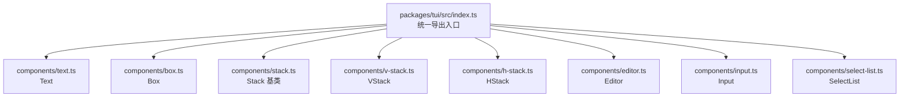
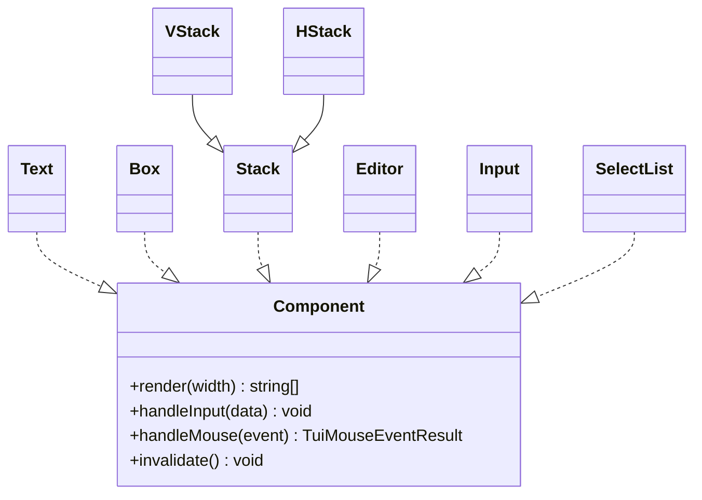
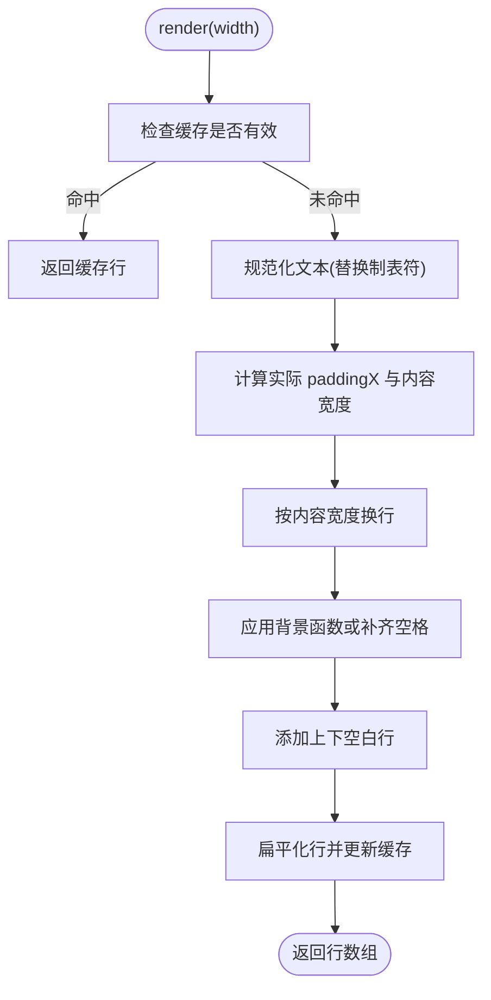
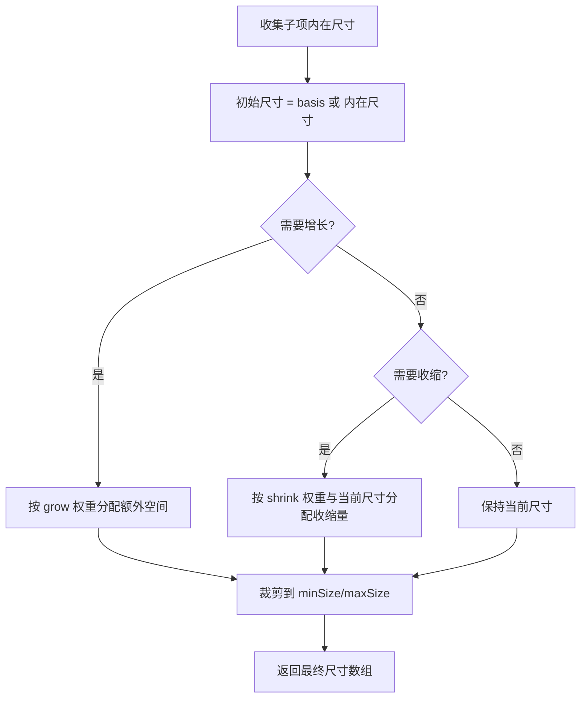
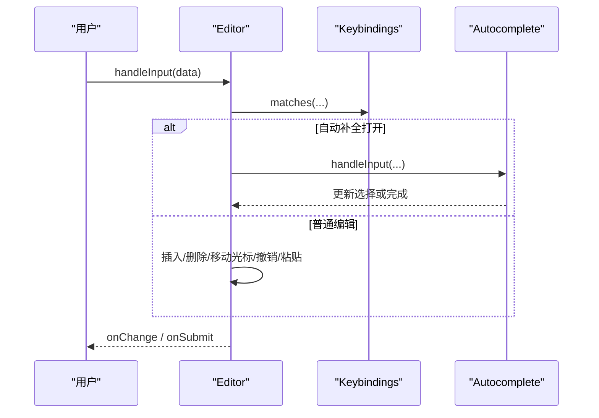
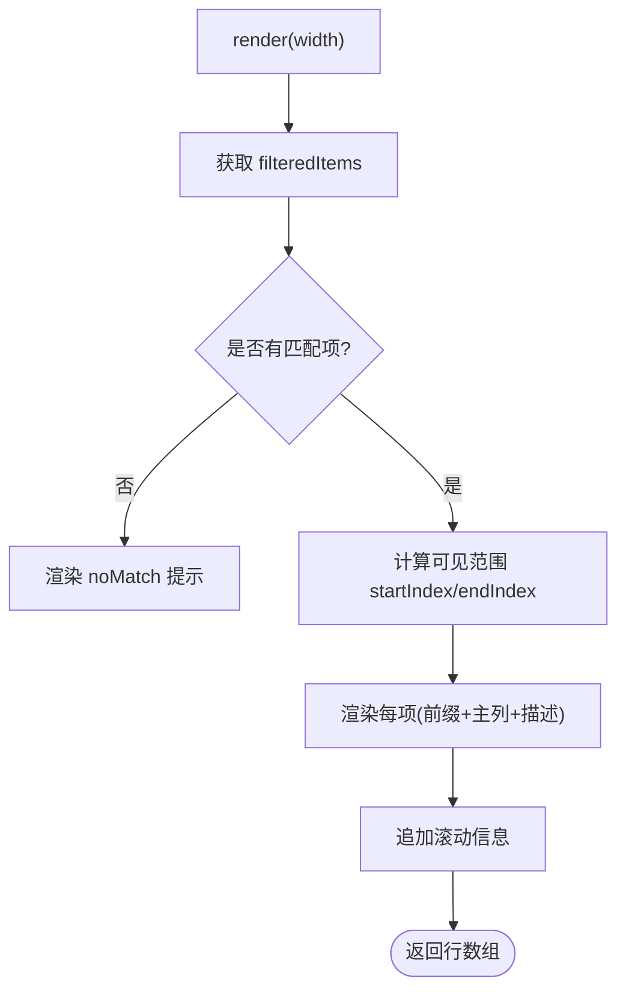
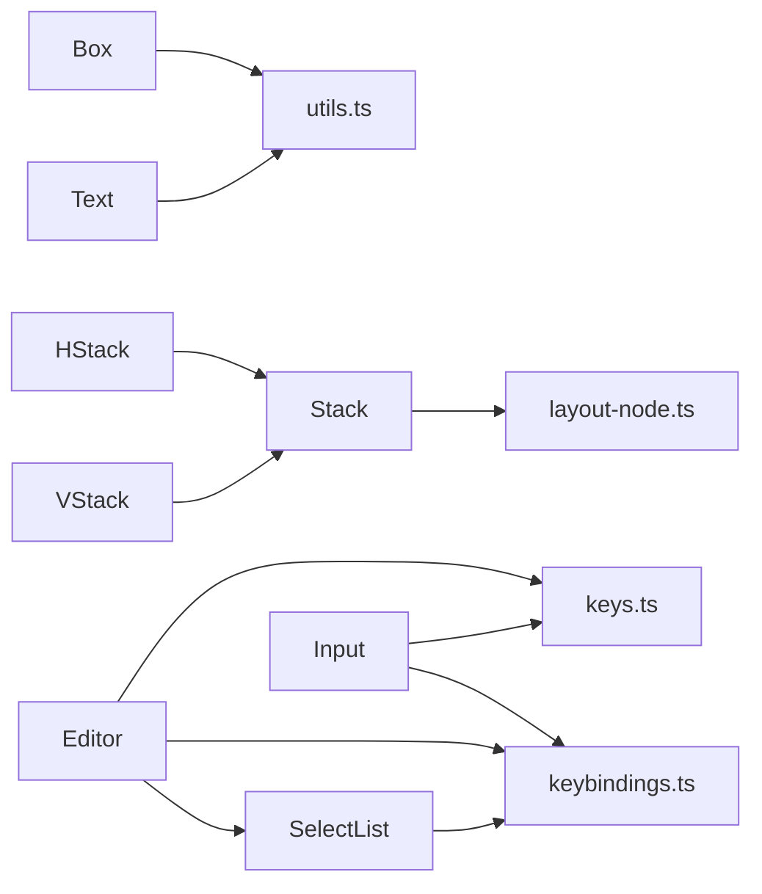
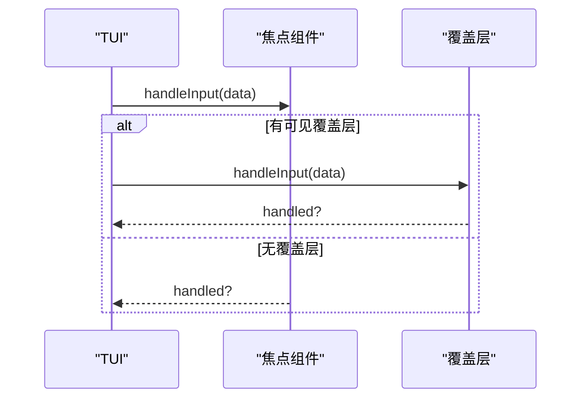

# UI组件库

<cite>
**本文引用的文件**   
- [packages/tui/README.md](https://github.com/FDE-GROUP/oh-my-fde/blob/omca/packages/tui/README.md)
- [packages/tui/src/index.ts](https://github.com/FDE-GROUP/oh-my-fde/blob/omca/packages/tui/src/index.ts)
- [packages/tui/src/components/text.ts](https://github.com/FDE-GROUP/oh-my-fde/blob/omca/packages/tui/src/components/text.ts)
- [packages/tui/src/components/box.ts](https://github.com/FDE-GROUP/oh-my-fde/blob/omca/packages/tui/src/components/box.ts)
- [packages/tui/src/components/stack.ts](https://github.com/FDE-GROUP/oh-my-fde/blob/omca/packages/tui/src/components/stack.ts)
- [packages/tui/src/components/v-stack.ts](https://github.com/FDE-GROUP/oh-my-fde/blob/omca/packages/tui/src/components/v-stack.ts)
- [packages/tui/src/components/h-stack.ts](https://github.com/FDE-GROUP/oh-my-fde/blob/omca/packages/tui/src/components/h-stack.ts)
- [packages/tui/src/components/editor.ts](https://github.com/FDE-GROUP/oh-my-fde/blob/omca/packages/tui/src/components/editor.ts)
- [packages/tui/src/components/input.ts](https://github.com/FDE-GROUP/oh-my-fde/blob/omca/packages/tui/src/components/input.ts)
- [packages/tui/src/components/select-list.ts](https://github.com/FDE-GROUP/oh-my-fde/blob/omca/packages/tui/src/components/select-list.ts)
</cite>

## 目录
1. [简介](#简介)
2. [项目结构](#项目结构)
3. [核心组件总览](#核心组件总览)
4. [架构总览](#架构总览)
5. [详细组件分析](#详细组件分析)
6. [依赖关系分析](#依赖关系分析)
7. [性能与渲染特性](#性能与渲染特性)
8. [组合模式与布局策略](#组合模式与布局策略)
9. [交互行为与事件模型](#交互行为与事件模型)
10. [使用示例与最佳实践](#使用示例与最佳实践)
11. [自定义组件开发指南](#自定义组件开发指南)
12. [故障排查](#故障排查)
13. [结论](#结论)

## 简介
本仓库中的 `@earendil-works/pi-tui` 是一个面向终端的轻量级 UI 框架，提供可组合的组件、差异渲染、主题定制、鼠标和键盘输入处理、覆盖层、滚动视图以及内联图像等能力。文档目标围绕以下内置组件展开：Text、Box、Stack（VStack/HStack）、Editor、Input、SelectList，并补充 Container、TruncatedText、Markdown、Loader、CancellableLoader、ScrollView、SettingsList、Spacer、Image、MouseRegion 等常用组件的使用说明。

该库强调：
- 统一的 `Component` 接口，便于扩展和组合。
- 基于 TUI 接口的渲染器抽象，支持主屏幕与备用屏幕两种模式。
- 通过主题函数对颜色、边框、选中态等进行样式定制。
- 在终端环境中实现无闪烁的同步输出与差异更新。

**章节来源**
- [packages/tui/README.md:1-17](https://github.com/FDE-GROUP/oh-my-fde/blob/omca/packages/tui/README.md#L1-L17)

## 项目结构
TUI 包的核心源码位于 `packages/tui/src`，其中：
- `src/components` 包含所有内置 UI 组件。
- `src/index.ts` 是对外导出的统一入口，集中导出组件、类型、工具函数、键盘与颜色模块、终端能力等。
- 其他文件如 `tui.ts`、`layout-node.ts`、`utils.ts`、`keybindings.ts`、`terminal-image.ts` 等提供运行时基础设施。



**图表来源**
- [packages/tui/src/index.ts:39-78](https://github.com/FDE-GROUP/oh-my-fde/blob/omca/packages/tui/src/index.ts#L39-L78)

**章节来源**
- [packages/tui/src/index.ts:1-198](https://github.com/FDE-GROUP/oh-my-fde/blob/omca/packages/tui/src/index.ts#L1-L198)

## 核心组件总览
| 组件 | 职责 | 关键属性与方法 | 典型用法 |
|---|---|---|---|
| Text | 多行文本显示，自动换行，支持左右上下内边距与背景函数 | `setText()`、`setCustomBgFn()`、`setPaddingX()`、`render(width)` | 展示说明文字、状态信息 |
| Box | 容器，为子组件添加统一内边距与背景色 | `addChild()`、`removeChild()`、`clear()`、`setBgFn()`、`setPaddingX()` | 包裹一组控件形成区块 |
| Stack(VStack/HStack) | 弹性布局容器，按垂直或水平方向分配空间 | `addChild(component, options)`、`gap`、`align`、`basis/grow/shrink/minSize/maxSize` | 构建表单、面板、标题栏 |
| Editor | 多行编辑器，支持自动补全、粘贴处理、历史、撤销、滚动 | `onSubmit`、`onChange`、`disableSubmit`、`setAutocompleteProvider()`、`setPaddingX()` | 命令输入、代码编辑、提示框 |
| Input | 单行输入框，支持光标移动、删除、粘贴、占位符、提交 | `getValue()`、`setValue()`、`onSubmit`、`onEscape` | 搜索框、参数输入 |
| SelectList | 可筛选的选择列表，支持键盘与鼠标交互 | `setFilter()`、`onSelect`、`onCancel`、`onSelectionChange` | 菜单、命令选择、选项面板 |

**章节来源**
- [packages/tui/README.md:364-690](https://github.com/FDE-GROUP/oh-my-fde/blob/omca/packages/tui/README.md#L364-L690)

## 架构总览
TUI 以 `Component` 接口为核心，所有 UI 元素都实现 `render(width)` 返回若干行字符串；可选实现 `handleInput()`、`handleMouse()`、`invalidate()`。TUI 运行时负责焦点管理、输入分发、渲染调度与差异更新。



**图表来源**
- [packages/tui/README.md:245-267](https://github.com/FDE-GROUP/oh-my-fde/blob/omca/packages/tui/README.md#L245-L267)
- [packages/tui/src/components/text.ts:7-115](https://github.com/FDE-GROUP/oh-my-fde/blob/omca/packages/tui/src/components/text.ts#L7-L115)
- [packages/tui/src/components/box.ts:14-172](https://github.com/FDE-GROUP/oh-my-fde/blob/omca/packages/tui/src/components/box.ts#L14-L172)
- [packages/tui/src/components/stack.ts:32-80](https://github.com/FDE-GROUP/oh-my-fde/blob/omca/packages/tui/src/components/stack.ts#L32-L80)
- [packages/tui/src/components/v-stack.ts:3-30](https://github.com/FDE-GROUP/oh-my-fde/blob/omca/packages/tui/src/components/v-stack.ts#L3-L30)
- [packages/tui/src/components/h-stack.ts:5-43](https://github.com/FDE-GROUP/oh-my-fde/blob/omca/packages/tui/src/components/h-stack.ts#L5-L43)
- [packages/tui/src/components/editor.ts:297-387](https://github.com/FDE-GROUP/oh-my-fde/blob/omca/packages/tui/src/components/editor.ts#L297-L387)
- [packages/tui/src/components/input.ts:32-60](https://github.com/FDE-GROUP/oh-my-fde/blob/omca/packages/tui/src/components/input.ts#L32-L60)
- [packages/tui/src/components/select-list.ts:40-60](https://github.com/FDE-GROUP/oh-my-fde/blob/omca/packages/tui/src/components/select-list.ts#L40-L60)

## 详细组件分析

### Text 组件
Text 用于显示多行文本，支持：
- 自动换行与 ANSI 样式保留。
- 左右内边距 `paddingX` 与上下内边距 `paddingY`。
- 可选背景函数 `customBgFn`，将整行填充背景。
- 缓存渲染结果以提升重复渲染性能。

API 要点：
- `constructor(text, paddingX=1, paddingY=1, customBgFn?)`
- `setText(text)`
- `setCustomBgFn(fn)`
- `setPaddingX(n)`
- `render(width)`

复杂度与性能：
- 换行与宽度计算基于可见宽度，避免 ANSI 转义影响视觉宽度。
- 缓存命中时直接返回已渲染行数组，减少重复计算。



**图表来源**
- [packages/tui/src/components/text.ts:52-113](https://github.com/FDE-GROUP/oh-my-fde/blob/omca/packages/tui/src/components/text.ts#L52-L113)

**章节来源**
- [packages/tui/src/components/text.ts:1-116](https://github.com/FDE-GROUP/oh-my-fde/blob/omca/packages/tui/src/components/text.ts#L1-L116)

### Box 组件
Box 是一个通用容器，为所有子组件统一添加内边距与背景色，同时转发鼠标事件到子组件。

API 要点：
- `constructor(paddingX=1, paddingY=1, bgFn?)`
- `addChild(component)`
- `removeChild(component)`
- `clear()`
- `setBgFn(fn)`
- `setPaddingX(n)`
- `render(width)`

设计要点：
- 内部维护渲染缓存，比较子行内容与背景采样值决定是否复用结果。
- 鼠标事件根据当前渲染几何进行命中测试，并将坐标转换到子组件局部坐标系。

```mermaid
sequenceDiagram
participant Parent as "父容器"
participant Box as "Box"
participant Child as "子组件"
Parent->>Box : handleMouse(event)
Box->>Box : 计算内容区域与偏移
Box->>Child : dispatchMouseEvent(child, localEvent)
Child-->>Box : 返回处理结果
Box-->>Parent : 返回处理结果
```

**图表来源**
- [packages/tui/src/components/box.ts:80-104](https://github.com/FDE-GROUP/oh-my-fde/blob/omca/packages/tui/src/components/box.ts#L80-L104)

**章节来源**
- [packages/tui/src/components/box.ts:1-173](https://github.com/FDE-GROUP/oh-my-fde/blob/omca/packages/tui/src/components/box.ts#L1-L173)

### Stack、VStack、HStack
Stack 是弹性布局基类，定义条目选项与尺寸分配算法；VStack 与 HStack 分别实现垂直与水平布局。

核心概念：
- `StackEntryOptions`: `basis`、`grow`、`shrink`、`minSize`、`maxSize`、`visible(viewport)`。
- `StackOptions`: `gap`、`align`。
- `allocateStackSizes(entries, intrinsicSizes, availableSize, gap)`：根据内在尺寸与可用空间分配最终尺寸。
- `visibleStackEntries(entries, viewport)`：根据 `visible` 回调过滤可见条目。

VStack：
- 每个子项占据一定行数，按 `gap` 插入空行。
- 对齐方式控制子项高度不足时的填充。

HStack：
- 每个子项占据一定列数，按 `gap` 插入列间距。
- 对齐方式控制子项高度不一致时的垂直对齐。



**图表来源**
- [packages/tui/src/components/stack.ts:95-154](https://github.com/FDE-GROUP/oh-my-fde/blob/omca/packages/tui/src/components/stack.ts#L95-L154)

**章节来源**
- [packages/tui/src/components/stack.ts:1-155](https://github.com/FDE-GROUP/oh-my-fde/blob/omca/packages/tui/src/components/stack.ts#L1-L155)
- [packages/tui/src/components/v-stack.ts:1-34](https://github.com/FDE-GROUP/oh-my-fde/blob/omca/packages/tui/src/components/v-stack.ts#L1-L34)
- [packages/tui/src/components/h-stack.ts:1-45](https://github.com/FDE-GROUP/oh-my-fde/blob/omca/packages/tui/src/components/h-stack.ts#L1-L45)

### Editor 组件
Editor 是多行编辑器，具备：
- 自动补全（斜杠命令与文件路径）。
- 大段粘贴标记与合并分段，保证光标与换行逻辑正确。
- 撤销栈与剪贴板环（KillRing）。
- 可视区域滚动与边界指示。
- IME 光标定位（硬件光标标记与虚拟光标）。

API 要点：
- `constructor(tui, theme, options?)`
- `onSubmit(text)`、`onChange(text)`
- `disableSubmit`
- `setAutocompleteProvider(provider)`
- `setPaddingX(n)`、`getPaddingX()`
- `setAutocompleteMaxVisible(n)`、`getAutocompleteMaxVisible()`

交互流程（输入处理）：


**图表来源**
- [packages/tui/src/components/editor.ts:701-800](https://github.com/FDE-GROUP/oh-my-fde/blob/omca/packages/tui/src/components/editor.ts#L701-L800)

**章节来源**
- [packages/tui/src/components/editor.ts:297-387](https://github.com/FDE-GROUP/oh-my-fde/blob/omca/packages/tui/src/components/editor.ts#L297-L387)
- [packages/tui/src/components/editor.ts:526-635](https://github.com/FDE-GROUP/oh-my-fde/blob/omca/packages/tui/src/components/editor.ts#L526-L635)
- [packages/tui/src/components/editor.ts:638-699](https://github.com/FDE-GROUP/oh-my-fde/blob/omca/packages/tui/src/components/editor.ts#L638-L699)

### Input 组件
Input 是单行输入框，具备：
- 占位符与占位符样式。
- 光标移动、单词导航、删除、粘贴。
- 撤销与剪贴板环。
- 提交与取消回调。

API 要点：
- `constructor(options?)`
- `getValue()`、`setValue(value)`
- `onSubmit(value)`、`onEscape()`
- `handleInput(data)`、`handleMouse(event)`

渲染特点：
- 当内容超出可用宽度时，根据光标位置决定可视窗口，实现横向滚动效果。
- 使用虚拟光标与硬件光标标记配合 IME 候选窗定位。

**章节来源**
- [packages/tui/src/components/input.ts:32-60](https://github.com/FDE-GROUP/oh-my-fde/blob/omca/packages/tui/src/components/input.ts#L32-L60)
- [packages/tui/src/components/input.ts:71-234](https://github.com/FDE-GROUP/oh-my-fde/blob/omca/packages/tui/src/components/input.ts#L71-L234)
- [packages/tui/src/components/input.ts:419-500](https://github.com/FDE-GROUP/oh-my-fde/blob/omca/packages/tui/src/components/input.ts#L419-L500)

### SelectList 组件
SelectList 是可筛选的选择列表，具备：
- 键盘导航（上/下/PageUp/PageDown/Enter/Esc）。
- 鼠标滚轮与点击选择。
- 可配置的主题函数，包括选中前缀、选中文本、描述、滚动信息与无匹配提示。
- 主列宽度自适应与截断策略。

API 要点：
- `constructor(items, maxVisible, theme, layout?)`
- `setFilter(filter)`
- `onSelect(item)`、`onCancel()`、`onSelectionChange(item)`
- `getSelectedItem()`

渲染流程：


**图表来源**
- [packages/tui/src/components/select-list.ts:76-108](https://github.com/FDE-GROUP/oh-my-fde/blob/omca/packages/tui/src/components/select-list.ts#L76-L108)

**章节来源**
- [packages/tui/src/components/select-list.ts:1-282](https://github.com/FDE-GROUP/oh-my-fde/blob/omca/packages/tui/src/components/select-list.ts#L1-L282)

## 依赖关系分析
组件之间的依赖关系如下：
- Text、Box、Stack、VStack、HStack、Editor、Input、SelectList 均实现 `Component` 接口。
- Editor 依赖 `SelectList` 作为自动补全下拉列表。
- Stack 提供布局算法，被 VStack 与 HStack 复用。
- 所有组件依赖 `utils.ts` 提供的可见宽度、截断、ANSI 包装等工具。
- 输入与快捷键依赖 `keybindings.ts` 与 `keys.ts`。



**图表来源**
- [packages/tui/src/components/editor.ts:1-26](https://github.com/FDE-GROUP/oh-my-fde/blob/omca/packages/tui/src/components/editor.ts#L1-L26)
- [packages/tui/src/components/input.ts:1-14](https://github.com/FDE-GROUP/oh-my-fde/blob/omca/packages/tui/src/components/input.ts#L1-L14)
- [packages/tui/src/components/select-list.ts:1-3](https://github.com/FDE-GROUP/oh-my-fde/blob/omca/packages/tui/src/components/select-list.ts#L1-L3)
- [packages/tui/src/components/stack.ts:1-2](https://github.com/FDE-GROUP/oh-my-fde/blob/omca/packages/tui/src/components/stack.ts#L1-L2)

**章节来源**
- [packages/tui/src/components/editor.ts:1-26](https://github.com/FDE-GROUP/oh-my-fde/blob/omca/packages/tui/src/components/editor.ts#L1-L26)
- [packages/tui/src/components/input.ts:1-14](https://github.com/FDE-GROUP/oh-my-fde/blob/omca/packages/tui/src/components/input.ts#L1-L14)
- [packages/tui/src/components/select-list.ts:1-3](https://github.com/FDE-GROUP/oh-my-fde/blob/omca/packages/tui/src/components/select-list.ts#L1-L3)
- [packages/tui/src/components/stack.ts:1-2](https://github.com/FDE-GROUP/oh-my-fde/blob/omca/packages/tui/src/components/stack.ts#L1-L2)

## 性能与渲染特性
- 差异渲染：TUI 仅更新变化的行或视口行，避免全屏刷新。
- 同步输出：使用 CSI 2026 原子输出，防止闪烁。
- 缓存机制：Text、Box 等组件缓存渲染结果，减少重复计算。
- 可见宽度计算：避免 ANSI 转义影响布局判断。
- 自动补全去抖：Editor 对异步补全请求进行去抖与任务队列管理。

建议：
- 对频繁更新的组件，尽量复用颜色对象与样式函数，避免每帧创建新对象。
- 长文本使用 TruncatedText 或手动截断，避免超长行导致渲染异常。
- 在 AltScreen 模式下使用 VStack/HStack/ScrollView 构建固定视口布局，提升交互体验。

**章节来源**
- [packages/tui/README.md:745-755](https://github.com/FDE-GROUP/oh-my-fde/blob/omca/packages/tui/README.md#L745-L755)
- [packages/tui/src/components/text.ts:52-113](https://github.com/FDE-GROUP/oh-my-fde/blob/omca/packages/tui/src/components/text.ts#L52-L113)
- [packages/tui/src/components/box.ts:106-162](https://github.com/FDE-GROUP/oh-my-fde/blob/omca/packages/tui/src/components/box.ts#L106-L162)

## 组合模式与布局策略
推荐组合模式：
- 使用 Container 或 Box 包裹多个子组件，形成语义区块。
- 使用 VStack 组织纵向内容，使用 HStack 组织横向工具栏或标签行。
- 使用 ScrollView 包裹长内容，结合主滚动视图与嵌套滚动视图。
- 使用 MouseRegion 为非交互式组件增加鼠标行为。

布局策略：
- 优先使用 `basis` 指定基础尺寸，再用 `grow`/`shrink` 控制弹性。
- 使用 `minSize`/`maxSize` 约束极端情况下的尺寸。
- 使用 `visible(viewport)` 实现响应式显示。
- 在 AltScreen 中设置布局根节点，使 VStack/HStack/ScrollView 获得视口语义。

**章节来源**
- [packages/tui/README.md:119-164](https://github.com/FDE-GROUP/oh-my-fde/blob/omca/packages/tui/README.md#L119-L164)
- [packages/tui/src/components/stack.ts:4-22](https://github.com/FDE-GROUP/oh-my-fde/blob/omca/packages/tui/src/components/stack.ts#L4-L22)

## 交互行为与事件模型
- 键盘输入：通过 `handleInput(data)` 接收原始终端输入，结合 `matchesKey` 与 `Key` 常量进行匹配。
- 鼠标输入：通过 `handleMouse(event)` 接收标准化事件，支持 press/click/drag/move/release/wheel。
- 焦点管理：Focusable 组件可实现 IME 光标定位，TUI 会扫描 `CURSOR_MARKER` 并定位硬件光标。
- 覆盖层：Overlay 提供对话框、菜单等模态 UI，支持锚点定位、百分比定位、绝对定位与 margin。



**图表来源**
- [packages/tui/README.md:269-306](https://github.com/FDE-GROUP/oh-my-fde/blob/omca/packages/tui/README.md#L269-L306)
- [packages/tui/README.md:166-235](https://github.com/FDE-GROUP/oh-my-fde/blob/omca/packages/tui/README.md#L166-L235)

**章节来源**
- [packages/tui/README.md:245-336](https://github.com/FDE-GROUP/oh-my-fde/blob/omca/packages/tui/README.md#L245-L336)

## 使用示例与最佳实践
- 快速开始：创建 Terminal、构造 TUI、添加 Text 与 Editor、设置焦点、启动循环。
- 颜色与样式：使用 `parseColor`、`mixColors`、`styleText` 构建主题。
- 视口布局：在 AltScreen 中使用 VStack/ScrollView 构建聊天界面。
- 覆盖层：使用 `showOverlay` 显示对话框，并通过 `handle.unfocus()` 管理焦点。
- 自动补全：使用 `CombinedAutocompleteProvider` 支持斜杠命令与文件路径。

参考路径：
- [packages/tui/README.md:18-53](https://github.com/FDE-GROUP/oh-my-fde/blob/omca/packages/tui/README.md#L18-L53)
- [packages/tui/README.md:81-117](https://github.com/FDE-GROUP/oh-my-fde/blob/omca/packages/tui/README.md#L81-L117)
- [packages/tui/README.md:119-164](https://github.com/FDE-GROUP/oh-my-fde/blob/omca/packages/tui/README.md#L119-L164)
- [packages/tui/README.md:166-235](https://github.com/FDE-GROUP/oh-my-fde/blob/omca/packages/tui/README.md#L166-L235)
- [packages/tui/README.md:692-718](https://github.com/FDE-GROUP/oh-my-fde/blob/omca/packages/tui/README.md#L692-L718)

**章节来源**
- [packages/tui/README.md:18-718](https://github.com/FDE-GROUP/oh-my-fde/blob/omca/packages/tui/README.md#L18-L718)

## 自定义组件开发指南
实现步骤：
1. 实现 `Component` 接口：至少实现 `render(width)` 与 `invalidate()`。
2. 如需输入处理，实现 `handleInput(data)`。
3. 如需鼠标交互，实现 `handleMouse(event)`。
4. 如需 IME 支持，实现 `Focusable` 接口并在渲染中插入 `CURSOR_MARKER` 与 `renderFakeCursor`。
5. 若需捕获视口输入（如列表），设置 `capturesViewportInput = true`。

注意事项：
- 每行长度不得超过传入的 `width`，否则 TUI 会报错。
- 多行带样式的文本需逐行重新应用样式或使用 `wrapTextWithAnsi`。
- 容器组件若嵌入 Input/Editor，应传播 `focused` 状态以保证 IME 候选窗定位正确。

参考路径：
- [packages/tui/README.md:245-336](https://github.com/FDE-GROUP/oh-my-fde/blob/omca/packages/tui/README.md#L245-L336)

**章节来源**
- [packages/tui/README.md:245-336](https://github.com/FDE-GROUP/oh-my-fde/blob/omca/packages/tui/README.md#L245-L336)

## 故障排查
常见问题与建议：
- 文本超长导致渲染错误：确保每行不超过 `width`，使用 `truncateToWidth` 或 `wrapTextWithAnsi`。
- IME 候选窗错位：确保 Focusable 组件传播 `focused` 状态，并使用 `CURSOR_MARKER` 与 `renderFakeCursor`。
- 自动补全卡顿：合理设置 `autocompleteMaxVisible`，并对异步提供者进行去抖与任务队列管理。
- 鼠标事件不生效：确认组件实现了 `handleMouse`，且在 AltScreen 模式下启用鼠标捕获。
- 滚动视图行为异常：检查是否在 AltScreen 中设置了布局根节点，并确保 ScrollView 的 `follow`、`primary`、`overscroll` 配置符合预期。

参考路径：
- [packages/tui/README.md:269-306](https://github.com/FDE-GROUP/oh-my-fde/blob/omca/packages/tui/README.md#L269-L306)
- [packages/tui/README.md:119-164](https://github.com/FDE-GROUP/oh-my-fde/blob/omca/packages/tui/README.md#L119-L164)

**章节来源**
- [packages/tui/README.md:269-306](https://github.com/FDE-GROUP/oh-my-fde/blob/omca/packages/tui/README.md#L269-L306)
- [packages/tui/README.md:119-164](https://github.com/FDE-GROUP/oh-my-fde/blob/omca/packages/tui/README.md#L119-L164)

## 结论
本 UI 组件库以 `Component` 接口为核心，提供了 Text、Box、Stack、Editor、Input、SelectList 等常用组件，并配套了丰富的布局、交互、主题与工具能力。通过组合模式与弹性布局，开发者可以快速构建终端应用的用户界面。建议在 AltScreen 模式下使用 VStack/HStack/ScrollView 构建视口布局，合理使用覆盖层与焦点管理，以获得流畅的交互体验。对于自定义组件，遵循 Component/Focusable 接口规范，并注意行宽限制与样式逐行应用，即可稳定集成到现有体系中。