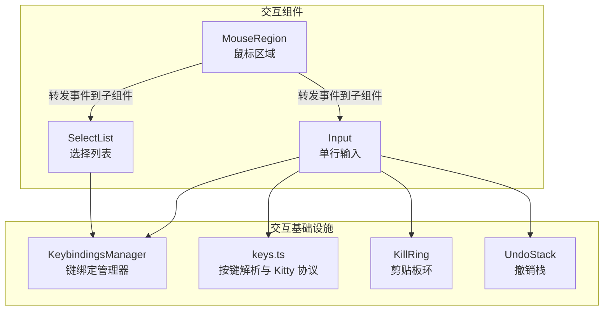
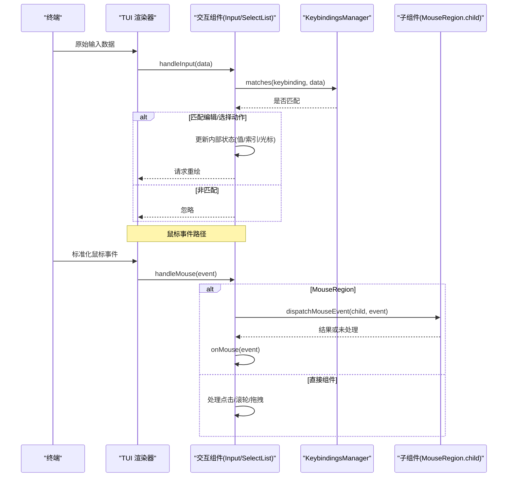
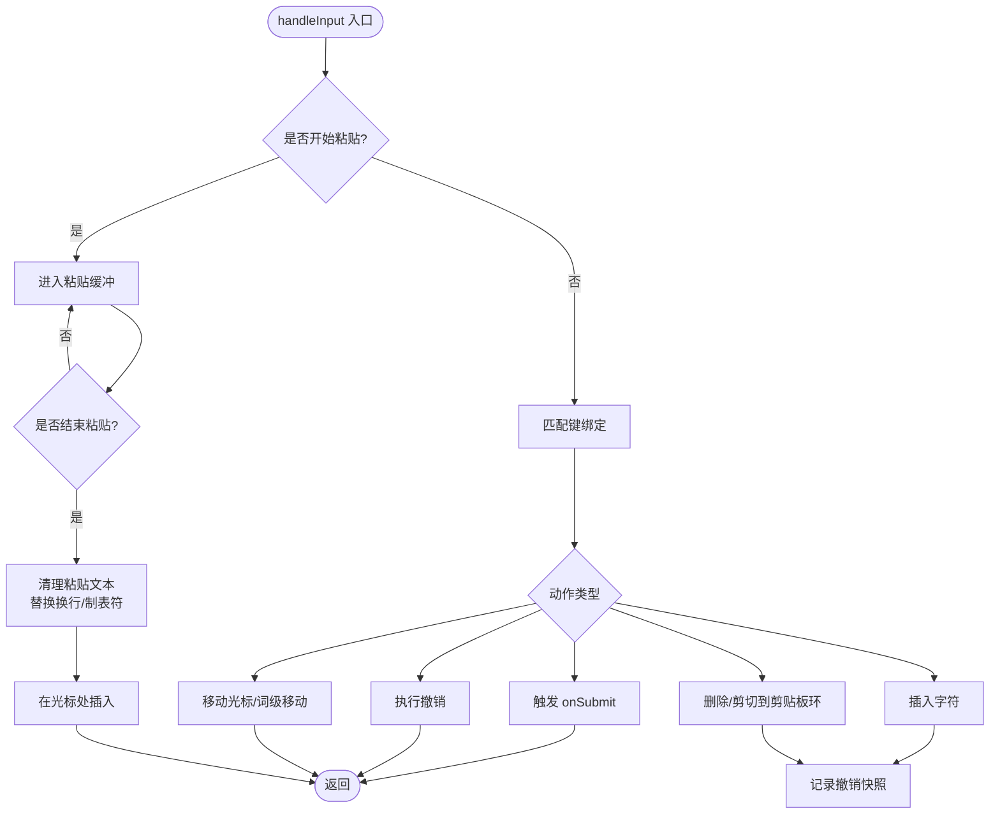
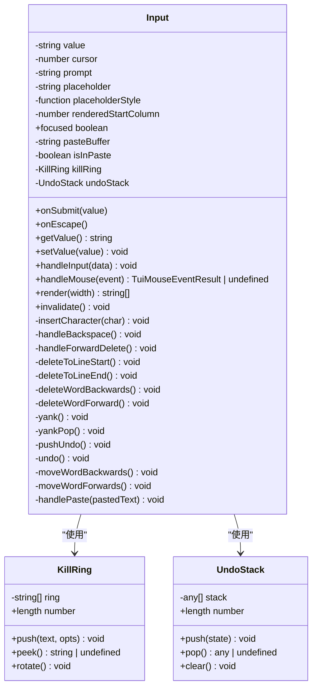
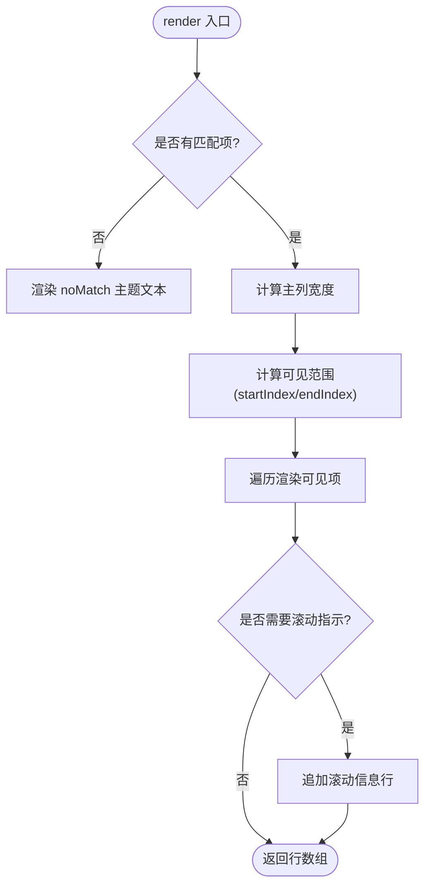
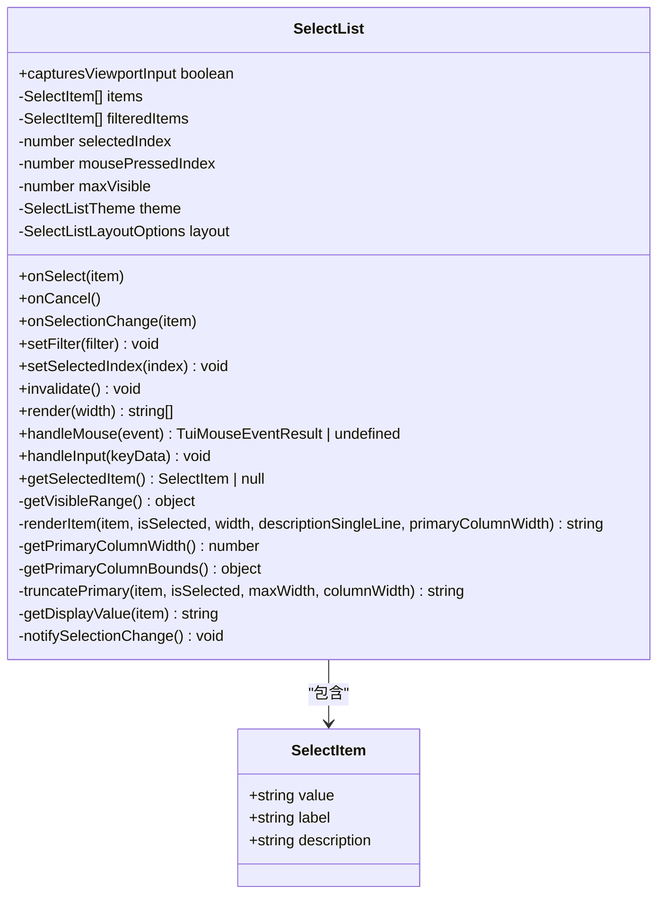
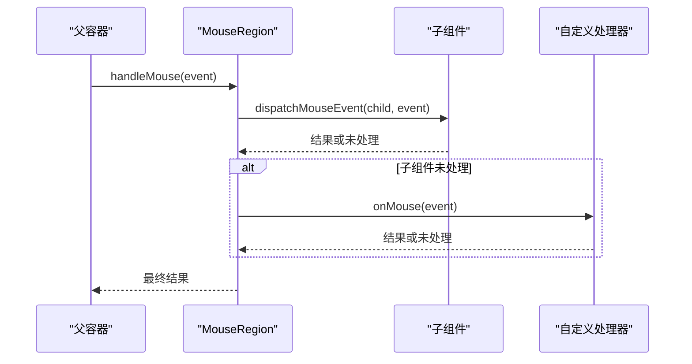
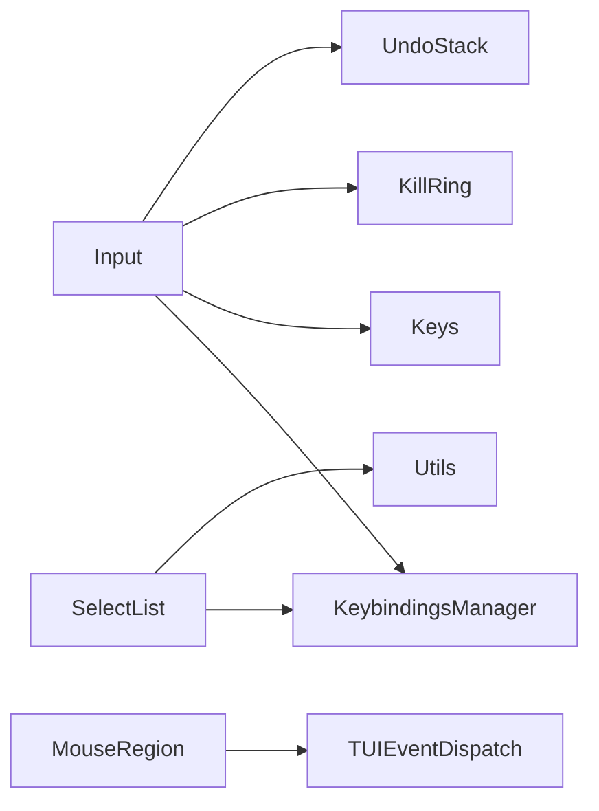

# 交互组件

<cite>
**本文引用的文件**   
- [packages/tui/src/components/input.ts](https://github.com/FDE-GROUP/oh-my-fde/blob/omca/packages/tui/src/components/input.ts)
- [packages/tui/src/components/select-list.ts](https://github.com/FDE-GROUP/oh-my-fde/blob/omca/packages/tui/src/components/select-list.ts)
- [packages/tui/src/components/mouse-region.ts](https://github.com/FDE-GROUP/oh-my-fde/blob/omca/packages/tui/src/components/mouse-region.ts)
- [packages/tui/src/keybindings.ts](https://github.com/FDE-GROUP/oh-my-fde/blob/omca/packages/tui/src/keybindings.ts)
- [packages/tui/src/keys.ts](https://github.com/FDE-GROUP/oh-my-fde/blob/omca/packages/tui/src/keys.ts)
- [packages/tui/src/kill-ring.ts](https://github.com/FDE-GROUP/oh-my-fde/blob/omca/packages/tui/src/kill-ring.ts)
- [packages/tui/src/undo-stack.ts](https://github.com/FDE-GROUP/oh-my-fde/blob/omca/packages/tui/src/undo-stack.ts)
- [packages/tui/README.md](https://github.com/FDE-GROUP/oh-my-fde/blob/omca/packages/tui/README.md)
</cite>

## 目录
1. [引言](#引言)
2. [项目结构](#项目结构)
3. [核心组件](#核心组件)
4. [架构总览](#架构总览)
5. [详细组件分析](#详细组件分析)
6. [依赖关系分析](#依赖关系分析)
7. [性能与可访问性](#性能与可访问性)
8. [使用示例与自定义指南](#使用示例与自定义指南)
9. [故障排查](#故障排查)
10. [结论](#结论)

## 引言
本文面向终端 TUI 框架中的用户交互组件，重点说明以下三类组件的实现细节、事件处理与状态管理：
- Input：单行文本输入，支持水平滚动、IME 光标定位、撤销重做、剪贴板环（Kill Ring）、粘贴模式。
- SelectList：带过滤、键盘导航、鼠标滚轮和点击的选择列表，支持主题化与主列宽度布局控制。
- MouseRegion：为任意已有组件添加鼠标行为而不改变其渲染输出。

文档同时覆盖输入验证策略、选择列表操作、鼠标区域监听、用户体验设计、键盘导航、焦点管理与无障碍支持，并提供使用示例与自定义交互逻辑实现指南。

## 项目结构
交互组件位于 TUI 包的 components 目录下，并依赖键绑定、按键解析、剪贴板环与撤销栈等通用能力。

**图表来源**
- [packages/tui/src/components/input.ts:1-502](https://github.com/FDE-GROUP/oh-my-fde/blob/omca/packages/tui/src/components/input.ts#L1-L502)
- [packages/tui/src/components/select-list.ts:1-282](https://github.com/FDE-GROUP/oh-my-fde/blob/omca/packages/tui/src/components/select-list.ts#L1-L282)
- [packages/tui/src/components/mouse-region.ts:1-34](https://github.com/FDE-GROUP/oh-my-fde/blob/omca/packages/tui/src/components/mouse-region.ts#L1-L34)
- [packages/tui/src/keybindings.ts:1-340](https://github.com/FDE-GROUP/oh-my-fde/blob/omca/packages/tui/src/keybindings.ts#L1-L340)
- [packages/tui/src/keys.ts:1-800](https://github.com/FDE-GROUP/oh-my-fde/blob/omca/packages/tui/src/keys.ts#L1-L800)
- [packages/tui/src/kill-ring.ts:1-47](https://github.com/FDE-GROUP/oh-my-fde/blob/omca/packages/tui/src/kill-ring.ts#L1-L47)
- [packages/tui/src/undo-stack.ts:1-29](https://github.com/FDE-GROUP/oh-my-fde/blob/omca/packages/tui/src/undo-stack.ts#L1-L29)

**章节来源**
- [packages/tui/src/components/input.ts:1-502](https://github.com/FDE-GROUP/oh-my-fde/blob/omca/packages/tui/src/components/input.ts#L1-L502)
- [packages/tui/src/components/select-list.ts:1-282](https://github.com/FDE-GROUP/oh-my-fde/blob/omca/packages/tui/src/components/select-list.ts#L1-L282)
- [packages/tui/src/components/mouse-region.ts:1-34](https://github.com/FDE-GROUP/oh-my-fde/blob/omca/packages/tui/src/components/mouse-region.ts#L1-L34)
- [packages/tui/src/keybindings.ts:1-340](https://github.com/FDE-GROUP/oh-my-fde/blob/omca/packages/tui/src/keybindings.ts#L1-L340)
- [packages/tui/src/keys.ts:1-800](https://github.com/FDE-GROUP/oh-my-fde/blob/omca/packages/tui/src/keys.ts#L1-L800)
- [packages/tui/src/kill-ring.ts:1-47](https://github.com/FDE-GROUP/oh-my-fde/blob/omca/packages/tui/src/kill-ring.ts#L1-L47)
- [packages/tui/src/undo-stack.ts:1-29](https://github.com/FDE-GROUP/oh-my-fde/blob/omca/packages/tui/src/undo-stack.ts#L1-L29)

## 核心组件
- Input：实现 Component 与 Focusable 接口，提供单行输入、水平滚动、IME 光标定位、撤销重做、剪贴板环、粘贴缓冲、键盘与鼠标交互。
- SelectList：实现 Component 接口，提供过滤、键盘导航、鼠标滚轮与点击、主题化渲染、主列宽度布局与滚动指示。
- MouseRegion：实现 Component 接口，将鼠标事件分派给子组件或自定义处理器，不改变子组件的渲染。

**章节来源**
- [packages/tui/src/components/input.ts:32-60](https://github.com/FDE-GROUP/oh-my-fde/blob/omca/packages/tui/src/components/input.ts#L32-L60)
- [packages/tui/src/components/select-list.ts:40-60](https://github.com/FDE-GROUP/oh-my-fde/blob/omca/packages/tui/src/components/select-list.ts#L40-L60)
- [packages/tui/src/components/mouse-region.ts:12-33](https://github.com/FDE-GROUP/oh-my-fde/blob/omca/packages/tui/src/components/mouse-region.ts#L12-L33)

## 架构总览
交互组件通过统一的 Component 接口与 TUI 渲染管线集成；键盘输入由 KeybindingsManager 统一匹配语义动作；鼠标事件由 TUI 归一化后分发至组件或其子区域。

**图表来源**
- [packages/tui/src/components/input.ts:71-234](https://github.com/FDE-GROUP/oh-my-fde/blob/omca/packages/tui/src/components/input.ts#L71-L234)
- [packages/tui/src/components/select-list.ts:110-178](https://github.com/FDE-GROUP/oh-my-fde/blob/omca/packages/tui/src/components/select-list.ts#L110-L178)
- [packages/tui/src/components/mouse-region.ts:21-28](https://github.com/FDE-GROUP/oh-my-fde/blob/omca/packages/tui/src/components/mouse-region.ts#L21-L28)
- [packages/tui/src/keybindings.ts:270-276](https://github.com/FDE-GROUP/oh-my-fde/blob/omca/packages/tui/src/keybindings.ts#L270-L276)

## 详细组件分析

### Input 组件
Input 是单行文本输入组件，具备以下特性：
- 状态管理
  - value：当前文本内容。
  - cursor：光标位置（按字符长度）。
  - renderedStartColumn：水平滚动起始列。
  - focused：Focusable 接口，用于 IME 光标定位。
  - pasteBuffer/isInPaste：Bracketed Paste 模式缓冲。
  - killRing：剪贴板环，支持 yank/yank-pop。
  - undoStack：撤销栈，保存 {value, cursor} 快照。
- 输入处理
  - 支持 Bracketed Paste 模式，自动清理换行与制表符。
  - 基于 KeybindingsManager 匹配语义动作：提交、取消、撤销、删除、移动、词级移动、粘贴等。
  - 支持 Kitty CSI-u 可打印字符解码。
  - 拒绝控制字符，仅接受可打印字符。
- 鼠标处理
  - 左键按下时根据可视列计算光标位置，并请求焦点。
- 渲染
  - 支持提示符、占位符样式、水平滚动、假光标与硬件光标标记。
  - 当内容超出可用宽度时，以光标为中心进行窗口滑动。

**图表来源**
- [packages/tui/src/components/input.ts:71-234](https://github.com/FDE-GROUP/oh-my-fde/blob/omca/packages/tui/src/components/input.ts#L71-L234)
- [packages/tui/src/components/input.ts:254-413](https://github.com/FDE-GROUP/oh-my-fde/blob/omca/packages/tui/src/components/input.ts#L254-L413)
- [packages/tui/src/kill-ring.ts:18-41](https://github.com/FDE-GROUP/oh-my-fde/blob/omca/packages/tui/src/kill-ring.ts#L18-L41)
- [packages/tui/src/undo-stack.ts:10-18](https://github.com/FDE-GROUP/oh-my-fde/blob/omca/packages/tui/src/undo-stack.ts#L10-L18)

#### Input 类图

**图表来源**
- [packages/tui/src/components/input.ts:32-502](https://github.com/FDE-GROUP/oh-my-fde/blob/omca/packages/tui/src/components/input.ts#L32-L502)
- [packages/tui/src/kill-ring.ts:8-47](https://github.com/FDE-GROUP/oh-my-fde/blob/omca/packages/tui/src/kill-ring.ts#L8-L47)
- [packages/tui/src/undo-stack.ts:7-29](https://github.com/FDE-GROUP/oh-my-fde/blob/omca/packages/tui/src/undo-stack.ts#L7-L29)

**章节来源**
- [packages/tui/src/components/input.ts:18-60](https://github.com/FDE-GROUP/oh-my-fde/blob/omca/packages/tui/src/components/input.ts#L18-L60)
- [packages/tui/src/components/input.ts:71-234](https://github.com/FDE-GROUP/oh-my-fde/blob/omca/packages/tui/src/components/input.ts#L71-L234)
- [packages/tui/src/components/input.ts:236-252](https://github.com/FDE-GROUP/oh-my-fde/blob/omca/packages/tui/src/components/input.ts#L236-L252)
- [packages/tui/src/components/input.ts:254-413](https://github.com/FDE-GROUP/oh-my-fde/blob/omca/packages/tui/src/components/input.ts#L254-L413)
- [packages/tui/src/components/input.ts:419-500](https://github.com/FDE-GROUP/oh-my-fde/blob/omca/packages/tui/src/components/input.ts#L419-L500)
- [packages/tui/src/kill-ring.ts:1-47](https://github.com/FDE-GROUP/oh-my-fde/blob/omca/packages/tui/src/kill-ring.ts#L1-L47)
- [packages/tui/src/undo-stack.ts:1-29](https://github.com/FDE-GROUP/oh-my-fde/blob/omca/packages/tui/src/undo-stack.ts#L1-L29)

### SelectList 组件
SelectList 提供交互式选择列表，支持：
- 过滤：setFilter 按 value 前缀过滤，重置选中项。
- 键盘导航：上下箭头、翻页、确认、取消。
- 鼠标交互：滚轮滚动、点击选择、悬停不改变选择。
- 主题化：selectedPrefix、selectedText、description、scrollInfo、noMatch。
- 布局：主列宽度最小/最大约束、截断策略回调。
- 可见范围：以选中项为中心显示固定行数，底部显示滚动信息。

**图表来源**
- [packages/tui/src/components/select-list.ts:76-108](https://github.com/FDE-GROUP/oh-my-fde/blob/omca/packages/tui/src/components/select-list.ts#L76-L108)
- [packages/tui/src/components/select-list.ts:180-188](https://github.com/FDE-GROUP/oh-my-fde/blob/omca/packages/tui/src/components/select-list.ts#L180-L188)
- [packages/tui/src/components/select-list.ts:191-228](https://github.com/FDE-GROUP/oh-my-fde/blob/omca/packages/tui/src/components/select-list.ts#L191-L228)

#### SelectList 类图

**图表来源**
- [packages/tui/src/components/select-list.ts:12-16](https://github.com/FDE-GROUP/oh-my-fde/blob/omca/packages/tui/src/components/select-list.ts#L12-L16)
- [packages/tui/src/components/select-list.ts:40-282](https://github.com/FDE-GROUP/oh-my-fde/blob/omca/packages/tui/src/components/select-list.ts#L40-L282)

**章节来源**
- [packages/tui/src/components/select-list.ts:12-60](https://github.com/FDE-GROUP/oh-my-fde/blob/omca/packages/tui/src/components/select-list.ts#L12-L60)
- [packages/tui/src/components/select-list.ts:62-108](https://github.com/FDE-GROUP/oh-my-fde/blob/omca/packages/tui/src/components/select-list.ts#L62-L108)
- [packages/tui/src/components/select-list.ts:110-178](https://github.com/FDE-GROUP/oh-my-fde/blob/omca/packages/tui/src/components/select-list.ts#L110-L178)
- [packages/tui/src/components/select-list.ts:180-282](https://github.com/FDE-GROUP/oh-my-fde/blob/omca/packages/tui/src/components/select-list.ts#L180-L282)

### MouseRegion 组件
MouseRegion 是一个轻量包装器，将鼠标事件优先分派给子组件；若子组件未处理，则调用传入的自定义处理器。它不改变子组件的渲染输出，适合在不侵入现有组件的情况下添加交互行为。

**图表来源**
- [packages/tui/src/components/mouse-region.ts:21-28](https://github.com/FDE-GROUP/oh-my-fde/blob/omca/packages/tui/src/components/mouse-region.ts#L21-L28)

**章节来源**
- [packages/tui/src/components/mouse-region.ts:1-34](https://github.com/FDE-GROUP/oh-my-fde/blob/omca/packages/tui/src/components/mouse-region.ts#L1-L34)

## 依赖关系分析
- Input 依赖：
  - KeybindingsManager：统一匹配语义键绑定（如 tui.editor.*、tui.input.*）。
  - keys.ts：Kitty 键盘协议与 legacy 序列解析、CSI-u 可打印字符解码。
  - KillRing：剪贴板环，支持累积删除与循环粘贴。
  - UndoStack：撤销栈，保存 {value, cursor} 快照。
- SelectList 依赖：
  - KeybindingsManager：选择导航与翻页。
  - utils.ts：文本宽度与截断工具。
- MouseRegion 依赖：
  - TUI 事件分发：dispatchMouseEvent。

**图表来源**
- [packages/tui/src/components/input.ts:1-15](https://github.com/FDE-GROUP/oh-my-fde/blob/omca/packages/tui/src/components/input.ts#L1-L15)
- [packages/tui/src/components/select-list.ts:1-4](https://github.com/FDE-GROUP/oh-my-fde/blob/omca/packages/tui/src/components/select-list.ts#L1-L4)
- [packages/tui/src/components/mouse-region.ts:1-7](https://github.com/FDE-GROUP/oh-my-fde/blob/omca/packages/tui/src/components/mouse-region.ts#L1-L7)
- [packages/tui/src/keybindings.ts:1-340](https://github.com/FDE-GROUP/oh-my-fde/blob/omca/packages/tui/src/keybindings.ts#L1-L340)
- [packages/tui/src/keys.ts:1-800](https://github.com/FDE-GROUP/oh-my-fde/blob/omca/packages/tui/src/keys.ts#L1-L800)
- [packages/tui/src/kill-ring.ts:1-47](https://github.com/FDE-GROUP/oh-my-fde/blob/omca/packages/tui/src/kill-ring.ts#L1-L47)
- [packages/tui/src/undo-stack.ts:1-29](https://github.com/FDE-GROUP/oh-my-fde/blob/omca/packages/tui/src/undo-stack.ts#L1-L29)

**章节来源**
- [packages/tui/src/components/input.ts:1-15](https://github.com/FDE-GROUP/oh-my-fde/blob/omca/packages/tui/src/components/input.ts#L1-L15)
- [packages/tui/src/components/select-list.ts:1-4](https://github.com/FDE-GROUP/oh-my-fde/blob/omca/packages/tui/src/components/select-list.ts#L1-L4)
- [packages/tui/src/components/mouse-region.ts:1-7](https://github.com/FDE-GROUP/oh-my-fde/blob/omca/packages/tui/src/components/mouse-region.ts#L1-L7)
- [packages/tui/src/keybindings.ts:1-340](https://github.com/FDE-GROUP/oh-my-fde/blob/omca/packages/tui/src/keybindings.ts#L1-L340)
- [packages/tui/src/keys.ts:1-800](https://github.com/FDE-GROUP/oh-my-fde/blob/omca/packages/tui/src/keys.ts#L1-L800)
- [packages/tui/src/kill-ring.ts:1-47](https://github.com/FDE-GROUP/oh-my-fde/blob/omca/packages/tui/src/kill-ring.ts#L1-L47)
- [packages/tui/src/undo-stack.ts:1-29](https://github.com/FDE-GROUP/oh-my-fde/blob/omca/packages/tui/src/undo-stack.ts#L1-L29)

## 性能与可访问性
- 性能
  - Input 使用图形段分割器与可视宽度计算，避免宽字符错位；水平滚动以光标为中心，减少不必要的重排。
  - SelectList 仅渲染可见范围，并通过主题函数与截断策略优化长文本展示。
  - MouseRegion 不重新渲染子组件，仅在必要时触发重绘。
- 可访问性与无障碍
  - Focusable 接口与 CURSOR_MARKER 使 IME 候选窗正确定位，提升多语言输入体验。
  - 键盘导航完整：Input 支持词级移动、行首尾、撤销重做；SelectList 支持上下、翻页、确认与取消。
  - 鼠标交互符合预期：Input 点击定位光标；SelectList 滚轮与点击选择；MouseRegion 允许无侵入式扩展。

**章节来源**
- [packages/tui/src/components/input.ts:419-500](https://github.com/FDE-GROUP/oh-my-fde/blob/omca/packages/tui/src/components/input.ts#L419-L500)
- [packages/tui/src/components/select-list.ts:76-108](https://github.com/FDE-GROUP/oh-my-fde/blob/omca/packages/tui/src/components/select-list.ts#L76-L108)
- [packages/tui/README.md:308-336](https://github.com/FDE-GROUP/oh-my-fde/blob/omca/packages/tui/README.md#L308-L336)

## 使用示例与自定义指南

### Input 使用要点
- 基本用法
  - 设置初始值与提交回调。
  - 获取当前值。
- 键盘快捷键
  - Enter 提交；Ctrl+A/E 行首尾；Ctrl+W/Alt+Backspace 删除词；Ctrl+U/K 删除到行首/尾；Ctrl+Left/Right 或 Alt+Left/Right 词级移动；方向键、退格、删除。
- 粘贴与剪贴板
  - 支持 Bracketed Paste 模式；剪贴板环支持 yank/yank-pop。
- 自定义
  - 可通过 placeholderStyle 定制占位符样式。
  - 通过 onEscape 与 onSubmit 实现业务逻辑。

参考路径：
- [packages/tui/README.md:417-438](https://github.com/FDE-GROUP/oh-my-fde/blob/omca/packages/tui/README.md#L417-L438)
- [packages/tui/src/components/input.ts:56-69](https://github.com/FDE-GROUP/oh-my-fde/blob/omca/packages/tui/src/components/input.ts#L56-L69)
- [packages/tui/src/components/input.ts:123-168](https://github.com/FDE-GROUP/oh-my-fde/blob/omca/packages/tui/src/components/input.ts#L123-L168)
- [packages/tui/src/components/input.ts:403-413](https://github.com/FDE-GROUP/oh-my-fde/blob/omca/packages/tui/src/components/input.ts#L403-L413)

### SelectList 使用要点
- 基本用法
  - 构造时传入选项数组、最大可见行数与主题。
  - 设置 onSelect/onCancel/onSelectionChange 回调。
  - 使用 setFilter 过滤，setSelectedIndex 控制选中项。
- 键盘与鼠标
  - 上下箭头导航；Enter 确认；Escape 取消；滚轮滚动；点击选择。
- 主题与布局
  - 自定义 selectedPrefix/selectedText/description/scrollInfo/noMatch。
  - 配置 minPrimaryColumnWidth/maxPrimaryColumnWidth 与 truncatePrimary 回调。

参考路径：
- [packages/tui/README.md:571-611](https://github.com/FDE-GROUP/oh-my-fde/blob/omca/packages/tui/README.md#L571-L611)
- [packages/tui/src/components/select-list.ts:54-60](https://github.com/FDE-GROUP/oh-my-fde/blob/omca/packages/tui/src/components/select-list.ts#L54-L60)
- [packages/tui/src/components/select-list.ts:62-70](https://github.com/FDE-GROUP/oh-my-fde/blob/omca/packages/tui/src/components/select-list.ts#L62-L70)
- [packages/tui/src/components/select-list.ts:110-178](https://github.com/FDE-GROUP/oh-my-fde/blob/omca/packages/tui/src/components/select-list.ts#L110-L178)
- [packages/tui/src/components/select-list.ts:230-268](https://github.com/FDE-GROUP/oh-my-fde/blob/omca/packages/tui/src/components/select-list.ts#L230-L268)

### MouseRegion 使用要点
- 为已有组件添加鼠标行为，不改变渲染。
- 在自定义处理器中判断事件类型与按钮，返回 handled 以阻止默认行为。

参考路径：
- [packages/tui/README.md:296-304](https://github.com/FDE-GROUP/oh-my-fde/blob/omca/packages/tui/README.md#L296-L304)
- [packages/tui/src/components/mouse-region.ts:12-33](https://github.com/FDE-GROUP/oh-my-fde/blob/omca/packages/tui/src/components/mouse-region.ts#L12-L33)

### 自定义交互逻辑实现指南
- 扩展键绑定
  - 通过 KeybindingsManager 注册或覆盖语义动作，确保组件内使用 kb.matches 匹配。
- 自定义输入验证
  - 在 Input.onSubmit 中执行业务校验，失败时提示或阻止提交。
- 自定义选择列表行为
  - 在 onSelectionChange 中实时预览；在 onSelect 中执行确认逻辑。
- 自定义鼠标区域
  - 使用 MouseRegion 包裹组件，在 onMouse 中实现展开/折叠、链接打开等。

参考路径：
- [packages/tui/src/keybindings.ts:231-307](https://github.com/FDE-GROUP/oh-my-fde/blob/omca/packages/tui/src/keybindings.ts#L231-L307)
- [packages/tui/src/components/input.ts:123-168](https://github.com/FDE-GROUP/oh-my-fde/blob/omca/packages/tui/src/components/input.ts#L123-L168)
- [packages/tui/src/components/select-list.ts:146-178](https://github.com/FDE-GROUP/oh-my-fde/blob/omca/packages/tui/src/components/select-list.ts#L146-L178)
- [packages/tui/src/components/mouse-region.ts:21-28](https://github.com/FDE-GROUP/oh-my-fde/blob/omca/packages/tui/src/components/mouse-region.ts#L21-L28)

## 故障排查
- 输入无法提交
  - 检查是否设置了 onSubmit 回调，以及 Enter 键绑定是否被覆盖。
  - 参考：[packages/tui/src/components/input.ts:123-127](https://github.com/FDE-GROUP/oh-my-fde/blob/omca/packages/tui/src/components/input.ts#L123-L127)
- 撤销无效
  - 确认使用了 pushUndo 与 undo 方法；检查 UndoStack 是否被清空。
  - 参考：[packages/tui/src/components/input.ts:379-389](https://github.com/FDE-GROUP/oh-my-fde/blob/omca/packages/tui/src/components/input.ts#L379-L389)
- 剪贴板环未生效
  - 确认删除操作调用了 killRing.push，且 yank/yank-pop 绑定了相应键。
  - 参考：[packages/tui/src/components/input.ts:290-377](https://github.com/FDE-GROUP/oh-my-fde/blob/omca/packages/tui/src/components/input.ts#L290-L377)
- 选择列表过滤不生效
  - 检查 setFilter 是否调用，且过滤逻辑基于 value 前缀。
  - 参考：[packages/tui/src/components/select-list.ts:62-66](https://github.com/FDE-GROUP/oh-my-fde/blob/omca/packages/tui/src/components/select-list.ts#L62-L66)
- 鼠标点击无效
  - 确认组件实现了 handleMouse，并返回 handled；或使用 MouseRegion 包裹。
  - 参考：[packages/tui/src/components/mouse-region.ts:21-28](https://github.com/FDE-GROUP/oh-my-fde/blob/omca/packages/tui/src/components/mouse-region.ts#L21-L28)

**章节来源**
- [packages/tui/src/components/input.ts:123-127](https://github.com/FDE-GROUP/oh-my-fde/blob/omca/packages/tui/src/components/input.ts#L123-L127)
- [packages/tui/src/components/input.ts:379-389](https://github.com/FDE-GROUP/oh-my-fde/blob/omca/packages/tui/src/components/input.ts#L379-L389)
- [packages/tui/src/components/input.ts:290-377](https://github.com/FDE-GROUP/oh-my-fde/blob/omca/packages/tui/src/components/input.ts#L290-L377)
- [packages/tui/src/components/select-list.ts:62-66](https://github.com/FDE-GROUP/oh-my-fde/blob/omca/packages/tui/src/components/select-list.ts#L62-L66)
- [packages/tui/src/components/mouse-region.ts:21-28](https://github.com/FDE-GROUP/oh-my-fde/blob/omca/packages/tui/src/components/mouse-region.ts#L21-L28)

## 结论
Input、SelectList 与 MouseRegion 构成了 TUI 交互层的核心：Input 提供健壮的文本输入与编辑能力；SelectList 提供直观的列表选择与导航；MouseRegion 提供无侵入的鼠标行为扩展。三者共同依赖键绑定、按键解析、剪贴板环与撤销栈等基础设施，形成一致、可测试、可扩展的交互模型。通过主题化、布局选项与回调机制，开发者可以灵活定制用户体验，同时保持代码清晰与性能可控。