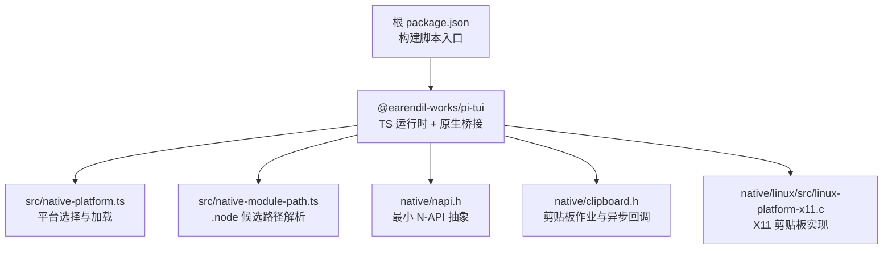
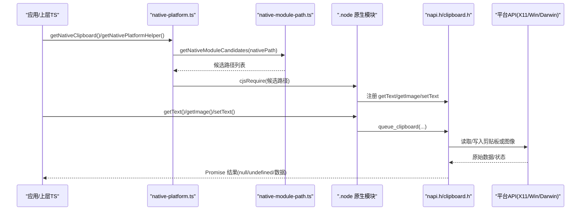
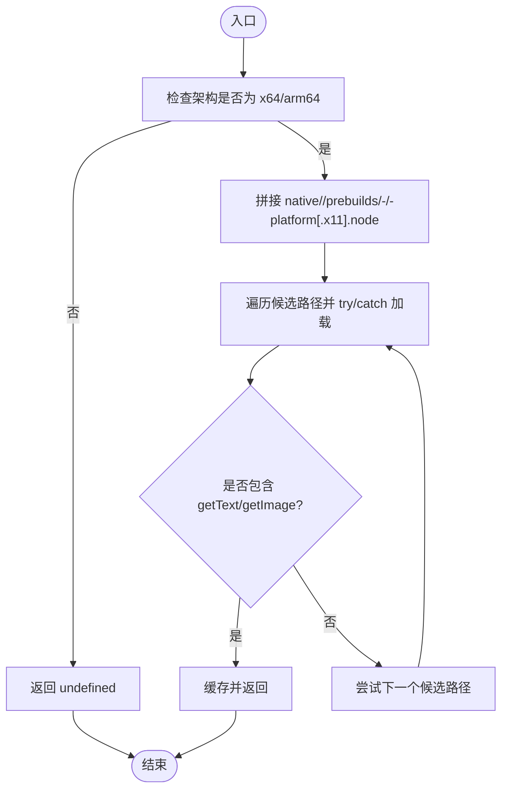
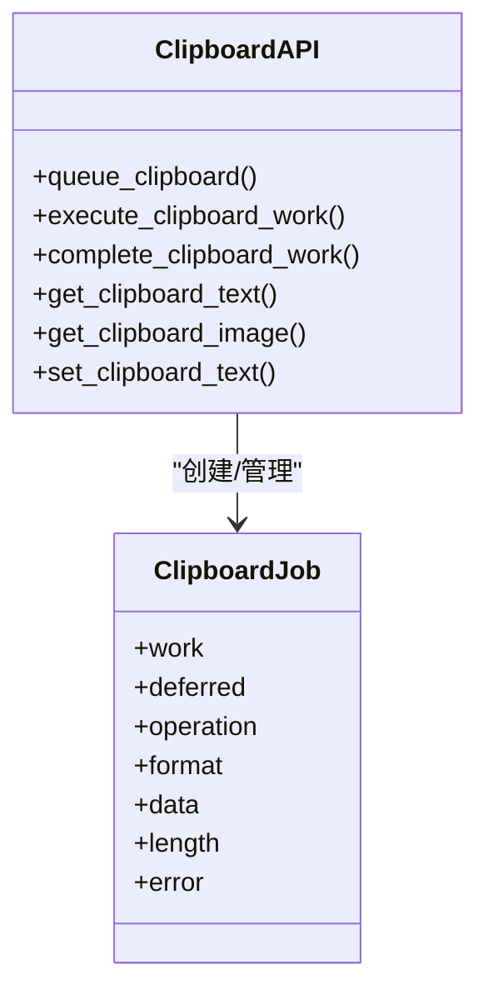
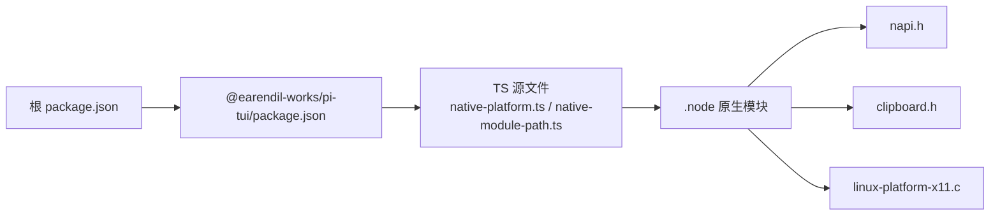
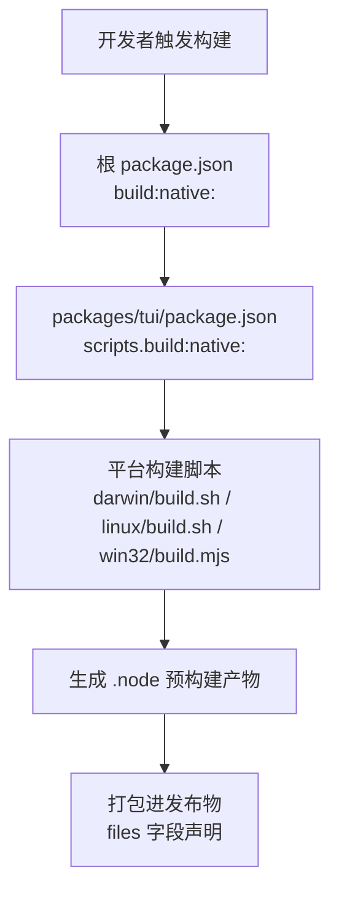

# 原生模块集成

<cite>
**本文引用的文件**   
- [README.md](https://github.com/FDE-GROUP/oh-my-fde/blob/omca/README.md)
- [package.json](https://github.com/FDE-GROUP/oh-my-fde/blob/omca/package.json)
- [packages/tui/package.json](https://github.com/FDE-GROUP/oh-my-fde/blob/omca/packages/tui/package.json)
- [packages/tui/src/native-platform.ts](https://github.com/FDE-GROUP/oh-my-fde/blob/omca/packages/tui/src/native-platform.ts)
- [packages/tui/src/native-module-path.ts](https://github.com/FDE-GROUP/oh-my-fde/blob/omca/packages/tui/src/native-module-path.ts)
- [packages/tui/native/napi.h](https://github.com/FDE-GROUP/oh-my-fde/blob/omca/packages/tui/native/napi.h)
- [packages/tui/native/clipboard.h](https://github.com/FDE-GROUP/oh-my-fde/blob/omca/packages/tui/native/clipboard.h)
- [packages/tui/native/linux/src/linux-platform-x11.c](https://github.com/FDE-GROUP/oh-my-fde/blob/omca/packages/tui/native/linux/src/linux-platform-x11.c)
</cite>

## 目录
1. [简介](#简介)
2. [项目结构](#项目结构)
3. [核心组件](#核心组件)
4. [架构总览](#架构总览)
5. [详细组件分析](#详细组件分析)
6. [依赖关系分析](#依赖关系分析)
7. [性能与并发特性](#性能与并发特性)
8. [跨平台差异与兼容性](#跨平台差异与兼容性)
9. [预构建二进制与编译流程](#预构建二进制与编译流程)
10. [故障排查指南](#故障排查指南)
11. [结论](#结论)

## 简介
本文件面向“原生模块集成”主题，聚焦于终端用户界面库中的原生能力：剪贴板读写、图像数据获取、键盘修饰键检测以及平台特定功能。文档从系统架构、组件职责、数据流、N-API 接口、平台适配层、预构建二进制和编译流程等维度进行说明，并覆盖 Windows、macOS、Linux 的差异处理与兼容性策略。

## 项目结构
该仓库为多包工作区，原生能力集中在 packages/tui 中，顶层 package.json 提供跨平台的原生构建脚本入口。关键路径如下：
- 顶层脚本：根 package.json 暴露 build:native:* 命令，统一调度各平台构建。
- TUI 包：packages/tui 包含 TypeScript 运行时与 native 原生代码（C/Objective-C）。
- 原生头文件：native/napi.h、native/clipboard.h 定义最小 N-API 抽象与剪贴板作业模型。
- 平台实现：darwin、win32、linux 各自拥有源码与预构建产物。

图表来源
- [package.json:12-18](https://github.com/FDE-GROUP/oh-my-fde/blob/omca/package.json#L12-L18)
- [packages/tui/package.json:7-14](https://github.com/FDE-GROUP/oh-my-fde/blob/omca/packages/tui/package.json#L7-L14)
- [packages/tui/src/native-platform.ts:28-65](https://github.com/FDE-GROUP/oh-my-fde/blob/omca/packages/tui/src/native-platform.ts#L28-L65)
- [packages/tui/src/native-module-path.ts:14-31](https://github.com/FDE-GROUP/oh-my-fde/blob/omca/packages/tui/src/native-module-path.ts#L14-L31)
- [packages/tui/native/napi.h:1-92](https://github.com/FDE-GROUP/oh-my-fde/blob/omca/packages/tui/native/napi.h#L1-L92)
- [packages/tui/native/clipboard.h:1-209](https://github.com/FDE-GROUP/oh-my-fde/blob/omca/packages/tui/native/clipboard.h#L1-L209)
- [packages/tui/native/linux/src/linux-platform-x11.c:254-274](https://github.com/FDE-GROUP/oh-my-fde/blob/omca/packages/tui/native/linux/src/linux-platform-x11.c#L254-L274)

章节来源
- [README.md:155-166](https://github.com/FDE-GROUP/oh-my-fde/blob/omca/README.md#L155-L166)
- [package.json:12-18](https://github.com/FDE-GROUP/oh-my-fde/blob/omca/package.json#L12-L18)
- [packages/tui/package.json:1-33](https://github.com/FDE-GROUP/oh-my-fde/blob/omca/packages/tui/package.json#L1-L33)

## 核心组件
- 平台选择与加载器
  - 负责根据 process.platform/arch 选择正确的 .node 模块，并在多种打包位置下尝试加载。
  - 在 macOS/Windows 上直接返回平台助手；在 Linux 上仅在存在 DISPLAY 环境变量时加载 X11 剪贴板辅助。
- 原生模块路径解析
  - 生成多个候选路径以兼容独立可执行、npm 包安装、相对路径等多种部署形态。
- N-API 抽象层
  - 通过动态符号解析避免链接期对 Node/Bun 的强依赖，仅使用最小 N-API 子集。
- 剪贴板作业框架
  - 定义统一的 clipboard_job 结构体，封装异步任务、格式、错误与结果序列化逻辑。
- 平台实现
  - Linux 使用 X11 访问剪贴板文本与图像；macOS/Windows 由各自平台源码实现（Objective-C/C）。

章节来源
- [packages/tui/src/native-platform.ts:7-23](https://github.com/FDE-GROUP/oh-my-fde/blob/omca/packages/tui/src/native-platform.ts#L7-L23)
- [packages/tui/src/native-platform.ts:28-65](https://github.com/FDE-GROUP/oh-my-fde/blob/omca/packages/tui/src/native-platform.ts#L28-L65)
- [packages/tui/src/native-module-path.ts:14-31](https://github.com/FDE-GROUP/oh-my-fde/blob/omca/packages/tui/src/native-module-path.ts#L14-L31)
- [packages/tui/native/napi.h:48-89](https://github.com/FDE-GROUP/oh-my-fde/blob/omca/packages/tui/native/napi.h#L48-L89)
- [packages/tui/native/clipboard.h:22-33](https://github.com/FDE-GROUP/oh-my-fde/blob/omca/packages/tui/native/clipboard.h#L22-L33)
- [packages/tui/native/linux/src/linux-platform-x11.c:254-274](https://github.com/FDE-GROUP/oh-my-fde/blob/omca/packages/tui/native/linux/src/linux-platform-x11.c#L254-L274)

## 架构总览
下图展示从 TypeScript 到原生模块的调用链：TS 层选择平台、构造 .node 路径、动态 require，随后进入 C 层的 N-API 导出函数，最终通过平台 API 完成剪贴板或图像操作。

图表来源
- [packages/tui/src/native-platform.ts:28-65](https://github.com/FDE-GROUP/oh-my-fde/blob/omca/packages/tui/src/native-platform.ts#L28-L65)
- [packages/tui/src/native-module-path.ts:14-31](https://github.com/FDE-GROUP/oh-my-fde/blob/omca/packages/tui/src/native-module-path.ts#L14-L31)
- [packages/tui/native/clipboard.h:141-205](https://github.com/FDE-GROUP/oh-my-fde/blob/omca/packages/tui/native/clipboard.h#L141-L205)
- [packages/tui/native/linux/src/linux-platform-x11.c:254-274](https://github.com/FDE-GROUP/oh-my-fde/blob/omca/packages/tui/native/linux/src/linux-platform-x11.c#L254-L274)

## 详细组件分析

### 平台选择与加载器（native-platform.ts）
- 职责
  - 根据 platform/arch 决定可用能力。
  - 在 macOS/Windows 上直接返回平台助手对象（含剪贴板与修饰键能力）。
  - 在 Linux 上仅在 DISPLAY 存在时加载 X11 剪贴板辅助。
- 关键点
  - 仅支持 x64/arm64 架构。
  - 使用缓存 Map 避免重复加载。
  - 通过 createRequire 动态加载 CommonJS 形式的 .node 模块。

图表来源
- [packages/tui/src/native-platform.ts:28-53](https://github.com/FDE-GROUP/oh-my-fde/blob/omca/packages/tui/src/native-platform.ts#L28-L53)

章节来源
- [packages/tui/src/native-platform.ts:7-23](https://github.com/FDE-GROUP/oh-my-fde/blob/omca/packages/tui/src/native-platform.ts#L7-L23)
- [packages/tui/src/native-platform.ts:28-65](https://github.com/FDE-GROUP/oh-my-fde/blob/omca/packages/tui/src/native-platform.ts#L28-L65)

### 原生模块路径解析（native-module-path.ts）
- 职责
  - 生成 .node 模块的候选路径集合，兼容 npm 包、独立可执行、相对路径等部署方式。
- 关键点
  - 优先尝试通过包名解析出安装目录，再拼接 native 路径。
  - 回退到当前模块目录、execPath 所在目录等常见位置。

章节来源
- [packages/tui/src/native-module-path.ts:1-31](https://github.com/FDE-GROUP/oh-my-fde/blob/omca/packages/tui/src/native-module-path.ts#L1-L31)

### N-API 抽象层（napi.h）
- 职责
  - 在不引入 Node/Bun 头文件的前提下，通过运行时符号解析获取 N-API 函数指针。
  - 提供统一的 fail/null/undefined 值创建与函数导出工具。
- 关键点
  - 使用 dlsym/GetProcAddress 动态查找 napi_* 符号。
  - 仅声明所需的最小函数类型，降低耦合与体积。

章节来源
- [packages/tui/native/napi.h:1-92](https://github.com/FDE-GROUP/oh-my-fde/blob/omca/packages/tui/native/napi.h#L1-L92)

### 剪贴板作业框架（clipboard.h）
- 数据结构
  - clipboard_job：封装异步工作句柄、Promise deferred、操作类型、数据格式、数据指针、长度与错误信息。
- 异步流程
  - queue_clipboard 创建异步工作并返回 Promise。
  - execute_clipboard_work 在 worker 线程执行平台相关逻辑。
  - complete_clipboard_work 将结果序列化为 JS 值并 resolve/reject。
- 数据格式
  - 支持空、UTF-8/LATIN1/UTF-16、二进制缓冲、路径数组等格式。
- 写剪贴板
  - 可选启用 PI_CLIPBOARD_WRITE 宏以暴露 setText 能力（Linux 侧通常通过命令行工具保持所有权）。

图表来源
- [packages/tui/native/clipboard.h:22-33](https://github.com/FDE-GROUP/oh-my-fde/blob/omca/packages/tui/native/clipboard.h#L22-L33)
- [packages/tui/native/clipboard.h:141-205](https://github.com/FDE-GROUP/oh-my-fde/blob/omca/packages/tui/native/clipboard.h#L141-L205)

章节来源
- [packages/tui/native/clipboard.h:1-209](https://github.com/FDE-GROUP/oh-my-fde/blob/omca/packages/tui/native/clipboard.h#L1-L209)

### Linux X11 剪贴板实现（linux-platform-x11.c）
- 职责
  - 打开 X11 剪贴板，读取文本或图像，设置合适的格式与长度，关闭连接。
- 导出
  - 注册 getText/getImage 两个 N-API 函数。
- 注意
  - 读取失败时设置错误消息；成功时按类型区分 UTF8/LATIN1/Buffer/Empty。

章节来源
- [packages/tui/native/linux/src/linux-platform-x11.c:254-274](https://github.com/FDE-GROUP/oh-my-fde/blob/omca/packages/tui/native/linux/src/linux-platform-x11.c#L254-L274)

## 依赖关系分析
- 顶层 package.json 提供跨平台构建脚本，分别转发到 packages/tui 的对应脚本。
- packages/tui/package.json 声明了 native 目录下的预构建产物与源码将被打包进发布物。
- TS 运行时依赖 native-platform.ts 与 native-module-path.ts 来定位并加载 .node 模块。
- 原生层依赖 napi.h 与 clipboard.h 提供的最小 N-API 抽象与作业框架。
- Linux 平台额外依赖 X11 库以访问剪贴板。

图表来源
- [package.json:12-18](https://github.com/FDE-GROUP/oh-my-fde/blob/omca/package.json#L12-L18)
- [packages/tui/package.json:7-33](https://github.com/FDE-GROUP/oh-my-fde/blob/omca/packages/tui/package.json#L7-L33)
- [packages/tui/src/native-platform.ts:28-65](https://github.com/FDE-GROUP/oh-my-fde/blob/omca/packages/tui/src/native-platform.ts#L28-L65)
- [packages/tui/src/native-module-path.ts:14-31](https://github.com/FDE-GROUP/oh-my-fde/blob/omca/packages/tui/src/native-module-path.ts#L14-L31)
- [packages/tui/native/napi.h:1-92](https://github.com/FDE-GROUP/oh-my-fde/blob/omca/packages/tui/native/napi.h#L1-L92)
- [packages/tui/native/clipboard.h:1-209](https://github.com/FDE-GROUP/oh-my-fde/blob/omca/packages/tui/native/clipboard.h#L1-L209)
- [packages/tui/native/linux/src/linux-platform-x11.c:254-274](https://github.com/FDE-GROUP/oh-my-fde/blob/omca/packages/tui/native/linux/src/linux-platform-x11.c#L254-L274)

章节来源
- [package.json:12-18](https://github.com/FDE-GROUP/oh-my-fde/blob/omca/package.json#L12-L18)
- [packages/tui/package.json:1-33](https://github.com/FDE-GROUP/oh-my-fde/blob/omca/packages/tui/package.json#L1-L33)

## 性能与并发特性
- 异步工作队列
  - 所有剪贴板操作通过 N-API 异步工作队列执行，避免阻塞主线程。
- 内存管理
  - 使用平台相关的分配/释放函数，确保在不同平台上正确释放缓冲区。
- 结果序列化
  - 在回调中将不同格式的数据转换为 JS 值（字符串、Uint8Array、路径数组），减少拷贝次数。
- 缓存
  - TS 层缓存已加载的平台助手，避免重复动态加载开销。

章节来源
- [packages/tui/native/clipboard.h:70-139](https://github.com/FDE-GROUP/oh-my-fde/blob/omca/packages/tui/native/clipboard.h#L70-L139)
- [packages/tui/src/native-platform.ts:25-53](https://github.com/FDE-GROUP/oh-my-fde/blob/omca/packages/tui/src/native-platform.ts#L25-L53)

## 跨平台差异与兼容性
- 平台选择
  - macOS/Windows：直接返回平台助手对象，具备 getText/getImage 及可能的修饰键检测能力。
  - Linux：仅在 DISPLAY 环境变量存在时加载 X11 剪贴板辅助；否则返回 undefined。
- 架构限制
  - 仅支持 x64 与 arm64，其他架构返回 undefined。
- 路径解析
  - 通过候选路径机制兼容独立可执行、npm 包、相对路径等多种部署场景。
- 剪贴板语义
  - Linux 侧通常通过命令行工具保持剪贴板所有权，因此 setText 可能不可用或行为不同。
- 预构建产物
  - 每个平台/架构组合提供独立的 .node 预构建文件，避免运行期编译。

章节来源
- [packages/tui/src/native-platform.ts:28-65](https://github.com/FDE-GROUP/oh-my-fde/blob/omca/packages/tui/src/native-platform.ts#L28-L65)
- [packages/tui/src/native-module-path.ts:14-31](https://github.com/FDE-GROUP/oh-my-fde/blob/omca/packages/tui/src/native-module-path.ts#L14-L31)
- [packages/tui/native/linux/src/linux-platform-x11.c:254-274](https://github.com/FDE-GROUP/oh-my-fde/blob/omca/packages/tui/native/linux/src/linux-platform-x11.c#L254-L274)

## 预构建二进制与编译流程
- 顶层脚本
  - 根 package.json 提供 build:native:darwin/linux/win32 三个命令，分别转发到 packages/tui 的对应脚本。
- TUI 包脚本
  - packages/tui/package.json 定义了各平台的原生构建脚本：
    - darwin: native/darwin/build.sh
    - linux: native/linux/build.sh
    - win32: node native/win32/build.mjs
- 发布物
  - packages/tui/package.json 的 files 字段声明了需要随包发布的 native 源码与预构建产物。
- 独立可执行
  - README 指出官方独立可执行归档中包含原生预构建产物，构建脚本会安装依赖并构建可执行及其运行时资源。

图表来源
- [package.json:16-18](https://github.com/FDE-GROUP/oh-my-fde/blob/omca/package.json#L16-L18)
- [packages/tui/package.json:7-14](https://github.com/FDE-GROUP/oh-my-fde/blob/omca/packages/tui/package.json#L7-L14)
- [packages/tui/package.json:16-33](https://github.com/FDE-GROUP/oh-my-fde/blob/omca/packages/tui/package.json#L16-L33)
- [README.md:155-166](https://github.com/FDE-GROUP/oh-my-fde/blob/omca/README.md#L155-L166)

章节来源
- [package.json:16-18](https://github.com/FDE-GROUP/oh-my-fde/blob/omca/package.json#L16-L18)
- [packages/tui/package.json:7-33](https://github.com/FDE-GROUP/oh-my-fde/blob/omca/packages/tui/package.json#L7-L33)
- [README.md:155-166](https://github.com/FDE-GROUP/oh-my-fde/blob/omca/README.md#L155-L166)

## 故障排查指南
- 无法加载 .node 模块
  - 现象：getNativePlatformHelper/getNativeClipboard 返回 undefined。
  - 排查要点：
    - 确认当前架构为 x64 或 arm64。
    - 检查 native/<platform>/prebuilds/<plat>-<arch>/<plat>-platform[.x11].node 是否存在。
    - 验证候选路径解析是否正确（独立可执行 vs npm 包）。
- Linux 剪贴板不可用
  - 现象：getNativeClipboard 返回 undefined。
  - 排查要点：
    - 确认 DISPLAY 环境变量已设置且指向可用的 X11 显示。
    - 确认已安装并加载 X11 相关依赖。
- 剪贴板操作失败
  - 现象：Promise 被拒绝或返回 null/undefined。
  - 排查要点：
    - 检查 clipboard_job.error 是否被设置。
    - 确认平台 API 调用是否成功（X11/Win/Darwin）。
    - 对于 Linux，注意 setText 可能不可用或行为受限于命令行工具。

章节来源
- [packages/tui/src/native-platform.ts:28-65](https://github.com/FDE-GROUP/oh-my-fde/blob/omca/packages/tui/src/native-platform.ts#L28-L65)
- [packages/tui/native/clipboard.h:102-139](https://github.com/FDE-GROUP/oh-my-fde/blob/omca/packages/tui/native/clipboard.h#L102-L139)
- [packages/tui/native/linux/src/linux-platform-x11.c:254-274](https://github.com/FDE-GROUP/oh-my-fde/blob/omca/packages/tui/native/linux/src/linux-platform-x11.c#L254-L274)

## 结论
本项目通过 TS 层平台选择与路径解析，结合最小 N-API 抽象与统一的剪贴板作业框架，实现了跨平台的剪贴板与图像能力。Windows、macOS、Linux 通过各自的平台源码与预构建二进制提供差异化实现。构建流程清晰，发布物包含必要的原生产物，便于在不同部署环境下稳定运行。针对常见问题，可通过架构检查、路径校验与环境变量配置快速定位与修复。