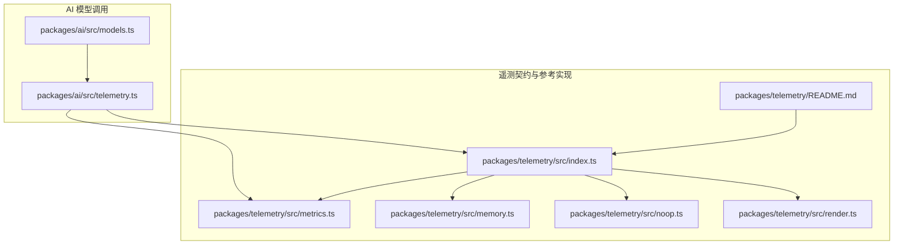
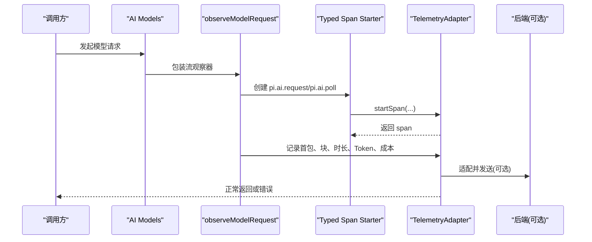
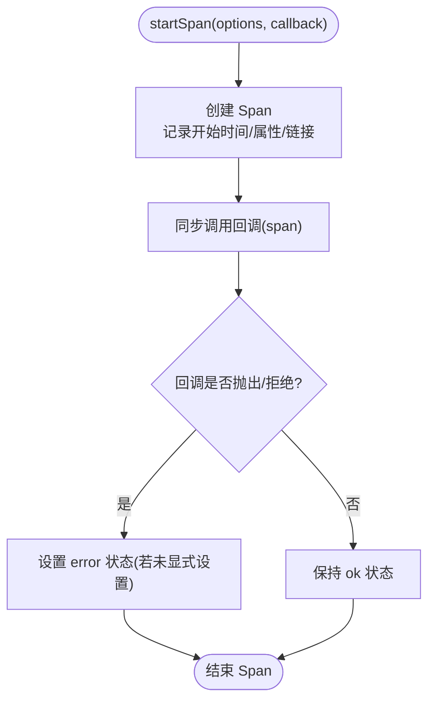
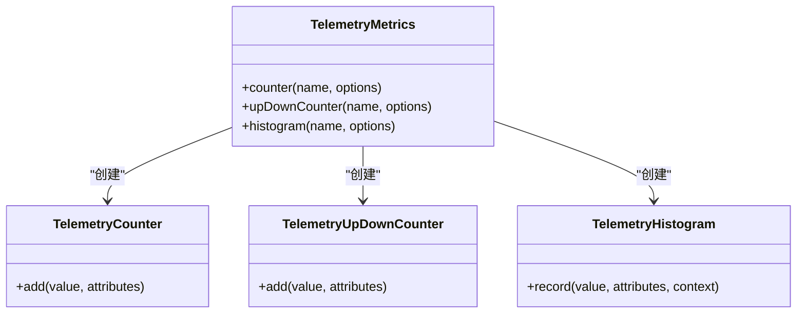
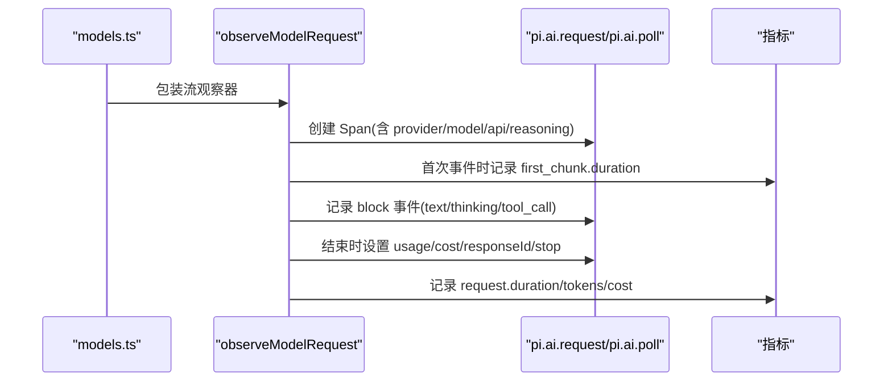
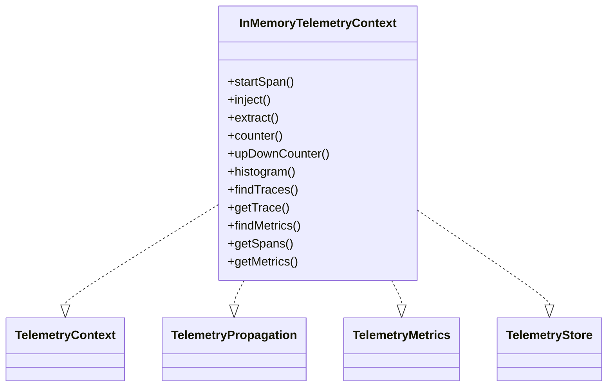
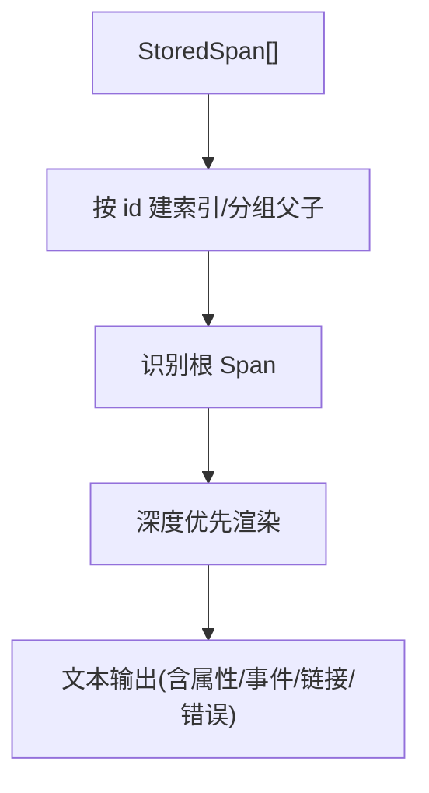
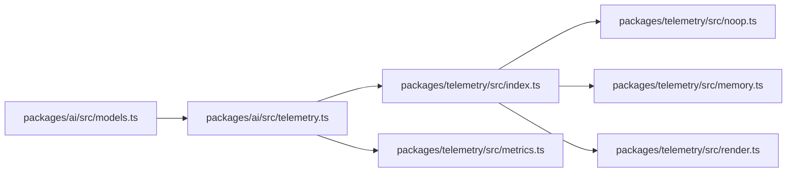
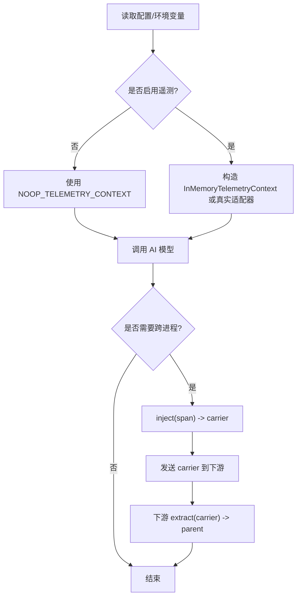
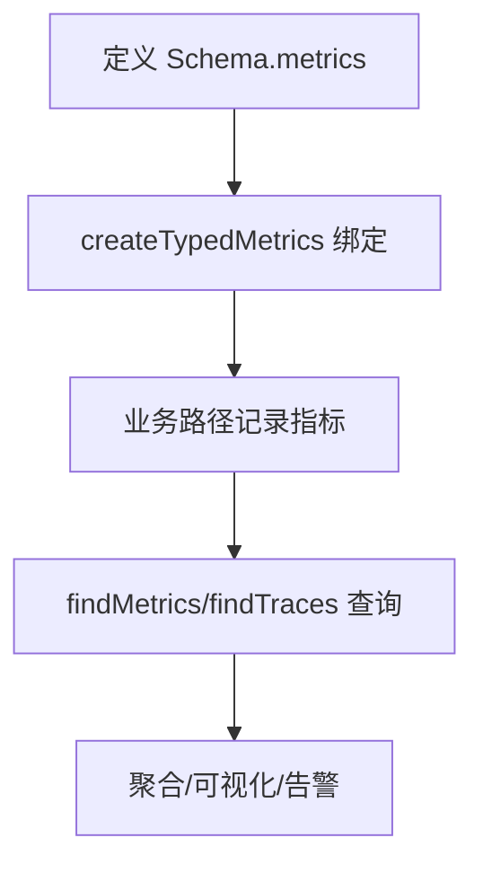

# 遥测数据收集

<cite>
**本文引用的文件**   
- [packages/telemetry/README.md](https://github.com/FDE-GROUP/oh-my-fde/blob/omca/packages/telemetry/README.md)
- [packages/telemetry/src/index.ts](https://github.com/FDE-GROUP/oh-my-fde/blob/omca/packages/telemetry/src/index.ts)
- [packages/telemetry/src/metrics.ts](https://github.com/FDE-GROUP/oh-my-fde/blob/omca/packages/telemetry/src/metrics.ts)
- [packages/telemetry/src/memory.ts](https://github.com/FDE-GROUP/oh-my-fde/blob/omca/packages/telemetry/src/memory.ts)
- [packages/telemetry/src/noop.ts](https://github.com/FDE-GROUP/oh-my-fde/blob/omca/packages/telemetry/src/noop.ts)
- [packages/telemetry/src/render.ts](https://github.com/FDE-GROUP/oh-my-fde/blob/omca/packages/telemetry/src/render.ts)
- [packages/ai/src/telemetry.ts](https://github.com/FDE-GROUP/oh-my-fde/blob/omca/packages/ai/src/telemetry.ts)
- [packages/ai/src/models.ts](https://github.com/FDE-GROUP/oh-my-fde/blob/omca/packages/ai/src/models.ts)
</cite>

## 目录
1. [引言](#引言)
2. [项目结构](#项目结构)
3. [核心组件](#核心组件)
4. [架构总览](#架构总览)
5. [详细组件分析](#详细组件分析)
6. [依赖关系分析](#依赖关系分析)
7. [性能与隐私](#性能与隐私)
8. [启用与禁用遥测](#启用与禁用遥测)
9. [自定义指标与数据分析](#自定义指标与数据分析)
10. [数据导出、第三方集成与合规](#数据导出第三方集成与合规)
11. [故障排查](#故障排查)
12. [结论](#结论)

## 引言
本仓库包含一个厂商中立的遥测契约与参考实现，以及 AI 模型调用路径中的遥测观测点。其目标是：
- 提供跨进程、跨后端可插拔的 Span、事件、状态和指标能力；
- 通过类型化 Schema 约束遥测名称、属性与事件，避免高基数属性泄露；
- 为 AI 请求提供统一的可观测性语义（时长、首包时间、Token、成本等）；
- 支持无记录模式、内存参考实现、渲染输出与存储查询接口，便于本地诊断与外部集成。

## 项目结构
遥测相关代码集中在 `packages/telemetry`，AI 层在 `packages/ai` 中消费该契约并定义领域 Schema。

**图表来源**
- [packages/telemetry/src/index.ts:1-129](https://github.com/FDE-GROUP/oh-my-fde/blob/omca/packages/telemetry/src/index.ts#L1-L129)
- [packages/telemetry/src/metrics.ts:1-41](https://github.com/FDE-GROUP/oh-my-fde/blob/omca/packages/telemetry/src/metrics.ts#L1-L41)
- [packages/telemetry/src/memory.ts:313-330](https://github.com/FDE-GROUP/oh-my-fde/blob/omca/packages/telemetry/src/memory.ts#L313-L330)
- [packages/telemetry/src/noop.ts:1-38](https://github.com/FDE-GROUP/oh-my-fde/blob/omca/packages/telemetry/src/noop.ts#L1-L38)
- [packages/telemetry/src/render.ts:1-73](https://github.com/FDE-GROUP/oh-my-fde/blob/omca/packages/telemetry/src/render.ts#L1-L73)
- [packages/ai/src/telemetry.ts:1-105](https://github.com/FDE-GROUP/oh-my-fde/blob/omca/packages/ai/src/telemetry.ts#L1-L105)
- [packages/ai/src/models.ts:23-24](https://github.com/FDE-GROUP/oh-my-fde/blob/omca/packages/ai/src/models.ts#L23-L24)

**章节来源**
- [packages/telemetry/README.md:1-16](https://github.com/FDE-GROUP/oh-my-fde/blob/omca/packages/telemetry/README.md#L1-L16)
- [packages/ai/src/models.ts:23-24](https://github.com/FDE-GROUP/oh-my-fde/blob/omca/packages/ai/src/models.ts#L23-L24)

## 核心组件
- TelemetryContext / TelemetrySpan：回调式 Span 生命周期，显式传播父上下文，不依赖全局状态。
- TelemetryMetrics：计数器、上下计数器、直方图，工厂与记录方法均为同步。
- TelemetryPropagation：注入/提取载体，用于跨进程或跨边界传递追踪上下文。
- InMemoryTelemetryContext：进程内参考实现，提供 Span、事件、链接、指标测量与基础查询。
- NOOP_TELEMETRY_CONTEXT：零开销禁用模式，保持业务代码不变。
- Typed Schemas：声明式 Schema，编译期推断 Span 名、属性、事件与指标类型。
- renderTrace：将已存储 Span 渲染为可读文本，适合日志或调试面板。

**章节来源**
- [packages/telemetry/src/index.ts:9-114](https://github.com/FDE-GROUP/oh-my-fde/blob/omca/packages/telemetry/src/index.ts#L9-L114)
- [packages/telemetry/src/metrics.ts:10-41](https://github.com/FDE-GROUP/oh-my-fde/blob/omca/packages/telemetry/src/metrics.ts#L10-L41)
- [packages/telemetry/src/memory.ts:313-330](https://github.com/FDE-GROUP/oh-my-fde/blob/omca/packages/telemetry/src/memory.ts#L313-L330)
- [packages/telemetry/src/noop.ts:13-38](https://github.com/FDE-GROUP/oh-my-fde/blob/omca/packages/telemetry/src/noop.ts#L13-L38)
- [packages/telemetry/src/render.ts:28-72](https://github.com/FDE-GROUP/oh-my-fde/blob/omca/packages/telemetry/src/render.ts#L28-L72)

## 架构总览
遥测采用“契约 + 适配器”设计：
- 应用或上层包只依赖契约与 Schema；
- 运行时通过传入 TelemetryContext 选择具体实现；
- AI 层使用 typed span starter 与 typed metrics 记录请求级遥测；
- 测试或本地诊断可使用 InMemoryTelemetryContext；
- 生产环境可替换为 OpenTelemetry、Sentry 或其他后端适配器。

**图表来源**
- [packages/ai/src/telemetry.ts:121-210](https://github.com/FDE-GROUP/oh-my-fde/blob/omca/packages/ai/src/telemetry.ts#L121-L210)
- [packages/telemetry/src/index.ts:102-114](https://github.com/FDE-GROUP/oh-my-fde/blob/omca/packages/telemetry/src/index.ts#L102-L114)

## 详细组件分析

### TelemetryContext 与 Span 生命周期
- startSpan 接受选项与回调，自动处理完成与异常状态；
- 子 Span 通过回调参数获得，形成树形调用链；
- setAttributes 合并属性，setStatus 最后写入生效；
- addEvent 记录时间点事件；addLink 建立非父子关联；
- 适配器需保证回调仅执行一次、返回值与拒绝值透传、结束后调用无效。

**图表来源**
- [packages/telemetry/src/memory.ts:213-277](https://github.com/FDE-GROUP/oh-my-fde/blob/omca/packages/telemetry/src/memory.ts#L213-L277)
- [packages/telemetry/README.md:123-139](https://github.com/FDE-GROUP/oh-my-fde/blob/omca/packages/telemetry/README.md#L123-L139)

**章节来源**
- [packages/telemetry/src/index.ts:102-114](https://github.com/FDE-GROUP/oh-my-fde/blob/omca/packages/telemetry/src/index.ts#L102-L114)
- [packages/telemetry/src/memory.ts:213-277](https://github.com/FDE-GROUP/oh-my-fde/blob/omca/packages/telemetry/src/memory.ts#L213-L277)
- [packages/telemetry/README.md:69-139](https://github.com/FDE-GROUP/oh-my-fde/blob/omca/packages/telemetry/README.md#L69-L139)

### 指标体系与类型化 Schema
- 指标包括 counter、upDownCounter、histogram；
- histogram 支持 boundaries 桶提示，record 可附带 exemplar context；
- createTypedMetrics 绑定 Schema 中的指标定义，编译期校验名称、kind、属性；
- 指标属性必须低基数，禁止用户 ID、Prompt、任意路径等高基数字段。

**图表来源**
- [packages/telemetry/src/metrics.ts:10-41](https://github.com/FDE-GROUP/oh-my-fde/blob/omca/packages/telemetry/src/metrics.ts#L10-L41)
- [packages/telemetry/src/metrics.ts:128-145](https://github.com/FDE-GROUP/oh-my-fde/blob/omca/packages/telemetry/src/metrics.ts#L128-L145)

**章节来源**
- [packages/telemetry/src/metrics.ts:10-41](https://github.com/FDE-GROUP/oh-my-fde/blob/omca/packages/telemetry/src/metrics.ts#L10-L41)
- [packages/telemetry/src/metrics.ts:43-145](https://github.com/FDE-GROUP/oh-my-fde/blob/omca/packages/telemetry/src/metrics.ts#L43-L145)
- [packages/telemetry/README.md:185-238](https://github.com/FDE-GROUP/oh-my-fde/blob/omca/packages/telemetry/README.md#L185-L238)

### AI 模型遥测
AI 层定义 `AI_TELEMETRY_SCHEMA`，覆盖：
- Span：pi.ai.request、pi.ai.poll；
- 事件：pi.ai.first_chunk、pi.ai.block；
- 指标：请求时长、首包时长、Token、成本；
- 属性：provider、model、api、stop、usage.*、cost.total、response.id。

**图表来源**
- [packages/ai/src/telemetry.ts:63-105](https://github.com/FDE-GROUP/oh-my-fde/blob/omca/packages/ai/src/telemetry.ts#L63-L105)
- [packages/ai/src/telemetry.ts:121-210](https://github.com/FDE-GROUP/oh-my-fde/blob/omca/packages/ai/src/telemetry.ts#L121-L210)

**章节来源**
- [packages/ai/src/telemetry.ts:1-105](https://github.com/FDE-GROUP/oh-my-fde/blob/omca/packages/ai/src/telemetry.ts#L1-L105)
- [packages/ai/src/telemetry.ts:109-210](https://github.com/FDE-GROUP/oh-my-fde/blob/omca/packages/ai/src/telemetry.ts#L109-L210)
- [packages/ai/src/models.ts:23-24](https://github.com/FDE-GROUP/oh-my-fde/blob/omca/packages/ai/src/models.ts#L23-L24)

### 内存参考实现与存储查询
InMemoryTelemetryContext 同时实现：
- TelemetryContext：Span 树与回调管理；
- TelemetryPropagation：carrier 注入/提取；
- TelemetryMetrics：指标测量；
- TelemetryStore：findTraces、getTrace、findMetrics。

**图表来源**
- [packages/telemetry/src/memory.ts:313-330](https://github.com/FDE-GROUP/oh-my-fde/blob/omca/packages/telemetry/src/memory.ts#L313-L330)
- [packages/telemetry/src/memory.ts:394-470](https://github.com/FDE-GROUP/oh-my-fde/blob/omca/packages/telemetry/src/memory.ts#L394-L470)

**章节来源**
- [packages/telemetry/src/memory.ts:313-470](https://github.com/FDE-GROUP/oh-my-fde/blob/omca/packages/telemetry/src/memory.ts#L313-L470)
- [packages/telemetry/README.md:261-308](https://github.com/FDE-GROUP/oh-my-fde/blob/omca/packages/telemetry/README.md#L261-L308)

### 渲染与可视化
renderTrace 将 StoredSpan 渲染为带缩进的森林视图，展示：
- Span 名称、属性、持续时间、错误信息；
- 事件偏移量；
- 跨 Trace 链接。

**图表来源**
- [packages/telemetry/src/render.ts:28-72](https://github.com/FDE-GROUP/oh-my-fde/blob/omca/packages/telemetry/src/render.ts#L28-L72)

**章节来源**
- [packages/telemetry/src/render.ts:1-73](https://github.com/FDE-GROUP/oh-my-fde/blob/omca/packages/telemetry/src/render.ts#L1-L73)

## 依赖关系分析
- packages/ai 依赖 @earendil-works/pi-telemetry 契约与工具；
- telemetry 包内部解耦：index 暴露契约与工具，metrics 定义指标类型，memory/noop 提供实现，render 提供可视化；
- 无全局状态，所有上下文通过参数显式传递，降低耦合与副作用。

**图表来源**
- [packages/ai/src/models.ts:23-24](https://github.com/FDE-GROUP/oh-my-fde/blob/omca/packages/ai/src/models.ts#L23-L24)
- [packages/ai/src/telemetry.ts:1-10](https://github.com/FDE-GROUP/oh-my-fde/blob/omca/packages/ai/src/telemetry.ts#L1-L10)
- [packages/telemetry/src/index.ts:1-129](https://github.com/FDE-GROUP/oh-my-fde/blob/omca/packages/telemetry/src/index.ts#L1-L129)

**章节来源**
- [packages/ai/src/models.ts:23-24](https://github.com/FDE-GROUP/oh-my-fde/blob/omca/packages/ai/src/models.ts#L23-L24)
- [packages/ai/src/telemetry.ts:1-10](https://github.com/FDE-GROUP/oh-my-fde/blob/omca/packages/ai/src/telemetry.ts#L1-L10)
- [packages/telemetry/src/index.ts:1-129](https://github.com/FDE-GROUP/oh-my-fde/blob/omca/packages/telemetry/src/index.ts#L1-L129)

## 性能与隐私
- 性能
  - 所有遥测 API 为同步，避免异步开销；
  - NOOP 模式共享冻结对象，零分配；
  - 指标记录不序列化业务数据，仅记录已有数值；
  - 内存适配器存储为数组，适合测试与本地诊断，但存储无界，应限制采集范围。
- 隐私
  - 明确禁止 Prompt、工具输入输出、文件内容、凭据、自由格式错误详情；
  - 指标属性强制低基数；
  - 敏感属性可通过 schema metadata 标记 sensitive；
  - 载体可能跨传输，不应作为应用状态持久化。

**章节来源**
- [packages/telemetry/README.md:207-238](https://github.com/FDE-GROUP/oh-my-fde/blob/omca/packages/telemetry/README.md#L207-L238)
- [packages/telemetry/README.md:513-519](https://github.com/FDE-GROUP/oh-my-fde/blob/omca/packages/telemetry/README.md#L513-L519)
- [packages/telemetry/src/noop.ts:13-38](https://github.com/FDE-GROUP/oh-my-fde/blob/omca/packages/telemetry/src/noop.ts#L13-L38)

## 启用与禁用遥测
- 默认禁用：未提供 TelemetryContext 时，AI 层回退到 NOOP_TELEMETRY_CONTEXT；
- 启用方式：在顶层构造一个适配器实例（如 InMemoryTelemetryContext），并通过请求选项或上下文传递给 AI 调用；
- 切换策略：根据环境变量或配置决定注入 InMemoryTelemetryContext 还是 NOOP_TELEMETRY_CONTEXT；
- 跨进程：通过 propagation.inject/extract 在 HTTP/RPC 等边界传递 carrier。

**图表来源**
- [packages/ai/src/telemetry.ts:121-153](https://github.com/FDE-GROUP/oh-my-fde/blob/omca/packages/ai/src/telemetry.ts#L121-L153)
- [packages/telemetry/src/noop.ts:19-38](https://github.com/FDE-GROUP/oh-my-fde/blob/omca/packages/telemetry/src/noop.ts#L19-L38)
- [packages/telemetry/src/memory.ts:332-354](https://github.com/FDE-GROUP/oh-my-fde/blob/omca/packages/telemetry/src/memory.ts#L332-L354)

**章节来源**
- [packages/ai/src/telemetry.ts:121-153](https://github.com/FDE-GROUP/oh-my-fde/blob/omca/packages/ai/src/telemetry.ts#L121-L153)
- [packages/telemetry/src/noop.ts:19-38](https://github.com/FDE-GROUP/oh-my-fde/blob/omca/packages/telemetry/src/noop.ts#L19-L38)
- [packages/telemetry/src/memory.ts:332-354](https://github.com/FDE-GROUP/oh-my-fde/blob/omca/packages/telemetry/src/memory.ts#L332-L354)

## 自定义指标与数据分析
- 自定义指标步骤
  1. 在模块中定义 TelemetrySchemaDefinition.metrics；
  2. 使用 createTypedMetrics 绑定指标名称、kind、unit、attributes；
  3. 在业务路径中调用 counter.add / histogram.record；
  4. 如需关联 Span，将当前 span 作为 exemplar context 传给 histogram.record。
- 数据分析建议
  - 使用 findMetrics 获取按 intervalMs 聚合的行；
  - 结合 trace 过滤 errors、name、attributes、时间区间；
  - 使用 renderTrace 快速定位失败链路；
  - 对 histogram 关注 boundaries 桶分布与 p95/p99；
  - 对 counter/upDownCounter 关注趋势与峰值。

**图表来源**
- [packages/telemetry/src/metrics.ts:128-145](https://github.com/FDE-GROUP/oh-my-fde/blob/omca/packages/telemetry/src/metrics.ts#L128-L145)
- [packages/telemetry/src/memory.ts:439-470](https://github.com/FDE-GROUP/oh-my-fde/blob/omca/packages/telemetry/src/memory.ts#L439-L470)

**章节来源**
- [packages/telemetry/README.md:211-238](https://github.com/FDE-GROUP/oh-my-fde/blob/omca/packages/telemetry/README.md#L211-L238)
- [packages/telemetry/src/metrics.ts:128-145](https://github.com/FDE-GROUP/oh-my-fde/blob/omca/packages/telemetry/src/metrics.ts#L128-L145)
- [packages/telemetry/src/memory.ts:439-470](https://github.com/FDE-GROUP/oh-my-fde/blob/omca/packages/telemetry/src/memory.ts#L439-L470)

## 数据导出、第三方集成与合规
- 数据导出
  - 内存适配器提供 getSpans/getMetrics 原始快照；
  - Store 接口提供 findTraces/getTrace/findMetrics；
  - renderTrace 可直接输出文本用于日志或 UI。
- 第三方集成
  - 适配器只需实现 TelemetryContext，并可选择性实现 TelemetryMetrics/TelemetryPropagation；
  - 可将 pi.ai.* 名称映射为后端约定命名；
  - 通过 propagation.inject/extract 对接 W3C traceparent/tracestate 等载体。
- 合规
  - 属性值限制为标量与数组；
  - 禁止记录 Prompt、工具输出、凭据、自由格式错误详情；
  - 指标属性必须低基数；
  - 敏感数据通过 schema metadata 标记 sensitive；
  - 载体不是应用状态，不应持久化。

**章节来源**
- [packages/telemetry/README.md:287-308](https://github.com/FDE-GROUP/oh-my-fde/blob/omca/packages/telemetry/README.md#L287-L308)
- [packages/telemetry/README.md:497-519](https://github.com/FDE-GROUP/oh-my-fde/blob/omca/packages/telemetry/README.md#L497-L519)
- [packages/telemetry/src/render.ts:1-73](https://github.com/FDE-GROUP/oh-my-fde/blob/omca/packages/telemetry/src/render.ts#L1-L73)

## 故障排查
- 现象：没有 Span 或指标
  - 检查是否使用了 NOOP_TELEMETRY_CONTEXT；
  - 确认是否注入了有效的 TelemetryContext；
  - 检查是否在回调中正确设置属性与状态。
- 现象：Trace 不完整
  - 远程父 Span 可能尚未 settle；
  - 分页查询基于最早存储 Span，注意 cursor 与 filter 一致性；
  - SQLite 读取提交行，不隐式 flush。
- 现象：指标缺失或异常
  - 确认指标属性为低基数；
  - histogram record 的 value 应为有限值；
  - counter add 的增量应为非负数。
- 现象：渲染输出异常字符
  - renderTrace 会转义控制字符；
  - 确保属性值不包含不可见控制字符。

**章节来源**
- [packages/telemetry/README.md:287-308](https://github.com/FDE-GROUP/oh-my-fde/blob/omca/packages/telemetry/README.md#L287-L308)
- [packages/telemetry/src/render.ts:1-10](https://github.com/FDE-GROUP/oh-my-fde/blob/omca/packages/telemetry/src/render.ts#L1-L10)
- [packages/telemetry/src/memory.ts:394-470](https://github.com/FDE-GROUP/oh-my-fde/blob/omca/packages/telemetry/src/memory.ts#L394-L470)

## 结论
该遥测系统以契约为中心，通过类型化 Schema 约束遥测语义，既保证了可观测性的丰富性，又控制了隐私与性能风险。AI 层定义了清晰的请求级遥测模型，配合内存参考实现与渲染工具，便于本地诊断与外部集成。生产环境中，推荐通过配置开关注入真实适配器，并使用低基数属性与最小必要数据原则，确保遥测安全、可控、可演进。