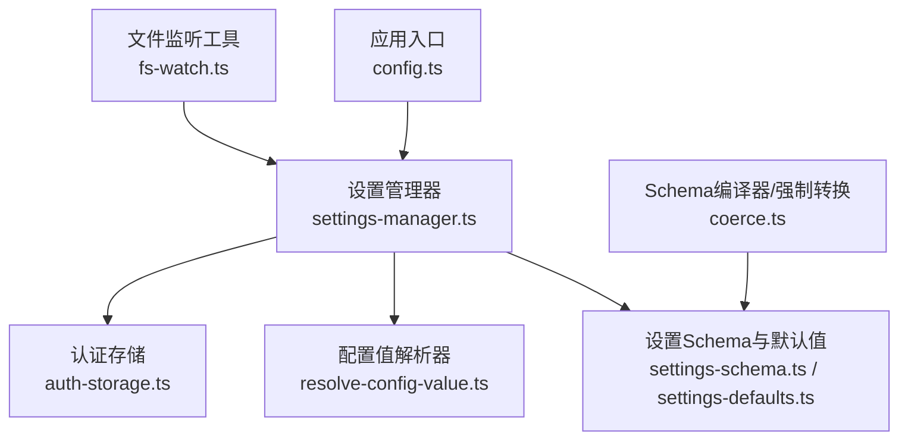
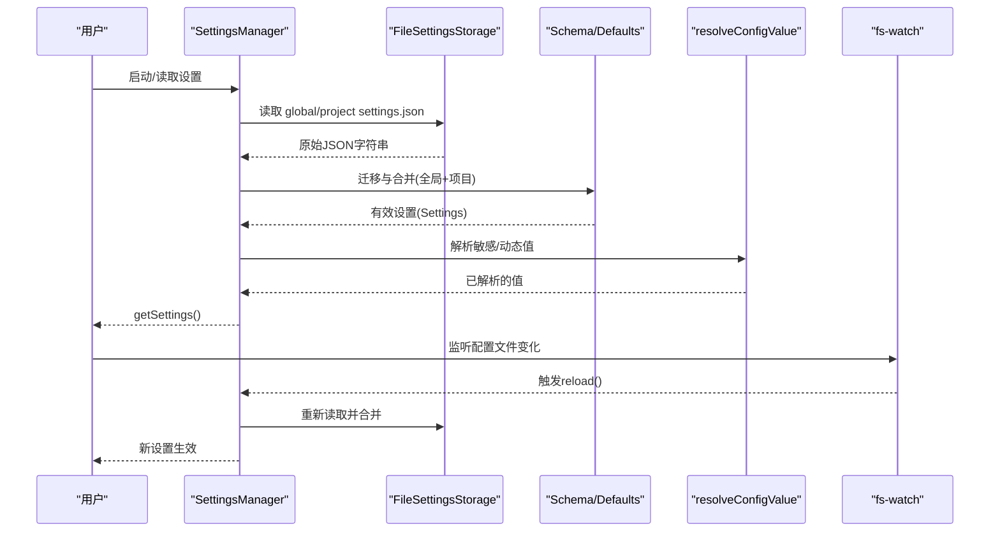
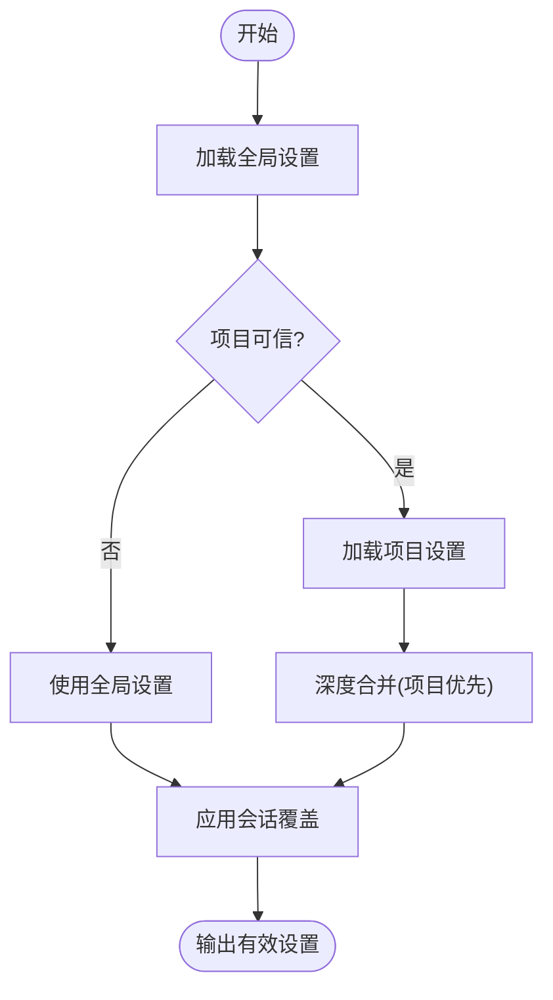
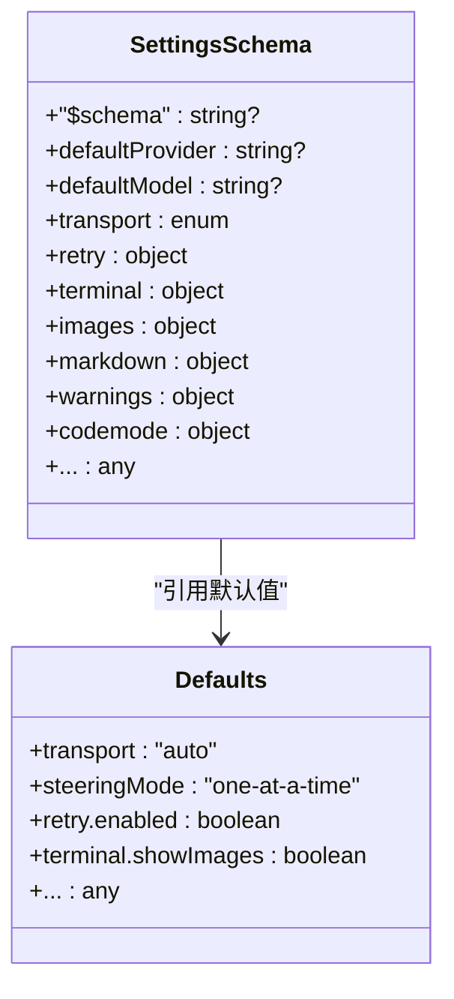
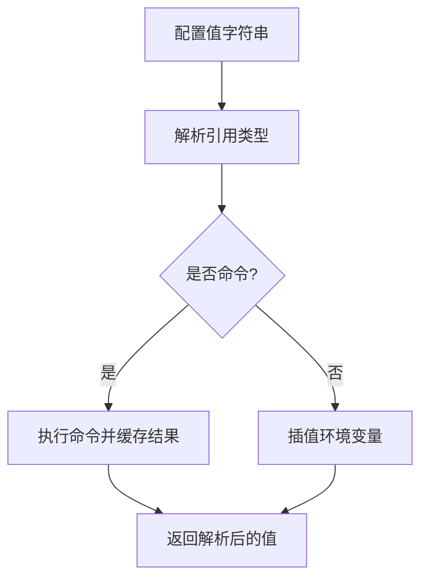
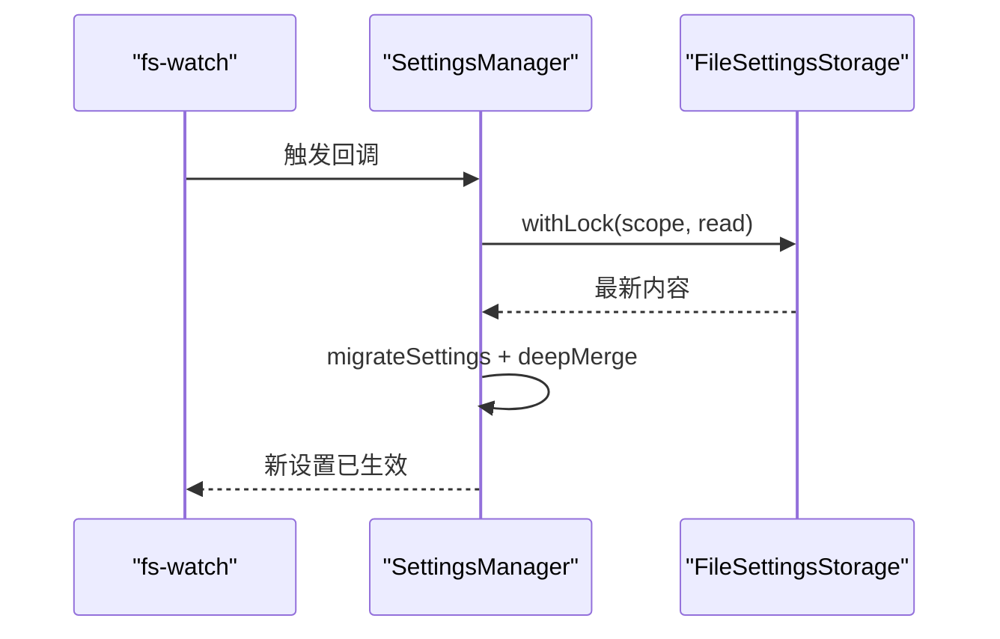
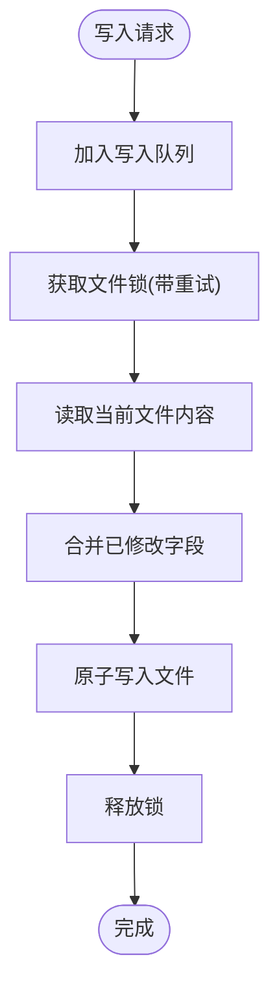
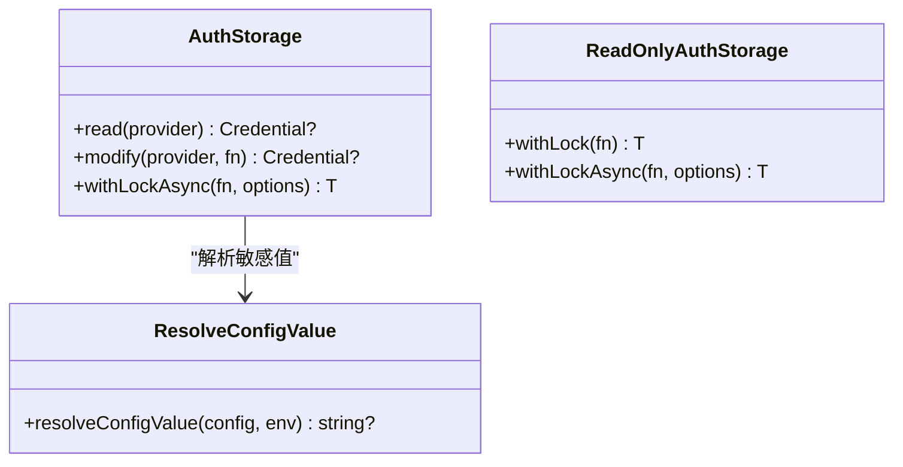
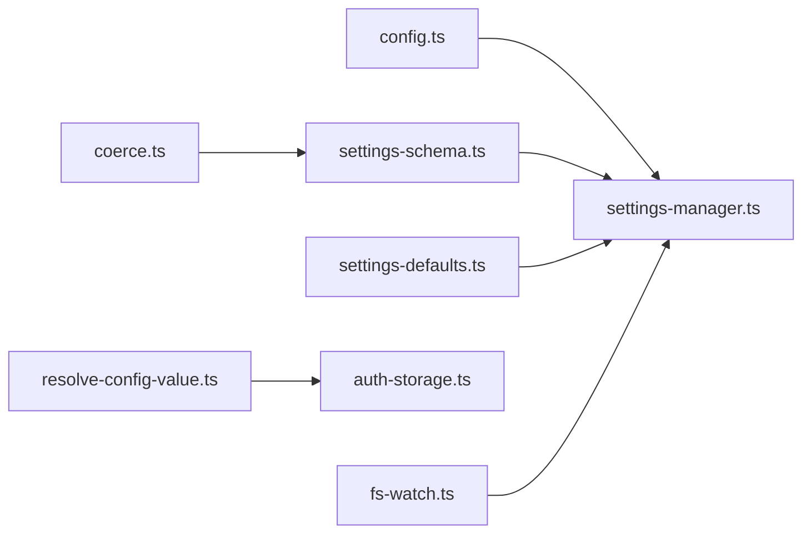
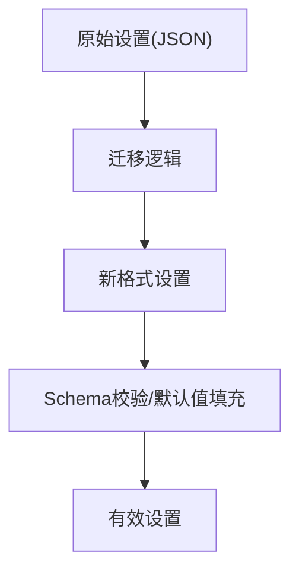

# 配置管理

<cite>
**本文引用的文件**   
- [settings-manager.ts](https://github.com/FDE-GROUP/oh-my-fde/blob/omca/packages/coding-agent/src/core/settings-manager.ts)
- [settings-defaults.ts](https://github.com/FDE-GROUP/oh-my-fde/blob/omca/packages/coding-agent/src/core/settings-defaults.ts)
- [settings-schema.ts](https://github.com/FDE-GROUP/oh-my-fde/blob/omca/packages/coding-agent/src/core/settings-schema.ts)
- [config.ts](https://github.com/FDE-GROUP/oh-my-fde/blob/omca/packages/coding-agent/src/config.ts)
- [resolve-config-value.ts](https://github.com/FDE-GROUP/oh-my-fde/blob/omca/packages/coding-agent/src/core/resolve-config-value.ts)
- [auth-storage.ts](https://github.com/FDE-GROUP/oh-my-fde/blob/omca/packages/coding-agent/src/core/auth-storage.ts)
- [fs-watch.ts](https://github.com/FDE-GROUP/oh-my-fde/blob/omca/packages/coding-agent/src/utils/fs-watch.ts)
- [coerce.ts](https://github.com/FDE-GROUP/oh-my-fde/blob/omca/packages/schema/src/coerce.ts)
</cite>

## 目录
1. [简介](#简介)
2. [项目结构](#项目结构)
3. [核心组件](#核心组件)
4. [架构总览](#架构总览)
5. [详细组件分析](#详细组件分析)
6. [依赖关系分析](#依赖关系分析)
7. [性能与并发特性](#性能与并发特性)
8. [安全与敏感信息](#安全与敏感信息)
9. [配置迁移与版本兼容](#配置迁移与版本兼容)
10. [最佳实践](#最佳实践)
11. [故障排除指南](#故障排除指南)
12. [结论](#结论)

## 简介
本文件系统性梳理 Pi 项目的配置管理体系，覆盖用户设置、环境变量、项目级配置、优先级规则、验证机制、默认值处理、热重载、敏感信息加密存储、配置迁移与版本兼容性，并给出最佳实践与排障建议。目标是帮助开发者与使用者快速理解并正确维护配置。

## 项目结构
配置相关代码主要分布在以下模块：
- 运行时配置路径与应用元数据：config.ts
- 用户设置管理器与持久化：settings-manager.ts
- 设置类型与默认值：settings-schema.ts、settings-defaults.ts
- 配置值解析（命令与环境变量插值）：resolve-config-value.ts
- 认证凭据存储（敏感信息）：auth-storage.ts
- 文件系统监听（用于热重载）：fs-watch.ts
- Schema 编译与值强制转换：coerce.ts

**图表来源**
- [config.ts:577-682](https://github.com/FDE-GROUP/oh-my-fde/blob/omca/packages/coding-agent/src/config.ts#L577-L682)
- [settings-manager.ts:160-327](https://github.com/FDE-GROUP/oh-my-fde/blob/omca/packages/coding-agent/src/core/settings-manager.ts#L160-L327)
- [settings-schema.ts:1-495](https://github.com/FDE-GROUP/oh-my-fde/blob/omca/packages/coding-agent/src/core/settings-schema.ts#L1-L495)
- [settings-defaults.ts:1-68](https://github.com/FDE-GROUP/oh-my-fde/blob/omca/packages/coding-agent/src/core/settings-defaults.ts#L1-L68)
- [resolve-config-value.ts:130-151](https://github.com/FDE-GROUP/oh-my-fde/blob/omca/packages/coding-agent/src/core/resolve-config-value.ts#L130-L151)
- [auth-storage.ts:159-473](https://github.com/FDE-GROUP/oh-my-fde/blob/omca/packages/coding-agent/src/core/auth-storage.ts#L159-L473)
- [fs-watch.ts:1-30](https://github.com/FDE-GROUP/oh-my-fde/blob/omca/packages/coding-agent/src/utils/fs-watch.ts#L1-L30)
- [coerce.ts:20-316](https://github.com/FDE-GROUP/oh-my-fde/blob/omca/packages/schema/src/coerce.ts#L20-L316)

**章节来源**
- [config.ts:577-682](https://github.com/FDE-GROUP/oh-my-fde/blob/omca/packages/coding-agent/src/config.ts#L577-L682)
- [settings-manager.ts:160-327](https://github.com/FDE-GROUP/oh-my-fde/blob/omca/packages/coding-agent/src/core/settings-manager.ts#L160-L327)

## 核心组件
- 配置路径与应用元数据：提供包根、应用名、配置目录名、Agent 目录、会话目录等路径解析，以及自更新命令与环境变量注入点。
- 设置管理器 SettingsManager：负责全局与项目级设置的加载、合并、写入、热重载、错误收集与变更追踪。
- 设置 Schema 与默认值：定义所有可配置项的类型、约束、默认值与描述，作为 JSON Schema 与运行时代码的共同事实来源。
- 配置值解析 resolveConfigValue：支持“命令执行”和“环境变量插值”，统一解析 API Key、Header 等敏感或动态配置值。
- 认证存储 AuthStorage：以加锁方式读写 auth.json，支持只读后端、异步链式调用与撤销信号。
- 文件监听 fs-watch：封装 node:fs.watch，提供错误处理与关闭工具函数，便于实现配置热重载。
- Schema 强制转换 coerce：对输入进行类型强制与递归转换，保证配置值符合 Schema 预期。

**章节来源**
- [config.ts:577-682](https://github.com/FDE-GROUP/oh-my-fde/blob/omca/packages/coding-agent/src/config.ts#L577-L682)
- [settings-manager.ts:160-327](https://github.com/FDE-GROUP/oh-my-fde/blob/omca/packages/coding-agent/src/core/settings-manager.ts#L160-L327)
- [settings-schema.ts:1-495](https://github.com/FDE-GROUP/oh-my-fde/blob/omca/packages/coding-agent/src/core/settings-schema.ts#L1-L495)
- [settings-defaults.ts:1-68](https://github.com/FDE-GROUP/oh-my-fde/blob/omca/packages/coding-agent/src/core/settings-defaults.ts#L1-L68)
- [resolve-config-value.ts:130-151](https://github.com/FDE-GROUP/oh-my-fde/blob/omca/packages/coding-agent/src/core/resolve-config-value.ts#L130-L151)
- [auth-storage.ts:159-473](https://github.com/FDE-GROUP/oh-my-fde/blob/omca/packages/coding-agent/src/core/auth-storage.ts#L159-L473)
- [fs-watch.ts:1-30](https://github.com/FDE-GROUP/oh-my-fde/blob/omca/packages/coding-agent/src/utils/fs-watch.ts#L1-L30)
- [coerce.ts:20-316](https://github.com/FDE-GROUP/oh-my-fde/blob/omca/packages/schema/src/coerce.ts#L20-L316)

## 架构总览
下图展示配置从磁盘到内存的加载、合并与生效流程，以及写回与热重载路径。

**图表来源**
- [settings-manager.ts:309-327](https://github.com/FDE-GROUP/oh-my-fde/blob/omca/packages/coding-agent/src/core/settings-manager.ts#L309-L327)
- [settings-manager.ts:366-394](https://github.com/FDE-GROUP/oh-my-fde/blob/omca/packages/coding-agent/src/core/settings-manager.ts#L366-L394)
- [settings-manager.ts:500-526](https://github.com/FDE-GROUP/oh-my-fde/blob/omca/packages/coding-agent/src/core/settings-manager.ts#L500-L526)
- [resolve-config-value.ts:130-151](https://github.com/FDE-GROUP/oh-my-fde/blob/omca/packages/coding-agent/src/core/resolve-config-value.ts#L130-L151)
- [fs-watch.ts:17-30](https://github.com/FDE-GROUP/oh-my-fde/blob/omca/packages/coding-agent/src/utils/fs-watch.ts#L17-L30)

## 详细组件分析

### 用户设置管理与优先级
- 作用域
  - 全局设置：位于 Agent 目录下的 settings.json。
  - 项目设置：位于当前工作目录下 .pi/settings.json。
- 优先级
  - 项目设置优先于全局设置；两者通过深度合并得到最终有效设置。
  - 在会话期间可通过 applyOverrides 叠加临时覆盖层。
- 可信项目
  - 当项目不可信时，项目设置不会加载，避免潜在风险。
- 字段修改追踪
  - 仅持久化本次会话中实际修改过的字段与嵌套键，减少不必要的写入。

**图表来源**
- [settings-manager.ts:272-307](https://github.com/FDE-GROUP/oh-my-fde/blob/omca/packages/coding-agent/src/core/settings-manager.ts#L272-L307)
- [settings-manager.ts:458-531](https://github.com/FDE-GROUP/oh-my-fde/blob/omca/packages/coding-agent/src/core/settings-manager.ts#L458-L531)

**章节来源**
- [settings-manager.ts:186-253](https://github.com/FDE-GROUP/oh-my-fde/blob/omca/packages/coding-agent/src/core/settings-manager.ts#L186-L253)
- [settings-manager.ts:272-327](https://github.com/FDE-GROUP/oh-my-fde/blob/omca/packages/coding-agent/src/core/settings-manager.ts#L272-L327)
- [settings-manager.ts:458-531](https://github.com/FDE-GROUP/oh-my-fde/blob/omca/packages/coding-agent/src/core/settings-manager.ts#L458-L531)

### 配置文件结构与验证
- 结构定义
  - 所有可配置项在 settings-schema.ts 中以 TypeBox Schema 声明，包含类型、默认值、描述与枚举约束。
  - 默认值集中定义在 settings-defaults.ts，供 Schema 与运行时访问器共享。
- 验证与强制转换
  - Schema 定义了严格类型与可选默认值；配合 schema 包的 Coercer 可对输入进行类型强制与递归转换，确保运行时拿到合法值。
- 向后兼容
  - 旧字段 queueMode/websockets/skills 对象格式等在迁移逻辑中被自动转换为新字段 steeringMode/transport/skills 数组等。

**图表来源**
- [settings-schema.ts:1-495](https://github.com/FDE-GROUP/oh-my-fde/blob/omca/packages/coding-agent/src/core/settings-schema.ts#L1-L495)
- [settings-defaults.ts:1-68](https://github.com/FDE-GROUP/oh-my-fde/blob/omca/packages/coding-agent/src/core/settings-defaults.ts#L1-L68)

**章节来源**
- [settings-schema.ts:1-495](https://github.com/FDE-GROUP/oh-my-fde/blob/omca/packages/coding-agent/src/core/settings-schema.ts#L1-L495)
- [settings-defaults.ts:1-68](https://github.com/FDE-GROUP/oh-my-fde/blob/omca/packages/coding-agent/src/core/settings-defaults.ts#L1-L68)
- [coerce.ts:20-316](https://github.com/FDE-GROUP/oh-my-fde/blob/omca/packages/schema/src/coerce.ts#L20-L316)

### 环境变量与动态配置值
- 环境变量注入点
  - PI_PACKAGE_DIR：覆盖包根目录。
  - PI_SELF_UPDATE_COMMAND：覆盖自更新命令。
  - PI_SHARE_VIEWER_URL：自定义分享查看器 URL。
  - ENV_AGENT_DIR / ENV_SESSION_DIR：覆盖 Agent/会话目录。
- 动态配置值解析
  - 支持以“!”开头的命令模式，执行外部命令获取值。
  - 支持 $ENV_VAR 或 ${ENV_VAR} 的环境变量插值。
  - 非命令模式下，“$$”转义为字面量“$”，“$!”转义为字面量“!”。

**图表来源**
- [resolve-config-value.ts:130-151](https://github.com/FDE-GROUP/oh-my-fde/blob/omca/packages/coding-agent/src/core/resolve-config-value.ts#L130-L151)
- [config.ts:337-345](https://github.com/FDE-GROUP/oh-my-fde/blob/omca/packages/coding-agent/src/config.ts#L337-L345)
- [config.ts:418-430](https://github.com/FDE-GROUP/oh-my-fde/blob/omca/packages/coding-agent/src/config.ts#L418-L430)
- [config.ts:609-612](https://github.com/FDE-GROUP/oh-my-fde/blob/omca/packages/coding-agent/src/config.ts#L609-L612)

**章节来源**
- [resolve-config-value.ts:130-151](https://github.com/FDE-GROUP/oh-my-fde/blob/omca/packages/coding-agent/src/core/resolve-config-value.ts#L130-L151)
- [config.ts:337-345](https://github.com/FDE-GROUP/oh-my-fde/blob/omca/packages/coding-agent/src/config.ts#L337-L345)
- [config.ts:418-430](https://github.com/FDE-GROUP/oh-my-fde/blob/omca/packages/coding-agent/src/config.ts#L418-L430)
- [config.ts:609-612](https://github.com/FDE-GROUP/oh-my-fde/blob/omca/packages/coding-agent/src/config.ts#L609-L612)

### 项目级配置与可信策略
- 项目设置文件位置：当前工作目录下的 .pi/settings.json。
- 可信控制
  - setProjectTrusted(true/false) 切换项目可信状态。
  - 不可信时不加载项目设置，且拒绝写入项目设置。
- 用途
  - 适合团队内为不同仓库设定差异化行为（如工具集、模型选择、UI 偏好）。

**章节来源**
- [settings-manager.ts:471-498](https://github.com/FDE-GROUP/oh-my-fde/blob/omca/packages/coding-agent/src/core/settings-manager.ts#L471-L498)
- [settings-manager.ts:555-559](https://github.com/FDE-GROUP/oh-my-fde/blob/omca/packages/coding-agent/src/core/settings-manager.ts#L555-L559)

### 热重载机制
- 文件监听
  - 使用 fs-watch.ts 提供的 watchWithErrorHandler 包装 node:fs.watch，统一错误处理与关闭。
- 重载流程
  - 监听全局或项目 settings.json 变化后，调用 SettingsManager.reload() 重新加载并合并。
- 注意事项
  - 重载会清空会话期间的修改标记，避免脏写。

**图表来源**
- [fs-watch.ts:17-30](https://github.com/FDE-GROUP/oh-my-fde/blob/omca/packages/coding-agent/src/utils/fs-watch.ts#L17-L30)
- [settings-manager.ts:500-526](https://github.com/FDE-GROUP/oh-my-fde/blob/omca/packages/coding-agent/src/core/settings-manager.ts#L500-L526)

**章节来源**
- [fs-watch.ts:1-30](https://github.com/FDE-GROUP/oh-my-fde/blob/omca/packages/coding-agent/src/utils/fs-watch.ts#L1-L30)
- [settings-manager.ts:500-526](https://github.com/FDE-GROUP/oh-my-fde/blob/omca/packages/coding-agent/src/core/settings-manager.ts#L500-L526)

### 写入与并发控制
- 文件锁
  - FileSettingsStorage 使用 proper-lockfile 对 settings.json 加锁，避免多进程并发写入导致损坏。
  - 重试策略：遇到 ELOCKED 时短暂等待并重试，最多尝试固定次数。
- 写入队列
  - SettingsManager 内部维护 writeQueue，串行化保存操作，避免竞态。
- 最小化写入
  - 仅持久化本次会话中修改过的字段与嵌套键，降低 I/O 频率。

**图表来源**
- [settings-manager.ts:576-627](https://github.com/FDE-GROUP/oh-my-fde/blob/omca/packages/coding-agent/src/core/settings-manager.ts#L576-L627)
- [settings-manager.ts:197-253](https://github.com/FDE-GROUP/oh-my-fde/blob/omca/packages/coding-agent/src/core/settings-manager.ts#L197-L253)

**章节来源**
- [settings-manager.ts:197-253](https://github.com/FDE-GROUP/oh-my-fde/blob/omca/packages/coding-agent/src/core/settings-manager.ts#L197-L253)
- [settings-manager.ts:576-627](https://github.com/FDE-GROUP/oh-my-fde/blob/omca/packages/coding-agent/src/core/settings-manager.ts#L576-L627)

### 认证与敏感信息存储
- 存储位置
  - 认证凭据存储在 Agent 目录下的 auth.json。
- 并发与安全
  - AuthStorage 提供 withLockAsync 加锁读写，支持 AbortSignal 取消与锁被破坏检测。
  - ReadOnlyAuthStorage 提供只读视图，便于审计与调试。
- 值解析
  - 读取 api_key 凭据时，若 key 为模板或命令，会通过 resolveConfigValue 解析为真实值。

**图表来源**
- [auth-storage.ts:159-203](https://github.com/FDE-GROUP/oh-my-fde/blob/omca/packages/coding-agent/src/core/auth-storage.ts#L159-L203)
- [auth-storage.ts:205-324](https://github.com/FDE-GROUP/oh-my-fde/blob/omca/packages/coding-agent/src/core/auth-storage.ts#L205-L324)
- [auth-storage.ts:443-473](https://github.com/FDE-GROUP/oh-my-fde/blob/omca/packages/coding-agent/src/core/auth-storage.ts#L443-L473)
- [resolve-config-value.ts:130-151](https://github.com/FDE-GROUP/oh-my-fde/blob/omca/packages/coding-agent/src/core/resolve-config-value.ts#L130-L151)

**章节来源**
- [auth-storage.ts:159-203](https://github.com/FDE-GROUP/oh-my-fde/blob/omca/packages/coding-agent/src/core/auth-storage.ts#L159-L203)
- [auth-storage.ts:205-324](https://github.com/FDE-GROUP/oh-my-fde/blob/omca/packages/coding-agent/src/core/auth-storage.ts#L205-L324)
- [auth-storage.ts:443-473](https://github.com/FDE-GROUP/oh-my-fde/blob/omca/packages/coding-agent/src/core/auth-storage.ts#L443-L473)
- [resolve-config-value.ts:130-151](https://github.com/FDE-GROUP/oh-my-fde/blob/omca/packages/coding-agent/src/core/resolve-config-value.ts#L130-L151)

## 依赖关系分析
- config.ts 提供路径与元数据，被 settings-manager.ts 与 CLI 广泛使用。
- settings-manager.ts 依赖 settings-schema.ts 与 settings-defaults.ts 进行类型与默认值处理。
- resolve-config-value.ts 被认证存储与可能的其他模块用于解析敏感/动态值。
- fs-watch.ts 为上层提供稳定的文件监听能力，便于实现热重载。
- coerce.ts 为 Schema 层提供值强制转换能力，保障配置一致性。

**图表来源**
- [config.ts:577-682](https://github.com/FDE-GROUP/oh-my-fde/blob/omca/packages/coding-agent/src/config.ts#L577-L682)
- [settings-manager.ts:1-27](https://github.com/FDE-GROUP/oh-my-fde/blob/omca/packages/coding-agent/src/core/settings-manager.ts#L1-L27)
- [resolve-config-value.ts:130-151](https://github.com/FDE-GROUP/oh-my-fde/blob/omca/packages/coding-agent/src/core/resolve-config-value.ts#L130-L151)
- [auth-storage.ts:159-473](https://github.com/FDE-GROUP/oh-my-fde/blob/omca/packages/coding-agent/src/core/auth-storage.ts#L159-L473)
- [fs-watch.ts:1-30](https://github.com/FDE-GROUP/oh-my-fde/blob/omca/packages/coding-agent/src/utils/fs-watch.ts#L1-L30)
- [coerce.ts:20-316](https://github.com/FDE-GROUP/oh-my-fde/blob/omca/packages/schema/src/coerce.ts#L20-L316)

**章节来源**
- [config.ts:577-682](https://github.com/FDE-GROUP/oh-my-fde/blob/omca/packages/coding-agent/src/config.ts#L577-L682)
- [settings-manager.ts:1-27](https://github.com/FDE-GROUP/oh-my-fde/blob/omca/packages/coding-agent/src/core/settings-manager.ts#L1-L27)
- [resolve-config-value.ts:130-151](https://github.com/FDE-GROUP/oh-my-fde/blob/omca/packages/coding-agent/src/core/resolve-config-value.ts#L130-L151)
- [auth-storage.ts:159-473](https://github.com/FDE-GROUP/oh-my-fde/blob/omca/packages/coding-agent/src/core/auth-storage.ts#L159-L473)
- [fs-watch.ts:1-30](https://github.com/FDE-GROUP/oh-my-fde/blob/omca/packages/coding-agent/src/utils/fs-watch.ts#L1-L30)
- [coerce.ts:20-316](https://github.com/FDE-GROUP/oh-my-fde/blob/omca/packages/schema/src/coerce.ts#L20-L316)

## 性能与并发特性
- 写入批量化
  - 通过 writeQueue 串行化保存，避免频繁 I/O 与锁竞争。
- 最小化变更
  - 仅持久化本次会话修改的字段与嵌套键，显著降低磁盘写入量。
- 锁重试
  - 针对 ELOCKED 的短时等待重试，提高在多进程场景下的成功率。
- 懒加载与缓存
  - 配置值解析支持命令结果缓存，避免重复执行外部命令。

[本节为通用指导，无需具体文件引用]

## 安全与敏感信息
- 敏感值来源
  - 可从环境变量、命令输出或模板插值获得。
- 存储保护
  - auth.json 采用加锁读写，防止并发篡改；支持只读后端用于审计。
- 传输与使用
  - 建议在 CI/CD 中使用环境变量注入密钥，避免将明文写入 settings.json。
- 权限隔离
  - 项目不可信时禁止读取与写入项目设置，降低恶意配置风险。

**章节来源**
- [auth-storage.ts:159-203](https://github.com/FDE-GROUP/oh-my-fde/blob/omca/packages/coding-agent/src/core/auth-storage.ts#L159-L203)
- [auth-storage.ts:205-324](https://github.com/FDE-GROUP/oh-my-fde/blob/omca/packages/coding-agent/src/core/auth-storage.ts#L205-L324)
- [auth-storage.ts:443-473](https://github.com/FDE-GROUP/oh-my-fde/blob/omca/packages/coding-agent/src/core/auth-storage.ts#L443-L473)
- [settings-manager.ts:471-498](https://github.com/FDE-GROUP/oh-my-fde/blob/omca/packages/coding-agent/src/core/settings-manager.ts#L471-L498)

## 配置迁移与版本兼容
- 字段迁移
  - queueMode → steeringMode
  - websockets(boolean) → transport(enum)
  - skills(object) → skills(array)
  - retry.maxDelayMs → retry.provider.maxRetryDelayMs
- 版本记录
  - lastChangelogVersion 与 extensionChangelogVersions 用于跟踪扩展与主程序变更版本。
- 兼容性策略
  - 迁移发生在加载阶段，旧格式仍可被读取并转换为新格式，保证平滑升级。

**图表来源**
- [settings-manager.ts:396-456](https://github.com/FDE-GROUP/oh-my-fde/blob/omca/packages/coding-agent/src/core/settings-manager.ts#L396-L456)
- [settings-manager.ts:680-701](https://github.com/FDE-GROUP/oh-my-fde/blob/omca/packages/coding-agent/src/core/settings-manager.ts#L680-L701)

**章节来源**
- [settings-manager.ts:396-456](https://github.com/FDE-GROUP/oh-my-fde/blob/omca/packages/coding-agent/src/core/settings-manager.ts#L396-L456)
- [settings-manager.ts:680-701](https://github.com/FDE-GROUP/oh-my-fde/blob/omca/packages/coding-agent/src/core/settings-manager.ts#L680-L701)

## 最佳实践
- 分层配置
  - 全局设置存放公共偏好；项目设置存放仓库特定行为。
- 使用环境变量
  - 将 API Key、令牌等敏感信息放入环境变量，并通过 resolveConfigValue 注入。
- 谨慎启用项目信任
  - 仅在可信仓库中启用项目设置，避免意外覆盖全局策略。
- 保持 Schema 一致
  - 新增配置项时同步更新 Schema 与默认值，确保 IDE 提示与校验生效。
- 监控错误
  - 定期 drainErrors 检查解析与持久化错误，及时修复损坏的配置。
- 最小化写入
  - 批量修改后再保存，利用最小化变更机制降低 I/O。

[本节为通用指导，无需具体文件引用]

## 故障排除指南
- 无法写入 settings.json
  - 检查文件权限与锁冲突；确认未同时有其他进程写入。
  - 观察错误队列 drainErrors 中的记录。
- 项目设置未生效
  - 确认项目处于可信状态；检查项目设置文件是否存在语法错误。
- 环境变量未生效
  - 检查 resolveConfigValue 的模板语法是否正确；确认环境变量存在。
- 热重载无效
  - 确认文件监听器正常启动且无错误；检查 reload 是否被调用。
- 认证失败
  - 检查 auth.json 格式与权限；确认敏感值已通过命令或环境变量正确解析。

**章节来源**
- [settings-manager.ts:561-588](https://github.com/FDE-GROUP/oh-my-fde/blob/omca/packages/coding-agent/src/core/settings-manager.ts#L561-L588)
- [settings-manager.ts:674-678](https://github.com/FDE-GROUP/oh-my-fde/blob/omca/packages/coding-agent/src/core/settings-manager.ts#L674-L678)
- [auth-storage.ts:159-203](https://github.com/FDE-GROUP/oh-my-fde/blob/omca/packages/coding-agent/src/core/auth-storage.ts#L159-L203)
- [fs-watch.ts:17-30](https://github.com/FDE-GROUP/oh-my-fde/blob/omca/packages/coding-agent/src/utils/fs-watch.ts#L17-L30)

## 结论
本项目通过清晰的职责划分与严格的 Schema 约束，构建了稳健的配置体系：全局与项目双层设置、安全的敏感值解析与存储、可靠的并发写入与热重载、完善的迁移与版本兼容。遵循本文的最佳实践与排障建议，可在保证安全与稳定性的前提下，灵活定制与演进系统行为。