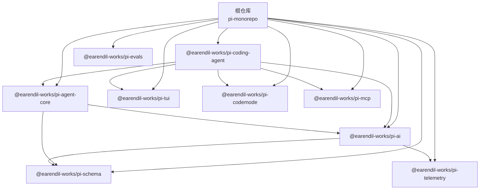
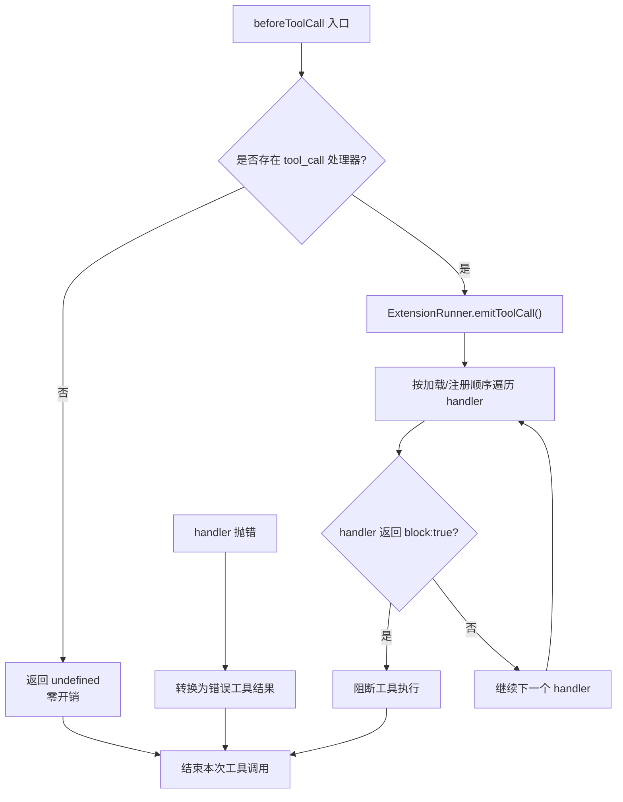
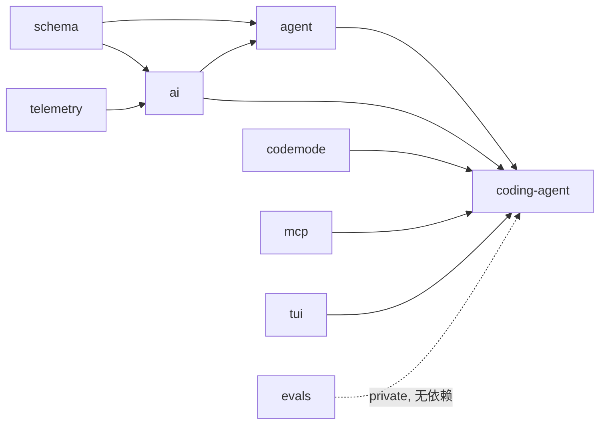

# OMCA项目文档

<cite>
**本文引用的文件**   
- [README.md](https://github.com/FDE-GROUP/oh-my-fde/blob/omca/README.md)
- [package.json](https://github.com/FDE-GROUP/oh-my-fde/blob/omca/package.json)
- [00-baseline.md](#/explains/00-baseline.md)
- [01-repo-map.md](#/explains/01-repo-map.md)
- [02-prune-plan.md](#/explains/02-prune-plan.md)
- [03-critical-path.md](#/explains/03-critical-path.md)
- [26-fork-and-prune.md](#/explains/26-fork-and-prune.md)
- [packages/coding-agent/package.json](https://github.com/FDE-GROUP/oh-my-fde/blob/omca/packages/coding-agent/package.json)
- [packages/agent/package.json](https://github.com/FDE-GROUP/oh-my-fde/blob/omca/packages/agent/package.json)
- [packages/ai/package.json](https://github.com/FDE-GROUP/oh-my-fde/blob/omca/packages/ai/package.json)
</cite>

## 更新摘要
**变更内容**
- 新增 Fork 与裁剪策略章节，详细说明代码库缩减的技术方法
- 更新项目结构部分，反映已删除的子系统（apps/p2, packages/env, packages/durable, packages/chord）
- 增强依赖关系分析，明确保留的9个核心包及其职责
- 补充 git 工作流和上游同步的最佳实践
- 更新验证状态和故障排查指南

## 目录
1. [引言](#引言)
2. [Fork 与裁剪策略](#fork-与裁剪策略)
3. [项目结构](#项目结构)
4. [核心组件](#核心组件)
5. [架构总览](#架构总览)
6. [关键路径与处理流程](#关键路径与处理流程)
7. [依赖关系分析](#依赖关系分析)
8. [性能与构建特性](#性能与构建特性)
9. [故障排查指南](#故障排查指南)
10. [结论](#结论)
11. [附录：OMCA裁剪与演进记录](#附录omca裁剪与演进记录)

## 引言
OMCA 是在 Pi 代码库基础上建立的本地工作分支，目标是围绕 `tool_call` 层做最小改动面的安全与策略增强。仓库本身是 Pi 的 monorepo，包含 CLI、Agent 运行时、多 Provider LLM 抽象、TUI、MCP、Codemode、Schema、Telemetry 等包；OMCA 在此基础上删除了 `apps/p2`、`packages/env`、`packages/chord`、`packages/durable` 等与当前目标无关的部分，并记录了基线、仓库地图、裁剪方案与关键路径。

Pi 的定位是一个"可定制的 Agent harness"，提供交互式 CLI、RPC、SDK、扩展系统、工具注册、Provider 适配和终端 UI。OMCA 不改变这些能力，而是以扩展方式在工具调用前增加写路径白名单与审计策略，同时明确区分"策略层"和"进程/文件系统级边界"。

**章节来源**
- [README.md:13-21](https://github.com/FDE-GROUP/oh-my-fde/blob/omca/README.md#L13-L21)
- [00-baseline.md:1-20](https://github.com/FDE-GROUP/oh-my-fde/blob/omca/docs/explains/00-baseline.md#L1-L20)

## Fork 与裁剪策略

### 什么是 Fork
这里的 "fork" 不是 GitHub 上的 fork 按钮，没有账号关系，也没有 push。而是在本地复制 Pi 的仓库，保留上游引用，建立自己的工作分支。

```bash
git init
git remote add upstream https://github.com/earendil-works/pi.git
git fetch upstream
git checkout -B main upstream/main
git checkout -B omca
```

| 引用 | 作用 |
|---|---|
| `upstream` | Pi 官方仓库，只读同步源 |
| `main` | 上游镜像，没有自己的提交 |
| `omca` | 所有实际工作所在的分支 |

所以"fork"= 本地 Git 分支 + 上游 remote，而不是平台意义上的 fork。

### 裁剪了什么
删除的四个子系统：

| 删除 | 文件 | 行数 | 原因 |
|---|---:|---:|---|
| `apps/p2` | 700 | 137,228 | 一个应用，依赖全部包 |
| `packages/env` | 46 | 11,272 | SSH 远程执行 daemon，依赖 durable/chord |
| `packages/durable` | 275 | 100,948 | 持久化运行时，只被 env/p2 使用 |
| `packages/chord` | 974 | 179,767 | 跨进程对象运行时，只被 durable/env/p2 使用 |
| `scripts/durable-browser-smoke-entry.ts` | 1 | 8 | 随 durable 删除 |

合计约 **1,996 个文件、43 万行**。

依据是包依赖图，不是猜测：

```
coding-agent 依赖：agent, ai, codemode, mcp, tui
ai 依赖：schema, telemetry
chord / durable / env / p2 是另一个集群
```

`coding-agent` 不依赖 `chord`、`durable`、`env` 或 `p2`，所以删掉它们不会影响 agent 的行为。

### 保留了什么
裁剪后保留 9 个包：

```
agent          agent loop、工具执行、steering/follow-up
ai             provider 适配、模型目录、认证
coding-agent   CLI、session、扩展、tools、compaction
codemode       QuickJS 沙箱
evals          评测夹具
mcp            MCP 客户端实现
schema         JSON Schema 编译/校验
telemetry      遥测契约（ai 依赖）
tui            终端渲染库
```

### 准确的 diff
以 fork 基点 `20d86c365` 比较：

```
git diff --shortstat 20d86c365
→ 2,036 files changed, 5,769 insertions(+), 429,663 deletions(-)
```

拆开看：

| 部分 | 变化 |
|---|---|
| 核心代码（agent/ai/coding-agent/tui/schema/mcp/codemode/telemetry） | 只有 `shell.ts` 删了 2 行注释 |
| 文档与验证脚本（`docs/explains`） | 30 文件，+5,710 行 |
| 删除的四个子系统 + 脚本 | 约 1,996 文件，约 43 万行 |
| 构建与脚本同步修改 | 少量增删 |

跟踪文件数：

```
fork 时：3,995
现在：   2,029（含新增的 30 份文档/脚本）
```

### "51%"的口径
两个统计口径略有差异：

- 按包行数求和：约 85.5 万 → 约 42.2 万，删除约 43.3 万，占 **50.6%**；
- 按 `git diff` 的 deletions：429,663 行，占 **约 50.3%**。

说"约 50%–51%"更准确。它衡量的是**仓库体积和需要理解的代码量**，不是"改了 Pi 一半的行为"。

### 同步修改了什么
删除会影响构建、脚本和 lockfile，所以做了这些"路标"修改：

| 文件 | 改动 |
|---|---|
| `package.json` | workspaces 去掉 `apps/*` 和 chord tutorial；build 链去掉 chord/durable/env |
| `package-lock.json` | 移除已不存在 workspace 的 stale 条目 |
| `scripts/sync-versions.test.mjs` | 去掉 `apps/p2` 用例 |
| `scripts/preview-packages.mjs` / `.test.mjs` | 去掉 `pi-env` 排除项 |
| `scripts/check-entry-graphs.mjs` | 去掉 chord/durable 的 workspace 与预算 |
| `scripts/check-browser-smoke.mjs` | 去掉 durable bundle 检查 |
| `scripts/browser-smoke-entry.ts` | 去掉 chord 导入 |
| `scripts/generate-coding-agent-install-lock.mjs` | 去掉 chord 特例 |
| `packages/coding-agent/src/utils/shell.ts` | 删除 2 行指向已删 durable 的失效注释 |

### 上游漂移处理
fork 基点是：

```
20d86c365  2026-11-05 18:07  feat(p2): Chord v2 cleanup pass
```

但 `upstream/main` 后来被某个后台 fetch 更新到了：

```
2a32a605a  2026-11-05 23:35  feat(p2): Gondolin sandbox environments
```

比基点新 11 个提交。这解释了一个容易误判的现象：用 `git diff upstream/main` 看核心代码，会看到 128 行改动，但那**不是我们的改动**，而是上游新增的 11 个提交。

正确的比较方式：

```bash
git diff 20d86c365          # 我们自己的改动
git log --oneline HEAD..upstream/main   # 上游新增的提交
```

同步上游时建议：

```bash
git fetch upstream
git rebase upstream/main
```

不要直接 `merge`，否则历史里会混入上游的合并提交，之后很难看清自己的改动。

**章节来源**
- [26-fork-and-prune.md:10-28](https://github.com/FDE-GROUP/oh-my-fde/blob/omca/docs/explains/26-fork-and-prune.md#L10-L28)
- [26-fork-and-prune.md:30-53](https://github.com/FDE-GROUP/oh-my-fde/blob/omca/docs/explains/26-fork-and-prune.md#L30-L53)
- [26-fork-and-prune.md:55-69](https://github.com/FDE-GROUP/oh-my-fde/blob/omca/docs/explains/26-fork-and-prune.md#L55-L69)
- [26-fork-and-prune.md:71-86](https://github.com/FDE-GROUP/oh-my-fde/blob/omca/docs/explains/26-fork-and-prune.md#L71-L86)
- [26-fork-and-prune.md:87-110](https://github.com/FDE-GROUP/oh-my-fde/blob/omca/docs/explains/26-fork-and-prune.md#L87-L110)
- [26-fork-and-prune.md:112-120](https://github.com/FDE-GROUP/oh-my-fde/blob/omca/docs/explains/26-fork-and-prune.md#L112-L120)
- [26-fork-and-prune.md:143-175](https://github.com/FDE-GROUP/oh-my-fde/blob/omca/docs/explains/26-fork-and-prune.md#L143-L175)

## 项目结构
仓库采用 npm workspaces monorepo 组织，根 `package.json` 声明所有 workspace，并提供统一的 build、check、test、release 脚本。核心产品入口位于 `packages/coding-agent`，它依赖 agent 运行时、AI 抽象、codemode、mcp 和 tui。



**图表来源**
- [package.json:5-11](https://github.com/FDE-GROUP/oh-my-fde/blob/omca/package.json#L5-L11)
- [packages/coding-agent/package.json:43-48](https://github.com/FDE-GROUP/oh-my-fde/blob/omca/packages/coding-agent/package.json#L43-L48)
- [packages/agent/package.json:25-28](https://github.com/FDE-GROUP/oh-my-fde/blob/omca/packages/agent/package.json#L25-L28)
- [packages/ai/package.json:77-87](https://github.com/FDE-GROUP/oh-my-fde/blob/omca/packages/ai/package.json#L77-L87)

**章节来源**
- [package.json:1-11](https://github.com/FDE-GROUP/oh-my-fde/blob/omca/package.json#L1-L11)
- [01-repo-map.md:5-21](https://github.com/FDE-GROUP/oh-my-fde/blob/omca/docs/explains/01-repo-map.md#L5-L21)

## 核心组件
OMCA 关注的核心组件集中在以下包：

| 包 | 职责 | 对 OMCA 的意义 |
|---|---|---|
| `@earendil-works/pi-coding-agent` | 交互式 CLI、会话管理、工具注册、扩展加载、TUI 集成 | 用户入口、工具实现、扩展钩子挂载点 |
| `@earendil-works/pi-agent-core` | Agent 状态机、turn/工具执行循环、事件派发 | `beforeToolCall` / `afterToolCall` 的安全策略接入点 |
| `@earendil-works/pi-ai` | 统一 LLM API、Provider 适配、流式响应 | 模型请求与 transcript 投影，不直接承载权限逻辑 |
| `@earendil-works/pi-schema` | JSON Schema / TypeBox 类型定义 | 工具参数校验的基础 |
| `@earendil-works/pi-telemetry` | 遥测契约与参考适配器 | 审计日志可能复用或扩展 |
| `@earendil-works/pi-tui` | 终端 UI 渲染 | 面向用户的提示与结果展示 |
| `@earendil-works/pi-codemode` | 模型写 JS 调工具 | 嵌套工具调用会经过同一 gate |
| `@earendil-works/pi-mcp` | MCP 客户端 | 外部工具调用也会进入 `tool_call` 钩子 |

OMCA 的第一个功能建议是：**在 `tool_call` 层实现写路径白名单扩展**，而不是修改 Agent 内核。这样能利用已有的 `block` 语义、嵌套调用覆盖、以及扩展零开销特性。

**章节来源**
- [01-repo-map.md:43-90](https://github.com/FDE-GROUP/oh-my-fde/blob/omca/docs/explains/01-repo-map.md#L43-L90)
- [03-critical-path.md:111-118](https://github.com/FDE-GROUP/oh-my-fde/blob/omca/docs/explains/03-critical-path.md#L111-L118)

## 架构总览
从一次用户 prompt 到工具执行，OMCA 需要重点理解如下分层：

```mermaid
sequenceDiagram
participant User as "用户"
participant CLI as "coding-agent CLI"
participant Session as "AgentSession"
participant Loop as "agent-loop.ts"
participant AI as "pi-ai streamFn"
participant Tools as "工具注册表"
participant Gate as "tool_call 扩展"
participant FS as "文件系统/沙箱"
User->>CLI : 输入任务
CLI->>Session : prompt()
Session->>Loop : 启动 agent loop
Loop->>AI : 构造请求并流式调用模型
AI-->>Loop : assistant 消息片段
Loop->>Tools : 解析 tool_calls
Loop->>Gate : beforeToolCall(工具名, 已校验参数)
Gate-->>Loop : block=true 或 false
alt 允许执行
Loop->>FS : 执行工具
FS-->>Loop : 工具结果
Loop->>Gate : afterToolCall(结果)
Gate-->>Loop : 审计/改写
else 阻断
Loop->>Loop : 生成错误工具结果
end
Loop-->>Session : turn_end
Session-->>CLI : 输出结果
```

**图表来源**
- [03-critical-path.md:6-25](https://github.com/FDE-GROUP/oh-my-fde/blob/omca/docs/explains/03-critical-path.md#L6-L25)
- [03-critical-path.md:27-56](https://github.com/FDE-GROUP/oh-my-fde/blob/omca/docs/explains/03-critical-path.md#L27-L56)
- [03-critical-path.md:58-75](https://github.com/FDE-GROUP/oh-my-fde/blob/omca/docs/explains/03-critical-path.md#L58-L75)

## 关键路径与处理流程

### 一次 prompt 的完整调用链
OMCA 文档明确指出，一次 prompt 的核心路径为：

```
AgentSession.prompt()
  → Agent.prompt()
  → agentLoop()
  → runAgentLoop()
  → runLoop()
      ├─ prepareNextTurn()
      ├─ prepareRequest()
      ├─ streamAssistantResponse()
      │     → config.convertToLlm()
      │     → streamFn(model, context)
      │     → emit message_start/update/end
      ├─ executeToolCalls()
      └─ finishTurn()
```

外层 while 处理 follow-up，内层处理 turn、tool、steering。`finishTurn` 返回结束动作时会直接结束，并通过 continue 保证再次发起请求。

**章节来源**
- [03-critical-path.md:6-25](https://github.com/FDE-GROUP/oh-my-fde/blob/omca/docs/explains/03-critical-path.md#L6-L25)

### 工具执行链与权限接缝
工具执行是 OMCA 最重要的接缝：

```
executeToolCalls()
  ├─ sequential?  executeToolCallsSequential()
  └─ parallel?    executeToolCallsParallel()
        └─ prepareToolCall()
             1. tools.find(name)
             2. prepareToolCallArguments()
             3. validateToolArguments()
             4. config.beforeToolCall(...)
             5. { block: true } → 错误结果，不执行
        └─ executePreparedToolCall()
             → tool.execute()
        └─ finalizeExecutedToolCall()
             → config.afterToolCall(...)
        └─ emit tool_execution_end
        └─ createToolResultMessage() + message_start/end
```

三个关键事实：
1. `beforeToolCall` 在参数 schema 校验之后运行，拿到的是已校验参数。
2. 并行模式是"预检串行、执行并发"，所有 `beforeToolCall` 在执行前按顺序跑完，gate 不需要考虑并发竞态。
3. 嵌套工具调用走同一个入口，因此 codemode 和 MCP 发起的调用也会经过 `tool_call` 钩子。

**章节来源**
- [03-critical-path.md:27-56](https://github.com/FDE-GROUP/oh-my-fde/blob/omca/docs/explains/03-critical-path.md#L27-L56)

### coding-agent 如何挂载扩展钩子
`AgentSession._installAgentToolHooks()` 将 `beforeToolCall` 和 `afterToolCall` 挂到扩展 runner。第一个返回 `{ block: true }` 的 handler 立即胜出；handler 抛错会被转换成错误工具结果，即"抛错等价于阻断"。嵌套调用通过 `_executeNestedToolCall()` 传入父调用 ID。



**图表来源**
- [03-critical-path.md:58-75](https://github.com/FDE-GROUP/oh-my-fde/blob/omca/docs/explains/03-critical-path.md#L58-L75)

**章节来源**
- [03-critical-path.md:58-75](https://github.com/FDE-GROUP/oh-my-fde/blob/omca/docs/explains/03-critical-path.md#L58-L75)

### turn/settle 边界与收敛扩展点
`finishTurn` 触发 `turn_end` 边界；`settle` 循环触发 `agent_before_settle`。OMCA 文档指出这是未来 `converge` 验证器的挂载点：在 `agent_before_settle` 中运行验证器，不通过则 `continue`，且没有处理器时零开销。

**章节来源**
- [03-critical-path.md:77-91](https://github.com/FDE-GROUP/oh-my-fde/blob/omca/docs/explains/03-critical-path.md#L77-L91)

### 工具与配置的组装
`AgentSession._buildRuntime()` 负责创建工具定义、扩展 runner 和刷新工具注册表。默认激活工具包括 read、bash、edit、write。配置文件位置分为用户级和项目级，目录名来自 `package.json` 的 `pi.configDir`，默认 `.pi`。

**章节来源**
- [03-critical-path.md:93-110](https://github.com/FDE-GROUP/oh-my-fde/blob/omca/docs/explains/03-critical-path.md#L93-L110)

### 写路径白名单的设计约束
OMCA 文档强调：**不要把"安全"寄托在 `tool_call` 上**。`tool_call` 是策略层，真正的边界必须是进程/文件系统层。

| 工具 | 可用的强制手段 | 级别 |
|---|---|---|
| write / edit | 解析 `input.path`，与白名单比对 | block 可靠 |
| bash | 只能做前缀/关键词检查，可被绕过 | 只能 advise |
| bash 真要强制 | OS 级沙箱（容器、只读挂载、用户隔离） | 内核外 |

此外，"advise"语义需要先定义：
1. 面向用户：UI 提示 + 审计日志，模型无感。
2. 面向模型：在 `tool_result` 里追加警告文本，事后可见。
3. 面向模型且事前：在 `before_agent_start` 注入策略说明，靠模型自觉。

建议组合 1 + 2：事前审计，事后把违规写入工具结果，避免"看起来拦住了其实没有"的假安全感。

**章节来源**
- [03-critical-path.md:111-158](https://github.com/FDE-GROUP/oh-my-fde/blob/omca/docs/explains/03-critical-path.md#L111-L158)

## 依赖关系分析
根据仓库地图和执行后的实际包集合，OMCA 保留的包依赖关系如下：



- `coding-agent` 的直接依赖：`agent`、`ai`、`codemode`、`mcp`、`tui`。
- 它不依赖 `chord`、`durable`、`env`、`p2`。
- `telemetry` 被 `ai` 直接依赖，是否可内联后删除仍在评估。

**图表来源**
- [01-repo-map.md:5-21](https://github.com/FDE-GROUP/oh-my-fde/blob/omca/docs/explains/01-repo-map.md#L5-L21)
- [packages/coding-agent/package.json:43-48](https://github.com/FDE-GROUP/oh-my-fde/blob/omca/packages/coding-agent/package.json#L43-L48)
- [packages/ai/package.json:77-87](https://github.com/FDE-GROUP/oh-my-fde/blob/omca/packages/ai/package.json#L77-L87)

**章节来源**
- [01-repo-map.md:5-21](https://github.com/FDE-GROUP/oh-my-fde/blob/omca/docs/explains/01-repo-map.md#L5-L21)
- [02-prune-plan.md:47-56](https://github.com/FDE-GROUP/oh-my-fde/blob/omca/docs/explains/02-prune-plan.md#L47-L56)

## 性能与构建特性
- Node 版本要求：>=22.19.0。
- 根仓库提供统一 build 链，依次构建 telemetry、schema、tui、codemode、mcp、ai、agent、coding-agent。
- `build:offline` 支持离线构建，避免拉取模型数据。
- `check` 脚本包含 lint、格式检查、依赖锁定检查、运行时依赖检查、TypeScript 类型检查、entry graph 检查和浏览器 smoke 检查。
- coding-agent 支持 unbundled 构建和 bundle 构建，并可进一步用 bun 编译二进制。
- 供应链加固：直接依赖精确锁定，lockfile 作为依赖真相，pre-commit 阻止意外提交 lockfile，CI 使用 `npm ci --ignore-scripts` 并运行 audit。

**章节来源**
- [package.json:12-55](https://github.com/FDE-GROUP/oh-my-fde/blob/omca/package.json#L12-L55)
- [package.json:67-73](https://github.com/FDE-GROUP/oh-my-fde/blob/omca/package.json#L67-L73)
- [README.md:102-111](https://github.com/FDE-GROUP/oh-my-fde/blob/omca/README.md#L102-L111)
- [README.md:168-180](https://github.com/FDE-GROUP/oh-my-fde/blob/omca/README.md#L168-L180)

## 故障排查指南
OMCA 基线记录了对既有失败的系统性分类，这对定位问题很有帮助：

| 原因 | 数量 | 说明 |
|---|---:|---|
| 缺 `rg` / `fd` | 27 | `tools.test.ts` 和部分回归测试依赖 ripgrep/fd |
| 剪贴板 / 无头环境 | 12 | clipboard 相关测试需要 X11/Wayland 工具 |
| Bun worker 生命周期 | 3 | codemode worker 测试与本机 Bun 行为差异 |
| 网络 / 模型目录 | 1 | model-catalog 协议测试依赖网络 |
| 时序 flaky | 1 | auth-storage 测试存在时序不稳定 |
| packages/env 缺 Rust daemon | 7 | env 包导入失败，随裁剪删除而消失 |

常见排查步骤：
1. 安装 `ripgrep` 与 `fd`，消除 grep/find 相关失败。
2. 在无头环境中跳过剪贴板测试，或安装 `xclip`/`wl-copy`。
3. 确认 Node 版本满足 >=22.19.0。
4. 若构建拉取模型失败，设置代理环境变量或使用离线构建。
5. 对于 flaky 测试，优先确认是否为网络或时序问题，再决定是否修复。

**章节来源**
- [00-baseline.md:37-88](https://github.com/FDE-GROUP/oh-my-fde/blob/omca/docs/explains/00-baseline.md#L37-L88)

## 结论
OMCA 不是从零开始的独立项目，而是基于 Pi monorepo 的工作分支，聚焦于在 `tool_call` 层增加写路径白名单与审计策略。其设计原则是：
- 不改 Agent 内核，优先使用已有扩展钩子。
- 明确策略层与安全边界的区别：`tool_call` 是策略，真正安全必须落在进程/文件系统层。
- 对 `bash` 这类任意命令工具只做 advise，不做虚假的字符串级"安全保证"。
- 保持渐进增强：没有处理器时零开销，有处理器时 fail closed。
- 通过 OMCA 文档记录基线、仓库地图、裁剪方案和关键路径，降低后续维护成本。

**章节来源**
- [03-critical-path.md:111-158](https://github.com/FDE-GROUP/oh-my-fde/blob/omca/docs/explains/03-critical-path.md#L111-L158)

## 附录：OMCA裁剪与演进记录

### 基线与环境
- 上游仓库：`https://github.com/earendil-works/pi.git`
- 上游提交：`20d86c365`
- 工作分支：`omca`，与 upstream/main 同步但不提交
- Node 版本：v22.23.0，满足 >=22.19.0
- 构建时需启用代理环境变量，否则 `packages/ai` 拉取 models.dev 会报网络错误

**章节来源**
- [00-baseline.md:1-20](https://github.com/FDE-GROUP/oh-my-fde/blob/omca/docs/explains/00-baseline.md#L1-L20)

### 裁剪方案与结果
- 删除 `apps/p2`、`packages/env`、`packages/chord`、`packages/durable` 及相关脚本。
- 合计删除约 1,996 个文件、约 43 万行。
- 剩余包：agent、ai、coding-agent、codemode、evals、mcp、schema、telemetry、tui。
- 裁剪后 `npm run check` 通过；`./test.sh` 失败数下降，剩余失败基本为环境问题。

**章节来源**
- [02-prune-plan.md:6-48](https://github.com/FDE-GROUP/oh-my-fde/blob/omca/docs/explains/02-prune-plan.md#L6-L48)

### 当前验证状态
- `npm run check`：通过；
- `./test.sh`：最后一次运行剩余 17 个失败，均为环境相关（剪贴板、Bun worker、模型目录网络、时序），详见 `00-baseline.md`；
- 四项基于 faux provider 的运行验证通过，见 `25-validation.md`。

**章节来源**
- [26-fork-and-prune.md:184-189](https://github.com/FDE-GROUP/oh-my-fde/blob/omca/docs/explains/26-fork-and-prune.md#L184-L189)

### 建议阅读顺序
1. 先看 `packages/agent/src/types.ts`，了解事件结构。
2. 再看 `packages/agent/src/agent-loop.ts`，掌握正常路径和工具路径。
3. 查看 `packages/coding-agent/src/core/tools/` 入口。
4. 查看 `packages/coding-agent/src/core/extensions/` 派发点。
5. 只读 `packages/ai/src/api/` 的 `streamSimple` 签名与调用点。

**章节来源**
- [01-repo-map.md:83-90](https://github.com/FDE-GROUP/oh-my-fde/blob/omca/docs/explains/01-repo-map.md#L83-L90)