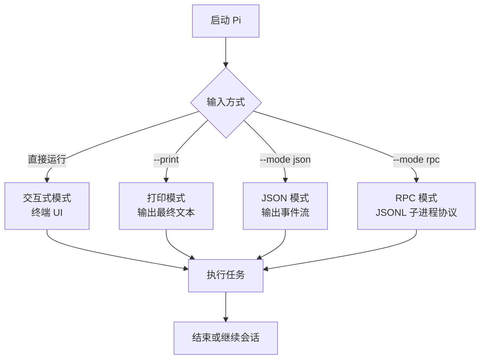
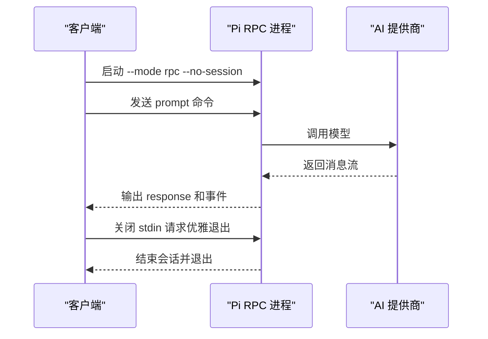

# 快速开始

<cite>
**本文引用的文件**   
- [README.md](https://github.com/FDE-GROUP/oh-my-coding-agent/blob/omca/README.md)
- [package.json](https://github.com/FDE-GROUP/oh-my-coding-agent/blob/omca/package.json)
- [packages/coding-agent/package.json](https://github.com/FDE-GROUP/oh-my-coding-agent/blob/omca/packages/coding-agent/package.json)
- [packages/coding-agent/docs/usage.md](https://github.com/FDE-GROUP/oh-my-coding-agent/blob/omca/packages/coding-agent/docs/usage.md)
- [packages/coding-agent/docs/cli.md](https://github.com/FDE-GROUP/oh-my-coding-agent/blob/omca/packages/coding-agent/docs/cli.md)
- [packages/coding-agent/docs/rpc.md](https://github.com/FDE-GROUP/oh-my-coding-agent/blob/omca/packages/coding-agent/docs/rpc.md)
</cite>

## 目录
1. [简介](#简介)
2. [环境要求](#环境要求)
3. [安装 Pi](#安装-pi)
4. [首次运行与基本配置](#首次运行与基本配置)
5. [三种入门模式](#三种入门模式)
6. [连接 AI 提供商](#连接-ai-提供商)
7. [执行第一个任务](#执行第一个任务)
8. [会话操作](#会话操作)
9. [常见问题与故障排除](#常见问题与故障排除)
10. [下一步](#下一步)

## 简介
Pi 是一个最小化、可扩展的 Agent 工具，支持在终端中交互式工作，也支持打印输出、JSON 事件流和 RPC 进程控制。你可以把它当作命令行编程助手、自动化脚本入口，或者通过 SDK/RPC 集成到自定义应用中。

对于新用户，推荐路径是：
- 使用官方安装器或 npm/Nix 安装；
- 进入项目目录运行 `pi`；
- 通过 `/login` 连接内置 AI 提供商；
- 输入一个简单任务，观察 Pi 调用工具并返回结果。

**章节来源**
- [README.md:13-21](https://github.com/FDE-GROUP/oh-my-coding-agent/blob/omca/README.md#L13-L21)
- [README.md:23-54](https://github.com/FDE-GROUP/oh-my-coding-agent/blob/omca/README.md#L23-L54)

## 环境要求
- Node.js 版本：`>=22.19.0`
- 操作系统：macOS、Linux、Windows
- 终端：支持基础交互的终端即可；高级功能（如鼠标、内联图片）依赖终端能力
- 网络：首次连接模型目录、登录提供商或刷新模型数据时可能需要网络；Nix 离线构建会优先使用预置模型目录数据

Node.js 版本约束来自仓库根和工作区包配置，Pi 的安装说明也明确要求 Node.js 22.19 或更高版本。

**章节来源**
- [package.json:67-69](https://github.com/FDE-GROUP/oh-my-coding-agent/blob/omca/package.json#L67-L69)
- [packages/coding-agent/package.json:94-96](https://github.com/FDE-GROUP/oh-my-coding-agent/blob/omca/packages/coding-agent/package.json#L94-L96)
- [README.md:43-44](https://github.com/FDE-GROUP/oh-my-coding-agent/blob/omca/README.md#L43-L44)

## 安装 Pi
### 方式一：官方安装器
适合希望快速获得稳定版本、自动处理依赖的用户。

- macOS/Linux：
  - 使用安装脚本获取 Pi；
  - 安装器会固定依赖，并通过 `pi update` 更新。
- Windows：
  - 使用 PowerShell 安装脚本。

安装完成后，可以在任意目录运行 `pi`。

**章节来源**
- [README.md:23-41](https://github.com/FDE-GROUP/oh-my-coding-agent/blob/omca/README.md#L23-L41)

### 方式二：npm 全局安装
适合已经熟悉 npm 生态的用户。

- 命令要点：
  - 使用 npm 全局安装 `@earendil-works/pi-coding-agent`；
  - 正常 npm 安装不需要执行依赖生命周期脚本；
  - npm 安装不会固定传递依赖，这与官方安装器不同。

注意：如果 Node.js 版本低于 22.19，请先升级 Node.js。

**章节来源**
- [README.md:37-44](https://github.com/FDE-GROUP/oh-my-coding-agent/blob/omca/README.md#L37-L44)
- [packages/coding-agent/package.json:2-11](https://github.com/FDE-GROUP/oh-my-coding-agent/blob/omca/packages/coding-agent/package.json#L2-L11)

### 方式三：Nix
适合希望可重复构建、隔离环境或从源码构建的用户。

- 直接运行稳定版：
  - 使用 Nix 运行 GitHub 上的稳定分支；
  - 也可将 stable 加入 profile 并升级。
- 本地构建：
  - 使用 `nix build .` 或 `nix run .` 构建当前检出代码；
  - 支持 ARM64 和 x86-64 的 Linux/macOS。
- 离线模型数据：
  - Nix 构建是离线的，预置模型数据来自 `nix/model-catalog.json`；
  - 如需手动刷新模型目录 pin，可使用对应脚本。

**章节来源**
- [README.md:56-70](https://github.com/FDE-GROUP/oh-my-coding-agent/blob/omca/README.md#L56-L70)

### 方式四：从源码开发
适合贡献者或需要调试底层行为的用户。

- 常用命令：
  - 安装依赖；
  - 构建全部包；
  - 离线构建；
  - 检查代码；
  - 运行测试；
  - 从源码运行 Pi。

**章节来源**
- [README.md:102-111](https://github.com/FDE-GROUP/oh-my-coding-agent/blob/omca/README.md#L102-L111)

## 首次运行与基本配置
### 启动 Pi
```bash
cd /path/to/project
pi
```
- Pi 会以当前目录作为工作目录；
- 它会发现项目中的文件、指令和配置；
- 首次使用时，Pi 可能询问是否信任当前项目文件夹。

### 选择模型
- 在 Pi 中输入 `/model` 或通过快捷键打开模型选择器；
- 也可以使用 CLI 参数指定模型、提供商和推理强度。

### 查看可用模型
```bash
pi --list-models
```
该命令会列出可用的模型，并可按模糊搜索过滤。

**章节来源**
- [packages/coding-agent/docs/usage.md:1-10](https://github.com/FDE-GROUP/oh-my-coding-agent/blob/omca/packages/coding-agent/docs/usage.md#L1-L10)
- [packages/coding-agent/docs/usage.md:44-53](https://github.com/FDE-GROUP/oh-my-coding-agent/blob/omca/packages/coding-agent/docs/usage.md#L44-L53)
- [packages/coding-agent/docs/cli.md:55-77](https://github.com/FDE-GROUP/oh-my-coding-agent/blob/omca/packages/coding-agent/docs/cli.md#L55-L77)

## 三种入门模式
Pi 支持多种运行界面，适合不同场景：

| 模式 | 适用场景 | 关键特点 |
|---|---|---|
| 交互式模式 | 日常终端工作、对话式编程 | 编辑器、转录、工具调用可视化 |
| 打印模式 | 一次性任务、脚本管道 | 输出最终文本后退出 |
| JSON/RPC 模式 | 自动化、IDE 集成、跨语言客户端 | 结构化事件流或长驻子进程协议 |



**图表来源**
- [packages/coding-agent/docs/cli.md:21-53](https://github.com/FDE-GROUP/oh-my-coding-agent/blob/omca/packages/coding-agent/docs/cli.md#L21-L53)
- [packages/coding-agent/docs/rpc.md:1-18](https://github.com/FDE-GROUP/oh-my-coding-agent/blob/omca/packages/coding-agent/docs/rpc.md#L1-L18)

### 交互式模式
- 在工作目录运行 `pi`；
- 在编辑器中输入提示并按回车发送；
- Pi 会显示提示、响应、工具调用、结果和错误；
- 可通过 `/model`、`/thinking`、`/login`、`/settings` 等命令调整行为。

**章节来源**
- [packages/coding-agent/docs/usage.md:1-27](https://github.com/FDE-GROUP/oh-my-coding-agent/blob/omca/packages/coding-agent/docs/usage.md#L1-L27)
- [packages/coding-agent/docs/usage.md:44-53](https://github.com/FDE-GROUP/oh-my-coding-agent/blob/omca/packages/coding-agent/docs/usage.md#L44-L53)

### 打印模式
- 适合“给一段提示，得到一次结果”的场景；
- 会将最终助手文本写入标准输出并退出；
- 可与管道结合，例如把 git diff 传给 Pi。

常见用法：
- 直接传入提示；
- 使用 `--print` 强制单次执行；
- 使用 `--mode text` 选择文本输出但不一定强制单次执行。

**章节来源**
- [packages/coding-agent/docs/cli.md:21-53](https://github.com/FDE-GROUP/oh-my-coding-agent/blob/omca/packages/coding-agent/docs/cli.md#L21-L53)

### RPC 模式
- 适合 IDE、自动化系统或其他语言客户端；
- Pi 作为长驻子进程运行；
- 通过 stdin/stdout 的 JSONL 记录通信；
- 支持命令、响应、会话事件和扩展 UI 记录。

启动示例：
```bash
pi --mode rpc --no-session
```

RPC 模式不接受 `@file` 提示参数，应通过 `prompt` 命令发送消息。

**章节来源**
- [packages/coding-agent/docs/rpc.md:1-20](https://github.com/FDE-GROUP/oh-my-coding-agent/blob/omca/packages/coding-agent/docs/rpc.md#L1-L20)
- [packages/coding-agent/docs/rpc.md:22-57](https://github.com/FDE-GROUP/oh-my-coding-agent/blob/omca/packages/coding-agent/docs/rpc.md#L22-L57)

## 连接 AI 提供商
### 在 Pi 内部登录
- 在 Pi 中输入 `/login`；
- 按照提示连接订阅或 API Key；
- 登录后即可使用内置提供商提供的模型。

这是 README 中推荐的“内置 AI 提供商”连接方式。

**章节来源**
- [README.md:52-53](https://github.com/FDE-GROUP/oh-my-coding-agent/blob/omca/README.md#L52-L53)
- [packages/coding-agent/docs/usage.md:44-53](https://github.com/FDE-GROUP/oh-my-coding-agent/blob/omca/packages/coding-agent/docs/usage.md#L44-L53)

### 使用 CLI 认证命令
适合需要在会话外管理凭据的场景：

- 登录提供商：
  ```bash
  pi auth login <provider>
  ```
- 登出提供商：
  ```bash
  pi auth logout <provider>
  ```
- 检查凭据状态：
  ```bash
  pi auth check --provider openai
  ```

CLI 认证命令支持保存 API Key、跳过浏览器登录、打印解析后的凭据等选项。

**章节来源**
- [packages/coding-agent/docs/cli.md:305-339](https://github.com/FDE-GROUP/oh-my-coding-agent/blob/omca/packages/coding-agent/docs/cli.md#L305-L339)

### 通过 CLI 参数指定模型和提供商
- `--provider`：限制模型查找范围；
- `--model`：按 ID 或名称匹配模型；
- `--api-key`：临时覆盖 API Key；
- `--thinking`：设置推理强度；
- `--models`：设置模型范围；
- `--list-models`：列出可用模型。

这些参数可用于交互式、打印、JSON 和 RPC 模式。

**章节来源**
- [packages/coding-agent/docs/cli.md:55-77](https://github.com/FDE-GROUP/oh-my-coding-agent/blob/omca/packages/coding-agent/docs/cli.md#L55-L77)

## 执行第一个任务
### 交互式模式：一句话任务
1. 进入项目目录；
2. 运行 `pi`；
3. 输入类似“总结这个仓库”的任务；
4. 观察 Pi 的工具调用和回复；
5. 如果需要，继续追加任务或调整方向。

Pi 会在转录中展示你的提示、Pi 的响应、工具调用、结果和错误。

**章节来源**
- [packages/coding-agent/docs/usage.md:1-10](https://github.com/FDE-GROUP/oh-my-coding-agent/blob/omca/packages/coding-agent/docs/usage.md#L1-L10)
- [packages/coding-agent/docs/usage.md:21-27](https://github.com/FDE-GROUP/oh-my-coding-agent/blob/omca/packages/coding-agent/docs/usage.md#L21-L27)

### 打印模式：一次性任务
```bash
pi --print "总结这个仓库"
```
- 适合脚本、CI 或管道；
- 输出最终助手文本后退出；
- 可配合 `git diff`、文件内容等输入。

**章节来源**
- [packages/coding-agent/docs/cli.md:21-53](https://github.com/FDE-GROUP/oh-my-coding-agent/blob/omca/packages/coding-agent/docs/cli.md#L21-L53)

### RPC 模式：最小客户端流程
RPC 模式的基本流程如下：



**图表来源**
- [packages/coding-agent/docs/rpc.md:12-18](https://github.com/FDE-GROUP/oh-my-coding-agent/blob/omca/packages/coding-agent/docs/rpc.md#L12-L18)
- [packages/coding-agent/docs/rpc.md:58-71](https://github.com/FDE-GROUP/oh-my-coding-agent/blob/omca/packages/coding-agent/docs/rpc.md#L58-L71)
- [packages/coding-agent/docs/rpc.md:91-97](https://github.com/FDE-GROUP/oh-my-coding-agent/blob/omca/packages/coding-agent/docs/rpc.md#L91-L97)

**章节来源**
- [packages/coding-agent/docs/rpc.md:12-20](https://github.com/FDE-GROUP/oh-my-coding-agent/blob/omca/packages/coding-agent/docs/rpc.md#L12-L20)
- [packages/coding-agent/docs/rpc.md:58-97](https://github.com/FDE-GROUP/oh-my-coding-agent/blob/omca/packages/coding-agent/docs/rpc.md#L58-L97)

## 会话操作
Pi 会自动保存会话，除非禁用会话持久化。

常用操作：
- `/new`：新建会话；
- `/resume`：恢复已保存会话；
- `/name`：为当前会话命名；
- `/session`：查看会话文件、ID、消息数、token 用量和成本；
- `pi --continue`：从相同目录恢复最近会话；
- `/compact`：压缩历史上下文；
- `/tree`、`/fork`、`/clone`：探索新分支而不丢失现有工作。

CLI 还提供更多会话参数，例如 `--continue`、`--resume`、`--session`、`--session-id`、`--fork`、`--no-session`、`--name` 等。

**章节来源**
- [packages/coding-agent/docs/usage.md:55-66](https://github.com/FDE-GROUP/oh-my-coding-agent/blob/omca/packages/coding-agent/docs/usage.md#L55-L66)
- [packages/coding-agent/docs/cli.md:78-110](https://github.com/FDE-GROUP/oh-my-coding-agent/blob/omca/packages/coding-agent/docs/cli.md#L78-L110)

## 常见问题与故障排除
### Node.js 版本不满足要求
**现象**：安装或运行时报 Node.js 版本错误。  
**原因**：Pi 要求 Node.js `>=22.19.0`。  
**解决**：升级 Node.js 后再安装或运行 Pi。

**章节来源**
- [package.json:67-69](https://github.com/FDE-GROUP/oh-my-coding-agent/blob/omca/package.json#L67-L69)
- [packages/coding-agent/package.json:94-96](https://github.com/FDE-GROUP/oh-my-coding-agent/blob/omca/packages/coding-agent/package.json#L94-L96)
- [README.md:43-44](https://github.com/FDE-GROUP/oh-my-coding-agent/blob/omca/README.md#L43-L44)

### 没有连接 AI 提供商
**现象**：无法调用模型或提示缺少凭据。  
**解决**：
- 在 Pi 中输入 `/login`；
- 或使用 `pi auth login <provider>`；
- 或通过 `--provider`、`--model`、`--api-key` 指定模型和凭据。

**章节来源**
- [README.md:52-53](https://github.com/FDE-GROUP/oh-my-coding-agent/blob/omca/README.md#L52-L53)
- [packages/coding-agent/docs/cli.md:55-77](https://github.com/FDE-GROUP/oh-my-coding-agent/blob/omca/packages/coding-agent/docs/cli.md#L55-L77)
- [packages/coding-agent/docs/cli.md:305-339](https://github.com/FDE-GROUP/oh-my-coding-agent/blob/omca/packages/coding-agent/docs/cli.md#L305-L339)

### 不知道有哪些模型可用
**现象**：不清楚支持的模型或提供商。  
**解决**：
- 在 Pi 中使用 `/model`；
- 或在 CLI 中运行 `pi --list-models`。

**章节来源**
- [packages/coding-agent/docs/usage.md:44-53](https://github.com/FDE-GROUP/oh-my-coding-agent/blob/omca/packages/coding-agent/docs/usage.md#L44-L53)
- [packages/coding-agent/docs/cli.md:75-76](https://github.com/FDE-GROUP/oh-my-coding-agent/blob/omca/packages/coding-agent/docs/cli.md#L75-L76)

### 想复用上次的工作
**现象**：希望继续之前的对话。  
**解决**：
- 在相同目录运行 `pi --continue`；
- 或在 Pi 中使用 `/resume`。

**章节来源**
- [packages/coding-agent/docs/usage.md:55-66](https://github.com/FDE-GROUP/oh-my-coding-agent/blob/omca/packages/coding-agent/docs/usage.md#L55-L66)
- [packages/coding-agent/docs/cli.md:88-93](https://github.com/FDE-GROUP/oh-my-coding-agent/blob/omca/packages/coding-agent/docs/cli.md#L88-L93)

### 想只输出文本，不进入交互界面
**现象**：希望脚本化调用 Pi。  
**解决**：
- 使用 `--print`；
- 或使用 `--mode json`、`--mode rpc`。

**章节来源**
- [packages/coding-agent/docs/cli.md:21-53](https://github.com/FDE-GROUP/oh-my-coding-agent/blob/omca/packages/coding-agent/docs/cli.md#L21-L53)

### RPC 客户端卡住或收不到事件
**现象**：RPC 模式下客户端无输出或阻塞。  
**排查建议**：
- 确保持续读取 stdout；
- 不要使用会把 Unicode 行分隔符当作记录边界的通用行读取器；
- 确认命令有唯一 `id` 以便关联响应；
- 等待 `agent_settled` 表示 Pi 不再自动继续；
- 优雅关闭时关闭 stdin，而不是直接杀死进程。

**章节来源**
- [packages/coding-agent/docs/rpc.md:35-49](https://github.com/FDE-GROUP/oh-my-coding-agent/blob/omca/packages/coding-agent/docs/rpc.md#L35-L49)
- [packages/coding-agent/docs/rpc.md:50-57](https://github.com/FDE-GROUP/oh-my-coding-agent/blob/omca/packages/coding-agent/docs/rpc.md#L50-L57)
- [packages/coding-agent/docs/rpc.md:58-71](https://github.com/FDE-GROUP/oh-my-coding-agent/blob/omca/packages/coding-agent/docs/rpc.md#L58-L71)
- [packages/coding-agent/docs/rpc.md:91-97](https://github.com/FDE-GROUP/oh-my-coding-agent/blob/omca/packages/coding-agent/docs/rpc.md#L91-L97)

### 权限与安全
**现象**：担心 Pi 访问文件系统、进程、网络或凭据。  
**说明**：
- Pi 默认以启动它的用户和进程权限运行；
- 如需更强边界，可容器化或沙箱化；
- 文档提供 Gondolin、Docker、OpenShell 等模式。

**章节来源**
- [README.md:88-97](https://github.com/FDE-GROUP/oh-my-coding-agent/blob/omca/README.md#L88-L97)

## 下一步
- 阅读完整文档：[pi.dev/docs/latest](https://pi.dev/docs/latest)
- 了解交互用法：[packages/coding-agent/docs/usage.md](https://github.com/FDE-GROUP/oh-my-coding-agent/blob/omca/packages/coding-agent/docs/usage.md)
- 了解 CLI 选项：[packages/coding-agent/docs/cli.md](https://github.com/FDE-GROUP/oh-my-coding-agent/blob/omca/packages/coding-agent/docs/cli.md)
- 了解 RPC 协议：[packages/coding-agent/docs/rpc.md](https://github.com/FDE-GROUP/oh-my-coding-agent/blob/omca/packages/coding-agent/docs/rpc.md)
- 查看仓库总览和包结构：[README.md](https://github.com/FDE-GROUP/oh-my-coding-agent/blob/omca/README.md)