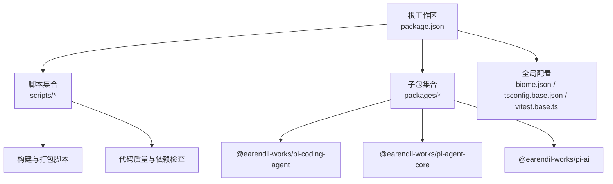
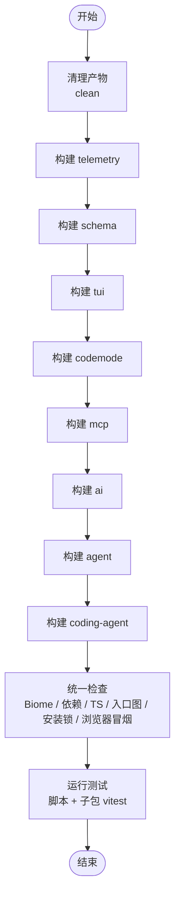
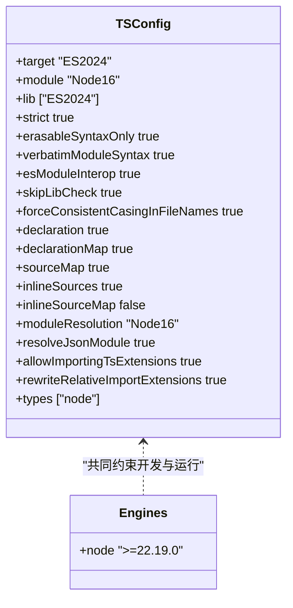
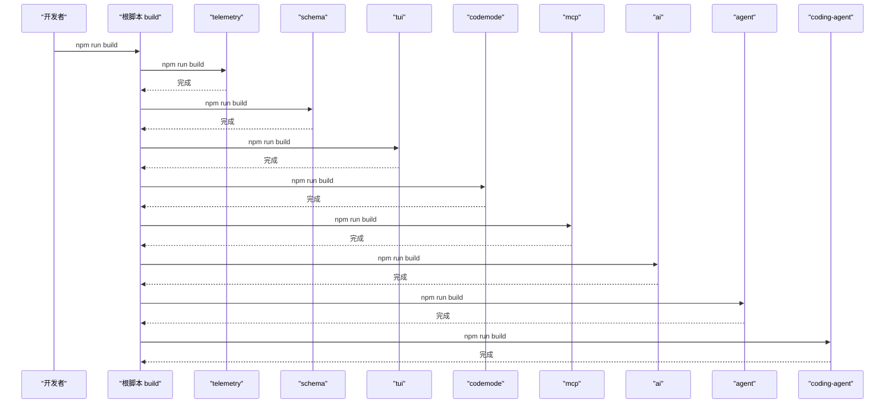
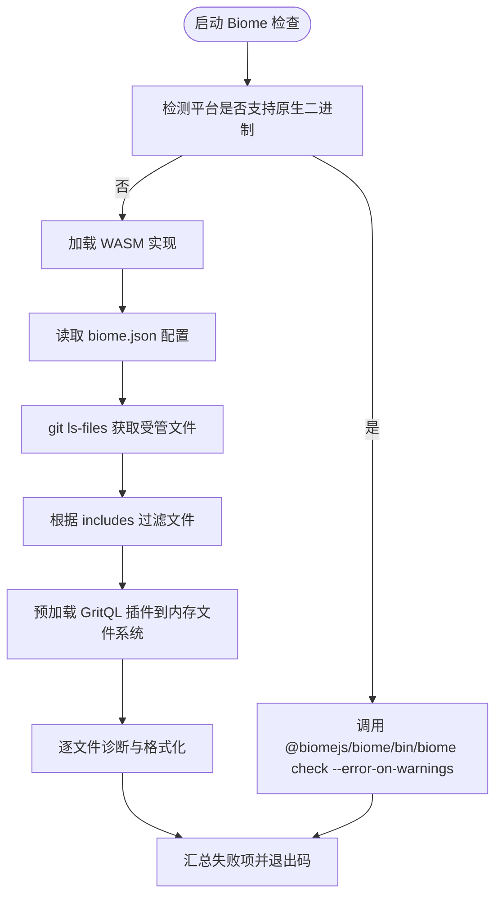
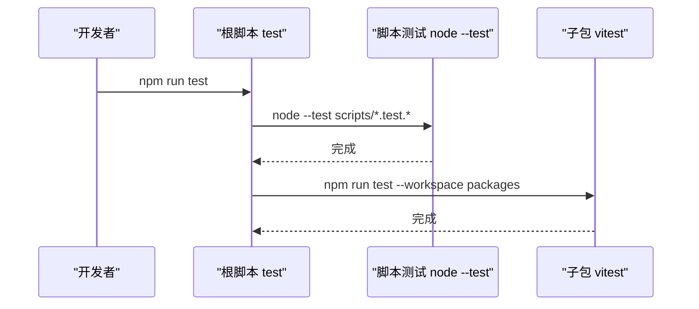

# 技术栈

<cite>
**本文引用的文件**   
- [package.json](https://github.com/FDE-GROUP/oh-my-coding-agent/blob/omca/package.json)
- [biome.json](https://github.com/FDE-GROUP/oh-my-coding-agent/blob/omca/biome.json)
- [vitest.base.ts](https://github.com/FDE-GROUP/oh-my-coding-agent/blob/omca/vitest.base.ts)
- [tsconfig.base.json](https://github.com/FDE-GROUP/oh-my-coding-agent/blob/omca/tsconfig.base.json)
- [scripts/biome-check.mjs](https://github.com/FDE-GROUP/oh-my-coding-agent/blob/omca/scripts/biome-check.mjs)
- [packages/coding-agent/package.json](https://github.com/FDE-GROUP/oh-my-coding-agent/blob/omca/packages/coding-agent/package.json)
- [packages/agent/package.json](https://github.com/FDE-GROUP/oh-my-coding-agent/blob/omca/packages/agent/package.json)
- [packages/ai/package.json](https://github.com/FDE-GROUP/oh-my-coding-agent/blob/omca/packages/ai/package.json)
</cite>

## 目录
1. [简介](#简介)
2. [项目结构](#项目结构)
3. [核心工具链总览](#核心工具链总览)
4. [架构与构建流程](#架构与构建流程)
5. [详细组件分析](#详细组件分析)
6. [依赖管理与版本控制策略](#依赖管理与版本控制策略)
7. [性能与可维护性考量](#性能与可维护性考量)
8. [开发环境搭建指南](#开发环境搭建指南)
9. [IDE 配置建议](#ide-配置建议)
10. [故障排查](#故障排查)
11. [结论](#结论)

## 简介
本文件面向 Pi 项目的开发者，系统梳理技术栈、运行环境与工具链选择依据，并给出可操作的本地开发指南。Pi 是一个基于 TypeScript 的 Monorepo，使用 Node.js 作为运行时，esbuild 作为构建工具，Biome 作为代码质量工具，Vitest 作为测试框架。仓库通过 npm workspaces 管理多个子包，并通过脚本统一编排构建、检查、发布与测试流程。

## 项目结构
仓库采用顶层 Monorepo 结构：
- 根目录包含全局工作区配置、脚本、类型与测试基础配置。
- packages 目录下按功能划分多个独立发布的子包，例如 agent、ai、codemode、coding-agent、mcp、schema、telemetry、tui 等。
- scripts 目录集中存放构建、检查、发布、模型目录生成等 Node 脚本。
- nix 目录提供 Nix 相关的包描述与模型目录数据。
- .github/workflows 用于持续集成。

图表来源
- [package.json:1-11](https://github.com/FDE-GROUP/oh-my-coding-agent/blob/omca/package.json#L1-L11)
- [package.json:12-55](https://github.com/FDE-GROUP/oh-my-coding-agent/blob/omca/package.json#L12-L55)

章节来源
- [package.json:1-11](https://github.com/FDE-GROUP/oh-my-coding-agent/blob/omca/package.json#L1-L11)
- [package.json:12-55](https://github.com/FDE-GROUP/oh-my-coding-agent/blob/omca/package.json#L12-L55)

## 核心工具链总览
- 语言与运行时
  - TypeScript 为主开发语言，目标为 ES2024，模块解析遵循 Node16。
  - Node.js 最低版本要求为 22.19.0，所有子包均声明相同引擎约束。
- 构建工具
  - esbuild 作为主要构建工具，配合各包的 tsc 编译与自定义打包脚本。
- 代码质量
  - Biome 负责格式化与 Lint，支持原生二进制与 WASM 回退路径。
- 测试框架
  - Vitest 在各子包中统一使用，测试环境为 Node，CI 下启用 GitHub Actions reporter。
- 包管理
  - npm workspaces 管理多包；根 package.json 定义统一脚本与 devDependencies。
  - pnpm 作为开发依赖之一，便于在 CI 或特定场景使用。

章节来源
- [package.json:57-69](https://github.com/FDE-GROUP/oh-my-coding-agent/blob/omca/package.json#L57-L69)
- [tsconfig.base.json:1-24](https://github.com/FDE-GROUP/oh-my-coding-agent/blob/omca/tsconfig.base.json#L1-L24)
- [packages/coding-agent/package.json:94-96](https://github.com/FDE-GROUP/oh-my-coding-agent/blob/omca/packages/coding-agent/package.json#L94-L96)
- [packages/agent/package.json:43-45](https://github.com/FDE-GROUP/oh-my-coding-agent/blob/omca/packages/agent/package.json#L43-L45)
- [packages/ai/package.json:106-108](https://github.com/FDE-GROUP/oh-my-coding-agent/blob/omca/packages/ai/package.json#L106-L108)

## 架构与构建流程
整体构建与检查流程由根脚本编排：
- 构建顺序：telemetry → schema → tui → codemode → mcp → ai → agent → coding-agent。
- 检查流程：Biome 检查与格式化、依赖锁定检查、运行时依赖检查、TypeScript 相对导入检查、入口图检查、安装锁校验、tsc 类型检查、浏览器冒烟测试。
- 测试流程：脚本级测试 + 各子包 vitest 测试。

图表来源
- [package.json:12-18](https://github.com/FDE-GROUP/oh-my-coding-agent/blob/omca/package.json#L12-L18)
- [package.json:19-26](https://github.com/FDE-GROUP/oh-my-coding-agent/blob/omca/package.json#L19-L26)
- [package.json:38-40](https://github.com/FDE-GROUP/oh-my-coding-agent/blob/omca/package.json#L38-L40)

章节来源
- [package.json:12-18](https://github.com/FDE-GROUP/oh-my-coding-agent/blob/omca/package.json#L12-L18)
- [package.json:19-26](https://github.com/FDE-GROUP/oh-my-coding-agent/blob/omca/package.json#L19-L26)
- [package.json:38-40](https://github.com/FDE-GROUP/oh-my-coding-agent/blob/omca/package.json#L38-L40)

## 详细组件分析

### TypeScript 与 Node.js 运行环境
- TypeScript 配置要点
  - 目标与库：ES2024。
  - 模块系统：Node16 模块解析与导入协议。
  - 严格模式开启，启用 erasableSyntaxOnly、verbatimModuleSyntax 等现代选项。
  - 输出声明与映射：declaration、declarationMap、sourceMap、inlineSources。
- Node.js 版本要求
  - 根与子包 engines.node 均为 >=22.19.0，确保一致的运行时能力。

图表来源
- [tsconfig.base.json:1-24](https://github.com/FDE-GROUP/oh-my-coding-agent/blob/omca/tsconfig.base.json#L1-L24)
- [package.json:67-69](https://github.com/FDE-GROUP/oh-my-coding-agent/blob/omca/package.json#L67-L69)
- [packages/coding-agent/package.json:94-96](https://github.com/FDE-GROUP/oh-my-coding-agent/blob/omca/packages/coding-agent/package.json#L94-L96)
- [packages/agent/package.json:43-45](https://github.com/FDE-GROUP/oh-my-coding-agent/blob/omca/packages/agent/package.json#L43-L45)
- [packages/ai/package.json:106-108](https://github.com/FDE-GROUP/oh-my-coding-agent/blob/omca/packages/ai/package.json#L106-L108)

章节来源
- [tsconfig.base.json:1-24](https://github.com/FDE-GROUP/oh-my-coding-agent/blob/omca/tsconfig.base.json#L1-L24)
- [package.json:67-69](https://github.com/FDE-GROUP/oh-my-coding-agent/blob/omca/package.json#L67-L69)

### 构建工具链（esbuild）
- esbuild 作为开发依赖被引入，配合各包的 tsc 编译与自定义打包脚本完成产物构建。
- coding-agent 包提供 build:binary 命令，结合 bun 进行二进制编译，同时调用内部依赖包的构建流程。
- 根脚本中的 build 命令按固定顺序构建各子包，保证依赖关系正确。

图表来源
- [package.json:12-18](https://github.com/FDE-GROUP/oh-my-coding-agent/blob/omca/package.json#L12-L18)
- [packages/coding-agent/package.json:31-37](https://github.com/FDE-GROUP/oh-my-coding-agent/blob/omca/packages/coding-agent/package.json#L31-L37)

章节来源
- [package.json:12-18](https://github.com/FDE-GROUP/oh-my-coding-agent/blob/omca/package.json#L12-L18)
- [packages/coding-agent/package.json:31-37](https://github.com/FDE-GROUP/oh-my-coding-agent/blob/omca/packages/coding-agent/package.json#L31-L37)

### 代码质量工具（Biome）
- 配置要点
  - 启用 linter 与 formatter，规则集为 recommended，并对部分规则进行开关调整。
  - 格式化设置：制表符缩进、宽度 120、行宽限制。
  - 文件包含范围覆盖 scripts、packages 源码与测试、AI catalog 与 examples。
  - 插件机制：通过 GritQL 插件扩展类型比较规则。
- 执行策略
  - 优先尝试原生二进制；若无可用平台则回退到 WASM 实现，逐文件检查与格式化。
  - 支持 --write 自动修复，并在语法错误时跳过格式化。

图表来源
- [biome.json:1-45](https://github.com/FDE-GROUP/oh-my-coding-agent/blob/omca/biome.json#L1-L45)
- [scripts/biome-check.mjs:1-124](https://github.com/FDE-GROUP/oh-my-coding-agent/blob/omca/scripts/biome-check.mjs#L1-L124)

章节来源
- [biome.json:1-45](https://github.com/FDE-GROUP/oh-my-coding-agent/blob/omca/biome.json#L1-L45)
- [scripts/biome-check.mjs:1-124](https://github.com/FDE-GROUP/oh-my-coding-agent/blob/omca/scripts/biome-check.mjs#L1-L124)

### 测试框架（Vitest）
- 统一配置
  - 根 vitest.base.ts 定义了 workspaceSourcePaths 与别名映射，将 @earendil-works/* 包名指向源码路径，便于测试直接引用源码。
  - 各子包 vitest.config.ts 启用 globals、environment=node，并在 CI 环境下切换 reporter。
- 测试入口
  - 根脚本 test 会先运行脚本级测试，再在工作区内运行各子包的 vitest。

图表来源
- [package.json:38-40](https://github.com/FDE-GROUP/oh-my-coding-agent/blob/omca/package.json#L38-L40)
- [vitest.base.ts:1-97](https://github.com/FDE-GROUP/oh-my-coding-agent/blob/omca/vitest.base.ts#L1-L97)
- [packages/codemode/vitest.config.ts:1-11](https://github.com/FDE-GROUP/oh-my-coding-agent/blob/omca/packages/codemode/vitest.config.ts#L1-L11)
- [packages/mcp/vitest.config.ts:1-11](https://github.com/FDE-GROUP/oh-my-coding-agent/blob/omca/packages/mcp/vitest.config.ts#L1-L11)
- [packages/schema/vitest.config.ts:1-11](https://github.com/FDE-GROUP/oh-my-coding-agent/blob/omca/packages/schema/vitest.config.ts#L1-L11)

章节来源
- [package.json:38-40](https://github.com/FDE-GROUP/oh-my-coding-agent/blob/omca/package.json#L38-L40)
- [vitest.base.ts:1-97](https://github.com/FDE-GROUP/oh-my-coding-agent/blob/omca/vitest.base.ts#L1-L97)

## 依赖管理与版本控制策略
- 包管理策略
  - 使用 npm workspaces 管理 packages/* 与若干示例扩展。
  - 根 package.json 集中声明 devDependencies，包括 @biomejs/biome、@biomejs/wasm-nodejs、esbuild、husky、pnpm、typescript、yaml。
  - 通过 overrides 强制 protobufjs 版本，避免传递依赖冲突。
- 依赖锁定与一致性
  - 存在 check:pinned-deps 与 check-runtime-deps 脚本，用于校验依赖锁定与运行时依赖。
  - install-lock:coding-agent 与 generate-coding-agent-install-lock 用于生成与校验安装锁。
- 版本同步与发布
  - version:* 系列脚本配合 sync-versions.js 同步工作区版本，并使用 --ignore-scripts 仅更新 lock。
  - publish 与 release 系列脚本封装发布流程，prepublishOnly 触发 clean、build、check。
- 最佳实践建议
  - 保持 Node.js 版本一致（>=22.19.0）。
  - 新增依赖需评估运行时影响，并通过 check-runtime-deps 验证。
  - 对第三方依赖尽量 pin 版本，必要时使用 overrides 收敛冲突。
  - 提交前运行 check 以统一代码风格与类型检查。

章节来源
- [package.json:1-11](https://github.com/FDE-GROUP/oh-my-coding-agent/blob/omca/package.json#L1-L11)
- [package.json:19-26](https://github.com/FDE-GROUP/oh-my-coding-agent/blob/omca/package.json#L19-L26)
- [package.json:41-55](https://github.com/FDE-GROUP/oh-my-coding-agent/blob/omca/package.json#L41-L55)
- [package.json:57-73](https://github.com/FDE-GROUP/oh-my-coding-agent/blob/omca/package.json#L57-L73)

## 性能与可维护性考量
- 构建性能
  - esbuild 提供高性能构建能力，适合大型 Monorepo 的增量构建。
  - 根脚本按依赖顺序构建，减少重复编译。
- 代码质量
  - Biome 的规则集与格式化策略统一团队风格，WASM 回退提升跨平台兼容性。
- 测试效率
  - Vitest 在 Node 环境下运行，CI 下使用 dot/github-actions reporter 提高可读性。
  - 通过别名映射直接引用源码，避免构建产物依赖导致测试不稳定。

[本节为通用指导，不直接分析具体文件]

## 开发环境搭建指南
- 前置条件
  - 安装 Node.js 版本满足 engines.node 要求（>=22.19.0）。
  - 建议使用 git 以支持 Biome 的文件扫描与 husky 钩子。
- 安装依赖
  - 在项目根目录执行 npm install，安装 workspaces 与 devDependencies。
- 常用命令
  - 构建：npm run build
  - 检查：npm run check
  - 测试：npm run test
  - 发布：npm run publish（或 dry-run：npm run publish:dry）
- 可选工具
  - pnpm：作为开发依赖，可在需要时使用 pnpm 命令。
  - husky：prepare 阶段自动初始化钩子。

章节来源
- [package.json:67-69](https://github.com/FDE-GROUP/oh-my-coding-agent/blob/omca/package.json#L67-L69)
- [package.json:12-18](https://github.com/FDE-GROUP/oh-my-coding-agent/blob/omca/package.json#L12-L18)
- [package.json:19-26](https://github.com/FDE-GROUP/oh-my-coding-agent/blob/omca/package.json#L19-L26)
- [package.json:38-40](https://github.com/FDE-GROUP/oh-my-coding-agent/blob/omca/package.json#L38-L40)
- [package.json:45-55](https://github.com/FDE-GROUP/oh-my-coding-agent/blob/omca/package.json#L45-L55)

## IDE 配置建议
- TypeScript
  - 使用 tsconfig.base.json 作为基础配置，确保编辑器识别 target、module、strict 等选项。
- Biome
  - 在 IDE 中启用 Biome 扩展，加载 biome.json 配置，以获得实时 Lint 与格式化提示。
  - 若平台不支持原生二进制，脚本会自动回退到 WASM，不影响编辑器体验。
- Vitest
  - 启用 Vitest 测试运行器，利用 vitest.base.ts 的别名映射，直接在 IDE 中运行与调试测试。
- Husky
  - 确保 prepare 已执行，以便在提交前触发 pre-commit 钩子（如 Biome 检查）。

章节来源
- [tsconfig.base.json:1-24](https://github.com/FDE-GROUP/oh-my-coding-agent/blob/omca/tsconfig.base.json#L1-L24)
- [biome.json:1-45](https://github.com/FDE-GROUP/oh-my-coding-agent/blob/omca/biome.json#L1-L45)
- [vitest.base.ts:1-97](https://github.com/FDE-GROUP/oh-my-coding-agent/blob/omca/vitest.base.ts#L1-L97)
- [package.json:55](https://github.com/FDE-GROUP/oh-my-coding-agent/blob/omca/package.json#L55)

## 故障排查
- Biome 检查失败
  - 确认平台是否支持原生二进制；否则脚本会使用 WASM 实现。
  - 使用 scripts/biome-check.mjs --write 自动修复格式问题。
  - 检查 biome.json 的 files.includes 是否包含目标文件。
- 依赖冲突
  - 使用 overrides 固定冲突依赖版本（如 protobufjs）。
  - 运行 check:pinned-deps 与 check-runtime-deps 定位问题。
- 测试无法解析包名
  - 确认 vitest.base.ts 的别名映射是否正确，确保 @earendil-works/* 指向源码路径。
  - 检查子包 vitest.config.ts 的 resolve.conditions 是否包含 source。

章节来源
- [scripts/biome-check.mjs:1-124](https://github.com/FDE-GROUP/oh-my-coding-agent/blob/omca/scripts/biome-check.mjs#L1-L124)
- [biome.json:26-44](https://github.com/FDE-GROUP/oh-my-coding-agent/blob/omca/biome.json#L26-L44)
- [package.json:71-73](https://github.com/FDE-GROUP/oh-my-coding-agent/blob/omca/package.json#L71-L73)
- [vitest.base.ts:45-96](https://github.com/FDE-GROUP/oh-my-coding-agent/blob/omca/vitest.base.ts#L45-L96)

## 结论
Pi 的技术栈围绕 TypeScript、Node.js、esbuild、Biome 与 Vitest 构建，形成高效、稳定且可维护的开发闭环。Monorepo 结构与统一脚本确保了构建、检查与测试的一致性；Biome 的跨平台回退与 Vitest 的源码别名映射提升了开发体验与测试可靠性。遵循本文档的环境与配置建议，可以快速搭建本地开发环境并稳定推进迭代。

[本节为总结性内容，不直接分析具体文件]