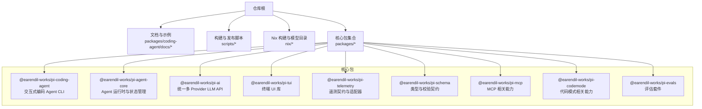
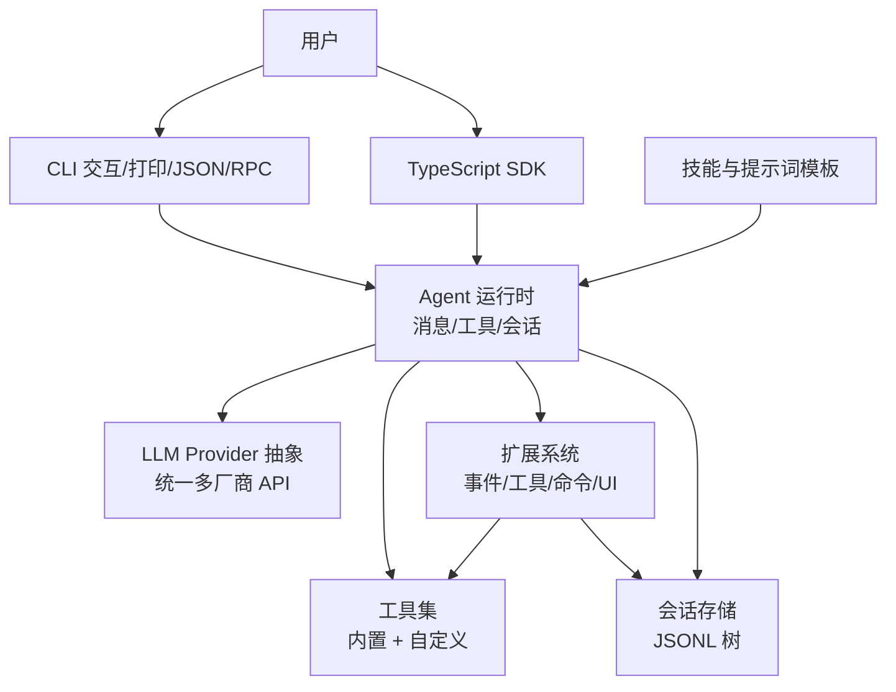
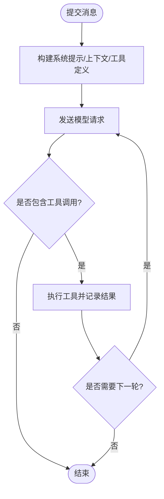
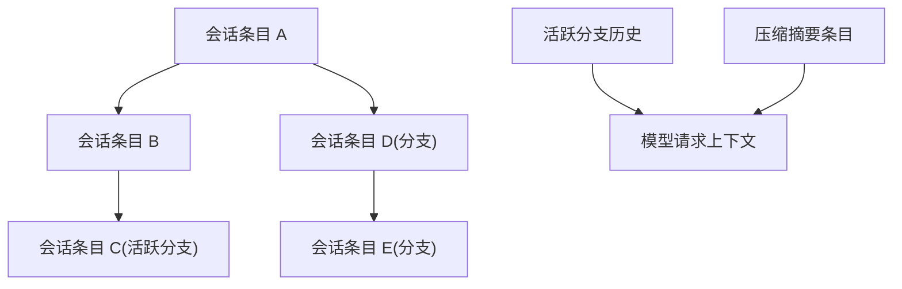
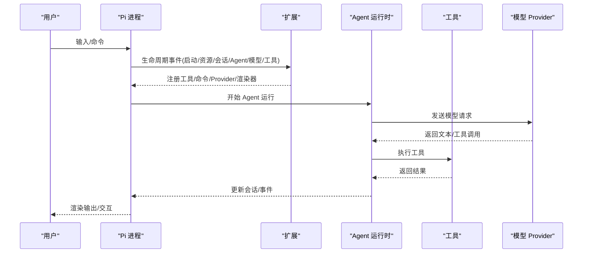
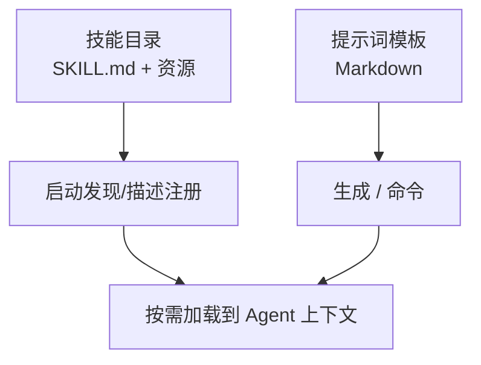
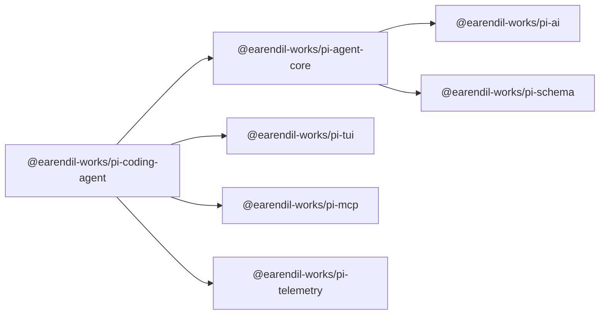

# 项目介绍

<cite>
**本文引用的文件**   
- [README.md](https://github.com/FDE-GROUP/oh-my-fde/blob/omca/README.md)
- [package.json](https://github.com/FDE-GROUP/oh-my-fde/blob/omca/package.json)
- [how-pi-works.md](https://github.com/FDE-GROUP/oh-my-fde/blob/omca/packages/coding-agent/docs/how-pi-works.md)
- [extensions.md](https://github.com/FDE-GROUP/oh-my-fde/blob/omca/packages/coding-agent/docs/extensions.md)
- [skills.md](https://github.com/FDE-GROUP/oh-my-fde/blob/omca/packages/coding-agent/docs/skills.md)
- [prompt-templates.md](https://github.com/FDE-GROUP/oh-my-fde/blob/omca/packages/coding-agent/docs/prompt-templates.md)
</cite>

## 目录
1. [引言](#引言)
2. [项目结构](#项目结构)
3. [核心组件](#核心组件)
4. [架构总览](#架构总览)
5. [详细组件分析](#详细组件分析)
6. [依赖关系分析](#依赖关系分析)
7. [性能与可扩展性](#性能与可扩展性)
8. [故障排查与安全](#故障排查与安全)
9. [结论](#结论)
10. [附录：快速上手与生态](#附录快速上手与生态)

## 引言
Pi 是一个“最小化、可扩展的 AI Agent 框架”。它的核心价值在于：让开发者把 Pi 适配到自己的工作流程，而不是反过来。Pi 提供强大的默认能力，同时通过扩展、技能、提示词模板和主题等机制，允许你按需定制行为、工具链与交互界面，并以包的形式在 npm 或 git 上分发。

- 目标用户
  - 希望用 AI Agent 提升开发效率的个人开发者与团队
  - 需要可插拔工具链、权限控制与审计能力的工程团队
  - 希望在 CLI、RPC、SDK 多种接口中复用同一 Agent 逻辑的工程师
  - 希望构建行业/企业专属 Agent 工作流的集成商

- 主要应用场景
  - 交互式代码助手与自动化任务编排
  - 基于工具的复杂多轮对话（模型调用 + 工具执行）
  - 将 Agent 嵌入终端、脚本、CI/CD 或自有应用
  - 以包形式沉淀团队规范、Prompt 模板、技能与主题

- 独特优势
  - 最小内核：不强制内置子 Agent 与计划模式，按需扩展
  - 强扩展点：事件驱动、生命周期钩子、自定义工具与 UI
  - 模块化设计：CLI、Agent 运行时、AI 统一 API、TUI、遥测等拆分为独立包
  - 多接口一致：交互式、打印、JSON、RPC、TypeScript SDK 共享同一会话与 Agent 机制
  - 安全可控：信任模型、容器化与沙箱方案可选

- 与其他 AI 工具的区别
  - 更强调“可定制的工作流”，而非仅聊天式问答
  - 通过扩展与技能实现“领域知识 + 工具”的组合式装配
  - 提供进程内 SDK 与 RPC 模式，便于二次开发与系统集成
  - 开源协议为 MIT，社区生态围绕 npm/git 包与技能分发

- 开源协议、社区与发展愿景
  - 许可证：MIT
  - 社区入口：Discord 社区、npm 包、官方文档站点
  - 发展愿景：持续完善 Agent 运行时、Provider 抽象、会话与上下文管理、以及面向生产的安全与可观测性能力

**章节来源**
- [README.md:13-21](https://github.com/FDE-GROUP/oh-my-fde/blob/omca/README.md#L13-L21)
- [README.md:198-200](https://github.com/FDE-GROUP/oh-my-fde/blob/omca/README.md#L198-L200)

## 项目结构
Pi 采用 monorepo 组织方式，核心能力被拆分为多个 npm 包，便于独立演进与复用。根目录包含安装脚本、构建脚本、Nix 配置与仓库级文档；`packages/` 下是各功能域的实现。

**图表来源**
- [README.md:72-86](https://github.com/FDE-GROUP/oh-my-fde/blob/omca/README.md#L72-L86)
- [package.json:1-11](https://github.com/FDE-GROUP/oh-my-fde/blob/omca/package.json#L1-L11)

**章节来源**
- [README.md:72-86](https://github.com/FDE-GROUP/oh-my-fde/blob/omca/README.md#L72-L86)
- [package.json:1-11](https://github.com/FDE-GROUP/oh-my-fde/blob/omca/package.json#L1-L11)

## 核心组件
- Agent 运行时与工具调用
  - 负责消息入队、系统提示构建、模型请求、工具执行与会话树维护
  - 支持多轮 turn：一次模型响应可能触发多次工具调用，直到无需继续
- 会话与会话树
  - 会话以 JSONL 持久化，树形结构记录消息、工具结果、摘要压缩等事件
  - 支持分支、分叉、克隆与压缩，保持历史可追溯
- 扩展系统
  - 通过 TypeScript 模块注入工具、命令、快捷键、Provider、渲染器与 TUI
  - 丰富的生命周期事件用于拦截、审计、增强与治理
- 技能与提示词模板
  - 技能提供“按需加载”的专业指令与资源
  - 提示词模板将 Markdown 转为可复用的 `/` 命令
- 多接口一致性
  - 交互式、打印、JSON、RPC、SDK 共享同一 Agent 与会话机制

**章节来源**
- [how-pi-works.md:1-50](https://github.com/FDE-GROUP/oh-my-fde/blob/omca/packages/coding-agent/docs/how-pi-works.md#L1-L50)
- [extensions.md:1-32](https://github.com/FDE-GROUP/oh-my-fde/blob/omca/packages/coding-agent/docs/extensions.md#L1-L32)
- [skills.md:1-10](https://github.com/FDE-GROUP/oh-my-fde/blob/omca/packages/coding-agent/docs/skills.md#L1-L10)
- [prompt-templates.md:1-10](https://github.com/FDE-GROUP/oh-my-fde/blob/omca/packages/coding-agent/docs/prompt-templates.md#L1-L10)

## 架构总览
下图展示 Pi 的高层架构：用户通过不同接口与 Agent 交互，Agent 协调模型请求与工具执行，并通过扩展与技能增强能力。

**图表来源**
- [how-pi-works.md:1-50](https://github.com/FDE-GROUP/oh-my-fde/blob/omca/packages/coding-agent/docs/how-pi-works.md#L1-L50)
- [extensions.md:1-32](https://github.com/FDE-GROUP/oh-my-fde/blob/omca/packages/coding-agent/docs/extensions.md#L1-L32)
- [skills.md:1-10](https://github.com/FDE-GROUP/oh-my-fde/blob/omca/packages/coding-agent/docs/skills.md#L1-L10)

## 详细组件分析

### Agent 循环与工具执行流程
Pi 的核心处理路径是“提交消息 → 构建请求 → 模型响应 → 工具执行 → 必要时继续”。该流程在多轮 turn 中迭代，直到不需要进一步模型请求为止。

**图表来源**
- [how-pi-works.md:7-14](https://github.com/FDE-GROUP/oh-my-fde/blob/omca/packages/coding-agent/docs/how-pi-works.md#L7-L14)

**章节来源**
- [how-pi-works.md:7-14](https://github.com/FDE-GROUP/oh-my-fde/blob/omca/packages/coding-agent/docs/how-pi-works.md#L7-L14)

### 会话与上下文管理
会话是 Pi 对一次对话的完整记录，包括消息、工具调用与结果、模型变更、压缩摘要等。会话以树形结构保存，当前活跃分支决定下一次模型请求的历史上下文。

**图表来源**
- [how-pi-works.md:25-32](https://github.com/FDE-GROUP/oh-my-fde/blob/omca/packages/coding-agent/docs/how-pi-works.md#L25-L32)

**章节来源**
- [how-pi-works.md:25-32](https://github.com/FDE-GROUP/oh-my-fde/blob/omca/packages/coding-agent/docs/how-pi-works.md#L25-L32)

### 扩展系统与生命周期
扩展是 Pi 的行为增强中心，可以注册工具、命令、快捷键、Provider、渲染器与 TUI，并通过事件订阅实现拦截、审计与治理。

**图表来源**
- [extensions.md:1-32](https://github.com/FDE-GROUP/oh-my-fde/blob/omca/packages/coding-agent/docs/extensions.md#L1-L32)
- [extensions.md:305-425](https://github.com/FDE-GROUP/oh-my-fde/blob/omca/packages/coding-agent/docs/extensions.md#L305-L425)

**章节来源**
- [extensions.md:1-32](https://github.com/FDE-GROUP/oh-my-fde/blob/omca/packages/coding-agent/docs/extensions.md#L1-L32)
- [extensions.md:305-425](https://github.com/FDE-GROUP/oh-my-fde/blob/omca/packages/coding-agent/docs/extensions.md#L305-L425)

### 技能与提示词模板
- 技能：按需提供专业指令与资源，适合“比提示词模板更重但无需新工具”的场景
- 提示词模板：将 Markdown 转为可复用的 `/` 命令，适合“重复使用的提示语”

**图表来源**
- [skills.md:1-10](https://github.com/FDE-GROUP/oh-my-fde/blob/omca/packages/coding-agent/docs/skills.md#L1-L10)
- [prompt-templates.md:1-10](https://github.com/FDE-GROUP/oh-my-fde/blob/omca/packages/coding-agent/docs/prompt-templates.md#L1-L10)

**章节来源**
- [skills.md:1-10](https://github.com/FDE-GROUP/oh-my-fde/blob/omca/packages/coding-agent/docs/skills.md#L1-L10)
- [prompt-templates.md:1-10](https://github.com/FDE-GROUP/oh-my-fde/blob/omca/packages/coding-agent/docs/prompt-templates.md#L1-L10)

## 依赖关系分析
Pi 的 monorepo 将 CLI、Agent 运行时、AI 统一 API、TUI、遥测、Schema、MCP、Codemode 与评估等解耦为独立包，便于单独测试、发布与升级。

**图表来源**
- [README.md:72-86](https://github.com/FDE-GROUP/oh-my-fde/blob/omca/README.md#L72-L86)
- [package.json:12-18](https://github.com/FDE-GROUP/oh-my-fde/blob/omca/package.json#L12-L18)

**章节来源**
- [README.md:72-86](https://github.com/FDE-GROUP/oh-my-fde/blob/omca/README.md#L72-L86)
- [package.json:12-18](https://github.com/FDE-GROUP/oh-my-fde/blob/omca/package.json#L12-L18)

## 性能与可扩展性
- 可扩展性
  - 扩展点丰富：事件、工具、命令、Provider、渲染器、TUI、MCP
  - 资源按需加载：技能仅在需要时加载完整指令，减少上下文开销
  - 多接口复用：CLI、RPC、SDK 共享同一 Agent 与会话机制，降低重复实现成本
- 性能考量
  - 会话压缩：插入摘要条目替代旧消息，降低后续请求长度
  - 并行工具执行：在支持的情况下并发执行工具，缩短整体耗时
  - Provider 抽象：统一多厂商 API，便于缓存与优化传输细节

[本节为通用指导，不直接分析具体文件]

## 故障排查与安全
- 信任与权限
  - Pi 默认以启动它的用户与进程权限运行，不包含内置的文件系统、进程、网络或凭据访问限制
  - 如需更强隔离，可使用容器化或沙箱方案（例如 Gondolin、Docker、OpenShell）
- 扩展安全
  - 扩展在 Pi 进程内运行，拥有操作系统权限；仅加载可信来源的扩展
  - 项目本地扩展需先通过项目信任决策再加载
- 会话与压缩
  - 压缩失败或中断可通过事件监听与重试机制定位问题
  - 会话树导航与分叉/克隆有助于回溯与对比不同分支的处理结果

**章节来源**
- [README.md:88-96](https://github.com/FDE-GROUP/oh-my-fde/blob/omca/README.md#L88-L96)
- [extensions.md:121-136](https://github.com/FDE-GROUP/oh-my-fde/blob/omca/packages/coding-agent/docs/extensions.md#L121-L136)
- [how-pi-works.md:47-50](https://github.com/FDE-GROUP/oh-my-fde/blob/omca/packages/coding-agent/docs/how-pi-works.md#L47-L50)

## 结论
Pi 的定位是“最小化内核 + 高度可扩展的 Agent 框架”。它通过事件驱动的扩展系统、按需加载的技能与提示词模板、统一的 Provider 抽象与一致的会话机制，帮助开发者将 AI Agent 深度融入自己的工具链与工作流。对于初学者，可以从交互式 CLI 入手；对于工程团队，可以通过扩展、技能与包机制沉淀团队规范；对于集成商，可以利用 SDK 与 RPC 将 Pi 嵌入自有产品。

[本节为总结性内容，不直接分析具体文件]

## 附录：快速上手与生态
- 快速安装与运行
  - 使用官方安装脚本或 npm 全局安装
  - 在目标项目目录下运行 `pi`，通过内置 Provider 登录并给出任务
- Nix 运行
  - 支持稳定版与源码构建，离线构建时使用预置模型目录
- 包与生态
  - 通过 npm 或 git 分享 Pi 包（扩展、技能、提示词模板、主题）
  - 社区与文档站点提供示例、最佳实践与进阶指南

**章节来源**
- [README.md:23-54](https://github.com/FDE-GROUP/oh-my-fde/blob/omca/README.md#L23-L54)
- [README.md:56-70](https://github.com/FDE-GROUP/oh-my-fde/blob/omca/README.md#L56-L70)
- [README.md:198-200](https://github.com/FDE-GROUP/oh-my-fde/blob/omca/README.md#L198-L200)