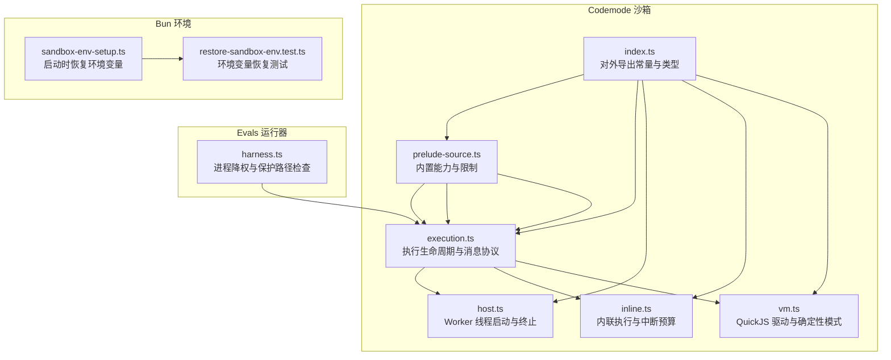
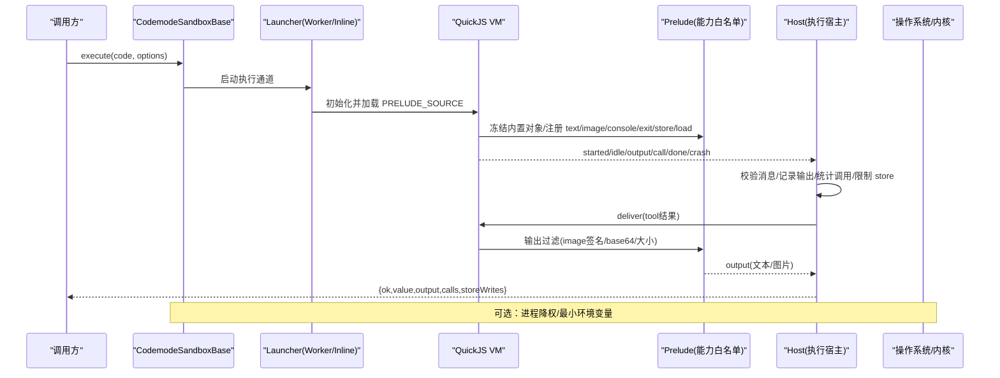
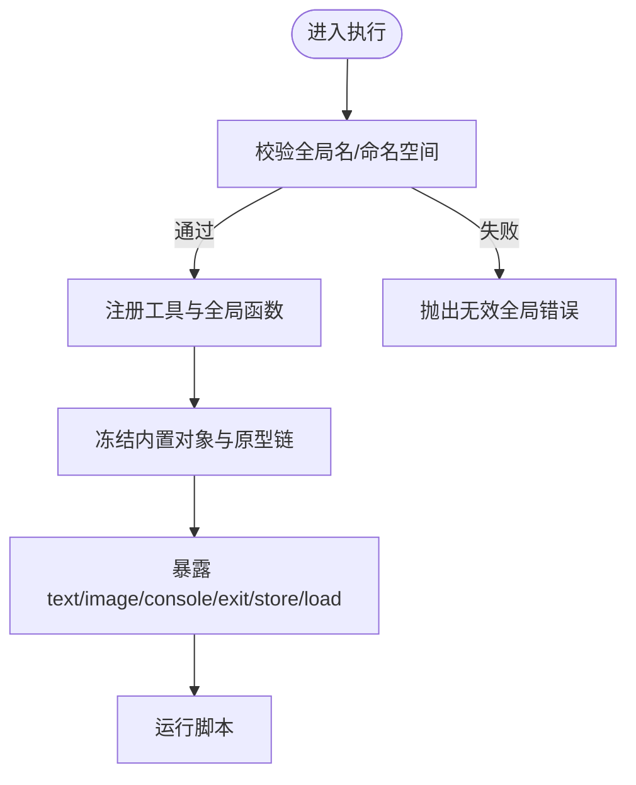
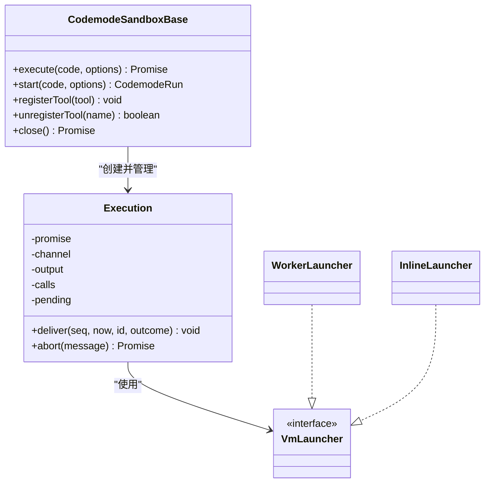
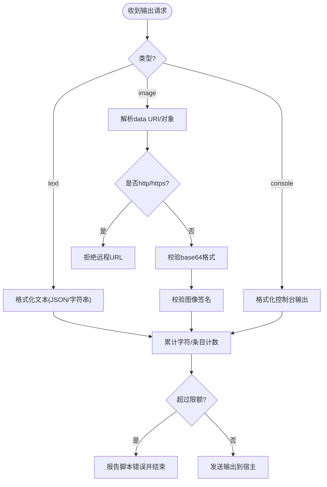
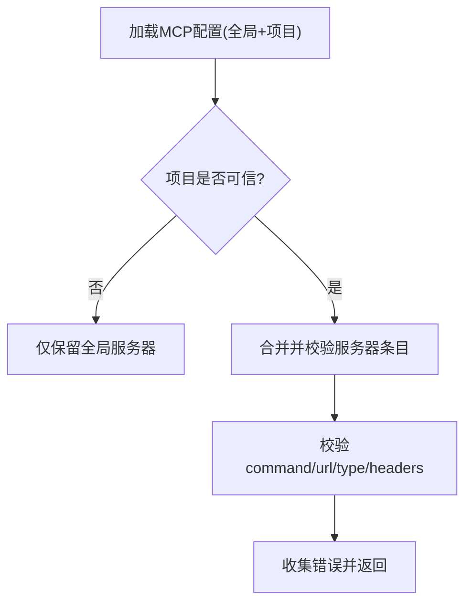
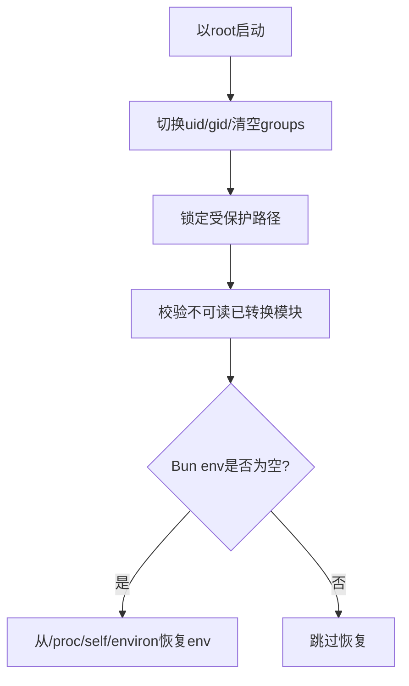
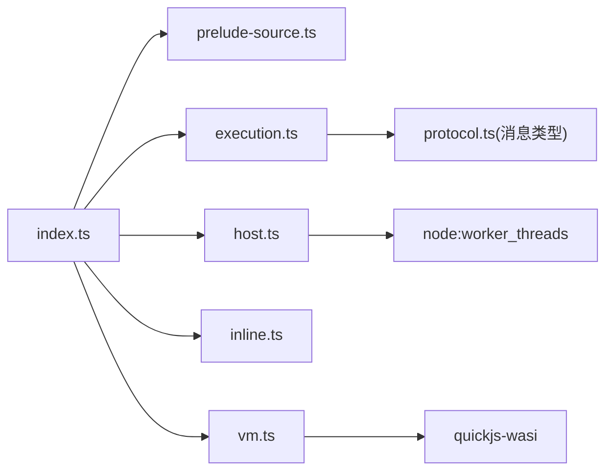

# 安全沙箱机制

**本文引用的文件**   
- [packages/codemode/src/runtime/prelude-source.ts](https://github.com/FDE-GROUP/oh-my-fde/blob/main/packages/codemode/src/runtime/prelude-source.ts)
- [packages/codemode/src/runtime/execution.ts](https://github.com/FDE-GROUP/oh-my-fde/blob/main/packages/codemode/src/runtime/execution.ts)
- [packages/codemode/src/runtime/host.ts](https://github.com/FDE-GROUP/oh-my-fde/blob/main/packages/codemode/src/runtime/host.ts)
- [packages/codemode/src/runtime/inline.ts](https://github.com/FDE-GROUP/oh-my-fde/blob/main/packages/codemode/src/runtime/inline.ts)
- [packages/codemode/src/runtime/vm.ts](https://github.com/FDE-GROUP/oh-my-fde/blob/main/packages/codemode/src/runtime/vm.ts)
- [packages/codemode/src/index.ts](https://github.com/FDE-GROUP/oh-my-fde/blob/main/packages/codemode/src/index.ts)
- [packages/codemode/test/sandbox.test.ts](https://github.com/FDE-GROUP/oh-my-fde/blob/main/packages/codemode/test/sandbox.test.ts)
- [packages/evals/src/harness.ts](https://github.com/FDE-GROUP/oh-my-fde/blob/main/packages/evals/src/harness.ts)
- [packages/coding-agent/src/bun/sandbox-env-setup.ts](https://github.com/FDE-GROUP/oh-my-fde/blob/main/packages/coding-agent/src/bun/sandbox-env-setup.ts)
- [packages/coding-agent/test/restore-sandbox-env.test.ts](https://github.com/FDE-GROUP/oh-my-fde/blob/main/packages/coding-agent/test/restore-sandbox-env.test.ts)

## 目录
1. [引言](#引言)
2. [项目结构](#项目结构)
3. [核心组件](#核心组件)
4. [架构总览](#架构总览)
5. [详细组件分析](#详细组件分析)
6. [依赖关系分析](#依赖关系分析)
7. [性能与资源限制](#性能与资源限制)
8. [故障排查指南](#故障排查指南)
9. [结论](#结论)
10. [附录：配置与安全清单](#附录配置与安全清单)

## 引言
本文件系统化梳理代码库中的“工具系统安全机制”，重点覆盖权限模型、沙箱隔离、访问控制、资源限制、信任管理、输出过滤与安全校验流程，并给出可操作的安全配置建议、风险评估方法与最佳实践。该机制的核心是 Codemode 沙箱：在受控的 QuickJS VM 中执行不受信任的工具脚本，通过预置能力白名单、严格的输出与存储限制、进程级降权与最小环境暴露等手段，实现强隔离与可控的资源使用。

## 项目结构
围绕安全沙箱的关键代码集中在 codemode 运行时与 evals 运行器中，同时包含 Bun 环境下的沙箱环境变量恢复逻辑。

**图表来源**
- [packages/codemode/src/runtime/prelude-source.ts:1-523](https://github.com/FDE-GROUP/oh-my-fde/blob/main/packages/codemode/src/runtime/prelude-source.ts#L1-L523)
- [packages/codemode/src/runtime/execution.ts:1-574](https://github.com/FDE-GROUP/oh-my-fde/blob/main/packages/codemode/src/runtime/execution.ts#L1-L574)
- [packages/codemode/src/runtime/host.ts:1-89](https://github.com/FDE-GROUP/oh-my-fde/blob/main/packages/codemode/src/runtime/host.ts#L1-L89)
- [packages/codemode/src/runtime/inline.ts:1-127](https://github.com/FDE-GROUP/oh-my-fde/blob/main/packages/codemode/src/runtime/inline.ts#L1-L127)
- [packages/codemode/src/runtime/vm.ts:1-342](https://github.com/FDE-GROUP/oh-my-fde/blob/main/packages/codemode/src/runtime/vm.ts#L1-L342)
- [packages/codemode/src/index.ts:1-66](https://github.com/FDE-GROUP/oh-my-fde/blob/main/packages/codemode/src/index.ts#L1-L66)
- [packages/evals/src/harness.ts:154-188](https://github.com/FDE-GROUP/oh-my-fde/blob/main/packages/evals/src/harness.ts#L154-L188)
- [packages/coding-agent/src/bun/sandbox-env-setup.ts:1-5](https://github.com/FDE-GROUP/oh-my-fde/blob/main/packages/coding-agent/src/bun/sandbox-env-setup.ts#L1-L5)
- [packages/coding-agent/test/restore-sandbox-env.test.ts:1-77](https://github.com/FDE-GROUP/oh-my-fde/blob/main/packages/coding-agent/test/restore-sandbox-env.test.ts#L1-L77)

**章节来源**
- [packages/codemode/src/index.ts:1-66](https://github.com/FDE-GROUP/oh-my-fde/blob/main/packages/codemode/src/index.ts#L1-L66)
- [packages/codemode/src/runtime/prelude-source.ts:1-523](https://github.com/FDE-GROUP/oh-my-fde/blob/main/packages/codemode/src/runtime/prelude-source.ts#L1-L523)
- [packages/codemode/src/runtime/execution.ts:1-574](https://github.com/FDE-GROUP/oh-my-fde/blob/main/packages/codemode/src/runtime/execution.ts#L1-L574)
- [packages/codemode/src/runtime/host.ts:1-89](https://github.com/FDE-GROUP/oh-my-fde/blob/main/packages/codemode/src/runtime/host.ts#L1-L89)
- [packages/codemode/src/runtime/inline.ts:1-127](https://github.com/FDE-GROUP/oh-my-fde/blob/main/packages/codemode/src/runtime/inline.ts#L1-L127)
- [packages/codemode/src/runtime/vm.ts:1-342](https://github.com/FDE-GROUP/oh-my-fde/blob/main/packages/codemode/src/runtime/vm.ts#L1-L342)
- [packages/evals/src/harness.ts:154-188](https://github.com/FDE-GROUP/oh-my-fde/blob/main/packages/evals/src/harness.ts#L154-L188)
- [packages/coding-agent/src/bun/sandbox-env-setup.ts:1-5](https://github.com/FDE-GROUP/oh-my-fde/blob/main/packages/coding-agent/src/bun/sandbox-env-setup.ts#L1-L5)
- [packages/coding-agent/test/restore-sandbox-env.test.ts:1-77](https://github.com/FDE-GROUP/oh-my-fde/blob/main/packages/coding-agent/test/restore-sandbox-env.test.ts#L1-L77)

## 核心组件
- 预置能力与限制（Prelude）：定义脚本可用的最小 API（text/image/console/exit/store/load），冻结内置对象，限制输出与存储大小，拒绝远程图片 URL 与非法 base64。
- 执行宿主（Execution）：统一编排超时、中止信号、工具调用、输出收集、store 写入、错误归一化与结果序列化。
- 运行后端：
  - Worker 后端：每个执行独立 worker 线程，支持 terminate 与共享中断标志。
  - Inline 后端：无 worker 时使用中断预算计数防止无限同步循环。
  - Remote 后端：通过 RPC 将执行卸载到远端隔离实例。
- VM 驱动（VM）：封装 QuickJS，提供确定性时间/随机数、栈保护、中断处理、消息桥接与空闲检测。
- 进程级隔离（Evals）：以 root 启动后切换非特权用户/组，锁定受保护路径，确保不可读已转换模块。
- 环境变量恢复（Bun）：在 Bun 沙箱环境下从 /proc/self/environ 恢复缺失的环境变量。

**章节来源**
- [packages/codemode/src/runtime/prelude-source.ts:1-523](https://github.com/FDE-GROUP/oh-my-fde/blob/main/packages/codemode/src/runtime/prelude-source.ts#L1-L523)
- [packages/codemode/src/runtime/execution.ts:1-574](https://github.com/FDE-GROUP/oh-my-fde/blob/main/packages/codemode/src/runtime/execution.ts#L1-L574)
- [packages/codemode/src/runtime/host.ts:1-89](https://github.com/FDE-GROUP/oh-my-fde/blob/main/packages/codemode/src/runtime/host.ts#L1-L89)
- [packages/codemode/src/runtime/inline.ts:1-127](https://github.com/FDE-GROUP/oh-my-fde/blob/main/packages/codemode/src/runtime/inline.ts#L1-L127)
- [packages/codemode/src/runtime/vm.ts:1-342](https://github.com/FDE-GROUP/oh-my-fde/blob/main/packages/codemode/src/runtime/vm.ts#L1-L342)
- [packages/evals/src/harness.ts:154-188](https://github.com/FDE-GROUP/oh-my-fde/blob/main/packages/evals/src/harness.ts#L154-L188)
- [packages/coding-agent/src/bun/sandbox-env-setup.ts:1-5](https://github.com/FDE-GROUP/oh-my-fde/blob/main/packages/coding-agent/src/bun/sandbox-env-setup.ts#L1-L5)

## 架构总览
下图展示一次工具脚本执行的端到端流程，包括宿主侧的权限与资源控制、VM 侧的能力白名单与输出过滤，以及进程级的降权与最小环境暴露。

**图表来源**
- [packages/codemode/src/runtime/execution.ts:1-574](https://github.com/FDE-GROUP/oh-my-fde/blob/main/packages/codemode/src/runtime/execution.ts#L1-L574)
- [packages/codemode/src/runtime/prelude-source.ts:1-523](https://github.com/FDE-GROUP/oh-my-fde/blob/main/packages/codemode/src/runtime/prelude-source.ts#L1-L523)
- [packages/codemode/src/runtime/host.ts:1-89](https://github.com/FDE-GROUP/oh-my-fde/blob/main/packages/codemode/src/runtime/host.ts#L1-L89)
- [packages/codemode/src/runtime/inline.ts:1-127](https://github.com/FDE-GROUP/oh-my-fde/blob/main/packages/codemode/src/runtime/inline.ts#L1-L127)
- [packages/codemode/src/runtime/vm.ts:1-342](https://github.com/FDE-GROUP/oh-my-fde/blob/main/packages/codemode/src/runtime/vm.ts#L1-L342)
- [packages/evals/src/harness.ts:154-188](https://github.com/FDE-GROUP/oh-my-fde/blob/main/packages/evals/src/harness.ts#L154-L188)

## 详细组件分析

### 权限模型与访问控制
- 全局名与保留字：
  - 禁止覆盖 tools、ALL_TOOLS、console、text、image、exit、globalThis、store、load 等保留名；命名空间冲突会被拒绝。
  - 自定义 globals 必须为合法标识符或 namespace.member，且不得与内置全局冲突。
- 工具与全局函数：
  - 仅暴露显式注册的 tool 与 global；未知名称会抛出友好提示并列出可用项。
  - 所有工具调用均经过 JSON 编解码与参数校验，避免原型污染导致的桥接失败。
- 内置对象加固：
  - 预置阶段冻结所有可达内置对象与原型链，阻止对 Array/Object/Promise 等的破坏性修改。
  - 允许实例层覆盖少数属性（如 name/message），但不会破坏宿主通信。

**图表来源**
- [packages/codemode/src/runtime/execution.ts:151-167](https://github.com/FDE-GROUP/oh-my-fde/blob/main/packages/codemode/src/runtime/execution.ts#L151-L167)
- [packages/codemode/src/runtime/prelude-source.ts:48-139](https://github.com/FDE-GROUP/oh-my-fde/blob/main/packages/codemode/src/runtime/prelude-source.ts#L48-L139)
- [packages/codemode/src/runtime/prelude-source.ts:213-271](https://github.com/FDE-GROUP/oh-my-fde/blob/main/packages/codemode/src/runtime/prelude-source.ts#L213-L271)

**章节来源**
- [packages/codemode/src/runtime/execution.ts:151-167](https://github.com/FDE-GROUP/oh-my-fde/blob/main/packages/codemode/src/runtime/execution.ts#L151-L167)
- [packages/codemode/src/runtime/prelude-source.ts:48-139](https://github.com/FDE-GROUP/oh-my-fde/blob/main/packages/codemode/src/runtime/prelude-source.ts#L48-L139)
- [packages/codemode/src/runtime/prelude-source.ts:213-271](https://github.com/FDE-GROUP/oh-my-fde/blob/main/packages/codemode/src/runtime/prelude-source.ts#L213-L271)

### 沙箱隔离与执行环境
- Worker 后端：
  - 每次执行创建独立 worker 线程与 VM，便于直接 terminate 终止失控脚本。
  - 使用共享中断标志，配合 terminate 保证即使同步阻塞也能尽快退出。
- Inline 后端：
  - 在无 worker 的环境中通过“中断预算”计数来中断长时间同步计算。
  - 设置较小的栈保护上限，避免主机栈溢出。
- VM 驱动：
  - 提供确定性模式：固定时间源、PRNG、UTC 时区，禁用 WeakRef/FinalizationRegistry，保证回放一致性。
  - 严格的消息协议与序列号，确保结果有序应用。

**图表来源**
- [packages/codemode/src/runtime/execution.ts:187-449](https://github.com/FDE-GROUP/oh-my-fde/blob/main/packages/codemode/src/runtime/execution.ts#L187-L449)
- [packages/codemode/src/runtime/host.ts:20-74](https://github.com/FDE-GROUP/oh-my-fde/blob/main/packages/codemode/src/runtime/host.ts#L20-L74)
- [packages/codemode/src/runtime/inline.ts:57-113](https://github.com/FDE-GROUP/oh-my-fde/blob/main/packages/codemode/src/runtime/inline.ts#L57-L113)
- [packages/codemode/src/runtime/vm.ts:160-341](https://github.com/FDE-GROUP/oh-my-fde/blob/main/packages/codemode/src/runtime/vm.ts#L160-L341)

**章节来源**
- [packages/codemode/src/runtime/host.ts:1-89](https://github.com/FDE-GROUP/oh-my-fde/blob/main/packages/codemode/src/runtime/host.ts#L1-L89)
- [packages/codemode/src/runtime/inline.ts:1-127](https://github.com/FDE-GROUP/oh-my-fde/blob/main/packages/codemode/src/runtime/inline.ts#L1-L127)
- [packages/codemode/src/runtime/vm.ts:1-342](https://github.com/FDE-GROUP/oh-my-fde/blob/main/packages/codemode/src/runtime/vm.ts#L1-L342)
- [packages/codemode/src/runtime/execution.ts:1-574](https://github.com/FDE-GROUP/oh-my-fde/blob/main/packages/codemode/src/runtime/execution.ts#L1-L574)

### 输出过滤与安全检查流程
- 文本输出：
  - 非字符串值被 JSON 序列化；异常时降级为字符串描述。
- 图片输出：
  - 仅接受 data URI base64 或含 image_url 的对象；拒绝 http/https 远程 URL。
  - 校验 base64 合法性与图像签名（PNG/JPEG/GIF/WebP）。
  - 忽略声明的 MIME 类型，按数据头自动识别。
- 输出限额：
  - 字符总量与条目数量双重限制，超限即报错并结束脚本。
- Store 限制：
  - 单值与总量上限，超限时抛出 RangeError 并提示使用 image()/工具写文件。

**图表来源**
- [packages/codemode/src/runtime/prelude-source.ts:337-429](https://github.com/FDE-GROUP/oh-my-fde/blob/main/packages/codemode/src/runtime/prelude-source.ts#L337-L429)

**章节来源**
- [packages/codemode/src/runtime/prelude-source.ts:337-429](https://github.com/FDE-GROUP/oh-my-fde/blob/main/packages/codemode/src/runtime/prelude-source.ts#L337-L429)
- [packages/codemode/test/sandbox.test.ts:97-192](https://github.com/FDE-GROUP/oh-my-fde/blob/main/packages/codemode/test/sandbox.test.ts#L97-L192)

### 信任管理与项目信任状态
- MCP 服务器配置合并：
  - 全局配置与可信项目配置合并；未信任项目不能添加或覆盖服务器。
  - 对命令型服务器进行严格校验，避免执行任意命令。
- 认证与令牌：
  - 支持 OAuth 设备码流程与受信任验证 URI 校验，拒绝不信任的 verification_uri。
- 凭据与环境：
  - 在隔离评估环境中隐藏敏感环境变量，必要时删除进程环境变量以避免泄露。

**图表来源**
- [packages/mcp/src/config.ts:229-243](https://github.com/FDE-GROUP/oh-my-fde/blob/main/packages/mcp/src/config.ts#L229-L243)
- [packages/coding-agent/test/mcp-extension.test.ts:56-88](https://github.com/FDE-GROUP/oh-my-fde/blob/main/packages/coding-agent/test/mcp-extension.test.ts#L56-L88)

**章节来源**
- [packages/mcp/src/config.ts:229-243](https://github.com/FDE-GROUP/oh-my-fde/blob/main/packages/mcp/src/config.ts#L229-L243)
- [packages/coding-agent/test/mcp-extension.test.ts:56-88](https://github.com/FDE-GROUP/oh-my-fde/blob/main/packages/coding-agent/test/mcp-extension.test.ts#L56-L88)

### 进程级隔离与最小环境暴露
- 以 root 启动后切换到非特权用户/组，清空附加组，确保无法读取受保护路径。
- 对已转换模块路径进行可读性校验，若可读取则判定隔离失败。
- 在 Bun 沙箱中，当 process.env 为空时从 /proc/self/environ 恢复环境变量，避免脚本因缺少必要信息而崩溃。

**图表来源**
- [packages/evals/src/harness.ts:154-188](https://github.com/FDE-GROUP/oh-my-fde/blob/main/packages/evals/src/harness.ts#L154-L188)
- [packages/coding-agent/src/bun/sandbox-env-setup.ts:1-5](https://github.com/FDE-GROUP/oh-my-fde/blob/main/packages/coding-agent/src/bun/sandbox-env-setup.ts#L1-L5)
- [packages/coding-agent/test/restore-sandbox-env.test.ts:46-77](https://github.com/FDE-GROUP/oh-my-fde/blob/main/packages/coding-agent/test/restore-sandbox-env.test.ts#L46-L77)

**章节来源**
- [packages/evals/src/harness.ts:154-188](https://github.com/FDE-GROUP/oh-my-fde/blob/main/packages/evals/src/harness.ts#L154-L188)
- [packages/coding-agent/src/bun/sandbox-env-setup.ts:1-5](https://github.com/FDE-GROUP/oh-my-fde/blob/main/packages/coding-agent/src/bun/sandbox-env-setup.ts#L1-L5)
- [packages/coding-agent/test/restore-sandbox-env.test.ts:1-77](https://github.com/FDE-GROUP/oh-my-fde/blob/main/packages/coding-agent/test/restore-sandbox-env.test.ts#L1-L77)

## 依赖关系分析
- 对外导出：
  - 输出常量 MAX_OUTPUT_CHARS、MAX_OUTPUT_ITEMS、MAX_STORE_TOTAL_CHARS、MAX_STORE_VALUE_CHARS，供上层策略与监控使用。
- 内部耦合：
  - prelude-source.ts 提供能力白名单与限制；execution.ts 负责执行生命周期与消息协议；host/inline/vm 分别实现不同运行后端。
- 外部依赖：
  - quickjs-wasi 提供 VM 与 WASI 能力；Node worker_threads 用于 Worker 后端。

**图表来源**
- [packages/codemode/src/index.ts:1-66](https://github.com/FDE-GROUP/oh-my-fde/blob/main/packages/codemode/src/index.ts#L1-L66)
- [packages/codemode/src/runtime/host.ts:1-89](https://github.com/FDE-GROUP/oh-my-fde/blob/main/packages/codemode/src/runtime/host.ts#L1-L89)
- [packages/codemode/src/runtime/vm.ts:1-342](https://github.com/FDE-GROUP/oh-my-fde/blob/main/packages/codemode/src/runtime/vm.ts#L1-L342)

**章节来源**
- [packages/codemode/src/index.ts:1-66](https://github.com/FDE-GROUP/oh-my-fde/blob/main/packages/codemode/src/index.ts#L1-L66)
- [packages/codemode/src/runtime/host.ts:1-89](https://github.com/FDE-GROUP/oh-my-fde/blob/main/packages/codemode/src/runtime/host.ts#L1-L89)
- [packages/codemode/src/runtime/vm.ts:1-342](https://github.com/FDE-GROUP/oh-my-fde/blob/main/packages/codemode/src/runtime/vm.ts#L1-L342)

## 性能与资源限制
- 输出限制：
  - 最大字符数与最大条目数，防止内存膨胀与长轮询攻击。
- Store 限制：
  - 单值与总量上限，避免持久化状态过大。
- 超时与中断：
  - 默认超时 300 秒；Inline 后端使用中断预算计数，Worker 后端使用 terminate 与共享中断标志。
- 栈保护：
  - Inline 后端设置较小栈上限，避免主机栈溢出；Deep recursion 转为可捕获的 RangeError。
- 确定性模式：
  - 固定时钟与随机源，禁用弱引用相关能力，确保回放一致性与可观测性。

**章节来源**
- [packages/codemode/src/runtime/prelude-source.ts:34-43](https://github.com/FDE-GROUP/oh-my-fde/blob/main/packages/codemode/src/runtime/prelude-source.ts#L34-L43)
- [packages/codemode/src/runtime/prelude-source.ts:337-429](https://github.com/FDE-GROUP/oh-my-fde/blob/main/packages/codemode/src/runtime/prelude-source.ts#L337-L429)
- [packages/codemode/src/runtime/execution.ts:49-50](https://github.com/FDE-GROUP/oh-my-fde/blob/main/packages/codemode/src/runtime/execution.ts#L49-L50)
- [packages/codemode/src/runtime/inline.ts:39-42](https://github.com/FDE-GROUP/oh-my-fde/blob/main/packages/codemode/src/runtime/inline.ts#L39-L42)
- [packages/codemode/src/runtime/vm.ts:160-179](https://github.com/FDE-GROUP/oh-my-fde/blob/main/packages/codemode/src/runtime/vm.ts#L160-L179)

## 故障排查指南
- 常见错误分类：
  - script：语法错误、抛出的异常、返回值不可序列化。
  - timeout：执行超时或中断预算耗尽。
  - aborted：调用方中止信号触发。
  - sandbox：Worker 异常、远程错误、桥接损坏（通常由原型污染导致）。
- 诊断要点：
  - 检查输出是否超过限制；确认 image() 传入的是 base64 data URI 而非远程 URL。
  - 检查 store() 的值与总量是否超限；必要时改用工具写文件或 image() 输出。
  - 若出现“bridge broken”，优先排查是否修改了 Array/Object/Promise 等原型方法。
  - 在 Bun 环境中，若 process.env 为空，确认 restoreSandboxEnv 是否成功从 /proc/self/environ 恢复。

**章节来源**
- [packages/codemode/test/sandbox.test.ts:218-261](https://github.com/FDE-GROUP/oh-my-fde/blob/main/packages/codemode/test/sandbox.test.ts#L218-L261)
- [packages/codemode/test/sandbox.test.ts:628-656](https://github.com/FDE-GROUP/oh-my-fde/blob/main/packages/codemode/test/sandbox.test.ts#L628-L656)
- [packages/codemode/test/sandbox.test.ts:734-748](https://github.com/FDE-GROUP/oh-my-fde/blob/main/packages/codemode/test/sandbox.test.ts#L734-L748)
- [packages/coding-agent/test/restore-sandbox-env.test.ts:46-77](https://github.com/FDE-GROUP/oh-my-fde/blob/main/packages/coding-agent/test/restore-sandbox-env.test.ts#L46-L77)

## 结论
该安全沙箱通过“最小能力白名单 + 严格输出/存储限制 + 进程级降权与最小环境暴露 + 多种执行后端”的组合，构建了多层防护体系。建议在部署时：
- 始终启用 Worker 后端或 Remote 后端，避免在主线程执行不受信任脚本。
- 合理设置超时与中断预算，结合 AbortSignal 实现可取消的执行。
- 严格校验 MCP 配置与项目信任状态，禁止未信任项目注入命令型服务器。
- 在生产环境开启输出与 store 限额监控，并对 bridge 错误进行告警。

## 附录：配置与安全清单
- 关键常量（可从 index.ts 导入）：
  - MAX_OUTPUT_CHARS、MAX_OUTPUT_ITEMS、MAX_STORE_TOTAL_CHARS、MAX_STORE_VALUE_CHARS
- 推荐配置项：
  - timeoutMs：根据业务需求设置，避免过长导致资源占用。
  - interruptBudget（Inline）：根据平台 CPU 限制调优，避免触发平台重置。
  - memoryLimitBytes（VM）：限制堆内存，防止 OOM。
  - signal：透传 AbortSignal，支持调用方主动中止。
- 安全检查清单：
  - 全局名与保留字校验通过。
  - 工具与全局函数仅暴露必要能力。
  - 输出与 store 限额生效。
  - 进程以非特权用户运行，受保护路径不可读。
  - Bun 环境下环境变量恢复正常。

**章节来源**
- [packages/codemode/src/index.ts:19-23](https://github.com/FDE-GROUP/oh-my-fde/blob/main/packages/codemode/src/index.ts#L19-L23)
- [packages/codemode/src/runtime/execution.ts:49-50](https://github.com/FDE-GROUP/oh-my-fde/blob/main/packages/codemode/src/runtime/execution.ts#L49-L50)
- [packages/codemode/src/runtime/inline.ts:39-55](https://github.com/FDE-GROUP/oh-my-fde/blob/main/packages/codemode/src/runtime/inline.ts#L39-L55)
- [packages/codemode/src/runtime/vm.ts:160-179](https://github.com/FDE-GROUP/oh-my-fde/blob/main/packages/codemode/src/runtime/vm.ts#L160-L179)
- [packages/evals/src/harness.ts:154-188](https://github.com/FDE-GROUP/oh-my-fde/blob/main/packages/evals/src/harness.ts#L154-L188)
- [packages/coding-agent/src/bun/sandbox-env-setup.ts:1-5](https://github.com/FDE-GROUP/oh-my-fde/blob/main/packages/coding-agent/src/bun/sandbox-env-setup.ts#L1-L5)